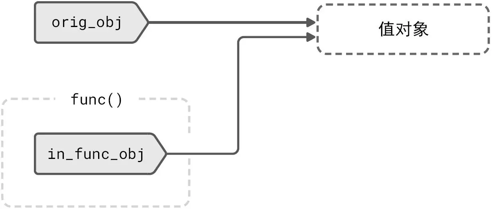
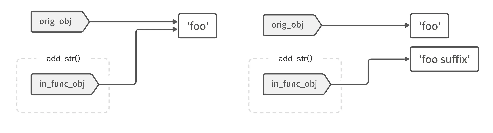
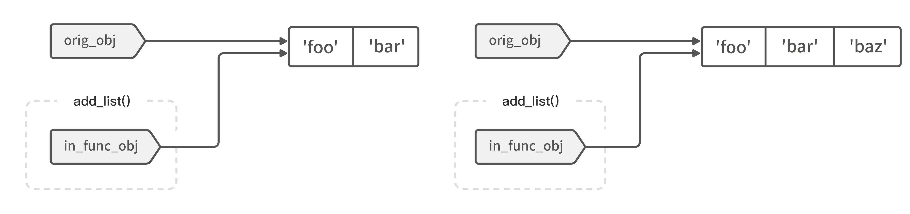

# 第3章容器类型(1)

## 第 3 章　容器类型

在我们的日常生活中，有一类物品比较特别，它们自身并不提供“具体”的功能，最大的用处就是存放其他东西——小学生用的文具盒、图书馆的书架，都可归入此类物品，我们可以统称它们为“容器”。

而在代码世界里，同样也有“容器”这个概念。代码里的容器泛指那些专门用来装其他对象的特殊数据类型。在 Python 中，最常见的内置容器类型有四种：列表、元组、字典、集合。

列表（list）是一种非常经典的容器类型，通常用来存放多个同类对象，比如从 1 到 10 的所有整数：

```
>>> numbers = [1, 2, 3, 4, 5, 6, 7, 8, 9, 10]
```

元组（tuple）和列表非常类似，但跟列表不同，它不能被修改。这意味着元组完成初始化后就没法再改动了：

```
>>> names = ('foo', 'bar')
>>> names[1] = 'x'
...
TypeError: 'tuple' object does not support item assignment
字典（dict）类型存放的是一个个键值对（key: value）。它功能强大，应用广泛，就连
Python 内部也大量使用，比如每个类实例的所有属性，就都存放在一个名为 dict 的字典
```

里：

```python
class Foo:
   def __init__(self, value):
       self.value = value
foo = Foo('bar')
print(foo.__dict__, type(foo.__dict__))
```

执行后输出：

```
{'value': 'bar'} <class 'dict'>
```

集合（set）也是一种常用的容器类型。它最大的特点是成员不能重复，所以经常用来去重（剔除重复元素）：

```
>>> numbers = [1, 2, 2, 1]
>>> set(numbers)
```

这四种容器类型各有优缺点，适用场景也各不相同。本章将简单介绍每种容器类型的特点，深入分析它们的应用场景，帮你厘清一些常见的概念。更好地掌握容器能帮助你写出更高效的Python 代码。

## 3.1　基础知识

在基础知识部分，我将按照列表、元组、字典、集合的顺序介绍每种容器的基本操作，并在其中穿插一些重要的概念解释。

### 3.1.1　列表常用操作

列表是一种有序的可变容器类型，是日常编程中最常用的类型之一。常用的列表创建方式有两

```
种：字面量语法与 list() 内置函数。
使用 [] 符号来创建一个列表字面量：
>>> numbers = [1, 2, 3, 4]
内置函数 list(iterable) 则可以把任何一个可迭代对象转换为列表，比如字符串：
>>> list('foo')
['f', 'o', 'o']
```

对于已有列表，我们可以通过索引访问它的成员。要删除列表中的某些内容，可以直接使用

```
del 语句：
# 通过索引获取内容，如果索引越界，会抛出 IndexError 异常
>>> numbers[2]
3
# 使用切片获取一段内容
>>> numbers[1:]
[2, 3, 4]
#  删除列表中的一段内容
>>> del numbers[1:]
>>> numbers
[1]
```

1. 在遍历列表时获取下标

```
当你使用 for 循环遍历列表时，默认会逐个拿到列表的所有成员。假如你想在遍历的同
```

- 1

```
时，获取当前循环下标，可以选择用内置函数 enumerate() 包裹列表对象
```

- ：

```
>>> names = ['foo', 'bar']
1
>>> for index, s in enumerate(names):
2
...     print(index, s)
3
...
4
0 foo
5
1 bar
6
enumerate() 接收一个可选的 start 参数，用于指定循环下标的初始值（默认为 0）：
>>> for index, s in enumerate(names, start=10):
1
...     print(index, s)
2
...
3
10 foo
4
11 bar
5
enumerate() 适用于任何“可迭代对象”，因此它不光可以用于列表，还可以用于元组、字
```

- 典、字符串等其他对象。


- 你可以在 6.1.1 节找到关于“可迭代对象”的更多介绍。

2. 列表推导式当我们需要处理某个列表时，一般有两个目的：修改已有成员的值；根据规则剔除某些成员。

- 举个例子，有个列表里存放了许多正整数，我想要剔除里面的奇数，并将所有数字乘以100。假如用传统写法，代码如下所示：

```python
def remove_odd_mul_100(numbers):
1
   """剔除奇数并乘以 100"""
2
   results = []
3
   for number in numbers:
4
       if number % 2 == 1:
5
           continue
6
       results.append(number * 100)
7
   return results
8
```

- 一共 6 行代码，看上去并不算太多。但其实针对这类需求，Python 为我们提供了更精简的写法：列表推导式（list comprehension）。使用列表推导式，上面函数里的 6 行代码可以压缩成一行：

```
# 用一个表达式完成 4 件事情
1
#
2
# 1. 遍历旧列表：for n in numbers
3
# 2. 对成员进行条件过滤：if n % 2 == 0
4
# 3. 修改成员： n * 100
5
# 4. 组装新的结果列表
6
#
7
results = [n * 100 for n in numbers if n % 2 == 0]
8
```

- 相比传统风格的旧代码，列表推导式把几类操作压缩在了一起，结果就是：代码量更少，并且维持了很高的可读性。因此，列表推导式可以算得上处理列表数据的一把“利器”。

- 但在使用列表推导式时，也需要注意不要陷入一些常见误区。在 3.3.6 节中，我会谈谈使用列表推导式的两个“不要”。

### 3.1.2　理解列表的可变性

Python 里的内置数据类型，大致上可分为可变与不可变两种。

- 可变（mutable）：列表、字典、集合。

- 不可变（immutable）：整数、浮点数、字符串、字节串、元组。

前面提到，列表是可变的。当我们初始化一个列表后，仍然可以调用

```
.append()、.extend() 等方法来修改它的内容。而字符串和整数等都是不可变的——我
```

们没法修改一个已经存在的字符串对象。

在学习 Python 时，理解类型的可变性是非常重要的一课。如果不能掌握它，你在写代码时就会遇到很多与之相关的“惊喜”。

拿一个最常见的场景“函数调用”来说，许多新手在刚接触 Python 时，很难理解下面这两个例子。

### 示例一：为字符串追加内容

```
在这个示例里，我们定义一个往字符串追加内容的函数 add_str()，并在外层用一个字符串
```

参数调用该函数：

```python
def add_str(in_func_obj):
   print(f'In add [before]: in_func_obj=""')
   in_func_obj += ' suffix'
   print(f'In add [after]: in_func_obj=""')
orig_obj = 'foo'
print(f'Outside [before]: orig_obj=""')
add_str(orig_obj)
print(f'Outside [after]: orig_obj=""')
```

运行上面的代码会输出这样的结果：

```
Outside [before]: orig_obj="foo"
In add [before]: in_func_obj="foo"
In add [after]: in_func_obj="foo suffix"
# 重要：这里的 orig_obj 变量还是原来的值
Outside [after]: orig obj="foo"
在这段代码里，原始字符串对象 orig_obj 被作为参数传给了 add_str() 函数的
in_func_obj 变量。随后函数内部通过 += 操作修改了 in_func_obj 的值，为其增加了后
缀字符串。但重点是：函数外的 orig_obj 变量所指向的值没有受到任何影响。
```

### 示例二：为列表追加内容

```python
在这个例子中，我们保留一模一样的代码逻辑，但是把 orig_obj 换成了列表对象：
def add_list(in_func_obj):
   print(f'In add [before]: in_func_obj=""')
   in_func_obj += ['baz']
   print(f'In add [after]: in_func_obj=""')
orig_obj = ['foo', 'bar']
print(f'Outside [before]: orig_obj=""')
add_list(orig_obj)
print(f'Outside [after]: orig_obj=""')
```

执行后会发现结果大不一样：

```
Outside [before]: orig_obj="['foo', 'bar']"
In add [before]: in_func_obj="['foo', 'bar']"
In add [after]: in_func_obj="['foo', 'bar', 'baz']"
# 注意：函数外的 orig_obj 变量的值已经被修改了！
Outside [after]: orig_obj="['foo', 'bar', 'baz']"
当操作对象变成列表后，函数内的 += 操作居然可以修改原始变量的值 !
```

### 示例解释

如果要用其他编程语言的术语来解释这两个例子，上面的函数调用似乎分别可以对应两种函数参数传递机制。

(1) 值传递（pass-by-value）：调用函数时，传过去的是变量所指向对象（值）的拷贝，因此

```
对函数内变量的任何修改，都不会影响原始变量——对应 orig_obj 是字符串时的行为。
```

(2) 引用传递（pass-by-reference）：调用函数时，传过去的是变量自身的引用（内存地址），

```
因此，修改函数内的变量会直接影响原始变量——对应 orig_obj 是列表时的行为。
```

看了上面的解释，你也许会发出灵魂拷问：为什么 Python 的函数调用要同时使用两套不同的机制，把事情搞得这么复杂呢？

答案其实没有你想得那么“复杂”——Python 在进行函数调用传参时，采用的既不是值传递，也不是引用传递，而是传递了“变量所指对象的引用”（pass-by-object-reference）。

```
换个角度说，当你调用 func(orig_obj) 后，Python 只是新建了一个函数内部变量
in_func_obj，然后让它和外部变量 orig_obj 指向同一个对象，相当于做了一次变量赋
```

值：

```python
def func(in_func_obj): ...
orig_obj = ...
func(orig_obj)
```

这个过程如图 3-1 所示。



- 图 3-1　进行函数调用后，变量与值对象间的关系示意图

```
一次函数调用基本等于执行了 in_func_obj = orig_obj。
所以，当我们在函数内部执行 in_func_obj += ... 等修改操作时，是否会影响外部变
量，只取决于 in_func_obj 所指向的对象本身是否可变。
如图 3-2 所示，浅色标签代表变量，白色方块代表值。在左侧的图里，in_func_obj 和
orig_obj 都指向同一个字符串值 'foo'。
```



```
图 3-2　对字符串对象执行 += 操作
在对字符串进行 += 操作时，因为字符串是不可变类型，所以程序会生成一个新对象
（值）：'foo suffix'，并让 in_func_obj 变量指向这个新对象；旧值（原始变量
orig_obj 指向的对象）则不受任何影响，如图 3-2 右侧所示。
但如果对象是可变的（比如列表），+= 操作就会直接原地修改 in_func_obj 变量所指向的
值，而它同时也是原始变量 orig_obj 所指向的内容；待修改完成后，两个变量所指向的值
```

（同一个）肯定就都受到了影响。如图 3-3 所示，右边的列表在操作后直接多了一个成

```
员：'bar'。
```



```
图 3-3　对列表对象执行 += 操作
```

由此可见，Python 的函数调用不能简单归类为“值传递”或者“引用传递”，一切行为取决于对象的可变性。

### 3.1.3　常用元组操作

```
元组是一种有序的不可变容器类型。它看起来和列表非常像，只是标识符从中括号 [] 变成了
圆括号 ()。由于元组不可变，所以它也没有列表那一堆内置方法，比如
.append()、.extend() 等。
和列表一样，元组也有两种常用的定义方式——字面量表达式和 tuple() 内置函数：
# 使用字面量语法定义元组
>>> t = (0, 1, 2)
# 真相：“括号”其实不是定义元组的关键标志——直接删掉两侧括号
# 同样也能完成定义，“逗号”才是让解释器判定为元组的关键
>>> t = 0, 1, 2
>>> t
(0, 1, 2)
# 使用 tuple(iterable) 内置函数
>>> t = tuple('foo')
>>> t
('f', 'o', 'o')
```

因为元组是一种不可变类型，所以下面这些操作都不会成功：

```
>>> del user_info[1]
# 报错：元组成员不允许被删除
#   TypeError: 'tuple' object doesn't support item deletion
>>> user_info.append(0)
# 报错：元组压根儿就没有 append 方法
#   AttributeError: 'tuple' object has no attribute 'append'
```

1. 返回多个结果，其实就是返回元组在 Python 中，函数可以一次返回多个结果，这其实是通过返回一个元组来实现的：

```python
def get_rectangle():
1
   """返回长方形的宽和高"""
2
   width = 100
3
   height = 20
4
   return width, height
5
6
7
# 获取函数的多个返回值
8
result = get_rectangle()
9
print(result, type(result))
10
# 输出：
11
# (100, 20) <class 'tuple'>
12
```

- 将函数返回值一次赋值给多个变量时，其实就是对元组做了一次解包操作：

```
width, height = get_rectangle()
1
# 可以理解为：width, height = (width, height)
2
```

2. 没有“元组推导式”前提到，列表有自己的列表推导式。而元组和列表那么像，是不是也有自己的推导式呢？瞎

```xml
猜不如尝试，我们把 [] 改成 () 符号来试试看：
>>> results = (n * 100 for n in range(10) if n % 2 == 0)
1
>>> results
2
<generator object <genexpr> at 0x10e94e2e0>
3
```

- 很遗憾，上面的表达式并没有生成元组，而是返回了一个生成器（generator）对象。因此它是生成器推导式，而非元组推导式。

- 不过幸运的是，虽然无法通过推导式直接拿到元组，但生成器仍然是一种可迭代类型，所以

```
我们还是可以对它调用 tuple() 函数，获得元组：
>>> results = tuple((n * 100 for n in range(10) if n % 2 == 0))
1
>>> results
2
(0, 200, 400, 600, 800)
3
```


- 有关生成器和迭代器的更多内容，可查看 6.1.1 节。

3. 存放结构化数据和列表不同，在同一个元组里出现不同类型的值是很常见的事情, 因此元组经常用来存放结

```
构化数据。比如，下面的 user_info 就是一份包含名称、年龄等信息的用户数据：
>>> user_info = ('piglei', 'MALE', 30, True)
1
>>> user_info[2]
2
30
3
```

- 正因为元组有这个特点，所以 Python 为我们提供了一个特殊的元组类型：具名元组。

### 3.1.4　具名元组

和列表一样，当我们想访问元组成员时，需要用数字索引来定位：

```
>>> rectangle = (100, 20)
>>> rectangle[0] ➊
100
>>> rectangle[-1] ➋
20
```

- ❶ 访问第一个成员❷ 访问最后一个成员

前面提到，元组经常用来存放结构化数据，但只能通过数字来访问元组成员其实特别不方便

```
——比如我就完全记不住上面的 rectangle[0] 到底代表长方形的宽度还是高度。
```

为了解决这个问题，我们可以使用一种特殊的元组：具名元组（namedtuple）。具名元组在保留普通元组功能的基础上，允许为元组的每个成员命名，这样你便能通过名称而不止是数字索引访问成员。

```
创建具名元组需要用到 namedtuple() 函数，它位于标准库的 collections 模块里，使用
```

前需要先导入：

```python
from collections import namedtuple
Rectangle = namedtuple('Rectangle', 'width,height') ➊
❶ 除了用逗号来分隔具名元组的字段名称以外，还可以用空格分隔：'width height'，
或是直接使用一个字符串列表：['width', 'height']
```

使用效果如下：

```
>>> rect = Rectangle(100, 20) ➊
>>> rect = Rectangle(width=100, height=20) ➋
>>> print(rect[0]) ➌
100
>>> print(rect.width) ➍
100
>>> rect.width += 1 ➎
...
AttributeError: can't set attribute
```

- ❶ 初始化具名元组❷ 也可以指定字段名称来初始化❸ 可以像普通元组一样，通过数字索引访问成员❹ 具名元组也支持通过名称来访问成员❺ 和普通元组一样，具名元组是不可变的

```
在 Python 3.6 版本以后，除了使用 namedtuple() 函数以外，你还可以用
typing.NamedTuple 和类型注解语法来定义具名元组类型。这种方式在可读性上更胜一
```

筹：

```python
class Rectangle(NamedTuple):
   width: int
   height: int
rect = Rectangle(100, 20)
但需要注意的是，上面的写法虽然给 width 和 height 加了类型注解，但 Python 在执行时
```

并不会做真正的类型校验。也就是说，下面这段代码也能正常执行：

```
# 提供错误的类型来初始化
rect_wrong_type = Rectangle('string', 'not_a_number')
```

想要严格校验字段类型，可以使用 mypy 等工具对代码进行静态检查（我们会在 13.1.5 节详细讲解）。

和普通元组比起来，使用具名元组的好处很多。其中最直观的一点就是：用名字访问成员

```
（rect.width）比用普通数字（rect[0]）更易读、更好记。除此之外，具名元组还有其
```

他妙用，在 3.3.7 节中，我会展示把它用作函数返回值的好处。

### 3.1.5　字典常用操作

跟列表和元组比起来，字典是一种更为复杂的容器结构。它所存储的内容不再是单一维度的线

```
性序列，而是多维度的 key: value 键值对。以下是字典的一些基本操作：
>>> movie = {'name': 'Burning', 'type': 'movie', 'year': 2018}
# 通过 key 来获取某个 value
>>> movie['year']
2018
# 字典是一种可变类型，所以可以给它增加新的 key
>>> movie['rating'] = 10
# 字典的 key 不可重复，对同一个 key 赋值会覆盖旧值
>>> movie['rating'] = 9
>>> movie
{'name': 'Burning', 'type': 'movie', 'year': 2018, 'rating': 9}
```

1. 遍历字典

```
当我们直接遍历一个字典对象时，会逐个拿到字典所有的 key。如果你想在遍历字典时同
时获取 key 和 value，需要使用字典的 .items() 方法：
# 遍历获取字典所有的 key
1
>>> for key in movie:
2
...     print(key, movie[key])
3
4
# 一次获取字典的所有 key: value 键值对
5
>>> for key, value in movie.items():
6
...
print(key, value)
7
```

2. 访问不存在的字典键

```
当用不存在的键访问字典内容时，程序会抛出 KeyError 异常，我们通常称之为程序里的
```

- 边界情况（edge case）。针对这种边界情况，比较常见的处理方式有两种：

- (1) 读取内容前先做一次条件判断，只有判断通过的情况下才继续执行其他操作；

```
(2) 直接操作，但是捕获 KeyError 异常。
```

- 第一种写法：

```
>>> if 'rating' in movie:
1
...     rating = movie['rating']
2
... else:
3
...     rating = 0
4
...
5
```

- 第二种写法：

```
>>> try:
1
...     rating = movie['rating']
2
... except KeyError:
3
...     rating = 0
4
...
5
```

- 在 Python 中，人们比较推崇第二种写法，因为它看起来更简洁，执行效率也更高。不过，

```
如果只是“提供默认值的读取操作”，其实可以直接使用字典的 .get() 方法。
```

- 在 5.1.1 节中，我们会详细探讨为何应该使用捕获异常来处理边界情况。

```
dict.get(key, default) 方法接收一个 default 参数，当访问的键不存在时，方法
会返回 default 作为默认值：
>>> movie.get('rating', 0) ➊
1
2
0
3
❶ 此时 movie 里没有 rating 字段
```

3. 使用 setdefault 取值并修改

```
有时，我们需要修改字典中某个可能不存在的键，比如在下面的代码里，我需要往字典 d
的 items 键里追加新值，但 d['items'] 可能根本就不存在。因此我写了一段异常捕获
逻辑——假如 d['items'] 不存在，就以列表来初始化它：
try:
1
   d['items'].append(value)
2
except KeyError:
3
   d['items'] = [value]
4
针对上面这种情况，其实有一个更适合的工具：d.setdefault(key, default=None)
```

- 方法。使用它，可以直接删掉上面的异常捕获，代码逻辑会变得更简单。

```
视条件的不同，调用 dict.setdefault(key, default) 会产生两种结果：当 key 不
存在时，该方法会把 default 值写入字典的 key 位置，并返回该值；假如 key 已经存
```

- 在，该方法就会直接返回它在字典中的对应值。代码如下：

```
>>> d = {'title': 'foobar'}
1
>>> d.setdefault('items', []).append('foo') ➊
2
>>> d
3
{'title': 'foobar', 'items': ['foo']}
4
>>> d.setdefault('items', []).append('bar') ➋
5
>>> d
6
{'title': 'foobar', 'items': ['foo', 'bar']}
7
❶ 若 key 不存在，以空列表 [] 初始化并返回
❷ 若 key 存在，直接返回旧值
```

4. 使用 pop 方法删除不存在的键

```
如果我们想删除字典里的某个键，一般会使用 del d[key] 语句；但如果要删除的键不存
在，该操作就会抛出 KeyError 异常。
```

- 因此，要想安全地删除某个键，需要加上一段异常捕获逻辑：

```
try:
1
   del d[key]
2
except KeyError:
3
   # 忽略 key 不存在的情况
4
   pass
5
```

- 但假设你只是单纯地想去掉某个键，并不关心它存在与否、删除有没有成功，那么使用

```
dict.pop(key, default) 方法就够了。
只要在调用 pop 方法时传入默认值 None，在键不存在的情况下也不会产生任何异常：
```

```
d.pop(key, None)
1
```

```
　严格说来，pop 方法的主要用途并不是删除某个键，而是取出这个键对应的值。
```

- 但我个人觉得，偶尔用它来执行删除操作也无伤大雅。

5. 字典推导式和列表类似，字典同样有自己的字典推导式。（比元组待遇好多啦！）你可以用它来方便地过滤和处理字典成员：

```
>>> d1 = {'foo': 3, 'bar': 4}
1
>>>
2
{'foo': 30}
3
```

### 3.1.6　认识字典的有序性与无序性

在 Python 3.6 版本以前，几乎所有开发者都遵从一条常识：“Python 的字典是无序的。”这里的无序指的是：当你按照某种顺序把内容存进字典后，就永远没法按照原顺序把它取出来了。

以下面这段代码为例：

```
>>> d = {}
>>> d['FIRST_KEY'] = 1
>>> d['SECOND_KEY'] = 2
>>> for key in d:
...     print(key)
```

如果用 Python 2.7 版本运行这段代码，你会发现输出顺序和插入顺序反过来了。第二个插入

```
的 SECOND_KEY 反而第一个被打印了出来：
SECOND_KEY
FIRST_KEY
```

上面这种无序现象，是由字典的底层实现所决定的。

```
Python 里的字典在底层使用了哈希表（hash table）数据结构。当你往字典里存放一对 key:
value 时，Python 会先通过哈希算法计算出 key 的哈希值——一个整型数字；然后根据这
```

个哈希值，决定数据在表里的具体位置。

因此，最初的内容插入顺序，在这个哈希过程中被自然丢掉了，字典里的内容顺序变得仅与哈希值相关，与写入顺序无关。在很长一段时间里，字典的这种无序性一直被当成一个常识为大家所接受。

但 Python 语言在不断进化。Python 3.6 为字典类型引入了一个改进：优化了底层实现，同样的字典相比 3.5 版本可节约多达 25% 的内存。而这个改进同时带来了一个有趣的副作用：字典变得有序了。因此，只要用 Python 3.6 之后的版本执行前面的代码，结果永远都会是

```
FIRST_KEY 在前，SECOND_KEY 在后。
```

一开始，字典变为有序只是作为 3.6 版本的“隐藏特性”存在。但到了 3.7 版本，它已经彻底成

- 2

了语言规范的一部分。

如今当你使用字典时，假如程序的目标运行环境是 Python 3.7 或更高版本，那你完全可以依赖字典类型的这种有序特性。

```
但如果你使用的 Python 版本没有那么新，也可以从 collections 模块里方便地拿到另一个
有序字典对象 OrderedDict，它可以在 Python 3.7 以前的版本里保证字典有序：
>>> from collections import OrderedDict
>>> d = OrderedDict()
>>> d['FIRST_KEY'] = 1
>>> d['SECOND_KEY'] = 2
>>> for key in d:
...     print(key)
FIRST_KEY
SECOND_KEY
OrderedDict 最初出现于 2009 年发布的 Python 3.1 版本，距今已有十多年历史。因为新版
本的 Python 的字典已然变得有序，所以人们常常讨论 collections.OrderedDict 是否有
```

必要继续存在。

```
但在我看来，OrderedDict 比起普通字典仍然有一些优势。最直接的一点是，
OrderedDict 把“有序”放在了自己的名字里，因此当你在代码中使用它时，其实比普通字典
```

更清晰地表达了“此处会依赖字典的有序特性”这一点。

```
另外从功能上来说，OrderedDict 与新版本的字典其实也有着一些细微区别。比如，在对比
两个内容相同而顺序不同的字典对象时，解释器会返回 True 结果；但如果是 OrderedDict
对象，则会返回 False：
>>> d1 = {'name': 'piglei', 'fruit': 'apple'}
>>> d2 = {'fruit': 'apple', 'name': 'piglei'}
>>> d1 == d2 ➊
True
>>> d1 = OrderedDict(name='piglei', fruit='apple')
>>> d2 = OrderedDict(fruit='apple', name='piglei')
>>> d1 == d2 ➋
False
```

- ❶ 内容一致而顺序不同的字典被视作相等，因为解释器只对比字典的键和值是否一致

```
❷ 同样的 OrderedDict 则被视作不相等，因为“键的顺序”也会作为对比条件
除此之外，OrderedDict 还有 .move_to_end() 等普通字典没有的一些方法。所以，即便
Python 3.7 及之后的版本已经提供了内置的“有序字典”，但 OrderedDict 仍然有着自己的一
```

席之地。

### 3.1.7　集合常用操作

集合是一种无序的可变容器类型，它最大的特点就是成员不能重复。集合字面量的语法和字典很像，都是使用大括号包裹，但集合里装的是一维的值 ，而不是键值对 。

初始化一个集合：

```
>>> fruits = {'apple', 'orange', 'apple', 'pineapple'}
重新查看上面 fruits 变量的值，你会马上体会到集合最重要的两个特征——去重与无序
——重复的 'apple' 消失了，成员顺序也被打乱了：
>>> fruits
{'pineapple', 'orange', 'apple'}
要初始化一个空集合，只能调用 set() 方法，因为 {} 表示的是一个空字典，而不是一个空
```

集合。

```
# 正确初始化一个空集合
>>> empty_set = set()
```

集合也有自己的推导式语法：

```
>>> nums = [1, 2, 2, 4, 1]
>>>
```

1. 不可变的集合 frozenset

```
集合是一种可变类型，使用 .add() 方法可以向集合追加新成员：
>>> new_set = set(['foo', 'foo', 'bar'])
1
>>> new_set.add('apple')
2
>>> new_set
3
{'apple', 'bar', 'foo'}
4
假如你想要一个不可变的集合，可使用内置类型 frozenset，它和普通 set 非常像，只
```

- 是少了所有的修改类方法：

```
>>> f_set = frozenset(['foo', 'bar'])
1
>>> f_set.add('apple')
2
# 报错：没有 add/remove 那些修改集合的方法
3
AttributeError: 'frozenset' object has no attribute 'add'
4
```

2. 集合运算除了天生不重复以外，集合的最大独特之处在于：你可以对其进行真正的集合运算，比如求交集、并集、差集，等等。所有操作都可以用两种方式来进行：方法和运算符。

- 假如我有两个保存了水果名称的集合：

```
>>> fruits_1 = {'apple', 'orange', 'pineapple'}
1
>>> fruits_2 = {'tomato', 'orange', 'grapes', 'mango'}
2
```

- 对两个集合求交集，也就是获取两个集合中同时存在的东西：

```
# 使用 & 运算符
1
>>> fruits_1 & fruits_2
2
{'orange'}
3
# 使用 intersection 方法完成同样的功能
4
>>> fruits_1.intersection(fruits_2)
5
...
6
```

- 对集合求并集，把两个集合里的东西合起来：

```
# 使用 | 运算符
1
>>> fruits_1 | fruits_2
2
{'mango', 'orange', 'grapes', 'pineapple', 'apple', 'tomato'}
3
# 使用 union 方法完成同样的功能
4
>>> fruits_1.union(fruits_2)
5
...
6
```

- 对集合求差集，获得前一个集合有、后一个集合没有的东西：

```
# 使用 - 运算符
1
>>> fruits_1 - fruits_2
2
{'apple', 'pineapple'}
3
# 使用 difference 方法完成同样的功能
4
>>> fruits_1.difference(fruits_2)
5
...
6
除了上面这三种运算，集合还有 symmetric_difference、issubset 等其他许多有用
```

- 的操作，你可以在官方文档里找到详细的说明。

- 这些集合运算在特定场景下非常有用，能帮你高效完成任务，达到事半功倍的效果。第 12 章的案例故事板块就有一个使用集合解决真实问题的有趣案例。

3. 集合只能存放可哈希对象在使用集合时，除了上面这些常见操作，你还需要了解另一件重要的事情，那就是集合到底可以存放哪些类型的数据。

- 比如下面的集合可以被成功初始化：

```
>>> valid_set = {'apple', 30, 1.3, ('foo',)}
1
```

- 但这个集合就不行：

```
>>> invalid_set = {'foo', [1, 2, 3]}
1
...
2
TypeError: unhashable type: 'list'
3
```

- 正如上面的报错信息所示，集合里只能存放“可哈希”（hashable）的对象。假如把不可哈希

```
的对象（比如上面的列表）放入集合，程序就会抛出 TypeError 异常。
```

- 在使用集合时，可哈希性是个非常重要的概念，下面我们来看看什么决定了对象的可哈希性。

### 3.1.8　了解对象的可哈希性

在介绍字典类型时，我们说过字典底层使用了哈希表数据结构，其实集合也一样。当我们把某个对象放进集合或者作为字典的键使用时，解释器都需要对该对象进行一次哈希运算，得到哈希值，然后再进行后面的操作。

```
这个计算哈希值的过程，是通过调用内置函数 hash(obj) 完成的。如果对象是可哈希的，
hash 函数会返回一个整型结果，否则将会报 TypeError 错误。
```

因此，要把某个对象放进集合，那它就必须是“可哈希”的。话说到这里，到底哪些类型是可哈希的？哪些又是不可哈希的呢？我们来试试看。

首先，那些不可变的内置类型都是可哈希的：

```
>>> hash('string')
-3407286361374970639
>>> hash(100)
# 有趣的事情，整型的 hash 值就是它自身的值
100
>>> hash((1, 2, 3))
529344067295497451
```

而可变的内置类型都无法正常计算哈希值：

```
>>> hash({'key': 'value'})
TypeError: unhashable type: 'dict'
>>> hash([1, 2, 3])
TypeError: unhashable type: 'list'
```

可变类型的不可哈希特点有一定的“传染性”。比如在一个原本可哈希的元组里放入可变的列表对象后，它也会马上变得不可哈希：

```
>>> hash((1, 2, 3, ['foo', 'bar']))
TypeError: unhashable type: 'list'
```

由用户定义的所有对象默认都是可哈希的：

```
>>> class Foo:
...     pass
...
>>> foo = Foo()
>>> hash(foo)
273594269
```

总结一下，某种类型是否可哈希遵循下面的规则：

```
(1) 所有的不可变内置类型，都是可哈希的，比如 str、int、tuple、frozenset 等；
(2) 所有的可变内置类型，都是不可哈希的，比如 dict、list 等；
(3) 对于不可变容器类型 (tuple, frozenset)，仅当它的所有成员都不可变时，它自身才
```

是可哈希的；

(4) 用户定义的类型默认都是可哈希的。

谨记，只有可哈希的对象，才能放进集合或作为字典的键使用。

- 在 12.2 节中，你可以读到一个深度使用可哈希概念的案例故事。

### 3.1.9　深拷贝与浅拷贝

在 3.1.2 节中，我们学习了对象的可变性概念，并看到了可变性如何影响代码的行为。在操作这些可变对象时，如果不拷贝原始对象就修改，可能会产生我们并不期待的结果。

```
比如在下面的代码里，nums 和 nums_copy 两个变量就指向了同一个列表，修改 nums 的同
时会影响 nums_copy：
>>> nums = [1, 2, 3, 4]
>>> nums_copy = nums
>>> nums[2] = 30
>>> nums_copy ➊
[1, 2, 30, 4]
❶ nums_copy 的内容也发生了变化
```

假如我们想让两个变量的修改操作互不影响，就需要拷贝变量所指向的可变对象，做到让不同变量指向不同对象。按拷贝的深度，常用的拷贝操作可分为两种：浅拷贝与深拷贝。

1. 浅拷贝

```
要进行浅拷贝，最通用的办法是使用 copy 模块下的 copy() 方法：
>>> import copy
1
>>> nums_copy = copy.copy(nums)
2
>>> nums[2] = 30
3
4
# 修改不再相互影响
5
>>> nums, nums_copy
6
([1, 2, 30, 4], [1, 2, 3, 4])
7
除了使用 copy() 函数外，对于那些支持推导式的类型，用推导式也可以产生一个浅拷贝
```

- 对象：

```
>>> d = {'foo': 1}
1
>>> d2 =
2
>>> d['foo'] = 2
3
>>> d, d2
4
({'foo': 2}, {'foo': 1})
5
```

- 使用各容器类型的内置构造函数，同样能实现浅拷贝效果：

```
>>> d2 = dict(d.items()) ➊
1
>>> nums_copy = list(nums) ➋
2
❶ 以字典 d 的内容构建一个新字典
❷ 以列表 nums 的成员构建一个新列表
```

- 对于支持切片操作的容器类型——比如列表、元组，对其进行全切片也可以实现浅拷贝效果：

```
# nums_copy 会变成 nums 的浅拷贝
1
>>> nums_copy = nums[:]
2
```

- 除了上面这些办法，有些类型自身就提供了浅拷贝方法，可以直接使用：

```
# 列表有 copy 方法
1
>>> num = [1, 2, 3, 4]
2
>>> nums.copy()
3
[1, 2, 3, 4]
4
5
# 字典也有 copy 方法
6
>>> d = {'foo': 'bar'}
7
>>> d.copy()
8
{'foo': 'bar'}
9
```

2. 深拷贝大部分情况下，上面的浅拷贝操作足以满足我们对可变类型的复制需求。但对于一些层层嵌套的复杂数据来说，浅拷贝仍然无法解决嵌套对象被修改的问题。

```
比如，下面的 items 是一个嵌套了子列表的多级列表：
>>> items = [1, ['foo', 'bar'], 2, 3]
1
如果只是使用 copy.copy() 对 items 进行浅拷贝，你会发现它并不能做到完全隔离两个
```

- 变量：

```
>>> import copy
1
>>> items_copy = copy.copy(items)
2
>>> items[0] = 100 ➊
3
>>> items[1].append('xxx') ➋
4
>>> items
5
[100, ['foo', 'bar', 'xxx'], 2, 3]
6
>>> items_copy ➌
7
[1, ['foo', 'bar', 'xxx'], 2, 3]
8
❶ 修改 items 的第一层成员
❷ 修改 items 的第二层成员，往子列表内追加元素
❸ 对 items[1] 的第一层修改没有影响浅拷贝对象，items_copy[0] 仍然是 1，但
对嵌套子列表 items[1] 的修改已经影响了 items_copy[1] 的值，列表内多出了
'xxx'
之所以会出现这样的结果，是因为即便对 items 做了浅拷贝，items[1] 和
items_copy[1] 指向的仍旧是同一个列表。如果使用 id() 函数查看它们的对象 ID，会
```

- 发现它们其实是同一个对象：

```
>>> id(items[1]), id(items_copy[1])
1
(4467751104, 4467751104)
2
要解决这个问题，可以用 copy.deepcopy() 函数来进行深拷贝操作：
>>> items_deep = copy.deepcopy(items)
1
深拷贝会遍历并拷贝 items 里的所有内容——包括它所嵌套的子列表。做完深拷贝后，
items 和 items_deep 的子列表不再是同一个对象，它们的修改操作自然也不会再相互
```

- 影响：

```
>>> id(items[1]), id(items_deep[1]) ➊
1
(4467751104, 4467286400)
2
```

- ❶ 子列表的对象 ID 不再一致

## 3.2　案例故事

虽然 Python 已经内置了不少强大的容器类型，但在这些内置容器的基础上，我们还能方便地创造新的容器类型，设计更好用的自定义数据结构。

在下面这个案例故事里，“我”就来设计一个自定义字典类型，利用它重构一段数据分析脚本。

### 分析网站访问日志

几个月前，我开始利用业余时间开发一个 Python 资讯类网站 PyNews，上面汇集了许多Python 相关的精品技术文章，用户可以免费浏览这些文章，学习最新的 Python 技术。

上周六，我把 PyNews 部署到了线上。令我没想到的是，这个小网站居然特别受欢迎，在没怎么宣传的情况下，日访问量节节攀升，一周以后，每日浏览人数居然已经突破了 1000。

但随着用户访问量的增加，越来越多的用户开始向我抱怨：“网站访问速度太慢了！”我心想：“这不行啊，访问速度这么慢，用户不就全跑了嘛！”于是，我决定马上开始优化 PyNews 的访问速度。

要优化性能，第一步永远是找到性能瓶颈。刚好，我把网站所有页面的访问耗时都记录在了一个访问日志里。因此，我准备先分析访问日志，看看究竟是哪些页面在“拖后腿”。

访问日志文件格式如下：

```
# 格式：请求路径 请求耗时（毫秒）
/articles/three-tips-on-writing-file-related-codes/ 120
/articles/15-thinking-in-edge-cases/ 400
/admin/ 3275
...
```

日志里记录了每次请求的路径与耗时。基于这些日志，我决定先写一个访问分析脚本，把请求数据按路径分组，然后再依据耗时将其划为不同的性能等级，从而找到迫切需要优化的页面。

基于我的设计，响应时间被分为四个性能等级。

(1) 非常快：小于 100 毫秒。

(2) 较快：100 到 300 毫秒之间。

(3) 较慢：300 毫秒到 1 秒之间。

(4) 慢：大于 1 秒。

理想的解析结果如下所示：

```
---
== Path: /articles/three-tips-on-writing-file-related-codes/
  Total requests: 828
  Performance:
    - Less than 100 ms: 16
    - Between 100 and 300 ms: 35
    - Between 300 ms and 1 s: 119
    - Greater than 1 s: 696
== Path: /
...
---
```

脚本会按分组输出请求路径、总请求数以及各性能等级请求数。

因为原始日志格式很简单，非常容易解析，所以我很快就写完了整个脚本，如代码清单 3-1 所示。

- 代码清单 3-1　日志分析脚本 analyzer_v1.py

```python
from enum import Enum
class PagePerfLevel(str, Enum):
   LT_100 = 'Less than 100 ms'
   LT_300 = 'Between 100 and 300 ms'
   LT_1000 = 'Between 300 ms and 1 s'
   GT_1000 = 'Greater than 1 s'
def analyze_v1():
   path_groups = {}
   with open("logs.txt", "r") as fp:
       for line in fp:
           path, time_cost_str = line.strip().split()
           # 根据页面耗时计算性能等级
           time_cost = int(time_cost_str)
           if time_cost < 100:
               level = PagePerfLevel.LT_100
           elif time_cost < 300:
               level = PagePerfLevel.LT_300
           elif time_cost < 1000:
               level = PagePerfLevel.LT_1000
           else:
               level = PagePerfLevel.GT_1000
           # 如果路径第一次出现，存入初始值
           if path not in path_groups:
               path_groups[path] = {}
           # 如果性能 level 第一次出现，存入初始值 1
           try:
               path_groups[path][level] += 1
           except KeyError:
               path_groups[path][level] = 1
   for path, result in path_groups.items():
       print(f'== Path: ')
       total = sum(result.values())
       print(f'   Total requests: ')
       print(f'   Performance:')
       # 在输出结果前，按照“性能等级”在 PagePerfLevel 里面的顺序排列，小于 100 毫秒
       # 的在最前面
       sorted_items = sorted(
           result.items(), key=lambda pair: list(PagePerfLevel).index(pair[0])
       )
       for level_name, count in sorted_items:
           print(f'     - : ')
if __name__ == "__main__":
   analyze_v1()
在上面的代码里，我首先在最外层定义了枚举类型 PagePerfLevel，用于表示不同的请求
性能等级，随后在 analyze_v1() 内实现了所有的主逻辑。其中的关键步骤有：
(1) 遍历整个日志文件，逐行解析请求路径（path）与耗时（time_cost）；
```

(2) 根据耗时计算请求属于哪个性能等级；

```
(3) 判断请求路径是否初次出现，如果是，以子字典初始化 path_groups 里的对应值；
(4) 对子字典的对应性能等级 key，执行请求数加 1 操作。
```

经以上步骤完成数据统计后，在输出每组路径的结果时，函数不能直接遍历

```
result.items()，而是要先参照 PagePerfLevel 枚举类按性能等级排好序，然后再输
```

出。

在线上测试试用这个脚本后，我发现它可以正常分析请求、输出性能分组信息，达到了我的预期。

不过，虽然脚本功能正常，但我总觉得它的代码写得不太好。一个最直观的感受是：

```
analyze_v1() 函数里的逻辑特别复杂，耗时转级别、请求数累加的逻辑，全都被糅在了一
```

块，整个函数读起来很困难。

```
另一个问题是，代码里分布着太多零碎的字典操作，比如 if path not in
path_groups、try: ... except KeyError:，等等，看上去非常不利落。
```

于是我决定花点儿时间重构一下这份脚本，解决上述两个问题。

1. 使用 defaultdict 类型在上面的代码里，有两种字典操作看上去有点儿像：

```
# 1
1
# 如果路径第一次出现，存入初始值
2
if path not in path_groups:
3
   path_groups[path] = {}
4
5
# 2
6
# 如果性能 level 第一次出现，存入初始值 1
7
try:
8
   path_groups[path][level] += 1
9
except KeyError:
10
   path_groups[path][level] = 1
11
当 path 和 level 变量作为字典的 key 第一次出现时，为了正常处理它们，代码同时用
了两种操作：先判断后初始化；直接操作并捕获 KeyError 异常。我们在 3.1.5 节学过，
除了这么操作，其实还可以使用字典的 .get() 和 .setdefault() 方法来简化代码。
但在这个场景下，内置模块 collections 里的 defaultdict 类型才是最好的选择。
defaultdict(default_factory, ...) 是一种特殊的字典类型。它在被初始化时，
接收一个可调用对象 default_factory 作为参数。之后每次进行 d[key] 操作时，如果
访问的 key 不存在，defaultdict 对象会自动调用 default_factory() 并将结果作
为值保存在对应的 key 里。
为了更好地理解 defaultdict 的特点，我们来做个小实验。首先初始化一个空
defaultdict 对象：
>>> from collections import defaultdict
1
>>> int_dict = defaultdict(int)
2
然后直接对一个不存在的 key 执行累加操作。普通字典在执行这个操作时，会抛出
KeyError 异常，但 defaultdict 不会：
>>> int_dict['foo'] += 1
1
当 int_dict 发现键 'foo' 不存在时，它会调用 default_factory——也就是 int()
——拿到结果 0，将其保存到字典后再执行累加操作：
>>> int_dict
1
defaultdict(<class 'int'>, {'foo': 1})
2
>>> dict(int_dict)
3
{'foo': 1}
4
通过引入 defaultdict 类型，代码的两处初始化逻辑都变得更简单了。
接下来，我们需要解决 analyze_v1() 函数内部逻辑过于杂乱的问题。
```

2. 使用 MutableMapping 创建自定义字典类型

```
在前面的函数里，有一段核心的字典操作代码：先通过 time_cost 计算出 level，然后
以 level 为键将请求数保存到字典中。这段代码的逻辑比较独立，假如把它从函数中抽离
```

- 出来，代码会变得更好理解。

- 此时就该自定义字典类型闪亮登场了。自定义字典和普通字典很像，但它可以给字典的默认行为加上一些变化。比如在这个场景下，我们会让字典在操作“响应耗时”键时，直接将其翻译成对应的性能等级。

```
在 Python 中定义一个字典类型，可通过继承 MutableMapping 抽象类来实现，如代码清
```

- 单 3-2 所示。

- 代码清单 3-2　用于存储响应时间的自定义字典

```python
from collections.abc import MutableMapping
1
2
3
class PerfLevelDict(MutableMapping):
4
   """存储响应时间性能等级的字典"""
5
6
   def __init__(self):
7
       self.data = defaultdict(int)
8
9
   def __getitem__(self, key):
10
       """当某个级别不存在时，默认返回 0"""
11
       return self.data[self.compute_level(key)]
12
13
   def __setitem__(self, key, value):
14
       """将 key 转换为对应的性能等级，然后设置值"""
15
       self.data[self.compute_level(key)] = value
16
17
   def __delitem__(self, key):
18
       del self.data[key]
19
20
   def __iter__(self):
21
       return iter(self.data)
22
23
   def __len__(self):
24
       return len(self.data)
25
26
   @staticmethod
27
   def compute_level(time_cost_str):
28
       """根据响应时间计算性能等级"""
29
       # 假如已经是性能等级，不做转换直接返回
30
       if time_cost_str in list(PagePerfLevel):
31
           return time_cost_str
32
33
       time_cost = int(time_cost_str)
34
       if time_cost < 100:
35
           return PagePerfLevel.LT_100
36
       elif time_cost < 300:
37
           return PagePerfLevel.LT_300
38
       elif time_cost < 1000:
39
           return PagePerfLevel.LT_1000
40
       return PagePerfLevel.GT_1000
41
在上面的代码中，我编写了一个继承了 MutableMapping 的字典类 PerfLevelDict。
但光继承还不够，要让这个类变得像字典一样，还需要重写包括 __getitem__、
__setitem__ 在内的 6 个魔法方法。
```

- 其中最重要的几点简单说明如下：

```
在 __init__ 初始化方法里，使用 defaultdict(int) 对象来简化字典的空值初始化
```

- 操作；

```
__getitem__ 方法定义了 d[key] 取值操作时的行为；
__setitem__ 方法定义了 d[key] = value 赋值操作时的行为；
PerfLevelDict 的 __getitem__/__setitem__ 方法和普通字典的最大不同，在于
操作前调用了 compute_level()，将字典键转成了性能等级。
我们来试用一下 PerfLevelDict 类：
```

```
>>> d = PerfLevelDict()
1
>>> d[50] += 1
2
>>> d[403] += 12
3
>>> d[30] += 2
4
>>> dict(d)
5
{<PagePerfLevel.LT_100: 'Less than 100 ms'>: 3, <PagePerfLevel.LT_1000: 'Betwee
6
有了 PerfLevelDict 类以后，我们不需要再去手动做“耗时→级别”转换了，一切都可以
```

- 由自定义字典的内部逻辑处理好。

- 创建自定义字典类还带来了一个额外的好处。在之前的代码里，有许多有关字典的零碎操

```
作，比如求和、对 .items() 排序等，现在它们全都可以封装到 PerfLevelDict 类里，
```

- 代码逻辑不再是东一块、西一块，而是全部由一个数据类搞定。

3. 代码重构

```
使用 defaultdict 和自定义字典类以后，代码最终优化成了代码清单 3-3 所示的样子。
```

- 代码清单 3-3　重构后的日志分析脚本 analyzer_v2.py

```python
from enum import Enum
1
from collections import defaultdict
2
from collections.abc import MutableMapping
3
4
5
class PagePerfLevel(str, Enum):
6
   LT_100 = 'Less than 100 ms'
7
   LT_300 = 'Between 100 and 300 ms'
8
   LT_1000 = 'Between 300 ms and 1 s'
9
   GT_1000 = 'Greater than 1 s'
10
11
12
class PerfLevelDict(MutableMapping):
13
   """存储响应时间性能等级的字典"""
14
15
   def __init__(self):
16
       self.data = defaultdict(int)
17
18
   def __getitem__(self, key):
19
       """当某个性能等级不存在时，默认返回 0"""
20
       return self.data[self.compute_level(key)]
21
22
   def __setitem__(self, key, value):
23
       """将 key 转换为对应的性能等级，然后设置值"""
24
       self.data[self.compute_level(key)] = value
25
26
   def __delitem__(self, key):
27
       del self.data[key]
28
29
   def __iter__(self):
30
       return iter(self.data)
31
32
   def __len__(self):
33
       return len(self.data)
34
35
   def items(self):
36
       """按照顺序返回性能等级数据"""
37
       return sorted(
38
           self.data.items(),
39
           key=lambda pair: list(PagePerfLevel).index(pair[0]),
40
       )
41
42
   def total_requests(self):
43
       """返回总请求数"""
44
       return sum(self.values())
45
46
   @staticmethod
47
   def compute_level(time_cost_str):
48
       """根据响应时间计算性能等级"""
49
       if time_cost_str in list(PagePerfLevel):
50
           return time_cost_str
51
52
       time_cost = int(time_cost_str)
53
       if time_cost < 100:
54
           return PagePerfLevel.LT_100
55
       elif time_cost < 300:
56
           return PagePerfLevel.LT_300
57
       elif time_cost < 1000:
58
           return PagePerfLevel.LT_1000
59
       return PagePerfLevel.GT_1000
60
61
def analyze_v2():
62
   path_groups = defaultdict(PerfLevelDict)
63
   with open("logs.txt", "r") as fp:
64
       for line in fp:
65
           path, time_cost = line.strip().split()
66
           path_groups[path][time_cost] += 1
67
68
   for path, result in path_groups.items():
69
       print(f'== Path: ')
70
       print(f'   Total requests: ')
71
       print(f'   Performance:')
72
       for level_name, count in result.items():
73
           print(f'     - : ')
74
75
76
if __name__ == '__main__':
77
   analyze_v2()
78
阅读这段新代码，你可以明显感受到 analyze_v2() 函数相比之前的变化非常大。有了自
定义字典 PerfLevelDict 的帮助，analyze_v2() 函数的整个逻辑变得非常清晰、非
常容易理解——它只负责解析日志与打印结果，其他统计逻辑都交由 PerfLevelDict 负
```

- 责。

- 为何不直接继承 dict？

```
在实现自定义字典时，我让 PerfLevelDict 继承了 collections.abc 下的
MutableMapping 抽象类，而不是内置字典 dict。这看起来有点儿奇怪，因为从直觉
```

- 上说，假如你想实现某个自定义类型，最方便的选择就是继承原类型。

```sql
但是，如果真的继承 dict 来创建自定义字典类型，你会碰到很多问题。
拿一个最常见的场景来说，假如你继承了 dict，通过 __setitem__ 方法重写了它的
键赋值操作。此时，虽然常规的 d[key] = value 行为会被重写；但假如调用方使用
d.update(...) 来更新字典内容，就根本不会触发重写后的键赋值逻辑。这最终会导
```

- 致自定义类型的行为不一致。

```sql
举个简单的例子，下面的 UpperDict 是继承了 dict 的自定义字典类型：
class UpperDict(dict):
1
   """总是把 key 转为大写"""
2
3
   def __setitem__(self, key, value):
4
       super().__setitem__(key.upper(), value)
5
试着使用 UpperDict：
>>> d = UpperDict()
1
>>> d['foo'] = 1  ➊
2
>>> d
3
{'FOO': 1}
4
>>> d.update({'bar': 2})  ➋
5
>>> d
6
{'FOO': 1, 'bar': 2}
7
```

- ➊ 直接对字典键赋值，触发了大写转换逻辑

```sql
➋ 调用 .update(...) 方法并不会触发任何自定义逻辑
正因如此，如果你想创建一个自定义字典，继承 collections.abc 下的
MutableMapping 抽象类是个更好的选择，因为它没有上面的问题。而对于列表等其他
```

- 容器类型来说，这条规则也同样适用。有关这个话题，你可以阅读 Trey Hunner 的文章“The problem with inheriting from dictand list in Python”了解详情。

[1]：我把 称作“函数”（function）其实并不准确。因为 实际上是一个“类”（class），而不是普通函数，但为了简化理解，我们暂且叫

- 它“函数”吧。

[2]：在 Python 3.7 版本的更新公告中有一行说明：the insertion-order preservation nature of dict objects has been declared to be

- an official part of the Python language spec。
