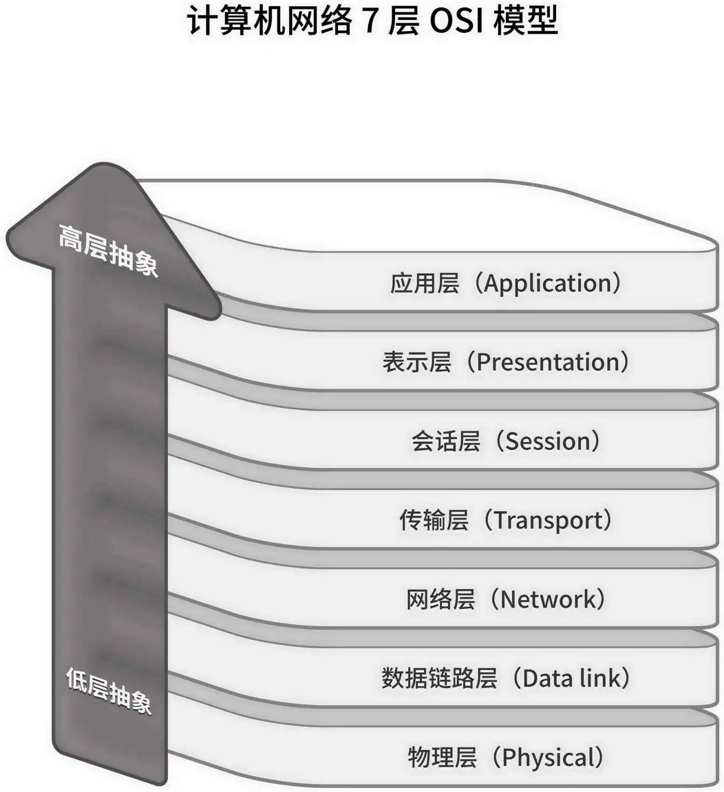
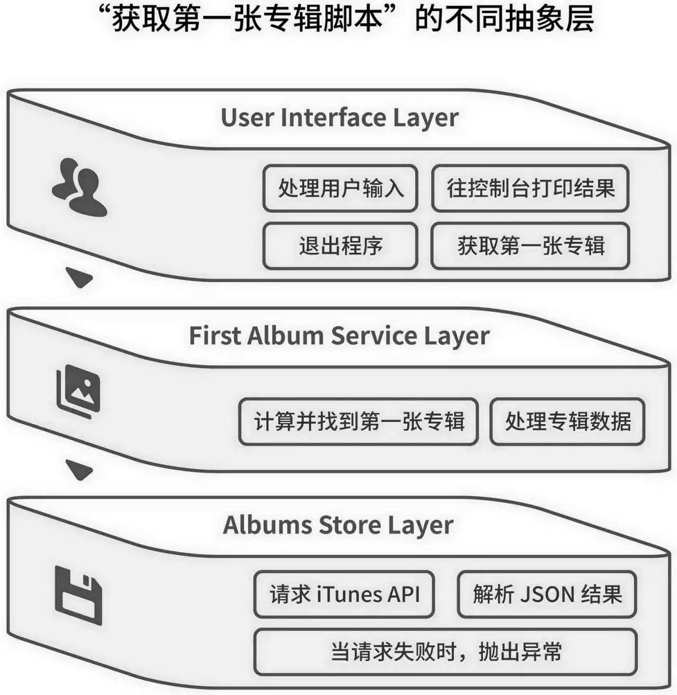

# 第7章函数(2)

## 7.3　编程建议

### 7.3.1　别写太复杂的函数

你有没有在项目中见过那种长达几百行、逻辑错综复杂的“巨无霸”函数？那样的函数不光难读，改起来同样困难重重，人人唯恐避之不及。所以，我认为编写函数最重要的原则就是：别写太复杂的函数。

为了避免写出太复杂的函数，第一个要回答的问题是：什么样的函数才能算是过于复杂？我一般会通过两个标准来判断。

1. 长度第一个标准是长度，也就是函数有多少行代码。

- 诚然，我们不能武断地说，长函数就一定比短函数复杂。因为在不同的编程风格下，相同行数的代码所实现的功能可以有巨大差别，有人甚至能把一个完整的俄罗斯方块游戏塞进一行代码内。

- 但即便如此，长度对于判断函数复杂度来说仍然有巨大价值。在著作《代码大全（第 2版）》中，Steve McConnell 提到函数的理想长度范围是 65 到 200 行，一旦超过 200 行，代码出现 bug 的概率就会显著增加。

- 从我自身的经验来看，对于 Python 这种强表现力的语言来说，65 行已经非常值得警惕了。假如你的函数超过 65 行，很大概率代表函数已经过于复杂，承担了太多职责，请考虑将它拆分为多个小而简单的子函数（类）吧。

2. 圈复杂度第二个标准是“圈复杂度”（cyclomatic complexity）。

- “圈复杂度”是由 Thomas J. McCabe 在 1976 年提出的用于评估函数复杂度的指标。它的值是一个正整数，代表程序内线性独立路径的数量。圈复杂度的值越大，表示程序可能的执行路径就越多，逻辑就越复杂。

- 如果某个函数的圈复杂度超过 10，就代表它已经太复杂了，代码编写者应该想办法简化。优化写法或者拆分成子函数都是不错的选择。

- 接下来，我们通过实际代码来体验一下圈复杂度的计算过程。

- 在 Python 中，你可以通过 radon 工具计算一个函数的圈复杂度。radon 基于 Python 编

```
写，使用 pip install radon 即可完成安装。
```

- 安装完成后，接下来就是找到一份需要计算圈复杂度的代码。在这里，我将使用第 4 章案例里的“按照电影分数计算评级”的函数：

```python
def rank(self):
1
   rating_num = float(self.rating)
2
   if rating_num >= 8.5:
3
       return 'S'
4
   elif rating_num >= 8:
5
       return 'A'
6
   elif rating_num >= 7:
7
       return 'B'
8
   elif rating_num >= 6:
9
       return 'C'
10
   else:
11
       return 'D'
12
执行 radon 命令，就可以查看上面这个函数的圈复杂度：
> radon cc complex_func.py -s
1
complex_func.py
2
   F 1:0 rank - A (5)
3
可以看到，有着大段 if/elif 的 rank() 函数的圈复杂度为 5，评级为 A。虽然这个值没
```

- 有达到危险线 10，但考虑到函数只有短短 10 行，5 已经足够引起重视了。

```python
作为对比，我们再计算一下案例中使用 bisect 模块重构后的 rank() 函数：
def rank(self):
1
   breakpoints = (6, 7, 8, 8.5)
2
   grades = ('D', 'C', 'B', 'A', 'S')
3
   index = bisect.bisect(breakpoints, float(self.rating))
4
   return grades[index]
5
```

- 重构后函数的圈复杂度如下：

```
radon cc complex_func.py -s
1
complex_func.py
2
   F 1:0 rank - A (1)
3
```

- 可以看到，新函数的圈复杂度从 5 降至 1。1 是一个非常理想化的值，如果一个函数的圈复杂度为 1，就代表这个函数只有一条主路径，没有任何其他执行路径，这样的函数通常来说都十分简单、容易维护。

- 当然，在正常的项目开发流程中，我们一般不会在每次写完代码后，都手动执行一次

```
radon 命令检查函数圈复杂度是否符合标准，而会将这种检查配置到开发或部署流程中自
```

- 动执行。在第 13 章中，我将继续介绍这部分内容。

### 7.3.2　一个函数只包含一层抽象

在 5.2.2 节中，我分享过一个与抽象一致性有关的案例。在那个案例中，函数抛出了高于自身抽象级别的异常，导致代码很难复用。于是我们得出结论：保证函数抛出的异常与自身抽象级别一致非常重要。

但抽象级别对函数设计的影响远不止于此。在本节中，我们将继续探讨这个话题。不过在那之前，我先提出一个问题：“抽象级别到底是什么？”

要解释抽象级别，得从解释“抽象”开始。

1. 什么是抽象打开维基百科的 Abstraction 词条页面，你可以找到抽象的定义。通用领域里的“抽象”，是指在面对复杂事物（或概念）时，主动过滤掉不需要的细节，只关注与当前目的有关的信息的过程。

- 光看概念，抽象似乎挺玄乎，但其实不然，抽象不光不玄乎，而且很自然——人类每天都在使用抽象能力。

- 举个例子，我吃完饭在大街上散步，走得有点儿累了，于是对自己说：“腿真疼啊，找把椅子坐吧。”此时此刻，“椅子”在我脑中就是一个抽象的概念。

- 我脑中的椅子：

- 有一个平坦的表面可以把屁股放上去；

- 离地 20 到 50 厘米，能支撑 60 千克以上的重量。

- 对这个抽象概念来说，路边的金属黑色长椅是我需要的椅子，饭店门口的塑料扶手椅同样也是我需要的椅子，甚至某个一尘不染的台阶也可以成为我要的“椅子”。

- 在这个抽象下，椅子的其他特征，比如使用什么材料（木材还是金属）、涂的什么颜色（白色还是黑色），对于我来说都不重要。于是在一次逛街中，我不知不觉完成了一次对椅子的抽象，解决了屁股坐哪儿的问题。

- 所以简单来说，抽象就是一种选择特征、简化认知的手段。接下来，我们看看抽象与软件开发的关系。

2. 抽象与软件开发

- 在计算机科学领域里，人们广泛使用了抽象能力，并围绕抽象发明了许多概念和理论，而分层思想就是其中最重要的概念之一。

- 什么是分层？分层就在设计一个复杂系统时，按照问题抽象程度的高低，将系统划分为不同的抽象层（abstraction layer）。低级的抽象层里包含较多的实现细节。随着层级变高，细节越来越少，越接近我们想要解决的实际问题。

- 举个例子，计算机网络体系里的 7 层 OSI 模型（如图 7-1 所示），就应用了这种分层思想。



- 图 7-1　计算机网络 7 层 OSI 模型示意图

- 在 OSI 模型的第一层物理层，主要关注原始字节流如何通过物理媒介传输，牵涉针脚、集线器等各种细节。而第七层应用层则更贴近终端用户，这层包含的都是我们日常用到的东西，比如浏览网页的 HTTP 协议、发送邮件的 SMTP 协议，等等。

- 在这种分层结构下，每一层抽象都只依赖比它抽象级别更低的层，同时对比它抽象级别更高的层一无所知。因此，每层都可以脱离更高级别的层独立工作。比如活跃在传输层的 TCP协议，可以对应用层的 HTTP、HTTPS 等应用协议毫无感知，独立工作。

- 分层是一种特别有用的设计理念。基于分层，我们可以把复杂系统的诸多细节封装到各个独立的抽象层中，每一层只关注特定内容，复杂度得到大大降低，系统也变得更容易理解。

- 正因为抽象与分层理论特别有用，所以不管你有没有意识到，其实在各个维度上都活跃着“分层”的身影，如下所示。

- 项目间的分层：电商后端 API（高层抽象）→数据库（低层抽象）。

- 项目内的分层：账单模块（高层抽象）→ Django 框架（低层抽象）。

- 模块内的分层：函数名–获取账户信息（高层抽象）→函数内–处理字符串（低层抽象）。

- 无论在哪个维度上，随意混合抽象级别、打破分层都会导致不好的后果。

- 举个例子，电商网站需要开发一个用户抽奖功能。不在电商后端项目里增加模块，而是通过堆砌大量数据库内置函数，写出长达 1000 行的 SQL 语句实现了需求的核心逻辑。试问，这样的 SQL 语句有几个人能看明白，再过一个月，恐怕作者自己都看不懂吧。

- 因此，即便是在非常微观的层面上，比如编写一个函数时，我们同样需要考虑函数内代码与抽象级别的关系。假如一个函数内同时包含了多个抽象级别的内容，就会引发一系列的问题。

- 接下来，我们通过一份真实的代码来看看如何确定函数的抽象级别。

3. 脚本案例：调用 API 查找歌手的第一张专辑iTunes 是苹果公司提供的内容商店服务，在里面可以购买世界各地的电影、音乐等数字内容。

- 同时，iTunes 还提供了一个公开的可免费调用的内容查询 API。下面这个脚本就通过调用该 API 实现了查找歌手的第一张专辑的功能。

```python
first_album.py 脚本的完整代码如下：
"""通过 iTunes API 搜索歌手发布的第一张专辑"""
1
import sys
2
from json.decoder import JSONDecodeError
3
4
import requests
5
from requests.exceptions import HTTPError
6
7
ITUNES_API_ENDPOINT = 'https://itunes.apple.com/search'
8
9
10
def command_first_album():
11
   """通过脚本输入查找并打印歌手的第一张专辑信息"""
12
   if not len(sys.argv) == 2:
13
       print(f'usage: python  {}')
14
       sys.exit(1)
15
16
   term = sys.argv[1]
17
   resp = requests.get(
18
       ITUNES_API_ENDPOINT,
19
       {
20
           'term': term,
21
           'media': 'music',
22
           'entity': 'album',
23
           'attribute': 'artistTerm',
24
           'limit': 200,
25
       },
26
   )
27
   try:
28
       resp.raise_for_status()
29
   except HTTPError as e:
30
       print(f'Error: failed to call iTunes API, ')
31
       sys.exit(2) ➊
32
   try:
33
       albums = resp.json()['results']
34
   except JSONDecodeError:
35
       print(f'Error: response is not valid JSON format')
36
       sys.exit(2)
37
   if not albums:
38
       print(f'Error: no albums found for artist ""')
39
       sys.exit(1)
40
41
   sorted_albums = sorted(albums, key=lambda item: item['releaseDate'])
42
   first_album = sorted_albums[0]
43
   # 去除发布日期里的小时与分钟信息
44
   release_date = first_album['releaseDate'].split('T')[0]
45
46
   # 打印结果
47
   print(f"'s first album: ")
48
   print(f" * Name: ")
49
   print(f" * Genre: ")
50
   print(f" * Released at: ")
51
52
53
if __name__ == '__main__':
54
   command_first_album()
55
```

- ❶ 当脚本执行异常时，应该使用非 0 返回码，这是编写脚本的规范之一

- 执行看看效果：

```
> python first_album.py ➊
1
usage: python first_album.py
2
3
> python first_album.py "linkin park" ➋
4
linkin park's first album:
5
 * Name: Hybrid Theory
6
 * Genre: Hard Rock
7
 * Released at: 2000-10-24
8
9
> python first_album.py "calfoewf#@#FE" ➌
10
Error: no albums found for artist "calfoewf#@#FE"
11
```

- ❶ 没有提供参数时，打印错误信息并返回❷ 执行正常，打印专辑信息（《Hybrid Theory》超好听！）❸ 输入参数没有匹配到任何专辑，打印错误信息

4. 脚本抽象级别分析这个脚本实现了我们想要的效果，那么它的代码质量怎么样呢？我们从长度、圈复杂度、嵌套层级几个维度来看看：

```
(1) 主函数 command_first_album() 共 40 行代码；
```

- (2) 函数圈复杂度为 5；

- (3) 函数内最大嵌套层级为 1。

- 看上去每个维度都在合理范围内，没有什么问题。但是，除了上面这些维度外，评价函数好坏还有一个重要标准：函数内的代码是否在同一个抽象层内。

```
上面脚本的主函数 command_first_album() 显然不符合这个标准。在函数内部，不同
```

- 抽象级别的代码随意混合在了一起。比如，当请求 API 失败时（数据层），函数直接调用

```
sys.exit() 中断了程序执行（用户界面层）。
```

- 这种抽象级别上的混乱，最终导致了下面两个问题。

```
函数代码的说明性不够：如果只是简单读一遍 command_first_album()，很难搞清
```

- 楚它的主流程是什么，因为里面的代码五花八门，什么层次的信息都有。

- 函数的可复用性差：假如现在要开发新需求——查询歌手的所有专辑，你无法复用已有函数的任何代码。

- 所以，如果缺乏设计，哪怕是一个只有 40 行代码的简单函数，内部也很容易产生抽象混乱问题。要优化这个函数，我们需要重新梳理程序的抽象级别。

- 在我看来，这个程序至少可以分为以下三层。

- (1) 用户界面层：处理用户输入、输出结果。

- (2) “第一张专辑”层：找到第一张专辑。

- (3) 专辑数据层：调用 API 获取专辑信息。

- 在每一个抽象层内，程序所关注的事情都各不相同，如图 7-2 所示。



- 图 7-2　“获取第一张专辑脚本”的不同抽象层

- 基于这样的层级设计，我们可以对原始函数进行拆分。

5. 基于抽象层重构代码重构后的脚本 first_album_new.py 的代码如下：

```python
""" 通过 iTunes API 搜索歌手发布的第一张专辑"""
12
import sys
3
from json.decoder import JSONDecodeError
4
5
import requests
6
from requests.exceptions import HTTPError
7
8
ITUNES_API_ENDPOINT = 'https://itunes.apple.com/search'
9
10
11
class GetFirstAlbumError(Exception):
12
   """ 获取第一张专辑失败"""
13
class QueryAlbumsError(Exception):
14
   """获取专辑列表失败"""
15
16
17
def command_first_album():
18
   """通过输入参数查找并打印歌手的第一张专辑信息"""
19
   if not len(sys.argv) == 2:
20
       print(f'usage: python  {}')
21
       sys.exit(1)
22
23
   artist = sys.argv[1]
24
   try:
25
       album = get_first_album(artist)
26
   except GetFirstAlbumError as e:
27
       print(f"error: ", file=sys.stderr)
28
       sys.exit(2)
29
30
   print(f"'s first album: ")
31
   print(f" * Name: ")
32
   print(f" * Genre: ")
33
   print(f" * Released at: ")
34
35
36
def get_first_album(artist):
37
   """根据专辑列表获取第一张专辑
38
39
   :param artist: 歌手名字
40
   :return: 第一张专辑
41
   :raises: 获取失败时抛出 GetFirstAlbumError
42
   """
43
   try:
44
       albums = query_all_albums(artist)
45
   except QueryAlbumsError as e:
46
       raise GetFirstAlbumError(str(e))
47
48
   sorted_albums = sorted(albums, key=lambda item: item['releaseDate'])
49
   first_album = sorted_albums[0]
   # 去除发布日期里的小时与分钟信息
50
   release_date = first_album['releaseDate'].split('T')[0]
51
   return {
52
       'name': first_album['collectionName'],
53
       'genre_name': first_album['primaryGenreName'],
54
       'release_date': release_date,
55
   }
56
57
58
def query_all_albums(artist):
59
   """根据歌手名字搜索所有专辑列表
60
61
   :param artist: 歌手名字
62
   :return: 专辑列表，List[Dict]
63
   :raises: 获取专辑失败时抛出 GetAlbumsError
64
   """
65
   resp = requests.get(
66
       ITUNES_API_ENDPOINT,
67
       {
68
           'term': artist,
69
           'media': 'music',
70
           'entity': 'album',
71
           'attribute': 'artistTerm',
72
           'limit': 200,
73
       },
74
   )
75
   try:
76
       resp.raise_for_status()
77
   except HTTPError as e:
78
       raise QueryAlbumsError(f'failed to call iTunes API, ')
79
   try:
80
       albums = resp.json()['results']
81
   except JSONDecodeError:
82
       raise QueryAlbumsError('response is not valid JSON format')
83
   if not albums:
84
       raise QueryAlbumsError(f'no albums found for artist ""')
85
   return albums
86
87
if __name__ == '__main__':
88
   command_first_album()
89
```

- 在新代码中，旧的主函数被拆分成了三个不同的函数。

```
command_first_album()：程序主入口，对应用户界面层。
get_first_album()：获取第一张专辑，对应“第一张专辑”层。
query_all_albums()：调用 API 获取数据，对应专辑数据层。
```

- 经过调整后，脚本里每个函数内的所有代码都只属于同一个抽象层。这大大提升了函数代码的说明性。现在，当你在阅读每个函数时，可以很清晰地知道它在做什么事情。

- 同时，把大函数拆分成几个更小的函数后，代码的可复用性也得到了提升。假如现在要开发

```
“查询所有专辑”功能，我们可以直接复用 query_all_albums() 函数完成工作。
```

- 在设计函数时，请时常记得检查函数内代码是否在同一个抽象级别，如果不是，那就需要把函数拆成更多小函数。只有保证抽象级别一致，函数的职责才更简单，代码才更易读、更易维护。

### 7.3.3　优先使用列表推导式

函数式编程是一种编程风格，它最大的特征，就是通过组合大量没有副作用的“纯函数”来实现复杂的功能。如果你想在 Python 中实践函数式编程，最常用的几个工具如下所示。

```
(1) map(func, iterable)：遍历并执行 func 获取结果，迭代返回新结果。
(2) filter(func, iterable)：遍历并使用 func 测试成员，仅当结果为真时返回。
(3) lambda：定义一个一次性使用的匿名函数。
```

举个例子，假如你想获取所有处于活跃状态的用户积分，代码可以这么写：

```
points = list(map(query_points, filter(lambda user: user.is_active(), users)))
```

不需要任何循环和分支，只要一条函数式的表达式就能完成工作。

```
但比起上面这种 map 套 filter 的写法，我们其实完全可以使用列表推导式来搞定这个问
```

题：

```
points = [query_points(user) for user in users if user.is_active()]
```

在大多数情况下，相比函数式编程，使用列表推导式的代码通常更短，而且描述性更强。所以，当列表推导式可以满足需求时，请优先使用它吧。

### 7.3.4　你没有那么需要 lambda

```
Python 中有一类特殊的函数：匿名函数。你可以用 lambda 关键字来快速定义一个匿名函
数，比如 lambda x, y: x + y。匿名函数最常见的用途就是作为 sorted() 函数的排序
```

参数使用。

```
但有时，我们会过于习惯使用 lambda，而写出下面这样的代码：
>>> l = ['87', '3', '10']
# 转换为整数后排序
>>> sorted(l, key=lambda n: int(n))
['3', '10', '87']
```

仔细观察上面的代码，你能发现问题在哪吗？在这段代码里，为了排序，我们定义了一个

```
lambda 函数，但这个函数其实什么都没干，只是把调用透传给 int() 而已。
```

所以，上面代码里的匿名函数完全是多余的，可以直接去掉：

```
>>> sorted(l, key=int)
['3', '10', '87']
```

这样的代码更短，也更好理解。

```
在使用 lambda 函数时，还有一类常见的使用场景——用匿名函数做一些简单的操作运算，
比如通过 key 获取字典值、通过属性名获取对象值，等等。
用 lambda 获取字典某个 key 的值：
>>> sorted(data, key=lambda obj: obj['name'])
对于这种进行简单操作的匿名函数，我们其实完全可以用 operator 模块里的函数来替代。
比如使用 operator.itemgetter() 就可以直接实现“获取某个 key 的值”操作：
>>> from operator import itemgetter
>>> itemgetter('name')({'name': 'foo'}) ➊
'foo'
❶ 调用 itemgetter('name') 会生成一个新函数，使用 obj 参数调用新函数，效果等
同于表达式 obj['name']
前面 sorted() 使用的 lambda 函数也可以直接用 itemgetter() 替代：
>>> sorted(data, key=itemgetter('name'))
除了 itemgetter() 以外，operator 模块里还有许多有用的函数，它们都可以用来替代简
单的操作运算类匿名函数，比如 add()、attrgetter() 等，详细列表可以查询官方文档。
总之，Python 中的 lambda 函数只是一颗简单的语法糖。它的许多使用场景，要么本身就不
存在，要么更适合用 operator 模块来满足。lambda 并非无可替代。
当你确实想要编写 lambda 函数时，请尝试问自己一个问题：“这个功能用 def 写一个普通函
```

数是不是更合适？”尤其当需求比较复杂时，千万别试着把大段逻辑糅进一个巨大的匿名函数

```
里。请记住，没什么特殊功能是 lambda 能做而普通函数做不到的。
```

### 7.3.5　了解递归的局限性

递归（recursion）是指函数在执行时依赖调用自身来完成工作，是一种非常有用的编程技巧。在实现一些特定算法时，使用递归的代码更符合人们的思维习惯，有着天然的优势。

比如，下面计算斐波那契数列（Fibonacci sequence）的函数就非常容易理解：

```python
def fib(n):
   if n < 2:
       return n
   return fib(n-1) + fib(n-2)
斐波那契数列的第一个成员和第二个成员是 0 和 1，随后的每个成员都是前两个成员之和，
比如 [0, 1, 1, 2, 3, 5, …]。
```

使用它获取数列的前 10 位成员：

```
>>> [fib(i) for i in range(10)]
[0, 1, 1, 2, 3, 5, 8, 13, 21, 34]
```

虽然上面的函数代码很直观，但用起来有一些限制。比如当需要计算的数字很大时，上面的

```
fib(n) 函数在执行时会形成一个非常深的嵌套调用栈，当它的深度超过一定限制后，函数就
会抛出 RecursionError 异常：
>>> fib(1000)
Traceback (most recent call last):
 ...
 [Previous line repeated 995 more times]
 File "fib.py", line 2, in fib
   if n < 2:
RecursionError: maximum recursion depth exceeded in comparison
```

这个最大递归深度限制由 Python 在语言层面上设置，你可以通过下面的命令查看和修改这个限制：

```
>>> import sys
>>> sys.getrecursionlimit()
1000
>>> sys.setrecursionlimit(10000) ➊
```

- ❶ 你也可以手动把限制修改成 10 000 层，但我们一般不这么做

在编程语言领域，为了避免递归导致调用栈过深，占用过多资源，不少编程语言使用一种被称

```
为尾调用优化（tail call optimization）的技术。这种技术能将 fib() 函数里的递归优化成循
```

环，以此避免嵌套层级过深，提升性能。

但 Python 没有这种技术。因此在使用递归时，你必须对函数的输入数据规模时刻保持警惕，

```python
确保它所触发的递归深度，一定远远低于 sys.getrecursionlimit() 的最大限制。
当然，仅针对上面的 fib() 函数来说，它对递归的使用其实有许多值得优化的地方。第一个
点就是 fib() 函数会触发太多重复计算，它的算法时间复杂度是 O(2^n)。因此，只要用
@lru_cache 给它加上缓存，就可以极大地提升性能：
from functools import lru_cache
@lru_cache
def fib(n): ...
```


```
　使用 @lru_cache 优化斐波那契数列计算，其实就是 functools 模块官方文档里
```

- 的一个例子。

这样做以后，程序就免去了许多重复计算，可以极大地提升执行效率。

```
不过，添加 @lru_cache 也仅仅能提升它的效率，如果输入数字过大，函数执行时还是会超
```

过最大递归深度限制。对于任何递归代码来说，一劳永逸的办法是将其改写成循环。

```python
下面这个函数就是用循环实现的斐波那契数列，它的调用效果和递归函数 fib() 一模一样：
def fib_loop(n):
   a, b = 0, 1
   for i in range(n):
       a, b = b, a + b
   return a
```

改写为循环后，新函数不会因为输入数字过大而触发递归深度报错，并且它的算法时间复杂度也远比旧函数低，执行效率更高。

总而言之，Python 里的递归因为缺少语言层面的优化，局限性较大。当你想用递归来实现某个算法时，请先琢磨琢磨是否能用循环来改写。如果答案是肯定的，那就改成循环吧。

但像上面的例子一样，能被简单重写为循环的递归代码毕竟是少数。假如递归确实能带来许多方便，当你决意要使用它时，请务必注意不要超过最大递归深度限制。

## 7.4　总结

在本章中，我们学习了在 Python 中编写函数的相关知识。

```
在设计函数参数时，请不要使用可变类型作为默认参数，而应该用 None 来替代。你可以定义
```

仅限关键字参数，来提高函数调用的可读性。在函数中返回结果时，应该尽量保证返回值类型

```
的统一，在想要返回 None 值时，应该考虑是否可以用抛出异常来替代。
functools 模块中有许多有用的工具，你可以查阅官方文档了解更多内容。
```

在案例故事中，我介绍了在函数中保存状态的几种常见方式，包括全局变量、闭包、类方法等。闭包和类是编写有状态函数的两种推荐工具。

最后我想说的是，虽然函数可以消除重复代码，但绝不能只把它看成一种复用代码的工具。函数最重要的价值其实是创建抽象，而提供复用价值甚至可以算成抽象所带来的一种“副作用”。

因此，要想写出好的函数，秘诀就在于设计好的抽象，这就是为什么我说不要写太复杂的函数（导致抽象不精确），每个函数只应该包含一层抽象。

以下是本章要点知识总结。

(1) 函数参数与返回相关基础知识

```
不要使用可变类型作为参数默认值，用 None 来代替
```

- 使用标记对象，可以严格区分函数调用时是否提供了某个参数

- 定义仅限关键字参数，可以强制要求调用方提供参数名，提升可读性

- 函数应该拥有稳定的返回类型，不要返回多种类型

```
适合返回 None 的情况——操作类函数、查询类函数表示意料之中的缺失值
在执行失败时，相比返回 None，抛出异常更为合适
```

- 如果提前返回结果可以提升可读性，就提前返回，不必追求“单一出口”

(2) 代码可维护性技巧

- 不要编写太长的函数，但长度并没有标准，65 行算是一个危险信号

- 圈复杂度是评估函数复杂程度的常用指标，圈复杂度超过 10 的函数需要重构

- 抽象与分层思想可以帮我们更好地构建与管理复杂的系统

- 同一个函数内的代码应该处在同一抽象级别

(3) 函数与状态

- 没有副作用的无状态纯函数易于理解，容易维护，但大多数时候“状态”不可避免

- 避免使用全局变量给函数增加状态

- 当函数状态较简单时，可以使用闭包技巧

- 当函数需要较为复杂的状态管理时，建议定义类来管理状态

(4) 语言机制对函数的影响

```
functools.partial() 可以用来快速构建偏函数
functools.lru_cache() 可以用来给函数添加缓存
比起 map 和 filter，列表推导式的可读性更强，更应该使用
lambda 函数只是一种语法糖，你可以使用 operator 模块等方式来替代它
```

- Python 语言里的递归限制较多，可能的话，请尽量使用循环来替代
