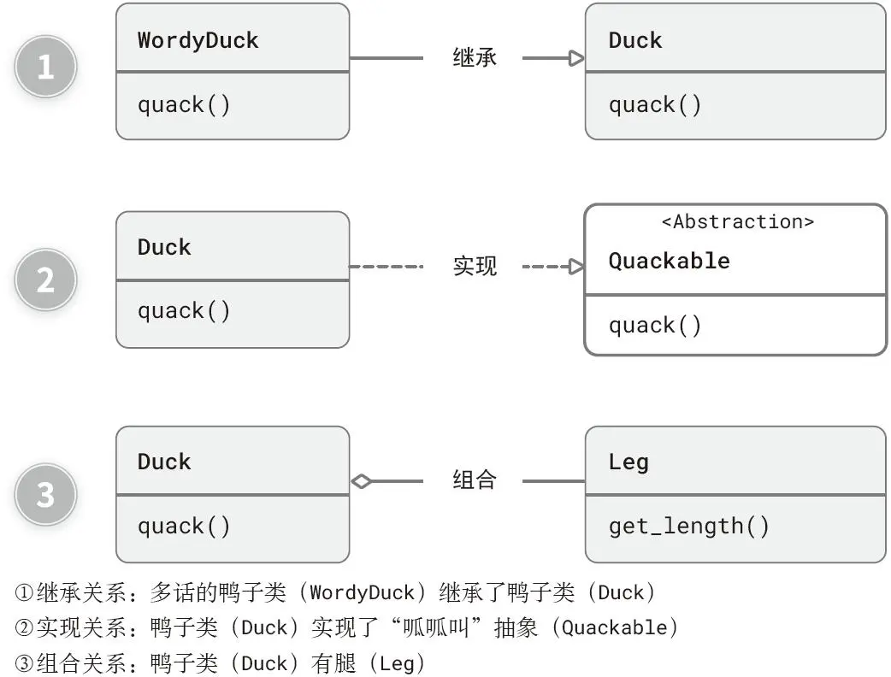
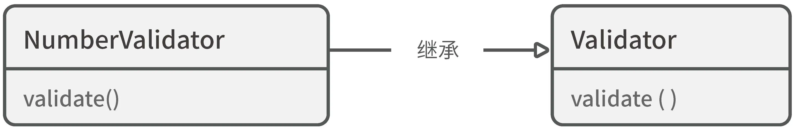
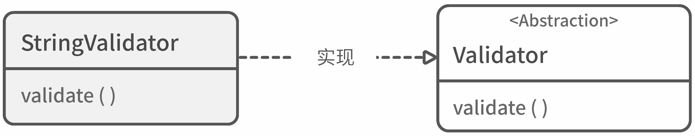
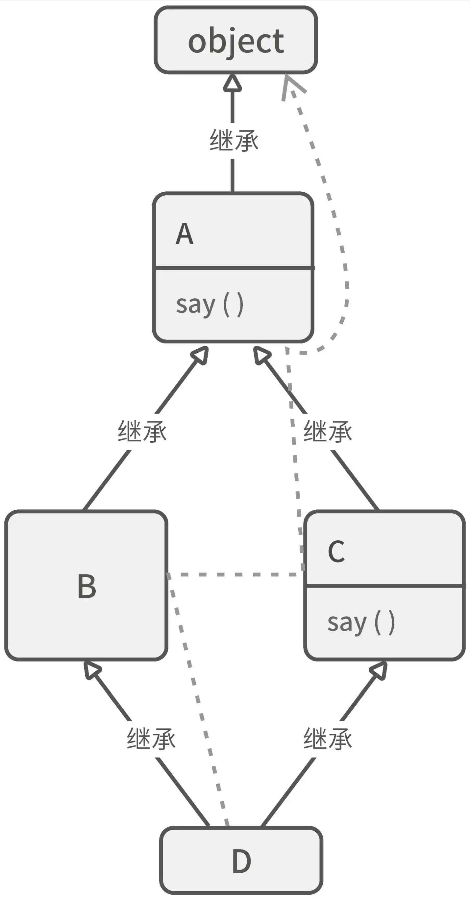
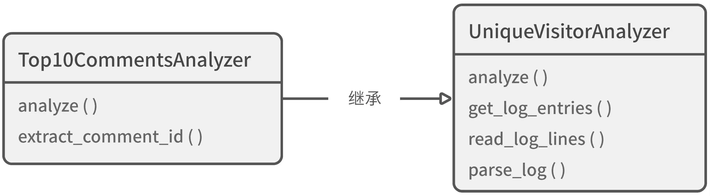
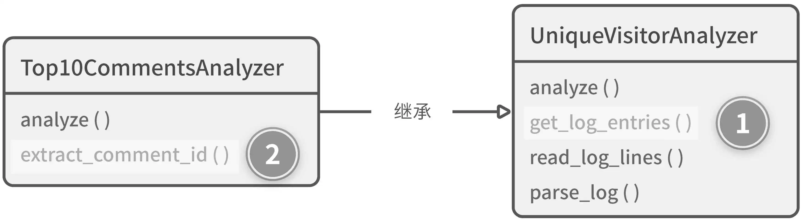
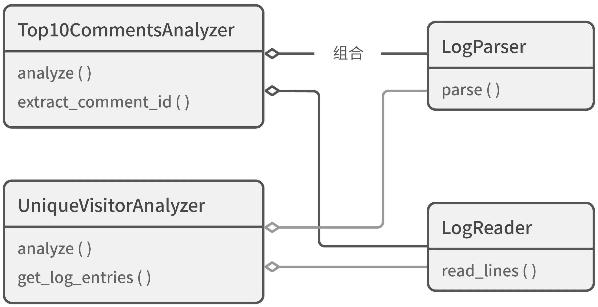

# 第9章面向对象编程(1)

## 第 9 章　面向对象编程

Python 是一门支持多种编程风格的语言。面对同样的需求，不同的程序员会写出风格迥异的Python 代码。一个习惯“过程式编程”的人，可能会用一大堆环环相扣的函数来解决问题。而一个擅长“面向对象编程”的人，可能会搞出数不清的类来完成任务。

虽然不同的编程风格各有优缺点，无法直接比较，但如今面向对象编程的流行度与接受度远超其他编程风格。

几乎所有现代编程语言都支持面向对象功能，但由于设计理念不同，不同编程语言所支持的面向对象有许多差异。比如接口（interface）是 Java 面向对象体系中非常重要的组成部分，而在 Python 里，你压根儿就找不到接口对象。

Python 语言在整体设计上深受面向对象思想的影响。你经常可以听到“在 Python 里，万物皆对象”这句话。这并不夸张，在 Python 中，最基础的浮点数也是一个对象：

```python
>>> i = 1.3
>>> i.is_integer() ➊
False
❶ 调用浮点数对象的 is_integer() 方法
要创建自定义对象，你需要用 class 关键字来定义一个类：
class Duck:
   def __init__(self, name):
       self.name = name
   def quack(self):
print(f"Quack! I'm !")
实例化一个 Duck 对象，并调用它的 .quack() 方法：
>>> donald = Duck('donald')
>>> donald.quack()
Quack! I'm donald!
```

为了区分，我们常把类里定义的函数称作方法。除了普通方法外，你还可以使用

```
@classmethod、@staticmethod 等装饰器来定义特殊方法。在 9.1.2 节，我会介绍这部
```

分内容。

Python 支持类之间的继承，你可以用继承来创建一个子类，并重写父类的一些方法：

```python
class WordyDuck(Duck): ➊
   def quack(self):
       print(f"Quack!Quack!Quack! I'm !")
❶ 继承 Duck 类
```

在创建继承关系时，你不止可以继承一个父类，还能同时继承多个父类。在 9.1.5 节中，我会介绍多重继承的相关知识。

在日常编写代码时，继承作为一个强大的代码复用机制，常被过度使用。本章的案例故事与继承有关，我会介绍何时该用继承，何时该用组合替代继承。

在本章中，你还会看到一些如图 9-1 所示的图。



- 图 9-1　类之间的关系示意图

这是一种简化过的 UML 图，能帮助你更直观地理解类之间的关系。

面向对象是一个非常庞大的主题，除了上述内容外，本章还会涉及鸭子类型、抽象类、元类等内容。话不多说，我们开始吧！

## 9.1　基础知识

### 9.1.1　类常用知识

在 Python 中，类（class）是我们实践面向对象编程时最重要的工具之一。通过类，我们可以把头脑中的抽象概念进行建模，进而实现复杂的功能。同函数一样，类的语法本身也很简单，但藏着许多值得注意的细节。

下面我会分享一些与类相关的常用知识点。

1. 私有属性是“君子协定”封装（encapsulation）是面向对象编程里的一个重要概念，为了更好地体现类的封装性，许多编程语言支持将属性设置为公开或私有，只是方式略有不同。比如在 Java 里，我们可

```
以用 public 和 private 关键字来表达是否私有；而在 Go 语言中，公有 / 私有则是用首
```

- 字母大小写来区分的。

- 在 Python 里，所有的类属性和方法默认都是公开的，不过你可以通过添加双下划线前缀

```python
__ 的方式把它们标示为私有。举个例子：
class Foo:
1
   def __init__(self):
2
       self.__bar = 'baz'
3
上面代码中 Foo 类的 bar 就是一个私有属性，如果你尝试从外部访问它，程序就会抛出异
```

- 常：

```
>>> foo = Foo()
1
>>> foo.__bar
2
AttributeError: 'Foo' object has no attribute '__bar'
3
```

- 虽然上面是设置私有属性的标准做法，但 Python 里的私有只是一个“君子协议”。“君子协议”是指，虽然用属性的本名访问不了私有属性，但只要稍微调整一下名字，就可以继续操作

```
__bar 了：
>>> foo._Foo__bar
1
'baz'
2
这是因为当你使用 __ 的方式定义一个私有属性时，Python 解释器只是重新给了它一个包
含当前类名的别名 ___，因此你仍然可以在外部用这个别名来访问和修改它。
```

- 因为私有属性依靠这套别名机制工作，所以私有属性的最大用途，其实是在父类中定义一个不容易被子类重写的受保护属性。

- 而在日常编程中，我们极少使用双下划线来标示一个私有属性。如果你认为某个属性是私有

```
的，直接给它加上单下划线 _ 前缀就够了。而“标准”的双下划线前缀，反而可能会在子类想
```

- 要重写父类私有属性时带来不必要的麻烦。


- 在 Python 圈，有一句常被提到的老话：“大家都是成年人了。”（We are allconsenting adults here.）这句话代表了 Python 的一部分设计哲学，那就是期望程序员做正确的事，而不是在语言上增加太多条条框框。Python 没有严格意义上的私有属性，应该就是遵循了这条哲学的结果。

2. 实例内容都在字典里在第 3 章的开篇，我提到 Python 语言内部大量使用了字典类型，比如一个类实例的所有成

```
员，其实都保存在了一个名为 __dict__ 的字典属性中。
```

- 而且，不光实例有这个字典，类其实也有这个字典：

```python
class Person:
1
   def __init__(self, name, age):
2
       self.name = name
3
       self.age = age
4
5
   def say(self):
6
       print(f"Hi, My name is , I'm ")
7
查看 __dict__：
```

```javascript
>>> p = Person('raymond', 30)
1
2
>>> p.__dict__ ➊
3
{'name': 'raymond', 'age': 30}
4
>>> Person.__dict__ ➋
5
mappingproxy({'__module__': '__main__', '__init__': <function Person.__init__ a
❶ 实例的 __dict__ 里，保存着当前实例的所有数据
❷ 类的 __dict__ 里，保存着类的文档、方法等所有数据
在绝大多数情况下，__dict__ 字典对于我们来说是内部实现细节，并不需要手动操作
它。但在有些场景下，使用 __dict__ 可以帮我们巧妙地完成一些特定任务。
比如，你有一份包含 Person 类数据的字典 {'name': ..., 'age': ...}。现在你想
把这份字典里的数据直接赋值到某个 Person 实例上。最简单的做法是通过遍历字典来设
```

- 置属性：

```sql
>>> d = {'name': 'andrew', 'age': 20}
1
>>> for key, value in d.items():
2
...     setattr(p, key, value)
3
但除此之外，其实也可以直接修改实例的 __dict__ 属性来快速达到目的：
p.__dict__.update(d)。
不过需要注意的是，修改实例的 __dict__ 与循环调用 setattr() 方法这两个操作并不
完全等价，因为类的属性设置行为可以通过定义 __setattr__ 魔法方法修改。
```

- 举个例子：

```python
class Person:
1
   ...
2
3
   def __setattr__(self, name, value):
4
       # 不允许设置年龄小于 0
5
       if name == 'age' and value < 0:
6
           raise ValueError(f'Invalid age value: ')
7
       super().__setattr__(name, value)
8
在上面的代码里，Person 类增加了 __setattr__ 方法，实现了对 age 值的校验逻辑。
```

- 执行效果如下：

```
>>> p = Person('raymond', 30)
1
>>> p.age = -3
2
ValueError: Invalid age value: -3
3
虽然普通的属性赋值会被 __setattr__ 限制，但如果你直接操作实例的 __dict__ 字
```

- 典，就可以无视这个限制：

```
>>> p.__dict__['age'] = -3
1
>>> p.say()
2
Hi, My name is raymond, I'm -3
3
在某些特殊场景下，合理利用 __dict__ 属性的这个特性，可以帮你完成常规做法难以做
```

- 到的一些事情。

### 9.1.2　内置类方法装饰器

在编写类时，除了普通方法以外，我们还常常会用到一些特殊对象，比如类方法、静态方法等。要定义这些对象，得用到特殊的装饰器。下面简单介绍这些装饰器。

1. 类方法

```
当你用 def 在类里定义一个函数时，这个函数通常称作方法。调用方法需要先创建一个类
```

- 实例。

```python
举个例子，下面的 Duck 是一个简单的鸭子类：
class Duck:
1
   def __init__(self, color):
2
       self.color = color
3
4
   def quack(self):
5
       print(f"Hi, I'm a  duck!")
6
创建一只鸭子，并调用它的 quack() 方法：
>>> d = Duck('yellow')
1
>>> d.quack()
2
Hi, I'm a yellow duck!
3
如果你不使用实例，而是直接用类来调用 quack()，程序就会因为找不到类实例而报错：
>>> Duck.quack()
1
TypeError: quack() missing 1 required positional argument: 'self'
2
不过，虽然普通方法无法通过类来调用，但你可以用 @classmethod 装饰器定义一种特殊
```

- 的方法：类方法（class method），它属于类但是无须实例化也可调用。

```python
下面给 Duck 类加上一个 create_random() 类方法：
class Duck:
1
   ...
2
3
   @classmethod
4
   def create_random(cls): ➊
5
       """创建一只随机颜色的鸭子"""
6
       color = random.choice(['yellow', 'white', 'gray'])
7
       return cls(color=color)
8
❶ 普通方法接收类实例（self）作为参数，但类方法的第一个参数是类本身，通常使用
名字 cls
```

- 调用效果如下：

```xml
>>> d = Duck.create_random()
1
>>> d.quack()
2
Hi, I'm a white duck!
3
>>> d.create_random() ➊
4
<__main__.Duck object at 0x10f8f2f40>
5
```

- ❶ 虽然类方法通常是用类来调用，但你也可以通过实例来调用类方法，效果一样

- 作为一种特殊方法，类方法最常见的使用场景，就是像上面一样定义工厂方法来生成新实例。类方法的主角是类型本身，当你发现某个行为不属于实例，而是属于整个类型时，可以考虑使用类方法。

2. 静态方法

```
如果你发现某个方法不需要使用当前实例里的任何内容，那可以使用 @staticmethod 来
```

- 定义一个静态方法。

```python
下面的 Cat 类定义了 get_sound() 静态方法：
class Cat:
1
   def __init__(self, name):
2
       self.name = name
3
4
   def say(self):
5
       sound = self.get_sound()
6
       print(f': ...')
7
8
   @staticmethod
9
   def get_sound(): ➊
10
       repeats = random.randrange(1, 10)
11
       return ' '.join(['Meow'] * repeats)
12
```

- ❶ 静态方法不接收当前实例作为第一个位置参数

- 代码运行效果如下：

```
>>> c = Cat('Jack')
1
>>> c.say()
2
Jack: Meow Meow Meow...
3
```

- 除了实例外，你也可以用类来调用静态方法：

```
>>> Cat.get_sound()
1
'Meow Meow Meow Meow Meow Meow'
2
```

- 和普通方法相比，静态方法不需要访问实例的任何状态，是一种与状态无关的方法，因此静态方法其实可以改写成脱离于类的外部普通函数。

- 选择静态方法还是普通函数，可以从以下几点来考虑：

- 如果静态方法特别通用，与类关系不大，那么把它改成普通函数可能会更好；

- 如果静态方法与类关系密切，那么用静态方法更好；

- 相比函数，静态方法有一些先天优势，比如能被子类继承和重写等。

3. 属性装饰器

- 在一个类里，属性和方法有着不同的职责：属性代表状态，方法代表行为。二者对外的访问

```python
接口也不一样，属性可以通过 inst.attr 的方式直接访问，而方法需要通过
inst.method() 来调用。
不过，@property 装饰器模糊了属性和方法间的界限，使用它，你可以把方法通过属性的
方式暴露出来。举个例子，下面的 FilePath 类定义了 get_basename() 方法：
import os
1
2
class FilePath:
3
   def __init__(self, path):
4
       self.path = path
5
6
   def get_basename(self):
7
       """获取文件名"""
8
       return self.path.split(os.sep)[-1]
9
使用 @property 装饰器，你可以把上面的 get_basename() 方法变成一个虚拟属性，
```

- 然后像使用普通属性一样使用它：

```python
class FilePath:
1
   ...
2
3
   @property
4
   def basename(self):
5
       """获取文件名"""
6
       return self.path.rsplit(os.sep, 1)[-1]
7
```

- 调用效果如下：

```sql
>>> p = FilePath('/tmp/foo.py')
1
>>> p.basename
2
'foo.py'
3
@property 除了可以定义属性的读取逻辑外，还支持自定义写入和删除逻辑：
class FilePath:
1
   ...
2
   @property
3
   def basename(self):
4
       """获取文件名"""
5
       return self.path.rsplit(os.sep, 1)[-1]
6
7
   @basename.setter ➊
8
   def basename(self, name): ➋
9
       """修改当前路径里的文件名部分"""
10
       new_path = self.path.rsplit(os.sep, 1)[:-1] + [name]
11
       self.path = os.sep.join(new_path)
12
13
   @basename.deleter
14
   def basename(self): ➌
15
       raise RuntimeError('Can not delete basename!')
16
❶ 经过 @property 的装饰以后，basename 已经从一个普通方法变成了 property
对象，因此这里可以使用 basename.setter
❷ 定义 setter 方法，该方法会在对属性赋值时被调用
❸ 定义 deleter 方法，该方法会在删除属性时被调用
```

- 调用效果如下：

```sql
>>> p = FilePath('/tmp/foo.py')
1
>>> p.basename = 'bar.txt' ➊
2
>>> p.path
3
'/tmp/bar.txt'
4
5
>>> del p.basename ➋
6
RuntimeError: Can not delete basename!
7
❶ 触发 setter 方法
❷ 触发 deleter 方法
@property 是个非常有用的装饰器，它让我们可以基于方法定义类属性，精确地控制属性
```

- 的读取、赋值和删除行为，灵活地实现动态属性等功能。

```
　除了 @property 以外，描述符也能做到同样的事情，并且功能更多、更强大。
```

- 在 12.1.3 节中，我会介绍如何用描述符来实现复杂属性。

- 当你决定把某个方法改成属性后，它的使用接口就会发生很大的变化。你需要学会判断，方法和属性分别适合什么样的场景。

```
举个例子，假如你的类有个方法叫 get_latest_items()，调用它会请求外部服务的数
十个接口，耗费 5～10 秒钟。那么这时，盲目把这个方法改成 .latest_items 属性就不
```

- 太恰当。

- 人们在读取属性时，总是期望能迅速拿到结果，调用方法则不一样——快点儿慢点儿都无所谓。让自己设计的接口符合他人的使用预期，也是写代码时很重要的一环。

### 9.1.3　鸭子类型及其局限性

每当我们谈论 Python 的类型系统时，总有一句话被大家反复提起：“Python 是一门鸭子类型的编程语言。”

虽然这个定义被广泛接受，但是和“静态类型”“动态类型”这些名词不一样，“鸭子类型”（duck-typing）不是什么真正的类型系统，而只是一种特殊的编程风格。

在鸭子类型编程风格下，如果想操作某个对象，你不会去判断它是否属于某种类型，而会直接判断它是不是有你需要的方法（或属性）。或者更激进一些，你甚至会直接尝试调用需要的方法，假如失败了，那就让它报错好了（参考 5.1.1 节）。

- 当看到一只鸟走起来像鸭子、游泳起来像鸭子、叫起来也像鸭子，那么这只鸟就可以称为鸭子。——来自“鸭子类型”的维基百科词条

```
也就是说，虽然 Python 提供了检查类型的函数：isinstance()，但是鸭子类型并不推荐你
使用它。你想调用 items 对象的 append() 方法？别拿 isinstance(items, list) 判
断 items 究竟是不是列表，想调就直接调吧！
```

举个更具体的例子，假如某人要编写一个函数，来统计某个文件对象里有多少个元音字母，那么遵循鸭子类型的指示，应该直接把代码写成代码清单 9-1。

- 代码清单 9-1　统计文件中元音数量

```python
def count_vowels(fp):
   """统计某个文件中元音字母（aeiou）的数量"""
   VOWELS_LETTERS = {'a', 'e', 'i', 'o', 'u'}
   count = 0
   for line in fp: ➊
       for char in line:
           if char.lower() in VOWELS_LETTERS:
               count += 1
   return count
# 合法的调用方式：传入一个可读的文件对象
with open('small_file.txt') as fp:
   print(count_vowels_v2(fp))
❶ 不做任何类型判断，直接开始遍历 fp 对象
```

在超过 90% 的情况下，你能找到的合理的 Python 代码就如上所示：没有任何类型检查，想

```
做什么就直接做。你肯定想问，假如调用方提供的 fp 参数不是文件对象怎么办？答案是：不
```

怎么办，直接报错就好。示例如下。

```
>>> count_vowels(100)
Traceback (most recent call last):
 File "<stdin>", line 1, in <module>
 File "duck_typing.py", line 8, in count_vowels
   for line in fp:
TypeError: 'int' object is not iterable
```

如果编码者觉得：“这实在是太随意了，我非得给它加上一点儿类型校验不可。”那么他也可以选

```
择补充一些符合鸭子类型的校验语句，比如通过判断 fp 对象有没有 read 方法来决定是否继
```

续执行，如代码清单 9-2 所示。

- 代码清单 9-2　统计文件中元音数量（增加校验）

```python
def count_vowels(fp):
   """统计某个文件中元音字母（aeiou）的数量"""
   if not hasattr(fp, 'read'): ➊
       raise TypeError('must provide a valid file object')
   VOWELS_LETTERS = {'a', 'e', 'i', 'o', 'u'}
   count = 0
   for line in fp:
       for char in line:
           if char.lower() in VOWELS_LETTERS:
               count += 1
   return count
```

- ❶ 新增的校验语句

```
但不管怎样，在纯粹的鸭子类型编程风格下，不应该出现任何的 isinstance 类型判断语
```

句。

假如你用其他静态类型的编程语言写过代码，肯定会觉得，这么搞真是太乱来了，这样的代码看上去就很不靠谱。但实话实说，鸭子类型编程风格确实有许多实打实的优点。

首先，鸭子类型不推荐做类型检查，因此编码者可以省去大量与之相关的烦琐工作。其次，鸭子类型只关注对象是否能完成某件事，而不对类型做强制要求，这大大提高了代码的灵活性。

```
举个例子，假如你把一个 StringIO 对象——一种实现了 read 操作的类文件（file-like）对
象——传入上面的 count_vowels() 函数，会发现该函数仍然可以正常工作：
>>> from io import StringIO
>>> count_vowels(StringIO('Hello, world!'))
3
```

你甚至可以从零开始自己实现一个新类型：

```python
class StringList:
   """用于保存多个字符串的数据类，实现了 read() 和可迭代接口"""
   def __init__(self, strings):
       self.strings = strings
   def read(self):
       return ''.join(self.strings)
   def __iter__(self):
       for s in self.strings:
           yield s
虽然上面的 StringList 类和文件类型八竿子打不着，但是因为 count_vowels() 函数遵
循了鸭子类型编程风格，而 StringList 恰好实现了它所需要的接口，因此 StringList
对象也可以完美适用于 count_vowels 函数：
```

```
>>> sl = StringList(['Hello', 'World'])
>>> count_vowels(sl)
3
```

不过，即便鸭子类型有以上种种好处，我们还是无法对它的缺点视而不见。

### 鸭子类型的局限性

鸭子类型的第一个缺点是：缺乏标准。在编写鸭子类型代码时，虽然我们不需要做严格的类型校验，但是仍然需要频繁判断对象是否支持某个行为，而这方面并没有统一的标准。

```
拿前面的文件类型校验来说，你可以选择调用 hasattr(fp, "read")，也可以选择调用
hasattr(fp, "readlines")，还可以直接写 try ... except 的 EAFP 风格代码来直
```

接进行操作。

看上去怎么做都行，但究竟哪种最好呢？

鸭子类型的另一个问题是：过于隐式。在鸭子类型编程风格下，对象的真实类型变得不再重要，取而代之的是对象所提供的接口（或者叫协议）变得非常重要。但问题是，鸭子类型里的所有接口和协议都是隐式的，它们全藏在代码和函数的注释中。

```
举个例子，通过阅读 count_vowels() 函数的代码，你可以知道：fp 文件对象需要提供
read 方法，也需要可迭代。但这些规则都是隐式的、片面的。这意味着你虽然通过读代码了
```

解了大概，但是仍然无法回答这个问题：“究竟是哪些接口定义了文件对象？”。

在鸭子类型里，所有的接口和协议零碎地分布在代码的各个角落，最终虚拟地活在编码者的大脑中。

综合考虑了鸭子类型的种种特点后，你会发现，虽然这非常有效和实用，但有时也会让人觉得过于灵活、缺少规范。尤其是在规模较大的 Python 项目中，如果代码大量使用了鸭子类型，编码者就需要理解很多隐式的接口与规则，很容易不堪重负。

幸运的是，除了鸭子类型以外，Python 还为类型系统提供了许多有效的补充，比如类型注解与静态检查（mypy）、抽象类（abstract class）等。

在下一节，我们会看看抽象类为鸭子类型带来了什么改变。

### 9.1.4　抽象类

我在前一节提到，在鸭子类型编程风格中，编码者不应该关心对象的类型，只应该关心对象是

```
否支持某些操作。这意味着，用于判断对象类型的 isinstance() 函数在鸭子世界里完全没
```

有用武之地。

```
但是，自从抽象类出现以后，isinstance() 函数的地位发生了一些微妙的变化。在解释这
个变化前，我们先看看 isinstance() 的典型工作模式是什么样的。
```

1. isinstance() 函数假如有以下两个类：

```python
class Validator:
1
   """校验器基类，校验不同种类的数据是否符合要求"""
2
3
   def validate(self, value):
4
       raise NotImplementedError
5
6
class NumberValidator(Validator):
7
   """校验输入值是否是合法数字"""
8
9
   def validate(self, value):
10
       ...
11
Validator 是校验器基类，NumberValidator 是继承了 Valdiator 的校验器子类，
```

- 如图 9-2 所示。



- 图 9-2　继承示意图

```
利用 isinstance() 函数，我们可以判断对象是否属于特定类型：
>>> isinstance(NumberValidator(), NumberValidator)
1
True
2
>>> isinstance('foo', Validator)
3
False
4
isinstance() 函数能理解类之间的继承关系，因此子类的实例同样可以通过基类的校
```

- 验：

```
>>> isinstance(NumberValidator(), Validator)
1
True
2
使用 isinstance() 函数，我们可以严格校验对象是否属于某个类型。但问题是：鸭子类
型只关心行为，不关心类型，所以 isinstance() 函数天生和鸭子类型的理念相背。不
```

- 过，在 Python 2.6 版本推出了抽象类以后，事情出现了一些转折。

2. 校验对象是否是 Iterable 类型在解释抽象类对类型机制的影响前，我们先看看下面这个类：

```python
class ThreeFactory:
1
   """在被迭代时不断返回 3
2
3
   :param repeat: 重复次数
4
   """
5
6
   def __init__(self, repeat):
7
       self.repeat = repeat
8
9
   def __iter__(self):
10
       for _ in range(self.repeat):
11
           yield 3
12
ThreeFactory 是个非常简单的类，它所做的，就是迭代时不断返回数字 3：
>>> obj = ThreeFactory(2) ➊
1
>>> for i in obj:
2
...     print(i)
3
...
4
3
5
3
6
```

- ❶ 初始化一个会返回两次 3 的新对象

```
在 collections.abc 模块中，有许多和容器相关的抽象类，比如代表集合的 Set、代表
序列的 Sequence 等，其中有一个最简单的抽象类：Iterable，它表示的是可迭代类
型。假如你用 isinstance() 函数对上面的 ThreeFactory 实例做类型检查，会得到一
```

- 个有趣的结果：

```
>>> from collections.abc import Iterable
1
>>> isinstance(ThreeFactory(2), Iterable)
2
True
3
虽然 ThreeFactory 没有继承 Iterable 类，但当我们用 isinstance() 检查它是否
属于 Iterable 类型时，结果却是 True，这正是受了抽象类的特殊子类化机制的影响。
```

3. 抽象类的子类化机制在 Python 中，最常见的子类化方式是通过继承基类来创建子类，比如前面的

```
NumberValidator 就继承了 Validator 类。但抽象类作为一种特殊的基类，为我们提
```

- 供了另一种更灵活的子类化机制。

```python
为了演示这个机制，我把前面的 Validator 改造成了一个抽象类：
from abc import ABC
1
2
class Validator(ABC): ➊
3
   """校验器抽象类"""
4
5
   @classmethod
6
   def __subclasshook__(cls, C):
7
       """任何提供了 validate 方法的类，都被当作 Validator 的子类"""
8
       if any("validate" in B.__dict__ for B in C.__mro__): ➋
9
           return True
10
       return NotImplemented
11
12
   def validate(self, value):
13
       raise NotImplementedError
14
❶ 要定义一个抽象类，你需要继承 ABC 类或使用 abc.ABCMeta 元类
❷ C.__mro__ 代表 C 的类派生路线上的所有类（见 9.1.5 节）
上面代码的重点是 __subclasshook__ 类方法。__subclasshook__ 是抽象类的一个
特殊方法，当你使用 isinstance 检查对象是否属于某个抽象类时，如果后者定义了这个
```

- 方法，那么该方法就会被触发，然后：

```
实例所属类型会作为参数传入该方法（上面代码中的 C 参数）；
```

- 如果方法返回了布尔值，该值表示实例类型是否属于抽象类的子类；

```
如果方法返回 NotImplemented，本次调用会被忽略，继续进行正常的子类判断逻辑。
```

```python
在我编写的 Validator 类中，__subclasshook__ 方法的逻辑是：所有实现了
validate 方法的类都是我的子类。
这意味着，下面这个和 Validator 没有继承关系的类，也被视作 Validator 的子类：
class StringValidator:
1
   def validate(self, value):
2
       ...
3
4
print(isinstance(StringValidator(), Validator))
5
# 输出：True
6
```

- 图 9-3 展示了两者的关系。



- 图 9-3　StringValidator 实现了抽象类 Validator

```
通过 __subclasshook__ 类方法，我们可以定制抽象类的子类判断逻辑。这种子类化形
```

- 式只关心结构，不关心真实继承关系，所以常被称为“结构化子类”。

```
这也是之前的 ThreeFactory 类能通过 Iterable 类型校验的原因，因为 Iterable 抽
象类对子类只有一个要求：实现了 __iter__ 方法即可。
除了通过 __subclasshook__ 类方法来定义动态的子类检查逻辑外，你还可以为抽象类
```

- 手动注册新的子类。

```
比如，下面的 Foo 是一个没有实现任何方法的空类，但假如通过调用抽象类 Validator
的 register 方法，我们可以马上将它变成 Validator 的“子类”：
>>> class Foo:
1
...     pass
2
...
3
>>> isinstance(Foo, Validator) ➊
4
False
5
6
>>> Validator.register(Foo) ➋
7
False
8
9
>>> isinstance(Foo(), Validator) ➌
10
True
11
>>> issubclass(Foo, Validator)
12
True
13
❶ 默认情况下，Foo 类和 Validator 类没有任何关系
❷ 调用 .register() 把 Foo 注册为 Validator 的子类
❸ 完成注册后，Foo 类的实例就能通过 Validator 的类型校验了
总结一下，抽象类通过 __subclasshook__ 钩子和 .register() 方法，实现了一种比
继承更灵活、更松散的子类化机制，并以此改变了 isinstance() 的行为。
有了抽象类以后，我们便可以使用 isinstance(obj, type) 来进行鸭子类型编程风格
的类型校验了。只要待匹配类型 type 是抽象类，类型检查就符合鸭子类型编程风格——
```

- 只校验行为，不校验类型。

4. 抽象类的其他功能

```
除了更灵活的子类化机制外，抽象类还提供了一些其他功能。比如，利用 abc 模块的 @
abstractmethod 装饰器，你可以把某个方法标记为抽象方法。假如抽象类的子类在继承
```

- 时，没有重写所有抽象方法，那么它就无法被正常实例化。

- 举个例子：

```python
class Validator(ABC):
1
   """校验器抽象类"""
2
3
   ...
4
   @abstractmethod ➊
5
   def validate(self, value):
6
       raise NotImplementedError
7
8
class InvalidValidator(Validator): ➋
9
   ...
10
❶ 把 validate 定义为抽象方法
❷ InvalidValidator 虽然继承了 Validator 抽象类，但没有重写 validate 方法
如果你尝试实例化 InvalidValidator，就会遇到下面的错误：
>>> obj = InvalidValidator()
1
Traceback (most recent call last):
2
 File "<stdin>", line 1, in <module>
3
TypeError: Can't instantiate abstract class InvalidValidator with abstract meth
4
```

- 这个机制可以帮我们更好地控制子类的继承行为，强制要求其重写某些方法。

- 此外，虽然抽象类名为抽象，但它也可以像任何普通类一样提供已实现好的非抽象方法。比

```
如 collections.abc 模块里的许多抽象类（如 Set、Mapping 等）像普通基类一样实
```

- 现了一些公用方法，降低了子类的实现成本。

- 最后，我们总结一下鸭子类型和抽象类：

- 鸭子类型是一种编程风格，在这种风格下，代码只关心对象的行为，不关心对象的类型；

- 鸭子类型降低了类型校验的成本，让代码变得更灵活；

- 传统的鸭子类型里，各种对象接口和协议都是隐式的，没有统一的显式标准；

```
普通的 isinstance() 类型检查和鸭子类型的理念是相违背的；
```

- 抽象类是一种特殊的类，它可以通过钩子方法来定制动态的子类检查行为；

```
因为抽象类的定制子类化特性，isinstance() 也变得更灵活、更契合鸭子类型了；
使用 @abstractmethod 装饰器，抽象类可以强制要求子类在继承时重写特定方法；
```

- 除了抽象方法以外，抽象类也可以实现普通的基础方法，供子类继承使用；

```
在 collections.abc 模块中，有许多与容器相关的抽象类。
```

- 在第 10 章与第 11 章，你会看到更多有关鸭子类型和抽象类的代码示例。

### 9.1.5　多重继承与 MRO

许多编程语言在处理继承关系时，只允许子类继承一个父类，而 Python 里的一个类可以同时继承多个父类。这让我们的模型设计变得更灵活，但同时也带来一个新问题：“在复杂的继承关系下，如何确认子类的某个方法会用到哪个父类？”

以下面的代码为例：

```python
class A:
   def say(self):
       print("I'm A")
class B(A):
   pass
class C(A):
   def say(self):
       print("I'm C")
class D(B, C):
   pass
```

```
D 同时继承 B 和 C 两个父类，而 B 和 C 都是 A 的子类。此时，如果你调用 D 实例的 say()
方法，究竟会输出 A 还是 C 的结果呢？答案是：
>>> D().say()
I'm C
```

在解决多重继承的方法优先级问题时，Python 使用了一种名为 MRO（method resolutionorder）的算法。该算法会遍历类的所有基类，并将它们按优先级从高到低排好序。

```
调用类的 mro() 方法，你可以看到按 MRO 算法排好序的基类列表：
>>> D.mro()
[<class '__main__.D'>, <class '__main__.B'>, <class '__main__.C'>, <class '__main
❶ 这里面的 <class 'object'> 是每个 Python 类的默认基类
```

图 9-4 展示了类的关系。



- 图 9-4　类关系示意图，带箭头的虚线代表 MRO 的解析顺序

当你调用子类的某个方法时，Python 会按照上面的 MRO 列表从前往后寻找这个方法，假如

```
某个类实现了这个方法，就直接返回。这就是前面的 D().say() 定位到了 C 类的原因，因
为在 D 的 MRO 列表中，C 排在 A 的前面。
```

### MRO 与 super()

基于 MRO 算法的基类优先级列表，不光定义了类方法的找寻顺序，还影响了另一个常见的内

```
置函数：super()。
在许多人的印象中，super() 是一个用来调用父类方法的工具函数。但这么说并不准确，
super() 使用的其实不是当前类的父类，而是它在 MRO 链条里的上一个类。
```

举个例子：

```python
class A:
   def __init__(self):
       print("I'm A")
       super().__init__()
class B(A):
   def __init__(self):
       print("I'm B")
       super().__init__()
class D1(B):
   pass
在上面的单一继承关系下，实例化 D1 类的输出结果很直观：
>>> D1()
I'm B
I'm A
此时，super() 看上去就像是在调用父类的方法。但是，如果稍微调整一下继承关系，把 C
```

类加入继承关系链里：

```python
...
class C(A):
   def __init__(self):
       print("I'm C")
       super().__init__()
class D2(B, C): ➊
   pass
❶ 让 D2 同时继承两个类
实例化 D2 类就会输出下面的结果：
>>> D2()
I'm B
I'm C ➊
I'm A
❶ C 类的 __init__ 方法调用插在了 B 和 A 之间
当我在继承关系里加入 C 类后，B.__init__() 里的 super() 不会再直接找到 B 的父类
A，而是会定位到当前 MRO 链条里的下一个类，一个看上去和 B 毫不相关的类：C。
正如例子所示，当你在方法中调用 super() 时，其实无法确定它会定位到哪一个类。这是因
```

为你永远不知道使用类的人，会把它加入什么样的 MRO 继承链条里。

```
总而言之，Python 里的多重继承是一个相当复杂的特性，尤其在配合 super() 时。
```

在实际项目里，你应该非常谨慎地对待多重继承，因为它很容易催生出一些复杂的继承关系，进而导致代码难以维护。假如你发现自己在实现某个功能时，必须使用多重继承，而且必须用MRO 算法来精心设计方法间的覆盖关系，此时你应该停下来，喝口水，深吸一口气，重新思考一遍自己想要解决的问题。

以我的经验来看，许多所谓“精心设计”的多重继承代码，也许在写出来的当天编码者会觉得：自己用相当高明的手段解决了一个十分困难的问题。但在一个月后，当其他人需要修改这段代码时，很容易被复杂的继承关系绕晕。

大多数情况下，你需要的并不是多重继承，而也许只是一个更准确的抽象模型，在该模型下，最普通的继承关系就能完美解决问题。

### 9.1.6　其他知识

面向对象编程所涉及的内容相当多，这意味着，一章很难涵盖所有知识点。

在本节中，我挑选了两个平常较少用到的知识点进行简单介绍。如果你对其中的某个知识点感兴趣，可自行搜索更多资料。

1. Mixin 模式

- 顾名思义，Mixin 是一种把额外功能“混入”某个类的技术。有些编程语言（比如 Ruby）为Mixin 模式提供了原生支持，而在 Python 中，我们可以用多重继承来实现 Mixin 模式。

- 要实现 Mixin 模式，你需要先定义一个 Mixin 类：

```python
class InfoDumperMixin: ➊
1
   """Mixin：输出当前实例信息"""
2
3
   def dump_info(self):
4
       d = self.__dict__
5
       print("Number of members: {}".format(len(d)))
6
       print("Details:")
7
       for key, value in d.items():
8
           print(f' - : ')
9
❶ Mixin 类名常以“Mixin”结尾，这算是一种不成文的约定
```

- 相比普通类，Mixin 类有一些鲜明的特征。

- Mixin 类通常很简单，只实现一两个功能，所以很多时候为了实现某个复杂功能，一个类常常会同时混入多个 Mixin 类。另外，大多数 Mixin 类不能单独使用，它们只有在被混入其他类时才能发挥最大作用。

```python
下面是一个使用 InfoDumperMixin 的例子：
class Person(InfoDumperMixin):
1
   def __init__(self, name, age):
2
       self.name = name
3
       self.age = age
4
```

- 调用结果如下：

```
>>> p = Person('jack', 20)
1
>>> p.dump_info()
2
Number of members: 2
3
Details:
4
 - name: jack
5
 - age: 20
6
```

- 虽然 Python 中的 Mixin 模式基于多重继承实现，但令 Mixin 区别于普通多重继承的最大原因在于：Mixin 是一种有约束的多重继承。在 Mixin 模式下，虽然某个类会同时继承多个基类，但里面最多只会有一个基类表示真实的继承关系，剩下的都是用于混入功能的 Mixin类。这条约束大大降低了多重继承的潜在危害性。

- 1许多流行的 Web 开发框架使用了 Mixin 模式，比如 Django、DRF等。

- 不过，虽然 Mixin 是一种行之有效的编程模式，但不假思索地使用它仍然可能会带来麻烦。有时，人们使用 Mixin 模式的初衷，只是想对糟糕的模型设计做一些廉价的弥补，而这只会把原本糟糕的设计变得更糟。

- 假如你想使用 Mixin 模式，需要精心设计 Mixin 类的职责，让它们和普通类有所区分，这样才能让 Mixin 模式发挥最大的潜力。

2. 元类元类是 Python 中的一种特殊对象。元类控制着类的创建行为，就像普通类控制着实例的创建行为一样。

```
type 是 Python 中最基本的元类，利用 type，你根本不需要手动编写 class ... : 代
码来创建一个类——直接调用 type() 就行：
```

```xml
>>> Foo = type('Foo', (), {'bar': 3}) ➊
1
>>> Foo
2
<class '__main__.Foo'>
3
>>> Foo().bar
4
3
5
❶ 参数分别为 type(name, bases, attrs)
在调用 type() 创建类时，需要提供三个参数，它们的含义如下。
(1) name：str，需要创建的类名。
(2) bases：Tuple[Type]，包含其他类的元组，代表类的所有基类。
(3) attrs：Dict[str, Any]，包含所有类成员（属性、方法）的字典。
虽然 type 是最基本的元类，但在实际编程中使用它的场景其实比较少。更多情况下，我
们会创建一个继承 type 的新元类，然后在里面定制一些与创建类有关的行为。
```

- 为了演示元类能做什么，代码清单 9-3 实现了一个简单的元类，它的主要功能是将类方法自动转换成属性对象。另外，该元类还会在创建实例时，为其增加一个代表创建时间的

```python
created_at 属性。
代码清单 9-3　示例元类 AutoPropertyMeta
import time
1
import types
2
3
class AutoPropertyMeta(type): ➊
4
   """元类：
5
6
   - 把所有类方法变成动态属性
7
   - 为所有实例增加创建时间属性
8
   """
9
10
   def __new__(cls, name, bases, attrs): ➋
11
       for key, value in attrs.items():
12
           if isinstance(value, types.FunctionType) and not key.startswith('_
13
              attrs[key] = property(value) ➌
14
       return super().__new__(cls, name, bases, attrs) ➍
15
16
   def __call__(cls, *args, **kwargs): ➎
17
       inst = super().__call__(*args, **kwargs)
18
       inst.created_at = time.time()
19
       return inst
20
❶ 元类通常会继承基础元类 type 对象
❷ 元类的 __new__ 方法会在创建类时被调用
```

- ❸ 将非私有方法转换为属性对象

```python
❹ 调用 type() 完成真正的类创建
❺ 元类的 __call__ 方法，负责创建与初始化类实例
下面的 Cat 类使用了 AutoPropertyMeta 元类：
import random
1
2
class Cat(metaclass=AutoPropertyMeta):
3
   def __init__(self, name):
4
       self.name = name
5
6
   def sound(self):
7
       repeats = random.randrange(1, 10)
8
       return ' '.join(['Meow'] * repeats)
9
```

- 效果如下：

```
>>> milo = Cat('milo')
1
>>> milo.sound ➊
2
'Meow Meow Meow Meow Meow Meow Meow'
3
>>> milo.created_at ➋
4
1615000104.0704262
5
❶ sound 原本是方法，但是被元类自动转换成了属性对象
```

- ❷ 读取由元类定义的创建时间

- 通过上面这个例子，你会发现元类的功能相当强大，它不光可以修改类，还能修改类的实

```
例。同时它也相当复杂，比如在例子中，我只简单演示了元类的 __new__ 和 __call__
方法，除此之外，元类其实还有用来准备类命名空间的 __prepare__ 方法。
```

- 和 Python 里的其他功能相比，元类是个相当高级的语言特性。通常来说，除非要开发一些框架类工具，否则你在日常工作中根本不需要用到元类。

- 元类是一种深奥的“魔法”，99% 的用户不必为之操心。如果你在琢磨是否需要元类，那你肯定不需要（那些真正要使用元类的人确信自己的需求，而无须解释缘由）。Metaclasses are deeper magic than 99% of users should ever worry about. If youwonder whether you need them, you don’t (the people who actually need them knowwith certainty that they need them, and don’t need an explanation about why).——Tim Peters

- 但鲜有使用场景，不代表学习元类就没有意义。我认为了解元类的工作原理，对理解Python 的面向对象模型大有裨益。

- 元类很少被使用的原因，除了应用场景少以外，还在于它其实有许多“替代品”，它们是：

- (1) 类装饰器（见 8.2.2 节）；

```
(2) __init_subclass__ 钩子方法（见 9.3.1 节）；
```

- (3) 描述符（见 12.1.3 节）。

- 这些工具的功能虽然不如元类那么强大，但它们都比元类简单，更容易理解。日常编码时，它们可以覆盖元类的大部分使用场景。

## 9.2　案例故事

我第一次接触面向对象概念，是在十几年前的大学 Java 课上。虽然现在我已经完全忘记了那堂课的内容，但我清楚记得当时用的教科书第一页里的一句话：“面向对象有三大基本特征：封装（encapsulation）、继承（inheritance）与多态（polymorphism）。”

虽然我在课堂上学到的“继承”，作为一个“基本特征”，似乎显得“人畜无害”、很好掌握，不过在之后的十几年编程生涯里，在写过和看过太多糟糕的代码后，我发现“继承”虽然是一个基本概念，但它同时也是面向对象设计中最容易做错的事情之一。有时候，继承带来的问题甚至远比好处多。

为什么这么说呢？假如你用 Google 搜索“inheritance is bad”（继承不好），会发现有多达6400 万条搜索结果。许多新编程语言甚至完全取缔了继承。比如 2009 年发布的 Go 语言，虽然有一些面向对象语言的特征，但完全不支持继承。

作为曾经的三大面向对象基本特征，继承是怎么慢慢走到今天这一步的呢？我认为这和人们大量误用继承脱不了干系。

众所周知，继承为我们提供了一种强大的代码复用手段——只要继承某个父类，你就能使用它的所有属性和方法，获得它的所有能力。但强大同样也容易招致混乱，错误的继承关系很容易催生出一堆烂代码。

下面我们来看一个关于继承的故事。

### 继承是把双刃剑

小 R 是一名 Python 后端程序员，三个月前加入了一家移动互联网创业公司。公司的主要产品是一款手机游戏新闻 App——GameNews。在这款 App 里，用户可以浏览最新的游戏资讯，也可以通过评论和其他用户交流。

一个普通的工作日上午，小 R 在工位前坐下，拿出笔记本电脑，准备开始修复昨天没调完的bug。这时，公司的运营组同事小 Y 走到他的桌前。

“R 哥，有件事儿你能不能帮一下忙？”小 Y 问道。

“什么事儿？”

“是这样的，GameNews 上线都好几个星期了，虽然能查到下载量还不错，但不知道有多少人在用。你能不能在后台加个功能，让我们能查到 GameNews 每天的活跃用户数啊？”

- 2

听完小 Y 的描述，小 R 心想，统计 UV

- 数本身不是什么难事儿，但公司现在刚起步，各种

数据统计基建都没有，而且新功能需求又排得那么紧，怎么做这个统计最合适呢？

看到小 R 眉头微皱，半天不说话，小 Y 怯生生地开口了。

“这个统计是不是特别麻烦？要是麻烦就——”

没等小 Y 说完，小 R 突然就想到了办法。GameNews 几周前刚上线时，小 R 将所有的 API调用都记录了日志，全部按天保存在了服务器上。通过解析这些日志，他可以很轻松地计算出每天的 UV 数。

“不麻烦，包在我身上，明天上线！”小 R 打断了小 Y。

小 Y 走后，小 R 开始写起了代码。要基于日志来统计每天的 UV 数，程序至少需要做到这几件事：获取日志内容、解析日志、完成统计。

所幸这几件事都不算太难，没过多久，小 R 就写好了下面这个类，如代码清单 9-4 所示。

```python
代码清单 9-4　统计某日 UV 数的类 UniqueVisitorAnalyzer
class UniqueVisitorAnalyzer:
   """统计某日 UV 数
   :param date: 需要统计的日期
   """
   def __init__(self, date):
       self.date = date
   def analyze(self):
       """通过解析与分析 API 访问日志，返回 UV 数
       :return: UV 数
       """
       for entry in self.get_log_entries():
           ... # 省略：根据 entry.user_id 统计 UV 数并返回结果
   def get_log_entries(self):
       """获取当天所有日志记录"""
       for line in self.read_log_lines():
           yield self.parse_log(line)
   def read_log_lines(self):
       """逐行获取访问日志"""
       ... # 省略：根据日志 self.date 读取日志文件并返回结果
   def parse_log(self, line):
       """将纯文本格式的日志解析为结构化对象
       :param line: 纯文本格式日志
       :return: 结构化的日志条目 LogEntry 对象
       """
       ...  # 省略：复杂的日志解析过程
       return LogEntry(
           time=...,
           ip=...,
           path=...,
           user_agent=...,
           user_id=...,
       )
在代码中，UniqueVisitorAnalyzer 类接收日期作为唯一的实例化参数，然后通过
analyze() 方法完成统计。为了统计 UV 数，analyze() 方法需要先读取日志文件，然后
解析日志文本，最终基于日志对象 LogEntry 里的 user_id 来计算结果。
```

经过简单的测试后，小 R 的代码在第二天准时上线，赢得了运营同事的好评。

1. 新需求：统计最热门的 10 条评论时间过去了一个月，其间 GameNews 的注册用户数增长了不少。

- 一天上午，小 Y 又来到小 R 的桌前，说道：“R 哥，最近用户发表的评论越来越多，你能不能搞个统计功能，把每天点赞数最多的 10 条评论找出来？这样可以方便我们搞点儿运营活动。”

- 小 R 接下这个需求后，心想：一个月前不是刚写了那个 UV 统计吗？新需求好像刚好能复

```
用那些代码。于是他打开 IDE，找到自己一个月前写的 UniqueVisitorAnalyzer 类，
```

- 只花了半分钟就确定了编码思路。

- 在 GameNews 提供的所有 API 中，评论点赞的 API 路径是有规律

```
的：/comments/<COMMENT_ID>/up_votes/。要统计热门评论，小 R 只需要从每天的
API 访问日志里，把所有的评论和点赞请求找出来，然后通过统计路径里的 COMMENT_ID
```

- 就能达到目的。

```
所以，小 R 决定通过继承来复用 UniqueVisitorAnalyzer 类里的日志读取和解析逻
```

- 辑，这样他只要写很少的代码就能完成需求。

- 只花了不到 10 分钟，小 R 就写出了下面的代码：

```python
class Top10CommentsAnalyzer(UniqueVisitorAnalyzer):
1
   """获取某日点赞量最高的 10 条评论
2
3
   :param date: 需要统计的日期
4
   """
5
6
   limit = 10
7
8
   def analyze(self):
9
       """通过解析与统计 API 访问日志，返回点赞量最高的评论
10
11
       :return: 评论 ID 列表
12
       """
13
       for entry in self.get_log_entries(): ➊
14
           comment_id = self.extract_comment_id(entry.path)
15
           ...  # 省略：统计过程与返回结果
16
17
   def extract_comment_id(self, path):
18
       """
19
       根据日志访问路径，获取评论 ID。
20
       有效的评论点赞 API 路径格式：/comments/<ID>/up_votes/
21
22
       :return: 仅当路径是评论点赞 API 时，返回 ID，否则返回 None
23
       """
24
       matched_obj = re.match('/comments/(.*)/up_votes/', path)
25
return matched obj and matched obj.group(1)
26
❶ 此处的 get_log_entries() 是由父类提供的方法
基于继承提供的强大复用能力，Top10CommentsAnalyzer 自然而然地获得了父类的日志
```

- 读取与解析能力，如图 9-5 所示。小 R 只写了不到 20 行代码，就实现了需求，自我感觉相当良好。



```
图 9-5　Top10CommentsAnalyzer 继承了 UniqueVisitorAnalyzer
```

- 上面的代码看似简单，一个月后却给小 R 带来了不小的麻烦。

2. 修改 UV 逻辑又过了一个月，小 R 的公司发展得越来越好，有许多新同事入职。一天，运营同事小 Y 又来找小 R。

- “R 哥，还记得你两个月前写的那个 UV 统计吗？我们最近觉得，把所有用过 GameNewApp 的人都当作活跃用户，其实挺不准的。”小 Y 手里端着一杯咖啡，慢慢说道：“你能不能改一下逻辑，只统计那些真正点开过新闻的用户？”

- 接到新需求后，小 R 心想：这个需求挺简单的，不如让两周前入职的同事小 V 负责。于是小 R 走到小 V 旁边，和他描述了一遍需求，并详细讲了一遍 UV 统计的代码。

- 小 V 是一名有经验的开发人员，他很快便明白了应该怎么下手。因为所有访问新闻的 API

```
路径都是同一种格式：/news/<ID>/，所以他只要调整一下代码，过滤一遍日志，就能挑
```

- 选出所有真正看过新闻的用户。

```python
于是，小 V 在 UniqueVisitorAnalyzer 类上做了一点儿调整：
import re
1
2
class UniqueVisitorAnalyzer:
3
4
   ...
5
6
   def get_log_entries(self):
7
       """获取当天所有日志记录"""
8
       for line in self.read_log_lines():
9
           entry = self.parse_log(line)
10
           if not self.match_news_pattern(entry.path): ➊
11
               continue
12
           yield entry
13
14
   def match_news_pattern(self, path):
15
       """判断 API 路径是不是在访问新闻
16
17
       :param path: API 访问路径
18
       :return: bool
19
       """
20
       return re.match(r'^/news/[^/]*?/$', path)
21
```

- ❶ 新增日志过滤语句

```
小 V 在 UniqueVisitorAnalyzer 类上增加了一个方法：match_news_pattern，它
负责判断 API 路径是不是访问新闻的路径格式。同时，小 V 在 get_log_entries 里也
```

- 增加了条件判断——如果当前日志不是访问新闻，就跳过它。

- 通过上面的修改，小 V 很快实现了只统计“新闻阅读者”的需求。

- 把代码提交上去以后，小 V 邀请小 R 审查这段改动。小 R 检查后没发现什么问题，于是新代码很快就部署到了线上。

- 但是，很快就发生了一件所有人都意想不到的事情。

3. 意料之外的 bug第二天一上班，运营同事小 Y 一路小跑到小 R 身边，一边喘气一边说道：“R 哥，为啥今天Top 10 评论数据是空的啊？一条评论都没有，赶紧帮看看是咋回事吧！”

- 小 R 一听觉得奇怪，说：“最近没人调整过那部分逻辑啊，怎么会出问题呢？”

- “会不会和我们昨天上线的 UV 统计调整有关？”坐在旁边听到俩人对话的小 V 突然插了一句。

- 听到这句话，小 R 愣了几秒钟，然后一拍大腿。

- “对对对，热门评论统计继承了 UV 统计的类，肯定是昨天的改动影响到了。我审查代码时完全忘记了这回事！”小 R 连忙说道。

- 于是小 R 打开统计热门评论的代码，很快就找到了问题的原因：

```python
class Top10CommentsAnalyzer(UniqueVisitorAnalyzer):
1
2
   def analyze(self):
3
       # 当小 V 修改了父类 UniqueVisitorAnalyzer 的
4
       # get_log_entries() 方法后，子类的 get_log_entries()
5
       # 方法调用从此只能拿到路径属于"查看新闻"的日志条目
6
       for entry in self.get_log_entries():
7
           comment_id = self.extract_comment_id(entry.path)
8
           ...
9
10
   def extract_comment_id(self, path):
11
       # 因为输入源发生了变化，所以extract_comment_id() 永远匹配不到
12
       # 任何点赞评论的路径了
13
       matched_obj = re.match('/comments/(.*)/up_votes/', path)
14
       return matched_obj and matched_obj.group(1)
15
```

- 问题产生的整个过程如图 9-6 所示。



- 图 9-6　①修改父类函数，②子类受到影响

- 从表面上看，这个 bug 似乎是由于两人的粗心大意造成的。小 Y 在写代码时，没有厘清继承关系就随意修改了父类逻辑。而小 R 在审查代码时，也没有仔细推演修改基类可能带来的后果。

- 但粗心大意只是表面原因。在开发软件时，我们不能指望程序员能够事事考虑得十全十美，永远记得自己写过的每一段代码逻辑，这根本就不现实。错误地使用了继承，才是导致这个bug 的根本原因。

4. 回顾继承，使用组合我们回溯到一个月前小 R 接到“统计热门评论”需求的时候。当他发现新需求可以复用

```
UniqueVisitorAnalyzer 类里的部分方法时，几乎是马上就决定创建一个子类来实现新
```

- 需求。

- 但继承是一种类与类之间紧密的耦合关系。让子类继承父类，虽然看上去毫无成本地获取了父类的全部能力，但同时也意味着，从此以后父类的所有改动都可能影响子类。继承关系越复杂，这种影响就越容易超出人们的控制范围。

- 正是因为继承的这种不可控性，才有了后面小 Y 调整 UV 统计逻辑却影响了热门评论统计的事情。

- 小 R 使用继承的初衷，是为了复用父类中的方法。但如果只是为了复用代码，其实没有必

```
要使用继承。当小 R 发现新需求要用到 UniqueVisitorAnalyzer 类的“读取日志”“解析
```

- 日志”行为时，他完全可以用组合（composition）的方式来解决复用问题。

```
要用组合来复用 UniqueVisitorAnalyzer 类，我们需要先分析这个类的职责与行为。
在我看来，UniqueVisitorAnalyzer 类主要负责以下几件事。
```

- 读取日志：根据日期找到并读取日志文件。

```
解析日志：把文本日志信息解析并转换成 LogEntry。
```

- 统计日志：统计日志，计算 UV 数。

```
基于这些事情，我们可以对 UniqueVisitorAnalyzer 类进行拆分，把其中需要复用的
```

- 两个行为创建为新的类：

```python
class LogReader:
1
   """根据日期读取特定日志文件"""
2
3
   def __init__(self, date):
4
       self.date = date
5
6
   def read_lines(self):
7
       """逐行获取访问日志"""
8
       ... # 省略：根据日志 self.date 读取日志文件并返回结果
9
10
11
class LogParser:
12
   """将文本日志解析为结构化对象"""
13
14
   def parse(self, line):
15
       """将纯文本格式的日志解析为结构化对象
16
17
       :param line: 纯文本格式的日志
18
       :return: 结构化的日志条目 LogEntry 对象
19
       """
20
       ...  # 省略：复杂的日志解析过程
21
       return LogEntry(
22
           time=...,
23
           ip=...,
24
           path=...,
25
           user_agent=...,
26
           user_id=...,
27
       )
28
LogReader 和 LogParser 两个新类，分别对应 UniqueVisitorAnalyzer 类里的“读
```

- 取日志”和“解析日志”行为。

```
相比之前把所有行为都放在 UniqueVisitorAnalyzer 类里的做法，新的代码其实体现
```

- 了另一种面向对象建模方式——针对事物的行为建模，而不是对事物本身建模。

- 针对事物本身建模，代表你倾向于用类来重现真实世界里的模型，比如

```
UniqueVisitorAnalyzer 类就代表“UV 统计”这个需求，如果它要完成“读取日志”“解析
```

- 日志”这些事情，那就把这些事情作为类方法来实现。而针对事物的行为建模，代表你倾向

```
于用类来重现真实事物的行为与特征，比如用 LogReader 来代表日志读取行为，用
LogParser 来代表日志解析行为。
```

- 在多数情况下，基于事物的行为来建模，可以孵化出更好、更灵活的模型设计。

```python
基于新的类和模型，UniqueVisitorAnalyzer 类可以修改为下面这样：
class UniqueVisitorAnalyzer:
1
   """统计某日的 UV 数"""
2
3
   def __init__(self, date):
4
       self.date = date
5
       self.log_reader = LogReader(self.date)
6
       self.log_parser = LogParser()
7
8
   def analyze(self):
9
       """通过解析与分析 API 访问日志，返回 UV 数
10
11
       :return: UV 数
12
       """
13
       for entry in self.get_log_entries():
14
           ...  # 省略：根据 entry.user_id 统计 UV 数并返回结果
15
16
   def get_log_entries(self):
17
       """获取当天所有日志记录"""
18
       for line in self.log_reader.read_lines():
19
           entry = self.log_parser.parse(line)
20
           if not self.match_news_pattern(entry.path):
21
               continue
22
           yield entry
23
24
   ...
25
```

- 虽然这份代码看上去和旧代码相差不大，但如果小 R 拿着这份代码，接到统计热门评论的

```
需求后，他会发现，根本不需要继承 UniqueVisitorAnalyzer 类来实现新需求，只需
```

- 要利用组合实现下面这样的类就行：

```python
class Top10CommentsAnalyzer:
1
   """获取某日点赞量最高的 10 条评论"""
2
3
   limit = 10
4
5
   def __init__(self, date):
6
       self.log_reader = LogReader(self.date)
7
       self.log_parser = LogParser()
8
9
   ...
10
11
   def get_log_entries(self):
12
       for line in self.log_reader.read_lines():
13
           entry = self.log_parser.parse(line)
14
           yield entry
15
```

- 使用组合之后的类关系如图 9-7 所示。



- 图 9-7　使用组合后的类关系图

- 新类同样复用了旧代码，但继承关系不见了。没有了继承，后续的 bug 也就根本不会出现。

5. 总结故事的最后，小 R 与小 V 在一番讨论后，最终选择用上面的结构重构“UV 统计”与“热门评论统计”两个类，用组合替代了继承，解除了它们之间的继承关系。

- 那么，这个故事告诉了我们什么道理呢？

- 在编写面向对象代码时，许多人常常把继承当成一种廉价的代码复用手段，当他们看到新需求可以复用某个类的方法时，就会直接创建一个继承该类的子类，快速达到复用目的。但这种简单粗暴的做法忽视了继承的复杂性，容易在未来惹来麻烦。

- 继承是一种极为紧密的耦合关系。为了避免继承惹来麻烦，每当你想创建新的继承关系时，应该试着问自己几个问题。

```
我要让 B 类继承 A 类，但 B 和 A 真的代表同一种东西吗？如果它俩不是同类，为什么
```

- 要继承？

```
即使 B 和 A 是同类，那它们真的需要用继承来表明类型关系吗？要知道，Python 是鸭
```

- 子类型的，你不用继承也能实现多态。

```
如果继承只是为了让 B 类复用 A 类的几个方法，那么用组合来替代继承会不会更好？
```

- 假如小 R 在编写代码时，问了自己上面这些问题，那么他就会发现“UV 统计”和“热门评论统

```
计”根本就不是同类，因为它俩连产出的结果类型都不一样，一个返回用户数（int），一个
返回评论列表（List[int]）。它俩只是碰巧需要共享几个行为而已。
```

- 同样是复用代码，组合产生的耦合关系比继承松散得多。如果组合可以达到复用目的，并且能够很好表达事物间的联系，那么常常是更好的选择。这也是人们常说“多用组合，少用继承”的原因。

- 但这并不代表我们应该完全弃用继承。继承所提供的强大复用能力，仍然是组合所无法替代的。许多设计模式（比如模板方法模式——template method pattern）都是依托继承来实现的。

- 对待继承，我们应当十分谨慎。每当你想使用继承时，请一定多多对比其他方案、权衡各方利弊，只有当继承能精准契合你的需求时，它才不容易在未来带来麻烦。

- 从另一种角度看这个故事在小 R 的这个故事里，我主要以“继承可能导致 bug ”作为论据，分析了继承的优缺点。在下一章里，你会了解到一些重要的面向对象设计原则，当你理解了“单一职责”“里式替换”原则后，可以重新读一遍这个故事，也许会有不一样的体会。

[1]：DRF 的全称为 Django REST Framework，是一个流行的 REST API 服务开发框架。[2]：Unique Visitor 的首字母缩写，表示访问网站的独立访客。对于如何统计独立访客，常见的算法是把每个注册用户算作一个独立

- 访客，或者把每个 IP 地址算作一个独立访客。
