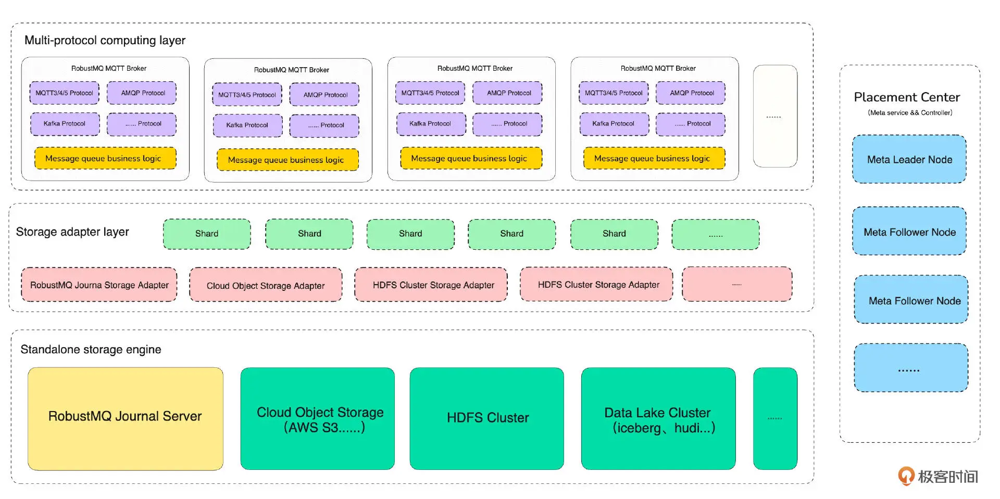

# 结束语 | 第一阶段课程结尾展望

- 本课程为精品小课，不标配音频

你好，我是文强。

到今天我们就正式结束这次课程了，在这门课程中我们基于 gRPC + RocksDB + Raft 构建了一个元数据服务集群。

从内容来看，每节课涉及的内容很多，包括但不限于 Rust 语言本身的知识点，还有比如分布式系统、网络、存储相关的内容。所以学习这个课程的过程可能会让你觉得有点吃力。不过，吃力也是合理的，内容知识点确实很多。

因此，这里我想再分享一下我对这门课程的期待和定位。在做课程设计的时候，我就明确了，我不想教你那种很基础的官方知识点的“翻译”，而是想教给你一些在平时很难获得的东西，在我看来可以叫做“经验”。

为抓手，带你去做一个真正具有工业化水准的基础软件。希望在这个课程中你可以获得：

1. 学好、学会 Rust 这个语言本身。

2. 知道如何开发实现一个分布式存储系统。

3. 参与写一个具有工业化水准的开源基础软件的经验。

4. 学会思考，技术上为什么会这么做，为什么不那么做。

当然，一分耕耘、一份收获，想从这个课程中获得更多的“经验”，就需要你更加投入，去理解课程、去理解代码、去旁征博引地学习更多内容，去交流群讨论和学习等等。编码、学习本身是一件很辛苦的过程。当你获得某个技能的过程越艰难，从某种程度来说你的竞争力就越强。

另外，在本次课程中，你会发现我们有两个项目《robustmq-geek》和《robustmq》。robustmq-geek 是课程配套的可运行的 Demo 示例，robustmq 是我们在社区推进的消息队列领域的开源项目。你可以理解 robustmq-geek 是开源项目 robustmq 的教学简化版，你也可以理解 robustmq 是 robustmq-geek 的工业化版本。

从课程设计的角度，我的初衷是希望你学会了本次课程后，能够去参与 robustmq 的开发。从而给你提供一个梯度，从简单到复杂，从示例项目到开源的工业化的基础软件项目，带你更好地去获得“经验”。

以终为始，为了告诉你我的系列课程最终会带你做成一个什么样子的基础软件。下面我来简单介绍一下 RobustMQ。

RobustMQ 的定位是基于 Rust 构建兼容多种主流消息队列协议、架构上具备完整 Serveless能力的下一代高性能云原生融合型消息队列。我希望把 RobustMQ 打造成下一个消息队列领域的 Apache 顶级项目。

它的整体架构图如下：

从设计的角度看，RobustMQ 是一个典型的分布式分层架构，包含计算层、存储层、调度层分离等。具体由控制层（Placement Center）、计算层（Multi-protocol computing layer）、存储适配层（Storage Adapter Layer）、独立的远端存储层（Standalone storage engine）四个部分组成。每一层都具备快速扩缩容能力，从而达到整个系统具备完整的 Serverless 能力。

因此它具备以下特点：

1. 100% Rust：完全基于 Rust 语言实现的消息队列引擎。

2. 多协议：支持 MQTT 3.1/3.1.1/5.0、AMQP、Kafka Protocol、RocketMQRemoting/gRPC、OpenMessing、JNS、SQS 等主流消息协议。

3. 分层架构：计算、存储、调度独立的三层架构，每层均具备集群化部署、快速水平扩缩容的能力。

4. 插件式存储：独立插件式的存储层实现，可根据需要选择合适的存储层。兼容传统和云原生架构，支持云、IDC 多种部署形态。

5. 高内聚架构：提供内置的元数据存储组件（Placement Center）和分布式存储服务（RobustMQ Journal Server），具备快速、简单、内聚的部署能力。

6. 功能丰富：支持顺序消息、死信消息、事务消息、幂等消息、延时消息等丰富的消息队列功能。

从项目愿景和技术架构来看，RobustMQ 是一个非常大的工程，非常有技术含量。如果你用心参与和学习，在我看来这个工程肯定可以给你带来成长，甚至是无与伦比的竞争力。

这里给你分享几个 RobustMQ 的资料，以便让你更好地了解 RobustMQ。

1. 《RobustMQ 魔法入门手册》

2. 《RobustMQ 官网》

3. 《RobustMQ 官方中文文档》

4. 《RobustMQ GitHub 项目》

5. 《RobustMQ 贡献指南》

6. Rust Conf 2024 分享 PPT：《RobustMQ - 下一代高性能云原生融合型消息队列》

7. Rust Conf 2024 分享视频：《RobustMQ - 下一代高性能云原生融合型消息队列》

课程的最后，祝愿你和我一样能在学习的过程中获得更多的踏实感，希望我们一起在这个内卷的环境中愈发从容！
