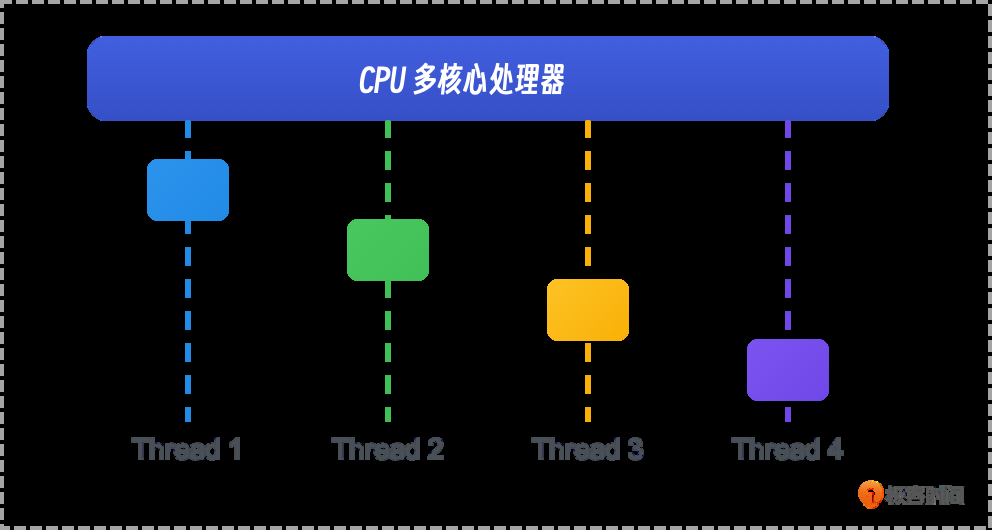
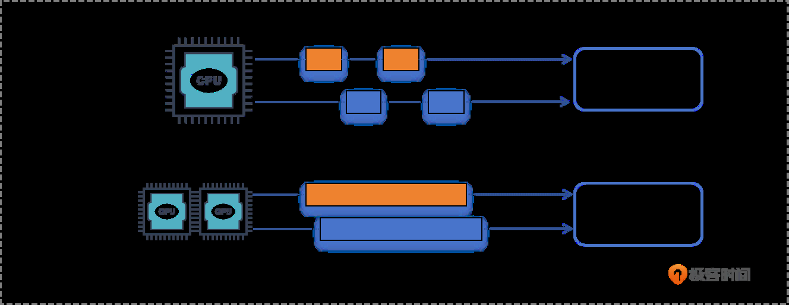
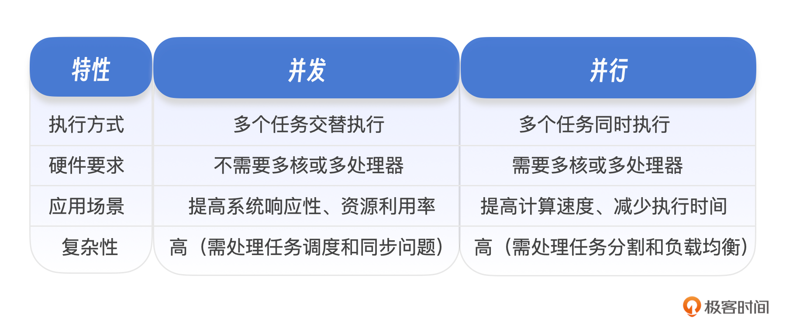
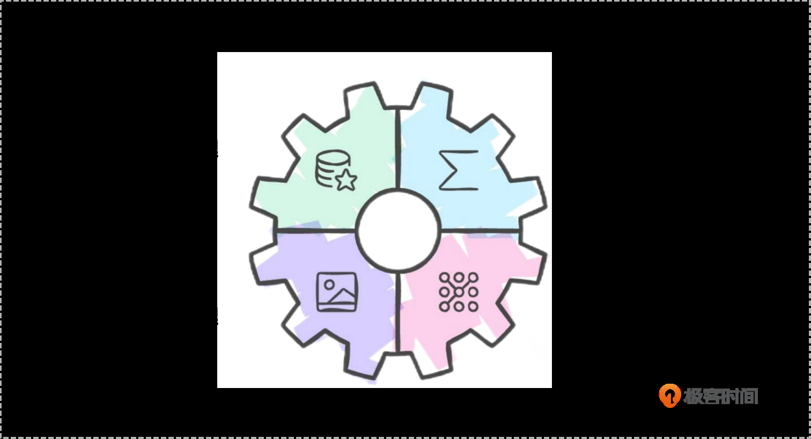

# 01 | 并发江湖，逐鹿天下：并发编程的基本概念与应用场景

你好，我是鸟窝。

并发编程是现代软件开发中不可或缺的一部分。随着硬件技术的发展，尤其是多核处理器的普及，单线程的程序已经无法充分发挥计算机的潜力。并发编程让程序能够同时处理多个任务，极大地提高了计算效率和资源的利用率。比如，当一个程序在等待网络响应时，它可以继续进行其他操作，从而避免了不必要的时间浪费。

此外，并发编程对于提升程序的响应性也至关重要。对于需要实时处理或有严格时延要求的应用，如在线游戏或金融交易系统，并发能够确保程序在面对高并发请求时依然保持流畅和高效。这不仅是性能上的提升，还是满足用户需求、增强用户体验的重要手段。而且，随着应用场景的复杂性增加，越来越多的应用程序需要在不同任务间进行协调，如多用户系统、大数据处理等。这些场景下，并发编程能够提供一种有效的方式来实现任务的协作，确保每个部分高效运行。

在技术的层面，学习并发编程也让开发者更深入地理解底层原理，如线程调度、内存共享、锁机制等，这些对于开发高效、安全的系统至关重要。因此，并发编程不仅是提高开发能力的工具，也是帮助开发者应对复杂应用挑战的关键技能。

## 什么是并发编程？

并发编程是现代软件开发中不可或缺的一部分。它指的是程序能够同时处理多个任务的能力，尽管这些任务可能并非严格意义上的同时执行，而是以交错的方式在逻辑上“同时”进行，实际可能不是在物理上同时运行（特别是在单核处理器上）。在当今多核处理器普及和分布式系统广泛应用的背景下，并发编程的重要性日益凸显。



随着现代计算设备的性能提升，特别是多核处理器的普及，并发编程变得越来越重要。以下是一些并发编程的典型应用场景：

- 提高性能：在多核处理器上，将任务分配到不同的核上并行执行，可以显著减少程序的执行时间。

- 提高程序响应性：在图形用户界面（GUI）应用或服务器应用中，并发编程可以让程序在处理耗时任务的同时保持对用户输入的响应。

- 资源优化：并发编程可以更有效地利用系统资源，如在等待 I/O 操作完成时执行其他计算任务。

对于 Rust 来说，并发的基本单位是进程和线程。进程是操作系统分配资源的最小单位，拥有独立的内存空间。而线程则是进程内部的执行单元，共享所属进程的资源。线程因其轻量级特性，成为了并发编程中更常用的单位，而这门课程我们也主要介绍基于线程的并发编程场景。

在并发编程中，我们需要处理任务的创建、启动、通信和同步。并发编程的核心在于如何管理这些任务的执行，使得它们能够高效地共享系统资源（如 CPU、内存等）而不引发错误。例如，当多个线程试图同时访问和修改同一数据时，可能会引发竞态条件（Race Condition），导致程序行为不可预测。实际上线程间的通信可以通过共享内存或消息传递来实现。而同步机制，如锁、信号量和条件变量，则用于协调不同线程的执行，防止数据竞争等问题。

并发编程中常见的设计模式包括生产者 - 消费者模式、读 - 写模式和主从模式等。这些模式为解决特定类型的并发问题提供了通用的框架。我们这门课程后面也有专门的章节介绍这些并发模式的实现。

并发编程的主要目标是提高程序的性能和响应性，更好地利用系统资源，并简化复杂系统的设计。然而，它也带来了诸如竞态条件、死锁和资源竞争等挑战，这些都是程序员在设计并发系统时需要特别注意的问题。

在 Rust 语言中，得益于其独特的所有权系统和类型检查，许多常见的并发问题可以在编译时就被捕获。这使得 Rust 成为编写安全高效的并发程序的理想选择。随着课程的深入，我们将逐步探讨 Rust 如何应对并发编程的挑战，以及如何利用其独特的特性构建可靠的并发系统。

## 并发 vs 并行

在计算机科学中，“并发”和“并行”是两个经常被混淆的概念，虽然它们看起来相似，但在本质上有着显著的区别。理解这两个概念对编写高效的并发程序至关重要。

并发是指多个任务在同一时间段内“交替”执行。换句话说，并发系统允许多个任务同时进行，但这些任务可能并不是真正同时运行，而是以一种分时的方式被调度器管理。这种任务交替的快速切换给人一种任务同时进行的感觉（实际上这种上下文的切换也是导致性能下降的一个主要原因）。

- 单处理器环境：在单处理器（单核）系统中，并发任务是通过时间片轮转等调度机制来交替执行的。虽然在微观层面上每个时间片内只有一个任务在运行，但在宏观层面上多个任务看似同时执行。

- 多处理器环境：在多核处理器中，并发任务可以分布在不同的处理器上，提升了实际的执行效率。

并发编程的主要目标是提高程序的响应性和资源利用率。例如，在一个网络服务器中，即使当前的任务在等待 I/O 操作完成，其他任务也可以继续执行，从而避免不必要的等待。



并行则是指多个任务在同一时刻真正同时运行。在并行系统中，多个处理器或处理器核心同时执行不同的任务，从而加速计算过程。

- 多处理器 / 多核系统：在并行计算中，不同的任务可以被分配到不同的处理器核心上同时运行。这种方式特别适用于计算密集型任务，如科学计算、图形渲染等。

- 数据并行性：并行计算的一个常见模式是数据并行性，即相同的操作被应用于不同的数据集上，从而可以在多个核心上并行处理。

并行编程的主要目标是提高程序的执行速度。通过将任务分割成可以同时执行的部分，并行计算可以显著缩短任务的完成时间。



我们通常在多核的情况下实现并行，而本课程主要讲解并发的设计和编程。Rob Pike 在他的著名的演讲《Concurrency is not Parallelism》中，谈到了并发的一些概念：

- Programming as the composition of independently executing processes. (Processes in thegeneral sense, not Linux processes. Famously hard to define.)将相互独立的执行过程综合到一起的编程技术。（这里是指通常意义上的执行过程，而不是Linux 进程。很难定义。）Concurrency is about structure.并发关乎结构。Concurrency provides a way to structure a solution to solve a problem that may (but notnecessarily) be parallelizable.并发提供了一种方式让我们能够设计一种方案将问题（非必须的）并行地解决。Concurrency is a way to structure a program by breaking it into pieces that can beexecuted independently.并发是一种将一个程序分解成小片段独立执行的程序设计方法。

通过将程序分解成小片段，提供能够并发执行的结构，通过并发库并发交替地执行任务，并且通过一些同步原语控制并发任务的执行和数据的同步，我们就可以实现并发程序。

- 同步原语（synchronization primitives）是用于控制并发程序中多个执行单元（如线程或进程）访问共享资源的工具或机制。它们帮助避免竞态条件、数据不一致以及其他并发问题，

- 确保不同执行单元能够在适当的时机访问共享资源。同步原语通常用于多线程或多进程环境下，保证数据的一致性和程序的正确性。同步原语的概念最早由 Edsger Dijkstra 提出。Dijkstra 是计算机科学领域的重要人物之一，他在 1960 年代提出了几种用于多线程和并发程序同步的基础机制，其中最著名的包括信号量（semaphores）。Dijkstra 在 1965 年发表的论文《Cooperating Sequential Processes》中首次提出了信号量概念，这是现代同步原语的一个核心组成部分。他引入了信号量作为一种机制，用于控制多个进程对共享资源的访问，从而避免竞态条件和死锁等并发问题。Dijkstra 还为同步原语的发展做出了其他重要贡献，尤其是在进程同步和互斥方面。他的工作为现代操作系统和并发编程的理论奠定了基础。

Rust 语言提供了丰富的工具和库来支持并发编程。Rust 的所有权系统和类型检查机制帮助开发者避免常见的并发编程错误，如数据竞争和死锁。此外，Rust 的标准库和社区提供的并发

```
处理库（如 rayon）使得编写高效、安全的并行程序更加容易。
```

## 并发编程的应用场景

并发编程在现代软件开发中具有广泛的应用，因为它能够提高程序的性能、响应性以及资源利用率。这节课我们将探讨并发编程的主要应用场景，帮助你更好地理解其在实际开发中的重要性。

### 多任务处理

多任务处理是并发编程的一个典型应用场景，尤其是在需要同时执行多个独立任务的系统中。以下是几个常见的例子：

- 操作系统：操作系统通过并发编程管理多个进程和线程，确保它们能够共享 CPU 时间和其他系统资源。例如，一个操作系统可能需要同时运行多个用户应用程序、处理输入输出操作、管理网络连接等。

- 服务器应用：服务器通常需要处理大量并发请求，如 Web 服务器、数据库服务器等。通过并发编程，服务器可以同时处理多个客户端请求，而不会因为某个请求的耗时操作而导致其他请求被阻塞。

### 密集型任务

I/O 密集型任务是指那些主要依赖于输入输出操作而非计算的任务，如网络通信、文件读写等。在这些场景中，并发编程能够显著提高系统的性能和响应速度。

- 网络服务器：在处理网络请求时，服务器通常需要等待数据的传输或响应。通过并发编程，服务器可以在等待某个请求完成时继续处理其他请求，从而提高吞吐量和响应速度。

- 文件处理：在需要处理大量文件读写操作的应用中（如日志分析工具、数据库管理系统等），并发编程可以让程序同时进行多个文件操作，从而减少总的处理时间。


### 计算密集型任务

计算密集型任务需要大量的 CPU 资源，如科学计算、图像处理、机器学习训练等。在这些场景中，并发编程尤其重要，因为它能够充分利用多核处理器的计算能力。

- 数据处理：在大规模数据处理任务中，使用并行编程可以将数据集分成多个部分并同时处理，从而显著缩短处理时间。

- 科学计算：科学计算通常涉及复杂的数学运算，这些运算可以分解为独立的子任务并行执行。并行编程能够加速这些计算过程，使得研究人员能够更快地获得结果。



### 用户界面与交互系统

图形用户界面（GUI） 应用通常需要处理用户的交互操作，同时执行后台任务。并发编程可以帮助 GUI 应用在保持界面响应的同时执行耗时的任务。

- 异步操作：在 GUI 应用中，某些操作（如网络请求、文件读取等）可能会阻塞主线程，从而导致界面无响应。通过将这些操作放在后台线程中执行，应用可以保持对用户输入的响应，提供更好的用户体验。

- 实时更新：一些应用需要实时更新界面，如股票行情、游戏等。并发编程可以让这些应用在获取和处理数据的同时，不影响界面的绘制和用户的交互。

### 实时系统

实时系统要求任务在特定的时间内完成，如嵌入式系统、工业控制系统、自动驾驶汽车等。并发编程在这些系统中至关重要，因为它允许多个任务同时运行，从而满足严格的时间要求。

- 嵌入式系统：在嵌入式系统中，多个传感器和执行器可能需要同时运行，并发编程可以帮助系统实时处理来自不同传感器的数据，并做出相应的决策。

- 工业控制：工业控制系统通常需要监控多个参数并实时调整系统的运行状态。并发编程可以帮助系统在多个监控任务之间切换，并及时响应各种事件。

### 分布式系统

分布式系统是指多个计算节点通过网络协作完成任务的系统，并发编程在这些系统中起着关键作用。

- 大数据处理：分布式大数据处理框架（如 Hadoop、Spark）依赖并发和并行编程来处理海量数据。通过将数据和任务分布到多个节点并行处理，可以极大地提高数据处理的效率。

- 微服务架构：在微服务架构中，各个服务通常是独立运行的进程，通过网络进行通信。并发编程可以帮助这些服务同时处理多个请求，并有效管理它们之间的通信。

### 游戏开发

游戏开发中也广泛使用并发编程，以实现复杂的游戏逻辑、物理引擎、人工智能以及渲染任务的并行执行。

- 游戏引擎：游戏引擎通常需要同时处理物理模拟、AI 决策、用户输入、音频处理等任务。通过并发编程，游戏引擎能够更高效地管理这些任务，并提供流畅的游戏体验。

- 网络游戏：在网络游戏中，并发编程用于处理大量的玩家交互、数据同步以及网络通信，以确保游戏的实时性和一致性。

### 高可用性与容错系统

高可用性与容错系统依赖并发编程来确保系统在面对硬件故障、网络问题或其他异常情况时，仍能继续运行。

- 多线程服务：通过多线程技术，系统可以在检测到某个线程故障时自动切换到备用线程，确保服务的连续性。

- 多进程服务：通过多进程服务，系统可以将请求负载到不同的进程去处理，在某个进程故障时，其他进程还可以提供服务，同样确保服务的连续性。

- 分布式容错：在分布式系统中，并发编程可以帮助实现节点之间的故障检测与恢复机制，确保系统即使在部分节点失效的情况下仍能正常运行。

并发编程在众多应用场景中扮演着至关重要的角色，从提高系统响应性和资源利用率，到实现复杂的实时系统和分布式架构。理解这些应用场景将帮助开发者更好地设计和实现并发程序，充分利用现代计算硬件的能力。

## 总结

并发编程在现代软件开发中至关重要，尤其在多核处理器普及和复杂应用需求不断增加的背景下。通过并发，程序可以在同一时刻处理多个任务，提高计算效率和资源利用率。它不仅能提升程序的性能，还能增强响应性，尤其在实时系统和高并发应用中，确保系统能够在面对大量请求时流畅运行。

并发编程能够有效解决资源优化和多任务处理的问题，适用于操作系统、网络服务器、密集型任务、以及 GUI 应用等多个场景。Rust 语言的并发编程结合其独特的所有权系统和类型检查，使得开发者能够编写安全、高效的并发程序。并且，Rust 的标准库和社区提供的并发工具，简化了并发编程的挑战，保证了程序的正确性和性能。

理解并发编程的核心不仅仅是提高程序的性能，还包括如何管理并发任务、避免竞态条件和死锁等常见问题。因此，掌握并发编程的设计模式和技术，对于构建高效、可靠的系统至关重要。

## 思考题

并发和并行有什么区别，并发可以带来性能提升的场景有哪些？你在开发过程中遇到哪些并发的场景？为什么大部分的课程都主要介绍并发编程，而不是并行编程？

期待你的分享。如果今天的内容对你有所帮助，也期待你转发给你的同事或者朋友，大家一起学习，共同进步。我们下节课再见！

小编提醒：首次直播时间在3 月 11 号晚 8 点，进课程交流群蹲直播链接🔗，直播答疑问题提交点这里
