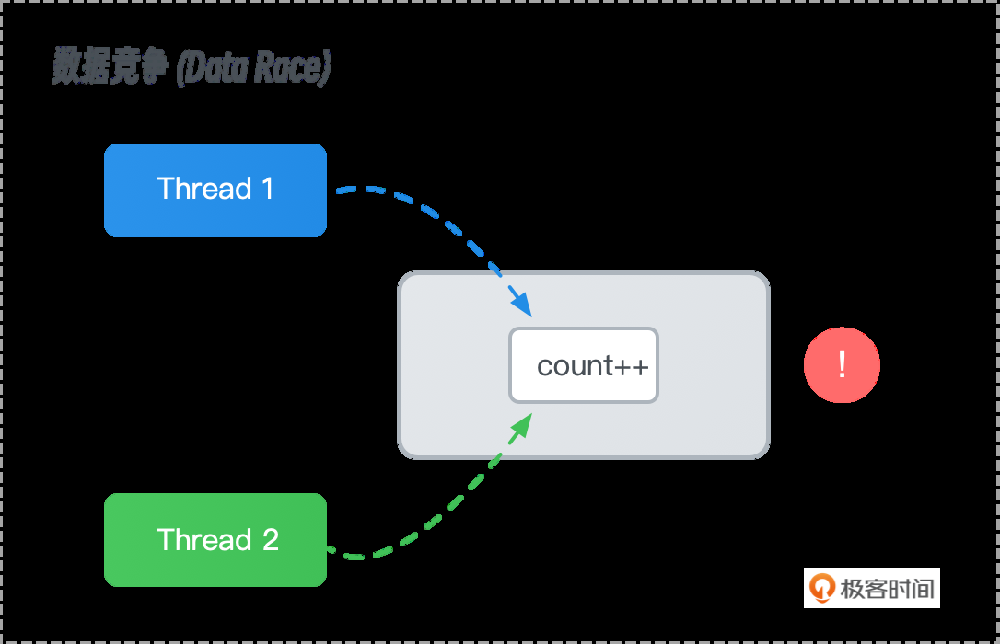
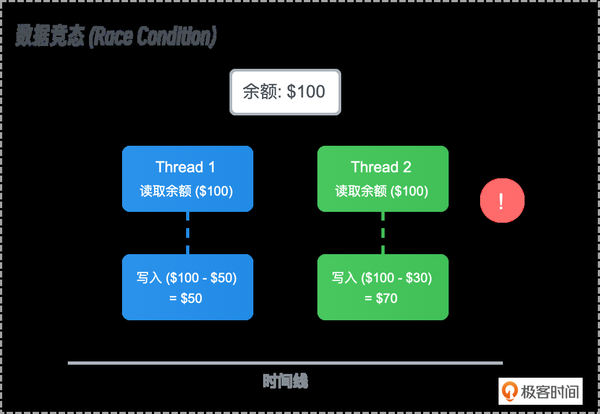
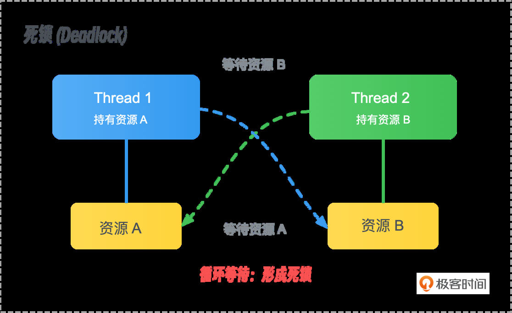
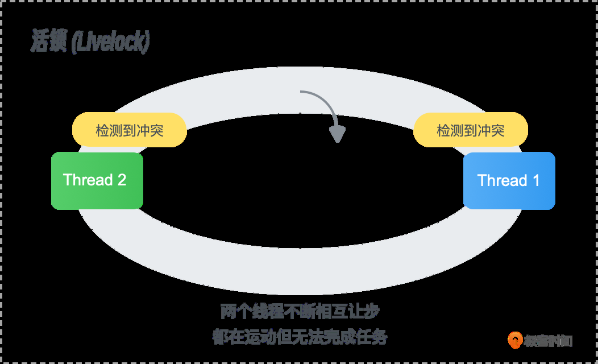
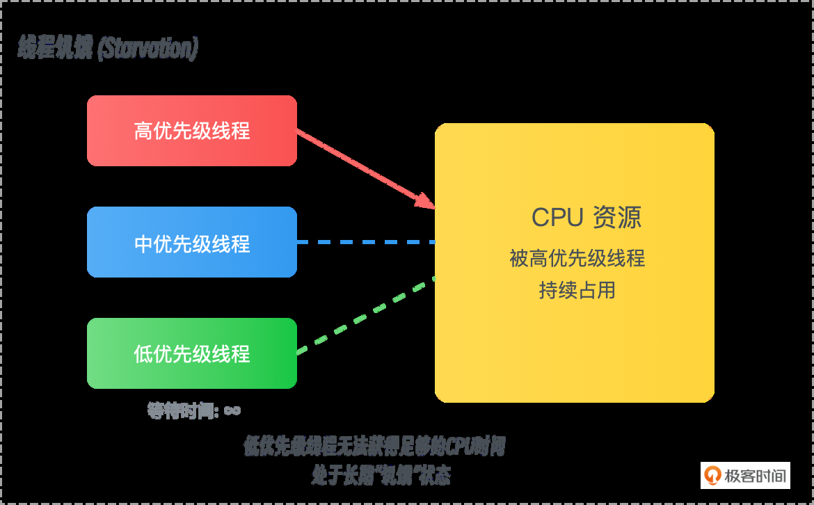
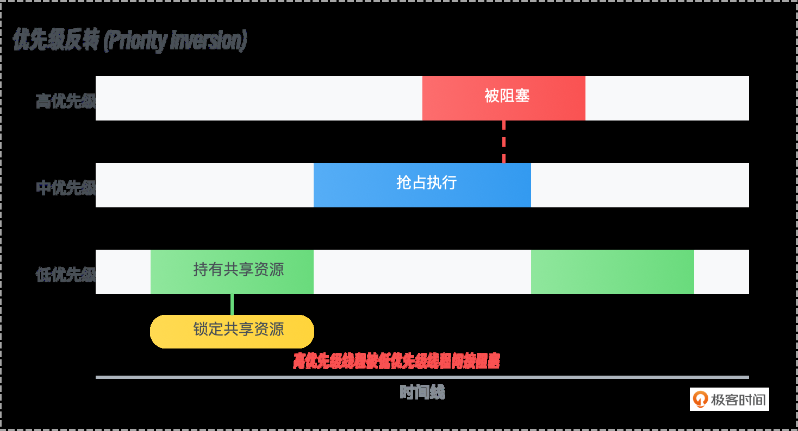

# 02 | 并发险途，乱象迷津：并发编程的挑战与问题

你好，我是鸟窝。

并发编程虽然能提高性能、增强系统响应性，但也引发了一系列复杂的挑战和问题。这些问题通常源于多个任务之间的交互、资源共享，以及系统行为的不可预测性。这节课我们将探讨并发编程中常见的挑战和问题，帮助你理解并发编程的复杂性并为后续深入地学习打下基础。

## 并发编程的挑战与问题

### 数据竞争

数据竞争（Data Race）是并发编程中的一种严重问题，发生在两个或多个线程在没有适当同步的情况下同时访问共享数据时。通常，这些线程中至少有一个执行写操作，从而导致数据不一致或不可预测的行为。



- 示例：假设有两个线程同时递增一个共享计数器。如果没有合适的同步机制，这些线程可能会同时读取计数器的值，然后各自将增量后的值写回。由于这两个写操作是并行的，最终的计数器值可能少于预期。

- 后果：数据竞争会导致程序的行为不确定，可能在某次运行中表现正常，但在另一次运行中出现错误。这种不确定性使得调试变得异常困难。

- 解决方法：数据竞争通常通过同步机制来避免，例如使用锁（Locks）来确保只有一个线程可以在任何时刻修改共享数据，或使用原子操作（Atomic Operations）以保证操作的不可分割性。

### 竞态条件

竞态条件（Race Condition）是另一个与数据竞争相关的问题，它描述的是程序的输出依赖于多个并发操作执行的顺序。在没有同步机制的情况下，不同的执行顺序可能导致不同的结果，从而引发错误。



- 示例：在一个银行系统中，如果两个线程同时试图更新同一账户的余额，而没有进行适当的同步处理，可能会导致余额更新错误。例如，一个线程执行存款操作，另一个线程执行取款操作，最终余额可能不正确。

- 解决方法：竞态条件通常通过同步机制来解决，如使用互斥锁（Mutex）来保护临界区，确保多个线程不会同时进入同一个代码块。此外，设计无锁算法（Lock-free Algorithms）也可以在一定程度上缓解竞态条件。

### 死锁

死锁（Deadlock）是并发编程中的一个严重问题，发生在两个或多个线程或进程相互等待对方持有的资源时，导致这些线程或进程无法继续执行。



示例：线程 A 持有资源 1 并等待资源 2，而线程 B 持有资源 2 并等待资源 1。这种情况会导致线程 A 和 B 相互等待，最终陷入死锁，程序无法继续运行。

- 防止死锁的方法包括下面几种：

- 资源有序分配：按照预定顺序申请资源，确保不会产生循环等待。

- 避免持有和等待：鼓励线程在持有一个资源时不等待其他资源，或在等待其他资源之前释放当前持有的资源。

- 死锁检测：动态监控线程的资源请求和分配情况，当检测到潜在的死锁时强制释放资源或终止部分线程。

### 活锁

活锁（Livelock）是与死锁相似的问题，不同之处在于任务仍然在执行，但由于某种条件一直没有得到满足，它们不断地进行状态变化，却始终无法取得进展。



- 示例：两个任务不断地调整各自的操作以避开冲突，但由于双方都在调整，始终无法完成各自的工作。

- 解决方法：活锁问题可以通过引入随机性、限制重试次数，或设计更为智能的协议来避免，确保任务能够最终取得进展。

### 饥饿与优先级反转

饥饿（Starvation）发生在某个任务无法获取所需资源的情况下，导致该任务长期得不到执行。优先级反转（Priority Inversion）则是指一个低优先级任务占用了资源，而高优先级任务因此无法获得资源，导致系统表现出意外的行为。





- 示例：在一个调度系统中，高优先级任务等待低优先级任务释放资源，然而中等优先级任务不断占用 CPU 时间，使得低优先级任务无法释放资源，导致高优先级任务陷入等待。

- 解决方法：解决饥饿问题的常见方法是采用公平调度算法，如最短作业优先（Shortest JobNext， SJN）和轮转调度（Round-Robin Scheduling）。优先级反转问题通常通过优先级继承机制解决，即当高优先级任务等待低优先级任务时，临时提升低优先级任务的优先级，直到它释放资源。

### 数据一致性与内存模型

在并发编程中，确保数据一致性是至关重要的，尤其是当多个任务共享数据时。由于现代处理器和编译器的优化，数据的读取和写入顺序可能被重排，导致数据在不同线程之间不一致。

- 示例：在多核处理器中，不同的处理器核心可能在各自的缓存中存储相同变量的副本，这可能导致某个核心对该变量的修改无法立即被其他核心看到，最终导致数据不一致。

- 解决方法：数据一致性问题通常通过内存屏障（Memory Barriers）或同步原语（如锁和条件变量）来解决，这些机制确保在必要的情况下强制刷新缓存或同步内存。

### 上下文切换与性能开销

上下文切换是指操作系统在多个并发任务之间切换时保存和恢复任务状态的过程。尽管上下文切换在并发系统中是必要的，但它会带来性能开销。

- 示例：每当操作系统从一个线程切换到另一个线程时，必须保存当前线程的状态并恢复下一个线程的状态，这个过程消耗了 CPU 时间，并且可能导致缓存不命中，进一步影响性能。

- 解决方法：减少上下文切换的常用方法包括优化任务粒度（减少不必要的并发）、使用协程（Coroutines）等轻量级任务，以及选择合适的并发模型（如事件驱动模型）。

### 调试与测试的复杂性

并发编程的另一个主要挑战是调试与测试的复杂性。由于并发任务之间的交互通常是不可预测的，因此并发程序的行为可能会在不同的运行中有所不同。这使得调试和测试并发程序变得极为困难。

- 示例：某个并发程序可能在一次运行中表现正常，但在另一次运行中由于某些竞态条件或死锁问题而失败。这种不确定性使得问题的重现变得困难，从而增加了调试的难度。

- 解决方法：调试并发程序通常需要使用特定的工具和技术，如死锁检测器、竞态条件分析工具、日志记录、并发测试框架等。此外，设计良好的测试用例和覆盖全面的测试方案也是确保并发程序正确性的重要手段。

## Rust 中的并发编程优势

Rust 在并发编程中提供了显著的优势，通过其独特的内存管理和类型系统，Rust 能够帮助开发者有效地应对并发编程中的各种挑战。

- 所有权系统：Rust 的所有权系统使得数据竞争在编译时被捕获，从而减少了运行时错误的可能性。所有权规则确保了多个线程不会同时拥有对同一数据的可变引用，这在根本上避免了许多并发问题。

```
安全的同步原语：Rust 提供了线程安全的数据结构和同步原语，如 Arc、Mutex 和
RwLock，这些工具帮助开发者在并发编程中更容易管理共享资源，并确保数据一致性。
```

- 零成本抽象：Rust 的抽象层几乎不会引入额外的性能开销，这使得开发者能够在不牺牲性能的前提下实现安全的并发编程。

并发编程为开发高性能和响应迅速的应用提供了必要的工具，但同时也引入了大量的复杂性和潜在问题。从数据竞争、竞态条件到死锁、上下文切换和调试难度，并发编程中的挑战往往需要开发者具备深厚的理解和经验。

幸运的是，Rust 通过其所有权系统和同步原语，为开发者提供了一种更安全、更高效的方式来应对这些挑战。在接下来的章节中，我们将详细探讨 Rust 如何帮助解决这些问题，并介绍Rust 中的具体并发编程技术。

## 没有“银弹”：并发不一定比串行快！

在编写并发程序时，许多人可能会认为并发执行总是比串行执行更快。然而，事实并非如此。并发并不是解决所有性能问题的“银弹”，在某些情况下，并发执行的开销可能反而导致性能下降。这节课我们将通过一个并发归并排序算法的示例来说明这一点，并通过基准测试（benchmark）来比较并发与串行执行的性能。

### 并发归并排序算法

归并排序是一种经典的分治算法，它将数组分成两半，分别进行排序，然后将排序后的子数组合并成一个有序的数组。由于归并排序天然具有递归的分解结构，它看似非常适合并发化处理。

我们可以将归并排序的并发版本实现为：

- 使用线程池并行处理左右两部分的排序。

- 在两部分排序完成后，合并结果。

以下是 Rust 中的并发归并排序代码：

```javascript
use std::thread;
// 使用多线程的方式实现归并排序
pub fn merge_sort_concurrent<T: Ord + Send + Clone>(arr: &mut [T]) {
   let len = arr.len();
   if len <= 1 {
       return;
   }
   // 将数组分割成左右两部分
   let mid = len / 2;
   let (left， right) = arr.split_at_mut(mid);
   thread::scope(|s| {
       // 在 scope 内创建线程并发执行左右半部分的排序
       s.spawn(|| merge_sort_concurrent(left));
       s.spawn(|| merge_sort_concurrent(right));
   });
   // 合并左右的结果
   merge(left， right);
}
// 合并左右排好序的数据
fn merge<T: Ord + Clone>(left: &mut [T]， right: &mut [T]) {
   // 新建一个 vec，存放排好序的数据
   let mut sorted = Vec::with_capacity(left.len() + right.len());
   let (mut i， mut j) = (0， 0);
   // 比较左右数组的大小，放入到一个 vec 中
   while i < left.len() && j < right.len() {
       if left[i] <= right[j] {
           sorted.push(left[i].clone());
           i += 1;
       } else {
           sorted.push(right[j].clone());
           j += 1;
       }
   }
   // 将剩余的元素添加到 sorted 中
   sorted.extend_from_slice(&left[i..]);
   sorted.extend_from_slice(&right[j..]);
   // 将结果拷贝回原始数组
   left.iter_mut().chain(right.iter_mut()).zip(sorted.into_iter())
       .for_each(|(slot， value)| *slot = value);
}
```

### async/await 版本的并发归并排序

```
async/await 是 Rust 中用于编写异步代码的关键特性，它使得编写并发程序更加简单和直
观。我们可以使用 async/await 来实现并发归并排序，从而更好地利用 Rust 的异步编程能
```

力。

- 当然，对于这个主要是 CPU 密集型的程序，async 未必是合适的方式，我们还是主要利用异步运行时的线程池的功能，避免机器资源被线程占满。

```javascript
基于 async/await 的并发归并排序实现如下：
// 使用 async 异步实现归并算法
pub async fn merge_sort_async<T: Ord + Send + Clone>(arr: &mut [T]) {
   let len = arr.len();
   if len <= 1 {
       return;
   }
   // 同样把数据分割成两部分
   let mid = len / 2;
   let (left， right) = arr.split_at_mut(mid);
   // 使用 async/await 来并发处理左右半部分的排序
   let (()， ()) = futures::join!(
       Box::pin(merge_sort_async(left))，
       Box::pin(merge_sort_async(right))，
   );
   // 合并左右两部分。merge 函数和上一节代码中的 merge 函数相同
   merge(left， right);
}
在这个版本中，我们使用 async/await 来并发处理左右两部分的排序任务，通过
futures::join! 宏来等待两个任务的完成。这种方式更加直观和易于理解，同时也能充分
```

利用 Rust 的异步编程能力。

### 并发与串行性能比较

为了更清晰地理解并发是否一定比串行快，我们可以通过基准测试对比并发归并排序和串行归并排序的性能。

以下是串行归并排序的实现：

```javascript
// 正统的串行实现归并排序
pub fn merge_sort_serial<T: Ord + Clone>(arr: &mut [T]) {
   let len = arr.len();
   if len <= 1 {
       return;
   }
   // 将 arr 分成两部分，因为程序是串行执行的，没有使用多线程，所以没有使用 split_at_mut 分
   let mid = len / 2;
   merge_sort_serial(&mut arr[..mid]);
   merge_sort_serial(&mut arr[mid..]);
   merge(arr);
}
fn merge<T: Ord + Clone>(arr: &mut [T]) {
   let mid = arr.len() / 2;
   // 将左右两部分分别复制到新的 vec
   let left = arr[..mid].to_vec();
   let right = arr[mid..].to_vec();
   let mut i = 0;
   let mut j = 0;
   let mut k = 0;
   while i < left.len() && j < right.len() {
       if left[i] <= right[j] {
           arr[k] = left[i].clone();
           i += 1;
       } else {
           arr[k] = right[j].clone();
           j += 1;
       }
       k += 1;
   }
   while i < left.len() {
       arr[k] = left[i].clone();
       i += 1;
       k += 1;
   }
   while j < right.len() {
       arr[k] = right[j].clone();
       j += 1;
       k += 1;
   }
}
```

串行归并排序的实现与并发版本类似，只是在排序左右两部分时采用串行递归的方式，而不是并发处理。

```
注意这里我们并没有实现和并发归并算法一样的 merge 函数，原因在于如果我们使用
merge(&mut arr[..mid]，&mut arr[mid..]) 会编译失败，Rust 的借用规则不允许同
时存在两个可变引用（&mut）指向同一个数据（或数据的不同部分），即使这些引用指向的是
不相交的部分。Rust 编译器无法自动推断出 arr[..mid] 和 arr[mid..] 这两个切片是相
```

互独立的，因此它会认为这段代码可能导致数据竞争（data race），从而拒绝编译。所以这里我们稍微变通了一下。

然后，我们编写基准测试进行性能测试。因为我们写的测试非常简单，所以这里我就没有使用

```javascript
criterion 框架，而是直接使用标准库自带的 test crate， 不过因为它还是实验性的，你
需要在代码文件加上 #![feature(test)] 才能使用：
#![feature(test)]
extern crate test;
use ch01::{merge_sort_concurrent， merge_sort_serial，merge_sort_async};
use rand::prelude::*;
use tokio::runtime::Runtime;
use test::Bencher;
// 产生包含指定数量的随机数的 vec
fn generate_random_vec(size: i32) -> Vec<i32> {
   let seed: u64 = 12345;
   let mut rng = StdRng::seed_from_u64(seed);
   (0..size).map(|_| rng.gen_range(0..size)).collect()
}
#[bench]
fn benchmark_merge_sort_concurrent(b: &mut Bencher) {
   let arr = generate_random_vec(100);
   b.iter(|| {
       let mut data = test::black_box(arr.clone());
       merge_sort_concurrent(&mut data);
   })
}
#[bench]
fn benchmark_merge_sort_serial(b: &mut Bencher) {
   let arr = generate_random_vec(10000);
   b.iter(|| {
       let mut data = test::black_box(arr.clone());
       merge_sort_serial(&mut data);
   })
}
#[bench]
fn benchmark_merge_sort_async(b: &mut Bencher) {
   let arr = generate_random_vec(10000);
   let rt = Runtime::new().unwrap();
   b.iter(|| {
       let mut data = test::black_box(arr.clone());
       rt.block_on(merge_sort_async(&mut data));
   })
}
我们使用 generate_random_vec 产生指定数量的随机数。在函数值我们使用指定的随机数
```

种子，以便每个测试都能产生相同序列的随机数。

```
因为 merge_sort_concurrent 会创建很多的线程，突破开发机资源的限制，无法产生更
多的线程导致测试失败，所以我们将 merge_sort_concurrent 的测试数据量减小到
100，而 merge_sort_serial 和 merge_sort_async 的测试数据量为 10000。
merge_sort_serial 串行执行，它会使用一个线程，开发机资源没有问题，
merge_sort_async 会产生少量线程（和开发机 CPU 核数相同），所以开发机也没有资源问
```

题。

### 基准测试结果分析

通过运行基准测试，你可能会发现并发归并排序在某些情况下并不一定比串行归并排序更快，甚至可能更慢。比如上面的代码在 Mac mini M2 上测试，并发归并排序的性能要比串行归并排序慢很多。

```
running 3 tests
test benchmark_merge_sort_async      ... bench:   1，274，852.08 ns/iter (+/- 4，2
test benchmark_merge_sort_concurrent ... bench:   1，166，457.80 ns/iter (+/- 27，
test benchmark_merge_sort_serial     ... bench:     738，717.72 ns/iter (+/- 3，56
test result: ok. 0 passed; 0 failed; 0 ignored; 3 measured; 0 filtered out; finis
```

造成这种现象的原因包括：

- 线程管理开销：并发归并排序需要创建多个线程来处理子任务，线程的创建和上下文切换是有开销的。当数据规模较小时，这些开销可能超过并发带来的性能提升。

- 数据量对并发的影响：当数据量较小时，分解到每个线程的数据量也很小，并发处理反而引入了不必要的复杂性和开销。而在数据量较大时，并发的优势才可能显现出来。

- 硬件限制：并发的性能提升依赖于硬件的支持（如多核处理器）。如果硬件资源不足或线程数超出处理器核心数，线程间的竞争会降低并发性能。

并发并不是性能的“银弹”，它在某些情况下能够提升性能，但在其他情况下可能引入更多的开销和复杂性。理解并掌握并发编程中的这些细节，能够帮助你在设计和实现并发程序时做出更明智的决策。通过合适的工具和基准测试，你可以找到并发和串行之间的最佳平衡点，以实现预期的性能目标。

## 总结

并发编程提供了提高性能和响应性的潜力，但它也带来了诸多复杂性和挑战。常见的问题包括数据竞争、竞态条件、死锁、活锁、饥饿、优先级反转等。这些问题通常源于多个线程之间的相互作用、资源共享和系统行为的不确定性，可能导致程序运行结果的不稳定和不可预测。

数据竞争和竞态条件是并发编程中最常见的问题，发生在多个线程无法适当同步地访问共享资源时，导致数据的不一致。通过使用锁和原子操作等同步机制可以有效避免这些问题。死锁则发生在多个线程互相等待对方释放资源，导致程序无法继续执行。避免死锁的方法包括资源的有序分配和避免持有资源时等待其他资源。活锁与死锁类似，但不同的是，任务虽然在执行，但无法完成实际的工作。通过引入随机性和智能的协议设计，可以解决活锁问题。

饥饿和优先级反转是与任务调度相关的问题，饥饿发生在某个任务因资源得不到满足而长期得不到执行，优先级反转则指低优先级任务占用资源导致高优先级任务无法执行。解决这些问题的方法包括使用公平调度算法和优先级继承机制。

数据一致性是并发编程中的另一大挑战，特别是在多核处理器中，由于处理器优化，数据可能在不同核心的缓存中存储，导致数据不同步。使用内存屏障和同步原语可以确保数据一致性。此外，上下文切换在多任务系统中是不可避免的，虽然是必需的，但也带来性能开销。优化任务粒度和使用轻量级任务如协程可以减少上下文切换的开销。

并发程序的调试和测试非常复杂，因为任务间的交互往往是不可预测的，导致并发程序的行为在不同的运行中可能有所不同。专用的调试工具和测试框架有助于解决这些问题。

Rust 提供了强大的工具来应对这些挑战。其独特的所有权系统能够在编译时捕捉数据竞争，避免了运行时错误的发生。Rust 提供的同步原语（如 Mutex 和 RwLock）帮助开发者更容易地管理共享资源，确保数据一致性。此外，Rust 的零成本抽象特性使得并发编程既安全又高效。

总之，尽管并发编程能提高系统性能和响应性，但其挑战和复杂性不可忽视。Rust 通过其内存管理和类型系统为开发者提供了应对这些挑战的工具，使得并发编程变得更安全、高效。在接下来的章节中，我们将深入探讨 Rust 在并发编程中的具体应用与技术。

## 思考题

1. 数据竞争与竞态条件的区别：什么是数据竞争和竞态条件？它们在并发编程中有什么不同？请简述数据竞争可能带来的后果，并举一个生活中的实际例子来解释。

2. 死锁与活锁的对比：死锁和活锁有什么相似之处和不同之处？请举例说明。如何设计程序避免死锁和活锁问题？请列举至少两种策略。

期待你的分享。如果今天的内容对你有所帮助，也期待你转发给你的同事或者朋友，大家一起学习，共同进步。我们下节课再见！

小编提醒：首次直播时间在3 月 11 号晚 8 点，进课程交流群蹲直播链接🔗，直播答疑问题提交点这里
