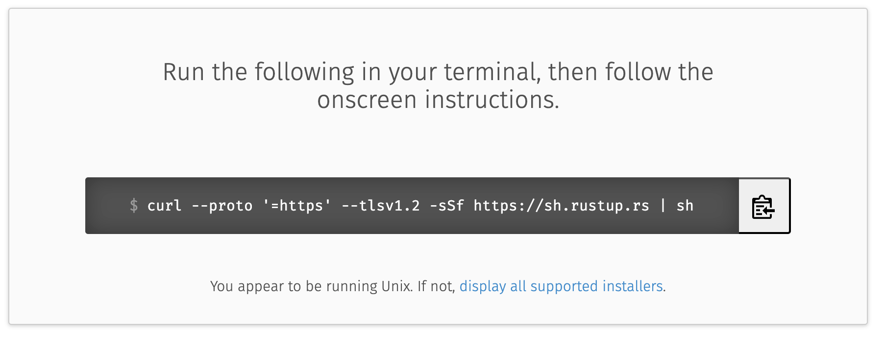
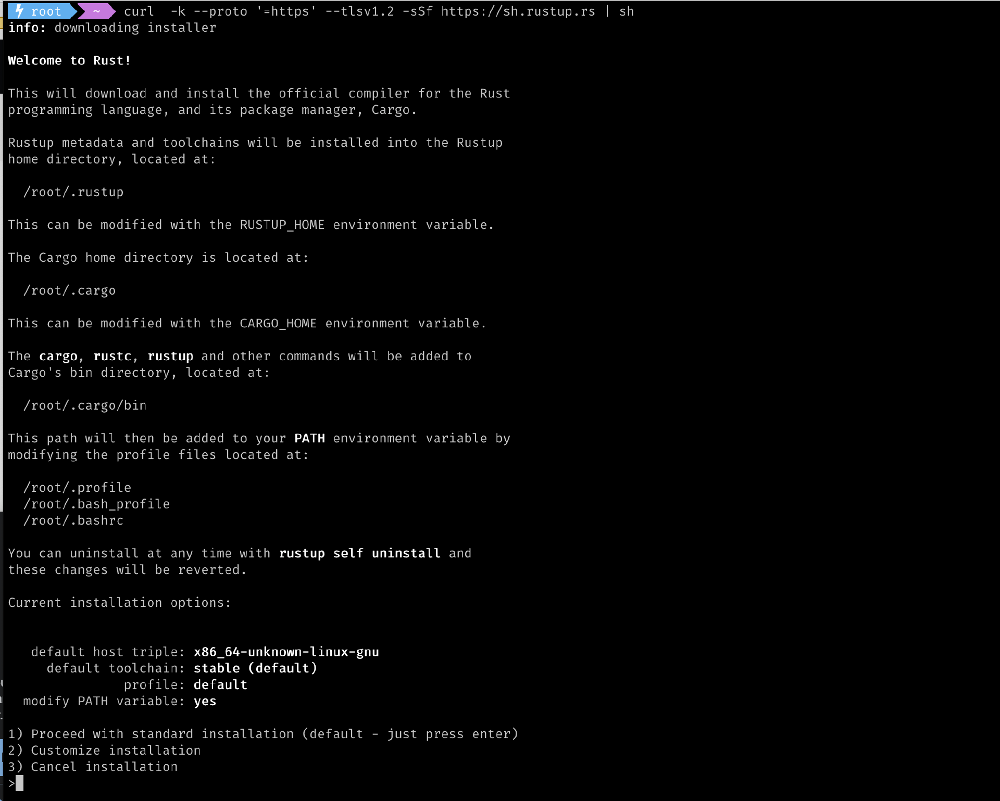
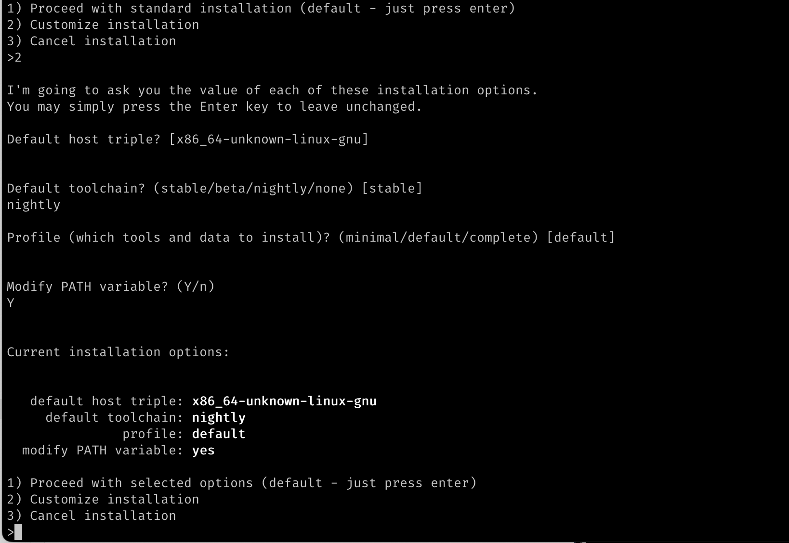
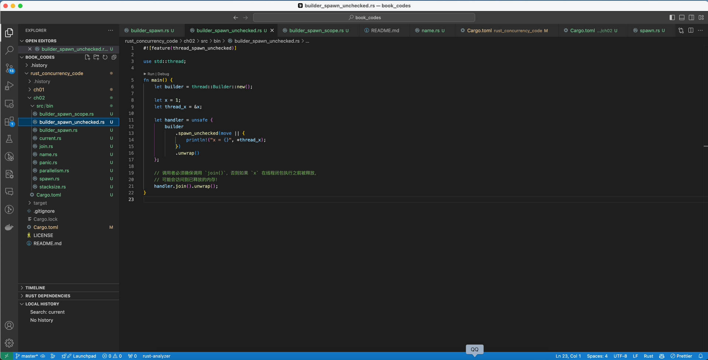
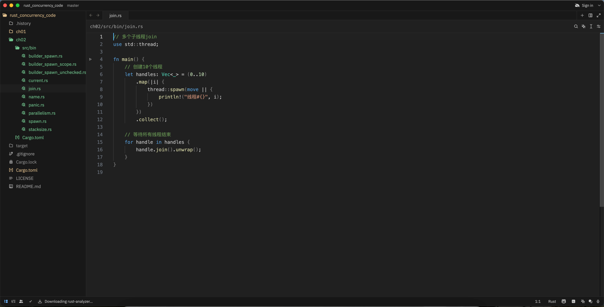
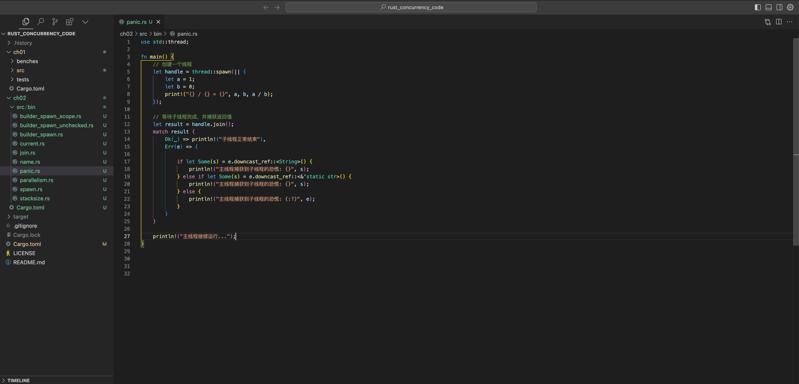
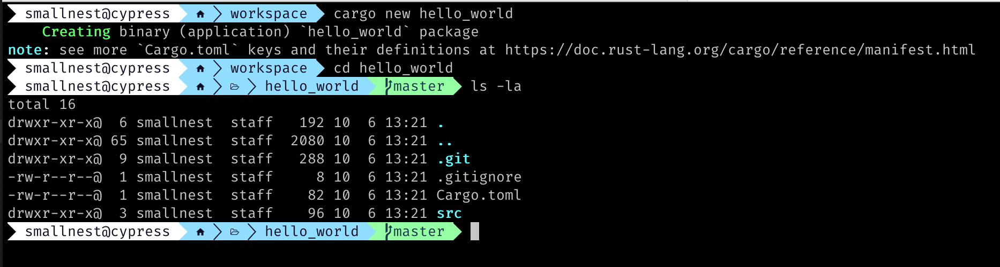

# 03 | 欲善其事，先利其器：开发环境搭建

你好，我是鸟窝。这节课我来带你搭建起 Rust 的编程环境。

如果你已经对 Rust 有所了解，并且对 Rust 程序的开发环境已经熟悉，可以跳过本章。如果你是一个 Rust 的初学者，你可以参考本章的内容，搭建好 Rust 的开发环境。

## rustup 和 cargo

安装 Rust 相关工具常用方式是使用 rustup, 这是一个 Rust 的安装和更新工具，它可以帮助你安装 Rust 和相关的工具链。你可以到网站了解详细信息。当然你访问这个网站的时候，首页会告诉你安装 rustup 命令最简单的方法：



执行那个 curl 命令会一步一步带你安装 Rust 相关工具。

首先是一些介绍。

接下来是一个默认选项，如果没有特别的，你就输入 1，选择默认安装即可。



但是如果你想要些不同的，那么你就选择 2，它会一步一步提示你选择，比如下面我选择安装Rust 的 nightly 版本，这样我就能测试 Rust 最新的不稳定的特性。

不过不用担心，以后你还可以修改安装不同的选项。



当然如果上面安装 rustup 的时候因为某种原因不能下载和访问，你也可以使用国内的镜像，

```bash
比如字节跳动的镜像 RsProxy，比如你设置环境变量，最好把它写入到 ~/.zshrc 或者
~/.bashrc:
export RUSTUP_DIST_SERVER="https://rsproxy.cn"
export RUSTUP_UPDATE_ROOT="https://rsproxy.cn/rustup"
```

然后使用下面的命令安装：

```bash
curl --proto '=https' --tlsv1.2 -sSf https://rsproxy.cn/rustup-init.sh | sh
```

完成上面的安装以后，Rust 相应的工具，比如 Rust 编译器、cargo 工具都已经安装成功了。有时候国内访问和下载 crate 很慢，你也可以修改相关的配置，从国内的镜像拉取，比如我们还是使用 RsProxy 网站的镜像：

```
[source.crates-io]
replace-with = 'rsproxy'
[source.rsproxy]
registry = "https://rsproxy.cn/crates.io-index"
[source.rsproxy-sparse]
registry = "sparse+https://rsproxy.cn/index/"
[registries.rsproxy]
index = "https://rsproxy.cn/crates.io-index"
[net]
git-fetch-with-cli = true
```

如果可能，你还可以使用 sparse 优化 crate 的索引和下载。默认情况下，cargo 会使用基于Git 的 index（也是前面的默认配置）。但是随着 index 体积增大，利用 git 拉取全量 index 逐渐变得缓慢（上百兆的 git 仓库即便是国内环境依旧较慢）。Sparse Index 可以进行优化，目前该功能在 nightly 版本下已可用。

```
[source.crates-io]
replace-with = 'rsproxy-sparse'
[source.rsproxy]
registry = "https://rsproxy.cn/crates.io-index"
[source.rsproxy-sparse]
registry = "sparse+https://rsproxy.cn/index/"
[registries.rsproxy]
index = "https://rsproxy.cn/crates.io-index"
[net]
git-fetch-with-cli = true
```

国内有很多 Rust crate 的镜像，尤其是一些知名的大学，下面都是一些国内的镜像，你可以选择合适的源：

```
# 放到 `$HOME/.cargo/config` 文件中
[source.crates-io]
registry = "https://github.com/rust-lang/crates.io-index"
# 替换成你偏好的镜像源
replace-with = 'rsproxy-sparse'
# 清华大学
[source.tuna]
registry = "https://mirrors.tuna.tsinghua.edu.cn/git/crates.io-index.git"
# 中国科学技术大学
[source.ustc]
registry = "https://mirrors.ustc.edu.cn/crates.io-index"
# 或者
# registry = "git://mirrors.ustc.edu.cn/crates.io-index"
# 上海交通大学
[source.sjtu]
registry = "https://mirrors.sjtug.sjtu.edu.cn/git/crates.io-index"
# 字节跳动源
[source.rsproxy]
registry = "https://rsproxy.cn/crates.io-index"
[source.rsproxy-sparse]
registry = "sparse+https://rsproxy.cn/index/"
[registries.rsproxy]
index = "https://rsproxy.cn/crates.io-index"
[net]
git-fetch-with-cli = true
```

## 编辑器

一个好的编辑器可以达到事半功倍的效果，不过这都是老黄历了，随着 AI 技术的快速发展，一个带 AI 智能助手的编辑器可以达到十倍的效果，所以接下来我介绍几款好用的编辑器，这也是我经常使用的编辑器。RustCover 是 JetBrain 公司的 Rust 编辑器，因为是商业产品，我就不介绍了。Rust.Vim 我也不会介绍，因为这是过于极客的编辑器。

### VS Code

Visual Studio Code（简称 VS Code）是由微软开发的一款免费、开源的轻量级代码编辑器。它是现代软件开发中常用的工具之一，广泛支持多种编程语言和工作流。以下是 VS Code 的一些关键特性：

- 轻量级但功能强大：VS Code 体积较小，运行速度快，适合不同规模的项目，无论是小型脚本还是大型代码库。此外，它既支持基本的文本编辑功能，又包含强大的代码编辑能力，如语法高亮、智能代码补全（IntelliSense）、代码导航等。

- 多语言支持：VS Code 支持多种编程语言，包括但不限于：JavaScript、TypeScript、Python、Go、Rust、C/C++ 通过插件（Extensions），可以添加对更多语言的支持或增强现有语言的功能。

- 扩展功能：VS Code 拥有丰富的扩展市场，用户可以根据需要安装插件来增强编辑器的功能。

- 集成调试器：VS Code 提供内置调试功能，支持多种语言的调试器。用户可以直接在代码编辑器中设置断点、单步调试、查看变量、输出调试信息等。

- 终端集成：VS Code 内部集成了终端功能，用户可以在不离开编辑器的情况下运行命令行操作，执行脚本、编译代码、查看日志等。

- 跨平台：VS Code 支持跨平台，能够在 Windows、macOS 和 Linux 系统上流畅运行，极大地方便了开发者在不同操作系统间的协作。

- 远程开发：VS Code 提供了远程开发功能（Remote Development），允许用户连接到远程服务器进行开发。这对于需要在云端或虚拟机上开发的项目非常有用。

- AI 支持：因为是微软旗下的产品，VS Code 很早就得到了 Copilot 的支持，而且很是火了一阵子，现在在 Cursor 的新的编辑器的竞争下，Copilot 也在快速进化。

在 VS Code 中，通过安装特定的扩展可以为 Rust 提供强大的开发支持，使得 Rust 开发变得高效便捷。目前我们常常使用的插件是 Rust Analyzer。这是最流行的 Rust 插件，提供全面的 Rust 开发支持。它由 Rust 社区维护，并且是官方推荐的工具。该插件提供智能代码补全、代码导航、错误提示、重构工具、格式化工具等功能。安装 Rust Analyzer 后，VS Code对 Rust 的支持将变得非常强大。



### Zed

Zed 编辑器是一款相对较新的代码编辑器，由 Nathan Sobo 和他的团队开发，Nathan Sobo曾是 Atom 编辑器的核心开发者之一。Atom 编辑器原来是 GitHub 自己开发的编辑器，一出来很是惊艳，但是随着 VS Code 的崛起，Atom 编辑器暗淡下去了，但是开发者 Nathan Sobo还是有编辑器开发的执念，他创建了基于 GPU 的快速相应的编辑器。另外的开发者 MaxBrunsfeld 和 Antonio Scandurra 同样是 Zed 项目的核心开发者，之前也参与过 Atom 编辑器的开发工作。

Zed 的设计目标是提供一个速度快、响应迅速、支持协作的现代代码编辑器。它通过使用Rust 编程语言构建的自定义引擎，确保了高性能和低延迟。

Zed 编辑器的功能聚焦于高性能、实时协作、专注模式和现代设计。Zed 的目标用户主要是对性能有较高要求的开发者，特别是那些在处理大型代码库或需要协作功能的开发者。它还适合那些希望使用现代编辑器的开发者，这些人可能对传统的基于 Electron 的编辑器（如 Atom 和VS Code）的性能感到不满。

Zed 原来最主要的目标之一就是高性能，通过 GPU 的加持渲染确实非常快，但是，随着最近智能编辑器的大火，他们的目标也不得不进行调整，最开始是慢慢的 Copilot 插件的引入，最近有主攻各种大模型的 AI 辅助编码，也是紧跟时代潮流。



Zed 编辑器就是使用 Rust 开发的，所以必然的 Rust 是它第一要支持的编程语言。Zed 也是集成了 Rust Analyzer。

### Cursor

本来 Copilot 在 VS Code 中的代码，就让大家很惊艳了，没想到代码辅助可以提高那么多的生产力：自动的代码生成，单元代码自动产生、代码辅助分析、代码注释自动添加、检查代码中的错误等等。在我们在逐步熟悉 Copilot 的各项功能的同时，Copilot 的新特性也不再像刚开始的时候层出不穷。

就在大家以为代码助手就这样的时候，又出来一个王炸，也就是 Cursor 这个编辑器。它默认使用当前 claude-3.5-sonnet 当前最好的代码大数据模型之一，让代码复制编程的想象力天花板又达到了新的高度。

它不仅仅有 Copilot 常见的代码自动生成这种我们已经熟悉的基本功能，还可以根据提示，给你生成一个完整的代码项目，包括前后端的代码，甚至配置文件，而你只需和它交谈几次，让它修改几次小错误，做一些美化，就可以完成一个项目。

你还可以让它基于整个项目，生成项目的 quick start 等文档。甚至对于一个不会编程的人来说，它都可以帮助你完成整个编程项目。虽然目前生成的项目还是比较简单，可是这已经非常炸裂了。你甚至可以看到几岁的小孩完全用 Cursor 生成一个游戏。

我花了一个小时的时间，使用 Cursor 生成了一个 IP 地理信息查询的网站：https://ip.rpcx.io 简直是太爽了。因为 Cursor 也是基于 VS Code 开发的，所以它天然支持Rust Analyzer 插件，也就是完全支持 Rust 开发，还有 AI 的加持。



- Cursor 当前可以试用，试用期过后你就需要购买才能使用它的 AI 功能了，或者换新的账号。

## 一个简单的 Rust 项目

Rust 项目通常使用 Cargo 来管理。以下是创建和运行一个简单 Rust 项目的步骤：

1. 创建新项目

```bash
  cargo new hello_world
  cd hello_world
```

生成的项目的文件结构如下：



```
Cargo 已经创建了一个名为 Cargo.toml 的文件来保存项目的元数据，目前这个文件还没有
```

多少内容：

```
[package]
name = "hello_world"
version = "0.1.0"
edition = "2021"
[dependencies]
如果你想增加第三方依赖，比如 rand crate，你可以在这个目录下执行 cargo add rand：
cargo add rand
Updating `tuna` index
 Adding rand v0.8.5 to dependencies
        Features:
        + alloc
        + getrandom
        + libc
        + rand_chacha
        + std
        + std_rng
        - log
        - min_const_gen
        - nightly
        - packed_simd
        - serde
        - serde1
        - simd_support
        - small_rng
Locking 16 packages to latest compatible versions
 Adding wasi v0.11.0+wasi-snapshot-preview1 (latest: v0.13.2+wasi-0.2.1)
 Adding zerocopy v0.7.35 (latest: v0.8.2)
 Adding zerocopy-derive v0.7.35 (latest: v0.8.2)
```

也可以直接修改这个文件，编译或者运行的时候自动下载第三方库：

```
[package]
name = "hello_world"
version = "0.1.0"
edition = "2021"
[dependencies]
rand = "0.8.5"
Cargo 已经为我们的项目配制好了 git，它增加了 .git 目录和 .gitignore 文件。如果你不
想配置 git, 你可以在 cargo new 时候增加 --vcs none 来禁用版本控制。
编辑 src/main.rs，默认情况下 src 目录下会有一个 main.rs 简单的程序，它是 main 程序
```

- 的初始模板，你可以在此基础上编写复杂的程序：

```
  fn main() {
      println!("Hello, world!");
  }
```

比如我们修改为输出一个随机的数字：

```
fn main() {
   println!("{}", rand::random::<i32>());
}
```

3. 构建和运行:

```
  cargo run
```

### 库项目

```
如果我们想创建一个库项目，那么可以在 cargo new 的时候传入--lib。
使用 cargo new my_library --lib 创建库项目。
在 src/lib.rs 中定义公共 API。
使用 cargo build 构建库。
```

4. 其他项目可以通过在 Cargo.toml 中添加依赖来使用这个库。

```
或者在此项目中增加 main.rs，实现可执行文件，同时也可以引用这个库。
```

### 多个执行程序的项目

Cargo 支持在一个项目中包含多个二进制程序，至少有两种方式：

- 虚拟 workspace，workspace 配置例子如下：

```
[workspace]
members = ["member1", "path/to/member2", "crates/*"]
exclude = ["crates/foo", "path/to/other"]
```

可以包含多个 members，甚至可以写成通配符的方式。

```
多个 bin。可以在 bin 目录下写多个 main 程序，运行的时候通过 --bin 指定要运行的
```

- main 程序。

我们配套的代码同时采用这两种形式。每一章是一个单独的 member，每个 member 中又采用第二种形式，实现多个可执行程序。

第二种形式一般如下：

```
在 src/bin 目录下创建多个 .rs 文件，每个文件对应一个可执行程序。
例如，创建 src/bin/program1.rs 和 src/bin/program2.rs。
使用 cargo run --bin program1 来运行特定的程序。
```

## 总结

这节课我们详细介绍了如何为 Rust 开发环境配置工具和编辑器，并展示了一个简单的 Rust项目的创建过程，我们一起来回顾一下。

Rust 环境安装：

```
rustup：我们首先介绍了 rustup，这是安装和更新 Rust 的工具。通过访问官方安装网
```

- 站，用户可以根据需要选择默认安装或自定义安装（如选择 nightly 版本）。

2. 国内镜像：为了提高下载速度，我建议你使用国内镜像源（如 RsProxy、清华大学、上海交通大学等）的配置方法。

3. cargo：Rust 的包管理工具，用于管理依赖和构建项目。

编辑器选择：

1. VS Code：我推荐使用 Visual Studio Code（VS Code）作为 Rust 开发的编辑器。VSCode 是一款轻量级、功能强大的代码编辑器，支持多种编程语言和插件。通过安装 RustAnalyzer 插件，VS Code 可以提供智能代码补全、代码导航等功能，提升 Rust 开发效率。

2. Zed 编辑器：Zed 是一款由 Rust 开发的编辑器，专注于高性能、实时协作和现代设计，适合对性能要求较高的开发者。

3. Cursor 编辑器：Cursor 编辑器结合了 AI 技术，提供智能代码生成和协作功能，可以生成完整的项目并进行优化，适合需要快速开发的场景。

```
创建 Rust 项目：使用 cargo new 创建一个新的 Rust 项目，并展示项目结构。默认生成
的 Cargo.toml 文件用于管理项目的元数据和依赖。最后我还演示了如何添加第三方库
（如 rand crate），并通过修改 Cargo.toml 文件来管理项目依赖。
```

## 思考题

如果你已经熟悉了 Rust 的编程开发，可以略过本节课。如果你还未曾接触过 Rust 开发，就请你尝试创建一个 Rust Hello World 项目。

期待你的分享。如果今天的内容对你有所帮助，也期待你转发给你的同事或者朋友，大家一起学习，共同进步。我们下节课再见！

小编提醒：首次直播时间在3 月 11 号晚 8 点，进课程交流群蹲直播链接🔗，直播答疑问题提交点这里
