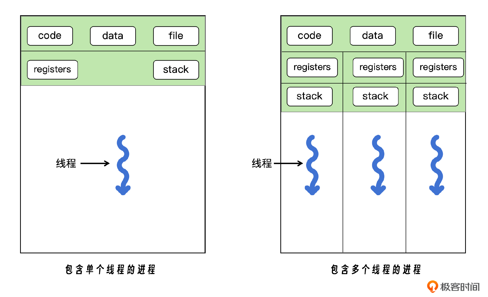
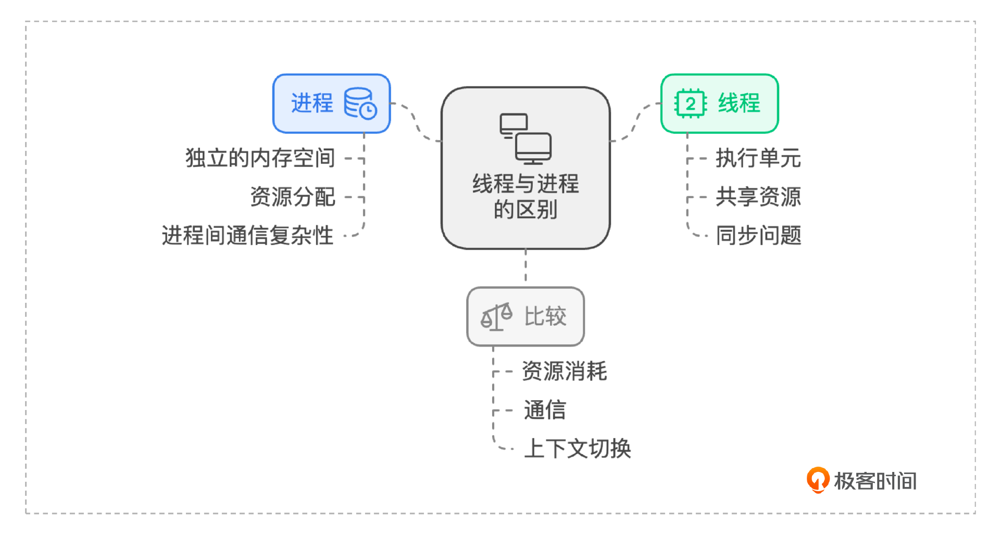
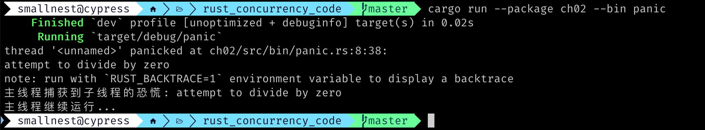
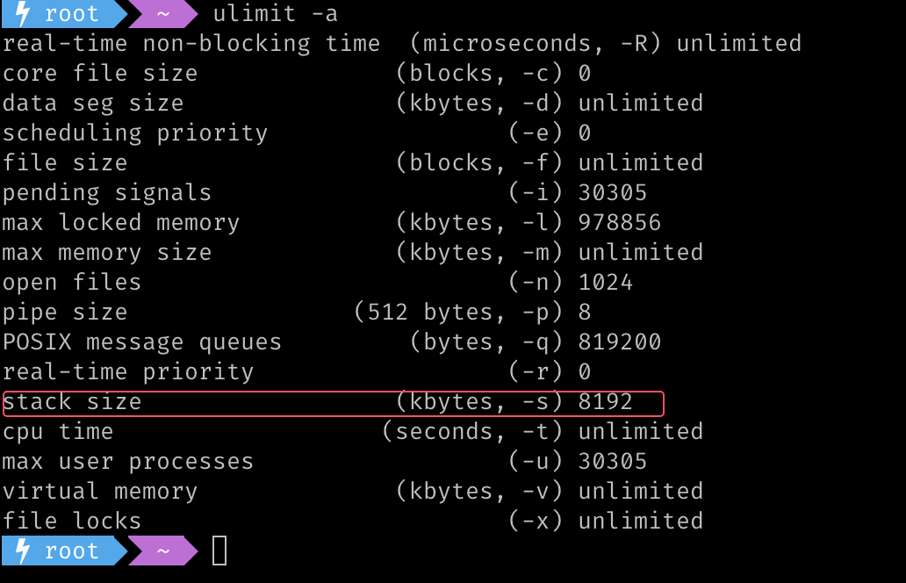
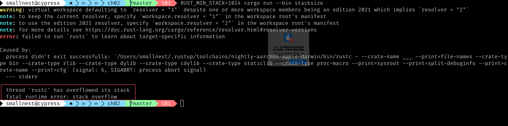

# 04 | 匠心独运，生生不息：如何创建和管理线程？

你好，我是鸟窝。

这节课我们来了解一下线程的基本概念、线程与进程的区别、线程的生命周期，以及 Rust 中的线程模型。这些基础知识将为接下来的实践与高级操作打下坚实的基础。

## 线程与进程

进程是一个运行中的程序的实例。每个进程都有自己独立的内存空间和资源，操作系统为进程分配所需的资源，如内存、文件描述符和 CPU 时间片。由于进程间的内存隔离，一个进程通常无法直接访问另一个进程的内存，这使得进程间通信（IPC）相对复杂。

线程则是进程中的更小的执行单元。大部分情况下，它被包含在进程之中，是进程中的实际运作单位，所以说程序实际运行的时候是以线程为单位的，一个进程中可以并发多个线程，每条线程并行执行不同的任务。线程之间的通信比进程间的通信更高效，因为它们可以直接共享数据。但正因为这种数据共享，也带来了数据竞争和同步问题。

线程是独立调度和分派的基本单位，并且同一进程中的多条线程将共享该进程中的全部系统资源，如虚拟地址空间、文件描述符和信号处理等等。但同一进程中的多个线程有各自的调用栈（call stack）、自己的寄存器上下文（register context）、自己的线程本地存储（thread-localstorage）。

一个进程可以有很多线程来处理，每条线程并行执行不同的任务。如果进程要完成的任务很多，这样就需要很多线程，也要调用很多核心，在多核或多 CPU，或支持 Hyper-threading 的CPU 上使用多线程程序设计可以提高程序的执行吞吐率。在单 CPU 单核的计算机上，使用多线程技术，也可以把进程中负责 I/O 处理、人机交互而常被阻塞的部分与密集计算的部分分开来执行，从而提高 CPU 的利用率。



线程 vs 进程：

- 进程通常是独立的，而线程作为进程的子集存在。

- 进程携带的状态信息比线程多得多，而进程中的多个线程共享进程状态、内存和其他资源。

- 进程具有单独的地址空间，而线程共享其地址空间。

- 进程仅通过系统提供的进程间的通信机制进行交互。

- 同一进程中线程之间的上下文切换通常比进程之间的上下文切换发生得更快。

线程与进程的优缺点包括：

- 线程的资源消耗更少：相比于使用多个进程，使用线程应用程序可以使用更少的资源来运行。

- 线程简化共享和通信：与需要消息传递或共享内存机制来执行进程间通信的进程不同，线程可以通过它们已经共享的数据、代码和文件进行通信。

- 线程可以使进程崩溃：由于线程共享相同的地址空间，线程执行的非法操作可能会使整个进程崩溃；因此，一个行为异常的线程可能会中断应用程序中所有其他线程的处理。



更有一些编程语言，比如 SmallTalk、Ruby、Lua、Python 等，还会有协程（coroutine）更小的调度单位。协程非常类似于线程。但是协程采用协作式多任务机制，而线程通常采用抢占式多任务机制。这意味着协程提供并发性而非并行性。使用抢占式调度的线程也可以实现协程，但是会失去某些好处。Go 语言实现了 Goroutine 的最小调度单元，虽然官方不把它和coroutine 等同，因为 goroutine 实现了独特的调度和执行机制，但是你可以大致把它看成和协程是一类的东西。

还有一类更小的调度单元叫纤程（Fiber），它是一种最轻量化的线程。它是一种用户态线程（user thread），让应用程序可以独立决定自己的线程要如何运作。

不管怎么说，Rust 实现并发的基本单位是线程，虽然也有一些第三方的库，比如 PingCAP 的黄旭东实现了 Stackful coroutine 库（may）和 coroutine ，甚至有一个 RFC（RFC2033: Experimentally add coroutines to Rust）关注它，但是目前 Rust 并发实现主流还是使用线程，包括最近实现的 async/await 特性，运行时还是以线程和线程池的方式运行。所以作为 Rust 并发编程的开篇，我们重点还是介绍线程的使用。

### 线程的生命周期

线程的生命周期通常包括几个阶段，不同的操作系统，比如 Linux 和 Windows，定义的线程状态可能不相同，不过我们大致可以将线程的生命周期划分为几个重要的状态，以便后续讨论的时候能够以一致性的概念进行讨论。

```
创建（Creation）：线程对象被创建。在 Rust 中，使用 std::thread::spawn 函数可以
```

- 创建一个新线程。

2. 就绪（Ready）：线程已经创建完成，等待操作系统分配 CPU 资源。一旦获得 CPU 时间片，线程将进入运行状态。

3. 运行（Running）：线程正在执行任务。线程会持续运行，直到任务完成、被操作系统抢占、或进入等待状态。

4. 阻塞（Blocked/Waiting）：线程等待某些事件的发生，例如等待 I/O 操作完成、等待互斥锁、或等待其他线程完成某项任务。在阻塞状态下，线程不会占用 CPU 资源。

5. 终止（Terminated）：线程的任务完成或发生了不可恢复的错误，线程进入终止状态。此时，线程释放所有占用的资源。

### Rust 中的线程模型

Rust 提供了强大的线程支持，同时保证了线程安全。这是通过 Rust 独特的所有权系统和编译时检查来实现的。Rust 中的线程模型有以下几个特点：

1. 安全的并发性：Rust 的所有权系统使得编译器可以在编译时检测出大部分的数据竞争问题。这种静态分析减少了运行时错误的可能性。

2. 自动化的资源管理：Rust 的所有权系统还管理着资源的释放。在线程结束时，Rust 会自动释放线程占用的内存和其他资源，不需要手动清理。

3. 轻量级线程创建：Rust 使用的是操作系统原生线程（OS threads），由操作系统直接创建和管理，所以这些线程的开销较低，同时提供高效的并发性能。

4. 线程的所有权传递：在 Rust 中，数据的所有权可以安全地从一个线程传递到另一个线程，这使得跨线程的数据共享更加安全和高效。

线程作为操作系统中重要的并发执行单元，能够有效提高程序的执行效率。在 Rust 中，线程管理得到了语言级别的支持，通过所有权系统和内存安全机制，Rust 不仅提供了强大的线程操作功能，还大大减少了并发编程中的常见错误。理解线程的生命周期、进程与线程的区别，以及 Rust 中的线程模型，将帮助我们在实际开发中更好地利用多线程技术。

## 创建新的线程

在 Rust 并发编程中，最重要的是你要学会创建一个线程，这是并发编程的基础。

```
Rust 中的线程支持由标准库中的 std::thread 模块提供。这个模块封装了操作系统级别的
```

线程操作，使得创建、管理和终止线程变得非常方便。

```javascript
在 Rust 中，使用 std::thread::spawn 函数可以轻松创建并启动一个新线程。该函数接收
一个闭包作为参数，这个闭包就是在线程中执行的代码。std::thread::spawn 函数会返
回 JoinHandle 来管理该线程：
use std::thread;
fn main() {
   let handle = thread::spawn(|| {
       // 这里是新线程中执行的代码
       for i in 1..10 {
           println!("子线程中：{}", i);
           thread::sleep(std::time::Duration::from_millis(1));
       }
   });
   // 主线程继续执行
   for i in 1..5 {
       println!("主线程中：{}", i);
       thread::sleep(std::time::Duration::from_millis(1));
   }
   // 等待新线程结束
   handle.join().unwrap();
}
在上面的示例中，thread::spawn 创建了一个新线程，并返回一个 JoinHandle。我们可
以使用 JoinHandle 来等待新线程结束。join 方法会阻塞主线程，直到新线程执行完成。
```

运行这个程序可以看到主线程和子线程交替输出（每次实际运行结果可能不同）：

```
主线程中：#1
子线程中：#1
主线程中：#2
子线程中：#2
子线程中：#3
主线程中：#3
主线程中：#4
子线程中：#4
子线程中：#5
子线程中：#6
子线程中：#7
子线程中：#8
子线程中：#9
注意： 如果不使用 join，直接主线程结束，那么那些新创建的线程将被强制终止。这可能会
```

导致数据丢失或未定义行为。

## 使用 JoinHandle 处理子线程的恐慌（Panic）

万一在新创建的线程中发生了未处理的恐慌（panic），比如除以 0 等意外场景，那么这个恐慌

```
会沿着线程栈向上传播，最终会导致主线程崩溃。我们可以在主线程中使用 JoinHandle 的
unwrap 方法来捕获这个恐慌，从而避免主线程崩溃。
在 Rust 中，thread::spawn 创建的子线程在运行时可能会出现恐慌（panic）。当子线程发
```

生恐慌时，会导致什么现象？

首先看下面这个 panic 的例子：

```javascript
use std::thread;
fn main() {
   // 创建一个线程
   let handle = thread::spawn(|| {
       let a = 1;
       let b = 0;
       print!("{} / {} = {}", a, b, a / b);
   });
   // 等待子线程完成，并捕获返回值
   let result = handle.join();
   match result {
       Ok(_) => println!("子线程正常结束"),
       Err(e) => {
           if let Some(s) = e.downcast_ref::<String>() {
               println!("主线程捕获到子线程的恐慌: {}", s);
           } else if let Some(s) = e.downcast_ref::<&'static str>() {
               println!("主线程捕获到子线程的恐慌: {}", s);
           } else {
               println!("主线程捕获到子线程的恐慌: {:?}", e);
           }
       }
   }
   println!("主线程继续运行...");
}
```

运行上面的程序，输出结果如下：



子线程由于在代码中表达式计算中除以了零，导致了 panic。我们从输出结果上看，主程序可以捕获子线程的 panic，并进行处理。主线程可以继续执行。

## Thread Builder

单单创建一个线程是不是有些简单了，我们能不能做点更多的东西呢？

就像我们每个人都有一个名字一样，线程也有名字，在调试多线程程序时，给每个线程一个有意义的名字是非常有用的，这样我们就能知道是哪个线程出了问题。Rust 提供了

```
thread::Builder，我们可以定制化线程。
```

### 设置线程名称

```javascript
thread::Builder 的 name 方法，允许你在创建线程时指定线程的名称。
use std::thread;
fn main() {
   let builder = thread::Builder::new()
       .name("worker_thread".to_string());
   let handle = builder.spawn(|| {
       println!("这是一个工作线程: {}", thread::current().name().unwrap());
   }).unwrap();
   handle.join().unwrap();
}
```

```
在上面的代码中，我们使用 thread::Builder::new().name("worker_thread") 为线
```

程指定了一个名字。在调试工具或日志中，这个名字可以帮助你更好地理解线程的行为。

### 设置栈的大小

线程栈是每个线程独有的一块内存区域，用于存储该线程的局部变量、参数值和返回地址等信息。以下是线程栈的一些关键特点：

- 独立性：每个线程都有自己的栈空间，互不干扰。这确保了线程之间的数据隔离。

- 大小限制：线程栈的大小通常是固定的，由操作系统或编程语言的运行时环境预先分配。常见的大小范围在 1MB 到 8MB 之间。

- 自动管理：栈的分配和释放是自动进行的。当函数被调用时，会自动在栈上为其分配空间；函数返回时，这些空间会自动释放。

- 存储内容：局部变量、函数参数、返回地址、临时变量、保存的寄存器值。

栈遵循后进先出（Last In First Out）的原则，这与函数调用和返回的顺序一致。由于其简单的结构，通常我们对栈的操作很快。如果函数调用太深（比如递归太深）或局部变量太多，可能导致栈溢出错误。

由于每个线程有独立的栈，不同线程的栈操作不会相互干扰，这在一定程度上提高了线程安全性。栈信息对于调试非常有用，可以通过栈跟踪（stack trace）查看程序的执行路径。

在 Go 语言中，goroutine 的栈大小是动态调整的，但是在 Linux 系统中，线程的栈的大小是

```
固定的，默认是 8M，我们可以通过 ulimit -a 查看。
```



```
thread::Builder 能够在创建线程的时候指定线程的栈大小。stack_size 方法可以设置栈
```

的大小，而环境变量 RUST_MIN_STACK 可以设置最小的栈大小，实际的栈大小是stack_size 和 RUST_MIN_STACK 中的较大值。因此即使通过 stack_size 方法设置了栈的大小，实际使用的栈大小也不会小于这个环境变量指定的值。如果栈太小，可能会导致栈溢出，从而导致程序崩溃，比如下面的代码：

```javascript
use std::thread;
fn main() {
   let handle = thread::Builder::new()
       .name("worker_thread".to_string())
       .stack_size(1024 * 1024) // 设置栈大小为 1M
       .spawn(|| {
           println!("这是一个工作线程");
           let a = vec![1; 1024 * 1024 * 1024]; // 创建一个非常大的向量，导致栈溢出
           println!("向量的大小: {}", a.len());
       })
       .unwrap();
   handle.join().unwrap();
}
```

运行这个程序，可以看到栈溢出的错误：



### spawn 创建线程

```
现在我们设置完线程的名称和栈大小了，那么怎么使用 Builder 创建对应的线程呢？
Builder 提供了三个方法创建线程：
spawn 方法：这是最常用的方法，用于创建并启动一个新线程。
spawn_unchecked 方法：与 spawn 类似，但不会检查线程的创建是否成功。
spawn_scoped 方法：创建一个新线程，并将其与当前的 Scope 关联。
关于 Scope 的概念，我们会在下节课详细介绍。介绍了 scope概念之后，你可以再回顾
spawn_scoped 方法。
```

### spawn 方法

```
spawn 方法接收一个闭包作为参数，这个闭包就是在线程中执行的代码。spawn 方法会返回
一个 JoinHandle，我们可以使用 JoinHandle 来等待线程结束。
```

```javascript
pub fn spawn<F, T>(self, f: F) -> Result<JoinHandle<T>>
where
   F: FnOnce() -> T + Send + 'static,
   T: Send + 'static,
下面是一个使用 spawn 方法的例子，其实我们在上面的例子中已经看到它了：
use std::thread;
fn main() {
   let handle = thread::Builder::new()
       .name("worker_thread".to_string())
       .stack_size(1024 * 1024) // 设置栈大小为 1M
       .spawn(|| { // ①
           println!("这是一个工作线程");
       })
       .unwrap();
   handle.join().unwrap();
}
在这个例子中，我们使用 thread::Builder 创建了一个新的线程。让我们逐步解析这个例
```

子。

```
首先，我们使用 thread::Builder::new() 创建一个新的线程构建器。
```

2. 然后，我们通过链式调用设置了线程的属性：

```
.name("worker_thread".to_string()): 设置线程的名称为 “worker_thread”。
.stack_size(1024 * 1024): 设置线程的栈大小为 1MB (1024 * 1024 字节）。
接下来的重点，在①这一行，我们调用 .spawn() 方法来实际创建并启动线程。spawn 方
```

- 法接收一个闭包作为参数，这个闭包包含了线程要执行的代码。

4. 在闭包内部，我们简单地打印了一条消息 “这是一个工作线程”。

```
spawn 方法返回一个 Result，我们使用 unwrap() 来获取 JoinHandle。如果线程创
```

- 建失败，这里会 panic。

```
最后，我们调用 handle.join().unwrap() 来等待线程完成。join() 方法会阻塞当前
```

- 线程，直到新创建的线程执行完毕。

```
这个例子展示了如何使用 thread::Builder 来创建一个自定义的线程，设置其属性，并等
待其完成。这种方法比直接使用 thread::spawn() 提供了更多的控制和灵活性。不像
thread::spawn，thread::Builder::spawn 方法返回一个
Result<JoinHandle<T>, Error>，这样我们可以知道线程是否创建成功。如果因为某种
```

原因，比如操作系统资源不足，线程创建失败，那么就会返回一个错误。

### spawn_unchecked 方法

```
spawn_unchecked 方法通过获取 Builder 的所有权，该方法会创建一个没有任何生命周
```

期限制的新线程，并返回一个包含其 JoinHandle 的 io::Result。新创建的线程可能会比调用者

```
存活更长时间（除非调用者是主线程，当主线程结束时，整个进程会终止）。JoinHandle 可
以用来阻塞等待新创建的线程终止，包括恢复其可能发生的 panic。这个方法与
```

thread::Builder::spawn 基本相同，除了它放宽了生命周期约束，这使得它成为不安全的。这

```
是一个 nightly-only experimental API，所以需要开启 nightly 特性。
spawn_unchecked 方法签名如下：
pub unsafe fn spawn_unchecked<'a, F, T>(self, f: F) -> Result<JoinHandle<T>>
where
   F: FnOnce() -> T + Send + 'a,
   T: Send + 'a,
```

让我们来解析这个方法签名：

```
pub unsafe fn：这表明这是一个公共的不安全函数。unsafe 关键字意味着这个函数可
```

- 能会违反 Rust 的一些安全保证，调用者需要确保满足某些条件才能安全使用。

```
spawn_unchecked<'a, F, T>：这是函数名和泛型参数。
'a 是一个生命周期参数，但在这个函数中它实际上被忽略了，这是这个函数“不安全”的
```

- 1.原因之一。

```
F 是一个泛型类型参数，表示传入的闭包或函数的类型。
```

- 2.

```
T 是另一个泛型类型参数，表示闭包或函数返回值的类型。
```

- 3.

```
(self, f: F): 这是函数的参数列表。
self 表示这是一个方法，它会消耗 Builder 实例（因为没有 & 或 &mut）。
```

- 1.

```
f: F 是传入的闭包或函数，类型为 F。
```

- 2.

```
-> Result<JoinHandle<T>>：这是函数的返回类型。
Result 是 Rust 的错误处理类型，表示函数可能成功也可能失败。
```

- 1.

```
如果成功，它会返回一个 JoinHandle<T>，其中 T 是新线程执行的闭包或函数的返回
```

- 2.类型。

这个方法允许创建一个新的线程，执行给定的闭包或函数，并返回一个

```
Result<JoinHandle<T>>。与普通的 spawn 不同，它忽略了某些生命周期检查，这就是
它被标记为 unsafe 的原因。使用时需要格外小心，确保不会导致数据竞争或其他未定义行
```

为。

```javascript
以下是一个使用 spawn_unchecked 方法的例子：
#![feature(thread_spawn_unchecked)]
use std::thread;
fn main() {
   let builder = thread::Builder::new();
   let x = 1;
   let thread_x = &x;
   let handler = unsafe {
       builder
           .spawn_unchecked(move || {
               println!("x = {}", *thread_x);
           })
           .unwrap()
   };
   // 调用者必须确保调用 `join()`，否则如果 `x` 在线程闭包执行之前被释放，
   // 可能会访问到已释放的内存！
   handler.join().unwrap();
}
在这个例子中，我们使用 spawn_unchecked 而不是普通的 spawn 方法，主要是因为我们
在新线程中使用了对主线程栈上变量 x 的引用 thread_x。这种跨线程的引用通常是不安全
```

的，因为：

```
生命周期问题：主线程中的 x 可能在新线程还在运行时就已经被释放了。
数据竞争：如果主线程和新线程同时访问 x，可能会导致数据竞争。
普通的 spawn 方法会在编译时捕获这种潜在的问题并报错，而 spawn_unchecked 允许我
```

们绕过这些安全检查。

```
然而，使用 spawn_unchecked 将安全责任转移到了程序员身上。这就是为什么在注释中强
调，调用者要负责调用 join()，否则如果 x 在线程闭包执行之前被释放，可能会访问到已
```

释放的内存！

### spawn_scoped 方法

```
spawn_scoped 方法创建一个新线程，并将其与当前的 Scope 关联。Scope 是一个管理线
```

程生命周期的结构体。

```
spawn_scoped 方法签名如下：
pub fn spawn_scoped<'scope, 'env, F, T>(
   self,
   scope: &'scope Scope<'scope, 'env>,
   f: F,
) -> Result<ScopedJoinHandle<'scope, T>>
where
   F: FnOnce() -> T + Send + 'scope,
T: Send + 'scope,
```

这个方法签名包含以下几个关键点：

生命周期参数：

```
'scope 表示 Scope 的生命周期。
'env 表示环境（可能是捕获的变量）的生命周期。
```

泛型参数：

```
F 表示要在新线程中执行的闭包类型。
T 表示闭包的返回值类型。
```

参数：

```
self 表示这是 Builder 的方法。
scope: &'scope Scope<'scope, 'env> 一个 Scope 的引用，用于管理线程的生命
```

- 周期。

```
f: F 要在新线程中执行的闭包。
返回值：Result<ScopedJoinHandle<'scope, T>> 返回一个 Result，成功时包含一
个 ScopedJoinHandle。
这个方法允许在指定的 Scope 内创建一个新线程，确保线程的生命周期不会超过 Scope 的
```

生命周期，从而提供了更安全的线程管理机制。

```javascript
下面是一个使用 spawn_scoped 方法的例子：
use std::thread;
fn main() {
   let mut a = vec![1, 2, 3];
   let mut x = 0;
   thread::scope(|s| {
       //① 我们可以在这里创建线程，并在作用域内使用 `a` 和 `x`。
       thread::Builder::new()
           .name("first_thread".to_string())
           .spawn_scoped(s, || {
               println!(
                   "hello from the {:?} scoped thread",
                   thread::current().name()
               );
               // 我们可以在这里借用 `a`。
               dbg!(&a);
           })
           .unwrap();
       //② 我们可以在这里创建另一个线程，并在作用域内使用 `a` 和 `x`。
       thread::Builder::new()
           .name("second_thread".to_string())
           .spawn_scoped(s, || {
               println!(
                   "hello from the {:?} scoped thread",
                   thread::current().name()
               );
               // 我们甚至可以在这里可变地借用 `x`，
               // 因为没有其他线程在使用它。
               x += a[0] + a[2];
           })
           .unwrap();
       println!("hello from the main thread");
   });
   // 在作用域之后，我们可以再次修改和访问我们的变量：
   a.push(4);
   assert_eq!(x, a.len());
   dbg!(&a);
}
```

```
这个例子展示了如何使用 thread::Builder 和 spawn_scoped 方法在一个作用域内创建
```

和管理多个线程。让我们来简单解析一下这个例子。

```
我们在主函数中创建了两个变量：一个向量 a 和一个整数 x。
使用 thread::scope 创建了一个作用域，在这个作用域内我们可以安全地使用和修改这
```

- 些变量。

```
在作用域内，我们使用 thread::Builder 创建了两个命名线程：
第一个线程（“first_thread”）打印了线程名称，并读取了 a 的值。
```

- 1.

```
第二个线程（“second_thread”）也打印了线程名称，并修改了 x 的值。
```

- 2.

4. 当作用域结束时，所有创建的线程都会自动结束。

```
在作用域之外，我们可以再次安全地修改 a 和访问 x。
```

6. 主线程也打印了一条消息。

```
这个例子很好地展示了 spawn_scoped 如何允许我们在一个受控的环境中创建线程，这些线
程可以安全地访问和修改其外部作用域的变量，而不需要使用 move 关键字或复杂的同步机
```

制。这种方法大大简化了多线程编程，同时保证了内存安全。

## 总结

进程是一个独立运行的程序实例，每个进程拥有自己的内存空间和资源，进程间的通信复杂。而线程是进程中的执行单元，多个线程共享同一进程的资源。线程间的通信更加高效，但需要解决数据竞争和同步问题。线程的创建和切换开销比进程小。

线程的生命周期包含几个主要状态：创建、就绪、运行、阻塞和终止。线程创建后进入就绪状态，等待 CPU 资源。运行状态表示线程执行任务，阻塞状态表示线程等待某些事件，终止状态则表示线程任务完成或发生错误。

Rust 通过其所有权系统保证线程安全，编译时检查大部分数据竞争问题。Rust 中的线程是操

```
作系统原生线程，具有轻量级创建和高效并发性能。Rust 通过 std::thread 提供线程管
```

理，并支持线程的所有权传递，使得跨线程的数据共享更加安全。

```
在 Rust 中，使用 std::thread::spawn 创建新线程，并返回一个 JoinHandle 来管理线
程的生命周期。通过 join 方法等待线程结束。 如果子线程发生恐慌，主线程可以通过
JoinHandle 的 join 方法捕获并处理恐慌，避免主线程崩溃。 Rust 提供
thread::Builder 来定制线程，例如设置线程名称和栈大小。使用 name 方法设置线程名
称，stack_size 方法设置线程栈大小。线程栈存储线程的局部变量和调用信息。Rust 允许
通过 thread::Builder 设置线程栈的大小。如果栈太小，可能导致栈溢出错误。
```

## 思考题

1. 多个线程并发打印数字：编写一个程序，创建 5 个线程，每个线程打印一个从 1 到 5 的数

```
字。确保线程的输出顺序是随机的。要求：使用 std::thread 创建多个线程。数字 1、
```

- 2、3、4、5 顺序输出。假定你还没有学习到其他同步原语，无法利用同步原语进行线程的编排。

2. 多个线程计算数组元素和：编写一个程序，将一个整数数组分成多个子数组，使用多个线程并行计算每个子数组的和，并将结果汇总为整个数组的总和。

期待你的分享。如果今天的内容对你有所帮助，也期待你转发给你的同事或者朋友，大家一起学习，共同进步。我们下节课再见！
