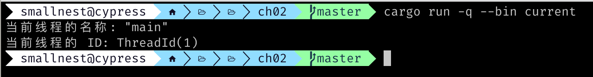
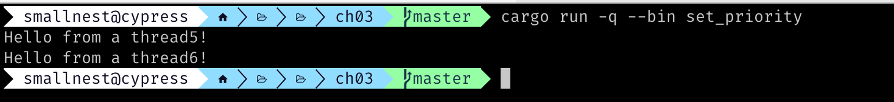
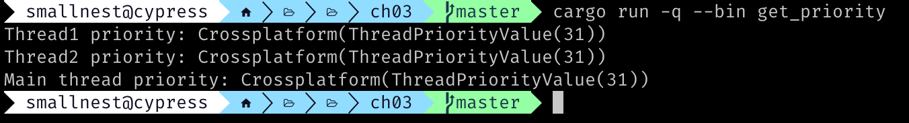

# 05 | 细察毫厘，优化性能：Rust线程高级概念

你好，我是鸟窝。

在前一课中我们学习了线程的创建以及线程栈大小的设置，在这节课中，我们学习更多和线程相关的知识，包括获取当前线程名称和 ID、线程的并发度和线程的优先级, 以及 CPU 的亲和性。

## 当前线程

在并发程序的开发过程中，我们时常有这样的疑问，当前的代码是在哪个线程运行？

```javascript
在 Rust 中，我们可以使用 thread::current() 函数来获取当前正在运行的线程。这个函
数返回一个 Thread 类型的实例，它代表了当前正在运行的线程。
Thread 类型提供了一些方法来获取线程的详细信息，例如线程的名称、线程的 ID 等。下面
是一个简单的例子，展示了如何使用 thread::current() 获取当前线程的信息：
use std::thread;
fn main() {
   let current_thread = thread::current();
   println!("当前线程的名称: {:?}", current_thread.name());
   println!("当前线程的 ID: {:?}", current_thread.id());
}
在这个例子中，我们使用 thread::current() 获取当前线程的实例，然后打印当前线程的
```

名称和 ID。运行这个程序，可以看到类似如下输出：



我们可以将线程的 ID 打印到日志文件中，方便我们根据日志进行并发问题的分析。我们也可以将线程 ID 发送到其他的 trace 系统中，方便观察和分析多线程的任务执行情况。

对于较老的 Rust 版本，比如 Rust 1.14 之前，标准库没有办法获取线程 id，可以使用 thread-id 库，现在我们是不需要了。

```javascript
use std::thread;
use thread_id;
fn main() {
   let handle = thread::spawn(move || {
       println!("spawned thread has id {}", thread_id::get());
   });
   println!("main thread has id {}", thread_id::get());
   handle.join().unwrap();
}
```

## 并发度

```
thread::available_parallelism 函数可以获取当前系统的并发度估计值，也就是当前
```

系统可以同时运行的线程数。

并行性是一种资源。一台给定的机器提供了一定的并行能力，即它可以同时执行的计算数量的上限。这个数字通常对应于计算机拥有的逻辑 CPU 数量，但在某些情况下可能会有所不同。像虚拟机或容器编排器这样的宿主环境可能希望限制程序可用的并行度。这通常是为了限制（无意中的）资源密集型程序对同一台机器上运行的其他程序的潜在影响。我们使用并发度来描述机器的并行性这个指标。

下面是一个获取当前系统并发度的例子：

```javascript
use std::thread;
fn main() {
   let parallelism = thread::available_parallelism().unwrap();
   println!("当前系统的并发度: {}", parallelism);
}
num_cpus crate 是一个常用的第三方库，用于获取当前系统的 CPU 核心数，也是在并发编
```

程中获取物理资源并行能力的常用方法。它的使用方法也很简单：

```javascript
use num_cpus;
fn main() {
   let num_cpus = num_cpus::get().unwrap();
   println!("当前系统的 CPU 核心数: {}", num_cpus);
}
```

注意这里的 CPU 核心数，不是物理核数，而是逻辑核数，一个物理核可以有多个逻辑核，比如一个物理核有 4 个逻辑核，那么这个物理核就可以同时运行 4 个线程。

```
num_threads crate 是另一个常用的第三方库，用于获取当前进程锁运行着的线程数，它的
```

使用方法如下：

```javascript
   if let Some(count) = num_threads::num_threads() {
       println!("current num_threads of this process: {}", count);
   } else {
       println!("num_threads: not supported");
   }
num_threads 和 num_cpus 的区别在于，num_threads 获取的是当前进程中运行着的线
程数，而 num_cpus 获取的是当前系统的 CPU 核心数。
thread_amount crate 是另一个常用的第三方库，也用于获取当前系统中活跃的线程数，它
```

的使用方法如下：

```javascript
   if let Some(count) = thread_amount::thread_amount() {
       println!("current thread_amount of this system: {}", count);
   } else {
       println!("thread_amount: not supported");
   }
```

在我的 Mac M2 mini 上，它没有办法获取到当前系统中活跃的线程数，在 Linux 上可以获取

```
到。既然有了更普适的 num_threads， 那么我们就可以忽略 thread_amount 了。
```

## 当前进程中线程的数量

当一个进程启动的时候，会产生一个主线程。当实现并发逻辑时，就有可能创建一个或者多个子线程、孙线程…

知道一个进程中有多少个线程，对于理解程序运行状态、诊断性能问题以及进行系统管理都非常有意义。为什么这么说呢？

1. 理解程序并发性

- 并发执行：线程是进程中实际运行的单位。一个进程可以包含多个线程，这些线程可以并发执行，从而提高程序的运行效率。了解一个进程的线程数可以帮助我们理解该程序是否利用了多线程来提高并发性。

- 资源分配：线程共享进程的内存空间和系统资源。知道线程数可以帮助我们分析程序对资源的利用情况，例如 CPU 使用率、内存占用等。

2. 诊断性能问题

- 性能瓶颈：如果一个进程的线程数过多，可能会导致系统资源过度消耗，例如 CPU 上下文切换开销增大、内存占用过多等，从而降低系统性能。通过监控进程的线程数，我们可以及时发现潜在的性能瓶颈。

- 死锁和资源竞争：多线程程序中可能存在死锁和资源竞争等问题，这些问题会导致程序运行异常甚至崩溃。通过分析进程的线程数和状态，我们可以更好地定位和解决这些问题。

- 线程泄漏：有些程序可能会出现线程泄漏，即创建的线程没有被正确释放，导致线程数不断增加，最终耗尽系统资源。监控进程的线程数可以帮助我们及时发现和解决线程泄漏问题。

3. 系统管理和监控

- 资源监控：系统管理员可以使用工具来监控系统中各个进程的线程数，从而了解系统的整体运行状态和资源使用情况。

- 故障排查：当系统出现故障时，通过分析进程的线程数和其他相关信息，可以帮助我们快速定位故障原因。

- 优化系统配置：了解系统中各个进程的线程数可以帮助我们更好地配置系统参数，例如调整线程池大小、设置资源限制等，从而优化系统性能。

thread-amount 提供了一个简单的方法，可以返回当前进程的当前线程的数量。

```javascript
use thread_amount::thread_amount;
use std::thread;
fn main() {
   let amount = thread_amount();
   let handle = thread::spawn(move || {
       if !amount.is_none() {
           println!("thread_amount: {}", amount.unwrap());
       }
   });
   handle.join().unwrap();
}
```

不过这个库仅仅支持 Windows 和 Linux 操作系统，不支持 macOS。对于 Linux，它是通过读

```
取这个文件的信息获得的：/proc/[PID]/status。
```

## 线程的优先级

线程优先级是操作系统线程调度的核心概念之一。当你创建一个新的线程时，你可能会想：“这个任务比其他任务更重要，希望操作系统尽快完成。”这就是线程优先级发挥作用的地方。

想象一下你是一个餐厅经理，负责安排服务员的工作。有些客人是 VIP 用户，更重要或有更着急的需求，你会指示服务员优先照顾这些客人。操作系统就像这个餐厅经理，而线程就是服务员。优先级高的线程会更频繁地获得 CPU 时间，就像重要客人获得更多关注一样。


- 你可能深有感触的是到银行去办理业务，即使是当前的 2025 年，你也会遇到取到排队号后漫长的等待时间。貌似你的号码马上就排到了，可能不断有其他 vip 号码插入到你的前面。明明感觉半个小时就可以搞定的银行业务，你可能需要被迫花上半天的时间才能办理，这个时候，你就深切感受到优先级的威力了。

在大多数系统中，线程优先级用数字表示，通常范围从 1 到 10 或 1 到 100。数字越大，优先级越高。当你创建线程时，可以设定它的初始优先级。但要小心，给太多线程高优先级就像告诉所有服务员“这桌最重要”一样，最终可能适得其反。

有趣的是，线程优先级并不是一成不变的。就像餐厅经理可能根据情况调整服务重点，你也可以在程序运行时动态调整线程的优先级。这种灵活性让你能够根据程序的实时需求来优化性能。

然而过度依赖优先级可能导致一些棘手的问题。想象一个低优先级的线程持有了高优先级线程需要的资源，这就像一个处理不太紧急任务的服务员恰好拿着 VIP 客人需要的东西。这种情况被称为优先级反转，可能会导致系统性能严重下降，甚至死锁。

因此明智地使用线程优先级就像精心安排餐厅服务一样重要。你需要平衡各种需求，确保每个任务都能得到适当的关注，同时避免某些任务被长期忽视。在实践中，通常建议将大多数线程保持在默认优先级，只在真正必要时才调整优先级。

- 火星探测器“探路者”号（Mars Pathfinder 1997）：这是优先级反转问题最著名的案例之一。探路者号在登陆火星后不久，就开始出现间歇性系统重置。经过分析，发现问题出在软件中一个共享总线的访问控制上。一个低优先级任务在访问总线时，被一个中优先级任务抢占，而一个高优先级任务又在等待该总线。这就导致高优先级任务被无限期地阻塞，最终触发了系统重置。虽然工程师通过远程上传补丁解决了问题，但这次事件凸显了优先级反转可能造成的严重后果。


- 图片来自维基百科

在 Linux 世界里，线程优先级的概念更为复杂和灵活。Linux 实际上实现了 140 个优先级范围，取值范围是从 0-139，这个值越小，优先级越高。同时 Linux 使用一种叫做“nice 值”的系统来控制进程和线程的调度优先级。这个名字听起来很友好，实际上它代表了一个进程“谦让”CPU 时间的程度。nice 值的范围从 -20 到 +19，映射到实际的优先级范围是 100-139（0-99 的优先级是为实时进程保留的。实时进程的优先级高于普通进程，它们使用的就是 0-99 这个范围）。这里有个有趣的反直觉设计：值越低，优先级反而越高。

你可以想象一下，Linux 系统像一个繁忙的办公室。nice 值低的进程就像那些总是抢着发言的同事，而 nice 值高的则像总是谦让他人的员工。系统管理员可以通过调整 nice 值来平衡办公室的“发言权”。

反观 Windows，它采用了一种看似更直观的方法。Windows 使用从 0 到 31 的优先级值，数值越大，优先级越高。这个系统分为几个主要的优先级类别，如低、正常、高和实时。在Windows 的优先级体系中，每个进程都有一个基本优先级类别，而线程则可以在这个基础上进行相对调整。这就像一个公司里不同部门有不同的基本工资标准，而每个员工还可以根据表现获得加薪或降薪。

这里我们主要介绍 Linux 环境下的 Rust 并发编程，所以后续不会介绍 Windows 相关的操作，你可以假定后面章节介绍的环境都是 Linux 环境。

```
Linux 还提供了一个 nice / renice 命令，nice 命令主要用于调整进程的优先级，而不是直
```

接调整线程的优先级。不过，由于在 Linux 中线程被视为轻量级进程，调整父进程的优先级通常也会影响其所有线程。

```
启动新进程时设置优先级，例如 nice -n 10 ./my_program。
nice -n <niceness> <command>
调整正在运行的进程的优先级，使用 renice。
renice -n <niceness> -p <PID>
比如 renice -n 10 -p 1234、renice -n +5 -p 1234、renice -n -5 -p
1234，普通用户只能增加 nice 值（即降低优先级），只有 root 用户可以降低 nice 值（即提高
优先级）。更精细的调度还可以使用 chrt 命令，不过使用 nice 命令在绝大部分场景下足够
```

了。

接下来看看我们如何在 Rust 中设置线程的优先级。

### 设置线程的优先级

```
要实现线程的优先级设置，我们需要引入 thread-priority 这个 crate。thread-
priority 是一个 Rust crate，它提供了对线程优先级的控制接口，允许开发者在跨平台的环
```

境中设置和获取线程的优先级。虽然 Rust 标准库本身不直接支持对线程优先级的修改，但

```
thread-priority crate 填补了这一空白，特别是在需要精细调度和性能优化的应用场景
```

中。

```
thread-priority 支持很多的平台，包括：
```

- Linux

- Android

- DragonFly

- FreeBSD

- OpenBSD

- NetBSD

- macOS

- iOS

- Windows

```
这么多的平台，它们的优先级的概念并不是完全统一的，不过 thread-priority 定义了一
个统一的模型：ThreadPriority, 这是一个枚举类型，定义了几种优先级：
pub enum ThreadPriority {
   Min,
   Crossplatform(ThreadPriorityValue),
   Os(ThreadPriorityOsValue),
   Deadline {
       runtime: Duration,
       deadline: Duration,
       period: Duration,
       flags: DeadlineFlags,
   },
   Max,
}
```

下面是一个使用这个枚举类型的例子：

```javascript
use std::thread;
use thread_priority::*;
fn main() {
   let handle1 = thread::spawn(|| {
       assert!(set_current_thread_priority(ThreadPriority::Min).is_ok());
       println!("Hello from a thread5!");
   });
   let handle2 = thread::spawn(|| {
       assert!(set_current_thread_priority(ThreadPriority::Max).is_ok());
       println!("Hello from a thread6!");
   });
   handle1.join().unwrap();
   handle2.join().unwrap();
}
```

这个例子中，我们创建了两个线程，一个设置了最低优先级，一个设置了最高优先级。这样，我们就可以在 Rust 中设置线程的优先级了。 运行这个程序，可以看到输出：



因为这个例子比较简单，机器上 CPU 也空闲，所以线程创建后就执行了，看不出优先级的效果。在复杂的环境下线程的优先级应该是发挥作用的。

```
ThreadPriorityValue 是一个平台独立的优先级值，取值在 0～100 之间 (不包括 100)。
```

这个值越高，线程的优先级越高。

```javascript
ThreadPriority::Crossplatform(ThreadPriorityValue) 提供了一个平台统一的
值，它将 ThreadPriorityValue 映射到合适的平台优先级的值。
下面这个例子演示了使用 Crossplatform 设置优先级。
use std::thread;
use thread_priority::*;
use std::convert::*;
fn main() {
   let handle1 = thread::spawn(|| {
       let v =  ThreadPriorityValue::try_from(15u8).unwrap();
       assert!(set_current_thread_priority(ThreadPriority::Crossplatform(v)).is_
       println!("Hello from a thread5!");
   });
   let handle2 = thread::spawn(|| {
       let v =  ThreadPriorityValue::try_from(20u8).unwrap();
       assert!(set_current_thread_priority(ThreadPriority::Crossplatform(v)).is_
       println!("Hello from a thread6!");
   });
   handle1.join().unwrap();
   handle2.join().unwrap();
   thread_priority_min_max();
}
ThreadPriorityOsValue 是一个平台相关的值。
ThreadPriority::Os(ThreadPriorityOsValue) 允许你直接使用操作系统的原生优先
```

级值。这提供了更细粒度的控制，特别适用于开发者希望使用每个操作系统特有的优先级语义时。不过这个方法的实现还不是那么好，暂时忽略它就好。

```
基本上，我们使用 ThreadPriority::Crossplatform 就足够了。
```

### 获取线程的优先级

简单地，如果我们想查看当前线程的优先级，我们可以使用下面的方法：

```javascript
use std::thread;
use thread_priority::*;
fn main() {
   // 使用 get_current_thread_priority
   let handle1 = thread::spawn(|| {
       let priority = get_current_thread_priority().unwrap(); // ①
       println!("Thread1 priority: {:?}", priority);
   });
   let handle2 = thread::spawn(|| {
       let priority = get_current_thread_priority().unwrap(); //  ②
       println!("Thread2 priority: {:?}", priority);
   });
   handle1.join().unwrap();
   handle2.join().unwrap();
   let priority = get_thread_priority(thread_priority::unix::thread_native_id())
   println!("Main thread priority: {:?}", priority);
}
①和②通过 get_current_thread_priority 获取当前线程的优先级，③通过
get_thread_priority 获取指定线程的优先级。运行这个程序可以看到输出：
```



### ThreadBuilder 扩展

```
thread_priority 提供了一个类似 std::thread::ThreadBuilder 一样的构建器，除
```

了可以设置线程的名称和栈大小外，还可以设置线程的优先级：

```javascript
use thread_priority::*;
fn main() {
   use thread_priority::*;
   let thread = ThreadBuilder::default()
       .name("MyThread")
       .priority(ThreadPriority::Max)
       .spawn(|result| {
           println!("Set priority result: {:?}", result);
           assert!(result.is_ok());
   }).unwrap();
   thread.join();
   let thread = ThreadBuilder::default()
       .name("MyThread")
       .priority(ThreadPriority::Max)
       .spawn_careless(|| {
           println!("We don't care about the priority result.");
   }).unwrap();
   thread.join();
}
这里利用 ThreadBuilder 的 priority 方法设置线程的优先级。一共创建了两个线程，一
个是 spawn，一个是 spawn_careless。spawn 会返回一个 Result，而
spawn_careless 不会，不管线程是否创建成功。
事实上, thread_priority::ThreadBuilderExt 还可以扩展
std::thread::Builder，这样我们就可以直接使用 std::thread::Builder 来设置线
```

程的优先级了：

```javascript
use thread_priority::*;
use thread_priority::ThreadBuilderExt;
let thread = std::thread::Builder::new()
   .name("MyNewThread".to_owned())
   .spawn_with_priority(ThreadPriority::Max, |result| { // ①
       println!("Set priority result: {:?}", result);
       assert!(result.is_ok());
}).unwrap();
thread.join();
注意，①这里的 spawn_with_priority 方法，它是 ThreadBuilderExt 提供的。
同理，thread_priority::ThreadScopeExt 也为 std::thread::scoped 提供了优先
```

级设置的方法：

```javascript
use thread_priority::*;
let x = 0;
std::thread::scope(|s|{
   s.spawn_with_priority(ThreadPriority::Max, |result| { // ①
           println!("Set priority result: {:?}", result);
           assert!(result.is_ok());
           dbg!(&x);
   });
});
注意，①这里的 spawn_with_priority 方法，它是 ThreadScopeExt 提供的。
```

## CPU Affinity

CPU Affinity 是一种技术，通过它我们可以控制进程（或者线程）运行在哪些具体的 CPU 核心上。这在 Linux 系统中尤为重要，因为现代处理器通常拥有多个核心。默认情况下，操作系统的调度器会根据系统资源的可用性，在多个 CPU 核心之间动态调度进程，以便最大限度地提高 CPU 的利用率。CPU Affinity 允许我们干预这种调度行为，将某个进程或线程绑定到特定的核心，或者限制其只在特定的核心集合中运行。

### 绑定的意义与动机

当我们为某个进程或线程设置了 CPU Affinity 时，操作系统的调度器在后续的任务调度中会严格遵守这个绑定设置，即只允许该进程在指定的 CPU 核心上运行。这背后的主要动机有几个。

1. 减少上下文切换带来的开销：默认调度模式下，进程可以在不同的核心上切换，虽然调度器会尽量优化这些切换，但仍然存在潜在的 CPU 缓存失效问题。绑定进程到某个核心可以帮助避免这种缓存失效，提高缓存命中率，从而提升性能。

2. 避免 CPU 核心之间的负载不均：在多核系统中，有时特定的任务由于计算量较大或者需要大量 I/O 操作，可能导致部分核心被过度使用，而其他核心处于空闲状态。通过设置 CPUAffinity，我们可以手动均衡负载，将不同的进程分配到不同的核心上，避免热点核心的出现。

3. 提高实时性：在某些实时系统中，精确控制任务执行的时机至关重要。通过将某些高优先级的任务绑定到指定核心，可以确保它们不会被其他核心的低优先级任务干扰，进而提高实时性。

### CPU Affinity 的具体使用

```
在 Linux 系统中，taskset 命令是用于设置和查看 CPU Affinity 的工具。让我们来看一个例
```

子。

```
假设我们有一个名为 my_program 的进程，我们希望将它绑定到第 0 和第 1 个 CPU 核心
```

- 上运行。可以通过以下命令来实现：

```
taskset -c 0,1 ./my_program
这条命令告诉系统，将进程 my_program 的 CPU Affinity 设置为 CPU 0 和 CPU 1。当该程
```

序启动后，调度器只会在这两个核心中调度它的执行，而不会让它在其他核心上运行。

- 如果我们已经有一个运行中的进程，并且希望修改它的 CPU Affinity，可以使用以下命令：

```
taskset -cp 0 1234
这里的 1234 是进程的 PID，而 -c 0 则表示将该进程绑定到 CPU 0。这样，我们通过
taskset 动态地修改了正在运行的进程的 CPU Affinity。
```

尽管 CPU Affinity 在特定的场景下能够提升性能，但并不是所有的应用场景都适合使用它。强制性地绑定进程到某些核心，可能会导致资源利用率的降低。尤其是在核心数量较少或者任务种类繁多的环境中，手动设置 CPU Affinity 可能会让某些核心负载过重，而其他核心空闲。

此外，操作系统的调度器本身具有很强的调度能力，通常它能够很好地把进程分配到不同的核心。因此，除非你有明确的性能目标或是实时性要求，否则不建议频繁手动干预调度。

接下来看看我们如何在 Rust 中动态地绑定 CPU。

```
affinity crate 为 Rust 提供 Linux/Windows 平台中的 CPU 亲和性控制。它提供了一组
```

API，允许开发者在 Rust 程序中设置和获取线程的 CPU 亲和性，它还提供了一种简单的方式来控制线程的 CPU 亲和性。不过它不支持 macOS 平台，因为 macOS 不支持用户级别设置CPU 亲和性（CPU Affinity）。

```javascript
use affinity::*;
fn main() {
   let cores: Vec<usize> = (0..get_core_num()).step_by(2).collect();
   println!("Binding thread to cores : {:?}", &cores);
   set_thread_affinity(&cores).unwrap();
   println!("Current thread affinity : {:?}", get_thread_affinity().unwrap());
}
```

```
get_core_num 可以获取当前系统的 CPU 核心数量，在上一节课中我也介绍了通过
num_cpus 获取 cpu 核数的方法，这里的 get_core_num 是 affinity crate 提供的方
```

法。

```
set_thread_affinity 可以设置线程的 CPU 亲和性，能一次绑定多个核。
get_thread_affinity 可以获取线程的 CPU 亲和性。
```

## 总结

好了，这一节课我们介绍了 Rust 并发编程中线程相关的几个重要概念，我们一起来回顾一下。

```
当前线程信息：使用 thread::current() 获取当前线程的实例，通过 name() 和 id()
```

- 方法获取线程名称和 ID，用于日志记录和跟踪。

```
并发度：thread::available_parallelism() 获取系统并发度（可同时运行的线程
```

- 数）。

```
num_cpus crate 获取逻辑 CPU 核心数。
```

- 1.

```
num_threads crate 获取当前进程的线程数（推荐）。
```

- 2.

3. 线程数：获得当前进程的线程数

4. 线程优先级：影响线程获得 CPU 时间的频率。高优先级线程获得更多 CPU 时间。

- 过度使用可能导致优先级反转（低优先级线程阻塞高优先级线程），如“火星探测器探路1.者号”事件。

```
Linux 使用 nice 值控制优先级（值越低优先级越高），使用 nice 和 renice 命令调整
```

- 2.进程优先级。

```
Rust 使用 thread-priority crate 设置和获取优先级，推荐使用
```

- 3.

```
ThreadPriority::Crossplatform(ThreadPriorityValue)。
get_current_thread_priority() 获取当前线程优先级，
```

- 4.

```
get_thread_priority() 获取指定线程优先级。
thread-priority crate 提供了 ThreadBuilder、ThreadBuilderExt 和
```

- 5.

```
ThreadScopeExt 方便设置线程优先级。
```

5. CPU 亲和性：控制线程运行在哪些 CPU 核心上，减少上下文切换、均衡负载、提高实时性。

```
Linux 使用 taskset 命令。
```

- 1.

```
Rust 使用 affinity crate，提供 get_core_num()、set_thread_affinity() 和
```

- 2.

```
get_thread_affinity()。
```

- 3.不建议频繁手动干预调度。

通过每节课的学习，相信你已经了解了如何在 Rust 中管理线程，包括获取线程信息、控制并发度、设置优先级以及绑定 CPU 核心，可以编写更高效的并发程序了。

## 思考题

- 请实现程序，设置程序的优先级和 CPU 的亲和性，并且通过命令观察设置是否生效。

- 请思考什么情况下你会考虑设置程序的优先级和 CPU 的亲和性？可以举例说明。

期待你的分享。如果今天的内容对你有所帮助，也期待你转发给你的同事或者朋友，大家一起学习，共同进步。我们下节课再见！
