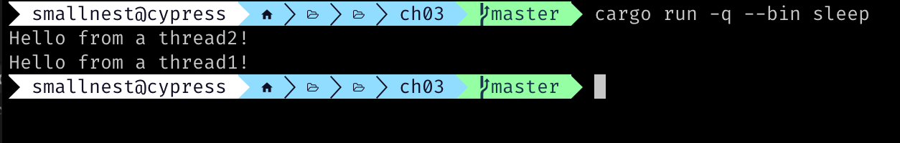

# 06 | 沉睡待机，应声而起：线程的挂起和唤醒

你好，我是鸟窝。

上节课我们学习了如何在 Rust 中管理线程，包括获取线程信息、控制并发度、设置优先级以及绑定 CPU 核心，这一节课，我们来看看如何让一个线程挂起和唤醒。

## sleep：累了，我想躺平一会


有时候我们我们需要将当前的线程暂停一段时间，可能是某些条件不满足，比如实现

```javascript
spinlock，或者是想定时执行某些业务，如cron类的程序，这个时候我们可以调用
 thread::sleep  函数。
use std::thread;
use std::time::Duration;
fn main() {
       let handle1 = thread::spawn(|| {
           thread::sleep(Duration::from_millis(2000));
           println!("Hello from a thread1!");
       });
       let handle2 = thread::spawn(|| {
           thread::sleep(Duration::from_millis(1000));
           println!("Hello from a thread2!");
       });
       handle1.join().unwrap();
       handle2.join().unwrap();
}
```

上面的例子中，我们创建了两个线程，一个线程睡眠 2 秒，另一个线程睡眠 1 秒。这样，我们就可以在 Rust 中暂停线程了。



```
它至少保证当前线程 sleep 指定的时间。因为它会阻塞当前线程，所以不要在异步的代码中
```

调用它。

如果时间设置为 0，不同的平台处理是不一样的，Unix 类的平台会立即返回，不会调用

```
nanosleep  系统调用，而 Windows 平台总是会调用底层的  Sleep  系统调用。
```

## yield_now：礼貌谦让

```
yield_now 的作用是主动放弃当前线程的 CPU 时间片，允许其他线程运行。它是一种协作
```

式的调度方式，意味着线程主动“让出”CPU，而不是被操作系统强制抢占。


```
yield_now() 会提示操作系统，当前线程可以暂停执行，让其他线程有机会运行。操作系统
```

可以选择立即切换到另一个线程，也可以选择继续执行当前线程。

```
与操作系统强制抢占不同，yield_now() 是一种协作行为。线程“主动”放弃 CPU，而不是被
```

动地被剥夺。

适用场景

- 避免长时间占用 CPU：当一个线程需要执行大量的计算或循环操作，并且不希望长时间独

```
占 CPU 导致其他线程饥饿时，可以使用 yield_now() 来让出 CPU 时间片，提高系统的
```

- 公平性。

```
提高响应性：在某些场景下，为了提高程序的响应速度，可以适当地使用 yield_now()，
```

- 让其他线程有机会及时响应事件或处理请求。

```
测试和调试：在测试和调试并发程序时，yield_now() 可以帮助模拟不同的线程执行顺
```

- 序，暴露潜在的并发问题。

```
需要注意的是，yield_now() 只是一个提示，操作系统不一定会立即切换线程。具体的调度
行为取决于操作系统的实现和当前系统的负载情况。而过度使用 yield_now() 可能会导致
```

不必要的上下文切换，反而降低程序的性能。因此，应该谨慎使用，只在真正需要的时候才使用。

```javascript
在异步编程模型中（例如使用 async/await），通常不需要显式地使用 yield_now()，因
为 await 关键字本身就具有让出 CPU 的作用。
下面是一个使用的yield_now()例子：
pub fn start_thread_with_yield_now() {
   let handle1 = thread::spawn(|| {
       thread::yield_now(); // ①
       println!("yield_now!");
   });
   let handle2 = thread::spawn(|| {
       thread::yield_now(); // ②
       println!("yield_now in another thread!");
   });
   handle1.join().unwrap();
   handle2.join().unwrap();
}
```

当程序运行到①和②时，会让出时间片，让其他线程有机会运行。当前的线程会进入就绪状态，等待调度器重新调度。

## park：线程挂起 /unpark：线程唤醒


### park

```
park 常常被翻译成“阻塞 / 挂起 / 休眠 / 暂停”，强调了 park 使线程进入等待状态（不占用
```

CPU 资源）的动作。

```
park 的作用是阻塞当前线程的执行，直到收到一个“许可”（permit）或发生超时（如果支持
超时）。被 park 的线程会进入休眠状态，不占用 CPU 资源，直到被 unpark 唤醒。
```

我举几个现实中的例子你就明白了。

```
停车场： 你可以把线程想象成一辆汽车，park 就像把车停到停车场，等待某种信号，比
```

- 如有人来取车，才能离开。

- 服务员等待： 就像一个服务员在没有顾客点单时站在一边等待。

- 睡眠： 线程进入睡眠状态，直到被唤醒。

### unpark

```
unpark 也常常被翻译成“唤醒 / 解除阻塞 / 恢复”，强调了使等待的线程恢复执行的动作。
unpark 的作用是给指定的线程发放一个“许可”，如果该线程正处于 park 状态（即阻塞状
态），则将其唤醒，使其可以继续执行。如果线程没有 park，则 unpark 会记录这个“许
可”，当线程后续调用 park 时，会立即获得许可并继续执行，而不会阻塞。
```

这里我们也可以类比生活中的场景：

- 取车： 就像有人来停车场取车，汽车就可以开走了。

- 顾客点单： 就像顾客点单了，服务员就可以开始工作了。

- 闹钟： 就像闹钟响了，把人从睡眠中叫醒。

```
park和unpark 常常是配套使用的，假设线程 A 调用 park()，它会阻塞。然后线程 B 调用
```

unpark(A)，线程 A 就会被唤醒，继续执行。如果线程 B 在线程 A 调用 park() 之前就调用了unpark(A)，那么当线程 A 稍后调用 park() 时，它不会阻塞，而是立即继续执行。

```
你可以认为每个线程都关联一个许可 permit，最初该许可不存在：
```

```
thread::park  将阻塞当前线程，直到线程的许可可用。此时它以原子操作的使用许可。
thread::park_timeout执行相同的操作，但允许指定阻止线程的最长时间。和
 sleep  不同，它可以还未到超时的时候就被唤醒。
thread.upark  方法以原子方式使许可可用（如果尚未可用）。
```

同时它还有以下特性：

```javascript
许可 (Permit)：每个线程都关联着一个许可。unpark 给予许可，park 消耗许可。许可最
多只有一个，重复unpark不会累积多个许可。
非阻塞的 unpark：如果线程在调用 unpark 时没有被 park，则许可会被保留，直到线
程调用 park 时立即使用，避免阻塞。这与传统的 wait/notify 机制不同，后者要求
notify 必须在 wait 之后调用才能生效。
线程安全性：park 和 unpark 是线程安全的，可以在不同的线程中调用。
下面是一个使用使用park和unpark的例子：
pub fn thread_park() {
   let handle = thread::spawn(|| {
       thread::park();
       println!("Hello from a park thread!");
   });
   thread::sleep(Duration::from_millis(1000));
   handle.thread().unpark();
   handle.join().unwrap();
}
在这里例子中，其中一个线程自己“躺平”了，park 了自己。另外一个线程使用 unpark 唤醒
了它。注意我们使用的是 handle.thread().unpark(),  唤醒对应的线程。
```

```javascript
如果令牌初始不存在，也就是我们在 park 之前调用 unpark 的话， 会导致紧接着的  park
调用立即返回，因为前面的 unpark 已经使得令牌可用了。
pub fn thread_park2() {
   let handle = thread::spawn(|| {
       thread::sleep(Duration::from_millis(1000));
       thread::park();
       println!("Hello from a park thread in case of unpark first!");
   });
   handle.thread().unpark();
   handle.join().unwrap();
}
这个例子中，我们先让主线程执行 unpark（利用 sleep 控制并发执行不是太严谨，但是简
单、容易阅读，并且在咱们自己的机器测试一般没问题）,  子线程执行park时不会被阻塞，
```

因为它可以立即拿到许可，继续执行。

## parking 库

```
parking crate 提供了最基础的 park 和 unpark 操作，以及一些相关的底层工具。它更接
```

近操作系统提供的 futex 或类似机制。

```
它提供了上面标准库类似的功能，并进行了扩展。注意它和 Rust 生态圈中的parking_lot
```

没有关系，它们是独立的两个库，不要弄混。

```
Parker 处于“已通知”或“未通知”状态。park() 方法会阻塞当前线程，直到Parker被通知，
然后将其置为未通知状态。unpark() 方法则将其置为已通知状态。
这个 API 类似于标准库中的 thread::park() 和 Thread::unpark()。不同之处在于，
```

由这些标准库的函数管理的“状态令牌”是整个线程共享的，任何人都可以调用

```
thread::current() 来访问它。如果你使用 park 和 unpark，但同时调用一个内部使用
park 和 unpark 的函数，这个函数可能会消耗本应用于你的唤醒信号，从而导致死锁。而这
个 crate 中的 Parker 对象通过管理自己的状态来避免这个问题，其状态不会与无关的调用者
```

共享。

下面是使用这个库的一个简单例子：

```javascript
   let p = Parker::new();
   let u = p.unparker();
   // 通知 parker
   u.unpark();
   // 立刻被唤醒，因为 parker 已经被通知
   p.park();
   thread::spawn(move || {
       thread::sleep(Duration::from_millis(500));
       u.unpark();
   });
   // 等待被唤醒
   p.park();
   println!("park_unpark")
如果Parker已经处于被通知的状态，这个时候调用park，调用者不会被阻塞。
如果Parker已经处于被通知的状态，这个时候调用park，调用者会被阻塞，直到这个被
Parker通知。
针对上面的例子，我们先进行了unpark调用，那么接下来的第 8 行park主程序不会被阻
塞，程序畅通无阻的继续执行。第 16 行的主程序调用park时就会被阻塞，直到子线程中调
用了unpark。
这个库还提供了一个 helper 函数，更方便的创建Parker和Unparker:
```

```javascript
let (p,u) = parking::pair();
```

和标准库的 park/unpark 的机制一致，无论是许可还是通知，一个对象值关联一个，这就意味

```javascript
着，即使你预先多次调用unpark，也只对后续的一个park，第二个以及再往后的park都会
被阻塞，直到有新的unpark发生。
   let p = Parker::new();
   let u = p.unparker();
   // 重复调用 unpark 也是安全的
   u.clone().unpark();
   u.clone().unpark();
   p.park();
   println!("park_unpark");
   p.park();
   println!("park_unpark again");
Parker除了提供park方法外，还提供了：
park_timeout(timeout: Duration)：阻塞当前线程，直到收到唤醒信号或超时。
park_deadline(instant: Instant)：阻塞当前线程，直到收到唤醒信号或超过最终
```

- 期限。其实和上面的函数是类似的。

```
unpark(thread: &Thread)：唤醒指定的线程。是的，Parker 也可以执行 unpark。
unparker(&self) -> Unparker：生成一个关联的 Unparker。Unparker 可以被
```

- clone，并发编程的时候使用起来就很方便了。

```
Unpacker除了提供unpark方法外，还提供了：
same_parker(&self, other: &Unparker) -> bool：判断当前的 Parker 是否与
另一个 Parker 实例相同。这个方法通常用于比较两个 Parker 对象，确认它们是否指向
同一个内部状态或是由同一个线程管理。在并发编程中，可能存在多个 Parker 实例，它
们管理着不同的线程或任务。如果你有两个 Parker 实例，调用 same_parker 可以帮助
你验证它们是否共享相同的状态或是同一线程所用的 Parker。通常，这对于确保正确同步
```

- 或者避免错误的资源共享很有用。。

```
will_unpark(&self, parker: &Parker) -> bool：判断当前的 Unpacker 是否
已经被标记为“已通知”（即是否处于已唤醒状态）。这个方法通常用于在调用 unpark 之前
检查是否已经有其他线程或操作唤醒了该 Unpacker。简单来说，will_unpark 方法帮
```

- 助你避免重复唤醒，或者在尝试唤醒某个线程之前，检查它是否已经被唤醒。它可以用于防

```
止在某些情况下重复调用 unpark 导致不必要的状态变化。如果你在并发编程中管理多个
线程或任务，使用 will_unpark 可以使你知道某个线程是否已经准备好继续执行，而不
必再次调用 unpark，从而提升性能和避免潜在的逻辑错误。
```

## park/unpark 使用场景

```
park/unpark 在 Rust 并发编程中主要用于线程间的同步和协调，特别是在需要细粒度控制
```

线程阻塞和唤醒的场景下。它们提供了一种比传统的条件变量更灵活、更底层的机制，常常用

```
于构建其他的并发数据结构 (同步原语)。以下是一些 park/unpark 的典型使用场景：
```

1. 手动实现同步原语

```
互斥锁（Mutex）的底层实现：虽然 Rust 提供了 std::sync::Mutex，但
park/unpark 可以用于构建自定义的互斥锁。当线程尝试获取已被锁定的互斥锁时，它可
以调用 park 进入阻塞状态；当持有锁的线程释放锁时，它可以调用 unpark 唤醒等待的
```

- 线程。

```
条件变量（Condvar）的底层实现：类似于互斥锁，park/unpark 也可以用于实现自定义
```

- 的条件变量。条件变量通常与互斥锁一起使用，用于在满足特定条件时唤醒等待的线程。

- 信号量（Semaphore）的实现： 信号量用于控制对共享资源的访问数量。可以使用

```
park/unpark 来控制线程的阻塞和唤醒，以实现信号量的获取和释放操作。
```

2. 构建自定义的并发数据结构

- 阻塞队列（Blocking Queue）：阻塞队列是一种线程安全的数据结构，当队列为空时，尝试从队列中取元素的线程会被阻塞；当队列满时，尝试向队列中添加元素的线程会被阻塞。

```
park/unpark 可以用于实现这种阻塞行为。
Future 和异步任务的调度：在异步编程模型中，park/unpark 有时会被用于 Future 的阻
塞和唤醒，虽然在 async/await 语法糖下通常不需要直接使用它们，但在一些底层实现
```

- 中可以看到它们的身影。

```
实现自定义的执行器（Executor）：执行器负责调度和执行异步任务。park/unpark 可以
```

- 用于控制任务的挂起和恢复执行。

3. 实现特定的线程协调逻辑

- 生产者 - 消费者模式：在生产者 - 消费者模式中，生产者线程向缓冲区中添加数据，消费者线程从缓冲区中取出数据。当缓冲区为空时，消费者线程需要等待；当缓冲区满时，生产者

```
线程需要等待。park/unpark 可以用于实现这种等待和唤醒的机制。
```

- 工作窃取（Work Stealing）调度器：工作窃取是一种用于并行计算的调度策略。当一个线

```
程完成自己的任务后，它可以“窃取”其他线程的任务来执行。park/unpark 可以用于在没
```

- 有任务可窃取时阻塞线程，并在有新任务可用时唤醒线程。

- 实现复杂的同步算法：一些高级的同步算法，例如读写锁的优化版本或无锁数据结构，可能

```javascript
会使用 park/unpark 来实现更高效的线程协调。
以下是一个使用 park/unpark 实现的简单阻塞队列的示例：
use std::sync::{Arc, Mutex};
use std::thread;
struct BlockingQueue<T> {
   queue: Arc<Mutex<Vec<T>>>,
   available: std::sync::atomic::AtomicBool,
   thread: thread::Thread,
}
impl<T> BlockingQueue<T> {
   fn new() -> Self {
       BlockingQueue {
           queue: Arc::new(Mutex::new(Vec::new())),
           available: std::sync::atomic::AtomicBool::new(false),
           thread: thread::current(),
       }
   }
   fn push(&self, value: T) {
       let mut queue = self.queue.lock().unwrap();
       queue.push(value);
       self.available.store(true, std::sync::atomic::Ordering::SeqCst);
       self.thread.unpark();//唤醒等待的线程
   }
   fn pop(&self) -> T {
       loop {
           let mut queue = self.queue.lock().unwrap();
           if let Some(value) = queue.pop() {
               return value;
           } else {
               drop(queue); // 释放锁，避免死锁
               self.available.store(false, std::sync::atomic::Ordering::SeqCst);
               thread::park();//没有数据，挂起当前线程
           }
       }
   }
}
fn main() {
   let queue = Arc::new(BlockingQueue::new());
   let queue_clone = queue.clone();
   thread::spawn(move || {
       for i in 0..10 {
           queue_clone.push(i);
           println!("Pushed: {}", i);
           thread::sleep(std::time::Duration::from_millis(100));
       }
   });
   for _ in 0..10 {
       let value = queue.pop();
       println!("Popped: {}", value);
   }
}
```

```
这个阻塞队列的核心在于 push 和 pop 方法在不同线程中的协作。
一个或多个线程调用 push 向队列中添加元素。
一个或多个线程调用 pop 从队列中取出元素。
当 pop 发现队列为空时，它会使调用pop的线程进入休眠。当 push 添加元素后，它会唤醒
等待在pop中的线程。
```

## 总结

```
好了，这一节课我们主要介绍了 Rust 中控制线程挂起和唤醒的三种方法：sleep、
park/unpark 和 yield_now。
sleep 让线程休眠指定时间，会阻塞线程。park 阻塞线程直到收到“许可”，unpark 发放这
个许可来唤醒线程，它们常用于线程同步，类似其他语言中的 wait/notfiy 机制。yield_now
```

是线程主动让出 CPU 时间片，提示系统调度其他线程，但系统不一定立即切换。简单来说，

```
sleep 是定时休息，park/unpark 是等待信号，yield_now 是礼貌让路。你记住了吗？
```

## 思考题

- 使用 sleep， 控制一个线程每分钟打印一句话。

- 使用 park/unpark 自己实现 BlockingQueue，后面的课程我们还会尝试使用条件变量来实现它。

期待你的分享。如果今天的内容对你有所帮助，也期待你转发给你的同事或者朋友，大家一起学习，共同进步。我们下节课再见！
