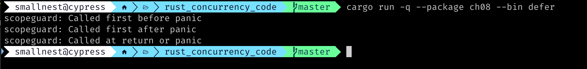
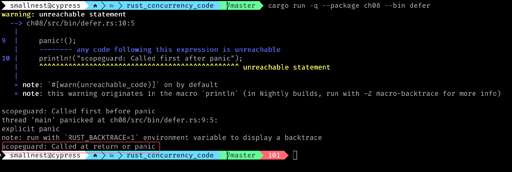

# 08 | 博采众长，触类旁通：有趣的线程扩展

你好，我是鸟窝。

在前面几节课程中我们学习了 Rust 线程相关的知识，如果你掌握好前面的线程的知识，理解了 Rust 中线程这个最基本的并发单元， 就可以轻松实现基本的并发程序了。在这节课中，我给你介绍几个关于线程的有趣的知识点。

```
首先我们先来了解 Rust 并发编程中两个重要但平时却不怎么接触的 trait：Sync 和 Send。
```


## Sync、Send 和 send_wrapper

```
在 Rust 中，Sync 和 Send 是两个非常重要的 trait，它们用于标记类型是否可以在并发环境
```

下安全地使用。理解这两个 trait 对于编写正确的并发程序至关重要。

```
Send 和 Sync 是 Rust 并发编程的基础。
Send 允许类型的所有权在线程之间安全传递。
Sync 允许类型通过共享引用在多个线程之间安全访问。
```

### Send trait

```
Send trait 标记了类型的所有权可以在线程之间安全传递。换句话说，如果一个类型 T 实现了
Send，那么将 T 的值从一个线程移动（move）到另一个线程是安全的。
含义：Send 意味着类型的所有权可以安全地在线程之间转移。
例子：大部分基本类型（如 i32、f64、bool 等）、结构体、枚举、以及包含 Send 类型
的容器（如 Vec<T>，如果 T 是 Send 的话）都自动实现了 Send。
反例：Rc<T>（引用计数）没有实现 Send，因为它的引用计数是共享的，在多线程环境下
```

- 直接使用会导致数据竞争。

### Sync trait

```
Sync trait 标记了类型可以在多个线程之间安全共享（通过共享引用）。换句话说，如果一个
类型 T 实现了 Sync，那么多个线程可以同时拥有 &T（不可变引用）。
含义：Sync 意味着类型可以通过共享引用在线程之间安全地访问。
条件：如果 &T 是 Send 的，那么 T 就是 Sync 的。
例子：大部分基本类型、不可变类型、以及内部没有可变状态的类型都自动实现了 Sync。
Arc<T>（原子引用计数）在 T 是 Send 和 Sync 的情况下，也实现了 Sync。
反例：Cell<T> 和 RefCell<T> 没有实现 Sync，因为它们提供了内部可变性，在多线
程环境下直接使用会导致数据竞争。MutexGuard（互斥锁的守卫）也没有实现 Sync，因
```

- 为它在同一时间只允许一个线程访问被保护的数据。

```
Rust 编译器会自动为某些类型实现 Send 和 Sync。通常情况下，如果一个类型的所有组成
部分都实现了 Send 和 Sync，那么该类型也会自动实现这两个 trait。
在极少数情况下，你可能需要手动实现 Send 或 Sync。这种情况通常发生在与外部代码（如
C 代码）交互时，或者使用了一些底层的不安全代码。手动实现 Send 或 Sync 是 unsafe
```

的，因为你需要自己保证类型的并发安全性。如果实现不正确，可能会导致未定义行为。

### 常见的并发类型和 Send/Sync

```
Arc<T>：如果 T 实现了 Send 和 Sync，那么 Arc<T> 就实现了 Send 和 Sync。
Arc<T> 用于在线程之间安全地共享所有权。
Mutex<T>：如果 T 是 Send 的，那么 Mutex<T> 就实现了 Send。Mutex<T> 用于提供
互斥访问，防止数据竞争。MutexGuard（通过 mutex.lock() 获取）没有实现 Sync，
```

- 因为同一时间只能有一个线程持有锁。

```
RwLock<T>：如果 T 是 Send 的，那么 RwLock<T> 就实现了 Send。RwLock<T> 允许
```

- 多个线程同时读取数据，但只允许一个线程写入数据。

```
通道（Channels）：std::sync::mpsc::Sender<T> 和
std::sync::mpsc::Receiver<T> 在 T 是 Send 的情况下都实现了 Send。通道用于
```

- 在线程之间传递消息。

```
原子类型（Atomic types）：原子类型（如 AtomicBool、AtomicUsize 等）都实现了
Send 和 Sync，它们提供了无需锁的原子操作。
避免手动实现 Send 和 Sync，除非绝对必要。如果需要手动实现，请务必仔细考虑类型的并
```

发安全性，并进行充分地测试。

```
如果编译器提示某个类型没有实现 Send 或 Sync，请检查该类型的组成部分，找出哪个部分
```

导致了问题，并考虑使用合适的并发原语来解决。

```
send_wrapper 实现了一个名为 SendWrapper 的包装类型，允许你在不同线程之间移动非
Send 类型的值，只要你确保只能在原线程内访问包含的值就可以。同时，你还需要确保包装
```

器是在原线程内被丢弃的。如果违反了这些约束，会导致 panic。

当然，你很少会遇到这样的场景，但是一旦遇到，就可以看一眼这个库，说不定能帮你大忙。下面的例子演示了如何使用这个库：

```javascript
use send_wrapper::SendWrapper;
use std::rc::Rc;
use std::ops::Deref;
use std::thread;
use std::sync::mpsc::channel;
fn main() {
   let wrapped_value = SendWrapper::new(Rc::new(42)); // 创建一个新的 SendWrapper
   let (sender, receiver) = channel(); // 创建一个 mpsc 通道
   let _t = thread::spawn(move || { // 创建一个新的线程
       sender.send(wrapped_value).unwrap(); // 在新线程中发送 wrapped_value
   });
   let wrapped_value = receiver.recv().unwrap(); // 在主线程中接收 wrapped_value
   let value = wrapped_value.deref(); // 解引用 wrapped_value
   println!("received from the main thread: {}", value);
}
一开始我们不是说 Rc<T> 没有实现 Send 吗，通过使用这个库一包装，立马就像换了个人一
样，Rc<T> 也实现了 Send，也可以在线程中移动了。
```

## Go 风格的启动线程

接下来我给你介绍一个有趣的宏，可以像 Go 一样简单地实现运行并发单元的方法（Go 语言中是 goroutine， Rust 中就是线程）。


```javascript
go-spawn 是一个库，它提供了宏，来以最少的代码启动和等待线程。线程可以通过 go! 或
go_ref! 启动，并可以通过 join! 或 join_all! 来等待它们完成。
use go_spawn::{go, join};
use std::sync::{
   atomic::{AtomicI64, Ordering},
   Arc,
};
fn main() {
   let counter = Arc::new(AtomicI64::new(0));
   let counter_cloned = counter.clone();
   // 启动一个线程，通过 move 捕获值。
   go! {
       for _ in 0..100 {
           counter_cloned.fetch_add(1, Ordering::SeqCst);
       }
   }
   // 等待所有线程结束
   assert!(join!().is_ok());
   assert_eq!(counter.load(Ordering::SeqCst), 100);
}
就问你，简洁不，是不是类似 Go 语言中的 go foo()?
```

这个库提供了四个宏，可以分为两对，注意它们之间的差异。

- go：创建一个线程来执行给定的代码。任何捕获的变量都将被移动到新创建的线程中。

- go_ref：创建一个线程来执行给定的代码。任何捕获的变量将被借用到新创建的线程中。

```
join：等待当前线程通过 go! 或 go_ref! 启动的最新一个尚未加入的线程完成。
join_all：等待当前线程通过 go! 或 go_ref! 启动的所有待加入线程完成。
```

如果你也是一个 Go 程序员，就会觉得这个宏实现得好有趣。

## Defer

```
那接下来我再介绍一个 Go 语言的好玩特性: defer。
在 Go 语言中，defer 语句用于注册一个延迟执行的函数调用。被 defer 修饰的函数会在包
含它的函数执行完毕后执行，也就是返回之前。defer 常用于清理资源、解锁、关闭文件等
```

操作。

```
Go 语言的 defer 功能有以下特点：
延迟执行：defer 语句后的函数调用不会立即执行，而是等待外层函数执行完毕后再执
```

- 行。

```
栈结构：多个 defer 语句按顺序入栈，直到函数返回时，按照后进先出（LIFO）的顺序执
```

- 行。

```
保证执行：无论函数是正常返回还是发生错误，defer 中的操作都会被执行，确保资源得
```

- 到释放或清理。

以下是一个 Go 语言使用 defer 的例子：

```go
package main
import "fmt"
func example() {
   fmt.Println("Start of function")
   defer fmt.Println("Deferred 1")
   defer fmt.Println("Deferred 2")
   fmt.Println("End of function")
}
func main() {
   example()
}
```

从代码中，你可以看到函数按照栈后入先出的方式依次执行。

```
在 Rust 中如何实现呢？你可以使用 scopeguard 库。
scopeguard 提供了一个方便的 RAII scope guard，当其作用域结束时会执行给定的闭包，
```

即使在作用域中的代码发生 panic（假设是非终止性 panic）。

```
defer! 宏和 guard 是兼容 no_std 的（仅需 core），但 on unwinding / not on
unwinding 策略需要链接到 std。默认情况下，启用了 use_std crate 特性。若需
no_std 支持，请禁用默认特性。
```

下面是一个例子：

```
use scopeguard::defer;
fn main() {
   defer! {
       println!("scopeguard: Called at return or panic");
   }
   println!("scopeguard: Called first before panic");
   // panic!();
   println!("scopeguard: Called first after panic");
}
```

输出：



可以看到 defer 的那个闭包在返回的时候执行了。

```
如果我们反注释掉 panic! 那一句，会发生什么呢？
use scopeguard::defer;
fn main() {
   defer! {
       println!("scopeguard: Called at return or panic");
   }
   println!("scopeguard: Called first before panic");
   panic!();
   println!("scopeguard: Called first after panic");
}
```

输出：



你会看到最后那个闭包也执行了。

## Join


```javascript
在 Rust 中，join 方法用于等待线程执行完成。它是 std::thread::JoinHandle 上的一
个方法。当你使用 std::thread::spawn 创建一个新线程时，它会返回一个
JoinHandle，你可以使用这个句柄来控制和等待线程。
use std::thread;
fn main() {
   let handle = thread::spawn(|| {
       println!("Hello from the spawned thread!");
       "Thread completed successfully!".to_string() // 线程返回值
   });
   println!("Waiting for the thread to finish...");
   // 等待线程完成，并获取其返回值
   let result = handle.join().unwrap(); // Join!!!
   println!("Thread returned: {}", result);
   println!("Main thread continues.");
}
```

现在问题来了，如果你启动了一百个线程，你总不能写一百行调用每一个 handler 的 Join 方法吧？

```
我们可以把它放在一个 vec 中，统一进行处理。
```

```javascript
use std::thread;
fn main() {
   let mut handles = vec![];
   for i in 0..5 {
       handles.push(thread::spawn(move || {
           println!("Hello from thread {}", i);
           i * 2
       }));
   }
   for handle in handles {
       let result = handle.join().unwrap();
       println!("Thread returned: {}", result);
   }
   println!("All threads finished.");
}
```

或者简单写成一行，也是不错的。

```
handles.into_iter().for_each(|handle| println!("Thread returned: {}", handle.join
对于不定数量，或者线程非常多的情况，我们可以使用 vec 处理方法，如果只有几个线程，
```

我们还可以使用下面的方法：

```javascript
use std::thread;
macro_rules! join_all {
   ($handles:expr) => {
       for handle in $handles {
           handle.join().unwrap();
       }
   };
}
fn main() {
   let handle1 = thread::spawn(|| {
       println!("Hello from a thread1!");
   });
   let handle2 = thread::spawn(|| {
       println!("Hello from a thread2!");
   });
   join_all!([handle1, handle2]); // 使用数组字面量
   let mut handles = Vec::new();
   handles.push(thread::spawn(|| println!("Hello from thread 3")));
   handles.push(thread::spawn(|| println!("Hello from thread 4")));
   join_all!(handles); // 使用 Vec
   let handles2 = vec![
       thread::spawn(|| println!("Hello from thread 5")),
       thread::spawn(|| println!("Hello from thread 6")),
   ];
   join_all!(handles2); // 使用 vec![] 宏
   let handles3 = (0..2).map(|i| thread::spawn(move|| println!("Hello from threa
   join_all!(handles3); // 使用迭代器和 collect
}
其实就是实现了一个 join_all 宏，支持 vec<JoinHandle> 作为参数。
```

## 总结

好了，这一节课我们介绍了 Rust 并发编程中几个有趣的特性和库，现在我们来回顾一下其中的要点。

```
Send 和 Sync 这两个核心 trait 分别用于标记类型的所有权是否能在线程间安全传递以及类型
是否能在多线程间安全共享。send_wrapper 库，它允许在特定条件下“欺骗”编译器，使非
Send 类型也能在线程间传递。
```

```
go-spawn 库提供了类似 Go 语言 go 关键字的宏，简化了线程的创建和管理。还有
scopeguard 库，它提供了类似 Go 语言 defer 语句的功能，允许在作用域结束时执行清理
```

操作，即使发生 panic 也能保证执行。最后，我还讲解了生成多个线程后调用 join 的技巧。

这节课主要是扩展视野，让你多了解一些实用的工具和技巧，帮助编写更高效、更安全的并发程序。讲到现在，我已经把 Rust 线程中的相关知识介绍完了，你不妨做一个回顾，巩固一下线程相关的知识点，再迎接下一节课的挑战。

## 思考题

在学习了 Go 和 defer 宏之后，请你写一个实验性的程序，演示它们的用法，尤其是子线程发生 panic 的情况。

欢迎你把你写完的程序分享出来，我们一起交流讨论，如果你觉得这节课的内容对你有帮助的话，也欢迎你分享给其他朋友，我们下节课再见！
