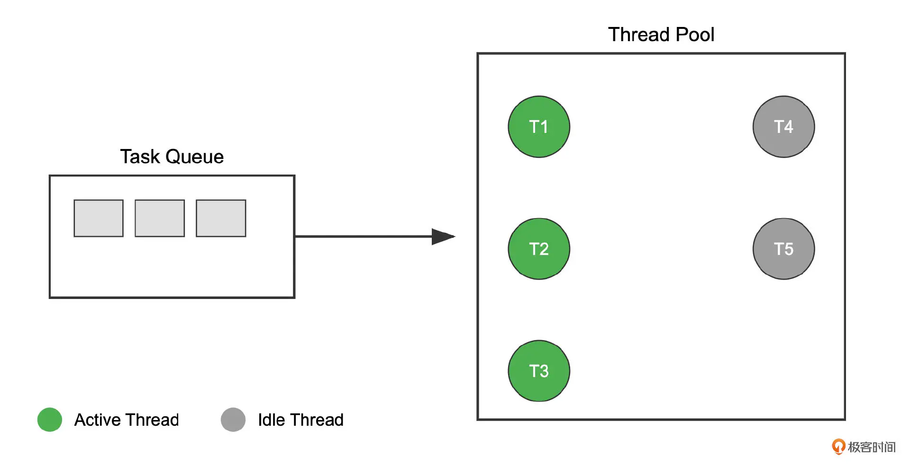
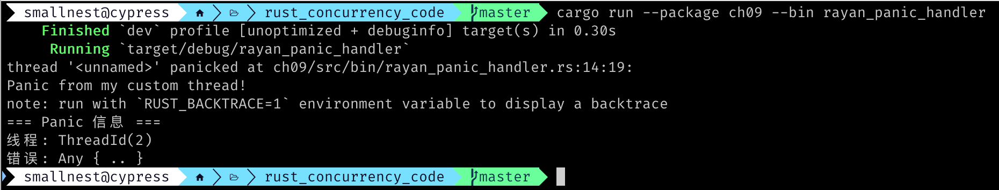

# 09 | 蓄势待发，并行天下（一）：常用线程池之Rayon

你好，我是鸟窝。

在多线程编程中，频繁地创建和销毁线程会带来较大的系统开销，尤其是在需要大量并发执行短任务的场景下。线程池是一种用于管理和复用线程的技术，它可以有效地解决这个问题。

线程池维护着一个线程集合，这些线程在没有任务时处于等待状态，一旦有新的任务提交，线程池就会分配一个空闲线程去执行该任务。任务执行完毕后，线程并不会立即销毁，而是返回线程池继续等待下一个任务。这样就避免了频繁创建和销毁线程的开销，提高了程序的性能。


线程池的优点：

- 降低资源消耗：通过复用已创建的线程，减少了线程创建和销毁的开销。

- 控制并发度：线程池可以限制同时执行的线程数量，从而有效控制系统的并发度，避免资源耗尽和过度竞争。

- 提高响应速度：当有新任务到达时，可以直接分配线程池中的空闲线程执行，无需等待线程创建。

- 提高线程的可管理性：线程池可以统一管理和监控线程，例如限制最大线程数、设置线程的生命周期等。

```
Rust 标准库 std::thread 提供了创建和管理线程的基本功能，但并没有内置线程池的实
```

现。不过，Rust 社区提供了许多优秀的第三方库来实现线程池，接下来我介绍几款常用的线程池库。



## Rayon 线程池

Rayon 是一个 Rust 库，旨在使并行计算变得简单易用。它通过提供高级的抽象，例如并行迭代器和任务并行，隐藏了底层线程管理的复杂性。Rayon 的核心是一个工作窃取（work-stealing）线程池，它负责有效地调度和执行并行任务。

```
第七课中我介绍了 Rayon 库的 scoped thread，这一节我介绍它的线程池。
```

Rayon 线程池有以下的特点：

1. 工作窃取（Work-Stealing）： 这是 Rayon 线程池的核心机制。它维护一个固定大小的线程池（默认情况下，线程数与系统逻辑核心数匹配）。每个线程都有自己的本地任务队列。当

- 一个线程完成其本地队列中的所有任务时，它可以从其他线程的队列中“窃取”任务来执行。这种机制可以有效地平衡各个线程的工作负载，最大程度地利用多核 CPU。

2. 默认全局线程池： Rayon 提供了一个默认的全局线程池，你无需手动创建和管理。这使得

```
并行化代码非常简单，只需使用 Rayon 提供的并行迭代器或 join 和 scope 函数即可。
```

3. 自定义线程池： 虽然默认的全局线程池通常足够好用，但 Rayon 也允许你创建自定义的线程池，以满足特定的需求。例如，你可以控制线程池的大小，或者在某些情况下使用不同的调度策略。

4. 零开销抽象： Rayon 的设计目标之一是提供零开销的抽象。这意味着使用 Rayon 进行并行化带来的额外开销应该尽可能小，接近于手写多线程代码的性能。

我们先来看看一个 Rayon 线程池的例子：

```javascript
pub fn fib(n: usize) -> usize {
   if n == 0 || n == 1 {
       return n;
   }
   let (a, b) = rayon::join(|| fib(n - 1), || fib(n - 2)); // runs inside of `po
   return a + b;
}
fn main() {
   let pool = rayon::ThreadPoolBuilder::new()
       .num_threads(8)
       .build()
       .unwrap();
   let n = pool.install(|| fib(20));
   println!("{}", n);
}
fib 是一个计算斐波那契数的函数，我们非常熟悉了。这里使用 rayon::join 并行计算
fib(n-1) 和 fib(n-2)，并将结果返回。
main 函数中，首先创建了八个线程的线程池，然后在该线程池中执行 fib(20) 的计算，并
```

将结果打印出来。

使用 Rayon 有两种方式：

- 高级并行构造（High-level parallel constructs） 是使用 Rayon 最简单的方式，通常也是效率最高的。

- 并行迭代器（Parallel iterators）使将顺序迭代器转换为并行执行变得容易。1.

```
ParallelIterator trait 为所有并行迭代器定义了通用方法。
IndexedParallelIterator trait 为支持随机访问的迭代器添加了方法。
```

- 2.

```
par_sort 方法并行地对 &mut [T] 切片（或向量）进行排序。
```

- 3.

```
par_extend 可用于有效地扩展集合，其中的元素由并行迭代器生成。
```

- 4.

- 自定义任务（Custom tasks） 允许你自行将工作划分为并行任务。

```
join 用于将一个任务细分为两部分。
```

- 1.

```
scope 创建一个作用域，你可以在其中创建任意数量的并行任务。
```

- 2.

```
ThreadPoolBuilder 可用于创建你自己的线程池或自定义全局线程池。
```

- 3.

因为这一节课我主要讲述线程池的使用，所以 Rayon 的并行构造放在后面专门一节课讲述。

```
scope 也在第七节课进行了讲述，这里也不再赘述。本节课主要讲述 ThreadPoolBuilder
和 join。
```

### ThreadPoolBuilder 介绍

```
ThreadPoolBuilder 是 Rayon 库中用于创建和配置线程池的工具。虽然 Rayon 默认提供
了一个全局线程池，通常情况下使用它就足够了，但 ThreadPoolBuilder 允许你进行更精
```

细的控制，以满足特定的需求。

想象一下，你有一个需要大量并行处理的任务，但你希望限制使用的线程数量，或者在某些特

```
殊情况下需要一些定制化的配置。这时，ThreadPoolBuilder 就派上用场了。
ThreadPoolBuilder 允许你通过链式调用的方式设置线程池的各种属性，最后调用
build() 方法来创建一个 ThreadPool 实例。这个实例代表了一个独立的线程池，你可以
```

使用它来执行并行任务，而不会影响到 Rayon 的全局线程池。

```
最常用的配置选项是 num_threads()，它允许你显式地设置线程池中线程的数量。如果不
```

设置这个选项，Rayon 会根据系统的逻辑核心数自动确定线程数。在某些情况下，你可能需要手动控制线程数，例如：

- 避免资源过度占用：如果你的程序与其他资源密集型程序同时运行，限制线程数可以防止系统资源过度占用，提高整体性能。

- 针对特定硬件优化：在某些特殊的硬件环境下，最佳的线程数可能并非系统的逻辑核心数。

```
通过 num_threads() 可以进行微调，以达到最佳性能。
```

- 测试和调试：在测试和调试并行代码时，控制线程数可以帮助你更好地理解程序的行为，并更容易地发现潜在的并发问题。

```
除了 num_threads() 之外，ThreadPoolBuilder 还提供了一些其他不太常用的配置选
```

项。例如：

```
stack_size()：设置每个线程的栈大小。通常情况下，你不需要修改这个选项，除非你
```

- 的并行任务需要大量的栈空间。

```
build()：根据之前的配置构建 ThreadPool 实例。此方法返回一个
Result<ThreadPool, BuildError>，你需要处理可能出现的错误（例如，如果指定
```

- 的线程数为 0）。

```
build_global()：构建一个全局线程池，并将其设置为 Rayon 的默认线程池。这个方法
与 build() 类似，但它会将创建的线程池设置为全局的，这意味着之后所有使用 Rayon
的代码都会使用这个新的全局线程池。这个方法也返回一个 Result<(),
BuildError>。
thread_name()：如果你需要为线程命名以进行调试或其他目的，你可以使用这个方法定
```

- 制，比如：

```javascript
let basic_pool = ThreadPoolBuilder::new()
       .thread_name(|index| format!("worker-{}", index))
       .build()
       .unwrap();
use_current_thread()：将当前线程作为线程池中的一个线程使用。当前线程保证会
```

- 被分配到索引 0 的位置。由于这个线程不是由 Rayon 管理的，因此这个线程不会执行生成（spawn）和退出（exit）处理程序。

需要注意的是，当前线程不会运行主要的工作窃取循环。这意味着提交到线程池的任务通常不会被当前线程自动接收和执行，除非你通过某种方式向 Rayon 让出控制权，比如通过

```
yield_now()、yield_local() 或 scope() 等方法。
exit_handler()：当线程池中的线程即将终止时，Rayon 会调用这个退出回调函数，使
```

- 得我们有机会执行一些清理工作或记录线程的退出信息。回调函数可能会被多个线程同时调用，这是因为线程池中的多个线程可能会同时退出，特别是在线程池关闭时。正因如此，编写回调函数时需要确保它是线程安全的。如果回调函数发生 panic，Rayon 会通过预先配置的 panic 处理器来处理这个异常情况，这提供了一个优雅处理错误的机制。

```
panic_handler()：我来解释一下这段关于 Rayon panic 处理器的文档。Rayon 在处理
```

- panic 时遵循一个基本原则：尽量模拟顺序执行的语义。这意味着，当并行代码中发生panic 时，Rayon 会尝试将这个 panic 传播到一个合理的位置，就像这段代码是顺序执行的

```
那样。但在某些情况下，特别是使用 spawn() API 时，并不存在明显的位置来传播
```

- panic。这是因为 spawn 创建的是独立的任务，与主执行流并无直接关联。在这种情况下，就会调用专门配置的 panic 处理器。

如果没有设置自定义的 panic 处理器，Rayon 会采用默认行为：终止整个进程。这遵循了“panic 不应该被忽略”的设计原则。这种处理方式确保了异常情况不会悄无声息地通过。

一个特殊情况是：如果 panic 处理器本身发生了 panic，程序会直接终止。为了防止这种情

```
况，建议在 panic 处理器的代码主体外包裹一层 std::panic::catch_unwind()。
spawn_handler()：设置自定义线程生成函数。线程只有在线程池被 drop 后才会退出，
```

- 而不是任务完成就退出。线程终止由调用方负责。

```javascript
start_handler()：设置一个在线程启动时被调用的回调函数。
下面是一个使用 ThreadPoolBuilder 的例子：
use std::time;
fn main() -> Result<(), rayon::ThreadPoolBuildError> {
   let pool = rayon::ThreadPoolBuilder::new()
       .num_threads(2)
       .spawn_handler(|thread| {
           std::thread::spawn(|| {
               println!("start a new thread");
               thread.run()
           });
           Ok(())
       })
       .start_handler(|i| {
           println!("start thread #{}", i);
       })
       .exit_handler(|i| {
           println!("exit thread #{}", i);
       })
       .build()?;
   pool.install(|| println!("Hello from my custom thread!"));
   std::thread::sleep(time::Duration::from_secs(1));
   drop(pool);
   std::thread::sleep(time::Duration::from_secs(1));
   Ok(())
}
.new()：创建一个新的 ThreadPoolBuilder 实例，用于配置线程池。
.num_threads(2)：设置线程池中的线程数量为 2。
.spawn_handler(|thread| {...})：这是自定义线程生成逻辑的关键。
.start_handler(|i| {...})：i 参数可能是线程的索引（从 0 开始）。这段代码会在
```

- 每个线程启动时打印一条消息。

```
.exit_handler(|i| {...})：i 参数同样可能是线程的索引。这段代码会在每个线程
```

- 退出时打印一条消息。

```javascript
.build()?: 构建配置好的线程池。? 运算符用于传播可能发生的错误。
下面是一个使用 panic_handler 的例子：
fn main() -> Result<(), rayon::ThreadPoolBuildError> {
   let pool = rayon::ThreadPoolBuilder::new()
       .num_threads(2)
       .panic_handler(|panic_info| {
           let thread_id = std::thread::current().id();
           let panic_info = format!("{:?}", panic_info);
           println!("=== Panic 信息 ===");
           println!("线程: {:?}", thread_id);
           println!("错误: {}", panic_info);
       })
       .build()?;
   pool.spawn(|| panic!("Panic from my custom thread!"));
   std::thread::sleep(std::time::Duration::from_secs(1));
   Ok(())
}
运行这个代码，会打印出 panic 信息，panic_handler 会处理 panic，打印出 panic 信息。
```



### ThreadPool 如何执行任务？

```
创建好 ThreadPool 实例后，你需要使用 install() 方法在一个闭包中执行你的并行代
```

码。这个闭包会在你创建的线程池中执行，而不会使用全局线程池。

举个例子：

```javascript
use rayon::ThreadPoolBuilder;
fn main() {
   let pool = ThreadPoolBuilder::new()
       .num_threads(4) // 创建一个包含 4 个线程的线程池
       .build()
       .unwrap();
   pool.install(|| {
       // 在自定义线程池中执行并行任务
       (0..100).into_par_iter().for_each(|i| {
           // 这里是并行执行的代码
           println!("Processing {}", i);
       });
   });
   println!("Finished!");
}
事实上，ThreadPool 提供了多种执行任务的方法：
install(|| { ... })：这是一个在已构建的线程池上执行闭包的方法。它会阻塞当前
```

- 线程，直到闭包执行完成。这是在 Rayon 中执行并行代码的最简单方法之一。例如：

```javascript
use rayon::ThreadPoolBuilder;
let pool = ThreadPoolBuilder::new().build().unwrap();
pool.install(|| {
   println!("This code runs in the thread pool.");
   (0..10).into_par_iter().for_each(|i| {
       println!("Parallel item: {}", i);
   });
});
scope(|s| { ... })：创建一个新的作用域，允许你在其中生成（spawn）多个并行任
```

- 务。作用域会等待所有生成的任务完成后才返回。这对于需要并行执行一组相互独立的任务非常有用。其实我们在第 7 课就已经介绍过了。例如：

```
use rayon::scope;
scope(|s| {
   s.spawn(|_| {
       println!("Task 1");
   });
   s.spawn(|_| {
       println!("Task 2");
   });
});
println!("Both tasks finished.");
scope_fifo(|s| { ... })：与 scope() 类似，但它使用 FIFO 先进先出的调度策略
来执行任务。这意味着任务会按照它们被生成的顺序执行。在大多数情况下，scope() 的
```

- 默认调度策略就足够好，只有在特定情况下需要保证执行顺序时才需要使用

```
scope_fifo()。
in_place_scope(|s| { ... })：与 scope() 类似，但它尝试在当前线程上执行尽
```

- 可能多的任务，以减少线程切换的开销。只有当任务数量超过可用线程数时，才会创建新的worker 线程。这对于执行少量计算量小的并行任务可能更高效。

```
in_place_scope_fifo(|s| { ... })：结合了 in_place_scope() 和
scope_fifo() 的特性，即在当前线程上尽可能多地执行任务，并使用 FIFO 调度策略。
spawn(|_| { ... })：在 scope() 或 scope_fifo() 内部使用，用于生成一个新的
并行任务。spawn() 接受一个闭包作为参数，这个闭包会在线程池中的一个线程上异步执
```

- 行。

```
spawn_fifo(|_| { ... })：与 spawn() 类似，但在 scope_fifo() 内部使用，以
```

- 确保任务按照 FIFO 顺序执行。

```
spawn_broadcast(|_| { ... })：在该线程池中的每个线程上启动一个异步任务。该
```

- 任务将在隐式的全局作用域中运行，这意味着它可能会超出当前栈帧的生命周期——因此，它不能捕获栈上的任何引用（你可能需要使用 move 闭包）。

```
broadcast() 方法在线程池中的每个线程上执行 op。任何使用 join、scope 或并行迭
```

- 代器的操作都将在该线程池中运行。广播操作会在每个线程的本地工作队列耗尽后执行，然后才会尝试从其他线程窃取任务。这种策略的目的是尽可能及时地在所有线程上执行，同时尽量不打扰当前的工作。如果有需要，未来可能会添加不同的广播策略，以支持更激进或更温和的任务注入方式。

```
spawn_broadcast：将操作 op 直接广播到所有线程，确保每个线程都执行该操作。
broadcast：用于广播信息或任务，通常在本地任务队列为空时执行，并且可以在不同的线
```

程之间进行任务传递，避免过多干扰当前工作。

下面的例子演示了上面各种启动任务的方法：

```javascript
use rayon;
use rayon::ThreadPoolBuilder;
use std::sync::{Arc, Mutex};
fn main() {
   // 创建一个自定义线程池，包含 4 个线程
   let pool = ThreadPoolBuilder::new().num_threads(4).build().unwrap();
   // 共享计数器，模拟跨线程的共享状态
   let counter = Arc::new(Mutex::new(0));
   let counter2 = Arc::clone(&counter);
   // 创建一个闭包作为任务，修改共享的计数器
   let op = move || {
       let mut counter = counter.lock().unwrap();
       *counter += 1;
       println!("Thread {:?} processed the task, counter: {}", std::thread::curr
   };
   // 直接使用 `spawn` 启动任务
   pool.spawn(move || {
       println!("\nUsing spawn method");
       op(); // 使用闭包
   });
   // 直接使用 `scope` 启动多个任务（确保所有任务完成后再返回）
   pool.scope(|s| {
       println!("\nUsing scope method");
       s.spawn(|_| println!("spawn a task")); // 使用 spawn 启动任务
       s.spawn(|_| println!("spawn another task")); // 启动另一个任务
   });
   // 直接使用 `scope_fifo` 启动多个任务（先发先执行，任务按照提交顺序执行）
   pool.scope_fifo(|s| {
       println!("\nUsing scope_fifo method");
       s.spawn_fifo(|_| println!("spawn task#3"));
       s.spawn_fifo(|_| println!("spawn task#4"));
   });
   // 直接使用 `in_place_scope` 启动任务（任务在同一线程内执行，不会并行）
   pool.in_place_scope(|s| {
       println!("\nUsing in_place_scope method");
       s.spawn(|_| println!("spawn task#5"));
   });
   // 直接使用 `in_place_scope_fifo` 启动任务（先发先执行，但在同一线程内顺序执行）
   pool.in_place_scope_fifo(|s| {
       println!("\nUsing in_place_scope_fifo method");
       s.spawn_fifo(|_| println!("spawn task#6"));
   });
   // 使用 `spawn_fifo` 启动任务，确保任务按提交顺序执行
   pool.spawn_fifo(|| {
       println!("\nUsing spawn_fifo method");
   });
   // 使用 `spawn_broadcast` 广播任务到所有线程
   pool.spawn_broadcast(|_| {
       println!("\nUsing spawn_broadcast method");
   });
   // 使用 `broadcast` 方法广播任务到所有线程
   pool.broadcast(|_| {
       println!("\nUsing broadcast method");
   });
   // 等待所有任务执行完毕
   std::thread::sleep(std::time::Duration::from_secs(1));
   // 输出最终计数器的值
   println!("\nFinal counter value: {}", *counter2.lock().unwrap());
}
```

另外， ThreadPool 还提供了三个查询状态的方法：

```
current_num_threads：当前线程数
current_thread_has_pending_tasks：当前线程是否有待处理任务
current_thread_index：当前线程索引
```

### join、yield_local、yield_now 三个方法

```
ThreadPool 的这三个方法各有各的妙处：
join：join 是 Rayon 中的一个方法，允许你在并行计算中合并多个线程的结果。它将多
```

- 个并行任务“连接”起来，等待所有任务完成并收集它们的结果。通常用于将多个并行执行的任务结果合并为一个最终结果。

用法：

```javascript
fn main() {
   let result = rayon::join(
       || println!("task 1"),
       || {println!("task 2"); 2}
   );
   println!("Result: {:?}", result); // Result: ((), 2)
}
yield_local：yield_local 方法用于主动让出当前线程，允许其他任务运行。它不会
```

- 跨线程或跨线程池任务边界进行调度，而只是让出当前线程，使得线程池中的其他任务有机会执行。这个方法主要用于让当前线程在任务中更好地协调其他任务的调度。

用法：

```
rayon::scope(|s| {
   s.spawn(|_| {
       // 某些计算
       rayon::yield_local();
       // 继续执行其他计算
   });
});
yield_now：yield_now 与 yield_local 相似，但它允许当前线程让出执行权并立刻
```

- 交给其他线程。这意味着，它不仅仅是让出当前线程内的计算时间，还可能允许调度器重新调度当前线程到其他地方执行。这通常用于更高层次的调度，以避免长时间占用一个线程。

用法：

```
rayon::scope(|s| {
   s.spawn(|_| {
       // 某些计算
       rayon::yield_now();
       // 继续执行其他计算
   });
});
```

yield_local vs yield_now

1. yield_local

```
yield_local 会让当前线程放弃 CPU 时间片，但它只会在当前线程池内进行调度，即它只
是将执行权交给同一线程池中的其他线程。也就是说，调用 yield_local 后，当前线程仍
```

然留在同一个线程池中，其他任务有机会在当前线程继续执行。

使用场景：适用于在同一线程池中进行任务调度时，如果你希望当前线程暂停，并让其他任务有机会执行。

行为：让出当前线程的执行权，其他任务可以使用同一线程池中的线程继续执行。

2. yield_now

```
yield_now 更为激进，它会让当前线程主动放弃其执行权，可能不仅仅是在当前线程池内进
```

行调度。它会允许操作系统或调度器决定哪个线程执行，因此有可能是同一线程池中的另一个线程，也可能是完全不同的线程池或线程。

使用场景：适用于更高层次的调度，特别是当你希望当前线程主动让出执行权，以便调度器可

```
以决定哪个线程执行。yield_now 可能会导致线程调度到完全不同的地方。
```

行为：让出当前线程的执行权，调度器可以决定哪个线程执行，可能是同一个线程池内的其他线程，也可能是操作系统或全局调度器分配的线程。

关键区别

- 调度范围：

```
yield_local 只会影响当前线程池内部的任务调度。
yield_now 可能会跨线程池，允许操作系统或全局调度器介入调度，调度的范围更广。
```

- 粒度：

```
yield_local 只是让出当前线程的时间片，其他任务可能会继续在当前线程池的其他
```

- 线程中执行。

```
yield_now 允许更广泛的线程调度，可能会将当前线程移交给其他线程池或调度器。
```

### 全局线程池

Rayon 的全局线程池是 Rayon 中非常核心的概念，它在整个程序生命周期内存在，并且会自动管理并发执行的任务。Rayon 提供了并行计算的便捷接口，通过这个全局线程池，程序可以有效地分配计算任务到多个线程，从而充分利用多核处理器的计算能力。

Rayon 的全局线程池是一个静态、共享的线程池，用于管理并发任务。它是 Rayon 默认使用的线程池，在没有显式创建自定义线程池的情况下，所有的并行任务都会提交到这个全局线程池中。全局线程池的主要作用是：

- 自动管理线程池的大小：全局线程池的大小会根据系统的核心数（通常是 CPU 核心数）进行调整。Rayon 会默认启动一个线程池，线程池的大小会与 CPU 核心数相匹配（每个线程对应一个核心），但它也会根据负载进行动态调整。

- 任务调度和执行：当你调用 Rayon 提供的并行操作（如 par_iter()）时，任务会被分配给全局线程池中的线程执行，Rayon 会自动调度任务，确保任务高效执行。

- 线程池的共享性：所有的并行操作都会共享这个线程池，程序中的不同并行计算不会创建独立的线程池，而是复用同一个全局线程池。

### 全局线程池的特点

- 线程池大小：全局线程池的默认大小是根据 CPU 核心数来设置的，通常会是

```
num_cpus::get()，即系统的逻辑核心数。这意味着，Rayon 会在程序启动时自动创建
```

- 一个大小为 CPU 核心数的线程池，确保计算能够充分利用多核资源。

- 任务分配和调度：Rayon 使用一种称为“工作窃取”的策略来调度任务。当某个线程完成其任务时，它会去“窃取”其他线程尚未完成的任务，以保持线程池的高效运行。这样可以避免一些线程空闲等待，提升计算效率。

- 线程池的生命周期：全局线程池的生命周期由 Rayon 自动管理，你不需要显式地创建或销毁线程池。只要有并行任务，线程池就会持续存在，并在程序结束时自动销毁。

- 线程池的调优：如果需要，你可以调整全局线程池的大小或线程数，或者创建一个自定义的线程池供特定的任务使用。这对于需要更精细控制并发行为的应用程序来说非常有用。

### 如何使用全局线程池？

```
rayon 库提供了和 ThreadPool 相同名称的函数，这些函数如果是在 rayon 的线程池被调
```

用，那么它和当前的线程池相关，否则，它和全局线程池相关。

```
例如： current_num_threads 返回当前注册表中的线程数。如果这段代码在 Rayon 线程
```

池内执行，则返回当前线程池中的线程数。否则，返回全局线程池中的线程数。

常见的方法包括：

```
1.par_iter() 和 par_for_each()
```

这些方法会自动使用全局线程池来并行处理集合中的元素。

```javascript
use rayon::prelude::*;
let data: Vec<i32> = (0..100).collect();
let sum: i32 = data.par_iter()
   .map(|&x| x * x) // 对每个元素执行平方运算
   .sum(); // 对所有结果求和
println!("Total sum: {}", sum);
在上面的例子中，par_iter() 会自动将 data 的元素分配给全局线程池中的多个线程进行
```

并行处理。

```
2.scope() 和 spawn()
scope 和 spawn 方法提供了一种更加灵活的并行控制方式，允许你在多个线程之间手动管理
```

任务。

```
use rayon::scope;
scope(|s| {
   s.spawn(|_| {
       // 执行某个并行任务
   });
   s.spawn(|_| {
       // 执行另一个并行任务
   });
});
在这个例子中，scope 会创建一个作用域，所有在 scope 内部通过 spawn 启动的任务都会
```

在全局线程池中并行执行。

### 如何控制全局线程池？

虽然全局线程池会自动管理线程数量和任务调度，但你也可以通过以下方式来控制全局线程池的行为。

设置线程池大小

```javascript
通过调用 rayon::ThreadPoolBuilder 可以创建一个自定义大小的线程池，并通过
Rayon::set_thread_pool 来将其设置为全局线程池。
use std::thread::current;
fn main() -> Result<(), Box<dyn std::error::Error>> {
   let _ = rayon::ThreadPoolBuilder::new()
       .num_threads(8)
       .thread_name(|i| format!("rayon-global-thread-{}", i))
       .build_global()?;
   rayon::scope(|s| {
       s.spawn(|_| {
           println!("Hello from rayon global thread:{}!", current().name().unwra
       });
   });
   Ok(())
}
```

在上面的例子中，我们手动设置了全局线程池为 8 个线程，而不是默认的线程池大小。

一般来说，我们不会修改全局的线程池，除非进行性能测试或者你就想修改配置参数。

## 总结

```
好了，这一节课，我们介绍了 Rust 并发编程中最强大使用最广泛的线程池 Rayon 库。
```

线程池是一种重要的并发编程技术，它通过维护一个线程集合来复用线程，避免了频繁创建和销毁线程的开销，从而提高了程序的性能和响应速度。在需要大量并发执行短任务的场景下，线程池尤为重要。它不仅降低了资源消耗，还能够控制并发度，防止系统资源耗尽和过度竞争。

此外，线程池还提供了更好的线程管理能力，例如限制最大线程数、设置线程生命周期等。虽然 Rust 标准库提供了线程的基本操作，但并没有内置线程池的实现，因此需要借助第三方库

```
来实现线程池的功能。常用的 Rust 线程池库包括 Rayon 和 ThreadPool。
Rayon 是一个强大的并行计算库，它通过工作窃取算法高效地调度和执行并行任务，并提供
了高级抽象，如并行迭代器和任务并行，简化了并发编程。Rayon 默认提供了一个全局线程
池，方便用户快速进行并行化开发，同时也支持通过 ThreadPoolBuilder 创建自定义线程
池，以满足特定的需求。Rayon 提供了多种执行任务的方式，包括 install、scope、
spawn 等，以及 join、yield_local 和 yield_now 等辅助方法，用于任务的合并和线
```

程的调度。

最后还有针对 Rayon 的两条特殊注意事项需要提醒你。

```
避免在 rayon::scope 或 rayon::join 中执行阻塞操作： 这会导致 rayon 的工作窃取
```

- 机制失效，降低并行效率。

```
注意全局线程池的共享性： 如果你的程序中使用了多个库，并且这些库都使用了 rayon，
```

- 它们会共享同一个全局线程池。这可能会导致一些意想不到的性能问题。在这种情况下，可以考虑使用自定义的线程池。

```
下节课我们继续学习 ThreadPool 线程池库。
```

## 思考题

```
请你使用 Rayon 线程池，写一个并发排序，排序方法不限。欢迎你把你写的并发排序分享到
```

留言区，我们一起交流讨论，如果你觉得这节课的内容对你有帮助的话，也欢迎你分享给需要的朋友，我们下节课再见！
