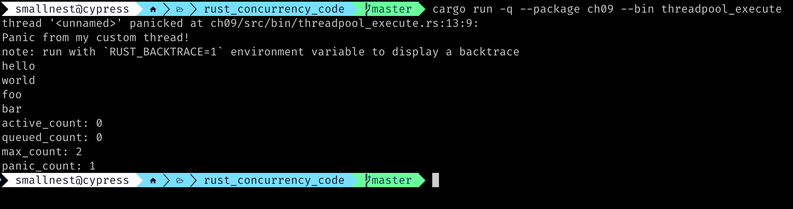

# 10 | 蓄势待发，并行天下（二）：常用线程池之threadpool

你好，我是鸟窝。

除了上节课我们所讲的大名鼎鼎的 Rayon 线程池外，还有一个知名的线程池库

```
threadpool，使用也很广泛，这节课我们来学习它。最后我们再了解线程池中的一些陷阱，
```

避免踩坑。

## threadpool 库

```
threadpool crate 是 Rust 中一个相对简单易用的线程池库。虽然 Rayon 在很多情况下是更
强大和方便的选择（尤其是数据并行），但 threadpool 提供了一种更基础的方式来管理线程
```

池，对于一些特定的场景可能仍然有用。

```
threadpool 胜在简单高效。它就包含两个结构体：
Builder 是一个构建器模式的实现，它提供了一种灵活的方式来创建和配置 ThreadPool
实例。使用构建器模式，你可以通过链式调用的方式设置 ThreadPool 的各种属性（例如
```

- 线程数量、栈大小等），而无需使用复杂的构造函数或大量的可选参数。

```
ThreadPool 是一个抽象概念，它封装了线程池的实现细节，提供了一种简单的方式来执
行并行任务。通过使用 ThreadPool，你无需手动创建和管理线程，而是将任务提交到线
```

- 程池，由线程池负责调度和执行。这里的“基本并行性”指的是简单的任务并行，即将不同的任务分配到不同的线程并行执行。

```
简单来说，Builder 创建 ThreadPool，ThreadPool 用来执行任务。
```

### Builder

```
Builder 包含可以配置三个属性：
num_threads(num_threads: usize) -> Builder：此方法用于设置所构建的
ThreadPool 实例在任意时刻可存活的最大工作线程数。若未显式指定，则默认使用 CPU
```

- 核心数作为线程数。

```
thread_name(self, name: String) -> Builder：通过此方法可以为构建的
ThreadPool 中的线程指定名称。若不指定，则线程将不命名。
thread_stack_size(self, size: usize) -> Builder：这个方法用来设置
ThreadPool 生成的线程的栈大小（以字节为单位）。如果没有设置，线程的栈大小会使用
std::thread 文档中规定的默认值。
```

下面这个例子中我们设置了这三个属性：

```javascript
use std::thread;
use threadpool;
fn main() {
   let pool = threadpool::Builder::new()
   .num_threads(8) // 设置线程池中线程的数量
   .thread_name("my-thread".into()) // 设置线程的名称
   .thread_stack_size(8_000_000) // 设置线程的栈大小, 默认为 2MB, 这里设置为 8MB
   .build();
   for i in 0..10 {
       pool.execute(|| {
           println!("Hello from my custom thread: {}!", thread::current().name()
       });
   }
   pool.join();
}
不幸的是，我们通过 thread_name 设置了线程的名称后，池子中的所有的线程都叫做同一
```

个名称了。这个针对每一个线程，有相同的前缀，然后再加上索引会更好，有区分度。

### 线程池

### 线程池的创建

```
new(num_threads: usize) -> ThreadPool：创建一个新的线程池，最多可并发执
行 num_threads 个任务。如果 num_threads 为 0，则此函数会触发 panic。
with_name(name: String, num_threads: usize) -> ThreadPool：创建一个
新的线程池，其中所有 num_threads 个线程都将被命名为 name，并且可以并发执行这
些任务。如果 num_threads 为 0，则此函数会触发 panic。
```

### 线程池的设置

```
set_num_threads(num_threads: usize)：这个方法用来设置工作线程的数量为
num_threads。你可以在程序运行期间修改线程池的大小。已经运行或正在等待的线程不
```

- 会被终止。

### 线程池的状态

```
active_count() -> usize：返回线程池中当前正在执行任务的 worker 线程数量。
max_count() -> usize：返回线程池可用于并发执行任务的最大 worker 线程数量。
```

```
panic_count() -> usize：返回线程池中 worker 线程在其生命周期内发生 panic 的次
```

- 数总和。

```
queued_count() -> usize：返回已提交到线程池但尚未被 worker 线程执行的任务数
```

- 量。

### 线程池的任务操作

```
execute<F>(job: F)：将函数 job 提交到线程池以异步执行。
join(&self) 阻塞当前线程，直至线程池中所有已提交的任务执行完成。在空线程池上调
用 join 会立即返回。可以同时从多个线程调用 join。join 就像一个同步点。所有在
join 发生之前开始等待的线程会一起结束等待，即使在它们真正开始等待的时候，线程池
可能又接到了新的任务。  如果在线程池的某个线程里调用 join，会导致死锁。
```

下面是一个执行任务的例子：

```javascript
use std::time;
use std::thread;
use threadpool::ThreadPool;
fn main() {
   let pool = ThreadPool::new(2);
   pool.execute(|| {
       thread::sleep(time::Duration::from_secs(10));
   });
   pool.execute(|| {
       panic!("Panic from my custom thread!");
   });
   pool.execute(|| println!("hello"));
   pool.execute(|| println!("world"));
   pool.execute(|| println!("foo"));
   pool.execute(|| println!("bar"));
   pool.join();
   println!("active_count: {}", pool.active_count());
   println!("queued_count: {}", pool.queued_count());
   println!("max_count: {}", pool.max_count());
   println!("panic_count: {}", pool.panic_count());
}
```

上面这个例子我们演示了任务的执行以及 panic。最后打印出了线程池的状态。

上面的程序输出如下：



## 线程池的陷阱

线程池虽然能有效地管理和复用线程，但如果不正确使用，也会带来一些陷阱。以下是一些常见的线程池陷阱以及相应的解决办法：

### I/O 密集型任务阻塞线程

问题： 如果线程池中的线程被长时间的 I/O 操作（例如网络请求、磁盘读写）阻塞，会导致其他任务无法得到执行，降低线程池的吞吐量。特别是当线程池大小设置不合理，线程数过少时，更容易造成所有线程都被 I/O 阻塞，导致整个程序停滞。

例子： 一个 Web 服务器使用线程池处理客户端请求。如果某个请求需要访问一个响应缓慢的数据库，处理该请求的线程就会被阻塞，直到数据库返回结果。如果大量请求都访问该数据库，线程池中的所有线程都可能被阻塞，导致服务器无法响应新的请求。

解决办法

1. 增大线程池大小： 对于 I/O 密集型任务，通常需要比 CPU 密集型任务更大的线程池。经验公式是：线程数 = CPU 核心数 * (1 + I/O 耗时 / CPU 耗时)。例如，如果 I/O 耗时是 CPU耗时的 5 倍，那么线程数可以是 CPU 核心数的 6 倍，当然这是一个粗略的估计。

2. 使用异步 I/O： 使用非阻塞 I/O 操作可以避免线程被长时间阻塞。Rust 中可以使用

```
tokio、async-std 等异步运行时。
```

3. 使用独立的 I/O 线程池： 将 I/O 操作放在一个单独的线程池中执行，与 CPU 密集型任务的线程池隔离开来。

### CPU 密集型任务导致饥饿

问题： 如果线程池中主要执行 CPU 密集型任务，而少量需要快速响应的任务（例如 UI 线程的消息处理）被提交到同一个线程池，那么 CPU 密集型任务可能会长时间占用 CPU 资源，导致快速响应的任务得不到及时执行，造成“饥饿”现象。

例子： 一个图像处理程序使用线程池进行图像渲染。如果用户在渲染过程中点击了某个按钮，触发了一个需要快速响应的 UI 操作，由于所有线程都在忙于渲染，UI 操作可能需要等待很长时间才能得到执行。

解决办法

1. 使用独立的线程池： 为不同类型的任务创建独立的线程池。例如，创建一个专门用于 CPU密集型任务的线程池，以及一个专门用于快速响应任务的线程池。

2. 设置任务优先级： 如果必须使用同一个线程池，可以为任务设置优先级，确保高优先级的任务能够优先执行。但 Rust 标准库的线程和线程池本身并不直接支持优先级，需要自行实现或借助第三方库。

### 线程池大小设置不合理

问题： 线程池大小设置过小会导致任务排队等待，降低吞吐量；设置过大则会导致过多的线程上下文切换，反而降低性能。

解决办法

1. 根据任务类型和系统资源进行调整： CPU 密集型任务的线程数通常设置为 CPU 核心数 +1；I/O 密集型任务的线程数需要根据 I/O 耗时和 CPU 耗时的比例进行调整。

2. 进行性能测试： 通过实际的性能测试来确定最佳的线程池大小。可以使用基准测试工具，

```
例如 criterion.rs，来测量不同线程池大小下的程序性能。
```

### 任务提交过多导致内存溢出（OOM）

问题： 如果任务提交的速度远大于线程池的处理速度，并且使用了无界队列，会导致大量的任务堆积在队列中，最终导致内存溢出。

解决办法

1. 使用有界队列： 使用有最大容量的队列，当队列满时，可以采取拒绝策略，例如抛出异常、丢弃任务或由提交任务的线程执行。

2. 控制任务提交速度： 使用流量控制或限流等技术来限制任务的提交速度。

### 死锁

问题： 如果一个线程在等待它自己线程池中的另一个线程完成某个任务，就可能发生死锁。

```
例子： 线程 A 在线程池中执行一个任务，该任务又调用 pool.join() 或其他阻塞方法来等
```

待同一个线程池中的另一个任务完成。如果线程池大小为 1，那么线程 A 就会永远等待它自己，导致死锁。

解决办法

1. 避免在线程池的线程中调用阻塞方法等待同一个线程池的任务： 尽量使用异步方式来处理任务之间的依赖关系。

2. 确保线程池大小足够大： 避免只有一个线程的线程池。

## 总结

```
好了，这一节课我们重点介绍了 threadpool 库。
threadpool 则是一个相对简单的线程池库，更易于学习和使用，适合基本的任务并行场
景。它通过 Builder 创建和配置 ThreadPool 实例，并提供了 execute 和 join 等方法
来执行和管理任务。选择哪个库取决于具体的需求，rayon 更适合复杂的并行计算，而
threadpool 则更适合简单的任务并行。
最后讲述完 rayon 和 threadpool 两个线程池后，我们又介绍了线程池使用中的陷阱，你
```

在使用线程池的时候，还是要做一些思考的，无论是事前评估任务的类型，还是在执行任务的时候避免死锁或者阻塞当前的线程池。

## 思考题

请你使用 threadpool 线程池，写一个并发排序，排序方法不限。欢迎你把你实现的并发排序算法分享到留言区，我们一起讨论，如果你觉得这节课的内容对你有帮助的话，也欢迎你分享给需要的朋友，我们下节课再见！
