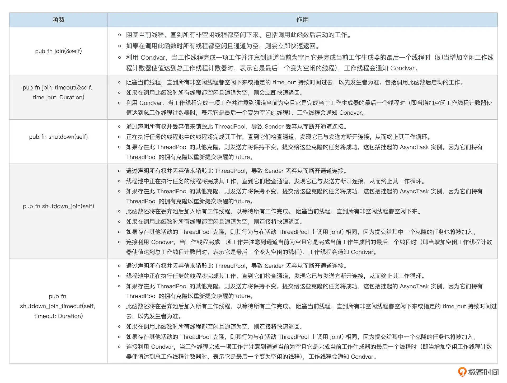
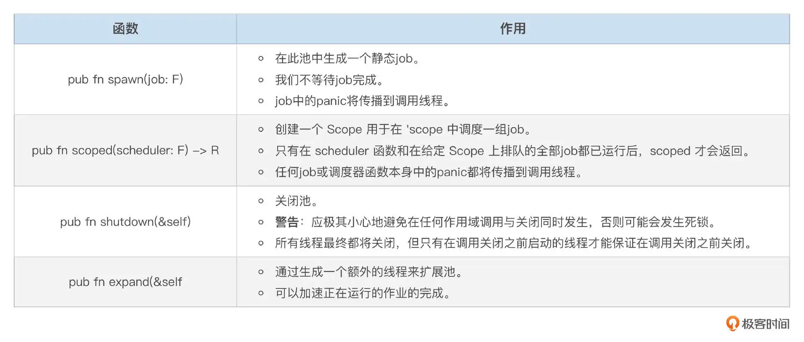

# 11 | 百花齐放，百家争鸣：更多的线程池

你好，我是鸟窝。

在上节课我介绍了常用的 Rayon 线程池和 ThreadPool 线程池。实际上在我们大部分的开发过程中，使用这两个就足够了。这两个各有特色，可以满足我们从简单到复杂的多种使用场景。但是，对于线程池这个通用的技术手段，Rust 生态圈肯定还会有各种各样的线程池，就像其他编程语言一样，各种轮子不断涌现。

这节课我介绍几个知名度还算比较高的线程池，让你了解一下，开拓一下视野，说不定某个线程池库的某个特殊功能正好满足你的需求。


## fast_threadpool 库


这个线程池实现旨在最小化延迟。具体来说，你得保证在任务执行之前不会承担线程创建的开销。新线程仅在工作线程的“空闲时间”，例如，返回作业结果之后，才会被创建。延迟的唯一可能情况是缺乏“可用”的工作线程。为了最小化这种情况发生的概率，该线程池会持续保持一定数量的工作线程可用（可配置）。

该实现允许你异步等待作业结果，因此你可以将其用作异步运行时中 spawn_blocking 函数的替代品。下面这个例子是创建了一个使用默认参数配置的线程池，并执行了一个任务。

```javascript
execute 方法是一个阻塞方法，直到任务完成它才会返回：
use fast_threadpool::{ThreadPool, ThreadPoolConfig};
use std::time::Duration;
use std::thread;
fn main() {
   let threadpool = ThreadPool::start(ThreadPoolConfig::default(), ()).into_sync
   let _ = threadpool.execute(|_| {
       println!("Hello from my custom thread!");
   });
   match threadpool.launch(|_| {
       thread::sleep(Duration::from_secs(10));
       println!("Hello from my custom sleep thread!");
   }) {
       Ok(join_handler) => {
           println!("Task launched successfully!");
           join_handler.join().unwrap();
       },
       Err(e) => eprintln!("Failed to launch task: {:?}", e),
   }
}
在这个例子中，我演示了两种方式：execute 和 launch。launch 不会阻塞调用者，它启
```

动给定的任务，并返回一个单次接收器（专业术语叫做 oneshot），用于监听任务的结果。

```javascript
下面这个例子是一个异步调用的例子，线程池调用的是方法 into_async_handler，
execute 方法执行的时候不会阻塞。
use fast_threadpool::{ThreadPool, ThreadPoolConfig};
use tokio;
#[tokio::main]
async fn main() -> Result<(), Box<dyn std::error::Error>> {
   let threadpool = ThreadPool::start(ThreadPoolConfig::default(), ()).into_asyn
   let _ = threadpool.execute(|_| {
       println!("Hello from my custom thread!");
   }).await?;
   Ok(())
}
```

## rusty_pool 库

```
rusty_pool 基于 crossbeam 的多生产者多消费者通道的弹性线程池实现，支持任务结果
```

的等待和异步支持。

该线程池具有两种不同的池大小：核心池大小，由始终存在的线程填充；最大池大小，描述了同时可能存在的最大工作线程数量。这些额外的非核心线程具有特定的生存时间，在创建线程池时定义，该生存时间定义了此类线程在不接收任何工作的情况下可以空闲多长时间，然后放弃并终止其工作循环。

该线程池不会在提交任务之前生成任何线程。然后，它将为每个任务创建一个新线程，直到核心池大小已满。之后，只有在当前池低于最大池大小且没有空闲线程时，才会在调用

```
execute() 时创建一个新线程。
比如 evaluate() 和 complete() 之类的函数返回一个 JoinHandle，可用于等待提交的
任务或 future 的结果。JoinHandles 可以发送到线程池以创建一个任务，该任务阻塞一
```

个工作线程，直到它收到另一个任务的结果，然后对结果进行操作。如果任务恐慌，则

```
JoinHandle 接收取消错误。这是使用单向通道与工作线程通信来实现的。
如果启用了“async”功能（默认情况下），则该线程池可用作 future 执行器。“async”功能包
括 spawn() 和 try_spawn() 函数，它们创建一个任务，逐个轮询 future 并创建一个唤
醒器，在 future 可以取得进展时将 future 重新提交到池中。如果没有“async”功能，则可
以使用 complete 函数简单地将 future 执行到完成，该函数仅阻塞一个工作线程，直到
future 已轮询到完成。
```

如果不需要，“async”功能可以被禁用，方法是在你的 Cargo 依赖项中添加以下内容：

```
[dependencies.rusty_pool]
default-features = false
version = "*"
在创建新工作线程时，该线程池尝试使用 compare-and-swap 机制来增加工作线程计数，
```

如果由于总工作线程计数已增加到指定限制（尝试创建核心线程时的核心大小，否则为最大大小）而增加失败，则池尝试创建非核心工作线程（如果先前尝试创建核心工作线程并且不存在空闲工作线程）或将任务发送到通道。panic 的工作线程总是被克隆和替换。

### 锁的使用

```
除了用于锁定 Condvar 的 join 函数之外，该线程池实现完全依赖于 crossbeam 和原子操
作。这意味着，线程池在大多数情况下避免了使用锁，从而提高了并发性能。仅在使用 join
函数时，需要使用锁来保护 Condvar，以确保线程之间的正确同步。
```

### 线程状态判断

线程池通过比较总工作线程数和空闲工作线程数来判断当前是否处于空闲状态。这两个值都存

```
储在一个 AtomicUsize 变量中，并且每个值只占用 usize 类型的一半大小。这种设计确保
```

了在更新这两个值时，可以以原子操作的方式进行，从而避免了竞争条件和数据不一致的问题。

该线程池在实现中尽可能地避免了锁的使用，以提高性能。同时，通过巧妙地使用原子操作，实现了高效的线程状态判断，从而优化了线程池的整体性能。

我们可以通过使用 shutdown 函数销毁线程池及其 crossbeam 通道，但是这不会停止已经运行的任务，而是在线程下次尝试从通道获取工作时终止线程。只有在所有线程池克隆都已关闭/ 删除后，才会销毁通道。

上面这段内容主要来自官方库的说明，讲了很多这个库的内部实现细节问题。对于我们用户来说，倒不必太过关注于它的实现，而是应该将注意力放在它的使用上，除非你是一个并发库的开发者。

从提交任务线程的角度来看性能，rusty_pool 在大多数情况下应该比任何使用

```
std::sync::mpsc 的线程池（例如 rust-threadpool）表现更好，这得益于 crossbeam 团队
```

的出色工作。在某些极端竞争的情况下，rusty_pool 可能会落后于 rust-threadpool，尽管发生这种情况的场景几乎不实用，因为它们需要在循环中提交空任务，并且取决于平台。macOS在测试场景中似乎表现特别好，可能是由于 macOS 已经投入了大量精力来优化原子操作，因为 Swift 的引用计数依赖于它。

有两点可能会让你评估和使用这个库：一是类似 Java 的线程池，它有核心线程和非核心线程，某些场景下能够减少线程的创建和浪费；二是性能。

下面是几种生成这个线程池方法：

```javascript
use rusty_pool::Builder;
use rusty_pool::ThreadPool;
use std::time::Duration;
fn main() {
   // 创建默认的 `ThreadPool` 配置，核心池大小为 CPU 数量
   let pool = ThreadPool::default();
   pool.execute(|| {
       println!("Hello from my custom thread!");
   });
   println!("name:{}, current: {}, idle: {}", pool.get_name(),
       pool.get_current_worker_count(),pool.get_idle_worker_count());
   // 创建一个默认命名的 `ThreadPool`, 核心池大小为 5，最大池大小为 50，线程空闲时间为 60
   let pool2 = ThreadPool::new(5, 50, Duration::from_secs(60));
   println!("name:{}, current: {}, idle: {}", pool2.get_name(),
       pool2.get_current_worker_count(),pool2.get_idle_worker_count());
   // 创建一个自定义名称的 `ThreadPool`, 核心池大小为 5，最大池大小为 50，线程空闲时间为 6
   let pool3 = ThreadPool::new_named(String::from("my_pool"), 5, 50, Duration::f
   println!("name:{}, current: {}, idle: {}", pool3.get_name(),
       pool3.get_current_worker_count(),pool3.get_idle_worker_count());
   // 使用 Builder 结构体创建, 核心池大小为 5，最大池大小为 50
   let pool4 = Builder::new().core_size(5).max_size(50).build();
   println!("name:{}, current: {}, idle: {}", pool4.get_name(),
       pool4.get_current_worker_count(),pool4.get_idle_worker_count());
}
```

代码演示了四种生成线程的方法：默认配置、new、new 且设置名称、Builder 模式。

下面是演示四种执行任务的方式的例子：

```javascript
use rusty_pool::ThreadPool;
use std::sync::{
   Arc,
   atomic::{AtomicI32, Ordering},
};
use std::thread;
use std::time::Duration;
fn main() {
   let pool = ThreadPool::new(5, 50, Duration::from_secs(60));
   // 方式1： execute提交任务就直接返回
   pool.execute(|| {
       thread::sleep(Duration::from_secs(5));
       println!("Hello from my custom thread!");
   });
   // 方式2：evaluate 生成一个 JoinHandler, 然后可以调用await_complete等待完成
   let handle = pool.evaluate(|| {
       return 4;
   });
   let result = handle.await_complete();
   println!("result: {}", result);
   // 方式3：launch 启动一个任务，返回一个JoinHandler, 然后可以调用join等待完成
   async fn some_async_fn(x: i32, y: i32) -> i32 {
       x + y
   }
   async fn other_async_fn(x: i32, y: i32) -> i32 {
       x - y
   }
   // 方式3：简单的使用complete提交异步任务到一个worker上, 然后调用await_complete等待完成
   let handle = pool.complete(async {
       let a = some_async_fn(4, 6).await; // 10
       let b = some_async_fn(a, 3).await; // 13
       let c = other_async_fn(b, a).await; // 3
       some_async_fn(c, 5).await // 8
   });
   println!("result: {}", handle.await_complete());
   // 方式4：spawn future，创建一个waker，如果准备好以便继续执行，它会自动重新提交到线程池，
   let count = Arc::new(AtomicI32::new(0));
   let clone = count.clone();
   pool.spawn(async move {
       let a = some_async_fn(3, 6).await; // 9
       let b = other_async_fn(a, 4).await; // 5
       let c = some_async_fn(b, 7).await; // 12
       clone.fetch_add(c, Ordering::SeqCst);
   });
   pool.join();
   println!("result: {}", count.load(Ordering::SeqCst)); // 12
}
```

其中：

```
方式 1：execute 无需等待，任务交给线程池后就当甩手掌柜了，调用者不会被阻塞。
方式 2：evaluate 提供了等待结果完成的方法，使用 await_complete 等待任务完
```

- 成。

```
方式 3：complete 把一组 future 提交给线程池的一个 worker，它会阻塞一个 worker 直
```

- 到把这些 future 都完成。

- 方式 4：spawn 也是把一组 future 提交给线程池，但是它不会绑定一个 worker 上。正所谓树挪死人挪活，它是在某个 future 可以继续执行时，才提交给线程池，让线程池选择worker 执行，这是和方式 3 的最大区别。

```
同时对应的这四种方式还有 try_execute、try_evaluate、try_complete、
try_spawn 等 try_xxx 方法，它会返回提交任务成功或者失败的信息。还有
try_spawn_await 方法，它是通过 future 的方式返回结果，而不像 try_complete 会阻
```

塞 worker 直到完成。

```
start_core_threads 方法启动初始的核心线程，使用这个方法的好处是预先把这些线程
```

准备好，避免使用的时候临时创建线程而产生额外的延迟。

线程池还提供了 join 和 shutdown 的功能。



## scoped-thread-pool 库

scoped-thread-pool 是一个灵活的线程池，提供作用域线程和静态线程。

```
与许多其他作用域线程池库不同，该库旨在实现最大灵活性：Pool 和 Scope 都是 Send +
Sync，Pool 实现了 Clone，并且两者都具有许多有用的便利功能，例如：
Pool::spawn 用于生成静态作业。
Pool::expand 用于扩展池中的线程数量。
Pool::shutdown 用于关闭池。
Scope::forever 和 Scope::zoom 用于外部化 Scope 管理，并允许对作业调度和等待
```

- 进行细粒度控制。

这两个类型上几乎所有方法只需要一个不可变的借用，因此可以在没有外部同步的情况下安全地并发使用。

```
此外，该库的内部设计经过精心构造，使所有不安全操作都被封装在 Scope 类型中，该类型
实际上只是为在 Pool 上调度的作业添加了生命周期作用域到 WaitGroup 类型。
```



下面是一个此线程池库使用的例子：

```javascript
use scoped_thread_pool::Pool;
fn main() {
   let mut buf = [0, 0, 0, 0];
   let pool = Pool::new(4);
   pool.scoped(|scope| {
       for i in &mut buf {
           scope.execute(move || *i += 1);
       }
   });
   assert_eq!(&buf, &[1, 1, 1, 1]);
}
```

```
这里例子中 scoped 会阻塞，直到任务（job，作业）全部在线程池中完成。scoped 算是这
```

个线程池的一个特色了。

## scheduled-thread-pool 库

scheduled-thread-pool 库是可调度延迟执行并周期性重复的线程池，它不仅可以像普通线程池一样并行执行任务，还可以根据预定的时间安排来执行任务，从而实现更加灵活的任务调度。


这种线程池的应用场景非常广泛，例如：

- 定时任务：定时备份数据、定时发送邮件、定时清理缓存等。

- 调度任务：根据时间计划执行不同的任务。

- 游戏服务器：定时处理游戏逻辑、定时更新游戏状态。

- 实时系统：定时采集数据、定时控制设备等。

通过使用计划线程池，可以更加高效地管理和执行各种定时任务，提高系统的自动化程度和可靠性。这算是这个线程池的特色了，如果你有这种需求，就可以参考这个线程池库。

如果你想自己创建一个线程池，也可以在设计阶段多想想你的线程池和别人的有何不同。

它的初始化方法很简单，不多做介绍了，下面是它指定定时任务的一些方法：

```
execute(job)：尽快执行给定的闭包 job。
execute_after(delay, job)：延迟指定时间 delay 后执行给定的闭包 job。
execute_at_fixed_rate(initial_delay, rate, f)：
延迟 initial_delay 后，以固定的时间间隔 rate 周期性地执行闭包 f。
rate 包括闭包的执行时间。
execute_at_dynamic_rate(initial_delay, f)：
延迟 initial_delay 后，以闭包 f 动态返回的时间间隔周期性地执行闭包 f。
rate 包括闭包的执行时间。
execute_with_fixed_delay(initial_delay, delay, f)：
延迟 initial_delay 后，以固定的时间间隔 delay 周期性地执行闭包 f。
与 execute_at_fixed_rate 不同，delay 不包括闭包的执行时间。
execute_with_dynamic_delay(initial_delay, f)：
延迟 initial_delay 后，以闭包 f 动态返回的时间间隔周期性地执行闭包 f。
与 execute_at_dynamic_rate 不同，delay 不包括闭包的执行时间。
```

注意：

```
所有方法都要求闭包实现 FnOnce、Send 和 'static 特性。
```

- 如果闭包发生 panic，则后续的执行将停止。

```
ScheduledThreadPool 实现了 Send 和 Sync 特性，可以在多个线程之间安全地共享。
ScheduledThreadPool 不支持 RefUnwindSafe，因为闭包可能发生 panic。
```

下面是一个使用此线程池库的例子：

```javascript
use std::sync::mpsc::channel;
use std::thread::sleep;
use std::time::Duration;
fn main() {
   let (sender, receiver) = channel();
   let pool = scheduled_thread_pool::ScheduledThreadPool::new(4);
   let handle = pool.execute_after(Duration::from_millis(1000), move || {
       println!("Hello from a scheduled thread!");
       sender.send("done").unwrap();
   });
   let _ = handle;
   receiver.recv().unwrap();
   let handle = pool.execute_at_fixed_rate(
       Duration::from_millis(1000),
       Duration::from_millis(1000),
       || {
           println!("Hello from a scheduled thread!");
       },
   );
   sleep(Duration::from_secs(5));
   handle.cancel()
}
```

这段代码展示了如何使用 scheduled_thread_pool 库来创建和管理一个定时线程池，并执行定时任务。

首先，代码创建了一个具有 4 个线程的定时线程池 ScheduledThreadPool。然后，它展示了两种不同的定时任务执行方式：

```
execute_after 方法：用于在指定的延迟时间后执行一次任务。在这个例子中，任务将
```

- 在 1 秒（1000 毫秒）后执行，并打印一条消息 “Hello from a scheduled thread!”。任务完成后，通过 sender 发送一个消息 “done”。

```
execute_at_fixed_rate  方法：用于以固定的时间间隔重复执行任务。在这个例子
```

- 中，任务每隔 1 秒（1000 毫秒）执行一次，并打印一条消息 “Hello from a scheduled

```
thread!”。主线程休眠 5 秒后，调用  handle.cancel()  取消定时任务。
```

通过这两种方法，代码展示了如何在指定时间后执行一次任务，以及如何以固定的时间间隔重复执行任务。

## 总结

好了，这一节课我们介绍了 Rust 并发编程中几个有趣的特性和库。

新的线程池还在不断地涌现，比如 threadpool-executor、easy-threadpool、workerpool、blocking-threadpool、java-threadpool、base-threadpool、tinypool、async-cpupool 等等，说实在的有点太多了，能数得上来的就有二百多个，这些库没有一点绝活是很难出人头地的，像blocking-threadpool 提供了背压，至此还算是有些特色。

本章节我本来准备介绍更多的线程库，但是最后我改变主意了，如果介绍太多太多没有特色的第三方库，会干扰你的选择。所以最终我挑了几个有特色的线程池库做了介绍：

- fast_threadpool 库追求性能和最小延迟。

- rusty_pool 库提供核心线程和非核心线程，线程资源控制更强大，执行任务的方式多样。

- scoped-thread-pool 库在线程池上提供 scoped 的功能。

- scheduled-thread-pool 库提供了定时和周期性执行任务的能力。

这些库各有特色，针对特定的场景我们也可以多看它们一眼，说不定用得着。

## 思考题

请你实现一个最简单的线程池库，越简单越好，暂时先不追求更高的性能。欢迎你把你的实现代码放到留言区，也欢迎你把这节课的内容分享给需要的朋友，我们下节课再见！
