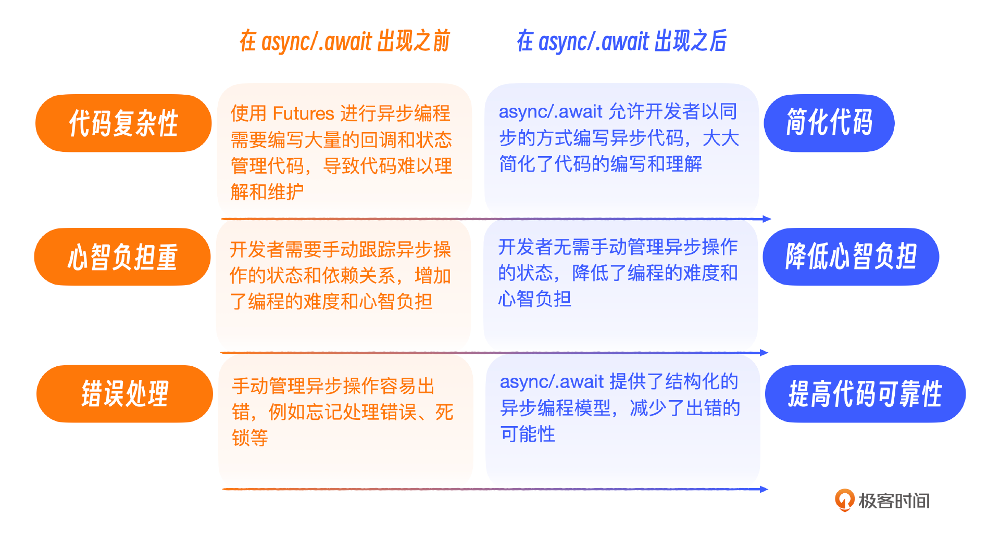
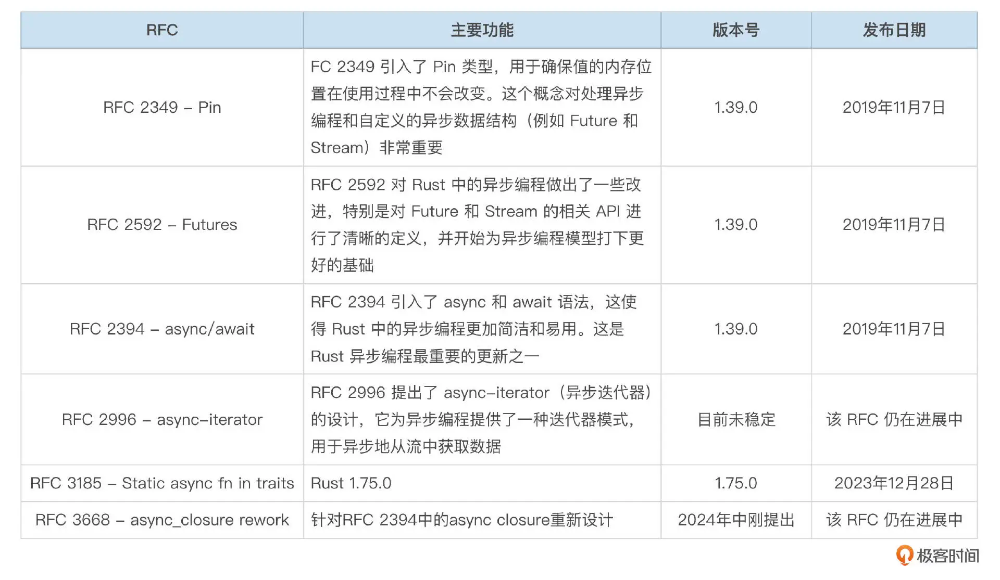

# 12 | 时序交错，异步之美：async-await异步编程

你好，我是鸟窝。

在前几节课我们讲述了 Rust 各种线程池的用法，接下来的两节课我重点介绍一下 Rust 比较新的异步编程模式。


## 异步编程的历史

Rust 的异步编程模型经历了多次演变，最终在 1.39 版本（2019 年）正式引入了

```
async/.await 语法，这是一个重要的里程碑。
```

以下是 Rust 异步发展的主要阶段：

1. 早期 Futures（Futures 0.1）：在 async/.await 出现之前，Rust 主要使用 Futures 库进行异步编程。Futures 提供了一种表示异步操作的抽象，但使用起来较为复杂，需要手动编写大量的回调和状态管理代码。

2. Futures 0.3 与标准化：为了改进 Futures 的易用性，Rust 社区进行了大量的改进和标准化工作，最终形成了 Futures 0.3 版本，并将其合并到了标准库中。这个版本为后续的async/.await 奠定了基础。

3. async/.await 的引入（Rust 1.39）：async/.await 语法的引入极大地简化了 Rust 的异步编程。它允许开发者像编写同步代码一样编写异步代码，避免了繁琐的回调和状态管理，提高了代码的可读性和可维护性。

在 async/.await 出现之前，Rust 的异步编程主要面临代码复杂性、心智负担重、错误处理等痛点，而 async/.await 的引入有效地解决了这些痛点。



async/.await 已经成为 Rust 异步编程的标准方式，并得到了广泛的应用。Rust 社区也在不断地改进和完善异步生态，例如：

- Tokio：一个流行的 Rust 异步运行时，它提供了丰富的异步工具和组件，例如网络、IO、定时器等。它是 Rust 中最流行的异步运行时，功能非常强大，适用于构建复杂的网络应用

- 和高性能服务，但它也相对复杂和庞大。

- async-std：另一个 Rust 异步运行时，它的目标是提供一个类似于 Rust 标准库的异步API，方便开发者使用。它在 API 设计上与标准库保持一致性，降低了学习成本。

- smol：更加注重轻量级和简单性，适用于小型项目、嵌入式系统或需要快速原型开发的情况。它在简单和性能之间取得了很好的平衡。

- monoio：字节跳动实现的一个异步运行时。它是一个纯粹基于 io_uring/epoll/kqueue 的Rust 异步运行时。它的部分设计借鉴了 Tokio 和 Tokio-uring。然而，与 Tokio-uring 不同的是，Monoio 不运行在其他运行时的基础上，因此效率更高。

## 标准库对异步编程的支持

Rust 标准库对异步编程的支持是构建在几个核心概念之上的，它提供的是最基础的构建模块，而不是一个完整的运行时环境。这意味着你需要像 Tokio、async-std 或 smol 这样的第三方库来实际运行异步代码。

标准库主要通过以下几个方面支持异步编程：

```
Future trait：这是异步编程的核心。Future 代表一个异步操作的最终结果。它是一个“承
诺”，表示将来会有一个值可用。Future trait 定义了一个关键方法：
trait Future {
   type Output;
   fn poll(self: Pin<&mut Self>, cx: &mut Context<'_>) -> Poll<Self::Output>;
}
Output：关联类型，表示 Future 完成后产生的值的类型。
poll：尝试执行 Future 的方法。它接收一个 Pin<&mut Self> 和一个 Context。Pin
```

- 用于防止 Future 在执行过程中被移动，这对于某些需要固定内存地址的 Future 非常重要。

```javascript
Context 提供了唤醒 Future 的能力。poll 方法返回一个 Poll 枚举：
Poll::Pending：Future 尚未完成，需要稍后再次调用 poll。
Poll::Ready(val)：Future 已经完成，并返回结果 val。
async 和 await 关键字：这是 Rust 提供的语法糖，用于更方便地编写异步代码。async
用于创建异步代码块或异步函数。async 块或 async fn 会返回一个实现了 Future trait
的类型。await 用于暂停当前 Future 的执行，直到另一个 Future 完成。await 只能在
async 块或 async fn 中使用。
async fn my_async_function() -> i32 {
   // 一些异步操作...
   10
}
async fn another_async_function() {
   let result = my_async_function().await;
   println!("Result: {}", result);
}
std::task 模块：提供了与任务调度和执行相关的类型和函数，例如：
Context：提供唤醒 Future 的能力。
Waker：用于通知执行器某个 Future 已经准备好再次被 poll。
std::pin::Pin：用于固定 Future 在内存中的位置，这对于某些需要固定内存地址的
```

- Future 非常重要，例如自引用结构体。

同时，你也一定要清楚地知道，标准库不包含的内容：

- 执行器 / 运行时：标准库不提供执行 Future 的执行器。你需要使用像 Tokio、async-std 或smol 这样的第三方库。

- I/O 操作：标准库本身没有提供异步 I/O 操作，例如异步网络或文件操作。这些通常由运行时库提供。这意味着你想利用异步 I/O 的能力的话，一定要使用第三方库或者自己开发，否则没有办法利用异步提效。

### block_on


```
标准库本身也没有对异步运行时提供的接口（例如 block_on）进行统一的定义。这是 Rust
异步生态系统的一个关键设计选择。虽然标准库没有统一 block_on 的接口定义，但各种异
步运行时（如 Tokio、async-std）都提供了类似功能的 block_on 方法，这说明它在异步编
程中扮演着重要的角色。下面我来详细介绍 block_on 方法的功能和使用场景。block_on
```

的核心功能：在同步上下文中执行异步代码。

```
block_on 的最主要功能就是将异步代码（Future）桥接到同步代码中执行。简单来说，它
```

允许你在一个普通的同步函数中调用并等待一个异步操作完成。

```
block_on 的基本工作原理是：
创建运行时上下文：block_on 内部会创建一个运行时环境（如果当前线程不在任何运行
```

- 时中）。创建的运行时不同，可能是单线程的，也可能是多线程的。

2. 驱动 Future 执行：它会驱动传入的 Future 执行，直到 Future 完成并产生结果。

3. 阻塞当前线程：在 Future 执行过程中，如果遇到需要等待的情况（例如等待 I/O 操作完

```javascript
成），block_on 会阻塞当前线程，直到 Future 被唤醒。
返回 Future 的结果： 一旦 Future 完成，block_on 会返回 Future 产生的结果。
block_on 主要用于以下几种场景：
main 函数入口： 异步程序的入口通常是 main 函数，但 main 函数本身是同步的。因
此，需要使用 block_on 来启动异步运行时并执行顶层的异步任务。例如：
#[tokio::main] // Tokio 提供的宏，简化了 block_on 的使用
async fn main() {
   // 异步代码...
   println!("Hello from Tokio!");
}
// 手动使用 block_on 的例子
use tokio::runtime::Runtime;
fn main() {
   let rt = Runtime::new().unwrap();
   rt.block_on(async {
       // 异步代码...
       println!("Hello from Tokio!");
   });
}
测试： 在测试异步代码时，通常需要在同步的测试函数中运行异步代码。block_on 可以
```

- 方便地实现这一点。

```javascript
#[tokio::test]
async fn my_async_test() {
   // 异步测试代码...
   assert_eq!(1 + 1, 2);
}
// 手动使用 block_on 的例子
#[test]
fn my_sync_test() {
   use tokio::runtime::Runtime;
   let rt = Runtime::new().unwrap();
   rt.block_on(async {
       // 异步代码...
       assert_eq!(1 + 1, 2);
   });
}
与同步代码集成： 有时需要在同步代码中调用异步函数。block_on 提供了一种桥接机
```

- 制，使得这种集成成为可能。但应该尽量避免这种情况，因为它可能会降低程序的并发性能。

注意事项：

1. 避免在异步上下文中使用 block_on： 在已经运行在异步运行时中的代码中，绝对不要使

```
用 block_on。这有可能导致死锁，因为 block_on 会阻塞当前线程，而该线程可能正是
```

- 异步运行时用来执行其他任务的线程。

```
性能影响：block_on 会阻塞当前线程，因此在需要高并发和高性能的场景中应该谨慎使
用。通常应该使用异步运行时提供的任务调度机制（例如 tokio::spawn、
async_std::task::spawn）来运行异步任务，而不是 block_on。
```

### Rust 异步编程相关的提案



相关链接：

RFC 2349 - Pin

RFC 2592 - Futures

RFC 2394 - async/await

RFC 2996 - async-iterator

RFC 3185 - Static async fn in traits

RFC 3668 - async_closure rework

## async/.await 初步

```
async/.await 是 Rust 内置的工具，用于编写看起来像同步代码的异步函数。async 关键
字将一段代码转换成一个实现了 Future trait 的状态机。在同步方法中调用阻塞函数会阻塞
整个线程，而阻塞的 Future 会让出线程的控制权，允许其他 Future 运行。
让我们在 Cargo.toml 文件中添加一些依赖：
[dependencies]
futures = "0.3"
要创建一个异步函数，可以使用 async fn 语法：
async fn do_something() { /* ... */ }
async 是一个语法糖，它返回的值是一个 Future。要使事情真正发生，Future 需要在一
```

个执行器（executor）上运行：

```javascript
// `block_on` 会阻塞当前线程，直到提供的 future 运行完成。
// 其他执行器提供更复杂的行为，例如在同一个线程上调度多个 future。
use futures::executor::block_on;
async fn hello_world() {
   println!("hello, world!");
}
fn main() {
   let future = hello_world(); // 什么也不会打印
   block_on(future); // `future` 运行并打印 "hello, world!"
}
在 async fn 内部，你可以使用 .await 来等待另一个实现了 Future trait 的类型完成，例
如等待另一个 async fn 的输出。与 block_on 不同，.await 不会阻塞当前线程，而是异
```

步地等待 future 完成，如果 future 当前无法取得进展，则允许其他任务运行。

```javascript
例如，假设我们有三个 async fn：learn_song、sing_song 和 dance。
async fn learn_song() -> Song { /* ... */ }
async fn sing_song(song: Song) { /* ... */ }
async fn dance() { /* ... */ }
一种错误的方法就是使用 block_on 阻塞学习、唱歌和跳舞中的每一个方法：
fn main() {
   let song = block_on(learn_song());
   block_on(sing_song(song));
   block_on(dance());
}
```

然而，我们没有以这种方式发挥最佳性能——我们一次只做一件事！显然，我们必须先学会这首歌才能唱，但是跳舞可以和学习和唱歌同时进行。为此，我们可以创建两个可以并发运行的

```javascript
单独的 async fn：
async fn learn_and_sing() {
   // 等待歌曲学会后再唱歌。
   // 我们在这里使用 `.await` 而不是 `block_on`，以防止阻塞线程，
   // 这使得同时 `dance` 成为可能。
   let song = learn_song().await;
   sing_song(song).await;
}
async fn async_main() {
   let f1 = learn_and_sing();
   let f2 = dance();
   // `join!` 类似于 `.await`，但可以并发等待多个 future。
   // 如果我们在 `learn_and_sing` future 中暂时被阻塞，
   // 则 `dance` future 将接管当前线程。如果 `dance` 变得阻塞，
   // `learn_and_sing` 可以重新接管。如果两个 future 都被阻塞，
   // 则 `async_main` 被阻塞并将控制权交给执行器。
   futures::join!(f1, f2);
}
fn main() {
   block_on(async_main());
}
```

在这个例子中，学习歌曲必须在唱歌之前进行，但学习和唱歌都可以与跳舞同时进行。如果我

```
们在 learn_and_sing 中使用 block_on(learn_song()) 而不是
learn_song().await，则在 learn_song 运行时，线程将无法执行任何其他操作。这将
使同时跳舞成为不可能。通过 .awaitlearn_song future，我们允许其他任务在
learn_song 被阻塞时接管当前线程。这使得在同一个线程上并发运行多个 future 直至完成
```

成为可能。

总结：

- async fn： 定义一个异步函数，返回一个 Future。

- Future： 代表一个异步操作的最终结果。

- .await： 用于等待一个 Future 完成，不会阻塞当前线程。

- block_on： 用于在同步上下文中运行 Future，会阻塞当前线程。

- join!： 用于并发等待多个 Future 完成

到此为止，你应该对 Rust 的异步编程有一个基本的了解了，接下来我们针对不同的异步运行时，详细讲解它。

## async 的类型

```
Rust 中的 async 关键字用于定义异步代码块，这些代码块可以暂停执行并在稍后恢复，而不
```

会阻塞整个线程。这使得 Rust 能够高效地处理 I/O 密集型任务，例如网络请求和文件操作。

```
async 可以应用于函数、方法、闭包和 trait。下面我们分别介绍。
```

### 异步函数（async fn）

```javascript
这是最常见的 async 用法。通过在函数定义前加上 async 关键字，可以将一个函数转换为
异步函数。异步函数返回一个 Future，它代表一个可以稍后完成的计算。
async fn my_async_function(x: i32) -> i32 {
   // 一些异步操作，例如网络请求或文件 I/O
   println!("开始异步操作，输入值为：{}", x);
   tokio::time::sleep(std::time::Duration::from_millis(1000)).await; // 模拟耗时操
   println!("异步操作完成");
   x * 2
}
#[tokio::main] // 使用 tokio 运行时
async fn main() {
   let future = my_async_function(5); // 创建一个 Future，但不会立即执行
   println!("main 函数中，等待 future 完成...");
   let result = future.await; // 等待 Future 完成并获取结果
   println!("异步操作的结果是：{}", result);
}
在这个例子中，my_async_function 是一个异步函数。调用它会立即返回一个 Future，
而不是立即执行函数体内的代码。只有当使用 .await 运算符等待这个 Future 完成时，函
数体内的代码才会被执行。#[tokio::main] 宏用于创建一个 Tokio 运行时，这是执行异步
```

代码所必需的。

### 异步方法（async fn）

```javascript
async 也可以用于 trait 中的方法和类型的实现中的方法。
use async_trait::async_trait;
#[async_trait]
trait MyTrait {
   async fn my_async_method(&self, x: i32) -> i32;
}
struct MyStruct;
#[async_trait]
impl MyTrait for MyStruct {
   async fn my_async_method(&self, x: i32) -> i32 {
       println!("在 MyStruct 中执行异步方法，输入值为：{}", x);
       tokio::time::sleep(std::time::Duration::from_millis(1000)).await;
       println!("MyStruct 中的异步方法完成");
       x * 3
   }
}
#[tokio::main]
async fn main() {
   let my_struct = MyStruct;
   let result = my_struct.my_async_method(10).await;
   println!("异步方法的结果是：{}", result);
}
在这个例子中，MyTrait 定义了一个异步方法 my_async_method。MyStruct 实现了这
个 trait，并提供了该方法的具体实现。注意这里使用了 async_trait crate，这是因为在
trait 中使用 async fn 需要一些特殊的处理。
```

### 异步闭包（async move ||）

```javascript
async 也可以与闭包一起使用，创建异步闭包。
#[tokio::main]
async fn main() {
   let x = 5;
   let my_async_closure = async move |y: i32| -> i32 {
       println!("在闭包中执行异步操作，输入值为：x={}, y={}", x, y); // 注意这里捕获了外
       tokio::time::sleep(std::time::Duration::from_millis(1000)).await;
       println!("闭包中的异步操作完成");
       x + y
   };
   let result = my_async_closure(10).await;
   println!("异步闭包的结果是：{}", result);
}
```

```
在这个例子中，my_async_closure 是一个异步闭包。move 关键字用于将外部变量 x 的所
```

有权转移到闭包中。

### Trait 中的异步函数（async fn in traits）

```
如上面的例子所示，在 trait 中定义异步函数需要使用 async_trait crate。这是因为 Rust
的 trait 对象（trait objects）在早期版本中无法直接支持异步函数。async_trait crate 通过
代码转换的方式，将 trait 中的异步函数转换为返回 Future 的普通函数，从而绕过了这个限
```

制。

不过自 Rust 1.75.0 版本后，这个功能也官方支持了，上面的异步方法中我们已经在 Trait 中定义了异步函数。

## .await：等待异步任务完成

```
.await 是 Rust 异步编程中至关重要的操作符，它用于挂起当前异步函数的执行，直到一个
Future 完成并产生结果。理解 .await 的工作方式以及它在各种复杂场景下的表现，对于
```

编写高效、正确的异步代码至关重要。

```
当你在一个 async 函数中使用 .await 时，会发生以下步骤：
挂起当前 Future：当前的 async 函数会被转换成一个状态机，.await 所在的位置会成
```

- 为一个挂起点。执行器（executor）会记录下当前 Future 的状态，并将其从当前线程中移除。

2. 让出线程控制权：线程不再被这个 Future 占用，可以去执行其他的 Future。这是异步编程实现并发的关键。

```
等待 Future 完成：被 .await 的 Future 会在后台继续执行（可能在其他线程上）。当这个
```

- Future 完成并产生结果时，执行器会收到通知。

```
恢复执行：执行器会将之前挂起的 Future 重新调度到线程上，从 .await 之后的位置继续
```

- 执行，并获取 Future 的结果。

```sql
下面介绍一些 .await 在复杂场景下的应用和需要注意的点：
在循环中使用.await
在循环中使用 .await 可以处理一系列异步操作。例如，你需要从网络上下载多个文件：
async fn download_files(urls: Vec<&str>) -> Result<(), Box<dyn std::error::Error>
   for url in urls {
       let content = download_file(url).await?; // 在循环中使用 .await
       println!("Downloaded {} bytes from {}", content.len(), url);
   }
   Ok(())
}
在 select! 宏中使用 .await
select! 宏允许你同时等待多个 Future，并选择第一个完成的 Future 的结果。这在需要处
```

理多个并发操作，并希望尽早响应的场景中非常有用：

```sql
use tokio::select;
async fn task1() -> String {
   tokio::time::sleep(std::time::Duration::from_millis(500)).await;
   "Task 1 completed".to_string()
}
async fn task2() -> String {
   tokio::time::sleep(std::time::Duration::from_millis(200)).await;
   "Task 2 completed".to_string()
}
#[tokio::main]
async fn main() {
   let result = select! {
       res1 = task1() => res1,
       res2 = task2() => res2,
   };
   println!("{}", result); // 输出 "Task 2 completed"
}
在这个例子中，task2 会比 task1 更早完成，因此 select! 会选择 task2 的结果。
在 join! 宏中使用 .await
join! 宏允许你并发地等待多个 Future 完成，并获取它们的结果。与 select! 不同的是，
join! 会等待所有 Future 完成：
use tokio::join;
#[tokio::main]
async fn main() {
   let (res1, res2) = join!(task1(), task2());
   println!("{}, {}", res1, res2); // 输出 "Task 1 completed, Task 2 completed" (
}
在这个例子中，task1 和 task2 会并发执行，join! 会等待它们都完成后再继续执行。
在 async 块中使用 .await
.await 只能在 async 函数、async 块或 async move 闭包中使用。async 块可以用于在
非 async 函数中创建小的异步上下文：
fn main() {
   let future = async {
       println!("Inside async block");
       tokio::time::sleep(std::time::Duration::from_millis(100)).await;
       println!("Async block completed");
       42
   };
   tokio::runtime::Runtime::new().unwrap().block_on(future);
}
```

## 总结

好了，在这一节课中，我们了解了 Rust 异步编程的发展历程、核心概念以及

```
async/.await 的使用。
```

- 发展历程： Rust 异步编程从早期的 Futures 0.1 演进到 Futures 0.3 并最终在 1.39 版本引

```
入 async/.await 语法，极大地简化了异步代码的编写和维护，解决了代码复杂、心智负
```

- 担重和容易出错等痛点。同时我们介绍了几个常用的异步运行时：Tokio、async-std、smol和 monoio。

```
标准库支持：Rust 标准库通过 Future trait、async 和 await 关键字以及 std::task
```

- 模块等提供异步编程的基础构建模块，但不包含执行器和 I/O 操作，需要第三方库（如Tokio）提供。

```
block_on：用于在同步上下文中执行异步代码，常用于 main 函数入口、测试和与同步代
```

- 码集成，但应避免在异步上下文中使用，并注意其性能影响。

```
相关提案：简要介绍了与异步编程相关的几个 RFC，包括 Pin 类型、Future 改进、
async/await 引入、异步迭代器、trait 中的静态异步函数以及异步闭包的改进。
async/.await 初步：解释了 async 如何将代码转换为状态机，以及 .await 如何挂起
和恢复 Future 的执行。通过例子展示了如何使用 block_on、.await 和 join! 进行异
```

- 步编程。

```
async 的类型：介绍了 async 在函数、方法、闭包和 trait 中的应用，并给出了相应的代
```

- 码示例。特别提到 Rust 1.75.0 之后官方支持在 trait 中定义异步函数。

```sql
.await 的使用场景：详细解释了 .await 的工作方式，并介绍了在循环、select! 宏、
join! 宏和 async 块中使用 .await 的场景，以及需要注意的所有权和生命周期问题。
```

这节课全面地介绍了 Rust 异步编程的基础知识和重要特性，为后续深入学习异步运行时打下了基础。下一节课，我们重点学习几种常用的异步运行时。

## 思考题

请你使用异步编程的方式，实现一个并发的排序算法。欢迎你把你实现的并发排序算法分享到留言区，我们一起讨论，如果你觉得这节课的内容对你有帮助的话，也欢迎你分享给需要的朋友，我们下节课再见！
