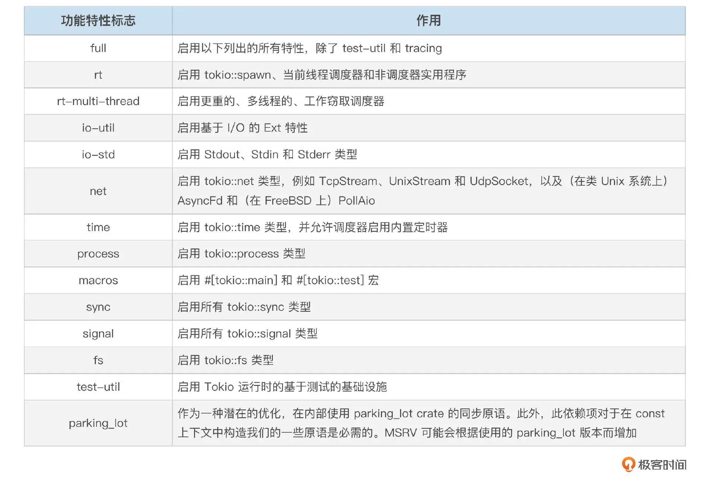
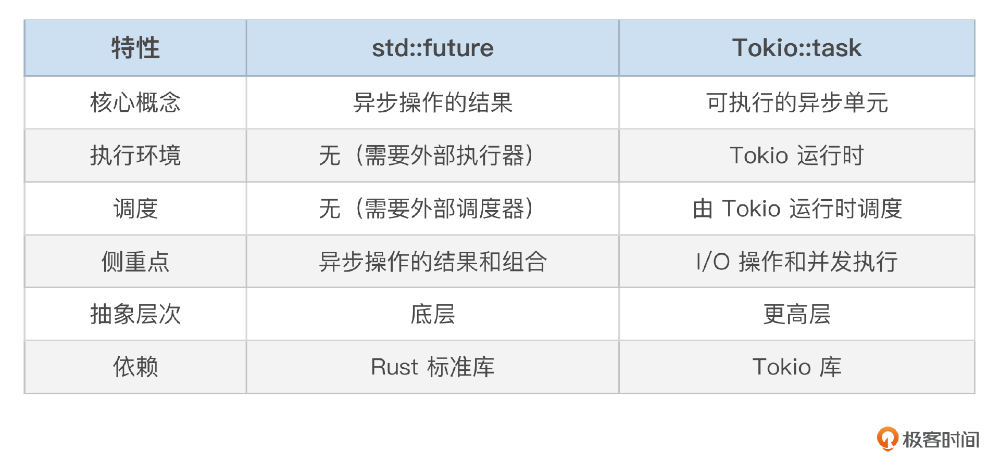

# 13 | 运筹帷幄，伺机而动：Tokio异步运行时（上）

你好，我是鸟窝。

在上节课我们已经了解了 Rust 的异步编程的基本知识，而且我们也学会了编写异步编程的代码，但是 Rust 标准库是没有提供异步运行时的实现的，我们需要借助第三方实现异步运行时库。

这节课本来我想重点介绍 tokio、async-std、smol 等几种异步运行时，但是 tokio 这个库如此重要且又使用广泛，内容又多，所以本节课我就只介绍 tokio 异步运行时，其他几个运行时我后续再讲。


## Tokio 运行时

Tokio 是 Rust 生态系统中最流行的异步运行时，它提供了一系列工具和库，用于构建高性能、高并发的网络应用程序。Tokio 基于 Rust 的 async/await 语法，使得异步代码的编写和维护变得更加简洁和容易。

Tokio 提供了几个主要组件：

- 用于执行异步代码的多线程运行时。

- 标准库的异步版本，包括 TCP 和 UDP 套接字、文件系统操作，以及进程和信号管理。

- 庞大的库生态系统，包括同步原语和通道，以及超时、睡眠和间隔，由操作系统事件队列（epoll、kqueue、IOCP 等）支持的 I/O 驱动程序，以及高性能定时器等。

Tokio 具有以下特点：

- 速度快

Tokio 速度很快，它构建于同样快速的 Rust 编程语言之上。这秉承了 Rust 的精神，其目标是让开发者即使手动编写等效代码也无法获得更高的性能提升。

- 可扩展性

Tokio 具有良好的可扩展性，它构建于同样具有可扩展性的 async/await 语言特性之上。在处理网络连接时，受限于延迟，单个连接的处理速度存在上限，因此扩展的唯一方法是同时处理大量连接。借助 async/await 语言特性，增加并发操作的成本变得极低，从而能够扩展到大量的并发任务。

- 可靠性高

Tokio 使用 Rust 构建，Rust 是一种能够帮助所有人构建可靠、高效软件的语言。大量研究表明，大约 70% 的高危安全漏洞是由内存不安全引起的。使用 Rust 可以消除应用程序中此类错误。Tokio 还非常注重提供一致的行为，避免意外情况的发生。Tokio 的主要目标是让用户能够部署可预测的软件，使其每天都能以可靠的响应时间和无不可预测的延迟峰值运行。

- 易用性强

借助 Rust 的 async/await 特性，编写异步应用程序的复杂性已大大降低。再加上 Tokio 的实用工具和蓬勃发展的生态系统，编写应用程序变得轻而易举。

Tokio 在合理的情况下遵循标准库的命名约定。这使得仅使用标准库编写的代码可以轻松转换为使用 Tokio 编写的代码。凭借 Rust 强大的类型系统，轻松交付正确代码的能力是无与伦比的。

- 灵活性好

Tokio 提供了运行时的多种变体。从多线程、工作窃取运行时到轻量级的单线程运行时，应有尽有。这些运行时中的每一个都提供了许多可供用户根据自身需求进行调整的旋钮。

因为这个库使用广泛，我们没有理由不好好学好它，所以这节课我把它放在第一个，重点学习它。

### 引入 Tokio 库

Tokio 由多个模块组成，这些模块提供了一系列对于在 Rust 中实现异步应用程序至关重要的功能。这里我们将简要地浏览 Tokio，概述主要的 API 及其用途。

Tokio 非常适合编写应用程序，在这种情况下，大多数用户不必过于担心应该选择哪些特性。

```
如果你不确定，我们建议使用 full启用所有特性，以确保在构建应用程序时不会遇到任何障
```

碍：

```
tokio = { version = "1", features = ["full"] }
```

如果你在开发代码库，你的目标应该是提供基于 Tokio 的最轻量级的 crate。为了实现这一目标，你应该确保只启用所需的功能特性。这允许用户在引入你的 crate 时无需启用不必要的功能：

```
tokio = { version = "1", features = ["rt", "net"] }
```

以下是可用功能特性标志的列表。你可能还会注意到，在每个函数、结构体和 trait 的上方都列出了使用该项所需的一个或多个功能特性标志。还是那句话，如果你是 Tokio 的新手，建议

```
使用 full 功能特性标志，它将启用所有公共 API。但请注意，这将引入许多您可能不需要的
```

额外依赖项。



```
注意： AsyncRead 和 AsyncWrite trait 不需要任何特性，并且始终可用。
还有一个不稳定的特性 tracing，我们就不多做介绍了。
```

### Tokio 运行时入门

与其他 Rust 程序不同，异步应用程序需要运行时支持。具体来说，以下运行时服务是必不可少的：

- 一个 I/O 事件循环，称为驱动程序，它驱动 I/O 资源并将 I/O 事件分派给依赖于这些事件的任务。

- 一个调度器，用于执行使用这些 I/O 资源的任务。

- 一个定时器，用于安排工作在设定的时间段后运行。

```javascript
Tokio 的 Runtime 将所有这些服务捆绑为一个单一类型，允许它们一起启动、关闭和配置。
但是，通常不需要手动配置 Runtime，用户只需使用 tokio::main 属性宏，该宏会在底层
创建一个 Runtime。
use tokio;
#[tokio::main]
async fn main() {
   let x = 5;
   let my_async_closure = async move |y: i32| -> i32 {
       println!("在闭包中执行异步操作，输入值为：x={}, y={}", x, y); // 注意这里捕获了外
       tokio::time::sleep(std::time::Duration::from_millis(1000)).await;
       println!("闭包中的异步操作完成");
       x + y
   };
   let result = my_async_closure(10).await;
   println!("异步闭包的结果是：{}", result);
}
#[tokio::main]  宏将  main  函数标记为异步函数，并启动一个  tokio  运行时来执行它。
这样可以在  main  函数中使用  await  关键字来等待异步操作完成。
```

这个异步闭包捕获了外部变量 x，并接受一个参数 y。在闭包内部，使用 tokio::time::sleep

```
函数来异步地等待 1 秒钟（1000 毫秒）。await  关键字用于等待这个异步操作完成。
```

最后用了异步闭包 my_async_closure，传入参数 10，并使用 await 关键字等待闭包执行完成。最终结果被打印出来。

重点是：

```
#[tokio::main]  宏启动一个  tokio  运行时，使  main  函数能够执行异步代码。
```

- tokio::time::sleep 函数用于异步地等待一段时间。

```
await  关键字用于等待异步操作完成。
```

你可以配置这个宏，使用单线程还是多线程，以及多线程的情况下线程的数量，比如：

```
// 使用默认的线程池，线程数为逻辑核的数量
#[tokio::main]
// 单线程
#[tokio::main(flavor = "current_thread")]
// 多线程,指定工作线程数
#[tokio::main(worker_threads = 4)]
// 多线程，线程数为4，同上
#[tokio::main(
   worker_threads = 4,
   flavor = "multi_thread"
)]
```

除了使用宏，我们还可以在需要执行异步代码的地方构建 tokio 运行时并执行代码，比如：

```javascript
use std::thread;
use tokio;
use tokio::runtime::Builder;
fn main() {
   let rt = Builder::new_multi_thread()
       .worker_threads(4)
       .enable_all()
       .build()
       .unwrap();
   rt.block_on(async {
       println!("异步闭包的结果是：{}", thread::current().name().unwrap());
   });
}
block_on 方法我先前讲过，一般运行时都会提供这个方法，用来在同步代码中运行异步代
```

码。

手动配置运行时的时候，默认情况下不会启用任何资源驱动。在这种情况下，尝试使用网络类型或时间类型将会失败。为了启用这些类型，必须启用相应的资源驱动。这可以通过

```
Builder::enable_io 和 Builder::enable_time 来完成。作为一种简写方式，
Builder::enable_all 可以同时启用这两个资源驱动。
```

运行时可能会根据其配置和使用情况生成线程。多线程调度器会生成线程来调度任务以及处理

```
spawn_blocking 调用。
同样，也有应用到测试上的属性 #[tokio::test]：
#[tokio::test]
async fn my_test() -> std::io::Result<()> {
   assert_eq!(2 * 2, 4);
   Ok(())
}
```

### 运行时的行为细节

```
在 Runtime 处于活动状态时，线程可能会在空闲一段时间后关闭。一旦 Runtime 被丢弃
```

（drop），通常所有运行时线程都已终止，但如果存在无法停止的已生成工作，则不能保证它们一定会被终止。

运行时拥有一组需要调度的任务。它会重复地从该集合中移除一个任务并进行调度（通过调用

```
poll）。当集合为空时，线程将进入休眠状态，直到有任务添加到集合中。
```

然而，上述方法不足以保证运行时的良好表现。例如，运行时可能只有一个始终准备好被调度的任务，并每次都调度该任务。这是一个问题，因为它会使其他任务因未被调度而处于饥饿状态。

为了解决这个问题，Tokio 提供了以下公平性保证：

- 如果任务总数不会无限增长，并且没有任务阻塞线程，则可以保证任务被公平地调度。

或者，更正式地来说：

- 在以下两个假设条件下：存在某个数 MAX_TASKS，使得运行时在任何特定时间点的任务总数永远不会超过1.MAX_TASKS。

- 存在某个数 MAX_SCHEDULE，使得对运行时上生成的任何任务调用 poll 都会在2.MAX_SCHEDULE 个时间单位内返回。

- 那么，存在某个数 MAX_DELAY，使得当一个任务被唤醒时，它将在 MAX_DELAY 个时间单位内被运行时调度。

```
这里，MAX_TASKS 和 MAX_SCHEDULE 可以是任何数字，运行时的用户可以选择它们。
MAX_DELAY 数字由运行时控制，并取决于 MAX_TASKS 和 MAX_SCHEDULE 的值。
```

除了上述公平性保证之外，不保证任务的调度顺序，也不保证运行时对所有任务都绝对公平。例如，如果运行时有两个都已就绪的任务 A 和 B，则运行时可能会在调度 B 之前调度 A 五

```
次。即使 A 使用 yield_now 让出执行权，情况也是如此。唯一保证的是它最终会调度 B。
通常，只有在通过在其 waker 上调用 wake 将任务唤醒后，才会调度任务。但是，这并非绝
```

对保证，Tokio 在某些情况下可能会调度尚未被唤醒的任务。

### I/O 和定时器

除了调度任务之外，运行时还必须管理 I/O 资源和定时器。它通过定期检查是否有任何已就绪的 I/O 资源或定时器，并唤醒相关的任务以使其能够被调度来实现这一点。

这些检查会在调度任务之间定期执行。在与之前的公平性保证相同的假设下，Tokio 保证它会在某个最大时间单位内唤醒具有 I/O 或定时器事件的任务。

在异步代码中务必要使用异步 I/O 和专门的定时器和 Sleep 方法，否则非但达不到性能提升的目的，反而会影响想异步执行的其他方法。

### 当前线程运行时

当前线程运行时维护两个 FIFO（先进先出）队列，用于存放已准备好调度的任务：全局队列和本地队列。运行时会优先从本地队列中选择下一个要调度的任务，只有当本地队列为空，或者它已连续 31 次从本地队列中选择任务时，才会从全局队列中选择任务。数字 31 可以使用

```
global_queue_interval 设置进行更改。
```

每当没有准备好调度的任务时，或者当它已连续调度 61 个任务时，运行时将检查新的 I/O 或

```
定时器事件。数字 61 可以使用 event_interval 设置进行更改。
```

当从运行时上运行的任务内部唤醒一个任务时，被唤醒的任务将直接添加到本地队列。否则，该任务将添加到全局队列。当前线程运行时不使用 LIFO（后进先出）槽优化。

有点像 Go 运行时的做法。如果你有此同感，这是对的，Tokio 运行时的实现参考了 Go 运行时的一些做法。

### 多线程运行时

多线程运行时具有固定数量的工作线程，这些线程都在启动时创建。多线程运行时维护一个全局队列，以及每个工作线程的本地队列。工作线程的本地队列最多可以容纳 256 个任务。如果超过 256 个任务添加到本地队列，则会将其中一半移到全局队列以腾出空间。

运行时会优先从本地队列中选择下一个要调度的任务，只有当本地队列为空，或者它已连续

```
global_queue_interval 次从本地队列中选择任务时，才会从全局队列中选择任务。如果
未使用运行时构建器显式设置 global_queue_interval 的值，则运行时将使用一种启发
```

式方法动态计算它，该方法的目标是在每次检查全局队列之间间隔 10 毫秒（基于

```
worker_mean_poll_time 指标）。
```

如果本地队列和全局队列都为空，则工作线程将尝试从另一个工作线程的本地队列中窃取任务。窃取是通过将一个本地队列中一半的任务移动到另一个本地队列来完成的。

每当没有准备好调度的任务时，或者当它已连续调度 61 个任务时，运行时将检查新的 I/O 或

```
定时器事件。数字 61 可以使用 event_interval 设置进行更改。
```

多线程运行时使用 LIFO（后进先出）槽优化：每当一个任务唤醒另一个任务时，另一个任务会被添加到工作线程的 LIFO 槽中，而不是添加到队列中。如果发生这种情况时 LIFO 槽中已有一个任务，则 LIFO 槽会被替换，并且之前在 LIFO 槽中的任务会被放入线程的本地队列。当运行时完成调度一个任务时，它会立即调度 LIFO 槽中的任务（如果存在）。当使用 LIFO 槽时，不会重置协作预算（coop budget）。

此外，如果一个工作线程连续三次使用 LIFO 槽，则会暂时禁用它，直到该工作线程调度了一

```
个并非来自 LIFO 槽的任务。可以使用 disable_lifo_slot 设置禁用 LIFO 槽。LIFO 槽与
```

本地队列是分开的，因此其他工作线程无法窃取 LIFO 槽中的任务。

当从不是工作线程（worker thread）的线程唤醒一个任务时，该任务将被放入全局队列。

简单来说，LIFO 槽就像一个“快速通道”，专门用于处理新近唤醒的任务，避免了它们在队列中排队等待的时间，并提高了 CPU 缓存的利用率。

举例说明：

假设有两个任务 A 和 B。

1. 任务 A 正在运行，并且它需要等待某个 I/O 操作完成。

2. 任务 A 在等待期间唤醒了任务 B。

3. 如果没有 LIFO 槽，任务 B 将被放入某个队列中等待调度。

4. 有了 LIFO 槽，任务 B 将被直接放入 LIFO 槽中，并在任务 A 让出 CPU 后立即执行。

通过这个过程，任务 B 避免了在队列中等待的时间，并且很可能仍然在 CPU 缓存中拥有任务A 使用过的数据，从而提高了性能。

需要注意的是：

- LIFO 槽并非总是启用，运行时会根据情况选择是否使用它。

- 如果一个工作线程连续三次使用 LIFO 槽，则会暂时禁用它，以防止某些任务过度占用CPU。

- LIFO 槽只在多线程运行时中使用，单线程运行时不使用。

### std::future vs tokio::task

Tokio 的 Task 和 std 的 Future 在概念上有重叠之处，都用于处理异步操作，但它们处于不同的抽象层次，并且服务于不同的目标。理解它们的区别有助于更好地使用 Tokio 和 Rust 的异步编程。

### std::future

```
std::future 代表一个异步操作的结果。它本身并不执行任何操作，只是一个持有未来结果
的占位符。你可以通过 poll 方法来轮询 future 是否完成，或者通过 await (在 async/await
```

语法中) 来等待结果。

```
std::future 拥有异步操作的所有权。一旦 future 被创建，它就负责管理异步操作的生命周
```

期。future 的状态可以是未完成、已完成（成功或失败）。

```
组合性：std::future 可以通过各种组合器，例如 and_then、or_else、join 等进
```

- 行组合，创建复杂的异步流程。

```
通用性：std::future 是 Rust 标准库的一部分，因此具有很高的通用性，可以用于各种
```

- 异步编程场景，不仅仅局限于 Tokio。

```
底层抽象：std::future 是一个相对底层的抽象，它定义了异步操作的基本接口，但没有
```

- 提供具体的执行环境。

### Tokio::task

```
tokio::task 代表一个可执行的异步单元。它不仅包含异步操作的结果（通过 future 表
示），还包含执行环境（即 Tokio 运行时）。tokio::task 必须在 Tokio 运行时中运行才能执
```

行。运行时负责调度 task 的执行、管理线程池、处理 I/O 事件等。

- 任务调度： Tokio 运行时使用一个复杂的调度器来管理 task 的执行，以保证公平性和效率。这包括本地队列、全局队列、工作窃取等机制。

```
专注于 I/O： Tokio 最初是为高性能 I/O 密集型应用而设计的，因此 tokio::task 也更侧
```

- 重于处理 I/O 操作。

```
更高层抽象：tokio::task 是一个比 std::future 更高层的抽象，它建立在
std::future 之上，并提供了更丰富的特性和更易用的 API。
```

### 主要区别



```
tokio::task 内部使用 std::future 来表示异步操作的结果。你可以将 tokio::task
```

看作是一个包含 future 和执行环境的容器。

下面是一个混合使用 future 和 task 的例子：

```javascript
use std::future::Future;
use std::pin::Pin;
use std::task::{Context, Poll};
use tokio::task;
// 使用 std::future 实现一个简单的异步操作
struct MyFuture;
impl Future for MyFuture {
   type Output = i32;
   fn poll(self: Pin<&mut Self>, _cx: &mut Context<'_>) -> Poll<Self::Output> {
       // 模拟异步操作，这里直接返回一个完成状态
       Poll::Ready(42)
   }
}
#[tokio::main]
async fn main() {
   // 使用 std::future
   let my_future = MyFuture;
   let result = my_future.await;
   println!("std::future result: {}", result);
   // 使用 Tokio::task
   let task = task::spawn(async {
       // 在 Tokio 运行时中执行异步操作
       42
   });
   let result = task.await.unwrap();
   println!("Tokio::task result: {}", result);
}
在这个示例中，MyFuture 是一个实现了 std::future::Future trait 的结构体，它表示
一个简单的异步操作。tokio::main 宏创建了一个 Tokio 运行时，并在其中执行了两个异步
操作：一个使用 std::future，另一个使用 Tokio::task::spawn。
```

通过这个例子，你可以更清楚地看到 std::future 和 Tokio::task 之间的区别和联系。

## 总结

好了，本节课我们主要介绍了 Rust 中最重要的异步运行时 Tokio。Tokio 提供了一整套工具，

```
帮助开发者构建高性能的并发网络应用。它基于 Rust 的 async/await 语法，使用起来非常
```

方便。

```
Tokio 的核心是 Runtime，它负责驱动 I/O 事件循环、调度任务和管理定时器。使用 #
[tokio::main] 宏可以快速启动一个 Tokio 运行时，并使 main 函数支持异步操作。这个宏
可以配置为单线程或多线程模式，也可以使用 tokio::runtime::Builder 手动构建和配
```

置运行时。

接下来一节课我们还会继续学习 Tokio 运行时。

## 思考题

请你使用 Tokio 启动四个任务，每个任务输出一个数字，依次输出 1 2 3 4，然后程序退出。欢迎你把你的代码分享到留言区，我们一起探讨，如果你觉得这节课的内容对你有帮助的话，也欢迎你分享给其他朋友，我们下节课再见！
