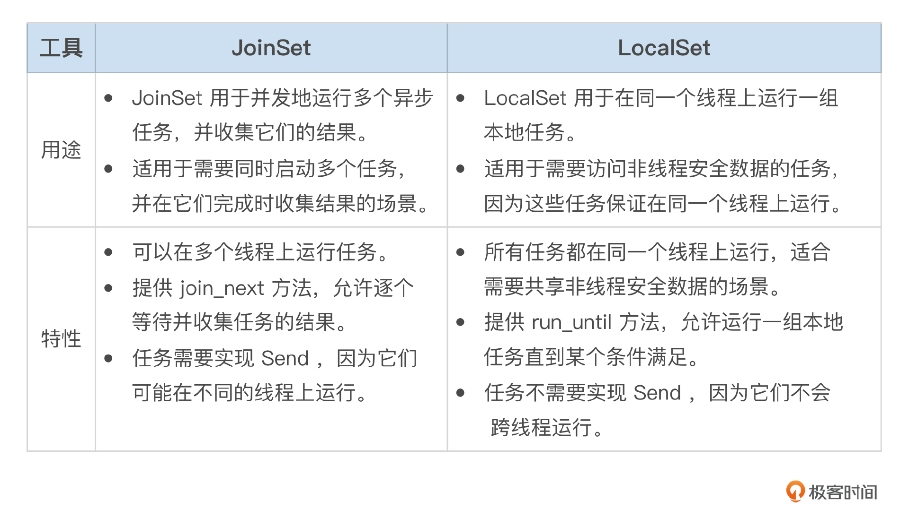

# 14 | 运筹帷幄，伺机而动：Tokio异步运行时（下）

你好，我是鸟窝。

这节课我们继续学习 Tokio 异步运行时的其他知识，包括任务、宏和信号。

## 任务（Task）

任务是一种轻量级、非阻塞的执行单元，类似于操作系统线程，但它们不是由操作系统调度器管理的，而是由 Tokio 运行时管理的。这种通用模式的另一个名称是绿色线程。如果你熟悉Go 的 Goroutine、Kotlin 的协程或 Erlang 的进程，你就可以将 Tokio 的任务视为类似的东西。

关于任务的关键点包括：

- 任务是轻量级的。由于任务由 Tokio 运行时而不是操作系统调度，因此创建新任务或在任务之间切换不需要上下文切换，并且开销相当低。创建、运行和销毁大量任务非常廉价，尤其是与操作系统线程相比。

- 任务是协作调度的。大多数操作系统都实现抢占式多任务处理。这是一种调度技术，操作系统允许每个线程运行一段时间，然后抢占它，暂时暂停该线程并切换到另一个线程。另一方面，任务实现协作式多任务处理。在协作式多任务处理中，允许一个任务运行直到它让出，向 Tokio 运行时的调度器表明它目前无法继续执行。当一个任务让出时，Tokio 运行时会切换到执行下一个任务。

- 任务是非阻塞的。通常，当一个操作系统线程执行 I/O 或必须与其他线程同步时，它会阻塞，允许操作系统调度另一个线程。当一个任务无法继续执行时，它必须让出，从而允许Tokio 运行时调度另一个任务。任务通常不应执行可能阻塞线程的系统调用或其他操作，因为这将阻止在同一线程上运行的其他任务的执行。不过这部分我们提供了在异步上下文中运行阻塞操作的 API。

### 创建任务

### spawn

```
如果我们要创建任务，我们最需要了解的函数就是 task::spawn。你可以将其视为标准库中
的 thread::spawn 的异步等效项。它接受一个异步块或其他 future，并创建一个新任务来
```

并发地运行该工作：

```
use tokio::task;
task::spawn(async {
   // 在这里执行一些工作...
});
与 std::thread::spawn 类似，task::spawn 返回一个 JoinHandle 结构体。
JoinHandle 本身是一个 future，可用于等待已生成任务的输出。例如：
```

```javascript
use tokio::task;
let join = task::spawn(async {
   // ...
   "hello world!"
});
// ...
// 等待已生成任务的结果。
let result = join.await?;
assert_eq!(result, "hello world!");
同样，类似于 std::thread 的 JoinHandle 类型，如果生成的 task 发生恐慌，则等待其
JoinHandle 将返回一个 JoinError。例如：
use tokio::task;
let join = task::spawn(async {
   panic!("发生了不好的事情！");
});
// 返回的结果表明任务失败。
assert!(join.await.is_err());
```

### spawn_blocking

通常，在 future 中发出阻塞调用或执行大量计算而不让出控制权是有问题的，因为它可能阻止执行器驱动其他 future 前进。此函数在一个专用于阻塞操作的线程上运行提供的闭包。

```
Tokio 将在通过此函数请求时生成更多阻塞线程，直到达到在 Builder 上配置的上限。达到
上限后，任务将放入队列。默认情况下，线程限制非常大，因为 spawn_blocking 通常用于
各种无法异步执行的 IO 操作。当使用 spawn_blocking 运行 CPU 密集型代码时，应牢记
```

这个较大的上限。当运行许多 CPU 密集型计算时，应使用信号量或其他同步原语来限制并行

```
执行的计算数量。专门的 CPU 密集型执行器，例如 rayon，也可能是一个不错的选择。
```

此函数旨在用于最终自行完成的非异步操作。如果要生成一个普通线程，则应改用

```javascript
thread::spawn。
       let result = task::spawn_blocking(move || {
           thread::sleep(Duration::from_secs(2));
           return 200
       })
       .await
       .unwrap();
       println!("Result: {}", result); // 输出 20
在这段代码中，我们使用了 Tokio 库中的  task::spawn_blocking  函数来在单独的线程中
```

运行一个阻塞操作。

```
请注意，使用 spawn_blocking 生成的任务无法中止，因为它们不是异步的。如果在
spawn_blocking 任务上调用 abort，则不会有任何效果，并且该任务将继续正常运行。
例外情况是任务尚未开始运行；在这种情况下，调用 abort 可能会阻止任务启动。
关闭执行器时，它将无限期地等待所有阻塞操作完成。你可以使用 shutdown_timeout 在
```

一定超时后停止等待它们。注意，这仍然不会取消任务——它们只是在方法返回后被允许继续运行。如果阻塞任务尚未开始运行，则有可能将其取消，但这不能保证。

请注意，如果你使用的是单线程运行时，此函数仍将为阻塞操作生成额外的线程。当前线程调度器的单线程仅用于异步代码。

### spawn_local

```javascript
在当前的 LocalSet 或 LocalRuntime 上生成一个 !Send 的 future。生成的 future 将在调
用 spawn_local 的同一个线程上运行。提供的 future 将在调用 spawn_local 时立即在后
台开始运行，即使你不 await 返回的 JoinHandle。
       let nonsend_data = Rc::new("my nonsend data...");
       // 创建了一个新的 LocalSet，它是一个任务集合，
       // 保证这些任务在同一个线程上运行。
       // 这对于需要访问非线程安全数据的任务非常有用。
       let local = task::LocalSet::new();
       // 使用 run_until 方法运行本地任务集，
       // 直到提供的异步任务完成。在这个异步任务中，
       // 首先克隆了 nonsend_data，以确保每个任务都有自己的数据引用。
       local
           .run_until(async move {
               let nonsend_data = nonsend_data.clone();
               // 使用 task::spawn_local 生成一个新的本地任务。
               // 这个函数类似于 tokio::spawn，
               // 但它确保任务在与 LocalSet 相同的线程上运行。
               // 在这个任务中，打印了 nonsend_data 的内容。
               // await 和 unwrap 确保等待任务完成
               task::spawn_local(async move {
                   println!("{}", nonsend_data);
                   // ...
               })
               .await
               .unwrap();
           })
           .await;
```

### LocalSet

```
一组在同一线程上执行的任务。在某些情况下，需要运行一个或多个未实现 Send trait 的
```

future，因此在线程之间发送它们是不安全的。在这些情况下，可以使用本地任务集来调度一

```javascript
个或多个 !Send 的 future 在同一线程上一起运行。例如，以下代码将无法编译：
use std::rc::Rc;
#[tokio::main]
async fn main() {
   // `Rc` 非线程安全.
   let nonsend_data = Rc::new("my nonsend data...");
   let nonsend_data = nonsend_data.clone();
   // 此处 `async` 块移动了nonsend_data，所以future是`!Send`,
   // 又因为`tokio::spawn`需要此future实现`Send`,导致编译失败
   tokio::spawn(async move {
       println!("{}", nonsend_data);
       // ...
   }).await.unwrap();
}
为了启动 !Send 的 future，我们可以使用本地任务集在调用 Runtime::block_on 的线程
上调度它们。在本地任务集内部运行时，我们可以使用 task::spawn_local，它可以启动
!Send 的 future。例如：
       let nonsend_data = Rc::new("my nonsend data...");
       // 创建了一个新的 LocalSet，它是一个任务集合，
       // 保证这些任务在同一个线程上运行。
       // 这对于需要访问非线程安全数据的任务非常有用。
       let local = task::LocalSet::new();
       // 使用 run_until 方法运行本地任务集，
       // 直到提供的异步任务完成。在这个异步任务中，
       // 首先克隆了 nonsend_data，以确保每个任务都有自己的数据引用。
       local
           .run_until(async move {
               let nonsend_data = nonsend_data.clone();
               // 使用 task::spawn_local 生成一个新的本地任务。
               // 这个函数类似于 tokio::spawn，
               // 但它确保任务在与 LocalSet 相同的线程上运行。
               // 在这个任务中，打印了 nonsend_data 的内容。
               // await 和 unwrap 确保等待任务完成
               task::spawn_local(async move {
                   println!("{}", nonsend_data);
                   // ...
               })
               .await
               .unwrap();
           })
           .await;
这个例子我们上面介绍 spawn_local 的时候已经说过了。
```

### JoinSet

```
JoinSet 代表一组在 Tokio 运行时中创建的任务集合。我们可以使用 JoinSet 等待集合中部
```

分或全部任务的完成。这个集合是无序的，任务会按照它们完成的先后顺序返回。所有任务的

```javascript
返回值类型 T 必须相同。当 JoinSet 被丢弃时，其中包含的所有任务都会立即中止。
下面是一个使用 JoinSet 的例子：
use tokio::task::JoinSet;
#[tokio::main]
async fn main() {
   let mut set = JoinSet::new();
   for i in 0..10 {
       set.spawn(async move { i });
   }
   let mut seen = [false; 10];
   while let Some(res) = set.join_next().await {
       let idx = res.unwrap();
       seen[idx] = true;
   }
   for i in 0..10 {
       assert!(seen[i]);
   }
}
这段代码展示了如何使用 Tokio 库中的  JoinSet  来并发地运行多个异步任务，并收集它们
```

的结果。

1. 使用 for 循环生成 10 个异步任务，每个任务简单地返回其索引 i。这些任务被添加到

```javascript
 JoinSet  中进行管理。
创建一个布尔数组  seen，用于跟踪每个任务的结果是否已被处理。使用  while let  循
环异步地等待并收集  JoinSet  中下一个完成的任务结果。res.unwrap()  提取任务的
结果，并将对应索引的  seen  值设置为  true。
使用  for  循环验证所有任务的结果都已被处理。如果所有任务都成功完成并且结果被正
```

- 确收集，程序将正常结束；否则，断言将失败并引发错误。

```
JoinSet 有一堆方法， join 系列包括 join_all、join_next、join_next_with_id，
等待任务全部完成或者逐个按照顺序检查任务是否完成，还有 try_join_next 和
try_join_with_id。abort_all 终止此集合内所有的任务。poll_join_next 和
poll_join_next_with_id 提供异步的功能。一系列 l 类 spawn 方法提供执行任务的能
力。detach_all 移除所有的任务。is_empty 检查集合是否为空，len 返回集合中任务的
数量。shutdown 终止所有的任务并等待它们完成终止动作，等价于 abort_all + 在循环中
join_next。
JoinSet 和  LocalSet 都是 Tokio 提供的用于管理异步任务的工具，但它们有不同的用途
```

和特性。以下是它们的主要区别：



### 取消

```
可以使用 JoinHandle::abort 或 AbortHandle::abort 方法取消已生成的任务。当调
用这些方法之一时，任务会被告知在下次 .await 点检查时让出控制权时关闭。如果任务已
```

经处于空闲状态，则会尽快关闭，而不会在它被正式关闭前再次运行。此外，关闭 Tokio 运行

```
时（例如，通过从 #[tokio::main] 返回）会立即取消其上的所有任务。
当 task 关闭时，它将在其所产出的任何 .await 处停止运行。所有局部变量都将通过运行其
析构函数而被销毁。关闭完成后，等待 JoinHandle 将失败并出现取消错误。
```

请注意，中止 task 并不保证它会因取消错误而失败，因为它可能首先正常完成。例如，如果

```
task 在调用 abort 和 task 结束之间没有在任何时候产出到运行时，则 JoinHandle 将改为
```

报告 task 正常退出。

```
注意，对 JoinHandle::abort 的调用只是将 task 排入取消计划，并且将在取消完成之前
```

返回。如果想要确保任务被完全取消，你需要使用 JoinHandle 等待它真正完成。同样，

```
JoinHandle::is_finished 方法只有在取消完成之后才会返回 true。此外，多次调用
JoinHandle::abort 与调用一次的效果相同。
Tokio 还提供了一个 AbortHandle，它类似于 JoinHandle，但它不提供等待 task 完成的
机制。每个 task 只能有一个 JoinHandle，但它可以有多个 AbortHandle。
```

### 阻塞和让出（Yield）

如上所述，在异步任务中运行的代码不应执行可能阻塞的操作。如果在运行其他任务的线程上执行阻塞操作，会阻塞整个线程，进而影响其他任务的运行。不过，Tokio 提供了两个用于在

```
异步上下文中运行阻塞操作的 API：task::spawn_blocking 和
task::block_in_place。
```

请注意，如果你从异步代码中调用非异步方法，那么该非异步方法仍位于异步上下文中，因此你也应避免在其中进行阻塞操作。这包括在异步代码中销毁的对象的析构函数。

### spawn_blocking

```
task::spawn_blocking 函数类似于刚刚讨论的 task::spawn 函数，但它不是在 Tokio
```

运行时生成一个非阻塞 future，而是在专用的阻塞任务线程池上生成一个阻塞函数。例如：

```
use tokio::task;
task::spawn_blocking(|| {
   // 执行一些计算密集型工作或调用同步代码
});
就像 task::spawn 一样，task::spawn_blocking 返回一个 JoinHandle，我们可以用
```

它来等待阻塞操作的结果：

```javascript
let join = task::spawn_blocking(|| {
   // 执行一些计算密集型工作或调用同步代码
   "blocking completed"
});
let result = join.await?;
assert_eq!(result, "blocking completed");
```

### block_in_place

```
当使用多线程运行时，task::block_in_place 函数也可用。与
task::spawn_blocking 类似，此函数允许从异步上下文中运行阻塞操作。然而，与
spawn_blocking 不同的是，block_in_place 通过将当前工作线程转换为阻塞线程来工
```

作，并将该线程上运行的其他任务移至另一个工作线程。这可以通过避免上下文切换来提高性能。例如：

```javascript
use tokio::task;
let result = task::block_in_place(|| {
   // 执行一些计算密集型工作或调用同步代码
   "blocking completed"
});
assert_eq!(result, "blocking completed");
```

### yield_now

```
此外，该模块提供了一个 task::yield_now 异步函数，类似于标准库的
thread::yield_now。调用和等待此函数将导致当前任务产出到 Tokio 运行时的调度程
```

序，从而允许调度其他任务。最终，产出任务将再次被轮询，允许它执行。例如：

```
use tokio::task;
async {
   task::spawn(async {
       // ...
       println!("spawned task done!")
   });
   // 产出，允许新生成的 task 首先执行。
   task::yield_now().await;
   println!("main task done!");
}
```

## 协作式调度

```
当对顶层任务调用 poll 时，它可能在返回 Poll::Pending 之前执行大量工作。如果一个
```

任务长时间运行而不让出控制权给执行器，它可能会饿死其他等待该执行器执行的任务，或者耗尽底层资源。由于 Rust 没有运行时环境，因此很难强制抢占长时间运行的任务。相反，这个模块提供了一种可选的机制，让协程与执行器协作，避免饿死问题。

我们来看这样一个协程：

```javascript
async fn drop_all<I: Stream + Unpin>(mut input: I) {
   while let Some(_) = input.next().await {}
}
```

乍一看似乎没什么问题，但如果输入流总是准备好数据，并且负载很高，会发生什么呢？如果

```
我们启动 drop_all，这个任务将永远不会让出控制权，并饿死其他在同一个执行器上运行
```

的任务，也会耗尽资源。为了解决这个问题，Tokio 在许多库函数中引入了显式的让步点，迫使任务定期返回给执行器。

显式让步点是一种重要的技术，用于在协作式调度的异步环境中防止任务饥饿。通过在长时间运行的任务中插入让步点，我们可以确保其他任务也能得到执行，提高程序的并发性和响应

```
性。在 Tokio 中，我们可以使用 tokio::task::yield_now() 来实现显式让步。
除了 tokio::task::yield_now()，一些 I/O 操作或其他异步操作本身就包含隐式的让步
```

点。例如，当一个任务等待网络数据时，它会自动让出控制权。

```javascript
另外，如果需要，可以使用 task::unconstrained 将 future 排除在 Tokio 的协作式调度之
外。一旦 future 被 unconstrained 包裹，它将不再受 Tokio 的强制让步机制约束。例如：
use tokio::{task, sync::mpsc};
let fut = async {
   let (tx, mut rx) = mpsc::unbounded_channel();
   for i in 0..1000 {
       let _ = tx.send(());
       // 不会被强制yield
       rx.recv().await;
   }
};
task::unconstrained(fut).await; // 此future不受约束
```

## 那些宏

### join/try_join

```
join! 宏等待多个并发分支，直到所有分支都完成后才返回。它必须在异步函数、闭包或代
码块内部使用。join! 宏接收一系列异步表达式，并在同一个任务中并发执行它们。每个异
```

步表达式都会求值为一个 future，这些 future 会在当前任务中进行多路复用。

```javascript
当处理返回 Result 的异步表达式时，无论是否有分支返回 Err，join! 都会等待所有分支
完成。如果希望在遇到 Err 时立即返回，需要使用 try_join!。
下面是一个简单使用 join! 的例子，它会等待两个任务都完成：
use  tokio::join;
async fn do_stuff_async() -> i32 {
   println!("do stuff");
   1
}
async fn more_async_work() -> &'static str {
   println!("more work");
   "hello join"
}
#[tokio::main]
async fn main() {
   let (first, second) = join!(
       do_stuff_async(),
       more_async_work());
   println!("first: {}, second: {}", first, second);
}
与 join! 类似，try_join! 宏也接收一系列异步表达式，并在同一个任务中并发执行它
```

们。每个异步表达式都会求值为一个 future，这些 future 会在当前任务中进行多路复用。

```
try_join! 宏会在所有分支都返回 Ok 时返回，或者在第一个分支返回 Err 时立即返回。
下面这个例子中其中一个任务返回 Err，所以 try_join! 宏收到后立即返回，不会再等另外
```

一个任务完成：

```javascript
async fn do_stuff_async() -> Result<(), &'static str> {
   std::thread::sleep(std::time::Duration::from_secs(1));
   Ok(())
}
async fn more_async_work() -> Result<(), &'static str> {
   Err("more work failed")
}
#[tokio::main]
async fn main() {
   let res = tokio::try_join!(
       do_stuff_async(),
       more_async_work());
   match res {
        Ok((first, second)) => {
            println!("first: {:?}, second: {:?}", first, second);
        }
        Err(err) => {
           println!("processing failed; error = {}", err);
        }
   }
}
```

### pin

```
pin! 宏将一个值固定在栈上。调用 async fn 会返回匿名的 Future 值，这些值没有实现
Unpin 特性。这些值在被轮询之前必须先固定（pin）。调用 .await 会自动处理这个过程，
但会消耗掉 future 的所有权。如果需要在 &mut _ 引用上调用 .await，那么调用者需要负
责手动固定 future。可以使用 Box::pin 在堆上分配并固定，或者使用 pin! 宏在栈上固
```

定。

下面的代码将无法通过编译：

```javascript
async fn my_async_fn() {
   // async logic here
}
#[tokio::main]
async fn main() {
   let mut future = my_async_fn();
   (&mut future).await;
}
```

稍微修改一下就可以编译了：

```sql
use tokio::pin;
async fn my_async_fn() {
   // async logic here
}
#[tokio::main]
async fn main() {
   let future = my_async_fn();
   pin!(future);
   (&mut future).await;
}
在使用 select! 宏以及需要 T: Stream + Unpin 的流操作时，固定（pinning）就显得尤
```

为重要，比如下面的代码，必须使用 pin 才能编译：

```sql
use tokio::{pin, select};
async fn my_async_fn() {
   println!("my_async_fn");
}
#[tokio::main]
async fn main() {
   pin! {
       let future1 = my_async_fn();
       let future2 = my_async_fn();
   }
   select! {
       _ = &mut future1 => {}
       _ = &mut future2 => {}
   }
}
```

### select

```sql
select! 宏等待多个并发分支，并在第一个分支完成后返回，取消其余分支。有点像 Go 语
言的 select 语句。select! 宏必须在异步函数、闭包和代码块内部使用。
select! 宏接受一个或多个分支，其模式如下：
<pattern> = <async expression> (, if <precondition>)? => <handler>,
此外，select! 宏可以包含一个可选的 else 分支，如果其他分支都不匹配其模式，则执行
该分支：else => <expression>。
该宏聚合所有 <async expression> 表达式，并在当前任务上并发运行它们。一旦第一个
表达式完成并返回一个与其 <pattern> 匹配的值，select! 宏将返回执行已完成分支的
<handler> 表达式的结果。
此外，每个分支可以包含一个可选的 if 先决条件。如果先决条件返回 false，那么该分支
将被禁用。提供的 <异步表达式> 仍然会被求值，但生成的结果 future 永远不会被轮询。当在
循环中使用 select! 时，这个功能很有用。
select! 表达式的完整生命周期如下：
计算所有提供的 <precondition> 表达式。如果先决条件返回 false，那么在当前
select! 调用的剩余时间内禁用该分支。由于循环而重新进入 select! 会清除“禁用”状
```

- 态。

```
聚合每个分支的 <async expression>，包括被禁用的分支。如果分支被禁用，<async
expression> 仍然会被求值，但生成的结果 future 不会被轮询。
```

3. 如果所有分支都被禁用，转到步骤 6。

```
并发等待所有剩余的 <异步表达式> 的结果。
```

```sql
一旦一个 <async expression> 返回一个值，就尝试把这个值应用于提供的
<pattern>。如果模式匹配，就计算 <handler> 并返回。如果模式不匹配，就在当前
select! 调用的剩余时间内禁用当前分支。从步骤 3 继续。
计算 else 表达式。如果没有提供 else 表达式，则 panic。
注意第 6 条，我们写代码的时候尽量加上 else 表达式，否则有可能 panic。如果所有分支都
被禁用且没有提供 else 分支，则 select! 宏会 panic。当提供的 if 先决条件返回
false，或者当模式与 <async expression> 的结果不匹配时，分支会被禁用。
```

如果你还是不太理解，我打一个比喻。

想象你是一家餐厅的服务员，你同时要服务好几桌客人（每个客人代表一个“分支”）。

```sql
select! 的作用：就像你同时关注着所有客人，一旦其中一位客人（第一个完成的“分支”）
```

- 点好了菜，你就立刻去厨房下单，而不再理会其他还在犹豫的客人（取消其余分支）。

```sql
select! 的使用场景：你必须在餐厅工作时（异步函数、闭包和代码块内部）才能使用这
```

- 种服务方式。

```sql
select! 的语法：
<模式> = <点菜请求> (, if <特殊要求>)? => <去厨房下单><点菜请求>：客人点了什
```

么菜（异步表达式）。

```xml
<特殊要求>：客人是否有特殊要求，比如“不要辣”（先决条件）。
<去厨房下单>：你去厨房下单的动作（处理程序）。
else => <实在没人点菜就休息>：如果所有客人都没点菜，你就可以休息一下（else 分
```

支）。

举个例子：

```sql
select! {
 客人A点了宫保鸡丁 => 去厨房下单宫保鸡丁,
 客人B点了鱼香肉丝 if 客人B不吃辣 => 去厨房下单不辣的鱼香肉丝,
 else => 休息一下
}
简单来说，select! 就像一个高效的调度员，它能让你同时处理多个任务，并在第一个任务
```

完成后立即作出响应，而忽略其他未完成的任务。它还提供了一些额外的功能，比如根据条件选择执行哪些任务，以及在所有任务都无法执行时执行一些默认的操作。

把所有异步操作都放在当前的任务里跑，它们可以同时进行，但不是一起进行。意思是说，这些操作其实是在同一个线程上轮流执行的，如果其中一个操作卡住了，整个线程就都动不了

```sql
了，其他操作也就没法继续。如果真的需要同时跑多个操作，那就用 tokio::spawn 为每个
异步操作创建一个新的任务，然后把这些任务的“句柄”（join handle）交给 select! 去管
```

理。

公平性

```sql
select! 默认会随机挑一个分支先看看。如果你在循环里用 select!，而且这些分支总是
```

准备好的状态，那这种随机挑选的方式就能保证相对的公平。

```sql
如果你想自己控制挑选的顺序，可以在 select! 的开头加上 biased;。具体怎么用可以看
下面我给出的例子。加了这个之后，select 就会按照你代码里的分支从上到下的顺序一个一
```

个地去检查。你需要这样做的原因有几个：

```sql
tokio::select! 用到的随机数生成也是要消耗 CPU 资源的。
```

- 你的 future 之间可能会有相互影响，这时候固定的检查顺序就很重要了。

但是用这种方式有个很重要的坑要注意。你得自己保证检查 future 的顺序是公平的。举个例子，你要在一个数据流和一个关闭信号之间做选择。如果这个数据流消息特别多，而且消息之

```sql
间几乎没有间隔，那你最好把关闭信号放在 select! 列表的最前面，这样才能保证它不会因
```

为数据流一直有数据而一直被忽略，确保它能被检查到。

```sql
下面是一个使用 biased; 的例子，可以看到分支顺序执行，否则 assert_eq 就会失败：
#[tokio::main]
async fn main() {
   let mut count = 0u8;
   loop {
       tokio::select! {
           // 如果你在没有`biased;` 的情况下运行这个例子，轮询顺序是伪随机的，
           // 并且对 count 值的断言（可能）会失败。
           biased;
           _ = async {}, if count < 1 => {
               count += 1;
               assert_eq!(count, 1);
           }
           _ = async {}, if count < 2 => {
               count += 1;
               assert_eq!(count, 2);
           }
           _ = async {}, if count < 3 => {
               count += 1;
               assert_eq!(count, 3);
           }
           _ = async {}, if count < 4 => {
               count += 1;
               assert_eq!(count, 4);
           }
           else => {
               break;
           }
       };
   }
}
```

接下来我们再学习最后一个宏。

### task_local

这个宏能把一堆静态变量打包，生成一个 LocalKey，让它们只在当前任务里用。原来的访问权限和属性都还在。比如：

```
task_local! {
   pub static ONE: u32;
   #[allow(unused)]
   static TWO: f32;
}
和 std::thread::LocalKey 不一样，tokio::task::LocalKey 不是等到真正要用的
```

时候才创建数据，而是包含它的那个 future 第一次被 Tokio 这种“调度员”（执行器）安排干活的时候，数据就准备好了。

例子如下：

```
tokio::task_local! {
   static NUMBER: u32;
}
NUMBER.scope(1, async move {
   assert_eq!(NUMBER.get(), 1);
}).await;
NUMBER.scope(2, async move {
   assert_eq!(NUMBER.get(), 2);
   NUMBER.scope(3, async move {
       assert_eq!(NUMBER.get(), 3);
   }).await;
}).await;
其中 scope 把值 T 设置成 future F 的任务本地值。
scope 执行完之后，这个任务本地值就会被清理掉。
#[tokio::main]
async fn main() {
   tokio::task_local! {
       static NUMBER: u32;
   }
   NUMBER.scope(1, async move {
       println!("task local value: {}", NUMBER.get());
   }).await;
   NUMBER.scope(2, async move {
       println!("task local value: {}", NUMBER.get());
   }).await;
   NUMBER.sync_scope(3, || {
       println!("task local value: {}", NUMBER.get());
   });
}
```

每个任务都获取到自己的本地值。

## signal

```
signal 用于 Tokio 的异步信号处理。需要注意的是，信号处理通常非常复杂，使用时务必谨
```

慎。这个 crate 致力于实现信号处理的“最佳实践”，但仍需根据你的应用程序需求进行评估，以确保其适用性。此外，在各个操作系统的特定结构文档中也记录了这个 crate 的一些根本性限制。

```
下面这个例子演示了程序接收到 ctrl+c 打印一条日志后退出：
use tokio::signal;
#[tokio::main]
async fn main() -> Result<(), Box<dyn std::error::Error>> {
   signal::ctrl_c().await?;
   println!("ctrl-c received!");
   Ok(())
}
```

它还可以监听 Linux 信号，如下面的例子：

```sql
use tokio::signal;
use tokio::signal::unix::{signal, SignalKind};
#[tokio::main]
async fn main() -> Result<(), Box<dyn std::error::Error>> {
   let mut interrupt_signal = signal(SignalKind::interrupt())?;
   let mut terminate_signal = signal(SignalKind::terminate())?;
   let mut hangup_signal = signal(SignalKind::hangup())?;
   tokio::select! {
       _ = signal::ctrl_c() => {},
       _ = interrupt_signal.recv() => {},
       _ = terminate_signal.recv() => {},
       _ = hangup_signal.recv() => {},
   }
   println!("exit");
   Ok(())
}
第 7～9 行代码分别创建了处理  SIGINT（中断信号）、SIGTERM（终止信号）和  SIGHUP
（挂起信号）的信号处理器，并使用 select! 宏等待任意一个信号（还包括 ctrl+c）。
```

- 思来想去，Tokio 的内容还是太多了，后续我再专门出一篇，介绍 Tokio 的其他的模块，比如 fs、io、net、process、sync 和 time, 这一节还是重点介绍运行时的知识。

## 总结

好了，本节课我们主要介绍了 Rust 中最重要的异步运行时 Tokio 剩余的知识。

Tokio 运行时使用任务（Task）进行并发操作的管理。任务是轻量级、非阻塞的，由 Tokio 运行时调度。Tokio 提供了多种创建任务的方法：

```
task::spawn 用于创建普通任务。
task::spawn_blocking 用于在单独的线程中运行阻塞操作。
task::spawn_local 用于在同一个线程上运行非 Send 的 future。
Tokio 还提供了 LocalSet 和 JoinSet 用于管理任务集合。LocalSet 用于在同一线程运行
任务，而 JoinSet 用于并发运行多个任务并收集结果。
```

为了防止任务长时间占用线程导致其他任务无法执行，Tokio 实现了协作式调度，并提供了

```
task::yield_now 方法让任务主动让出 CPU。也可以使用 task::unconstrained 使
```

future 不受 Tokio 的协作式调度约束。

Tokio 还提供了一些宏来简化异步编程：

```sql
join! 和 try_join! 用于等待多个 future 完成。
pin! 用于将 future 固定在栈上。
select! 用于等待多个 future 中第一个完成的 future。可以使用 biased; 控制轮询顺
```

- 序。

```
task_local! 用于创建任务本地变量。
最后简单提到了 signal 模块用于异步信号处理。
```

## 思考题

```
请你使用 Tokio 启动四个任务，分别计算一加到一百万，然后打印出结果，最后使用join!宏
```

等待任务都完成。

欢迎你把你动手的结果分享到留言区，我们一起交流讨论，如果你身边有对异步运行时 Tokio感兴趣的朋友，欢迎邀他一起学习，我们下节课再见！
