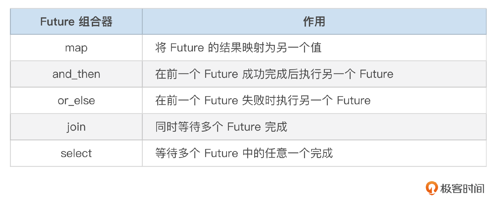
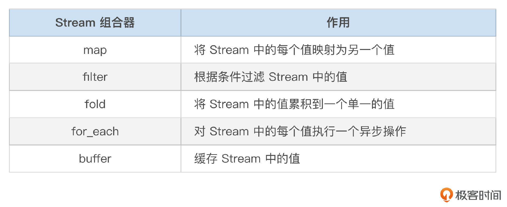

# 17 | 躬行实践，洞悉其理：自己动手实现一个Future

- 登录

鸟窝


你好，我是鸟窝。

上几节课我们学习了 Rust 的异步编程和几种常见的异步运行时，以及异步编程应用的场景以及陷阱，如果你觉得还不过瘾，那么这节课就让我们来学习如何实现一个自己的 Future。

我们可以通过 ready 创建一个无需等待的 Future，也可以通过 pending 创建一个永远不会完成的 Future。这两种方式是最极端的两个场景，更多的情况下，如果我们是一个库的实现者，我们可能要实现自己的异步库，实现自己的 Future。就像 tokio、async_std 实现的各种异步io、net 库一样。

## 一个简单的 Delay future

下面我将尝试解释如何在 Rust 中手动实现一个 Future，并解释其背后的原理。

### Future 的核心概念

- 登录

Future 代表一个异步操作的最终结果。它有两种状态：

- Pending（挂起）：操作尚未完成。

- Ready（就绪）：操作已完成，结果可用。

```
Future 的主要方法是 poll()，它被调用来检查 Future 是否已经完成。poll() 方法返回一
个 Poll 枚举。
enum Poll<T> {
   Ready(T),
   Pending,
}
```

简化版 Future 实现

下面是一个简单的 Future 实现，它模拟一个延迟操作：

```
use std::future::Future;
use std::task::{Context, Poll};
use std::time::Duration;
struct Delay {
   duration: Duration,
   completed: bool,
}
impl Delay {
   fn new(duration: Duration) -> Self {
       Delay {
           duration,
           completed: false,
       }
   }
}
impl Future for Delay {
```

- 登录

```javascript
   type Output = String;
   fn poll(mut self: std::pin::Pin<&mut Self>, cx: &mut Context<'_>) -> Poll<Sel
       if self.completed {
           Poll::Ready("延迟完成！".to_string())
       } else {
           println!("子曰：三思而后行！");
           // 模拟耗时操作，这里使用线程休眠
           std::thread::sleep(self.duration);
           self.completed = true;
           cx.waker().wake_by_ref(); // 非常重要！唤醒执行器
           Poll::Pending
       }
   }
}
#[tokio::main]
async fn main() {
   let delay = Delay::new(Duration::from_secs(2));
   let result = delay.await;
   println!("{}", result);
}
Delay 结构体：存储延迟时间和完成状态。
impl Future for Delay：为 Delay 实现了 Future trait。
poll() 方法：这是 Future 的核心。
如果 self.completed 为 true，则返回 Poll::Ready，表示 Future 已完成。
```

- 1.

```
否则，模拟一个耗时操作（这里使用 thread::sleep()），然后将 self.completed
```

- 2.

```
设置为 true。
重点：cx.waker().wake_by_ref(); 这行代码非常重要。它获取一个 Waker，并调
```

- 3.

```
用 wake_by_ref() 方法。Waker 的作用是通知执行器（Executor）Future 已经准备
好再次被 poll()。如果没有这一步，执行器就不知道 Future 已经完成了模拟的耗时操
```

- 作，Future 就永远不会完成。

```
main() 函数：使用 tokio 运行 main() Future。
```

### 改造 Delay

- 登录

但是，这个 Future 的实现有一个问题，在 Future 第一次被 poll 的时候，调用了

```
std::thread::sleep，这个导致调用线程阻塞，这正是上一课我们介绍的陷阱之一。
```

我们可以借助 tokio 实现的 sleep 改造一下，如下：

```javascript
use std::future::Future;
use std::pin::Pin;
use std::task::{Context, Poll};
use std::time::Duration;
use tokio::time::{sleep, Sleep};
use pin_project::pin_project;
#[pin_project] // 使用 pin_project 宏
struct Delay {
   #[pin] // 标记需要 Pin 住的字段
   sleep: Sleep,
   message: String,
}
impl Delay {
   fn new(duration: Duration, message: String) -> Self {
       Delay {
           sleep: sleep(duration),
           message,
       }
   }
}
impl Future for Delay {
   type Output = String;
   fn poll(self: Pin<&mut Self>, cx: &mut Context<'_>) -> Poll<Self::Output> {
       let this = self.project(); // 使用 project() 方法进行投影
       match this.sleep.poll(cx) {
           Poll::Pending => Poll::Pending,
           Poll::Ready(_) => Poll::Ready(this.message.clone()),
       }
   }
}
#[tokio::main]
async fn main() {
   let delay1 = Delay::new(Duration::from_secs(2), "第一个延迟完成！".to_string());
```

- 登录

```javascript
   let delay2 = Delay::new(Duration::from_secs(1), "第二个延迟完成！".to_string());
   tokio::join!(async { // 并发执行两个 Future
       let result1 = delay1.await;
       println!("{}", result1);
   }, async {
       let result2 = delay2.await;
       println!("{}", result2);
   });
   println!("所有延迟完成！");
}
Delay 结构体的 sleep: Sleep 是关键！我们不再使用 thread::sleep()，而是使用
tokio::time::sleep() 创建一个 Sleep 类型的 Future。Sleep Future 代表一个非阻塞
的延迟操作。它由 tokio 运行时管理。message: String 是存储延迟完成后要返回的消
```

息。

```
添加 pin_project crate：
在 Cargo.toml 文件中添加 pin-project = "1" 依赖。
#[pin_project] 宏：在 Delay 结构体上添加 #[pin_project] 宏。这个宏会自动生
成必要的 Pin 投影代码。
#[pin] 属性：在 Delay 结构体中需要 Pin 住的字段 sleep 上添加 #[pin] 属性。
self.project() 方法：在 poll 方法中使用 self.project() 方法进行投影。这个
方法是由 pin_project 宏自动生成的，它会返回一个 DelayProjection 类型的结构
```

- 体，其中包含了对 Pin 主字段的安全访问方式。

```
Delay::new() 构造函数调用 tokio::time::sleep() 创建一个 Sleep Future。这个函
数不会阻塞当前线程，而是向 tokio 运行时注册一个定时器。当指定的时间 duration 到达
时，tokio 运行时会唤醒与此 Sleep Future 关联的任务。
```

```
poll(mut self: Pin<&mut Self>, cx: &mut Context<'_>) ->
```

- 登录

```
Poll<Self::Output>：这是 Future trait 的核心方法。执行器会不断地调用这个方法来检
```

查 Future 是否已经完成。

```
Pin<&mut Self>：由于 tokio::time::Sleep 的 poll 方法需要一个 Pin<&mut
Sleep> 类型的参数，所以 Delay 的 poll 方法也必须接收一个 Pin<&mut Self> 类型的
参数。Pin 用于防止 Future 在执行过程中被移动到内存的其他位置，这对于某些需要固定内
```

存地址的 Future 非常重要。

```
match sleep.poll(cx)：这是 poll 方法的核心。我们调用内部 Sleep Future 的 poll
方法。 这里使用了 pin_project，所以访问 sleep 字段就很方便了。
cx: &mut Context<'_>：Context 包含一个 Waker，用于在 Future 准备好再次被
poll 时唤醒执行器。在这个例子中，tokio 运行时会自动处理 Waker 的唤醒，我们不需要
```

手动调用。

```
通过这个修改，我们借助 tokio::time::sleep 的能力，实现了无阻塞的 Delay future。
```

## Timeout future 的实现

```
接下来我介绍一个 Timeout future 的实现。这个 Timeout 会等待一段时间，如果这段事件
```

正经的 future 还没有完成，就导致超时返回。

这段代码展示了如何实现一个自定义的 Timeout 结构体，用于在指定的超时时间内执行一个异步任务。如果任务在超时时间内没有完成，则返回一个超时错误：

```
use std::future::Future;
use std::io;
use std::pin::Pin;
use std::task::{Context, Poll};
use pin_project::pin_project;
#[pin_project]
pub struct Timeout<F, D> {
   #[pin]
```

- 登录

```javascript
   future: F,
   #[pin]
   deadline: D,
   completed: bool,
}
impl<F, D> Timeout<F, D> {
   pub fn new(future: F, deadline: D) -> Self {
       Self {
           future,
           deadline,
           completed: false,
       }
   }
}
impl<F: Future, D: Future> Future for Timeout<F, D> {
   type Output = io::Result<F::Output>;
   fn poll(self: Pin<&mut Self>, cx: &mut Context<'_>) -> Poll<Self::Output> {
       let this = self.project();
       assert!(!*this.completed, "future polled after completing");
       match this.future.poll(cx) {
           Poll::Ready(v) => {
               *this.completed = true;
               Poll::Ready(Ok(v))
           }
           Poll::Pending => match this.deadline.poll(cx) {
               Poll::Ready(_) => {
                   *this.completed = true;
                   Poll::Ready(Err(io::Error::new(io::ErrorKind::TimedOut, "futu
               }
               Poll::Pending => Poll::Pending,
           },
       }
   }
}
#[tokio::main]
async fn main() {
   // 创建一个延迟 2 秒的 Future
   let delay = tokio::time::sleep(std::time::Duration::from_secs(2));
   // 创建一个超时时间为 1 秒的 Future
   let timeout = tokio::time::sleep(std::time::Duration::from_secs(1));
   // 创建一个超时 Future，因为timeout 1s就到了，所以delay future还没来得及返回，超时就返
   let timeout_future = Timeout::new(delay, timeout);
```

- 登录

```
   match timeout_future.await {
       Ok(_) => println!("Future 完成！"),
       Err(e) => eprintln!("Future 超时！错误：{}", e),
   }
}
```

Timeout 结构体包含三个字段：

- future：要执行的异步任务。

- deadline：超时时间。deadline 其实是一个 future，这也意味着它不仅仅可以是时间，也可以是另外一个 future。

- completed：标记任务是否已完成。

实现 Future trait 使 Timeout 结构体成为一个异步任务。poll 方法检查 future 和 deadline的状态：如果 future 完成，则返回结果；如果 deadline 超时，则返回超时错误；否则，继续等待。

## futures 库

```
futures-rs 是 Rust 异步编程生态系统中一个重要的库（现在已经纳入到官方的仓库之
下），它提供了一系列用于处理 Future、Stream 和其他异步操作的工具和抽象。futures-rs
中定义的 future 类型是标准库中 future 的原始实现。虽然 std::future 模块在 Rust 标准库
中已经提供了基本的 Future trait 和 async/.await 语法，但 futures-rs 仍然提供了许
```

多有用的扩展功能，尤其是在处理复杂的异步场景时。

### Future 扩展

```sql
组合器（Combinators）：futures-rs 提供了丰富的 Future 组合器，例如 map、
and_then、or_else、join、select 等，用于方便地组合、转换和控制 Future。这些
```

组合器使得编写复杂的异步流程变得更加简洁和易读。



- 登录

```bash
实用函数：提供了一些方便的函数，例如 ready 用于创建一个立即完成的 Future，
pending 用于创建一个永远不会完成的 Future。
FutureExt/TryFutureExt trait：通过 use futures::prelude::*; 引入的 FutureExt
/TryFutureExt trait 为 Future 类型添加了许多方便的方法，例如 map、then、
catch_unwind 等。
```

示例：

```javascript
use futures::future::{FutureExt, TryFutureExt, ready};
use tokio::runtime::Runtime;
async fn process_data(input: i32) -> Result<String, String> {
   // 使用 map 将 i32 转换为 String
   let string_future = ready(Ok(input)).map(|result| result.map(|n| format!("Num
   // 使用 and_then 处理 Result，并在成功时返回另一个 Future
   string_future
       .and_then(|s| async move {
           Ok(format!("Processed: {}", s))
       })
       .await
}
fn main() {
   let rt = Runtime::new().unwrap();
   rt.block_on(async {
       let result1 = process_data(10).await;
       println!("Result 1: {:?}", result1); // 输出：Ok("Processed: Number: 10")
```

- 登录

```javascript
       let result2 = process_data(-1).await; // 假设 -1 是一个错误输入
       println!("Result 2: {:?}", result2); // 输出：Ok("Processed: Number: -1")
   });
}
这个例子中 ready(Ok(input)) 创建一个立即完成的 Future，其结果为 Ok(input)。map
将 Future 的结果从 Result<i32, String> 映射为 Result<String, String>。
and_then 接收一个闭包，该闭包接收前一个 Future 的结果，并返回一个新的 Future。这使
```

得我们可以根据前一个 Future 的结果执行不同的异步操作。

### Stream 支持

```
futures-rs 定义了 Stream trait，用于表示异步产生的一系列值。Stream 类似于迭代
```

器，但它是异步的。

```
Stream 组合器：提供了各种 Stream 组合器，例如 map、filter、fold、for_each、
buffer 等，用于处理和转换异步数据流。
```



```
Stream 实用函数：提供了创建 Stream 的函数，例如 stream::iter 用于从迭代器创建
```

- 登录

```
Stream。
```

示例：

```javascript
use futures::stream::{self, StreamExt};
use tokio::runtime::Runtime;
async fn process_stream() {
   let stream = stream::iter(vec![1, 2, 3, 4, 5]);
   stream.for_each(|x| async move {
       println!("Processing: {}", x);
       // 这里可以进行一些异步操作，例如网络请求
       tokio::time::sleep(std::time::Duration::from_millis(100)).await;
   }).await;
   println!("Stream processing complete.");
}
fn main() {
   let rt = Runtime::new().unwrap();
   rt.block_on(async {
       process_stream().await;
   });
}
在这个例子中，stream::iter 从一个 Vec 创建一个 Stream。for_each 对 Stream 中
的每个元素执行一个异步闭包。tokio::time::sleep 模拟一个异步操作。
```

### Sink 支持

```
futures-rs 定义了 Sink trait，用于支持异步数据的写入。Sink 定义了 start_send、
poll_ready 和 poll_flush 等方法，用于异步发送数据。
```

示例：

- 登录

```javascript
use futures::channel::mpsc;
use futures::prelude::*;
use tokio::runtime::Runtime;
async fn send_data(mut tx: mpsc::Sender<i32>) {
   for i in 1..=5 {
       tx.send(i).await.unwrap();
       println!("Sent: {}", i);
       tokio::time::sleep(std::time::Duration::from_millis(100)).await;
   }
}
async fn receive_data(mut rx: mpsc::Receiver<i32>) {
   while let Some(item) = rx.next().await {
       println!("Received: {}", item);
   }
}
fn main() {
   let rt = Runtime::new().unwrap();
   rt.block_on(async {
       let (tx, rx) = mpsc::channel(10); // 创建一个容量为 10 的通道
       tokio::join!(send_data(tx), receive_data(rx));
   });
}
在这个例子中，mpsc::channel 创建一个多生产者单消费者（multi-producer single-
consumer）通道。tx.send(i).await 异步发送数据到通道。rx.next().await 异步接
收通道中的数据。tokio::join! 同时运行发送和接收任务。
```

### 执行器（Executor）

所有异步计算都发生在执行器内部，执行器能够将 Future 派生成任务。本模块提供了一些内置执行器，以及用于构建自定义执行器的工具。

示例：

```
use futures::executor::block_on;
use futures::future::ready;
```

- 登录

```javascript
async fn my_async_function() -> i32 {
   let future1 = ready(10); // 创建一个立即完成的 Future
   let future2 = async { 20 }; // 创建一个异步 Future
   let result1 = future1.await; // 等待 future1 完成
   let result2 = future2.await; // 等待 future2 完成
   result1 + result2
}
fn main() {
   let result = block_on(my_async_function()); // 执行异步函数
   println!("Result: {}", result); // 输出：Result: 30
}
在这个例子中，async fn my_async_function() 定义了一个异步函数，它返回一个
Future。ready(10) 创建一个立即完成的 Future，而 async { 20 } 创建一个异步
Future。.await 用于等待这些 Future 完成并获取结果。block_on 用于在当前线程上
```

执行异步函数。

### 宏

这个库提供了好几个宏，对于我们处理异步编程中的各种场景非常有帮助，所以这里我介绍它的几个常用的宏。

### join!

功能：同时轮询多个 Future，并在所有 Future 都完成后返回一个包含所有结果的元组。

```
返回值：如果所有 Future 都成功完成，则返回 (T1, T2, ..., Tn)，其中 Ti 是第 i 个
Future 的结果类型。如果其中任何一个 Future 返回错误，则整个 join! 操作会立即返回该
```

错误。

示例：

- 登录

```javascript
use futures::join;
use tokio::runtime::Runtime;
async fn fetch_data(url: &str) -> Result<String, String> {
   // 模拟网络请求
   tokio::time::sleep(std::time::Duration::from_millis(100)).await;
   Ok(format!("Data from {}", url))
}
fn main() {
   let rt = Runtime::new().unwrap();
   rt.block_on(async {
       let future1 = fetch_data("url1");
       let future2 = fetch_data("url2");
       let (result1, result2) = join!(future1, future2);
       println!("Result 1: {:?}", result1);
       println!("Result 2: {:?}", result2);
   });
}
```

等待两个 future 都完成。

### try_join!

```
功能：同时轮询多个 futures，并解析为一个 Result，其中包含成功输出的元组或一个错
```

误。

返回值：所有 future 都完成或者第一个失败的结果。

```
try_join! 类似于 join!，但如果任何一个 future 返回错误，它会立即完成。
```

示例（所有的任务都成功完成）：

```javascript
use futures::try_join;
let a = async { Ok::<i32, i32>(1) };
let b = async { Ok::<i32, i32>(2) };
```

- 登录

```javascript
assert_eq!(try_join!(a, b), Ok((1, 2)));
// `try_join!` 是可变参数的，因此您可以传递任意数量的 futures
let c = async { Ok::<i32, i32>(3) };
let d = async { Ok::<i32, i32>(4) };
let e = async { Ok::<i32, i32>(5) };
assert eq!(try join!(c, d, e), Ok((3, 4, 5)));
```

示例（一个任务失败）：

```javascript
use futures::try_join;
let a = async { Ok::<i32, i32>(1) };
let b = async { Err::<u64, i32>(2) };
assert_eq!(try_join!(a, b), Err(2));
```

### pending!

```
功能：等价于 futures_core::task::Poll，相当于消耗一次 Poll。
返回值：Poll::Pending。
```

示例：

```sql
use futures::{pending, select, FutureExt};
async fn pending_function() -> i32 {
   pending!();
   42
}
async fn ready_function() -> i32 {
   tokio::time::sleep(std::time::Duration::from_secs(1)).await;
```

- 登录

```sql
   48
}
#[tokio::main]
async fn main() {
   select! {
       v = pending_function().fuse() => {
           println!("pending_function completed: {}",v);
       },
       v = ready_function().fuse() => {
           println!("ready_function completed: {}",v);
       }
   }
}
pending! 宏在 Poll 的时候还没有 ready，再次 Poll 的时候就是 Ready 的状态了，所以打印
```

出 42。

这个宏文档不是很详细，而且也没有例子，有点难以理解，如果看代码就很清晰了，实际上它生成了一个 PendingOnce 对象并等待它完成：

```
#[macro_export]
macro_rules! pending {
   () => {
       $crate::__private::async_await::pending_once().await
   };
}
#[doc(hidden)]
pub fn pending_once() -> PendingOnce {
   PendingOnce { is_ready: false }
}
#[allow(missing_debug_implementations)]
#[doc(hidden)]
pub struct PendingOnce {
   is_ready: bool,
}
impl Future for PendingOnce {
   type Output = ();
```

- 登录

```
   fn poll(mut self: Pin<&mut Self>, _: &mut Context<'_>) -> Poll<Self::Output>
       if self.is_ready {
           Poll::Ready(())
       } else {
           self.is_ready = true;
           Poll::Pending
       }
   }
}
```

### pin_mut!

```
功能：在栈上创建一个可变的 Pin。Pin 用于确保某个值在内存中的位置不会移动，这对于某
```

些需要自引用的类型（例如 Future）非常重要。

```
用法：pin_mut!(variable) 将 variable 绑定为一个 Pin<&mut Type>。
```

示例：

```javascript
use futures::pin_mut;
use std::pin::Pin;
fn main() {
   let value = 5;
   pin_mut!(value); // value 现在是 Pin<&mut i32>
   let mut pinned_value: Pin<&mut i32> = value;
   *pinned_value = 10;
   println!("{}", *pinned_value); // 输出 10
}
```

例子中将 value 值变为 Pin，确保 value 值不移动。

### poll!

- 登录

```
功能：在当前的 async 上下文中轮询一个 Future 一次。
返回值：Poll<T>，表示 Future 的状态（Pending 或 Ready(T)）。
```

用法：通常在手动实现 Future 时使用。

示例（简化）：

```javascript
use std::task::Poll;
use futures::*;
async fn some_async_function() -> Result<&'static str, ()> {
   tokio::time::sleep(std::time::Duration::from_millis(100)).await;
   Ok("Async function completed")
}
#[tokio::main]
async fn main() {
   let mut future = Box::pin(some_async_function());
   let poll_result = poll!(&mut future); // 这一行轮询 future
   // 检查轮询结果
   match poll_result {
       Poll::Ready(value) => {
           // future 成功完成，处理该值
           println!("Future resolved with: {:?}", value);
       }
       Poll::Pending => {
           // future 尚未准备好，处理这种情况（例如，yield）
           println!("Future is not ready yet");
       }
   }
   // 等待足够的时间，重新轮询 future
   tokio::time::sleep(std::time::Duration::from_millis(1000)).await;
   let poll_result = poll!(&mut future);
   match poll_result {
       Poll::Ready(value) => {
           println!("Future resolved with: {:?}", value);
       }
       Poll::Pending => {
           println!("Future is not ready yet");
```

- 登录

```
       }
   }
}
上面的代码演示了如何使用 futures 库中的 poll! 宏手动轮询 future。其核心逻辑在于如
何使用 poll! 宏以及如何根据 Poll 的返回值进行处理。
poll! 宏用于轮询 future。它接受一个 &mut Future 类型的参数（这里是 &mut
future），并返回一个 Poll 类型的值。
第一次调用 poll!：由于 some_async_function() 需要 100 毫秒才能完成，因此第一
次调用 poll! 时，future 尚未完成，poll! 宏会返回 Poll::Pending。代码中的
match 语句会匹配到 Poll::Pending 分支，并打印 “Future is not ready yet”。
tokio::time::sleep(std::time::Duration::from_millis(1000)).await;
：这行代码使程序休眠 1000 毫秒，远大于 some_async_function() 所需的 100 毫
秒。这意味着在第二次调用 poll! 之前，future 肯定已经完成 (不考虑几乎不会出现的极
```

- 端情况)。

```javascript
第二次调用 poll!：由于 future 已经完成，第二次调用 poll! 时，宏会返回
Poll::Ready(Ok("Async function completed"))。代码中的 match 语句会匹配
到 Poll::Ready 分支，并打印 “Future resolved with: Ok(“Async function completed”)”。
poll! 宏是手动驱动 future 执行的关键。它模拟了 executor 的行为，即不断地轮询 future，
直到 future 完成。poll! 宏的返回值 Poll 有两个变体：
Poll::Pending：表示 future 尚未完成，需要稍后再次轮询。
Poll::Ready(value)：表示 future 已经完成，value 是 future 的返回值。
```

### select!

功能：用于同时轮询（poll）多个 futures 和 streams，并执行第一个完成的 futures 的分支。

- 登录

如果有多个 futures 准备就绪，则将在运行时伪随机选择一个。

返回值：future 的执行结果。

```sql
直接传递给 select! 的 futures 必须实现 Unpin 和 FusedFuture trait。
如果向 select! 传递的是返回 Future 的表达式（例如异步函数调用），而不是按名称命名的
Future，则会放宽 Unpin 要求，因为宏将把生成的 Future 固定在栈上。但是表达式返回的
Future 仍然必须实现 FusedFuture trait。
可以使用 .fuse() 方法融合尚未融合的 futures 和 streams。但是，需要注意的是，如果在
循环中使用 select!，则直接在调用中融合 future 或 stream 将不足以防止其在完成之后再
次被轮询，因此在循环中使用 select! 时，用户应该格外小心地在循环之外进行融合。
select! 可以用作表达式，并返回所选分支的返回值。因此，select! 中每个分支的返回
```

类型必须相同。

此宏只能在 async 函数、闭包和块内使用。它也依赖于库的 async-await 功能，该功能默认情况下处于激活状态。

示例：

```sql
use futures::future::FutureExt;
use futures::select;
async fn async_identity_fn(arg: usize) -> usize {
   arg
}
#[tokio::main]
async fn main() {
   let res = select! {
       a_res = async_identity_fn(62).fuse() => a_res + 1,
       b_res = async_identity_fn(13).fuse() => b_res,
   };
```

- 登录

```
   println!("Result: {}", res);
}
```

随机匹配到一个分支上。

```sql
futures 库也提供另一个宏 select_biased!，用于同时轮询（poll）多个 futures 和
streams，与 select! 宏不同的是，如果有多个 futures 准备就绪，则将按照声明的顺序选择
```

一个。

### stream_select

功能：组合多个具有相同 Item 类型的所有流（stream）变成一个。

返回值：返回流的元素。

```sql
它类似于 select 宏，但是并不强制要求所有流都具有相同的类型。stream_select 宏还
可以保持流在线，并且不需要分配 Box<dyn Stream>。传递给此宏的流必须实现 Unpin
```

trait。

示例：

```javascript
use futures::{StreamExt, stream, stream_select};
#[tokio::main]
async fn main() {
   let endless_ints = |i| stream::iter(vec![i].into_iter().cycle()).fuse();
   let mut endless_numbers = stream_select!(endless_ints(1i32), endless_ints(2),
   match endless_numbers.next().await {
       Some(1) => println!("Got a 1"),
       Some(2) => println!("Got a 2"),
       Some(3) => println!("Got a 3"),
       _ => unreachable!(),
   }
}
```

- 登录

这个例子组合了三种流。

## 总结

好了，这一节课分为两个部分。第一部分给你介绍了如何定制自己的 Future，通过DelayFuture 和 TimeoutFuture 给你介绍了自定义的 Future 实现。第二部分我们补充了futures 库的介绍。futures 库是非常流行的异步编程库，在 async/.await 还没有实现的时候它就开始提供异步的能力了。它提供了丰富的异步编程的扩展，尤其是那些便利的宏。

## 思考题

```
请使用异步并发的方式访问各大搜索引擎的网站，并使用 try_join 宏打印出成功与否。欢
```

迎你在留言区分享你动手实践的结果，我们一起交流讨论，如果你觉得这节课的内容对你有帮助的话，也欢迎你分享给其他朋友，我们下节课再见！
