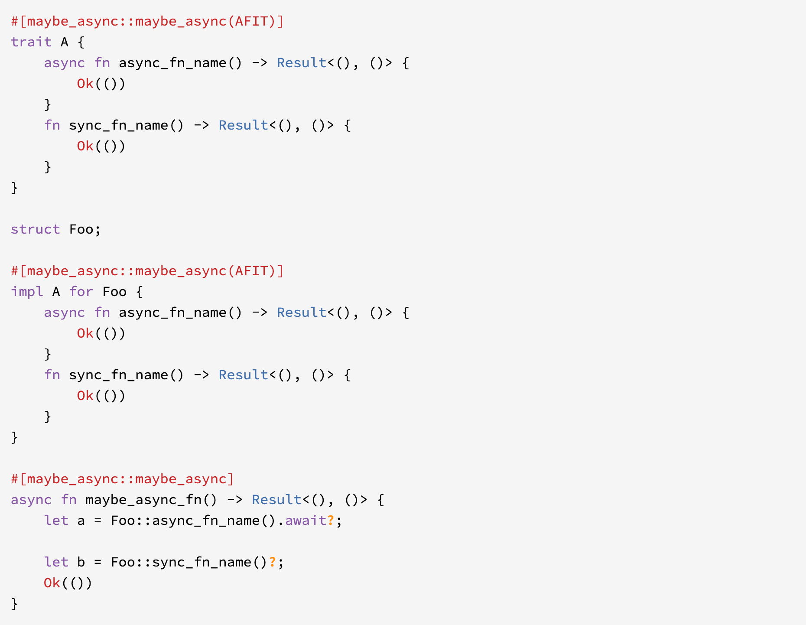
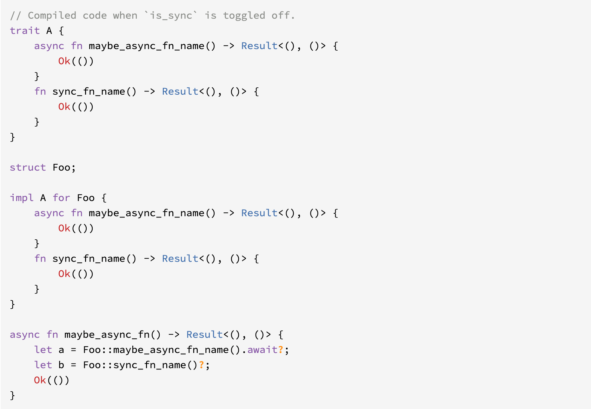
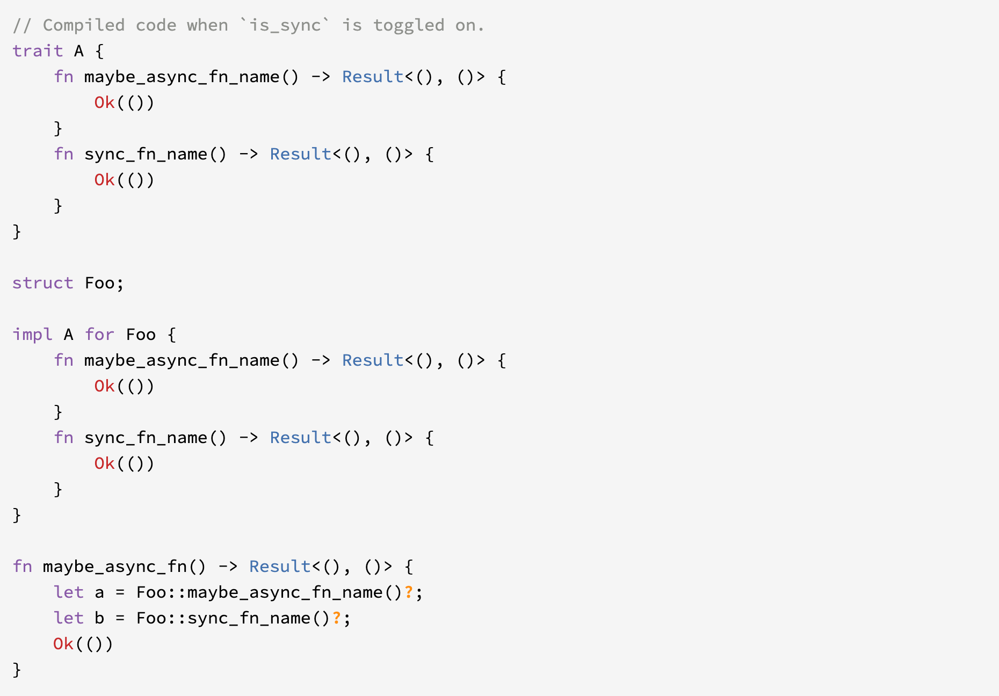

# 18 | 双管齐下，两全其美：编写同时支持同步和异步的代码

你好，我是鸟窝。

在前几节课我们已经学习了 Rust 的异步编程的基本知识，以及第三方的异步运行时，这节课我们讨论作为一个库的开发者的困境：如何开始同时支持同步和异步的 SDK？

## 同步（阻塞）or 异步？

- 这个同步你可以看作是阻塞，并没有严格区分这两个概念的区别。

试想这么一个场景，你想为你的产品提供一个公共的 API，你需要把你的产品特性封装成供用户使用的 API，比如你开发了一个 NoSQL 数据库，需要提供给用户调用的 API。一般情况下，或者几年前，我们认为这是一件很简单的事情，正常把一个个特性实现为对应的 API 即可。

```
但是，async/.await 编程模式突然出现了，这股风潮以及它带来的便利让你不禁想实现一
```

个异步的 API。因为操作数据库涉及大量 I/O 操作，使用异步编程看起来是合理的。

现在，你不得不维护两套代码，一套是同步的代码，一套是异步的代码，这些代码底层的业务逻辑又是类似的，如何有效地同时提供同步和异步的代码呢？这也是 Mario Ortiz Manero 在开发 rspotify 这个库时遇到的困境以及一些总结，这给了我很多的启发，所以我专门单列一节课，结合我的一些经验来介绍它，毕竟有可能我们的一部分工作就是要开发各种 crate，这样就会遇到类似的问题。


## 方案一：复制相同的代码

Mario Ortiz Manero 介绍的第一种方法就是同时创建同步和异步的两个库，然后将异步的代码

```
库复制到同步的代码库即可。因为它使用了 reqwest 这个库，这个库同时支持异步和同步的
调用，所以在同步的代码中只需删除掉 async/.await 等关键字，然后把 reqwest 的导入
改成 reqwest::blocking。
```

这样一来，想同步调用的用户只需导入同步的库，想异步调用的用户只需调用异步的库，就像

```
我们调用 reqwest 不同的模块一样。
```

不过，这个实现问题也不少：整个 crate 的一半代码都被复制了一遍，添加或修改一个特性就意味着要写两遍或删两遍所有东西。除非你把所有东西都测试一遍，否则没法确保两种实现是等效的。你可能说还好，我有完备的单元测试，如果连测试都复制粘贴错了呢！那可怎么办？还有代码审查也需要两次。麻烦不？

```
我们可以看看 reqwest 库中 get 函数的实现，下面是异步的实现：
pub async fn get<T: IntoUrl>(url: T) -> crate::Result<Response> {
   Client::builder().build()?.get(url).send().await
}
而同步的代码如下，可以看到代码几乎是一样的，只不过删除了 async 和 .await 关键字。
pub fn get<T: crate::IntoUrl>(url: T) -> crate::Result<Response> {
   Client::builder().build()?.get(url).send()
}
```

## 方案二：基于异步代码实现同步代码

第二种方法是把所有东西都在异步那边实现。然后，你只需为阻塞接口做个包装，在内部调用

```
block_on。block_on 会运行 future 直到完成，本质上就是把它变成同步的。你仍然需
```

要复制方法的定义，但实现只需写一次：

```javascript
pub fn get<T: crate::IntoUrl>(url: T) -> crate::Result<Response> {
   runtime.block_on(async move {
       Client::builder().build()?.get(url).send().await
    })
}
当然，你必须先初始化一个运行时，比如我们使用 tokio 异步运行时：
let mut runtime = tokio::runtime::Builder::new()
   .basic_scheduler()
   .enable_all()
   .build()
   .unwrap();
这就引出了一个问题：我们应该在每次调用这个 get 函数的时候都初始化运行时，这是不必
```

要的，会带来资源和性能的消耗。那么我们可以把它放在一个全局变量中，或者放在一个特定的结构体中，你还得考虑访问这个运行时的并发问题，一个正确的做法如下：

```
use tokio::runtime::Runtime;
lazy_static! { // You can also use `once_cell`
   static ref RT: Runtime = Runtime::new().unwrap();
}
pub fn get<T: crate::IntoUrl>(url: T) -> crate::Result<Response> {
   RT.handle().block_on(async move {
       Client::builder().build()?.get(url).send().await
    })
}
```

不管怎样，这个解决方案仍然有相当大的开销，这是最被人诟病的一个问题。

同时，这里还是有不少的重复代码，即使只是定义，积少成多也是个问题。这些重复的代码没有太多的代码逻辑，只是薄薄的一层对异步代码的封装而已。

## 方案三：使用 remove-async-await 宏自动生成同步代码

```
remove-async-await 是一个过程宏，用于通过移除 async 和 .await 来使异步函数变为
```

阻塞式。对于具有几乎完全相同的阻塞和异步实现的库，除了需要在某些函数调用上使用

```
.await 之外，这个宏非常有用。
```

举一个例子，假设你希望将异步 API 保持在名为“async”的可选特性之内。异步代码的实现如下，如果开启了“async”可选特性，这两个函数就是异步函数：

```javascript
#[cfg_attr(not(feature = "async"), remove_async_await::remove_async_await)]
async fn get_string() -> String {
   "hello world".to_owned()
}
#[cfg_attr(not(feature = "async"), remove_async_await::remove_async_await)]
pub async fn print() {
   let string = get_string().await;
   println!("{}", string);
}
```

在这个示例中，如果不使用“async”功能，它将扩展为：

```javascript
fn get_string() -> String {
   "hello world".to_owned()
}
pub fn print() {
   let string = get_string();
   println!("{}", string);
}
```

这个宏的好处就是通过宏的方式，根据你选的特性，帮你生成同步或者异步的代码。

这个库提供了 2 个宏：

- remove_async_await：你几乎应该一直使用这个宏。它使用 syn 库来解析 Rust 代码，并

```
从函数中移除 async，从表达式中移除 await。目前，它只能接受函数作为输入。
remove_async_await_string：只有在 remove_async_await 不适用于你的用例时才应
该使用这个宏。这是“愚蠢的宏”；它只是从输入的字符串表示中删除所有出现的 async 和
.await。这意味着虽然它可能适用于除函数以外的其他情况，但你不应该使用它，因为如
```

- 果函数或变量名包含“async”或“.await”，你的代码将中断。

```
不过这个宏只是针对一些常见的场景，通过移除 async 和关键字 await 的方式，而且不会
移除宏内调用（可以理解，移除宏内的 await 可能会导致调用的宏出问题）。
```

尽管这样，如果你的代码只是一些简单的异步调用，也不妨考虑考虑这个宏，毕竟它可以大大简化同时提供异步和同步的代码。

## 方案四：maybe_async 库

```
maybe_async 是另外一个可以根据开关生成同步和异步代码的宏。maybe-async 提供了四
组属性宏：maybe_async、sync_impl/async_impl、
must_be_sync/must_be_async 和 test。
为了使用 maybe-async，我们必须知道哪些代码块仅在阻塞实现中使用，哪些在异步实现中
使用。这两个实现应该共享相同的函数签名，除了 async/await 关键字之外，还需要使用
sync_impl 和 async_impl 来标记这些实现。
在代码中，如果异步和阻塞实现除了 async/await 关键字之外具有相同的 API，则可以使用
maybe_async 宏。并且，使用 Cargo.toml 中的 is_sync 特性开关来切换异步和阻塞代
```

码。

### maybe_async

提供了一个统一的特性开关，通过 is_sync 特性开关按需提供同步和异步转换，并遵循“优先

```
使用异步”的策略。如果想要保留异步代码，可以在依赖项中添加 maybe-async 并使用默认
特性，这意味着 maybe_async 与 must_be_async 相同：
[dependencies]
maybe_async = "0.2"
如果想要将异步代码转换为同步代码，可以在依赖项中添加 maybe-async 并使用 is_sync
特性开关。在这种情况下，maybe_async 与 must_be_sync 相同：
[dependencies]
maybe_async = { version = "0.2", features = ["is_sync"] }
maybe_async 属性有三种用法：
#[maybe_async] 或 #[maybe_async(Send)]：在这种模式下，将 #
[async_trait::async_trait] 添加到 trait 声明和 trait 实现中，以支持 trait 中的
```

- async fn。

```
#[maybe_async(?Send)]：并非所有异步 trait 都需要满足 dyn Future + Send 的
future。在这种模式下，将 #[async_trait::async_trait(?Send)] 添加到 trait 声明
```

- 和 trait 实现中，以避免在异步 trait 方法上放置 “Send” 和 “Sync” 约束。

```javascript
#[maybe_async(AFIT)]：AFIT 是 async function in trait 的缩写，从 Rust 1.74 开始稳
```

- 定。出于兼容性原因，trait 中的 async fn 是通过冗长的 AFIT 标志支持的。这将在下一个主要版本中成为默认模式。

### must_be_async

must_be_async 是保持异步。 must_be_async 属性有三种用法：

```
#[must_be_async] 或 #[must_be_async(Send)]
#[must_be_async(?Send)]
#[must_be_async(AFIT)]
```

### must_be_sync

```
转换为同步代码。通过移除所有 async move、async 和 await 关键字将异步代码转换为
```

同步代码。

### sync_impl

标记的代码块只会在同步版本中编译执行。也就是说，当你在代码中使用这个标记时，只有在

```
is_sync 特性开关设置为 true 的情况下，这段代码才会被编译。
```

### async_impl

```
标记的代码块只会在异步版本中编译执行。只有当 is_sync 特性开关设置为 false 或没有
```

设置时，这段代码才会被编译。async_impl 属性有三种用法：

```
#[async_impl] 或 #[async_impl(Send)]
```

- #[async_impl(?Send)]

- #[async_impl(AFIT)]

```javascript
#[maybe_async::sync_impl]
fn sync_function() {
   // 这里写同步代码，比如直接打印一条消息
   println!("Hello from sync function!");
}
#[maybe_async::async_impl]
async fn async_function() {
   // 这里写异步代码，比如发起一个网络请求
   let response = reqwest::get("https://api.example.com").await?;
   // ...
}
```

test

test 是一个方便的宏，用于统一异步和同步单元测试和端到端测试代码。 你可以指定编译为同步测试代码的条件以及使用给定测试宏（例如 tokio::test、async_std::test 等）编译为异步测试代码的条件。

```javascript
#[maybe_async::test(
   feature="is_sync",
   async(
       all(not(feature="is_sync"), feature="async_std"),
       async_std::test
   ),
   async(
       all(not(feature="is_sync"), feature="tokio"),
       tokio::test
   )
)]
async fn test_async_fn() {
   let res = async_fn().await;
   assert_eq!(res, true);
}
```

举个例子，下面是我们使用这个库实现的同时支持同步和异步的代码：



当 is_sync 开关没有设置的时候，那就是异步代码：



当 is_sync 开关设置了的时候，那就是同步代码：



```
相比于 remove-async-await，这个库的功能更加强大，如果你正在设计复杂的同步和异
```

步代码，更应该关注这个库。

## 方案五：winter-maybe-async 库

Winter maybe-async 是一个 Rust 编程语言的 crate，它提供了一组强大的过程宏，

```
maybe_async 和 maybe_await，能够让你在同步和异步代码之间无缝切换。这意味着你可
```

以编写一套代码，然后根据编译时的配置，将其编译成同步或异步的版本。

### maybe_async

```
maybe_async 宏会根据是否启用了 async 特性，有条件地向其标记的函数添加 async 关
键字。要生成异步版本，请在 crate 上启用 async 特性。如果 async 特性被禁用，则会生成
```

同步版本。例如：

```
// 为trait函数增加`maybe_async`
trait ExampleTrait {
   #[maybe_async]
   fn say_hello(&self);
   #[maybe_async]
   fn get_hello(&self) -> String;
}
// 为正常的函数增加`maybe_async`
#[maybe_async]
fn hello_world() {
   // ...
}
```

当 async 特性开启时，上面的代码转换成：

```
trait ExampleTrait {
   async fn say_hello(&self);
   async fn get_hello(&self) -> String;
}
async fn hello_world() {
   // ...
}
```

### maybe_await

```javascript
为了配合 maybe_async，这个库还提供了 maybe_await 过程宏，它可以根据 async 特性
标志，有条件地在表达式末尾添加 .await 关键字。
#[maybe_async]
fn hello_world() {
   // Adding `maybe_await` to an expression
   let w = maybe_await!(world());
   println!("hello {}", w);
}
#[maybe_async]
fn world() -> String {
   "world".to_string()
}
```

当 async 特性开启时，上面的代码转换成：

```javascript
async fn hello_world() {
   let w = world().await;
   println!("hello {}", w);
}
async fn world() -> String {
   "world".to_string()
}
```

### maybe_async_trait

```
maybe_async_trait 宏可以应用于 trait，它会根据是否启用了 async 特性，有条件地向使
用 #[maybe_async] 注解的 trait 方法添加 async 关键字。当 async 特性启用时，它还会
向 trait 或 impl 代码块应用 #[async_trait::async_trait(?Send)]。
// 给trait增加 `maybe_async_trait`
#[maybe_async_trait]
trait ExampleTrait {
   #[maybe_async]
   fn hello_world(&self);
   fn get_hello(&self) -> String;
}
// 给trait的实现增加maybe_async_trait
#[maybe_async_trait]
impl ExampleTrait for MyStruct {
   #[maybe_async]
   fn hello_world(&self) {
       // ...
   }
   fn get_hello(&self) -> String {
       // ...
   }
}
```

当 async 特性被开启的时候，上面的代码转换为：

```
#[async_trait::async_trait(?Send)]
trait ExampleTrait {
   async fn hello_world(&self);
   fn get_hello(&self) -> String;
}
#[async_trait::async_trait(?Send)]
impl ExampleTrait for MyStruct {
   async fn hello_world(&self) {
       // ...
   }
   fn get_hello(&self) -> String {
       // ...
   }
}
这个库也是一个值得推荐的编写同时支持同步和异步代码的库，尤其是它的宏 maybe_await
```

是一个特色。

## 总结

好了，在这一节课中，我们探讨了 Rust 库开发者面临的挑战：如何同时提供同步和异步的API。随着异步编程的兴起，开发者需要维护两套代码，增加了维护成本和代码重复。这里我们介绍了五种解决方案，旨在用一套代码同时支持同步和异步调用。

这些方案包括：

```
基于异步代码实现同步，通过 block_on 阻塞 future，但开销较大。
使用 remove-async-await 宏，通过移除 async 和 .await 自动生成同步代码，适用
```

- 于简单场景

```
使用 maybe_async 库，通过特性开关和宏提供更强大的同步 / 异步代码生成能力。
使用 winter-maybe-async 库，提供 maybe_async、maybe_await 和
maybe_async_trait 宏，更方便地进行同步 / 异步代码的切换和 trait 的支持。
```

## 思考题

```
请使用方案三、方案四或者方案五，访问 reqwest 的 get 函数，一套代码同时支持同步和
```

异步的 API。欢迎你把你试验的结果分享到留言区，和我一起讨论，也欢迎你把这节课的内容分享给需要的朋友，我们下节课再见！
