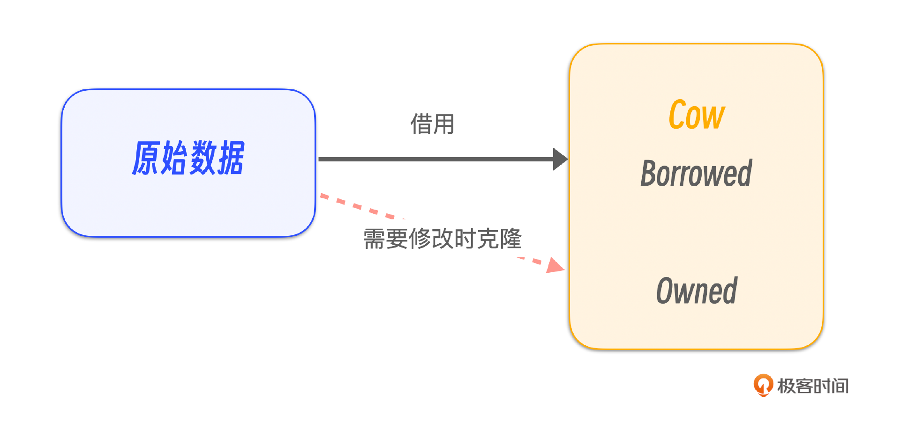
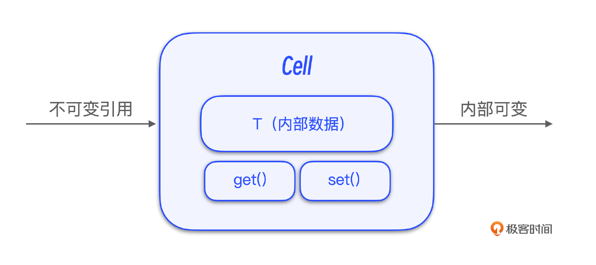

# 19 | 海纳百川，有容乃大：并发容器（上）

你好，我是鸟窝。

从这节课开始，我们将进入新的篇章，重点学习 Rust 中标准库的同步原语。

Rust 的同步原语体系丰富而强大，为了便于系统性理解，我们可以将其分为几种类型分别进行讲解。接下来这两节课将重点介绍容器类（或者叫做包装类）并发原语，它们的共同特点是

```
通过对普通数据的包装，来提供更丰富的功能特性。这些容器包括 Cow、Box、Cell、
RefCell、OnceCell、LazyCell、Rc和Arc 等。它们很多都不是线程安全的，但是常常
```

会在并发程序中使用。

- 本节课的内容比较详细，内容很多，所以我分成两节课来介绍。

有些文章把它们叫做智能指针，我认为叫什么都不重要，重要的是我们能够了解它们并且能够熟练运用。

```
这些容器类并发原语各具特色：Cow（Clone-on-Write）提供了写时克隆的能力，可以在需要
修改数据时才进行复制，从而优化性能；beef::Cow 则是对标准库 Cow 的一个优化实现。
Box 作为 Rust 中最基础的智能指针，将数据存储在堆上；而 Cell 和 RefCell 则提供了内
```

部可变性，使得我们能够在不可变引用的情况下修改数据。

```
在延迟初始化方面，OnceCell、LazyCell 提供了不同层次的支持。OnceCell 确保值只
被初始化一次；LazyCell 则在第一次访问时才进行初始化。在共享数据方面，Rc（引用计
数）允许在单线程环境下安全地共享数据，而 Arc（原子引用计数）则通过原子操作提供了
```

线程安全的共享机制，使得数据可以安全地在多个线程间传递和访问。

这些容器虽然功能各异，但都遵循 Rust 的所有权系统和借用规则，在提供额外功能的同时确保了内存安全和线程安全。通过合理使用这些容器，我们可以更优雅地处理复杂的并发场景，

```
实现更高效的资源管理。值得注意的是，Rc 和 Arc 虽然都提供了共享所有权的能力，但
Arc 因为使用原子操作而有额外的性能开销，因此在单线程环境下应优先使用 Rc。
```

这些容器类并发原语的设计体现了 Rust 在类型系统和内存管理上的深思熟虑。它们不仅提供了强大的功能，还通过编译时检查确保了使用的正确性。理解并掌握这些容器的使用，是构建高质量 Rust 并发程序的基础。

## Cow

Cow（Clone-on-Write）是 Rust 标准库中提供的一个智能指针类型，全称为

```
std::borrow::Cow，是一种提供写时复制功能的智能指针。它是一个枚举类型，可以持有
```

数据的借用或者拥有的版本。Cow 的独特之处在于它只在需要修改数据时才会克隆数据，这使得它在处理只读场景时非常高效。



```
该类型旨在通过 Borrow trait 处理通用的借用数据。Cow 实现了 Deref，这意味着你可以直
接在其封装的数据上调用非修改方法。如果需要修改，to_mut 将获取一个可变引用的所有权
值，并在必要时进行克隆。而在需要引用计数指针的场景下，请注意 Rc::make_mut 和
Arc::make_mut 也可以提供按需克隆功能。
Cow 的定义如下：
pub enum Cow<'a, B>
where
   B: 'a + ToOwned + ?Sized,
{
   Borrowed(&'a B),
   Owned(<B as ToOwned>::Owned),
}
Borrowed：持有数据的引用。
Owned：持有数据的所有权。
```

### 创建 Cow

```javascript
下面这个例子演示了三种生成 Cow 类型的不同方式：
use std::borrow::Cow;
fn main() {
  // 从借用创建
  let borrowed: Cow<str> = Cow::Borrowed("hello");
  println!("is_borrowed: {}, is_owned: {}", borrowed.is_borrowed(),borrowed.is_o
  // 从拥有的数据创建
  let owned: Cow<str> = Cow::Owned(String::from("hello"));
  println!("is_borrowed: {}, is_owned: {}", owned.is_borrowed(),owned.is_owned()
  // 从引用创建（自动选择）
  let text = "hello";
  let cow: Cow<str> = text.into();
  println!("is_borrowed: {}, is_owned: {}", cow.is_borrowed(),cow.is_owned()); /
}
```

### into_owned 方法

这个方法将获取所有权数据。若数据当前为借用状态，则执行克隆操作。

下面这个例子是原数据处于借用状态，所以会执行克隆操作：

```javascript
use std::borrow::Cow;
let s = "Hello world!";
let cow = Cow::Borrowed(s);
assert_eq!(cow.into_owned(),String::from(s));
下面这个例子原数据是有所有权的，所以直接从 Cow move 出去，不需要克隆操作：
use std::borrow::Cow;
let s = "Hello world!";
let cow: Cow<'_, str> = Cow::Owned(String::from(s));
assert_eq!(cow.into_owned(),String::from(s));
```

### to_mut 方法

取得数据所有权形式的可修改引用。若数据当前为借用状态，则执行克隆操作。

下面这个例子取得数据的所有权，并返回了它的可修改引用，并修改为大写字母。

```javascript
let mut cow = Cow::Borrowed("foo");
cow.to_mut().make_ascii_uppercase();
assert_eq!(cow, Cow::Owned(String::from("FOO")) as Cow<'_, str>);
assert_eq!(true, cow.is_owned());
使用 Cow 时，不要过早地进行克隆，这就失去了 Cow 的意义。
// 不好的做法
let cow:Cow<str>=Cow::Owned(string.clone());
// 好的做法
let cow:Cow<str>= string.into();
而且，一般情况下，如果你不需要修改，就不要调用 to_mut 方法。
// 不好的做法
cow.to_mut();// 即使不修改也会克隆
// 好的做法
if need_modification {
 cow.to_mut().push_str("suffix");
}
```

## beef::Cow

```
beef::Cow 是一个比标准库 Cow 更快、更紧凑的实现。该 crate 包含了两个版本的 Cow：
beef::Cow 是 3 个字宽：指针、长度和容量。它将所有权标签存储在容量中。
beef::lean::Cow 是 2 个字宽，将长度、容量和所有权标签都存储在一个字中。
```

官方称 beef::Cow 的两个版本都比 std::borrow::Cow 更精简，但实际上标准库中的 Cow 同样是三个字宽。由于 beef 库已有两年未更新，而 Rust 标准库在持续发展，这种说法可能存在一定局限性。

```javascript
   const WORD: usize = size_of::<usize>();
   assert_eq!(size_of::<std::borrow::Cow<str>>(), 3 * WORD);
   assert_eq!(size_of::<beef::Cow<str>>(), 3 * WORD);
   assert_eq!(size_of::<beef::lean::Cow<str>>(), 2 * WORD);
它的使用方法和标准库中的 Cow 使用方法类似：
use beef::Cow;
let borrowed: Cow<str> = Cow::borrowed("Hello");
let owned: Cow<str> = Cow::owned(String::from("World"));
assert_eq!(
   format!("{} {}!", borrowed, owned),
   "Hello World!",
);
```

## Box

```
Box 是 Rust 标准库中最简单也是最常用的智能指针。它提供了最基础的堆内存分配能力，允
许我们将数据存储在堆上而不是栈上。Box 的所有权语义遵循 Rust 的基本规则：当 Box 离
开作用域时，它的析构函数会被调用，Box 所指向的堆内存会被自动释放。
```

Box 类型拥有下面的特点：

- 堆内存分配：Box 的最基本特点是提供堆内存分配能力。

```javascript
// 在栈上分配
let stack_data = 42;
// 在堆上分配
let heap_data = Box::new(42);
// 堆上分配大型数据结构
let large_array = Box::new([0; 1000000]); // 在堆上分配大数组
```

- 零运行时开销：除了堆分配外没有额外开销。

没有额外的运行时开销：

```
usestd::mem::size_of;
// 在64位系统上
assert_eq!(size_of::<Box<i32>>(),size_of::<usize>());// 通常是8字节
```

直接映射到裸指针:

```javascript
let boxed =Box::new(42);
let raw_ptr =Box::into_raw(boxed);
let back_to_box =unsafe{Box::from_raw(raw_ptr)};
```

- 实现了 Deref/DerefMut 特质：允许透明地访问内部值。

```javascript
struct MyStruct {
   value: i32,
}
impl MyStruct {
   fn get_value(&self) -> i32 {
       self.value
   }
}
let my_box = Box::new(MyStruct { value: 42 });
// 无需显式解引用就能调用方法
let val = my_box.get_value();
// 显式解引用也可以
let val = (*my_box).get_value();
// 可以直接访问字段
println!("Value: {}", my_box.value);
```

```javascript
所有权语义：Box 遵循 Rust 的所有权规则。
fn take_ownership(boxed: Box<i32>) {
   println!("Value: {}", *boxed);
} // boxed在这里被释放
fn main() {
   let my_box = Box::new(42);
   take_ownership(my_box);
   // println!("{}", *my_box); // 编译错误：my_box已被移动
}
```

下面是借用的规则：

```javascript
fn borrow_box(boxed: &Box<i32>) {
   println!("Borrowed value: {}", **boxed);
}
fn mut_borrow_box(boxed: &mut Box<i32>) {
   **boxed += 1;
}
fn main() {
   let mut my_box = Box::new(42);
   borrow_box(&my_box);
   mut_borrow_box(&mut my_box);
}
编译时大小确定性：因此 Box 允许创建递归和动态大小类型。
// 递归类型
enum List {
   Cons(i32, Box<List>),
   Nil,
}
// 动态大小类型
trait Animal {
   fn make_sound(&self);
}
struct Dog;
impl Animal for Dog {
   fn make_sound(&self) {
       println!("Woof!");
   }
}
// 可以创建特质对象
let animal: Box<dyn Animal> = Box::new(Dog);
Drop 语义：Box 实现了 Drop 特质，确保资源正确释放。
struct CustomType {
   data: String,
}
impl Drop for CustomType {
   fn drop(&mut self) {
       println!("Dropping CustomType with data: {}", self.data);
   }
}
fn main() {
   let boxed = Box::new(CustomType {
       data: "hello".to_string(),
   });
   // 当boxed离开作用域时，
   // 1. 首先调用CustomType的drop
   // 2. 然后释放堆内存
}
线程间传递：如果Box内容是 Send，Box 可以在线程间安全传递。
use std::thread;
fn main() {
   let boxed = Box::new(42);
   let handle = thread::spawn(move || {
       println!("Value in new thread: {}", *boxed);
   });
   handle.join().unwrap();
}
```

## Cell、RefCell、OnceCell 和 LazyCell

### Cell

Rust 的所有权与借用系统是其安全性与线程安全性的核心。然而，有时候我们需要在不违反

```
借用规则的情况下修改数据。这就是内部可变性（Interior Mutability）的概念，而 Cell<T>
```

是实现这一概念的基础类型之一。



```
Cell<T> 是 Rust 标准库中的一个类型，位于 std::cell 模块，它提供了一种在拥有不可
变引用的同时修改其内部值的方法。简单来说，Cell<T> 允许我们“绕过”借用检查器的某些
```

限制，但仍然保持内存安全。通过将值移入和移出单元格来实现内部可变性。

在 Rust 中，如果你有一个不可变引用（&T），你不能通过它修改数据。这是 Rust 借用规则的核心部分。但有时，我们需要修改某个字段，同时保持结构体的其他部分不可变。这就有了

```javascript
Cell<T> 的用武之地。
struct Counter {
   value: Cell<i32>,
}
impl Counter {
   fn new() -> Self {
       Counter { value: Cell::new(0) }
   }
   fn increment(&self) {
       let current = self.value.get();
       self.value.set(current + 1);
   }
}
在上面的例子中，尽管 increment 方法接收的是 &self（不可变引用），但我们仍然可以修
改 value 字段，因为它被包裹在 Cell 中。
Cell 就像一个特殊的透明保险柜。想象一下，这个保险柜有一个特殊设计——它的外壳是完
```

全透明的，让你可以看见里面存放的物品，就像你可以通过不可变引用“看到”Cell 中的值，但它有一个特殊的机制：

- 对于小物品（实现了 Copy 特性的类型），保险柜有一个自动复制装置。当你想取出物品

```
时，它会自动复制一份给你，而原物品依然安全地保存在里面，这就是 get() 方法。
```

- 对于任何物品，保险柜有一个特殊的投递口。你可以通过这个口把新物品放进去，同时旧物

```
品会被替换出来，这就是 replace() 方法。
```

- 有时你只想更新里面的物品，不需要取出来。这时候，你可以通过一个特殊的操作窗口修改

```sql
物品，这就是 update() 方法。
```

- 最特别的是，即使你只有这个保险柜的查看权限（不可变引用），你依然可以通过这些机制改变里面的内容。

这个保险柜只能放在一个房间里（单线程环境），如果你想在多个房间之间共享，就需要使用更复杂的保险系统（比如 Mutex）。而且，对于大型物品（没有实现 Copy 特性的类型），你不能直接复制，需要使用一个更高级的保险柜（RefCell）。

```
Cell<T> 适用于以下场景：
```

- 需要内部可变性：当你想在拥有不可变引用的同时修改数据。

```
简单数据类型：Cell<T> 最适合用于实现了 Copy 特性的类型，如整数、浮点数、布尔值
等，虽然实际上 T 并没有限制。
非线程安全场景：Cell<T> 不是线程安全的，它仅适用于单线程环境。
避免借用检查冲突：在可能出现多个可变借用的情况下，使用 Cell<T> 可以避免编译错
```

- 误。

```
接下来让我们学习 Cell<T> 的使用方法。
```

1. new 创建新的 Cell

```javascript
创建一个新的 Cell，其中包含给定的值。
// 创建新的Cell
let c = Cell::new(5);
```

2. get 获取 Cell 中的值

返回所包含值的副本：

```javascript
let c = Cell::new(5);
let value = c.get(); // 返回5
```

如果包含的类型 T 没有实现 Copy 特质，那么调用 get 方法时编译失败：

```javascript
use std::cell::Cell;
fn main() {
   let my_cell = Cell::new(String::from("hello")); // String 没有实现 Copy
   let value = my_cell.get(); // 编译错误！
   println!("Value: {}", value);
}
```

3. get_mut 返回底层数据的可变引用

```javascript
此调用（在编译时）可变地借用 Cell，这保证了我们拥有唯一的引用。但是请注意：此方法
期望 self 是可变的，通常在使用 Cell 时不是这种情况。如果需要通过引用进行内部可变
性，你可以考虑使用 RefCell，它通过其 borrow_mut 方法提供运行时检查的可变借用。
use std::cell::Cell;
let mut c = Cell::new(5);
*c.get_mut() += 1;
assert_eq!(c.get(), 6);
```

所以如果你没有特殊的需求，这个方法你直接忽略就好。

```
反向操作就是 from_mut 方法：从 &mut T 返回 &Cell<T>。
```

4. set 设置 Cell 的新值

```javascript
let c = Cell::new(5);
c.set(10); // 现在c包含10
```

5. update 使用函数更新包含的值，并返回新值

```sql
let c = Cell::new(5);
c.update(|x| x + 1); // c现在包含6
```

6. replace 获取并替换值

```javascript
用 val 替换内部值，并返回被替换的值。
let c = Cell::new(5);
let old_value = c.replace(10); // 返回5，c现在包含10
```

7. swap 交换两个 Cell 的值

```
与 std::mem::swap 的区别在于，此函数不需要 &mut 可变引用。
如果 self 和 other 是部分重叠的不同 Cell，则此函数会引发恐慌。仅使用标准库方法，
不可能创建这种部分重叠的 Cell。但是，允许不安全代码创建例如两个部分重叠的
&Cell<[i32; 2]>。
```

8. take 取出 Cell 的值

```javascript
获取单元格的值，并将单元格替换为 Default::default()。
use std::cell::Cell;
let c = Cell::new(5);
let five = c.take();
assert_eq!(five, 5);
assert_eq!(c.into_inner(), 0);
```

9. into_inner 获取底层数据

提取值，并销毁单元格。

```javascript
use std::cell::Cell;
let c = Cell::new(5);
let five = c.into_inner();
assert_eq!(five, 5);
还有仅限 Nightly 版本的实验性 API，它能将元素为T的数组或者切片转换成 Cell<T> 的数据
```

和切片。

```
as_ptr 返回指向此单元格底层数据的原始指针。
Cell<T> 的大小基本上就是 T 的大小，没有显著的内存开销。可以通过
std::mem::size_of 来验证：
use std::cell::Cell;
use std::mem::size_of;
fn main() {
   println!("size of i32: {}", size_of::<i32>());  // 通常是4字节
   println!("size of Cell<i32>: {}", size_of::<Cell<i32>>()); // 也是4字节
}
```

### RefCell

```
RefCell 是内部可变性类型的另一个实现。在标准的 Rust 借用规则下，如果你有一个不可
```

变引用（&T），你不能通过它修改数据。但在某些情况下，我们确实需要这样的能力，例如：

- 当一个对象的方法需要修改自身，但该方法只接受不可变引用（&self）时；

- 在实现某些特定的数据结构（如缓存、图等）时；

- 当我们希望有选择地违反借用规则，但仍然保证安全时。

以下是一个简单的例子：

```
struct Logger {
   messages: RefCell<Vec<String>>,
}
impl Logger {
   fn new() -> Self {
       Logger {
           messages: RefCell::new(Vec::new()),
       }
   }
   fn log(&self, message: &str) {
       self.messages.borrow_mut().push(message.to_string());
   }
   fn get_messages(&self) -> Vec<String> {
       self.messages.borrow().clone()
   }
}
在这个例子中，尽管 log 方法只接受不可变引用（&self），我们仍然可以修改 messages 字
段，因为它被包裹在 RefCell 中。
RefCell 就像一个更先进的保险柜，拥有以下特点：
```

- 智能访问控制系统：这个保险柜不像 Cell 那样简单透明，而是配备了一个复杂的访问控制系统。它会记录谁正在访问保险柜内容，以及访问的方式（查看还是修改）。

- 双模式访问：保险柜有两种开启模式。

```
查看模式（borrow()）：可以同时发放多张查看卡，允许多人同时查看内容，但不能修
```

- 改。

```
修改模式（borrow_mut()）：只能发放一张修改卡，允许持卡人修改内容，但此时不能
```

- 发放任何查看卡。

- 动态警报系统：如果有人试图违反规则，例如，在已经有人拿到修改卡的情况下再请求查看卡，保险柜会立即触发警报（panic）。

- 通用存储能力：与只适合存放小物品（Copy 类型）的 Cell 不同，RefCell 可以安全地存放任何大小和类型的物品。

- 访问凭证：当你请求访问保险柜时，它不会像 Cell 那样直接给你物品的副本，而是发给你一个特殊的访问凭证（Ref 或 RefMut），让你通过这个凭证来访问或修改内容。

- 自动凭证回收：当你用完访问凭证离开时，系统会自动收回凭证，重置柜内物品的访问状态。

- 访问检查开销：这种智能系统需要额外的电力和计算能力来运行（运行时检查开销），这是相比简单透明保险柜（Cell）的一个缺点。

与 Cell 类似，这种保险柜也只能安装在一个安全室内（单线程环境）。如果需要在多个安全室之间共享，则需要更高级的带锁保险系统（如 Mutex）。

```
RefCell<T> 适用于以下场景：
```

- 需要内部可变性：当你需要在拥有不可变引用的同时修改数据。

```
单线程环境：RefCell<T> 不是线程安全的，只适用于单线程环境。
```

- 需要运行时借用检查：当编译时借用检查太严格，而你确信你的代码是安全的。

```
接下来让我们学习 RefCell<T> 的使用方法。
```

1. new 创建新的 RefCell

```javascript
// 创建新的RefCell
let ref_cell = RefCell::new(5);
```

2. borrow 借用内部值（不可变借用）

```javascript
let ref_cell = RefCell::new(5);
let borrowed = ref_cell.borrow(); // 返回Ref<T>
println!("Value: {}", *borrowed);
```

3. borrow_mut 可变借用内部值

```javascript
let ref_cell = RefCell::new(5);
let mut borrowed_mut = ref_cell.borrow_mut(); // 返回RefMut<T>
*borrowed_mut += 1;
println!("New value: {}", *borrowed_mut);
borrow_mut() 返回 RefMut<T>，也实现了 Deref和DerefMut 特性。
use std::cell::RefCell;
fn main() {
   let data = RefCell::new(vec![1, 2, 3]);
   // 获取RefMut<Vec<i32>>
   let mut data_ref_mut = data.borrow_mut();
   // 使用Deref特性访问内部值
   println!("Vector length: {}", data_ref_mut.len());  // 等同于 (*data_ref_mut).
   // 使用DerefMut特性修改内部值
   data_ref_mut.push(4);  // 等同于 (*data_ref_mut).push(4)
   // 现在vector是[1, 2, 3, 4]
   println!("Vector: {:?}", *data_ref_mut);
}
```

4. try_borrow 尝试借用（不会 panic）

```javascript
let ref_cell = RefCell::new(5);
let borrow_result = ref_cell.try_borrow(); // 返回Result<Ref<T>, BorrowError>
if let Ok(borrowed) = borrow_result {
   println!("Successfully borrowed: {}", *borrowed);
} else {
   println!("Failed to borrow");
}
```

5. try_borrow_mut 尝试可变借用（不会 panic）

```javascript
let ref_cell = RefCell::new(5);
let borrow_mut_result = ref_cell.try_borrow_mut(); // 返回Result<RefMut<T>, Borrow
if let Ok(mut borrowed) = borrow_mut_result {
   *borrowed += 1;
   println!("Successfully mutably borrowed: {}", *borrowed);
} else {
   println!("Failed to mutably borrow");
}
```

6. as_ptr 获取内部值的可变引用（不检查借用规则）

```javascript
let ref_cell = RefCell::new(5);
let value = unsafe { &mut *ref_cell.as_ptr() };
*value += 1;
println!("Value: {}", ref_cell.borrow());
```

7. into_inner 消费 RefCell 并返回内部值

```javascript
let ref_cell = RefCell::new(5);
let value = ref_cell.into_inner(); // 返回5
```

8. 获取 RefCell 内部的借用状态

```javascript
let ref_cell = RefCell::new(5);
let _borrow = ref_cell.borrow_mut();
println!("Borrow state: {:?}", ref_cell.try_borrow()); // Prints: Err(BorrowError
```

```
同样的，RefCell<T> 提供了和 Cell<T> 类似的方法，比如 get_mut、swap、take、
replace 以及新增加的 replace_with 等，这里就不再赘述了，我只介绍新的
replace_with。
```

9. replace_with 使用函数替换包含的值，并返回新值

```
使用 f 计算出的新值替换封装的值，返回旧值，且不进行任何值的析构。
```

- 不清楚为啥不和 Cell 的 update 方法名保持一致。

```javascript
use std::cell::RefCell;
let cell = RefCell::new(5);
let old_value = cell.replace_with(|&mut old| old + 1);
assert_eq!(old_value, 5);
assert_eq!(cell, RefCell::new(6));
OnceCell、LazyCell、Rc 的介绍我们放在下一节课中介绍。
```

## 总结

```
好了，在这一节课中，我们相当全面地了解了 Cow、Box、Cell、RefCell 几种容器（包
```

装器）。只有熟悉这些数据结构的功能和应用场景，你才会得心应手地使用它们。

下面是这几种常用数据类型的功能与应用场景的概览：

## 思考题

你正在实现一个日志过滤器模块，它的功能是扫描一段日志内容，并将所有敏感词替换成星号。

```
例如敏感词是："ERROR"、"PANIC"，日志内容是："System ERROR occurred.
Please check for PANIC."，处理后应为："System ***** occurred. Please
check for *****."
```

关键要求

```
如果日志内容不包含敏感词，直接返回原始日志内容的引用（Borrowed），不拷贝。
如果日志内容包含敏感词，返回一个新字符串（Owned），其中敏感词已替换。
```

- 敏感词可能非常多，因此函数要支持传入一个动态敏感词列表，而不是写死。

方法签名

```
fn filter_sensitive<'a>(log: &'a str, sensitive_words: &[&str]) -> std::borrow::C
```

示例

```javascript
let log = "System ERROR occurred. Please check for PANIC.";
let sensitive = &["ERROR", "PANIC"];
assert_eq!(
   filter_sensitive(log, sensitive),
   Cow::Owned("System ***** occurred. Please check for *****.".to_string())
);
let clean_log = "All systems operational.";
assert_eq!(
   filter_sensitive(clean_log, sensitive),
   Cow::Borrowed("All systems operational.")
);
```

欢迎你把你实现的结果分享到留言区，如果你觉得这节课的内容对你有帮助的话，也欢迎你分享给需要的朋友，我们下节课再见！
