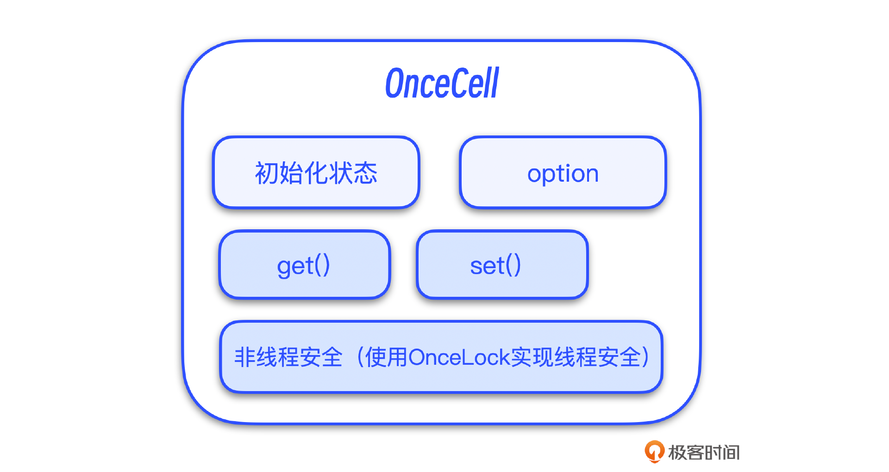
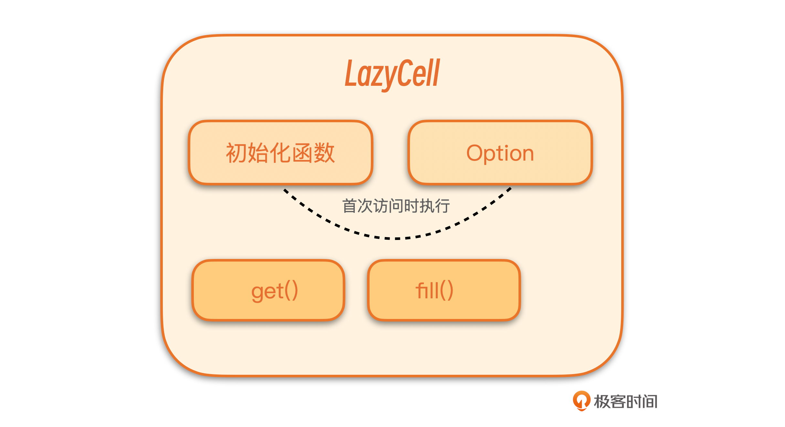
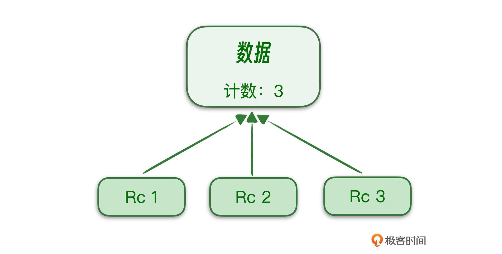
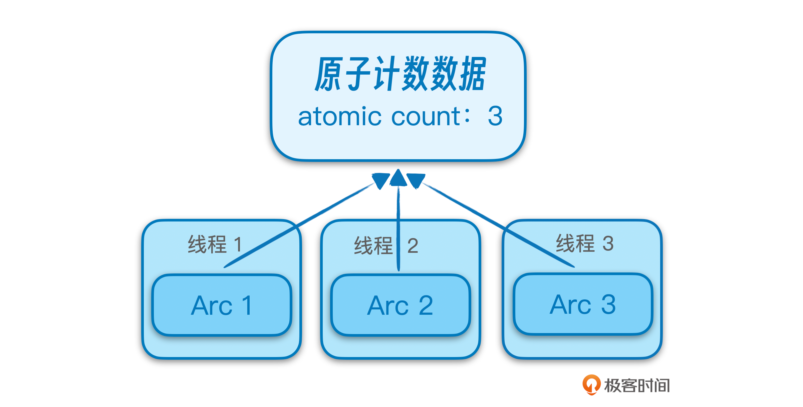
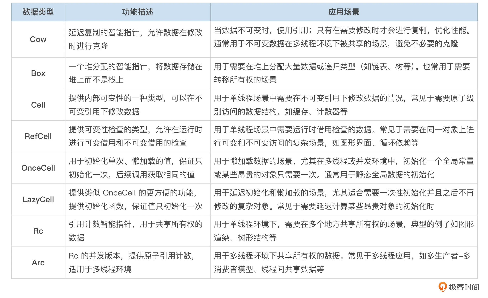
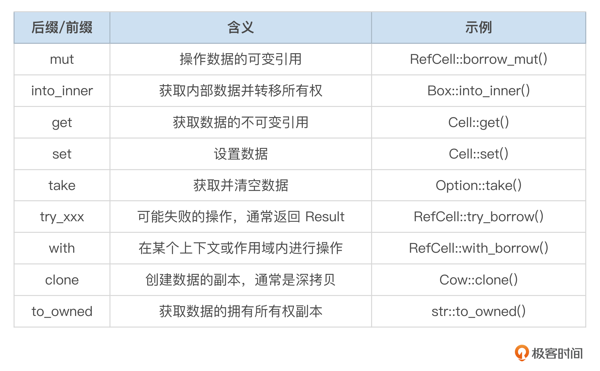

# 20 | 海纳百川，有容乃大：并发容器（下）

你好，我是鸟窝。

```
这一节我们继续学习其它的并发容器，包括 OnceCell、LazyCell 和 Rc。
```

## OnceCell 和 LazyCell

### OnceCell

```
OnceCell<T> 在某种程度上是 Cell 和 RefCell 的混合体，它适用于通常只需要设置一次
的值。这意味着可以获得内部值的引用 &T，而无需移动或复制它（与 Cell 不同），也无需运
行时检查（与 RefCell 不同）。然而，一旦设置了它的值，就无法更新它，除非你拥有
OnceCell 的可变引用。
```



```javascript
下面是一个简单的使用 OnceCell<T> 的例子：
use std::cell::OnceCell;
fn main() {
   let cell = OnceCell::new();
   assert!(cell.get().is_none());
   let value: &String = cell.get_or_init(|| {
       "Hello, World!".to_string()
   });
   assert_eq!(value, "Hello, World!");
   assert!(cell.get().is_some());
}
```

这个类型也比较简单，我们重点学习它的设置或者获取方法，也就是写和读操作。

```javascript
new 创建一个新的 OnceCell。创建一个新的 OnceCell<T> 实例，还未初始化过。
set 设置单元格的值。将单元格的内容设置为 value。如果单元格为空，此方法返回
Ok(())；如果单元格已满（即已被设置），则返回 Err(value)。
use std::cell::OnceCell;
let cell = OnceCell::new();
assert!(cell.get().is_none());
assert_eq!(cell.set(92), Ok(()));
assert_eq!(cell.set(62), Err(62));
assert!(cell.get().is_some());
take 取走单元格的值。从 OnceCell 中取出值，将其恢复到未初始化的状态。如果
OnceCell 尚未初始化，则不产生任何影响并返回 None。通过要求可变引用来保证安全
性，也就是说调用这个方法的时候，要求单元格是可变引用 &mut self。
pub fn take(&mut self) -> Option<T>
try_insert 尝试设置单元格的值。如果单元格为空，则将 value 设置到单元格中，并返回
包含该值引用的 Ok(&value)；如果单元格已满（即已被设置），则返回
Err(&current_value, value)。
```

上面是修改单元格的值的方法，接下来我们看看读取单元格的值的方法。

```
get 获取单元格的值的引用，获取底层值的引用。如果单元格为空，则返回 None。
```

6. get_mut 获取单元格的值的可变引用，获取底层值的可变引用。如果单元格为空，则返回

```
None。
```

7. get_or_init 获取单元格的值引用或者初始化。获取单元格的内容，如果单元格为空，则用

```
f 初始化它。如果 f 发生恐慌，恐慌将被传播给调用者，并且单元格保持未初始化状态。
从 f 中递归地重新初始化单元格是一个错误。这样做会导致恐慌。
```

8. get_or_try_init 获取单元格的值引用或者尝试初始化。获取单元格内容的可变引用，如果

```javascript
单元格为空，则用 f 初始化它。如果单元格为空且 f 初始化失败，则返回一个错误。如果
f 发生恐慌，恐慌将被传播给调用者，并且单元格保持未初始化状态。
#![feature(once_cell_get_mut)]
use std::cell::OnceCell;
let mut cell: OnceCell<u32> = OnceCell::new();
// Failed initializers do not change the value
assert!(cell.get_mut_or_try_init(|| "not a number!".parse()).is_err());
assert!(cell.get().is_none());
let value = cell.get_mut_or_try_init(|| "1234".parse());
assert_eq!(value, Ok(&mut 1234));
let Ok(value) = value else { return; };
*value += 2;
assert_eq!(cell.get(), Some(&1236))
```

9. get_mut_or_init 获取单元格的值可变引用或者初始化。获取单元格内容的可变引用，如果

```
单元格为空，则用 f 初始化它。如果 f 发生恐慌，恐慌将被传播给调用者，并且单元格保
```

- 持未初始化状态。

```javascript
#![feature(once_cell_get_mut)]
use std::cell::OnceCell;
let mut cell = OnceCell::new();
let value = cell.get_mut_or_init(|| 92);
assert_eq!(*value, 92);
*value += 2;
assert_eq!(*value, 94);
let value = cell.get_mut_or_init(|| unreachable!());
assert_eq!(*value, 94);
```

10. get_mut_or_try_init 获取单元格的值可变引用或者尝试初始化。获取单元格内容的可变引

```
用，如果单元格为空，则用 f 初始化它。如果单元格为空且 f 初始化失败，则返回一个错
误。如果 f 发生恐慌，恐慌将被传播给调用者，并且单元格保持未初始化状态。
```

11. into_inner 获取单元格的包装的值。消耗（Consume）该单元格，返回被包装的值。如果

```javascript
单元格为空，则返回 None。
use std::cell::OnceCell;
let cell: OnceCell<String> = OnceCell::new();
assert_eq!(cell.into_inner(), None);
let cell = OnceCell::new();
let _ = cell.set("hello".to_owned());
assert_eq!(cell.into_inner(), Some("hello".to_owned()));
```

### LazyCell

想象一下，你有一个程序，它需要用到一些数据，但这些数据可能只有在特定情况下才会被用

```
到。如果每次程序启动都立即加载这些数据，就会浪费时间和资源。OnceCell 和
LazyCell 就是用来解决这个问题的。
```

OnceCell：只初始化一次的“盒子”

```
OnceCell 就像一个“盒子”，你可以把数据放进去，但只能放一次。如果你尝试放第二次，它
```

就会报错。它很有用，当你需要确保某个数据只被初始化一次，并且在之后可以随时访问它的时候。简单来说，就是这个盒子只能被初始化一次，而且如果初始化的函数如果发生错误，那么这个盒子会保持未初始化的状态。

LazyCell：自动初始化的“盒子”

```
LazyCell 是 OnceCell 的一个更方便的版本。它不仅是一个“盒子”，还带有一个“初始化函
数”。当你第一次尝试从 LazyCell 中获取数据时，它会自动调用这个初始化函数来生成数
```

据，并把数据放入“盒子”里。以后每次你再尝试获取数据时，它就直接给你“盒子”里的数据，

```
而不会再次调用初始化函数。LazyCell 就像一个“懒人”盒子，只有在你需要的时候才会去准
```

备数据。它通过一个 Deref 的实现，让使用者在获取数据的时候，就像直接操作数据一样，而不需要关注初始化的过程。



它的方法也很少，下面我逐一介绍它们。

1. new 创建一个 LazyCell。使用给定的初始化函数创建一个新的惰性求值（lazy）。

```javascript
use std::cell::LazyCell;
let hello = "Hello, World!".to_string();
let lazy = LazyCell::new(|| hello.to_uppercase());
assert_eq!(&*lazy, "HELLO, WORLD!");
```

2. force 强制求值的引用。强制求这个惰性求值（lazy），并返回结果的引用。这等同于

```
Deref 的实现，但更加明确。
```

```javascript
use std::cell::LazyCell;
let lazy = LazyCell::new(|| 47);
assert_eq!(LazyCell::force(&lazy), &47);
assert_eq!(&*lazy, &47);
```

3. force_mut 强制求可变引用。强制求这个惰性求值（lazy），并返回结果的可变引用。

```javascript
#![feature(lazy_get)]
use std::cell::LazyCell;
let mut lazy = LazyCell::new(|| 92);
let p = LazyCell::force_mut(&mut lazy);
assert_eq!(*p, 92);
*p = 47;
assert_eq!(*lazy, 47);
get 返回值的引用。如果已初始化，则返回值的引用，否则返回 None。
#![feature(lazy_get)]
use std::cell::LazyCell;
let lazy = LazyCell::new(|| 92);
assert_eq!(LazyCell::get(&lazy), None);
let _ = LazyCell::force(&lazy);
assert_eq!(LazyCell::get(&lazy), Some(&92));
get_mut 返回可变引用。如果已初始化，则返回值的可变引用；否则返回 None。
#![feature(lazy_get)]
use std::cell::LazyCell;
let mut lazy = LazyCell::new(|| 92);
assert_eq!(LazyCell::get_mut(&mut lazy), None);
let _ = LazyCell::force(&lazy);
*LazyCell::get_mut(&mut lazy).unwrap() = 44;
assert_eq!(*lazy, 44);
into_inner 返回包装的值。消耗（Consume）这个 LazyCell，返回存储的值。如果
Lazy 已初始化，则返回 Ok(value)；否则返回 Err(f)。
#![feature(lazy_cell_into_inner)]
use std::cell::LazyCell;
let hello = "Hello, World!".to_string();
let lazy = LazyCell::new(|| hello.to_uppercase());
assert_eq!(&*lazy, "HELLO, WORLD!");
assert_eq!(LazyCell::into_inner(lazy).ok(), Some("HELLO, WORLD!".to_string()));
```

## Rc

Rust 的所有权系统是其最独特的特性之一，它在编译时保证内存安全而无需垃圾收集器。然

```
而有些情况下，单一所有权模型可能过于严格。这就是 Rc<T>（引用计数，Reference
```

Counting）智能指针发挥作用的地方。



```
Rc<T> 允许一个值有多个所有者，通过跟踪引用计数来决定何时清理值。当最后一个指向数
据的 Rc<T> 被丢弃时，数据才会被清理。Rc<T> 是 Rust 标准库中非常重要的一部分，特别
```

是在构建复杂数据结构如树、图等时。

- 引用计数是一种内存管理技术，它通过记录对特定资源的引用数量来跟踪该资源的生命周期。每当创建一个新的引用，计数器增加；每当引用离开作用域，计数器减少。当计数器归零时，资源被释放。

```
Rc<T> 适用于以下场景：
```


```javascript
接下来让我们学习 RefCell<T> 的使用方法。
new 创建新的 Rc。创建一个新的 Rc<T>，包装提供的值，初始引用计数为 1。
use std::rc::Rc;
fn main() {
   // 创建一个包含5的Rc智能指针
   let a = Rc::new(5);
   // 克隆Rc，增加引用计数
   let b = Rc::clone(&a);
   println!("引用计数: {}", Rc::strong_count(&a)); // 输出：引用计数: 2
}
clone 克隆。增加 Rc<T> 的引用计数，并返回一个指向同一内存位置的新 Rc<T> 实例。
```

- 这是一个浅拷贝操作，只复制指针而非数据。

```javascript
let cloned = Rc::clone(&data);
注意：你也可以使用 rc.clone()，但使用 Rc::clone(&rc) 表明你明确意识到这是一个
引用计数克隆操作，而不是深拷贝数据，也可以避免与内部类型 T 的方法发生冲突。
```

3. strong_count 返回当前引用计数。

```
println!("引用计数: {}", Rc::strong_count(&data));
downgrade 增加弱引用计数。创建一个指向同一内存位置的 Weak<T> 引用。这不会增加
```

- 强引用计数，但会增加弱引用计数。

```javascript
let weak = Rc::downgrade(&data);
weak_count 返回当前弱引用计数。返回 Rc<T> 的当前弱引用计数。
println!("弱引用计数: {}", Rc::weak_count(&data));
```

6. get_mut 获取内部值的可变引用。尝试获取内部值的可变引用，前提是引用计数为 1（只有一个所有者）。

```javascript
let mut unique = Rc::new(String::from("hello"));
if let Some(s) = Rc::get_mut(&mut unique) {
   s.push_str(" world");
}
```

7. ptr_eq 判断两个 Rc<T> 是否指向同一个内存位置。

```javascript
let rc1 = Rc::new(10);
let rc2 = Rc::clone(&rc1);
assert!(Rc::ptr_eq(&rc1, &rc2));
```

8. new_uninit 构造一个具有未初始化内容的新 Rc。

```javascript
let mut five = Rc::<u32>::new_uninit();
// 延迟初始化
Rc::get_mut(&mut five).unwrap().write(5);
let five = unsafe { five.assume_init() };
assert_eq!(*five, 5)
注意，它返回一个 Rc<MaybeUninit<T>> 类型的值，可以调用 assume_init 把它转换成
Rc<T> 类型的值。
类似地，new_uninit_slice 构造一个未初始化的切片：
use std::rc::Rc;
let mut values = Rc::<[u32]>::new_uninit_slice(3);
// Deferred initialization:
let data = Rc::get_mut(&mut values).unwrap();
data[0].write(1);
data[1].write(2);
data[2].write(3);
let values = unsafe { values.assume_init() };
assert_eq!(*values, [1, 2, 3])
注意，它返回一个 Rc<[MaybeUninit<T>]> 类型的值，可以调用 assume_init 把它转换
成 Rc<[T]> 类型的值。
new_zero 构造一个具有未初始化内容的新 Rc，并将内存填充为 0 字节：
```

```javascript
let zero = Rc::<u32>::new_zeroed();
let zero = unsafe { zero.assume_init() };
assert_eq!(*zero, 0)
new_zero_slice 构造一个具有未初始切片的新 Rc，并将内存填充为 0 字节：
let values = Rc::<[u32]>::new_zeroed_slice(3);
let values = unsafe { values.assume_init() };
assert_eq!(*values, [0, 0, 0])
同时，这四个方法还有对应的 try_xxxxxx 等四个方法, 当分配失败的时候，它会返回
```

error。

9. downcast 尝试将 Rc<dyn Any> 向下转型为具体类型。

```javascript
use std::any::Any;
use std::rc::Rc;
fn print_if_string(value: Rc<dyn Any>) {
   if let Ok(string) = value.downcast::<String>() {
       println!("String ({}): {}", string.len(), string);
   }
}
let my_string = "Hello World".to_string();
print_if_string(Rc::new(my_string));
print_if_string(Rc::new(0i8));
downcast_unchecked 等直接将内部的对象转型为具体的类型，不做类型的检查，而不像
downcast 返回 Result 类型。
```

10. increment_strong_count 强引用计数强制加一减一。

```javascript
increment_strong_count 将与提供的指针关联的 Rc<T> 上的强引用计数加一。
decrement_strong_count 将与提供的指针关联的 Rc<T> 上的强引用计数减一。
use std::rc::Rc;
let five = Rc::new(5);
unsafe {
   let ptr = Rc::into_raw(five);
   Rc::increment_strong_count(ptr);
   let five = Rc::from_raw(ptr);
   assert_eq!(2, Rc::strong_count(&five));
   Rc::decrement_strong_count(ptr);
   assert_eq!(1, Rc::strong_count(&five));
}
make_mut 将给定的 Rc 转换为可变引用。如果存在指向同一分配的其他 Rc 指针，则
make_mut 会将内部值 clone 到新的分配中，以确保唯一的拥有权。这也称为写时复制
（或许此刻你想起了Cow）。但是，如果此分配没有其他 Rc 指针，但有一些 Weak 指针，
则这些 Weak 指针将被解除关联，并且不会克隆内部值。
use std::rc::Rc;
let mut data = Rc::new(5);
*Rc::make_mut(&mut data) += 1;         // 不会克隆
let mut other_data = Rc::clone(&data); // 不会克隆底层数据
*Rc::make_mut(&mut data) += 1;         // 克隆了底层数据。data和other_data不再相同
*Rc::make_mut(&mut data) += 1;         // 不会克隆
*Rc::make_mut(&mut other_data) *= 2;   // 不会克隆
// data 和 other_data 是不同的数据
assert_eq!(*data, 8);
assert_eq!(*other_data, 12);
try_unwrap 返回内部值。如果 Rc 恰好有一个强引用，try_unwrap 方法则返回内部值。
否则，返回一个 Err，其中此 Err 包含传入的同一个 Rc。即使存在未完成的弱引用，此
```

- 操作也会成功：

```javascript
use std::rc::Rc;
let x = Rc::new(3);
assert_eq!(Rc::try_unwrap(x), Ok(3));
let x = Rc::new(4);
let _y = Rc::clone(&x);
assert_eq!(*Rc::try_unwrap(x).unwrap_err(), 4);
它和 into_inner 功能一样，只不过返回的类型不同而已，into_inner 返回 Option 类
```

型。

```
unwrap_or_clone 提供了另外一种可能，在不成功的情况下克隆内部值（如果我们拥有 T
的唯一引用，则解包它。否则，克隆 T 并返回克隆）。
```

```javascript
let inner = String::from("test");
let ptr = inner.as_ptr();
let rc = Rc::new(inner);
let inner = Rc::unwrap_or_clone(rc);
// 内部的值直接返回，并没有克隆
assert!(ptr::eq(ptr, inner.as_ptr()));
let rc = Rc::new(inner);
let rc2 = rc.clone();
let inner = Rc::unwrap_or_clone(rc);
// 因为有两个引用，所以克隆了
assert!(!ptr::eq(ptr, inner.as_ptr()));
pin 固定 T。pin 方法构造一个新的 Pin<Rc<T>>。如果 T 没有实现 Unpin，那么
value 将被固定在内存中，并且无法移动。
```

### 几个转换方法

```
from_raw：从原始指针构造一个 Rc<T>，原始指针必须先前由调用 Rc<U>::into_raw
```

- 返回。

```javascript
let x = Rc::new("hello".to_owned());
let x_ptr = Rc::into_raw(x);
unsafe {
   // 转换回Rc避免泄露
   let x = Rc::from_raw(x_ptr);
   assert_eq!(&*x, "hello");
}
into_raw：消耗 Rc，返回封装的指针。
into_array：将引用计数切片转换为引用计数数组。此操作不会重新分配内存；切片的
```

- 底层数组仅被重新解释为数组类型。

```
into_inner：已介绍，如果只有一个强引用，则返回内部对象。
new cyclic 创建一个新的 Rc，并返回它的弱引用。构造一个新的 Rc<T>，同时向你提供一
个指向该分配的 Weak<T>，以便你构造一个持有自身弱指针的 T。通常，直接或间接地循
环引用自身的结构不应持有自身的强引用，以防止内存泄漏。使用此函数，你可以在 T 的
初始化期间（在创建 Rc<T> 之前）访问弱指针，以便你可以克隆并将其存储在 T 内部。
new_cyclic 首先为 Rc<T> 分配托管内存，然后调用你的闭包，并将指向该内存的
Weak<T> 提供给闭包，最后才通过将闭包返回的 T 放置到分配的内存中来完成 Rc<T> 的
```

- 构造。

```
由于新的 Rc<T> 在 Rc<T>::new_cyclic 返回之前并未完全构造，因此在你的闭包内部
调用弱引用上的 upgrade 将失败并返回 None 值。
```

总结一下，Rc 在使用的过程中，应该避免的陷阱以及最佳实践。

- 循环引用

```javascript
如果不小心，Rc<T> 可能导致循环引用，从而产生内存泄漏。解决方案是在合适的地方使用
Weak<T>。
// 错误示例：循环引用
use std::rc::Rc;
use std::cell::RefCell;
struct Node {
   next: Option<Rc<RefCell<Node>>>,
}
fn create_cycle() {
   let a = Rc::new(RefCell::new(Node { next: None }));
   let b = Rc::new(RefCell::new(Node { next: None }));
   // a引用b
   a.borrow_mut().next = Some(Rc::clone(&b));
   // b引用a, 形成循环！
   b.borrow_mut().next = Some(Rc::clone(&a));
   // a和b的引用计数均为2，离开作用域后会变为1，但永远不会变为0
   // 因此内存永远不会被释放 -> 内存泄漏
}
```

- 线程安全问题

```
Rc<T> 不是线程安全的。如果需要在多线程环境中共享所有权，应使用 Arc<T>（原子引用
```

计数）。

```javascript
// 错误示例：Rc不能跨线程
use std::rc::Rc;
use std::thread;
fn thread_unsafe_example() {
   let data = Rc::new(42);
   // 这会导致编译错误
   let handle = thread::spawn(move || {
       println!("在线程中使用: {}", data);
   });
   handle.join().unwrap();
}
```

- 性能考虑

引用计数有一定的运行时开销，特别是在频繁克隆和丢弃引用时。在性能关键路径上，考虑使用其他方式如生命周期借用。

- Rc::clone vs Clone

```
优先使用 Rc::clone(&rc) 而非 rc.clone()，表明这是一个引用计数操作。
熟悉 Rc<T> 与 RefCell<T>、Box<T> 等的组合使用
```

### Arc

线程安全的引用计数指针。“Arc” 代表 “原子引用计数”（Atomically Reference Counted）。

```
类型 Arc<T> 提供对堆上分配的类型 T 的值的共享所有权。在 Arc 上调用 clone 会生成一
个新的 Arc 实例，它指向堆上与源 Arc 相同的分配，同时增加引用计数。当指向给定分配的
最后一个 Arc 指针被销毁时，存储在该分配中的值（通常称为“内部值”）也会被丢弃
```

（drop）。

```
Rust 中的共享引用默认禁止修改，Arc 也不例外：通常不能获取 Arc 内部内容的可变引用。
如果需要通过 Arc 进行修改，请使用 Mutex、RwLock 或其中一个 Atomic 类型。
```



想象一下，你有一份文件，你想让多个朋友都能看到它。但是，你不想让任何人直接修改原始

```
文件，以免造成混乱。Arc 就相当于一个“共享文件引用”，它允许你把文件的“只读”权限分享
```

给多个朋友。


```
Arc 是一种方便且安全的共享数据的方式，特别是在多线程环境中。
与 Rc<T> 不同，Arc<T> 使用原子操作进行引用计数。这意味着它是线程安全的。缺点是原
```

子操作比普通内存访问开销更大。如果你没有在线程之间共享引用计数的分配，那么可以考虑

```
使用 Rc<T> 以获得更低的开销。
只要 T 实现了 Send 和 Sync，Arc<T> 就会实现 Send 和 Sync。为什么不能将非线程安全
的类型 T 放入 Arc<T> 中使其线程安全呢？起初这可能有点违反直觉，毕竟 Arc<T> 的重点
不是线程安全吗？关键是 Arc<T> 使同一数据的多重所有权变得线程安全，但它不会为其数
据添加线程安全性。考虑 Arc<RefCell<T>>，RefCell<T> 不是 Sync 的，如果 Arc<T>
始终是 Send，那么 Arc<RefCell<T>> 也会是。但这样就会出现问题：RefCell<T> 不是
```

线程安全的，它使用非原子操作来跟踪借用计数。

```
Arc 和 Rc 的区别：
Rc：就像一个“单人办公室”的文件共享，只能在同一个“办公室”（线程）里使用。速度快，
```

- 但不能跨“办公室”共享。

```
Arc：就像一个“多人办公室”的文件共享，可以在不同的“办公室”（线程）里使用。速度稍
```

- 慢，但更灵活。

```
实践中，你可能需要将 Arc<T> 与某种 std::sync 类型（通常是 Mutex<T>）配对使用。
它的方法和 Rc 方法几乎是一样的，我觉得没有必要花费重复的文字再复述一遍 Rc<T> 方法
介绍，你可以对照着 Rc<T> 和 Arc<T> 两个一起学习。记住跨线程访问数据的时候使用即
```

可。

### 复制引用

```
通过使用为 Arc<T> 和 Weak<T> 实现的 Clone trait，可以从现有的引用计数指针创建新的
```

引用。

```javascript
use std::sync::Arc;
let foo = Arc::new(vec![1.0, 2.0, 3.0]);
// 下面两个语法等价
let a = foo.clone();
let b = Arc::clone(&foo);
// a、b、c 都是指向同一个内存地址的Arc
```

### Deref 行为

```
Arc<T> 会自动解引用为 T（通过 Deref trait），因此你可以在 Arc<T> 类型的值上调用 T
的方法。为了避免与 T 的方法发生名称冲突，Arc<T> 自身的方法是关联函数，通过完全限
```

定语法调用：

```javascript
use std::sync::Arc;
let my_arc = Arc::new(());
let my_weak = Arc::downgrade(&my_arc);
Arc<T> 对 Clone 等 trait 的实现也可以使用完全限定语法调用。有些人喜欢使用完全限定语
```

法，而另一些人则喜欢使用方法调用语法。

```javascript
下面一个 Arc 的例子，启动了 10 个线程访问 five 这个变量：
use std::sync::Arc;
use std::thread;
let five = Arc::new(5);
for _ in 0..10 {
   let five = Arc::clone(&five);
   thread::spawn(move || {
       println!("{five:?}");
   });
}
下面这个例子不但启动了 5 个线程，还通过原子操作修改 Arc 变量的值：
use std::sync::Arc;
use std::sync::atomic::{AtomicUsize, Ordering};
use std::thread;
let val = Arc::new(AtomicUsize::new(5));
for _ in 0..10 {
   let val = Arc::clone(&val);
   thread::spawn(move || {
       let v = val.fetch_add(1, Ordering::Relaxed);
       println!("{v:?}");
   });
}
```

## 总结

```
好了，在这两节课中，我们相当全面的了解了 Cow、Box、Cell、RefCell、OnceCell、
LazyCell、Rc、Arc 几种容器（包装器）。只有熟悉这些数据结构的功能和应用场景，你才
```

会得心应手地使用它们。

下面是这几种常用数据类型的功能与应用场景的概览：



Rust 的方法命名规范遵循一定的语义和一致性规则，这些命名模式遵循 Rust 语言的原则，简洁而富有表达力。帮助开发者快速理解方法的行为，及其与数据所有权、引用的关系：



这些命名模式遵循 Rust 语言的原则，简洁而富有表达力。通过方法名可以快速了解方法的作用及其与数据所有权、引用的关系。

## 思考题

请 Arc、Vec 生成一个队列，预先放入 100 个任务，然后启动四个 worker（thread）并发的处理任务。欢迎你把自己动手的成果分享到评论区，也欢迎你把这节课分享给需要的朋友，我们下节课再见！
