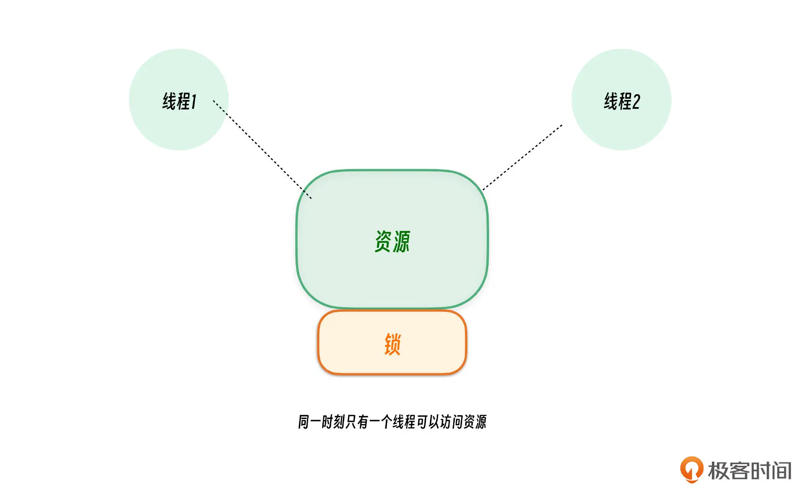

# 21 | 一夫当关，万夫莫开：互斥锁

你好，我是鸟窝。

这一节课，我们重点学习传统并发编程最常用的一个并发数据结构：互斥锁。

互斥锁（Mutex，全称 Mutual Exclusion Lock）是一种同步原语，用于保护共享资源，确保同一时刻只有一个线程（并发单元）可以访问该资源，其他线程必须等待锁释放后才能继续访问。

在多线程程序中，如果多个线程同时访问或修改同一份数据，可能会导致数据竞争（DataRace）和不一致（Inconsistent State）问题。互斥锁可以避免这些问题，保证：

- 同时只有一个线程访问关键数据。

- 其他线程必须等待当前持有锁的线程释放锁之后，才能获得访问权限。



## 互斥锁的基本用法

互斥锁（Mutex） 是一种非常经典的并发原语，早在 C 和 C++ 中就已经广泛使用。

它的本质是：当一个线程访问临界区时，其他线程必须等待。也就是说，这个互斥锁会阻塞等待锁可用的线程。

```javascript
下面是 Mutex 的一个简单例子：
use std::sync::{Arc, Mutex};
use std::thread;
fn main() {
   // 创建一个共享的计数器，包裹在Arc和Mutex中
   let counter = Arc::new(Mutex::new(0));
   // 准备多个线程，每个线程对计数器加1
   let mut handles = vec![];
   for _ in 0..5 {
       let counter = Arc::clone(&counter);
       let handle = thread::spawn(move || {
           let mut num = counter.lock().unwrap(); //获取锁
           *num += 1;
           println!("Thread incremented counter to: {}", *num);
       });
       handles.push(handle);
   }
   // 等待所有线程结束
   for handle in handles {
       handle.join().unwrap();
   }
   // 最终计数器的值
   println!("Final counter value: {}", *counter.lock().unwrap());
}
```

这个程序会创建五个线程，每个线程将计数器加 1 并打印出当前值。最后，主线程会等待所有线程完成并打印计数器的最终值。

计数器是一个共享资源，如果没有使用锁：

- 一个线程可能刚读取了计数器的值，还没来得及增加值，另一个线程就修改了计数器。

- 这样会导致计数器的值被覆盖，最终的结果可能小于预期。

```
通过 Mutex，每个线程在修改计数器之前需要先获得锁，只有锁被释放后其他线程才能继续
```

操作，这样就保证了计数器修改的正确性。

```javascript
let mut num = counter.lock().unwrap(); 这一行的意思是：
获取 counter 的互斥锁，确保当前线程对数据的独占访问。
解锁操作成功后，获得一个 Mutex 中的可变引用（num）。
通过该引用，可以对 Mutex 中包裹的值进行读写操作。
Mutex 可以通过 new 构造函数来创建。每个 Mutex 都有一个类型参数，表示它所保护的数
```

据类型。这些数据只能通过 lock 和 try_lock 方法返回的 RAII Guard 来访问，这确保了数据只有在互斥锁持有的情况下才能被访问。

```
接下来我们介绍 Mutex 为数不多的几个方法。
```

### lock

此函数会阻塞本地线程，直到可以获取互斥锁。返回时，该线程将是唯一持有锁的线程。

这个方法的方法签名如下：

```
pub fn lock(&self) -> LockResult<MutexGuard<'_, T>>
这里需要注意，如果正常获取了锁，你将获得一个 MutexGuard，以允许对锁进行作用域解
```

锁。当保护器超出作用域时，互斥锁将自动被解锁。

对于在已持有锁的线程中锁定互斥锁的行为，未作明确规定。但是，此函数不会在第二次调用时返回（例如，它可能会发生 panic 或死锁）。所以标准库的 Mutex 不是可重入锁，不要尝试在已经获取锁的情况下再获取锁。

下面是调用这个方法的例子：

```javascript
use std::sync::{Arc, Mutex};
use std::thread;
fn main() {
   let mutex = Arc::new(Mutex::new(0));
   let c_mutex = Arc::clone(&mutex);
   let handle = thread::spawn(move || {
       let mut v = c_mutex.lock().unwrap();
       *v = 10;
   });
   handle.join().unwrap();
   assert_eq!(*mutex.lock().unwrap(), 10);
}
注意 v 的类型是 MutexGuard<'_,i32>。它是互斥锁“作用域锁”的 RAII 实现。当此结构体
```

被丢弃（超出作用域）时，锁将被解锁。

```
通过此保护器及其 Deref 和 DerefMut 实现，可以访问受互斥锁保护的数据。就像上面的例
子一样，我们使用 *v 直接修改数据。
```

- 在 Rust 中，Deref 与 DerefMut 是两种至关重要的 trait，它们实现了智能指针的核心机制——解引用。Deref 赋予了类型解引用操作的能力，使得你可以如同操作原始类型一般，直接访问智能指针所指向的数据，这不仅简化了代码，更在类型层面实现了透明的抽象。DerefMut 则进一步扩展了这种能力，它允许对智能指针所指向的数据进行可变操作，这对于实现内部可变性模式至关重要。

```
如果你了解 Go 语言的话，你会发觉 Rust 的 Mutex 和 Go 语言的 Mutex 很不一样，Go 语
言的 Mutex 并不会显式地保护一个数据，同时 Go 语言的 Mutex 需要显式地调用
Unlock。
```

有时候，我们可能需要尽快地释放锁，尽量减少锁的争用，这个实现我们就要尽快 drop 掉

```javascript
MutexGuard<'_,i32>。比如下面的方法：
   let handle = thread::spawn(move || {
       {
           let mut v = c_mutex.lock().unwrap();
           *v = 10;
       }
       thread::sleep(std::time::Duration::from_secs(10));
   });
```

或者

```
drop(v);
```

### try_lock

此方法尝试获取此锁。

```
如果此时无法获取锁，则返回 Err。否则，返回一个 MutexGuard。当 MutexGuard 被丢
```

弃时，锁将被解锁。

此函数不会阻塞。

如果互斥锁的另一个用户在持有互斥锁时发生了 panic，并且原本可以获取该互斥锁，则此调

```
用将返回 Poisoned 错误。返回的错误中将包含已获取的锁保护器 MutexGuard。
如果因为互斥锁已被锁定而无法获取，则此调用将返回 WouldBlock 错误。
```

下面的例子尝试获取锁，并对是否能够获取到锁做处理：

```javascript
use std::sync::{Arc, Mutex};
use std::thread;
fn main(){
   let mutex = Arc::new(Mutex::new(0));
   let c_mutex = Arc::clone(&mutex);
   thread::spawn(move || {
       let mut lock = c_mutex.try_lock();
       if let Ok(ref mut mutex) = lock {
           **mutex = 10;
       } else {
           println!("try_lock failed");
       }
   }).join().expect("thread::spawn failed");
   assert_eq!(*mutex.lock().unwrap(), 10);
}
```

### get_mut

```
返回底层数据的可变引用。由于此调用可变地借用 Mutex，因此无需进行实际的锁定——可
```

变借用静态地保证不存在锁。

如果互斥锁的另一个用户在持有互斥锁时发生了 panic，则此调用将返回一个错误，其中包含底层数据的可变引用。

如下面的例子，我们直接通过这个方法就得到了整数的可变引用：

```javascript
let mut mutex = Mutex::new(0);
*mutex.get_mut().unwrap() = 10;
assert_eq!(*mutex.lock().unwrap(), 10);
```

### get_cloned

这是一个仅在 nightly 版本中提供的实验性 API。它负责返回底层数据的 clone 值，这也就要求底层数据必须是可克隆的。

### replace

这也是一个仅在 nightly 版本中提供的实验性 API。用于替换底层的数据，并返回老的值。

### set

这也是一个仅在 nightly 版本中提供的实验性 API。用来设置底层的数据。

这三个方法其实是封装的便利方法，内部实现上还是先获取到锁，再进行操作。

### into_inner

消费此互斥锁，并返回底层数据。

啥叫“消费”？消费指的是你把互斥锁里面的数据拿出来，并且互斥锁本身也就不存在了。

```
比如下面这个例子，你调用 mutex 的 into_inner 方法后，此 mutex 就不能再使用了，因
```

为它已经被消费了。

```javascript
use std::sync::Mutex;
fn main() {
   let mutex = Mutex::new(0);
   let mutex_inner = mutex.into_inner().unwrap();
   assert_eq!(mutex_inner, 0);
   // let _ = mutex.lock().unwrap();
}
```

### Poison 检测

```
Rust 标准库的 Mutex 有一个非常独特的 Poison 检测（Poisoning）机制。
Poison 表示“锁被污染了”，即： 当一个线程持有锁时发生 panic，Rust 会把这个 Mutex 标
```

记为“Poisoned”（中毒啦），说明这个锁保护的数据可能处于不一致状态。

一旦 Mutex 被中毒，默认情况下其他线程将无法访问其中的数据，因为此时数据很可能已经受到了污染（某些不变量可能已经被破坏）。

```
对于 Mutex 来说，这意味着它的 lock和try_lock 方法都会返回一个 Result，用来指示
这个 Mutex 是否已经中毒。
在大多数场合下，使用 Mutex 的代码通常会直接调用 unwrap()，这样可以把 panic 传播到
```

其他线程，确保不会意外读取到可能已经损坏的数据。

```
不过，中毒的 Mutex 并不会完全阻止对底层数据的访问。PoisonError 类型提供了一个
into_inner 方法，它可以返回本来在成功加锁时会拿到的 guard。这样一来，即使 Mutex
```

已经中毒，程序仍然可以强行访问其中的数据。

```
设想这样一个场景：一个线程获得了 Mutex 锁，并开始修改共享数据。修改到一半，线程
```

panic 崩溃了。这个时候，数据已经部分修改，可能已经不一致了（操作一半没做完）。怎么办？

在 C/C++，这种情况下下次加锁依然成功，并不会知道上次发生了崩溃。这样的话，后续线程读到的数据就是损坏的，可能直接引发数据污染、崩溃或逻辑错误。这种 Bug 非常难排查。

```
而 Rust 的 Mutex 会主动检测这种情况。如果上一个持锁线程 panic 了，下一个加锁的线程
```

会收到一个 Err，提醒数据可能已经被污染。这是一种故障传播和安全预警机制。

如下面的例子，我们在线程处理的最后，人为触发 panic:

```javascript
let m = Arc::new(Mutex::new(0));
let m_clone = Arc::clone(&m);
let handle = thread::spawn(move || {
   let mut guard = m_clone.lock().unwrap();
   *guard += 1;
   panic!("oops"); // 这个线程崩溃
});
let _ = handle.join(); // join()捕获panic
// 这里加锁时会检测到poison
match m.lock() {
   Ok(guard) => println!("Normal lock: {}", *guard),
   Err(poisoned) => {
       println!("Poisoned lock detected!");
       let guard = poisoned.into_inner();
       println!("Recovered: {}", *guard);
   }
}
这里我们创建了一个 Arc<Mutex<Vec<i32>>>，并在一个线程中对其进行修改，然后
```

panic。

```
在主线程中，我们尝试再次加锁，这时 Mutex 已经被 poisoned，我们可以通过
into_inner() 方法获取 Mutex 内部的数据。
这里我们放弃了 Poison 检测，直接获取了 Mutex 内部的数据，这样就可以继续使用这个数
据了。这种情况下，我们需要自己处理 poisoned 的情况，否则程序会直接 panic。
通过调用 Mutex 的 is_poisoned() 方法，我们可以检测 Mutex 是否被 poisoned。
当一个互斥锁进入中毒状态后，它会一直保持中毒，直到手动调用clear_poison()方法。
```

调用这个方法意味着：你已经对数据进行了修复或检查，并确认它是安全的，所以可以重新标记这个互斥锁为“非中毒”状态。

举个例子，如果你已经把数据重置为一个可靠的初始值，那么你可以用这个方法告诉系统：中毒状态已经解除。

又或者，你对数据做了一次完整性检查，确认它没有受影响，也可以通过这个方法清除中毒标记，让后续的加锁操作不再视为异常。

- Rust 标准库的 Mutex = 互斥锁 + 数据保护 + 故障检测 + 自动恢复机制，远比传统语言的Mutex 更“智能”，也更符合 Rust“安全第一”的语言哲学。

## 互斥锁的应用

```
在 Rust 中，Mutex 和 Arc的结合使用，是实现线程安全共享数据的常用模式。这种组合解
```

决了多线程并发访问同一数据时可能出现的数据竞争问题。

想象一下，你有一个需要被多个线程共享的计数器。如果每个线程都直接修改这个计数器，那么结果可能会变得混乱，因为多个线程可能会同时尝试修改它，导致数据不一致。这时，

```
Mutex 就派上了用场。它就像一个“通行证”，确保同一时间只有一个线程可以访问和修改计数
```

器。

```
但是，Mutex 本身并不能在线程之间共享。为了在多个线程之间共享 Mutex，我们需要使用
Arc（原子引用计数）。Arc 允许我们在多个线程之间安全地共享所有权，并且当最后一个线
```

程结束时，自动释放内存。

```
具体来说，我们可以将计数器包裹在 Mutex 中，然后再将 Mutex 包裹在
Arc 中。这样，我们就可以在多个线程之间共享这个 Arc，并且每个线程都可以通过 Mutex
```

来安全地访问和修改计数器。

例如，假设我们有一个需要被多个线程增加的计数器。我们可以这样做：

```
创建一个 Mutex，并将计数器作为其内部数据。
将 Mutex 包裹在 Arc 中，以便在多个线程之间共享。
为每个线程克隆 Arc，以便每个线程都拥有计数器的所有权。
在每个线程中，使用 Mutex::lock() 获取锁，然后增加计数器。
当线程结束时，Arc 的引用计数会自动减少，当最后一个线程结束时，计数器会被自动释
```

- 放。

通过这种方式，我们可以确保多个线程安全地访问和修改共享数据，避免数据竞争问题。

```
总结来说，Mutex 负责保护共享数据，确保同一时间只有一个线程可以访问，而 Arc 负责在
多个线程之间安全地共享 Mutex 的所有权。这种组合是 Rust 中实现线程安全共享数据的强
```

大工具。

互斥锁的基本用法一节我们已经举了这两个数据结构配合的例子。

## 互斥锁常见问题

接下来，我们梳理一下互斥锁常见问题。

### 死锁

如果两个线程互相等待对方释放锁，就会发生死锁。

死锁是指两个或多个线程相互等待对方释放所持有的锁，从而导致所有线程都无法继续执行的一种状态。

假设有两个线程，线程 A 需要同时获取锁 1 和锁 2，线程 B 也需要同时获取锁 2 和锁 1。如果线程 A 先获取了锁 1，线程 B 先获取了锁 2，然后线程 A 尝试获取锁 2，线程 B 尝试获取锁 1，此时就会发生死锁。

比如下面的例子：

```javascript
use std::sync::{Arc, Mutex};
use std::thread;
use std::time::Duration;
fn main() {
   // 创建两个互斥锁
   let lock1 = Arc::new(Mutex::new(1));
   let lock2 = Arc::new(Mutex::new(2));
   // 线程 A
   let a_lock1 = Arc::clone(&lock1);
   let a_lock2 = Arc::clone(&lock2);
   let thread_a = thread::spawn(move || {
       let lock1_guard = a_lock1.lock().unwrap();
       println!("Thread A acquired lock1");
       // 模拟一些工作
       thread::sleep(Duration::from_millis(100));
       let lock2_guard = a_lock2.lock().unwrap();
       println!("Thread A acquired lock2");
       // 线程A进行一些操作
       println!("Thread A do something");
   });
   // 线程 B
   let b_lock1 = Arc::clone(&lock1);
   let b_lock2 = Arc::clone(&lock2);
   let thread_b = thread::spawn(move || {
       let lock2_guard = b_lock2.lock().unwrap();
       println!("Thread B acquired lock2");
       // 模拟一些工作
       thread::sleep(Duration::from_millis(100));
       let lock1_guard = b_lock1.lock().unwrap();
       println!("Thread B acquired lock1");
       // 线程B进行一些操作
       println!("Thread B do something");
   });
   // 等待线程完成
   thread_a.join().unwrap();
   thread_b.join().unwrap();
}
```

为了避免死锁，Rust 开发者通常会遵循以下原则：

- 锁的获取顺序： 确保所有线程以相同的顺序获取锁。

- 避免持有多个锁： 尽量减少线程同时持有多个锁的情况。

- 使用超时机制： 在尝试获取锁时设置超时时间，如果超时则放弃获取，避免无限等待。

### 优先级反转

优先级反转是指高优先级线程被低优先级线程持有的锁阻塞，导致高优先级线程无法及时执行。

假设有三个线程——高优先级线程 H、中优先级线程 M 和低优先级线程 L。线程 L 先获取了锁，然后线程 H 尝试获取该锁，被阻塞。此时，如果线程 M 开始执行，它会抢占线程 L 的CPU 时间，导致线程 L 无法释放锁，从而延迟了线程 H 的执行。

在 Rust 中，优先级反转的问题通常依赖于操作系统提供的调度策略。开发者可以通过合理设置线程优先级，或者使用优先级继承等技术来缓解这个问题。

### 锁的开销

获取锁和释放锁都有一定性能损耗。获取和释放锁都需要一定的性能开销，包括 CPU 时间、内存访问等。频繁的锁操作会降低程序的性能。

如果一个线程在频繁的小粒度操作中都使用锁，那么锁的开销可能会成为性能瓶颈。

为了减少锁的开销，Rust 开发者可以：

- 减少锁的粒度： 尽量只在必要时才使用锁，避免过度同步。

- 使用更高效的同步机制： 例如，原子操作、无锁数据结构等。

- 减少锁的竞争： 尽量减少多个线程同时竞争同一个锁的情况。

锁的开销是一个需要根据实际情况权衡的问题。在保证线程安全的前提下，尽量减少锁的使用，可以提高程序的性能。

## 总结

好了，在这一节课中，我们深入探讨了 Rust 语言中的互斥锁（Mutex），这是一种至关重要的并发编程工具。

互斥锁的核心作用是保护共享资源，确保在多线程环境下，同一时刻只有一个线程能够访问特

```
定的数据。通过使用std::sync::Mutex，开发者可以有效地避免数据竞争和不一致性问
```

题，这对于构建可靠的并发程序至关重要。

```
课程里详细阐述了Mutex的各种方法，如 lock、try_lock 等，并着重讲解了
MutexGuard 的作用，以及如何通过 Deref 和 DerefMut 来实现对受保护数据的安全访
```

问。

此外，我们还特别强调了 Rust 互斥锁的“Poison 检测”机制，这是一个显著区别于其他语言的

```
特性。当持有锁的线程发生 panic 时，Mutex 会被标记为中毒，这是一种强大的故障检测和
```

安全预警机制。这种机制能够有效地防止数据污染，并提供了恢复机制，使得即使在发生错误的情况下，程序也能够安全地继续运行。

同时，我们也深度分析了互斥锁在使用中可能出现的死锁、优先级反转和锁的开销的问题，并且针对这些问题，给出了避免这些问题的方式方法。

## 思考题

从命令行中读取一个 1 到 100 的整数。由四个线程去处理:

- 如果能被 15 整除，则打印“能被 15 整除”。

- 如果能被 3 整除，不能被 15 整除，则打印“能被 3 整除”。

- 如果能被 5 整除，不能被 15 整除，则打印“能被 5 整除”。

- 否则直接打印出数字。

欢迎你在留言区记录你的思考或疑问。如果今天的内容对你有所帮助，也期待你转发给你的同事或者朋友，大家一起学习，共同进步。我们下节课再见！
