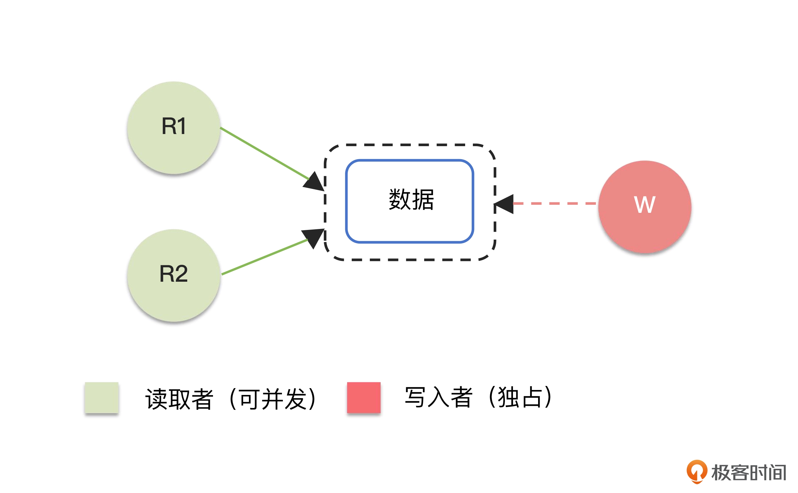

# 22 | 并行不悖，独占其时：读写锁

你好，我是鸟窝。

在并发编程中，当多个线程需要访问共享资源时，必须采取措施来避免数据竞争。上一节课中我们学习的传统的互斥锁（Mutex）通过提供独占访问来实现这一点，即一次只允许一个线程访问共享资源。然而，在某些情况下，这种排他性可能过于严格。读写锁（Read-Write Lock）是一种更细粒度的同步机制，它允许多个线程同时读取共享资源，但只允许一个线程写入。

读写锁的核心思想是：

- 读操作共享： 多个线程可以同时获取读锁，从而并发地读取共享数据。

- 写操作独占： 当一个线程获取写锁时，其他任何线程（包括读线程和写线程）都必须等待。



这种机制在读操作远多于写操作的场景下非常有用，因为它提高了并发性能。读写锁常常应用于下面的场景：

- 缓存：多个线程可以同时读取缓存数据，但只有在需要更新缓存时才进行写入。

- 配置文件：多个线程可以同时读取配置文件，但只有在修改配置时才进行写入。

```
某些数据结构：当某些数据结构主要用于读取时，可以使用 RwLock 来提高并发性能。
```

## Rust 的 RwLock

```
Rust 标准库在 std::sync 模块中提供了 RwLock 类型，用于实现读写锁。
```

读写锁允许在任何时刻存在多个 reader 或最多一个 writer。此锁的写入部分通常允许修改底层数据（独占访问），而读取部分则通常允许只读访问（共享访问）。

```
相比之下，互斥锁（Mutex）并不区分获取锁的 reader 或 writer，因此会阻塞所有等待锁变
为可用的线程。而读写锁（RwLock）则允许任意数量的 reader 获取锁，只要没有 writer 持有
```

锁。

锁的优先级策略取决于底层操作系统的实现，并且此类型不保证会使用任何特定的策略。特别

```javascript
是，等待在 write 中获取锁的 writer 可能（也可能不）会阻塞对 read 的并发调用，例如：
// 线程1                  |  // 线程2
let _rg1 = lock.read();  |
                        |  // 会被阻塞
                        |  let _wg = lock.write();
// 此时可能死锁            |
let _rg2 = lock.read();  |
```

这是读写锁一个潜在的不太容易发现的可能存在死锁的场景，我们要了解这种情况，在代码中尽量避免，比如同一个线程中避免重入锁。

```
和互斥锁一样，读写锁 RwLock<T> 也是包裹了它保护的数据，类型参数 T 表示此锁保护的
数据。要求 T 满足 Send 以便在线程之间共享，并满足 Sync 以允许通过 reader 进行并发访
问。锁定方法返回的 RAII 守卫实现了 Deref（以及 write 方法的 DerefMut），以允许访
```

问锁的内容。

```
使用 RwLock::new(data) 创建一个读写锁，其中 data 是被保护的共享数据。如下面的例
```

子：

```javascript
use std::sync::RwLock;
let lock = RwLock::new(5);
get_mut、get_cloned、into_inner、replace、set 这几个方法和互斥锁类似，我们
```

简单了解一下即可，就不进一步展开了。

### get_mut 得到可变引用

```
返回底层数据的可变引用。由于此调用可变地借用 RwLock，因此无需进行实际的锁定——可
```

变借用静态地保证不存在任何锁。

```
如果 RwLock 被毒化，此函数将返回一个包含底层数据可变引用的错误。
```

### get_cloned 返回包含的值的克隆

```
通过克隆返回包含的值。如果 RwLock 被毒化，此函数将返回一个错误。
```

### into_inner 返回底层数据

```
消费此 RwLock，返回底层数据。什么叫消费上一课我们已经介绍了。如果 RwLock 被毒
```

化，此函数将返回一个包含底层数据的错误。

### replace 替换包含的值

```
用 value 替换包含的值，并返回旧的包含值。如果 RwLock 被毒化，此函数将返回一个包含
提供的 value 的错误。
```

### set 设置包含的值

```
设置包含的值。如果 RwLock 被毒化，此函数将返回一个包含提供的 value 的错误。
```

### is_posioned 是否被毒化

判断锁是否被毒化。

如果另一个线程处于活动状态，锁仍然可能随时被毒化。在没有额外的同步措施的情况下，你

```
不应该为了程序的正确性而信任 false 的返回值。也就是说，当你调用这个方法返回 false
```

的时候，有可能此时读写锁被毒化了， 再次调用这个方法可能返回 true。

```javascript
当持有独占锁的写者发生 panic 时，RwLock 就会被毒化。比如下面的例子：
use std::sync::{Arc, RwLock};
use std::thread;
let lock = Arc::new(RwLock::new(0));
let c_lock = Arc::clone(&lock);
let _ = thread::spawn(move || {
   let _lock = c_lock.write().unwrap();
   panic!(); // 毒化此读写锁
}).join();
assert_eq!(lock.is_poisoned(), true);
```

### clear_poision 清除毒化标志

清除锁的毒化状态。

如果锁被毒化，它将保持毒化状态，直到调用此函数。这允许从毒化状态恢复，并标记为已恢复。例如，如果该值被一个已知的好值覆盖，那么锁可以被标记为未毒化。或者，可以检查该值以确定它是否处于一致状态，如果是，则移除毒化状态。

下面是一个清除毒化状态的例子：

```javascript
use std::sync::{Arc, RwLock};
use std::thread;
let lock = Arc::new(RwLock::new(0));
let c_lock = Arc::clone(&lock);
let _ = thread::spawn(move || {
   let _lock = c_lock.write().unwrap();
   panic!(); // 毒化此读写锁
}).join();
assert_eq!(lock.is_poisoned(), true);
let guard = lock.write().unwrap_or_else(|mut e| { // 如果中毒了
   **e.get_mut() = 1;
   lock.clear_poison(); // 清除毒化状态
   e.into_inner()
});
assert_eq!(lock.is_poisoned(), false);
assert_eq!(*guard, 1);
不像互斥锁，读写锁没有 lock / try_lock 方法，相反，它提供了获取读锁和写锁的方法。
```

### read 获取读锁

以共享读访问方式锁定此 RwLock，阻塞当前线程直至获取锁。

调用线程将被阻塞，直到没有持有锁的 writer。当此方法返回时，可能存在其他 reader 已在锁内。此方法不对争用 reader 或 writer 获取锁的顺序提供任何保证。

一旦获取了读锁，就会返回一个 RAII 守卫，一旦其被丢弃，将释放此线程的共享访问。

下面是一个获取读锁和写锁的例子：

```javascript
use std::{sync::RwLock, thread};
fn main() {
   let lock = RwLock::new(5);
   thread::scope(|s| {
       s.spawn(|| {
           let mut w = lock.write().unwrap();
           *w = 6;
       });
       s.spawn(|| {
           let r = lock.read().unwrap();
           println!("r = {}", r);
       });
       s.spawn(|| {
           let r = lock.read().unwrap();
           println!("r = {}", r);
       });
   });
   println!("lock = {:?}", lock);
}
```

注意以下两点特殊情况：

- 如果 RwLock 被毒化，此函数将返回一个错误。当写入者在持有独占锁时发生 panic 时，RwLock 会被毒化。

- 如果当前线程已持有锁，再次调用此函数（重入）可能会发生 panic。

### try_read 尝试获取读锁

尝试以共享读访问方式获取此 RwLock。如果此时无法授予访问权限，则返回

```
Err。否则，返回一个 RAII 守卫，该守卫在其被丢弃时释放共享访问权限。
```

该函数不会阻塞，也不对争用 reader 或 writer 获取锁的顺序提供任何保证。

注意以下两点特殊情况：

```
如果 RwLock 被毒化，此函数将返回 Poisoned 错误。当写入者在持有独占锁时发生
```

- panic 时，RwLock 会被毒化。

```
如果 RwLock 因已被写锁锁定而无法获取，此函数将返回 WouldBlock 错误。
```

### write 获取写锁

以独占写访问方式锁定此 RwLock，阻塞当前线程直至获取锁。当其他 writer 或 reader 当前持有锁时，此函数不会返回。

成功获取写锁后，会返回一个 RAII 守卫，该守卫在其被丢弃时释放此 RwLock 的写访问权限。

注意以下两点特殊情况：

- 如果 RwLock 被毒化，此函数将返回一个错误。当写入者在持有独占锁时发生 panic 时，RwLock 会被毒化。

- 如果当前线程已持有锁，再次调用此函数 (重入) 可能会发生 panic。

### try_write 尝试获取写锁

```
尝试以独占写访问方式锁定此 RwLock。如果此时无法获取锁，则返回 Err。否则，返回一个
```

RAII 守卫，该守卫在其被丢弃时释放锁。

此函数不会阻塞。此函数不对争用 reader 或 writer 获取锁的顺序提供任何保证。

注意以下两点特殊情况：

```
如果 RwLock 被毒化，此函数将返回 Poisoned 错误。当写入者在持有独占锁时发生
```

- panic 时，RwLock 会被毒化。

```
如果 RwLock 因已被独占锁定而无法获取，此函数将返回 WouldBlock 错误。
```

注意，这上面四个方法都有一句介绍：此函数不对争用 reader 或 writer 获取锁的顺序提供任何保证。这句话的意思是，当多个线程同时尝试获取同一个读写锁（RwLock）时，函数本身不会保证哪个线程会先获得锁。也就是说，锁的分配顺序是不确定的。

## 读写锁的坑

```
在 Rust 中使用读写锁（RwLock）时，虽然它能提供并发性能的提升，但也存在一些常见的
```

“坑”，需要我们注意。

### 读写锁的“饥饿”问题

如果读操作持续不断到来，写操作可能会长时间无法获得锁，导致“饥饿”现象。反之，如果写操作频繁，读操作也可能被“饿死”。这通常与操作系统的调度策略有关。

比如下面的例子，读操作有可能导致写操作不能执行：

```javascript
use std::sync::{Arc,RwLock};
use std::thread;
use std::time::Duration;
fn main() {
   let rwlock = Arc::new(RwLock::new(0));
   // 持续的读线程
   for _ in 0..10 {
       let read_lock = rwlock.clone();
       thread::spawn(move || {
           loop {
               let r = read_lock.read().unwrap();
               println!("Read: {}", *r);
               thread::sleep(Duration::from_millis(10));
           }
       });
   }
   thread::sleep(Duration::from_secs(1));
   // 写线程，可能会被“饿死”
   thread::spawn(move || {
       for i in 1..10 {
           thread::sleep(Duration::from_millis(1000));
           let mut w = rwlock.write().unwrap();
           *w += i;
           println!("Write: {}", *w);
       }
   });
   thread::sleep(Duration::from_secs(10)); // 保持程序运行一段时间
}
```

注意事项：

- 在设计系统时，需要考虑读写操作的频率，避免出现“饥饿”现象。

```
可以考虑使用公平的读写锁实现（如果可用）。比如 async-lock 这个库的 Rwlock, 它的
```

- 锁的策略是 write-preferring，这意味着 writer 永远不会被饿死。释放写锁会唤醒下一个被阻塞的 reader 和下一个被阻塞的 writer。

```
parking_lot 库的 Rwlock 锁使用任务公平的锁定策略，避免 reader 和 writer 都被饿死。
```

这意味着，当有 writer 等待获取锁时，即使锁是解锁状态，尝试获取锁的 reader 也会被阻塞。因此，在单个线程内尝试递归获取读锁可能会导致死锁。

### 读写锁的“毒化”问题

如果写线程在持有写锁时发生 panic，读写锁会被“毒化”。这意味着后续的读写操作都会返回错误。“毒化”是为了防止数据处于不一致的状态。

上面一节我们已经讲解了毒化相关的方法，我们编程的时候需要注意毒化的问题，并且处理毒化的情况。下面是获取一个毒化的锁的例子：

```javascript
use std::sync::{Arc,RwLock};
use std::thread;
fn main() {
   let rwlock = Arc::new(RwLock::new(0));
   let rwlock_clone = rwlock.clone();
   thread::spawn(move || {
       let _w = rwlock_clone.write().unwrap();
       panic!("Write thread panicked!");
   }).join().unwrap_err();
   // 读操作会因为毒化而失败
   let r = rwlock.read();
   println!("Read result: {:?}", r);
   //使用clear_poison可以清除毒化状态
   let _clear = rwlock.clear_poison();
   let r2 = rwlock.read().unwrap();
   println!("Read result after clear_poison: {:?}", r2);
}
```

注意事项：

- 在写操作中，要尽量避免 panic 的发生。

```
如果需要从毒化状态恢复，可以使用 clear_poison() 方法。
```

- 明确地进行毒化后的错误处理。

### 死锁问题

与互斥锁类似，读写锁也可能导致死锁，甚至更容易造成死锁且难以发现，例如，当一个线程同时持有读锁和写锁时，或者多个线程循环等待锁时，就可能会发生死锁。

注意事项：

- 避免在持有锁时调用其他可能获取锁的函数。

- 尽量保持锁的粒度较小，减少锁的持有时间。

## 总结

好了，在这一节课中，我们了解了 Rust 的读写锁。

```
并发编程中，读写锁（RwLock）是一种比互斥锁（Mutex）更细粒度的同步机制。它允许多
```

个线程同时读取共享资源，但只允许一个线程写入。这种机制的核心思想是读操作共享，写操作独占，适用于读操作远多于写操作的场景，如缓存、配置文件和某些数据结构。

```
Rust 标准库的 std::sync::RwLock 提供了读写锁的实现，它允许在任何时刻存在多个
```

reader 或最多一个 writer，提高了并发性能，但需要注意避免潜在的死锁和“饥饿”问题。

```
Rust 的读写锁 RwLock<T> 包裹了它保护的数据，并提供了 read、try_read、write和
try_write 等方法来获取读锁和写锁。此外，还提供了get_mut、get_cloned、
into_inner、replace和set 等方法来访问和修改底层数据。当持有写锁的线程发生
panic 时，读写锁会被“毒化”，可以使用 is_poisoned 和 clear_poison 方法来检查和清
```

除毒化状态。使用读写锁时，需要注意避免“饥饿”问题、处理“毒化”问题，并防止死锁的发生。

读写锁更容易出现难以发现的死锁现象，编程的时候要注意。

## 思考题

请使用读写锁实现一个定时更新的配置数据结构，此配置由一个线程每小时更新一次，并且其它线程可能会很频繁的读取此配置的值。

期待你的分享。如果今天的内容对你有所帮助，也期待你转发给你的同事或者朋友，大家一起学习，共同进步。我们下节课再见！
