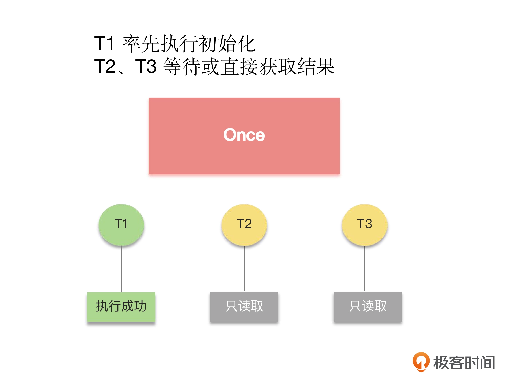
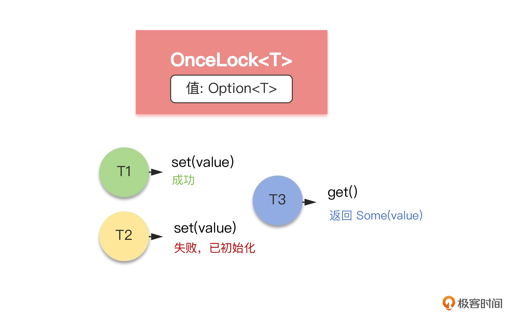
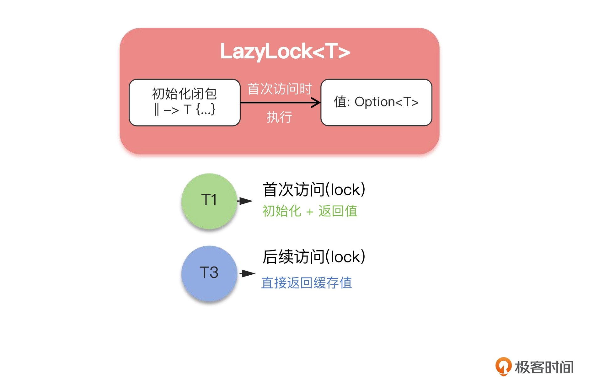
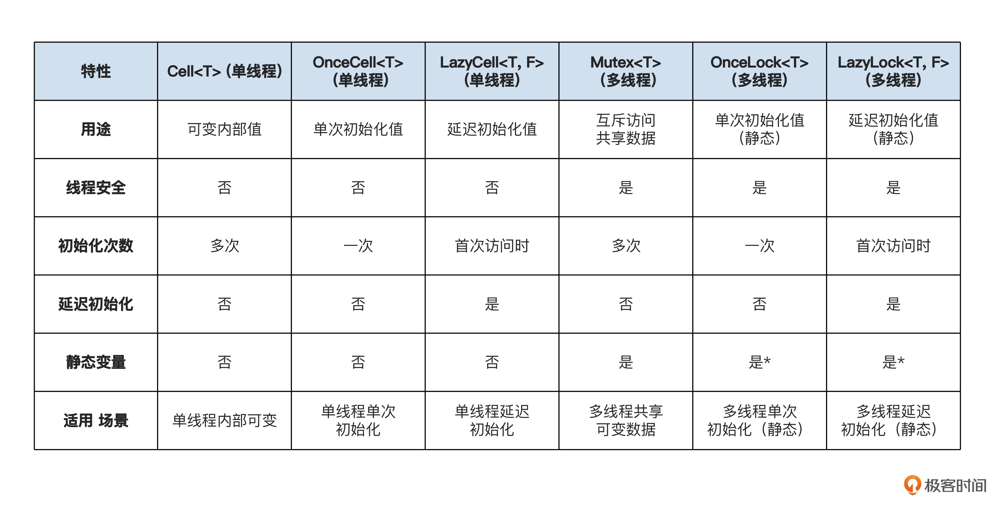

# 23 | 空前绝后，一劳永逸：Once同步原语

你好，我是鸟窝。

在前面两节课中，我们学习了互斥锁（Mutex）和读写锁（RwLock）这两种同步原语。今天我们来介绍另一个重要的同步原语，Once 以及 OnceLock 和 LazyLock。

## Once



Once 是一个轻量级的同步原语，它的主要作用是确保某段代码在程序整个生命周期只执行一次。这在初始化全局变量或者实现单例模式时特别有用。

Once 的特点是：

- 一次性执行：Once 确保初始化代码只会执行一次，即使在多线程环境下也是如此。

- 线程安全：多个线程可以同时尝试执行初始化，但只有一个线程会成功执行。

- 同步等待：其他线程会等待初始化完成后才继续执行。

- 零开销：一旦初始化完成，后续的检查几乎没有性能开销。

先前 Rust 的标准库中仅此一种“执行一次”的同步机制，后来才添加了 OnceLock 和lazyLock。

Once 的使用方法如下：

```javascript
use std::sync::{Once, Arc};
use std::thread;
static mut RESOURCE: Option<i32> = None;
static INIT: Once = Once::new();
// 获取资源
fn get_resource() -> i32 {
   INIT.call_once(|| { // 只初始化一次
       unsafe {
           RESOURCE = Some(42); // 初始化资源
       }
       println!("资源初始化完成, by thread {:?}", thread::current().id());
   });
   unsafe { RESOURCE.unwrap() }
}
fn main() {
   let mut handles = vec![];
   for _ in 0..5 {
       let handle = thread::spawn(move || {
           let value = get_resource();
           println!("线程 {:?}, 获取资源: {}", thread::current().id(), value);
       });
       handles.push(handle);
   }
   for handle in handles {
       handle.join().unwrap();
   }
}
这段代码展示了如何使用 Rust 的 Once 类型来确保某个资源只被初始化一次，并且在多个线
```

程中安全地访问该资源。

```
RESOURCE 是一个可变的全局变量，用于存储初始化后的资源。
INIT  是一个 Once 类型的静态变量，用于确保资源只被初始化一次。
get_resource  函数使用INIT.call_once  确保资源只被初始化一次。
在第一次调用时，RESOURCE 被设置为  Some(42)，并打印初始化完成的消息。
```

- 之后的调用将直接返回已经初始化的资源。

```
Once 类型的方法也很少，理解起来很简单，我们分别来看看。
```

### new 创建实例

```
new 方法自不必多说，就是创建一个 Once 对象。
```

### call_once 执行初始化一次

执行初始化函数一次且仅一次。

```
如果这是首次调用 call_once，则执行给定的闭包；否则，不执行该函数。如果另一个初始
```

化函数当前正在运行，则此方法将阻塞调用线程。

当此函数返回时，保证某个初始化已运行并完成。同时保证，执行的闭包所进行的任何内存写入，此时都能被其他线程可靠地观察到（闭包与返回后执行的代码之间存在 happens-before关系）。

```
如果给定的闭包在同一个 Once 实例上递归调用 call_once，则具体行为未指定，也就是允
```

许的结果是 panic 或死锁。所以不要在闭包中递归调用。

```
下面这个例子和上面的例子类似，也是 Once 通用的用法（全局变量 + Once + 一个辅助方
```

法）:

```javascript
use std::sync::Once;
use std::thread;
use std::time::Duration;
static mut VAL: usize = 0;
static INIT: Once = Once::new();
// 获取缓存的值。
// 如果没有缓存值, 则调用 expensive_computation() 函数获取值,
// 并将值缓存起来, 下次调用时直接返回缓存的值。
fn get_cached_val() -> usize {
   unsafe {
       INIT.call_once(|| {
           VAL = expensive_computation();
       });
       VAL
   }
}
fn expensive_computation() -> usize {
   // 非常耗时的操作
   thread::sleep(Duration::from_secs(2));
   42
}
fn main() {
   let mut handles = vec![];
   for _ in 0..5 {
       let handle = thread::spawn(move || {
           let value = get_cached_val();
           println!("线程 {:?}, 获取值: {}", thread::current().id(), value);
       });
       handles.push(handle);
   }
   for handle in handles {
       handle.join().unwrap();
   }
}
即使在多个线程并发调用此方法，闭包 f 也只会执行一次。然而，如果该闭包发生 panic，则
会“中毒（poison）”此 Once 实例，导致未来所有对 call_once 的调用也发生 panic。
```

这类似于互斥锁（mutex）的“中毒（poisoning）”行为。

### call_once_force 强制初始化

```javascript
执行与 call_once() 相同的功能，但忽略中毒（poisoning）。
与 call_once() 不同，如果此 Once 已中毒（即，先前对 call_once() 或
call_once_force() 的调用导致了 panic），则调用 call_once_force() 仍将调用闭包
f，并且不会立即导致 panic。如果 f 发生 panic，则 Once 将保持中毒状态。如果 f 没有发
生 panic，则 Once 将不再处于中毒状态，并且所有未来对 call_once() 或
call_once_force() 的调用都将是空操作（no-ops）。
闭包 f 会得到一个 OnceState 结构，可用于查询 Once 的中毒状态。
下面这个例子演示了调用 call_once() 和 call_once_force() 的区别：
use std::sync::Once;
use std::thread;
static INIT: Once = Once::new();
fn main() {
   // 中毒
   let handle = thread::spawn(|| {
       INIT.call_once(|| panic!());
   });
   assert!(handle.join().is_err());
   // 后续的调用会直接返回panic
   let handle = thread::spawn(|| {
       INIT.call_once(|| {});
   });
   assert!(handle.join().is_err());
   // 调用 call_once_force 会执行初始化函数，并重置中毒状态
   INIT.call_once_force(|state| {
       assert!(state.is_poisoned());
   });
   // 一旦成功调用一次，就不会再传播中毒状态
   INIT.call_once(|| {});
   println!("exit!");
}
```

### wait 等待初始化完成

这是一个仅在 nightly 版本中提供的实验性 API。

调用这个方法会阻塞当前调用线程，直到初始化过程结束。

```javascript
#![feature(once_wait)]
use std::sync::Once;
use std::thread;
static READY: Once = Once::new();
let thread = thread::spawn(|| {
   READY.wait(); // 等待初始化完成
   println!("准备好了");
});
READY.call_once(|| println!("执行初始化"));
如果此 Once 由于初始化闭包发生 panic 而中毒，则此方法也会 panic。如果不需要此行为，
请使用 wait_force。
```

### wait_force 强制等待初始化完成

这是一个仅在 nightly 版本中提供的实验性 API。

调用这个方法会阻塞当前调用线程，直到初始化过程结束, 并无视任何中毒标记。

```javascript
#![feature(once_wait)]
use std::sync::Once;
use std::{panic, thread};
use std::time::Duration;
static READY: Once = Once::new();
fn main() {
   let handle1 = thread::spawn(|| {
       READY.wait_force();
       println!("终于等待正确初始化了");
   });
   let handle2 = thread::spawn(|| {
       READY.call_once(|| panic!("poisoned"));
   });
   let handle3 = thread::spawn(|| {
       thread::sleep(Duration::from_secs(5));
       READY.call_once_force(|_| println!("强制初始化"));
   });
   println!("thread2: {}", handle2.join().is_err()); //true
   println!("thread1: {}", handle1.join().is_err()); // false
   println!("thread3: {}", handle3.join().is_err()); // false
}
如果此 Once 由于初始化闭包发生 panic 而中毒，则此方法会一直等待此Once 初始化完成
（使用 call_once_force）。
```

### is_completed 检查初始化是否完成

```
如果某个 call_once() 调用已成功完成，则返回 true。具体而言，在后面这几种情况下，
is_completed 将返回 false：
call_once() 根本没有被调用，
call_once() 被调用，但尚未完成，
Once 实例已中毒。
此函数返回 false 并不意味着 Once 没有被执行。例如，它可能在 is_completed 开始执
行和返回之间的时间内被执行，在这种情况下，false 返回值将是过时的（但仍然是允许
```

的）。

## OnceLock

```
OnceLock 也是一种同步原语，名义上只能写入一次。
```



```
此类型是一个线程安全的 OnceCell，可用于静态变量。在许多简单情况下，你可以使用
LazyLock<T, F> 来代替，以更少的精力获得此类型的优点：LazyLock<T, F> “看起来
像” &T，因为它在解引用时使用 F 进行初始化。
LazyLock 太简单而无法支持特定情况，因为在调用 LazyLock::new(|| ...) 之后，
LazyLock 不允许向其函数提供额外的输入。而 OnceLock 的优势就在这里，它调用
LazyLock::new(|| ...) 之后则向其函数提供额外的输入，这也就是 once 的含义。
下面是一个简单的例子，演示了一个 OnceLock 类型静态全局变量在未初始化和初始化后的
```

调用情况：

```javascript
use std::sync::OnceLock;
static CELL: OnceLock<usize> = OnceLock::new();
fn main() {
   // OnceLock还没有被写入。
   assert!(CELL.get().is_none());
   // 启动一个线程并写入OnceLock。
   std::thread::spawn(|| {
       let value = CELL.get_or_init(|| 12345);
       assert_eq!(value, &12345);
   })
   .join()
   .unwrap();
   // `OnceLock`现在包含值。
   assert_eq!(CELL.get(), Some(&12345),);
}
既然它是一个 OnceCell 的线程安全版本，那么它的方法基本也和 OnceCell 相同，我就不
```

赘述了，而是把这些方法简单列在下面。

- new：创建一个新实例。

```
get：获取底层值的引用。如果单元格为空或正在初始化，则返回  None。此方法永远不会
```

- 阻塞。

```
get_mut：获取底层值的可变引用。如果单元格为空，则返回 None。此方法永远不会阻
```

- 塞。

```
get_mut_or_init：获取单元格内容的可变引用，如果单元格为空，则使用 f 进行初始化。
```

- 此方法永远不会阻塞。

```
get_mut_or_try_init：获取单元格内容的可变引用，如果单元格为空，则使用 f 进行初始
化。如果单元格为空且 f 初始化失败，则返回错误。此方法永远不会阻塞。
get_or_init：获取单元格的内容，如果单元格为空，则使用 f 进行初始化。多个线程可以
并发调用 get_or_init，并提供不同的初始化函数，但保证只会执行其中一个函数。
```

如果 f 发生 panic，panic 会传播给调用者，并且单元格保持未初始化状态。

```
get_or_try_init：获取单元格的内容，如果单元格为空，则使用 f 进行初始化。如果单元
格为空且 f 初始化失败，则返回错误。
```

如果 f 发生 panic，panic 会传播给调用者，并且单元格保持未初始化状态。

```
into_inner：消耗 OnceLock，返回被包装的值。如果单元格为空，则返回 None。
set：将此单元格的内容设置为 value。如果另一个线程当前正在尝试初始化单元格，则可
能会阻塞。当 set 返回时，保证单元格包含一个值，但不一定是提供的值。如果此调用设
置了单元格的值，则返回 Ok(())。
take：将值从 OnceLock 中取出，并将其恢复到未初始化状态。如果 OnceLock 尚未初始
化，则不产生任何影响，并返回 None。通过要求可变引用来保证安全性。
try_inert：如果单元格为空，则将此单元格的内容设置为 value，然后返回对它的引用。
如果另一个线程当前正在尝试初始化单元格，则可能会阻塞。当 set 返回时，保证单元格包
含一个值，但不一定是提供的值。如果单元格为空，则返回  Ok(&value)；如果单元格已
满，则返回 Err(&current_value, value)。
```

- wait：阻塞当前线程，直到单元格被初始化。

## LazyLock

```
在 Rust 生态系统中，lazy_static 是一个非常流行的库，它主要用于简化静态变量的初始
```

化。

```
lazy_static 的作用包括后面这几种。
懒初始化：Rust 的 static 变量需要在编译时初始化，这意味着它们不能执行复杂的运行
时计算。lazy_static 允许你定义在第一次使用时才初始化的静态变量，这称为“懒初始
```

- 化”。

```
复杂静态变量：它允许定义包含复杂逻辑的静态变量，例如，创建 HashMap 或执行其他运
```

- 行时操作。

```
线程安全： lazy_static 确保静态变量的初始化是线程安全的，这对于多线程 Rust 程序
```

- 至关重要。

```
lazy_static 使用宏来生成代码，这些代码会在第一次访问静态变量时执行初始化。
lazy_static使用广泛，在很多项目中都有使用。
但是自 Rust 1.80.0，Rust 标准库提供了一个同样功能的同步原语，它就是 LazyLock，以后
```

我们可以直接使用它了。



```
LazyLock 类型是一个线程安全的 LazyCell，可用于静态变量。由于初始化可能从多个线
```

程调用，如果另一个初始化例程当前正在运行，则任何解引用调用都将阻塞调用线程。

```javascript
我们使用 Once 的时候，还是有点不方便的，既要定义一个全局变量，又要定义一个实例，然
后再写一个辅助函数访问它。使用 LazyLock 就方便很多了。
我将 Once 那一节中的例子改写成实现，你可以看到代码简化很多了：
use std::sync::LazyLock;
use std::thread;
static RESOURCE: LazyLock<i32> = LazyLock::new(|| {
   println!("资源初始化完成, by thread {:?}", thread::current().id());
   42
});
fn main() {
   let mut handles = vec![];
   for _ in 0..5 {
       let handle = thread::spawn(move || {
           let value = *RESOURCE;
           println!("线程 {:?}, 获取资源: {}", thread::current().id(), value);
       });
       handles.push(handle);
   }
   for handle in handles {
       handle.join().unwrap();
   }
}
```

它的方法也只有简单几个，我们一起看一下。

### new 初始化一个实例

后续的同步原语如果 new 方法没有啥特别，我就不介绍了，因为基本都是一样的，也是 rust初始化示例的标准函数。注意它需要传入一个初始化的函数或者闭包。

### force 强制求值

```
强制求值此惰性值，并返回对结果的引用。这等效于 Deref 实现，但更加显式。
```

如果另一个初始化例程当前正在运行，则此方法将阻塞调用线程。

```javascript
use std::sync::LazyLock;
let lazy = LazyLock::new(|| 92);
assert_eq!(LazyLock::force(&lazy), &92); // 强制求值
assert_eq!(&*lazy, &92); // 也是强制求值
```

两种强制求值的方法是一样的，一个是显式，一个是隐式。

### force_mut 强制返回结果额度引用

这是一个仅在 nightly 版本中提供的实验性 API。强制求值此惰性值，并返回对结果的可变引用。

```javascript
#![feature(lazy_get)]
use std::sync::LazyLock;
let mut lazy = LazyLock::new(|| 92);
let p = LazyLock::force_mut(&mut lazy); // 强制获得此对象的引用
assert_eq!(*p, 92);
*p = 44;
assert_eq!(*lazy, 44);
```

### get 或许当前值的结果

这是一个仅在 nightly 版本中提供的实验性 API。如果已初始化，则返回值的引用；否则返回

```javascript
None。
#![feature(lazy_get)]
use std::sync::LazyLock;
let lazy = LazyLock::new(|| 92);
assert_eq!(LazyLock::get(&lazy), None); // 还未初始化
let _ = LazyLock::force(&lazy); // 强制初始化
assert_eq!(LazyLock::get(&lazy), Some(&92)); // 已初始化
```

### get_mut 获得当前值的引用

这是一个仅在 nightly 版本中提供的实验性 API。如果已初始化，则返回值的可变引用；否则

```javascript
返回 None。
#![feature(lazy_get)]
use std::sync::LazyLock;
let mut lazy = LazyLock::new(|| 92);
assert_eq!(LazyLock::get_mut(&mut lazy), None);// 还未初始化
let _ = LazyLock::force(&lazy);// 强制初始化
*LazyLock::get_mut(&mut lazy).unwrap() = 44;// 已初始化
assert_eq!(*lazy, 44);
```

### into_inner 消费此对象

```javascript
这是一个仅在 nightly 版本中提供的实验性 API。消费此 LazyLock，返回存储的值。
如果 Lazy 已初始化，则返回 Ok(value)；否则返回 Err(f)。
#![feature(lazy_cell_into_inner)]
use std::sync::LazyLock;
let hello = "Hello, World!".to_string();
let lazy = LazyLock::new(|| hello.to_uppercase());
assert_eq!(&*lazy, "HELLO, WORLD!"); // 初始化
// 消费此对象
assert_eq!(LazyLock::into_inner(lazy).ok(), Some("HELLO, WORLD!".to_string()));
```

## 总结

```
好了，在这一节课中，我们了解了 Rust 中三种线程安全的初始化一次的数据类型：Once、
OnceLock 和 LazyLock。
Once 是一种轻量级的同步原语，它主要用于确保某段代码在程序的整个生命周期内只执行一
次，这在初始化全局变量或实现单例模式时特别有用。它通过 call_once 方法来实现这一功
能，并且在多线程环境下也能保证线程安全。但是，如果初始化闭包发生 panic，Once 实例
```

会进入“中毒”状态，导致后续调用也发生 panic。

```
为了更方便地进行线程安全的单次初始化，Rust 提供了 OnceLock。OnceLock 是一个线程
安全的 OnceCell，它特别适用于静态变量的初始化。与 Once 相比，OnceLock 提供了更
丰富的初始化和访问方法，例如 get_or_init、set 等，使得代码更加简洁易懂。当
LazyLock 无法满足需求时，OnceLock 提供了更灵活的选择。
LazyLock 则专注于延迟初始化。它是一个线程安全的 LazyCell，同样适用于静态变量，
也适用于局部变量。LazyLock 允许我们在首次访问时才执行初始化闭包，这对于初始化开
销较大的资源非常有用。它通过 deref 操作符来实现延迟初始化，使得代码看起来就像直接
访问一个已经初始化的变量。与 Once 相比，LazyLock 简化了静态变量的初始化，类似于
lazy_static 库。
```

这三种同步原语都用于确保代码只执行一次，或在首次访问时初始化。它们都具有线程安全的

```
特性，适用于多线程环境。Once 更加底层，提供了更细粒度的控制，而 OnceLock 和
LazyLock 则提供了更高级别的抽象，简化了常见用例。LazyLock 还提供了延迟初始化的
```

特性，使得复杂结构的初始化更加方便。

```
为了更清晰地对比 Cell、OnceCell、LazyCell 以及它们的线程安全版本，我将以表格的
```

形式呈现：



- 表示一般使用场景，也可以用在局部变量中。

## 思考题

请写一个 OnceLock 或者 LazyLock 当做局部变量的例子。

期待你的留言。如果今天的内容对你有所帮助，别忘了转发给你的同事或者朋友，大家一起学习，共同进步。我们下节课再见！
