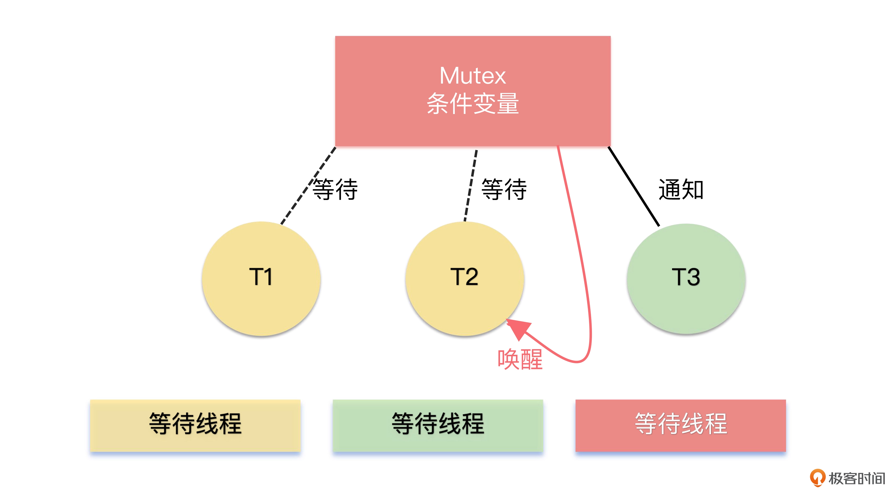

# 24 | 静观其变，伺机而动：Convar条件变量

你好，我是鸟窝。

在上节课我们已经了解了 Rust 的 Once 相关的同步原语，这节课我们重点介绍条件变量，这个同步原语不太常用，但是在特定场景下又特别有用。

条件变量是一种线程同步机制，它允许线程在满足特定条件之前进入休眠状态。当条件满足时，其他线程可以发出信号唤醒等待的线程。条件变量通常与互斥锁一起使用，以保护共享资源并确保线程安全。

我用粗体重点标注了它的三个功能：

- 线程休眠：条件变量允许线程在等待特定条件时进入休眠状态，从而避免了忙等待（busywaiting）带来的 CPU 资源浪费。

- 线程唤醒：当其他线程改变了条件变量所关联的条件时，它们可以发出信号唤醒等待的线程。

- 线程同步：条件变量可以与其他同步机制（如互斥锁）结合使用，以实现复杂的线程同步。

条件变量常常用在下面的特定场景中：

- 生产者 - 消费者模式：生产者线程生成数据并将其放入缓冲区，消费者线程从缓冲区中取出数据。当缓冲区为空时，消费者线程等待；当缓冲区满时，生产者线程等待。

- 线程池：线程池中的工作线程等待任务队列中的任务。当任务队列中有任务时，线程被唤醒并执行任务。

- 事件通知：当某个事件发生时，可以使用条件变量通知等待该事件的线程。

```
常见的编程语言中也常常看到它的身影，比如 C++ 中的pthread_cond_t，Java 中的
java.util.concurrent.locks.Condition 接口，Python 中的
threading.Condition ，Go 语言中的 Cond 等。
在 Rust 中，条件变量由 std::sync::Condvar 结构体表示。它通常与
std::sync::Mutex 结合使用，以保护共享数据。
```



除了常见的 new 构造函数外，重点是 notify 和 wait 族相关的方法，让我们一一介绍它们。

## Condvar 的方法

```
std::sync::Condvar 除了 new 构造函数外，主要包含通知和等待两类方法。
```

### new 创建一个条件变量

初始化一个新的条件变量，以便用于等待和通知操作。

不像 Go 语言中的条件变量，Rust 中的条件变量不会包含一个锁，而是常常和一个锁同时配合使用：

```javascript
use std::sync::Condvar;
let condvar = Condvar::new();
```

### notify_all

```
此方法确保所有当前在此条件变量上等待的线程都被唤醒。对 notify_all() 的调用不会以
```

任何方式进行缓冲。

在一个条件变量上等待的线程可能是零个，也可能是一个，也可能是多个，这个函数是唤醒所有在此条件变量上所有的线程。

如果你只是想唤醒一个，那么使用 notify_one 的方法。

### notify_one

```
唤醒此条件变量上正在等待的一个线程。如果存在等待中的线程，它将从 wait 或
wait_timeout 调用中恢复。
notify_one 的调用不会被缓存，也就是说，这次唤醒后，如果又有线程来等待此条件变
```

量，那么不会被自动唤醒。

```javascript
举一个例子中，例子中使用 notify_all()，你也可以修改为 notify_one：
use std::sync::{Arc, Condvar, Mutex};
use std::thread;
fn main() {
   let pair = Arc::new((Mutex::new(""), Condvar::new()));
   let pair2 = Arc::clone(&pair);
   thread::spawn(move || {
       let (lock, cvar) = &*pair2;
       let mut started = lock.lock().unwrap();
       *started = "时代变了";
       // 通知所有的等待线程，变量已经改变
       cvar.notify_all();
   });
   // 等待直到上面的线程改变了值
   let (lock, cvar) = &*pair;
   let mut started = lock.lock().unwrap();
   // 等待变量直到它被设置
   while started.is_empty() {
       started = cvar.wait(started).unwrap();
   }
}
```

这个例子有两个地方值得我们注意：

1. 当等待的线程被唤醒的时候，它需要检查变量满足不满足要求，如果不满足要求，它可以继续等待。通知者不负责检查条件变量满足不满足条件。

2.wait 的时候会释放锁，否则子线程中获取锁的时候就有可能死锁了，这是不允许发生的。当wait 的线程被唤醒的时候，它会尝试再获取到锁。

### wait 等待被唤醒

```
wait 方法的签名如下，可以看到，它需要一个 MutexGuard<'a, T> 类型的参数，也就是
```

获取的一个锁：

```
pub fn wait<'a,T>(&self, guard: MutexGuard<'a, T>) -> LockResult<MutexGuard<'a, T
此函数将解锁指定的互斥锁（由 guard 表示），并阻塞当前线程。这意味着，在互斥锁被逻辑
解锁之后发生的任何 notify_one 或 notify_all 调用，都有可能唤醒此线程。当此函数
```

调用返回时，指定的锁将被重新获取。

```javascript
   let (lock, cvar) = &*pair;
   let mut started = lock.lock().unwrap();
   while started.is_empty() {
       //释放started锁，休眠。
       // 如果被唤醒，会重新获取到started
       started = cvar.wait(started).unwrap();
   }
```

```
如果你的代码在不同的时间点，让同一个条件变量（Condvar）与不同的互斥锁（Mutex）
一起使用，那么程序可能会崩溃（panic!）。
```

同时还有几个 wait 函数的变种，加上了超时的机制，最多等待一段时间，这段时间如果没有被唤醒，就继续执行。

### wait_timeout

```
在此 Condvar 上等待通知，并在指定的持续时间后超时。
此函数的语义等同于 wait，不同之处在于线程阻塞的时间大致不会超过 dur。由于抢占或平
台差异等异常情况，可能无法保证实际等待时间精确等于 dur，因此不应将此方法用于精确
```

计时。

```javascript
返回的 WaitTimeoutResult 值指示是否已知超时已发生。
与 wait 类似，无论超时是否发生，当此函数返回时，指定的锁都会被重新获取。
use std::sync::{Arc, Condvar, Mutex};
use std::thread;
use std::time::Duration;
fn main() {
   let pair = Arc::new((Mutex::new(false), Condvar::new()));
   let pair2 = Arc::clone(&pair);
   thread::spawn(move || {
       thread::sleep(Duration::from_secs(1));
       let (lock, cvar) = &*pair2;
       let mut started = lock.lock().unwrap();
       *started = true;
       cvar.notify_one();
   });
   // 等待线程启动
   let (lock, cvar) = &*pair;
   let mut started = lock.lock().unwrap();
   loop {
       let result = cvar
           .wait_timeout(started, Duration::from_millis(100))
           .unwrap();
       // 10毫秒过去了，我们还没有收到通知。
       started = result.0;
       if *started == true {
           println!("Received the notification");
           break;
       } else {
           println!("Timeout occurred, still waiting...");
       }
   }
}
```

上面的代码一个线程会等待 1 秒之后更新条件变量的值，然后通知一个等待者。主线程会等待，超时时间是 100 毫秒，所以主线程会因为超时唤醒 10 次左右，每次唤醒返回的 Result

```
的值是一个元组，第一个值是 MutexGuard， 第二个是WaitTimeoutResult，可以判断是
```

不是超时了。

### wait_timeout_ms

```
这个方法和上面的方法类似，只不过超时的时间部署 Duration，而是毫秒数，更方便调
```

用。

```
pub fn wait_timeout_ms<'a, T>(
   &self,
   guard: MutexGuard<'a, T>,
   ms: u32,
) -> LockResult<(MutexGuard<'a, T>, bool)>
```

### wait_while

```
pub fn wait_while<'a, T, F>(
   &self,
   guard: MutexGuard<'a, T>,
   condition: F,
) -> LockResult<MutexGuard<'a, T>>
where
   F: FnMut(&mut T) -> bool,
```

这方法用于阻塞当前线程，直到提供的条件变为假（false）。

```
立即检查 condition，如果条件未满足（返回真（true）），则会 wait 等待下一次通知，然
后再次检查。此过程重复进行，直到 condition 返回假（false），此时函数返回。
此函数会原子地解锁指定的互斥锁（由 guard 表示）并阻塞当前线程。这意味着，在互斥锁
解锁后逻辑上发生的任何 notify_one 或 notify_all 调用，都有可能唤醒此线程。当此
```

函数调用返回时，指定的锁将被重新获取。

```
注意 condition 这个函数， 它会接受此条件变量中的条件，你判断条件是否满足，然后返
```

回 true 或者 false。本质上它是把唤醒后的循环隐藏起来了。

下面是一个它的例子：

```javascript
use std::sync::{Arc, Condvar, Mutex};
use std::thread;
fn main() {
   let pair = Arc::new((Mutex::new(true), Condvar::new()));
   let pair2 = Arc::clone(&pair);
   thread::spawn(move || {
       let (lock, cvar) = &*pair2;
       cvar.notify_one();
       let mut pending = lock.lock().unwrap();
       *pending = false;
       cvar.notify_one();
   });
   // 等待线程启动
   let (lock, cvar) = &*pair;
   let _guard = cvar
       .wait_while(lock.lock().unwrap(), |pending| {
           println!("Waiting for checking condition: {}", *pending);
           *pending // 如果条件为true，则继续等待
       })
       .unwrap();
}
```

### wait_timeout_while

在此条件变量上等待通知，并在指定的持续时间后超时。此函数的语义等同于

```
wait_while，不同之处在于线程阻塞的时间大致不会超过 dur。由于抢占或平台差异等异
常情况，可能无法保证实际等待时间精确等于 dur，因此不应将此方法用于精确计时。
返回的 WaitTimeoutResult 值指示是否已知在条件未满足的情况下超时已发生。
与 wait_while 类似，无论超时是否发生，当此函数返回时，指定的锁都会被重新获取。
它其实是 wait_timeout 和 wait_while 的一个结合版，超时或者条件满足时继续执行。
```

## 一个例子：一个多生产中多消费者队列

条件变量使用最广泛的场景就是生产者消费者的场景。

接下来的例子中，我们会实现一个简单的多生产者和多消费者的队列。我们使用

```
VecDeque<T> 作为队列的底层数据，当队列为空的时候，消费者需要等待，当生产者往空的
```

队列添加数据的时候，通知一个等待的消费者：

```javascript
use std::collections::VecDeque;
use std::sync::{Condvar, Mutex};
use std::time::Duration;
// 线程安全队列结构
pub struct Queue<T> {
   queue: Mutex<VecDeque<T>>,
   condvar: Condvar,
}
impl<T> Queue<T> {
   // 创建一个新的空队列
   pub fn new() -> Self {
       Queue {
           queue: Mutex::new(VecDeque::new()),
           condvar: Condvar::new(),
       }
   }
   // 向队列尾部添加元素
   pub fn push(&self, item: T) {
       let mut queue = self.queue.lock().unwrap();
       queue.push_back(item);
       if queue.len() == 1 {
           // 如果队列之前为空，通知等待中的线程
           self.condvar.notify_one();
       }
   }
   // 从队列头部移除并返回元素，如果队列为空则阻塞等待
   pub fn pop(&self) -> T {
       let mut queue = self.queue.lock().unwrap();
       // 当队列为空时等待
       while queue.is_empty() {
           queue = self.condvar.wait(queue).unwrap();
       }
       // 当队列不为空时，取出头部元素
       queue.pop_front().unwrap()
   }
   // 尝试从队列头部移除并返回元素，如果队列为空则立即返回None
   pub fn try_pop(&self) -> Option<T> {
       let mut queue = self.queue.lock().unwrap();
       queue.pop_front()
   }
   // 返回队列中元素的数量
   pub fn len(&self) -> usize {
       let queue = self.queue.lock().unwrap();
       queue.len()
   }
   // 检查队列是否为空
   pub fn is_empty(&self) -> bool {
       let queue = self.queue.lock().unwrap();
       queue.is_empty()
   }
}
```

我们的队列实现基于以下关键组件：

```
内部队列：使用 Rust 标准库的  VecDeque<T>  作为底层数据结构。
互斥锁：使用  Mutex<VecDeque<T>>  保护内部队列，确保同一时刻只有一个线程访问
```

- 队列。

```
条件变量：使用  Condvar  实现线程协作，允许消费者线程等待队列中有数据可用。
```

入队操作

push 方法将元素添加到队列尾部。如果队列从空变为非空，它会通知一个可能正在等待的消费者线程。

出队操作

我们实现了两种出队操作：

1. 阻塞式出队：如果队列为空，消费者线程会被阻塞直到有新数据可用

2. 非阻塞式出队：立即返回结果，如果队列为空则返回 None

本实现结合了两种同步机制：

```
互斥锁（Mutex）：保证对队列的独占访问，防止数据竞争
条件变量（Condvar）：实现线程间的协作和通知机制
```

## 总结

```
好了，在这一节课中，我们了解了 Rust 语言中的条件变量（Condvar）这一重要的同步原
```

语。条件变量主要用于线程间的协作，允许线程在特定条件满足前进入休眠状态，并在条件满足时被唤醒。它通常与互斥锁（Mutex）配合使用，以保护共享资源，实现复杂的线程同步逻辑。

此外，这节课还通过一个实际的生产者消费者队列的例子，展示了条件变量在生产者 - 消费者

```
模式中的应用。这个例子清晰地说明了如何利用 Condvar 实现线程间的等待和通知机制，让
```

线程环境下的数据共享更加高效和安全。

## 思考题

请扩展本节课中的多生产者多消费者的例子，实现一个固定长度的队列。等队列满的时候，生产者会被阻塞，直到队列有位置可以存放。

欢迎你在留言区记录你的思考或疑问。如果今天的内容对你有所帮助，也期待你转发给你的同事或者朋友，大家一起学习，共同进步。我们下节课再见！
