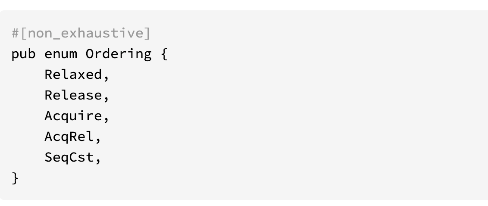

# 28 | 浑然一体，一气呵成：atomic原子操作（上）

鸟窝

- 课程介绍


- 讲述：机器人时长1 19:10大小3.30M

你好，我是鸟窝。

在前面的课程中我们学习了很多的同步原语，或者说用于并发的数据结构，你知道这些同步原语的基石是什么吗? 那就是原子操作：atomic。接下来的两节课我们就深入了解一下它的功能。

传统上，互斥锁（Mutex）、信号量（Semaphore）等同步原语被广泛用于保护共享资源的访问，确保在任何时刻只有一个线程能进入“临界区”（Critical Section）。虽然这些基于锁的机制相对容易理解和使用，但它们也可能引入性能瓶颈（如锁竞争导致的线程阻塞、上下文切换开销）和潜在的系统性问题（如死锁、优先级反转）。在高并发或对延迟要求极高的场景下，锁可能成为性能的掣肘。

为了应对这些挑战，原子操作（Atomic Operation）提供了一种更细粒度的并发控制方式。原子操作是不可分割的操作单元，它们要么完全执行，要么完全不执行，并且其执行过程不会被

```
其他线程中断。现代处理器通常提供硬件指令（如 x86 架构的 LOCK 前缀指令，以及通用的
比较并交换 Compare-and-Swap, CAS 指令）来高效地实现原子性。
```

基于这些原子操作，开发者可以构建非阻塞（Non-Blocking）或无锁（Lock-Free）的算法和数据结构，这些算法在某些条件下能够提供比传统锁更高的性能和更好的系统活性（Liveness）保证，例如避免死锁。

Rust 作为一门专注于内存安全和并发安全的系统编程语言，其设计哲学深刻地影响了它处理

```
并发的方式。Rust 的所有权（Ownership）、借用（Borrowing）系统以及 Send 和 Sync 标
```

记 trait 在编译时就能消除许多潜在的数据竞争。

```
在此基础上，Rust 标准库通过 std::sync::atomic 模块提供了一套丰富的原子类型（如
AtomicBool, AtomicUsize 等）和操作。Rust 的原子库不仅封装了底层的原子指令，更重
```

要的是，它强制开发者明确指定内存顺序（Memory Ordering），将对并发行为的底层控制暴露给开发者的同时，也试图通过类型系统引导开发者作出更安全的选择。

接下来的三节课我们会对 Rust 中的原子操作进行全面而深入的探讨。我们将详细解析

```
std::sync::atomic 模块提供的 API，重点阐述内存顺序这一核心且复杂的概念及其对程
```

序行为和性能的影响。此外，我还会展示原子操作在 Rust 中的典型应用场景，分析其性能特点，并讨论在实际使用中可能遇到的挑战和陷阱。

接下来让我们开始学习之旅吧。

## 背景知识

首先让我们先了解一些背景知识。

### 内存模型 (Memory Models)

为了优化性能，编译器和处理器可能会对内存操作进行重排序（Reordering），并且 CPU 缓存（Cache）的存在让一个核心的写入操作不一定能立即被其他核心看到。内存模型定义了程序中的内存操作（读、写）在多线程环境下何时以及如何对其他线程可见，以及操作之间允许的顺序。它是在程序员、编译器和硬件之间建立的一套规则契约。

不同的编程语言（如 C++11、Java）和硬件架构（如 x86-64、ARM）有不同的内存模型，规定了不同的默认行为和保证。Rust 的内存模型在很大程度上受到了 C++11 内存模型的启发。目前 Rust 还没有定义内存模型。各种学术界和行业专业人士正在提出各种提案，但目前，这是语言中的一个未定义部分。

### 编译器重排序

正如Rust 死灵书上介绍的那样，现实世界中存在编译器重排序和硬件重排序。

编译器本质上希望能够进行各种复杂的转换，以减少数据依赖并消除无用代码。特别是，它们可能会极大地改变事件的实际顺序，甚至让事件从不发生！如果我们编写如下内容：

```
x = 1;
y = 3;
x = 2;
```

编译器可能会得出结论，最好让你的程序执行如下操作：

```
x = 2;
y = 3;
```

这种情况颠倒了事件的顺序，并完全消除了一个事件。从单线程的角度来看，这是完全不可见的：所有语句执行完毕后，我们处于完全相同的状态。但如果我们的程序是多线程的，我们可能依赖于 x 在 y 被赋值之前就被赋值为 1。我们希望编译器能够进行这种优化，因为它们可以显著提高性能。另一方面，我们也希望程序能够按照我们所说的那样执行。

### 硬件重排序

即便编译器完全理解并遵循了程序员的意图，硬件层面自身也可能引发并发执行中的问题。这些问题主要源于 CPU 的内存层级结构。

尽管硬件中确实存在一个全局共享的内存空间，但从单个 CPU 核心的角度来看，访问该空间的延迟极高且速度缓慢。因此，每个 CPU 核心都倾向于优先操作其本地高速缓存（Cache）中的数据副本，仅在所需数据未在缓存中找到（即缓存未命中）时，才会访问共享内存。这正是引入高速缓存以提高性能的核心机制。

然而，这种机制也带来了挑战——如果每次从缓存读取数据都需要回溯到共享内存以验证其是否为最新值，那么缓存的性能优势将不复存在。其直接后果是，硬件本身无法保证在一个线程上按特定顺序执行的操作（尤其是内存写入），能够被另一个线程以完全相同的顺序观察到。

为了确保这种跨线程的事件顺序一致性，程序员必须使用特殊的 CPU 指令（例如内存屏障Memory Barriers），明确指示 CPU 限制某些优化行为，强制内存操作的可见性顺序。

比如，假设编译器严格按照以下逻辑生成指令：

```
初始状态：x = 0, y = 1
THREAD 1        THREAD 2
y = 3;          if x == 1 {
x = 1;              y *= 2;
               }
```

在理想化的执行模型下（假设所有操作按程序顺序执行，且结果对其他线程立即可见），该程序有两种可能的最终状态：

```
y = 3：线程 2 在线程 1 完成两个赋值操作之前执行了 if 判断，条件不满足。
y = 6：线程 2 在线程 1 完成两个赋值操作之后执行了 if 判断，观察到 x = 1 和 y =
3，执行了乘法。
```

但是，由于硬件内存模型的特性，还存在第三种可能的状态：

```
y = 2：线程 2 观察到了线程 1 写入的 x = 1，但未能及时观察到线程 1 写入的 y =
3。此时，线程 2 读取到的 y 仍是其本地缓存或共享内存中的旧值 1。基于这个旧值执行 y
*= 2 导致 y 变为 2，这个结果随后可能覆盖了线程 1 写入的 y = 3。这种情况暴露了内
```

- 存操作在不同线程间的可见性顺序并非必然符合程序代码的顺序。

值得注意的是，不同类型的 CPU 架构提供了不同的内存顺序保证（Memory OrderingGuarantees）。通常将硬件分为两类：

- 强顺序模型 (Strongly-ordered)：如 x86/64 架构。这类硬件本身提供了较强的顺序保证。

- 弱顺序模型 (Weakly-ordered)：如 ARM 架构。这类硬件允许更大幅度的指令重排和延迟的内存可见性，以优化性能。

这对并发编程具有两方面的重要影响：

1. 在强顺序模型的硬件上，请求更强的顺序保证（如使用内存屏障）的开销可能较低甚至为零，因为硬件本身已提供较强保证。反之，只有在弱顺序模型的硬件上，选择使用较弱的顺序保证（如果算法允许）才可能获得显著的性能提升。

2. 对于逻辑上存在并发错误的程序（例如，依赖了过弱的顺序保证），在强顺序硬件上运行时可能“碰巧”表现正常，从而掩盖了问题。只有在弱顺序硬件上测试时，这类潜在错误才更容易暴露出来。

### 内存顺序 (Memory Ordering)

这是内存模型的核心概念，用于指定单个原子操作对其周围其他内存操作（包括原子和非原子

```
操作）的顺序约束。不同的内存顺序（如 Relaxed, Acquire, Release, SeqCst）提供了
```

不同强度的保证，也对应着不同的性能开销。选择正确的内存顺序对于保证并发算法的正确性至关重要，我们将在后续章节详细讨论 Rust 中的内存顺序。Rust 直接继承了 C++20 的原子操作内存模型。

### 原子操作基础

先来看原子性 (Atomicity)。原子操作是作为一个单一、不可分割的单元执行的。从系统其他部分的视角来看，原子操作要么已经完成，要么尚未开始，不存在中间状态。

```
再来看看硬件支持。现代 CPU 提供专门的原子指令来实现原子性，例如 x86 上的 LOCK 指令
前缀可以锁住总线（或缓存行）来保证后续指令的原子性，以及像 CMPXCHG (Compare and
```

Exchange, CAS 的一种实现) 这样的特定原子指令。Load-Linked/Store-Conditional (LL/SC)是另一种在 RISC 架构（如 ARM、MIPS）上实现原子操作的机制。

- 操作类型：原子加载 (Atomic Load): 原子地读取内存位置的值。

- 原子存储 (Atomic Store)：原子地向内存位置写入值。

- 读 - 改 - 写 (Read-Modify-Write, RMW)：原子地读取一个值，对其进行修改，然后将新值

```
写回。常见的 RMW 操作包括原子加 / 减（Workspace_add/Workspace_sub）、原子交
换（swap）以及比较并交换（compare_exchange）。
```

最后还有比较并交换 (Compare-and-Swap, CAS)。CAS 是 RMW 操作中极其重要的一种。它接受三个参数：内存地址 V、期望的旧值 A 和新值 B。只有当地址 V 当前的值等于期望的旧值 A 时，它才会原子地将地址 V 的值更新为新值 B，并返回操作成功与否（或旧值）。CAS是实现许多无锁算法的基础构建块。

### 无锁编程 (Lock-Free Programming)

接下来我们看看无锁编程的定义。无锁是一种并发算法的属性，它保证系统作为一个整体总是在取得进展，即在任何时间点，至少有一个线程在执行有效的工作（即使其他线程可能被延迟）。这与基于锁的算法不同，后者中一个线程持有锁时可能会阻塞其他所有需要该锁的线程。无锁算法通常依赖于原子操作（特别是 CAS）来实现。

无锁编程的优缺点我们也要稍加留意。 无锁编程可以避免死锁，并且在低冲突或特定负载下可能提供比锁更好的性能和可伸缩性。然而，无锁算法通常非常复杂，难以设计、实现和验证其正确性。它们还可能面临诸如 ABA 问题（一个值被读取为 A，然后变为 B，再变回 A，导致 CAS 错误地认为没有发生变化）和活锁（线程不断重试操作但无法成功）等挑战。

## 内存顺序

Rust 的原子操作目前遵循与 C++20 原子操作相同的规则，特别是来自 intro.races 部分的规则，唯一的不同是没有“consume”内存顺序。C++ 使用的是基于对象的内存模型，而 Rust 使用的是基于访问的内存模型，所以需要做一些转换来将 C++ 的规则应用到 Rust 上。

简单来说，C++ 中提到的“对象的值”，在 Rust 中就是指读取时得到的字节数据。而 C++ 中提到的“原子对象的值”，则对应 Rust 中通过原子加载操作（如本模块提供的操作）得到的结果。“原子对象的修改”指的是原子存储操作。

```
最终，创建一个 Rust 原子类型的共享引用，类似于 C++ 中创建一个 atomic_ref，当共享
引用的生命周期结束时，atomic_ref 就会销毁。不同的是，Rust 允许同时对同一内存区域
```

进行原子和非原子的读取，这在 C++ 中是不允许的，因为 C++ 会将内存分为“原子对象”和“非

```
原子对象”，而 atomic_ref 只是临时将非原子对象当做原子对象来用。
```

这个模型最重要的部分是：数据竞争是未定义行为。数据竞争指的是两次访问冲突，其中至少有一次是非原子操作。如果两次访问影响的内存区域重叠，且至少有一次是写操作，就算是冲突。并且，如果它们没有严格的 happens-before 顺序（即一个操作的执行不确定先后关系），那么它们就是非同步的。

另外，内存模型中还有一个可能导致未定义行为的情况是混合大小访问：Rust 继承了 C++ 的一个限制——非同步的冲突原子访问不能部分重叠。也就是说，任何两次非同步的原子访问，要么完全不重叠，要么访问完全相同的内存（包括访问的大小），或者它们都是读操作。

- “混合大小访问”是指在同一内存区域进行多次原子操作时，访问的大小不一致的情况。举个例子：“假设有一个 AtomicU64 类型的变量，它占用 64 位内存。

- 如果你分别对该变量执行 32 位和 64 位的原子操作，这就是一个“混合大小访问”，因为你在同一内存位置做了不同大小（32 位 vs 64 位）的原子操作。

每个原子访问都有一个 Ordering，它定义了操作和 happens-before 顺序的关系。这个顺序和C++20 中的原子顺序是一致的。如果想更深入地了解，可以查阅《nomicon》。

C++ 的内存顺序包括下面的几种类型，更多的细节请参考 cppreference.com：

Rust 中定义的内存顺序是五种：



- 内存顺序是不太容易理解的概念，并且对于语言实现者来说，要兼容各种 CPU 架构也不是一件容易的事情。Go 语言的原子操作不需要你设置内存序，默认就是 SeqCst, 使用起来更简单。

这些排序决定了线程间内存访问的可见性和顺序，特别是在并发编程中非常重要。我们挨个看看每个内存顺序的说明。

首先需要了解内存顺序的作用。

- Relaxed：仅保证操作的原子性，没有额外的内存排序约束。适合不需要跨线程可见性的场景，例如计数器更新。

```
Release：用于存储操作，确保之前的写操作在当前存储之前完成，配合 Acquire 提供同
```

- 步。例如，发布数据后通知其他线程。

```
Acquire：用于加载操作，确保后续的读写操作在加载之后完成，常与 Release 配合使
```

- 用，例如读取已发布的数据。

```
AcqRel：结合 Acquire 和 Release，适用于既有读又有写的操作，如
compare_and_swap，确保双向同步。
```

- SeqCst：提供顺序一致性，所有 SeqCst 操作在所有线程中按全局顺序执行，适合需要强一致性的场景，但性能开销较大。

下面是五种内存顺序的对比介绍:

### Relaxed

- 定义：仅保证操作的原子性，没有额外的内存排序约束。

- 适用场景：当只需要确保操作本身不被其他线程干扰，但不关心内存可见性或顺序时使用。例如，线程本地计数器的递增。

- 特性：不提供任何跨线程的同步保证，适合性能敏感但不要求一致性的场景。

```javascript
C++ 等价：memory_order_relaxed。
use std::sync::atomic::{AtomicUsize, Ordering};
use std::sync::Arc;
use std::thread;
fn main() {
   // 创建一个可以在线程间共享的原子计数器
   let counter = Arc::new(AtomicUsize::new(0));
   // 创建多个线程，每个线程都增加计数器
   let mut handles = vec![];
   for _ in 0..10 {
       let counter_clone = Arc::clone(&counter);
       let handle = thread::spawn(move || {
           // 使用 Relaxed 内存序增加计数器100次
           for _ in 0..100 {
               // fetch_add 返回之前的值，并添加第一个参数到原子变量
               // Relaxed 表示我们只关心这个操作的原子性，不关心与其他内存操作的顺序
               counter_clone.fetch_add(1, Ordering::Relaxed);
           }
       });
       handles.push(handle);
   }
   // 等待所有线程完成
   for handle in handles {
       handle.join().unwrap();
   }
   // 读取最终值，同样使用 Relaxed 内存序
   println!("最终计数: {}", counter.load(Ordering::Relaxed));
}
```

### Release

- 定义：用于存储操作，确保当前线程中之前的写操作在该存储操作之前完成。

- 适用场景：发布数据后通知其他线程，例如生产者 - 消费者模式中，生产者完成数据准备后设置标志。

```
特性：配合 Acquire 提供单向同步，确保 Acquire 加载的线程能看到 Release 存储前
```

- 的所有写操作。

```
C++ 等价：memory_order_release。
```

Release 常常和另外线程中的 Acquire 配对使用：

```javascript
use std::sync::atomic::{AtomicBool, Ordering};
use std::sync::Arc;
use std::thread;
use std::time::Duration;
fn main() {
// 创建一个共享的原子标志和数据
   let flag = Arc::new(AtomicBool::new(false));
   let mut data = Arc::new(AtomicI32::new(0));
   // 克隆标志用于生产者线程
   let flag_clone = Arc::clone(&flag);
    let data1 = Arc::clone(&data);
   // 启动生产者线程
   let producer = thread::spawn(move || {
       // 模拟一些数据准备工作
       println!("生产者：正在准备数据...");
       thread::sleep(Duration::from_millis(50));
       // 在标志设置前修改数据
       data1.store(42, Ordering::Relaxed);
       // 使用 Release 序保证这之前的所有写入都对设置标志的线程可见
       println!("生产者：数据已准备好，设置标志...");
       flag_clone.store(true, Ordering::Release);
   });
   let data2: Arc<AtomicI32> = Arc::clone(&data);
   // 启动消费者线程
   let consumer = thread::spawn(move || {
       // 不断检查标志是否被设置
       println!("消费者：等待数据准备就绪...");
       // 自旋等待标志变为 true
       while !flag.load(Ordering::Acquire) {
           // 使用 Acquire 保证标志加载后的所有读取都能看到标志设置前的写入
           thread::yield_now(); // 让出CPU时间
       }
       // 一旦标志被设置，保证能看到生产者设置标志之前对数据的修改
       println!("消费者：标志被设置，数据 = {}", data2.load(Ordering::Relaxed));
   });
   // 等待两个线程完成
   producer.join().unwrap();
   consumer.join().unwrap();
}
```

### Acquire

- 定义：用于加载操作，确保当前线程中后续的读写操作在该加载操作之后完成。

- 适用场景：读取已发布的标志或数据，例如消费者线程等待生产者完成数据准备。

```
特性：与 Release 配合，提供从存储到加载的单向同步，确保看到最新数据。
C++ 等价：memory_order_acquire。
```

### AcqRel

```
定义：结合 Acquire 和 Release，适用于既有读又有写的操作，如
```

- compare_and_swap。

- 适用场景：需要同时同步读写操作的场景，例如锁的获取和释放。

```javascript
特性：如果操作涉及写（例如交换成功），提供 Release 语义；如果仅读（例如交换失
败），提供Acquire 语义。确保双向同步，但不会降级为 Relaxed。
C++ 等价：memory_order_acq_rel。
use std::sync::atomic::{AtomicUsize, Ordering};
use std::sync::Arc;
use std::thread;
use std::time::Duration;
fn main() {
   // 创建一个原子计数器作为信号量（表示可用资源数量）
   let semaphore = Arc::new(AtomicUsize::new(3)); // 初始有3个资源可用
   let mut handles = vec![];
   // 创建5个工作线程，它们都需要获取资源
   for id in 1..=5 {
       let sem = Arc::clone(&semaphore);
       let handle = thread::spawn(move || {
           println!("线程 {} 尝试获取资源", id);
           // 尝试获取资源（减少信号量）
           let mut acquired = false;
           while !acquired {
               // 当前值
               let current = sem.load(Ordering::Relaxed);
               if current > 0 {
                   // compare_exchange_weak尝试原子地将值从current更新为current-1
                   // 使用AcqRel: 成功时同时具有Acquire和Release语义
                   match sem.compare_exchange_weak(
                       current,
                       current - 1,
                       Ordering::AcqRel,  // 成功时使用AcqRel
                       Ordering::Acquire  // 失败时使用Acquire
                   ) {
                       Ok(_) => {
                           acquired = true;
                           println!("线程 {} 获得资源，剩余资源: {}", id, current -
                       }
                       Err(_) => {
                           // 竞争失败，其他线程修改了值，重试
                           thread::yield_now();
                       }
                   }
               } else {
                   // 没有可用资源，稍后重试
                   println!("线程 {} 等待资源...", id);
                   thread::sleep(Duration::from_millis(10));
               }
           }
           // 模拟使用资源
           println!("线程 {} 正在使用资源...", id);
           thread::sleep(Duration::from_millis(50));
           // 释放资源（增加信号量）
           sem.fetch_add(1, Ordering::Release);
           println!("线程 {} 释放资源", id);
       });
       handles.push(handle);
   }
   // 等待所有线程完成
   for handle in handles {
       handle.join().unwrap();
   }
}
```

### SeqCst

```
定义：提供顺序一致性，所有 SeqCst 操作在所有线程中按全局顺序执行。
```

- 适用场景：需要强一致性的场景，例如多线程状态机，确保所有线程看到相同操作顺序。

- 特性：提供最强的内存排序保证，但由于需要全局顺序，性能开销较大，适合少量关键操作。

```javascript
C++ 等价：memory_order_seq_cst。
use std::sync::atomic::{AtomicBool, Ordering};
use std::sync::Arc;
use std::thread;
fn main() {
   // 创建两个原子布尔标志
   let x = Arc::new(AtomicBool::new(false));
   let y = Arc::new(AtomicBool::new(false));
   // 用于存储观察结果的变量
   let mut saw_x_not_y = false;
   let mut saw_y_not_x = false;
   // 克隆用于线程的引用
   let x_clone1 = Arc::clone(&x);
   let y_clone1 = Arc::clone(&y);
   let x_clone2 = Arc::clone(&x);
   let y_clone2 = Arc::clone(&y);
   // 启动第一个线程
   let thread1 = thread::spawn(move || {
       // 设置x为true
       x_clone1.store(true, Ordering::SeqCst);
       // 检查y是否为true
       // 使用SeqCst保证全局一致的操作顺序
       if !y_clone1.load(Ordering::SeqCst) {
           saw_x_not_y = true;
           println!("线程1看到: x=true, y=false");
       } else {
           println!("线程1看到: x=true, y=true");
       }
   });
   // 启动第二个线程
   let thread2 = thread::spawn(move || {
       // 设置y为true
       y_clone2.store(true, Ordering::SeqCst);
       // 检查x是否为true
       // 使用SeqCst保证全局一致的操作顺序
       if !x_clone2.load(Ordering::SeqCst) {
           saw_y_not_x = true;
           println!("线程2看到: x=false, y=true");
       } else {
           println!("线程2看到: x=true, y=true");
       }
   });
   // 等待线程完成
   thread1.join().unwrap();
   thread2.join().unwrap();
   // 重要的SeqCst保证：不可能两个线程都看到对方的标志为false
   // 也就是说，saw_x_not_y和saw_y_not_x不可能同时为true
   println!("\n结果分析:");
   println!("线程1看到x=true但y=false: {}", saw_x_not_y);
   println!("线程2看到y=true但x=false: {}", saw_y_not_x);
   if saw_x_not_y && saw_y_not_x {
       println!("错误! 这在使用SeqCst时不应该发生");
   } else {
       println!("符合SeqCst保证: 两个线程不可能都看不到对方的写入");
   }
}
```

在选择排序时，我们需要权衡性能和正确性：

```
Relaxed 适合性能敏感但不要求跨线程可见性的场景，如本地计数器。
Release 和 Acquire 常成对使用，构建生产者 - 消费者模式。
AcqRel 适合需要双向同步的复杂操作，如锁机制。
SeqCst 虽然提供最强保证，但应谨慎使用，因其可能导致性能瓶颈，尤其在高并发场景。
```

## 可移植性

```
atomic模块中的所有原子类型，如果可用，都保证是无锁的。这意味着它们在内部不会获取
全局互斥锁。但原子类型和操作并不能保证是无等待的。例如，像 fetch_or 这样的操作可
能通过比较并交换（compare-and-swap，简称 CAS）循环来实现。
```

原子操作可能在指令层通过更大尺寸的原子指令实现。例如，某些平台使用 4 字节的原子指令来实现 AtomicI8。需要注意的是，这种模拟不会影响代码的正确性，只是需要了解这一点。

本模块中的原子类型并非在所有平台上都可用。然而，此处的原子类型普遍具有广泛支持，通常可以依赖其存在。不过，也存在一些值得注意的例外情况：

- 在具有 32 位指针的 PowerPC 和 MIPS 平台上，不支持 AtomicU64 或 AtomicI64 类型。

- 在非 Linux 的 ARM 平台（如 armv5te）上，仅提供加载（load）和存储（store）操作，不支持比较并交换（CAS）操作，例如 swap、fetch_add 等。此外，在 Linux 上，这些 CAS操作通过操作系统支持实现，可能会带来性能开销。

- 在 thumbv6m 的 ARM 目标上，仅提供加载和存储操作，不支持比较并交换（CAS）操

```
作，例如 swap、fetch_add 等。
```

- 请注意，未来可能会添加更多不支持某些原子操作的平台。追求最大可移植性的代码需要谨

```
慎选择使用的原子类型。AtomicUsize 和 AtomicIsize 通常是最具可移植性的，但即
便如此，它们也不是在所有地方都可用。作为参考，标准库（std）要求支持 AtomicBool
和指针大小的原子类型，而核心库（core）则没有此要求。
```

可以使用 #[cfg(target_has_atomic)] 属性根据目标平台支持的位宽有条件地编译代码。它是一个键值对选项，为每个支持的尺寸设置值，包括 “8”“16”“32”“64”“128” 以及表示指针大小原子的 “ptr”。

## 总结

好了，在这一节课中，我们先了解一些原子操作的背景知识，以及重点介绍了内存序，为我们的下节课打下基础。

原子操作是并发编程的基本构成要素，相较于传统的基于锁的机制（如互斥锁和信号量），它提供了更细粒度的并发控制，后者可能导致性能瓶颈和系统性问题。原子操作是不可分割的单元，通常由硬件指令（如比较并交换 CAS）支持，保证操作要么完全执行，要么完全不执行，从而能够构建非阻塞和无锁算法，在某些情况下提供更高的性能和更好的系统灵活性。

```
Rust 在其标准库中通过 std::sync::atomic 模块提供了一系列丰富的原子类型和操作，
```

并强调内存顺序这一关键概念，以管理多线程环境下内存操作的可见性，这在编译器和硬件重排序以及不同架构的内存模型带来的复杂性下尤为重要。选择合适的内存顺序（Relaxed、Release、Acquire、AcqRel、SeqCst）需要在性能和正确性之间进行权衡，同时也要注意原子操作在不同平台上的可移植性限制。

## 思考题

为什么原子操作要提供内存顺序枚举类型作为参数？

欢迎你在留言区记录你的思考或疑问。如果今天的内容对你有所帮助，也期待你转发给你的同事或者朋友，大家一起学习，共同进步。我们下节课再见！

- 分享给好友，一起充电成长

2025-04-18

- 赞 1提建议

- 27｜百川归海，万流归宗：mpsc和mpmc

上一篇

- 29｜浑然一体，一气呵成：atomic原子操作 (中)

下一篇
