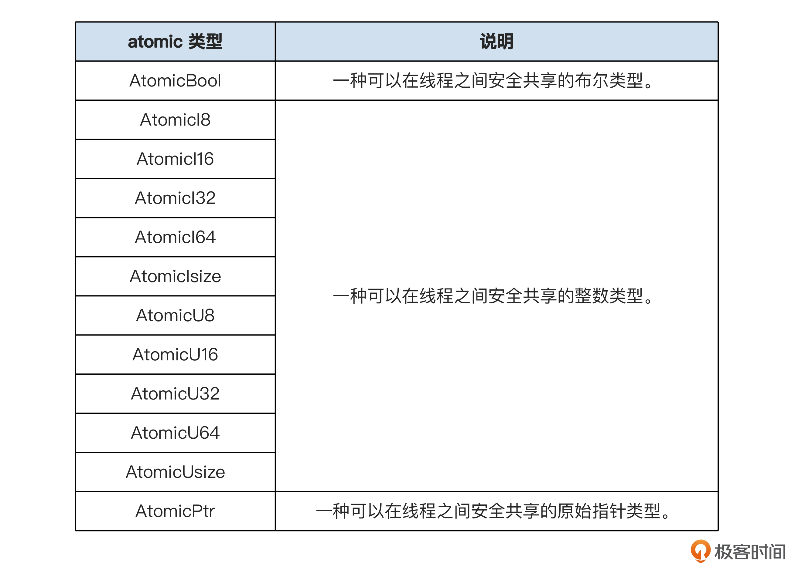

# 29 | 浑然一体，一气呵成：atomic原子操作(中)

你好，我是鸟窝。

在上节课，我们已经了解了原子操作的背景知识以及五种内存序的类型。这节课我们就要详细学习封装的原子类型以及各种原子操作，你也会看到内存序的使用。我还会在这节课带你了解atomic 的使用场景。

Rust 中原子类型可以用来实现其他更高级的同步原语，它是处于更底层的同步原语，对于我们想更深入了解 Rust 并发原语，我们一定要掌握它。

## atomic 类型

```
std::sync::atomic 模块提供了一系列原子操作的数据类型，这些数据类型对应于 Rust
```

的整数、布尔和指针类型, 它为这些类型提供了原子操作的能力。

虽然这个模块包含了很多的原子类型，每个原子类型又包含了巨多的方法，但是我在这节课中给你总结出它们的共同点，你只需要学会它们的共有的知识，就可以做到一通百通了。

首先我梳理了一张表格供你参考，这张表把原子类型分成了三类，所以我们就把 12 种原子类型简化到 3 种。



具体来说，它们被划分为以下三类：

```
AtomicBool：原子布尔类型。。
AtomicI8、AtomicU8、AtomicI16、AtomicU16、AtomicI32、AtomicU32、
AtomicI64、AtomicU64：固定大小的原子整数类型。比如 AtomicI8，此类型与底层
整数类型 i8 具有相同的大小、对齐方式和位有效性。AtomicIsize，AtomicUsize：
```

- 原子有符号 / 无符号整数类型（与平台指针大小相同）。

```
AtomicPtr<T>：原子原始指针类型。它使得指针本身的读写是原子的，但不保证指针指
向的数据的有效性或线程安全性。解引用 AtomicPtr 获取的值通常需要 unsafe 代码
```

- 块。

通过以上的分类，我们就比较容易学习这些类型的相关原子操作了。

```
我想进一步解释“比如 AtomicI8，此类型与底层整数类型 i8 具有相同的大小、对齐方式和
```

位有效性。”

```
相同的大小：这意味着 AtomicI8 在内存中占据的空间大小是和 i8 完全一样的。你已经
知道， i8是一个有符号的 8 位整数，它的大小是 1 个字节。AtomicI8 同样也只占用 1
```

- 个字节。原子类型多奇妙啊，不会额外占用更多的内存空间

- 对齐方式：对齐方式指的是数据在内存中的起始地址必须是某个特定数值的倍数。这个数值通常是 2 的幂次方（例如 1, 2, 4, 8 等字节）。不同的处理器架构对不同类型的数据有不同

```
的对齐要求。AtomicI8 和 i8 具有相同的对齐方式，这意味着它们在内存中可以放置的
起始地址的规则是相同的。对于像 i8 这样的小类型，通常其对齐要求是 1 字节，也就是说
它可以放在内存中的任何地址。AtomicI8 也遵循这个规则。原子操作要求必须位对齐。
位有效性：位有效性描述了类型所使用的二进制位中，哪些组合是有效的值。对于 i8 来
```

- 说，它使用 8 位来表示从 -128 到 127 的整数，所有这 256 种可能的位组合都是有效的。

```
AtomicI8 也具有相同的位有效性。这意味着存储在 AtomicI8 中的值，其底层的 8 位二
进制表示与存储在 i8 中的相同值的二进制表示是完全一致的。原子操作只是保证了对这 8
```

- 位的整体性、不可中断的读写和修改。

你可以把原子类型看作是基本类型的一个“豪华升级版”，它在保持了相同的内存布局和表示方式的同时，增加了在并发环境下的安全性和可预测性。

## atomic 操作

为了方便你学习和记忆，我总结一套便于记忆的方法。首先我们先学习所有原子类型共用的方法，这些方法对 12 种原子类型都是适用的，函数和方法的签名基本一样，唯一不同的是底层的数据不同而已。

### 通用方法

### new 创建一个原子类型

```
首先介绍 new 方法，创建一个对应类型T的原子类型。比如 AtomicBool::new 需要一个布
尔类型的初始值，AtomicI8:new 需要一个 i8 类型的初始值， AtomicIsize 需要一个
isize 类型的初始值，AtomicPtr 需要 *mut T 类型的初始值。在下面的各小节中我就不
```

再重复了。

### as_ptr 返回底层值的可变指针

```
as_ptr 方法返回一个指向内部值的可变指针。但是需要注意的是，对通过方法返回的结果值
```

进行非原子读写可能引发数据竞争。

```
即使你从一个可以安全共享的原子类型那里拿到一个可以修改数据的“通行证”（*mut 指针），
```

你也不能随便用这个通行证。你仍然需要非常小心，并且只能使用特定的“安全方式”（原子操作，如下面例子中的方法 1）来修改数据。而且，你必须明确告诉 Rust：“我知道我在做什

```javascript
么，这可能有点危险”（unsafe 代码块）。
use std::sync::atomic::{AtomicI16, Ordering};
unsafe fn my_atomic_op(arg: *mut i16) {
   // 方法1：直接使用 Rust 的原子操作
   unsafe{
       let atomic_ref = &*(arg as *mut AtomicI16);
       atomic_ref.fetch_add(1, Ordering::SeqCst);
   }
   // 方法2：手动修改内存（不推荐，非原子操作）
   // unsafe {
   //     *arg = *arg + 1;  // 警告：这不是原子操作！
   // }
}
fn main() {
   let atomic = AtomicI16::new(1);
   // 安全性： 这里我们假设 `my_atomic_op` 是一个原子操作
   unsafe {
       my_atomic_op(atomic.as_ptr());
   }
   println!("Atomic value: {}", atomic.load(Ordering::SeqCst)); // 输出：Atomic v
}
```

### from_ptr 创建新引用

```javascript
as_ptr 方法的反向操作，基于一个指针创建一个指向原子整数的新引用。
use std::sync::atomic::{self, AtomicI16};
fn main() {
   // 得到一个指向 i16 的原始指针
   let ptr: *mut i16 = Box::into_raw(Box::new(0));
   // 这里我们假设 ptr 是一个有效的(对齐的)指针，并且它指向一个 i16 的值
   assert!(ptr.cast::<AtomicI16>().is_aligned());
   {
       // 基于原始指针创建一个原子引用
       let atomic = unsafe { AtomicI16::from_ptr(ptr) };
       // 使用原子操作
       atomic.store(1, atomic::Ordering::Relaxed);
   }
   // 非原子地访问 `ptr` 后面的值是安全的，因为上面的块中原子的引用结束了它的生命周期
   assert_eq!(unsafe { *ptr }, 1);
   // 丢弃原始指针
   unsafe { drop(Box::from_raw(ptr)) }
}
```

### get_mut 返回可变引用

返回一个可以修改底层整数的引用。

```
注意哈，和 as_ptr 方法不同，这种操作是安全的，原因在于可变引用独占访问权限，从而
```

排除了其他线程在同一时刻访问此原子数据的可能性。

```javascript
use std::sync::atomic::{AtomicI16, Ordering};
fn main() {
   let mut some_var = AtomicI16::new(10);
   assert_eq!(*some_var.get_mut(), 10);
   *some_var.get_mut() = 5;
   assert_eq!(some_var.load(Ordering::SeqCst), 5);
}
```

### get_mut_slice 从原子类型数组得到普通类型数组

```
以非原子方式获取对 &mut [AtomicI16] 切片的访问。你可以像访问普通的 i16 切片一样
访问 [AtomicI16] 切片中的每个元素，而不需要使用原子操作（例如 load, store, swap
```

等）。你可以直接读取和写入元素的值。

这种操作是安全的，原因在于可变引用独占访问权限，从而排除了其他线程在同一时刻访问此原子数据的可能性。

```javascript
#![feature(atomic_from_mut)]
use std::sync::atomic::{AtomicI16, Ordering};
fn main() {
   // 1. 创建一个原子变量数组，并用0初始化。
   let mut some_ints = [const { AtomicI16::new(0) }; 10];
   // 2. 使用 AtomicI16::get_mut_slice() 获取一个数组可变引用。
   let view: &mut [i16] = AtomicI16::get_mut_slice(&mut some_ints);
   assert_eq!(view, [0; 10]);
   // 通过可变引用修改底层的值
   view.iter_mut()
       .enumerate()
       .for_each(|(idx, int)| *int = idx as _);
   std::thread::scope(|s| {
       // 通过原子加载操作验证底层的值
       some_ints.iter().enumerate().for_each(|(idx, int)| {
           s.spawn(move || assert_eq!(int.load(Ordering::Relaxed), idx as _));
       })
   });
}
```

### from_mut 从可变引用得到原子类型

```
获取对 &mut i16 的原子访问。get_mut方法的反向操作。
```

这里我要重点提示一下，只有在那些 AtomicI16 和 i16 内存对齐方式相同的目标平台上，才能使用此函数，因为原子操作要求数据对齐。

```javascript
#![feature(atomic_from_mut)]
use std::sync::atomic::{AtomicI16, Ordering};
fn main() {
   let mut some_int = 123;
   // 基于some_int创建一个原子引用
   // 这里我们假设 some_int 是一个有效的(对齐的)指针，并且它指向一个 i16 的值
   let a = AtomicI16::from_mut(&mut some_int);
   a.store(100, Ordering::Relaxed);
   assert_eq!(some_int, 100);
}
```

### from_mut_slice 从普通类型数据得到原子类型数组

```javascript
以原子方式获取对 &mut [i16] 切片的访问。
#![feature(atomic_from_mut)]
use std::sync::atomic::{AtomicI16, Ordering};
fn main() {
   // 一个普通的 i16 数组
   let mut some_ints = [0; 10];
   // 使用AtomicI16::get_mut_slice() 获取一个AtomicI16数组引用。
   let a = &*AtomicI16::from_mut_slice(&mut some_ints);
   std::thread::scope(|s| {
       for i in 0..a.len() {
           // 通过原子操作设置底层的值
           s.spawn(move || a[i].store(i as _, Ordering::Relaxed));
       }
   });
   // 通过非原子访问的方式访问底层的值
   for (i, n) in some_ints.into_iter().enumerate() {
       assert_eq!(i, n as usize);
   }
}
```

之所以能这样转来转去，是因为这些原子类型和底层数据大小一致，对齐一致。

### into_inner 消耗这个原子变量并返回底层值

消耗这个原子变量，并返回它所持有的值。因为消耗掉了这个原子变量，所以这个方法调用后，此原子变量不能再被访问了。

```
这种操作是安全的，原因在于按值传递 self 会转移所有权，从而排除了其他线程在同一时刻
```

访问此原子数据的可能性。

```javascript
use std::sync::atomic::AtomicI16;
fn main() {
   let some_var = AtomicI16::new(5);
   assert_eq!(some_var.into_inner(), 5);
   // 错误，因为 `some_var` 已经被消费了
   // println!("some_var: {:?}", some_var);
}
```

接下来介绍真正的原子操作。虽然刚才我们对原子类型划分成三类，但是它们也还是有很多相同操作的方法，功能一样，只是处理的底层数据类型不同而已。我会在第一次说到这个函数时详细讲解，后面再出现这个函数的时候我只会提一句。

### AtomicBool 原子布尔类型

一个可以在线程之间安全共享的布尔类型。

```
此类型与 bool 类型具有相同的大小、对齐方式和位有效性。
```

### load 读取数据

执行一次从布尔值原子读取数据的操作。

```
load 函数需要一个 Ordering 参数，该参数定义了本次读取操作的内存序。只允许使用的
值有 SeqCst、Acquire 和 Relaxed。（它们可以用在读操作上，当然SeqCst和 Relaxed
```

也可以用在写操作上）。

```
如果传入的 order 是 Release 或 AcqRel，则程序会发生 panic。（它们一般用在写操作
```

上。

```javascript
use std::sync::atomic::{AtomicBool, Ordering};
let some_bool = AtomicBool::new(true);
assert_eq!(some_bool.load(Ordering::Relaxed), true);
```

### store 保存数据

执行一次将数据写入布尔值的原子操作。

```javascript
store 函数需要一个 Ordering 参数，该参数定义了本次写入操作的内存序。允许使用的值
有 SeqCst、Release 和 Relaxed。
如果传入的 order 是 Acquire 或 AcqRel，则程序会发生 panic。
use std::sync::atomic::{AtomicBool, Ordering};
let some_bool = AtomicBool::new(true);
some_bool.store(false, Ordering::Relaxed);
assert_eq!(some_bool.load(Ordering::Relaxed), false);
```

### swap 交换数据

执行一次原子交换操作：将一个新值存储到布尔值中，并返回该布尔值原来的值。

```javascript
swap 函数需要一个 Ordering 参数，该参数定义了本次交换操作的内存序。所有内存序都
是有效的。需要注意的是，如果使用 Acquire，则存储操作会退化为 Relaxed；如果使用
Release，则加载操作会退化为 Relaxed。
use std::sync::atomic::{AtomicBool, Ordering};
let some_bool = AtomicBool::new(true);
assert_eq!(some_bool.swap(false, Ordering::Relaxed), true);
assert_eq!(some_bool.load(Ordering::Relaxed), false);
```

### update 更新数据

读取当前值，然后应用一个函数计算出新值。新值将被原子地存储，并返回原始读取到的旧值。

需要重点提示一下，由于其他线程可能同时修改该值，此函数可能会被重复调用多次，直到成功存储新值。但请注意，提供的函数仅会对最终成功存储的值计算一次。

```sql
update 函数接受两个 Ordering 参数来指定内存顺序。第一个参数是操作最终成功时的内
```

存序，第二个参数是加载操作的内存序。这两个参数分别对应于

```
AtomicBool::compare_exchange 的成功和失败内存序。
当成功时的内存序使用 Acquire 时，存储操作会变为 Relaxed；当成功时的内存序使用
Release 时，最终成功的加载会变为 Relaxed。失败时的加载内存序只能是 SeqCst、
Acquire 或 Relaxed。
```

注意事项

此方法并非硬件原生支持的“魔法”操作，而是基于

```
AtomicBool::compare_exchange_weak 实现的，因此也存在其固有的缺点，特别是无
```

法避免 ABA 问题。

这是一个夜构建版本才有的方法，正式版中还未包含，提供一个比 swap 更灵活的方法。

```sql
#![feature(atomic_try_update)]
use std::sync::atomic::{AtomicBool, Ordering};
let x = AtomicBool::new(false);
assert_eq!(x.update(Ordering::SeqCst, Ordering::SeqCst, |x| !x), false);
assert_eq!(x.update(Ordering::SeqCst, Ordering::SeqCst, |x| !x), true);
assert_eq!(x.load(Ordering::SeqCst), false);
```

### try_update 尝试更新数据

```javascript
读取当前值，然后应用一个函数，该函数可能会返回一个新的值（Some(new_value)）或指
示不更新（None）。如果函数返回 Some(new_value)，则原子地存储新值并返回
Ok(previous_value)；如果返回 None，则不进行存储并返回
Err(previous_value)。
#![feature(atomic_try_update)]
use std::sync::atomic::{AtomicBool, Ordering};
let x = AtomicBool::new(false);
assert_eq!(x.try_update(Ordering::SeqCst, Ordering::SeqCst, |_| None), Err(false)
assert_eq!(x.try_update(Ordering::SeqCst, Ordering::SeqCst, |x| Some(!x)), Ok(fal
assert_eq!(x.try_update(Ordering::SeqCst, Ordering::SeqCst, |x| Some(!x)), Ok(tru
assert_eq!(x.load(Ordering::SeqCst), false);
```

### compare_and_swap

```
当布尔值的当前值与给定的 current 值相同时，存储一个新的值到该布尔值中。
该方法总是返回操作之前的旧值。如果该返回值等于 current，则表示布尔值已被成功更
```

新。

```
compare_and_swap 方法同样接受一个 Ordering 类型的参数，用于描述本次操作的内存
排序方式。需要注意的是，即使使用了 AcqRel 排序，操作也可能因为比较失败而仅执行一
次 Acquire 加载，而不会具备 Release 语义。在发生存储的情况下，使用 Acquire 会使
存储部分表现为 Relaxed；而使用 Release 会使加载部分表现为 Relaxed。
```

此方法已经弃用，请使用 compare_exchange 和 compare_exchange_weak。

### compare_exchange

```
只有当前布尔值与给定的 current 值相同时，才存储一个新的值到该布尔值中。
返回值是一个 Result 类型，用于表明新值是否成功写入，并包含操作之前的旧值。在操作
成功 (Ok) 的情况下，该旧值必定与 current 值相等。
compare_exchange 方法接受两个 Ordering 类型的参数，分别用于描述本次操作成功和
```

失败时的内存排序要求。

```
success 参数定义了当与 current 值的比较成功时，所执行的读 - 修改 - 写操作所需的
```

- 内存顺序。

```
failure 参数则定义了当比较失败时，所执行的加载操作所需的内存顺序。
```

```javascript
将 success 顺序设置为 Acquire 会导致本次操作的存储部分表现为 Relaxed；而将
success 顺序设置为 Release 则会导致成功的加载表现为 Relaxed。failure 顺序仅能
为 SeqCst、Acquire 或 Relaxed。
use std::sync::atomic::{AtomicBool, Ordering};
let some_bool = AtomicBool::new(true);
assert_eq!(some_bool.compare_exchange(true,
                                     false,
                                     Ordering::Acquire,
                                     Ordering::Relaxed),
          Ok(true));
assert_eq!(some_bool.load(Ordering::Relaxed), false);
assert_eq!(some_bool.compare_exchange(true, true,
                                     Ordering::SeqCst,
                                     Ordering::Acquire),
          Err(false));
assert_eq!(some_bool.load(Ordering::Relaxed), false);
```

### compare_exchange_weak

```
只有当前布尔值与给定的 current 值相同时，才存储一个新的值到该布尔值中。
与 AtomicBool::compare_exchange 不同的是，即使比较成功，此函数也可能出现虚假
失败，但在某些平台上，这可以带来更高的代码执行效率。返回值是一个 Result 类型，用
```

于表明新值是否成功写入，并包含操作之前的旧值。

```
compare_exchange_weak 方法接受两个 Ordering 类型的参数，分别用于描述本次操作
```

成功和失败时的内存排序要求。

```
success 参数定义了当与 current 值的比较成功时，所执行的读 - 修改 - 写操作所需的
```

- 内存顺序。

```javascript
failure 参数则定义了当比较失败时，所执行的加载操作所需的内存顺序。
将 success 顺序设置为 Acquire 会导致本次操作的存储部分表现为 Relaxed；而将
success 顺序设置为 Release 则会导致成功的加载表现为 Relaxed。failure 顺序仅能
为 SeqCst、Acquire 或 Relaxed。
use std::sync::atomic::{AtomicBool, Ordering};
let val = AtomicBool::new(false);
let new = true;
let mut old = val.load(Ordering::Relaxed);
loop {
   match val.compare_exchange_weak(old, new, Ordering::SeqCst, Ordering::Relaxed
       Ok(_) => break,
       Err(x) => old = x,
   }
}
```

接下来是 fetch 类的操作，不同的原子类型会有不同的操作，比如布尔类型有布尔操作，整数类型有数学运算操作。

### fetch_and 与操作

对布尔值执行逻辑“与”操作。

```
此操作将当前布尔值与提供的参数 val 进行逻辑“与”运算，并将运算结果更新为当前布尔值，
```

随后返回执行操作前的原始值。

```javascript
fetch_and 函数需要一个 Ordering 参数，该参数定义了本次操作的内存序。所有内存序
都是有效的。需要注意的是，如果使用 Acquire，则存储操作会退化为 Relaxed；如果使
用 Release，则加载操作会退化为 Relaxed。
use std::sync::atomic::{AtomicBool, Ordering};
let foo = AtomicBool::new(true);
assert_eq!(foo.fetch_and(false, Ordering::SeqCst), true);
assert_eq!(foo.load(Ordering::SeqCst), false);
let foo = AtomicBool::new(true);
assert_eq!(foo.fetch_and(true, Ordering::SeqCst), true);
assert_eq!(foo.load(Ordering::SeqCst), true);
let foo = AtomicBool::new(false);
assert_eq!(foo.fetch_and(false, Ordering::SeqCst), false);
assert_eq!(foo.load(Ordering::SeqCst), false);
```

### fetch_nand 与非操作

对布尔值执行逻辑“与非”操作。

```
此操作将当前布尔值与提供的参数 val 进行逻辑“与非”运算，并将运算结果更新为当前布尔
```

值。随后返回执行操作前的原始值。

```
fetch_nand 函数需要一个 Ordering 参数，该参数定义了本次操作的内存序。所有内存序
都是有效的。需要注意的是，如果使用 Acquire，则存储操作会退化为 Relaxed；如果使
用 Release，则加载操作会退化为 Relaxed。
```

代码和上面的雷同，不重复写了。

### fetch_not 非操作

对布尔值执行逻辑“非”操作。

此操作将当前布尔值进行逻辑“非”运算，并将运算结果更新为当前布尔值。随后返回执行操作前的原始值。

```
fetch_not 函数需要一个 Ordering 参数，该参数定义了本次操作的内存序。所有内存序
都是有效的。需要注意的是，如果使用 Acquire，则存储操作会退化为 Relaxed；如果使
用 Release，则加载操作会退化为 Relaxed。
```

### fetch_or 或操作

对布尔值执行逻辑“或”操作。

```
此操作将当前布尔值与提供的参数 val 进行逻辑“或”运算，并将运算结果更新为当前布尔值。
```

随后返回执行操作前的原始值。

```
fetch_or 函数需要一个 Ordering 参数，该参数定义了本次操作的内存序。所有内存序都
是有效的。需要注意的是，如果使用 Acquire，则存储操作会退化为 Relaxed；如果使用
Release，则加载操作会退化为 Relaxed。
```

### fetch_xor 异或操作

对布尔值执行逻辑“异或”操作。

```
此操作将当前布尔值与提供的参数 val 进行逻辑“异或”运算，并将运算结果更新为当前布尔
```

值。随后返回执行操作前的原始值。

```
fetch_xor 函数需要一个 Ordering 参数，该参数定义了本次操作的内存序。所有内存序
都是有效的。需要注意的是，如果使用 Acquire，则存储操作会退化为 Relaxed；如果使
用 Release，则加载操作会退化为 Relaxed。
```

### fetch_update 使用指定的函数更新

```
获取当前值，并对其应用一个返回可选新值的函数。如果函数返回 Some(_)，则返回
Ok(previous_value) 类型的 Result，否则返回 Err(previous_value)。
```

请注意，如果在操作过程中，该值被其他线程修改，只要函数返回 Some(_)，则此函数可能会被多次调用；然而，该函数仅会对最终存储的值执行一次。

```
fetch_update 方法接受两个 Ordering 类型的参数，分别用于描述本次操作成功和失败时
```

的内存排序要求。

第一个参数定义了操作最终成功时所需的顺序，第二个参数定义了加载所需的顺序。这两个参

```
数分别对应于 AtomicBool::compare_exchange 方法的成功和失败排序。
将成功顺序设置为 Acquire 会导致本次操作的存储部分表现为 Relaxed；而将成功顺序设
置为 Release 则会导致最终成功的加载表现为 Relaxed。失败时的加载顺序仅能为
SeqCst、Acquire 或 Relaxed。
```

相对于前面几个 fetch 方法，此方法提供了一个通用的操作函数，而不是固定的布尔操作。

### AtomicXXX 原子整数类型

xxx 可以是 I8、U8、I16、U16、I32、U32、I64、U64。

以下原子操作方法和 AtomicBool 类同，不详细介绍了。

- load

- store

- swap

- update

- try_update

- compare_and_swap

- compare_exchange

- compare_exchange_weak

它没有布尔操作相关的 fetch，但是有一批和算术运算相关的 fetch。

### fetch_add 增加一个数

执行原子加法操作，将给定值加到当前值上，并返回执行操作前的原始值。此操作在发生算术溢出时会进行环绕。

```javascript
fetch_add 函数需要一个 Ordering 参数，该参数定义了本次操作的内存序。所有内存序
都是有效的。需要注意的是，如果使用 Acquire，则存储操作会退化为 Relaxed；如果使
用 Release，则加载操作会退化为 Relaxed。
use std::sync::atomic::{AtomicI64, Ordering};
let foo = AtomicI64::new(0);
assert_eq!(foo.fetch_add(10, Ordering::SeqCst), 0);
assert_eq!(foo.load(Ordering::SeqCst), 10);
```

### fetch_sub 减去一个数

执行原子减法操作：从当前值减去给定值，并返回执行操作前的原始值。此操作在发生算术溢出时会进行环绕。

```javascript
fetch_sub 函数需要一个 Ordering 参数，该参数定义了本次操作的内存序。所有内存序
都是有效的。需要注意的是，如果使用 Acquire，则存储操作会退化为 Relaxed；如果使
用 Release，则加载操作会退化为 Relaxed。
use std::sync::atomic::{AtomicI64, Ordering};
let foo = AtomicI64::new(20);
assert_eq!(foo.fetch_sub(10, Ordering::SeqCst), 20);
assert_eq!(foo.load(Ordering::SeqCst), 10);
```

### fetch_max 最大值操作

执行原子最大值操作，取当前值和给定值的最大值，并更新当前值。此操作比较当前值与提供

```javascript
的参数 val，并将两者之中的较大值设置为当前值。随后返回执行操作前的原始值。
fetch_max 函数需要一个 Ordering 参数，该参数定义了本次操作的内存序。所有内存序
都是有效的。需要注意的是，如果使用 Acquire，则存储操作会退化为 Relaxed；如果使
用 Release，则加载操作会退化为 Relaxed。
use std::sync::atomic::{AtomicI64, Ordering};
let foo = AtomicI64::new(23);
assert_eq!(foo.fetch_max(42, Ordering::SeqCst), 23);
assert_eq!(foo.load(Ordering::SeqCst), 42);
```

如果你想一步获得结果的最大值，你可以这样写：

```javascript
use std::sync::atomic::{AtomicI64, Ordering};
let foo = AtomicI64::new(23);
let bar = 42;
let max_foo = foo.fetch_max(bar, Ordering::SeqCst).max(bar); // 这样
assert!(max_foo == 42);
```

### fetch_min 最小值操作

执行原子最小值操作：取当前值和给定值的最小值，并更新当前值。

```
此操作比较当前值与提供的参数 val，并将两者之中的较小值设置为当前值。随后返回执行
```

操作前的原始值。

```
fetch_min 函数需要一个 Ordering 参数，该参数定义了本次操作的内存序。所有内存序
都是有效的。需要注意的是，如果使用 Acquire，则存储操作会退化为 Relaxed；如果使
用 Release，则加载操作会退化为 Relaxed。
```

接下来还有四个位操作，注意不是布尔操作。

### fetch_and 位与操作

```
对当前值执行按位“与”操作。此操作将当前值与提供的参数 val 进行按位“与”运算，并将运算
```

结果更新为当前值。然后返回执行操作前的原始值。

```javascript
fetch_and 函数需要一个 Ordering 参数，该参数定义了本次操作的内存序。所有内存序
都是有效的。需要注意的是，如果使用 Acquire，则存储操作会退化为 Relaxed；如果使
用 Release，则加载操作会退化为 Relaxed。
use std::sync::atomic::{AtomicI64, Ordering};
let foo = AtomicI64::new(0b101101);
assert_eq!(foo.fetch_and(0b110011, Ordering::SeqCst), 0b101101);
assert_eq!(foo.load(Ordering::SeqCst), 0b100001);
```

接下来的三个位操作的例子和前面这个雷同，我就不再重复了。

### fetch_nand 位与非操作

```
对当前值执行按位“与非”操作。此操作将当前值与提供的参数 val 进行按位“与非”运算，并将
```

运算结果更新为当前值。然后返回执行操作前的原始值。

```
fetch_nand 函数需要一个 Ordering 参数，该参数定义了本次操作的内存序。所有内存序
都是有效的。需要注意的是，如果使用 Acquire，则存储操作会退化为 Relaxed；如果使
用 Release，则加载操作会退化为 Relaxed。
```

### fetch_or 位或操作

```
对当前值执行按位“或”操作。此操作将当前值与提供的参数 val 进行按位“或”运算，并将运算
```

结果更新为当前值。然后返回执行操作前的原始值。

```
fetch_or 函数需要一个 Ordering 参数，该参数定义了本次操作的内存序。所有内存序都
是有效的。需要注意的是，如果使用 Acquire，则存储操作会退化为 Relaxed；如果使用
Release，则加载操作会退化为 Relaxed。
```

### fetch_xor 异或操作

```
对当前值和参数 val 执行按位“异或”运算，并将结果设置为新的值。随后返回先前的值。
```

```
fetch_xor 接受一个 Ordering 参数，该参数描述了此操作的内存顺序。所有内存序都是
可能的。请注意，使用 Acquire 会使此操作的存储部分变为 Relaxed，而使用 Release
会使加载部分变为 Relaxed。
```

### AtomicIsize/AtomicUsize

```
此类型的大小和位有效性与底层整数类型 isize / usize相同。
```

它的方法和原子整数类型的方法相同，不多做介绍了。

### AtomicPtr 原子指针类型

```
一种可以在线程之间安全共享的原始指针类型。此类型的大小和位有效性与 *mut T 相同。
和原子整数类型相同的是，它拥有fetch_and、fetch_or、fetch_xor三种位操作，没有
fetch_nand操作。它依然有fetch_update操作。
```

它的算术操作包括下面四种：

```
fetch_byte_add: 通过加 val 个字节偏移指针的地址，并返回之前的指针。
fetch_byte_sub: 通过减 val 个字节偏移指针的地址，并返回之前的指针。
fetch_ptr_add：通过加 val 个 T 类型大小的单位来偏移指针的地址，并返回之前的指
```

- 针。

```
fetch_ptr_sub: 通过减 val 个 T 类型大小的单位来偏移指针的地址，并返回之前的指
```

- 针。

## 总结

继上节课学习原子操作的背景知识和五种内存序类型之后，这节课我们深入探讨了 Rust 中

```
std::sync::atomic 模块所提供的封装原子类型，包括 AtomicBool、各种原子整数（如
AtomicI8 至 AtomicU64、AtomicIsize/AtomicUsize）以及原子指针 AtomicPtr，
```

这些类型都保证了在线程间的安全共享。课程里详细讲解这些原子类型的通用方法，你可以课后结合代码例子再加深一下印象。

学习这些原子类型和方法，你要学会找它们共性的东西，并和基本类型的操作做对比，比如布尔类型，就会有与非或等布尔操作；比如整数类型就有加减操作和位操作。

```
值得注意的是，原子操作方法都会带有一个内存序参数。一般读操作允许 SeqCst、
Acquire 和 Relaxed，写操作允许 SeqCst、Release 和 Relaxed，但是有的操作比如
swap 既包含读也包含写，一般内存序都可以，只不过它其中的某些操作会自动进行退化。对
```

于这些函数，请仔细阅读文档中这些函数的内存序的介绍，内存序参数可能是唯一影响你掌握原子类型的阻碍。

下一节课，我们还会继续学习 atomic 的相关知识和使用场景。

## 思考题

请思考，64 操作系统下，对一个 64 位指针的赋值，是原子操作还是非原子操作，请说出你的理由。

期待你的分享。如果今天的内容对你有所帮助，也期待你转发给你的同事或者朋友，大家一起学习，共同进步。我们下节课再见！
