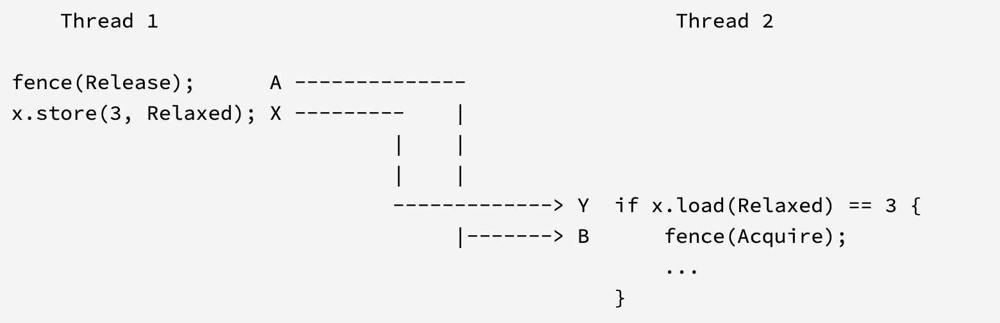

# 30 | 浑然一体，一气呵成：atomic原子操作(下)

你好，我是鸟窝。

前面两节课，我们已经了解了原子操作的背景知识以及五种内存序的类型，标准库中 12 种原

```
子类型以及它们非常多的原子方法。atomic 模块中的内容比较多，所以我们还得再开一节才
```

能学习完它的相关知识。

```
在这节课中，我们先来了解两个底层的和屏障（fence）相关的函数，然后学习原子类型应用
```

的场景。

## 两个函数

```
atomic 模块还提供了 fence 和 compiler_fence 两个函数。其实还有一个
spin_loop_hint 函数，但是这个函数自 Rust 1.51.0 就废弃了。
```

### fence

屏障 (Fence) 在其自身与其他线程中的原子操作或屏障之间建立同步。为实现这一点，屏障会阻止编译器和 CPU 对其周围特定类型的内存操作进行重排序。

```
读写多线程场景下，Acquire 语义和 Release 语义常常配套使用。
```

下面我们举一个利用屏障在线程间同步的例子。

```
Thread 1 是写线程
它使用 Release 语义屏障 A
```

- 它有写操作 X

```
Thread 2 是读线程
它使用 Acquire 语义屏障 B
```

- 它有读操作 Y

- 两个线程同步操作同一个原子类型 M

以上是背景介绍，接下来让我们理解官方文档中这段话和示意图：

```
一个具有（至少）Release 语义的屏障 A，与一个具有（至少）Acquire 语义的屏障 B 进
```

行同步： 当且仅当存在操作 X 和 Y（两者都作用于某个原子对象 ‘M’），使得 A 按序排在 X 之前（A is sequenced before X），Y 按序排在 B 之前（Y is sequenced before B），并且 Y 观测到了 M 的变化（Y observes the change to M）。这就在 A 和 B 之间提供了一个 “happens-before” 的依赖关系。



```
请注意，在上面的例子中，对 x 的访问必须是原子的，这一点至关重要。屏障不能用于在不
```

同线程的非原子访问之间建立同步。然而，得益于 A 和 B 之间的 happens-before 关系，任何发生在 A 之前的非原子访问，现在也与任何发生在 B 之后的非原子访问正确地同步了。

```
具有 Release 或 Acquire 语义的原子操作也可以与屏障同步。
也就是说，Thread 1 中 A 之前的任何操作，包括原子和非原子的，在 Thread 2 中 B 之
```

后都可以看到。 都可以看到的意思是都可以认为发生在 B 之前。

```
一个具有 SeqCst 排序的屏障，除了同时具有 Acquire 和 Release 语义外，还会参与到其
他 SeqCst 操作和 / 或屏障构成的全局程序顺序中。
fence 函数接收一个内存序参数， 内存序参数可以是 Acquire、Release、AcqRel 和
SeqCst 排序。
use std::sync::atomic::AtomicBool;
use std::sync::atomic::fence;
use std::sync::atomic::Ordering;
// 一个排他锁，基于自旋锁实现。
pub struct Mutex {
   flag: AtomicBool,
}
impl Mutex {
   pub fn new() -> Mutex {
       Mutex {
           flag: AtomicBool::new(false),
       }
   }
   // 获取锁
   pub fn lock(&self) {
       // 等待直到标识从false变为true
       // 自旋， CPU占用可能很高，不要用在生产环境中
       while self
           .flag
           .compare_exchange_weak(false, true, Ordering::Relaxed, Ordering::Rela
           .is_err()
       {}
       // 这个屏障和`unlock`中的存储操作同步。
       // 这意味着在这个屏障之前的所有操作都必须在这个屏障之后完成。
       fence(Ordering::Acquire);
   }
   pub fn unlock(&self) {
       // 这个屏障和`lock`中的fence操作同步。
       self.flag.store(false, Ordering::Release);
   }
}
```

### compiler_fence

“仅限针对编译器”的原子屏障。

```
与 fence 类似，此函数也与其他原子操作和屏障建立同步。但与 fence 不同，
compiler_fence 仅与同一线程内的操作建立同步。这起初可能听起来没什么用，因为单个
```

线程内的代码通常已经是完全有序的，不需要额外的同步。

然而，有些情况下代码可以在同一线程上运行却没有顺序保证：

- 最常见的情况是信号处理器 (signal handler)：信号处理器与其所中断的代码在同一线程中

```
运行，但相对于那段代码而言，它并没有顺序保证。compiler_fence 可用于在线程与其
信号处理器之间建立同步，就像 fence 可用于跨线程建立同步一样。
```

- 类似的情况也可能出现在嵌入式编程中的中断处理器（interrupt handlers），或抢占式绿

```
色线程（preemptive green threads）的自定义实现中。总的来说，compiler_fence
```

- 可以与保证在同一硬件 CPU 上运行的代码建立同步。

```
请注意，和 fence 一样，同步仍然需要在相关的两段代码（例如主代码和信号处理器代码）
```

中使用原子操作 —— 不可能完全依靠屏障和非原子操作来实现同步。

```
compiler_fence 不会生成任何机器码，但它限制了编译器允许进行的内存重排序类型。
compiler_fence 对应于 C 和 C++ 中的 atomic_signal_fence。
```

一句话，就是告诉编译器别给我瞎乱排，我已经标记按照顺序执行了。

```
use std::sync::atomic::AtomicBool;
use std::sync::atomic::Ordering;
use std::sync::atomic::compiler_fence;
static mut IMPORTANT_VARIABLE: usize = 0;
static IS_READY: AtomicBool = AtomicBool::new(false);
fn main() {
   unsafe { IMPORTANT_VARIABLE = 42 };
   // 将之前的写入标记为与未来的 relaxed stores 一起释放
   compiler_fence(Ordering::Release);
   IS_READY.store(true, Ordering::Relaxed);
   // 调用信号处理函数来测试同步
   signal_handler();
}
fn signal_handler() {
   if IS_READY.load(Ordering::Relaxed) {
       // 获取那些通过我们读取的 relaxed stores 释放的写入
       compiler_fence(Ordering::Acquire);
       assert_eq!(unsafe { IMPORTANT_VARIABLE }, 42);
   }
}
```

## 使用场景

原子操作是构建更复杂并发原语和系统的基础。原子类型这三节课的最后哈，我们就结合一些典型的应用场景及简化的 Rust 代码示例来加深理解。

### 原子标志位 (Atomic Flag)

用于线程间简单的状态通知，例如主线程通知工作子线程停止。

```javascript
use std::sync::Arc;
use std::sync::atomic::{AtomicBool, Ordering};
use std::thread;
use std::time::Duration;
fn main() {
   // 使用 Arc<AtomicBool> 在线程间共享标志
   let running = Arc::new(AtomicBool::new(true));
   let running_clone = running.clone();
   let handle = thread::spawn(move || {
       // 工作线程循环检查标志
       // 使用 Acquire 加载确保能观察到主线程的 Release 写入
       while running_clone.load(Ordering::Acquire) {
           println!("Working...");
           thread::sleep(Duration::from_millis(500));
       }
       println!("Worker thread stopping.");
   });
   // 主线程等待一段时间后设置标志
   thread::sleep(Duration::from_secs(2));
   println!("Main thread signaling stop.");
   // 使用 Release 存储确保此写入对工作线程的 Acquire 加载可见
   running.store(false, Ordering::Release);
   handle.join().unwrap();
   println!("Main thread finished.");
}
```

这里工作子线程要能够在一些关键点上检查这个原子标志位，看看是否需要退出。

### 原子计数器 (Atomic Counter)

```javascript
非常适合统计事件发生次数、管理资源引用计数（如 Arc 内部）等。
use std::sync::Arc;
use std::sync::atomic::{AtomicUsize, Ordering};
use std::thread;
fn main() {
   let counter = Arc::new(AtomicUsize::new(0));
   let mut handles = vec![];
   for i in 0..5 {
       let counter_clone = counter.clone();
       handles.push(thread::spawn(move || {
           for _ in 0..100 {
               // fetch_add 进行原子递增
               // Relaxed 通常足够用于简单计数，因为我们只关心最终总和，
               // 不关心增量操作之间的确切顺序或它们与其他变量的同步。
               // 如果计数器用于控制对其他数据的访问，可能需要更强的顺序。
               counter_clone.fetch_add(1, Ordering::Relaxed);
           }
           println!("Thread {} finished counting.", i);
       }));
   }
   for handle in handles {
       handle.join().unwrap();
   }
   // 读取最终结果时，通常需要 Acquire 或 SeqCst 来确保看到所有线程的最终写入。
   let final_count = counter.load(Ordering::Acquire);
   println!("Final count: {}", final_count); // 应为 500
}
```

### 实现简单自旋锁

自旋锁是一种简单的锁，线程在获取锁失败时会忙等待（循环检查）而不是阻塞。注意，简单的自旋锁效率低下且不公平，实际应用中应使用更复杂的实现或 std::sync::Mutex。

```
use std::sync::atomic::{AtomicBool, Ordering};
use std::cell::UnsafeCell; // 需要 UnsafeCell 来包裹数据，因为锁内部需要可变访问
// 一个简单的自旋锁结构体
pub struct SpinLock<T> {
   locked: AtomicBool,
   data: UnsafeCell<T>, // 数据被 UnsafeCell 包裹
}
// 需要手动实现 Send 和 Sync，因为 UnsafeCell 不是 Sync 的
// 我们断言锁的逻辑保证了线程安全
unsafe impl<T: Send> Send for SpinLock<T> {}
unsafe impl<T: Send> Sync for SpinLock<T> {}
impl<T> SpinLock<T> {
   pub fn new(data: T) -> Self {
       SpinLock {
           locked: AtomicBool::new(false), // false 表示未锁定
           data: UnsafeCell::new(data),
       }
   }
   // 获取锁，返回一个 RAII 守护对象
   pub fn lock(&self) -> SpinLockGuard<T> {
       // 循环尝试将 false (未锁定) 交换为 true (锁定)
       // Acquire 顺序: 确保成功获取锁之后的操作，发生在获取锁之后，
       // 并且能看到之前释放锁的线程的所有写入。
       // Relaxed 失败顺序: 如果 CAS 失败，不需要同步保证。
       while self.locked.compare_exchange_weak(false, true, Ordering::Acquire, O
           // 提示 CPU 我们在自旋等待，可能降低功耗或让出超线程资源
           std::hint::spin_loop();
       }
       SpinLockGuard { lock: self }
   }
   // 解锁操作由 SpinLockGuard 的 Drop 实现自动处理
}
// RAII 守护对象，用于自动解锁
pub struct SpinLockGuard<'a, T> {
   lock: &'a SpinLock<T>,
}
// 实现 Deref 和 DerefMut，让守护对象可以像 T 的引用一样使用
impl<'a, T> std::ops::Deref for SpinLockGuard<'a, T> {
   type Target = T;
   fn deref(&self) -> &Self::Target {
       // Safety: 我们持有锁，保证了对数据的独占访问权
       unsafe { &*self.lock.data.get() }
   }
}
impl<'a, T> std::ops::DerefMut for SpinLockGuard<'a, T> {
   fn deref_mut(&mut self) -> &mut Self::Target {
       // Safety: 我们持有锁，保证了对数据的独占访问权
       unsafe { &mut *self.lock.data.get() }
   }
}
// 实现 Drop trait，在守护对象离开作用域时自动释放锁
impl<'a, T> Drop for SpinLockGuard<'a, T> {
   fn drop(&mut self) {
       // Release 顺序: 确保在解锁之前对受保护数据的所有修改，
       // 对下一个成功获取锁的线程可见。
       self.lock.locked.store(false, Ordering::Release);
   }
}
```

### 无锁数据结构

原子操作是构建无锁栈、队列、集合等的基础。这些结构允许多个线程并发访问而无需传统锁，通常使用 CAS 循环来实现。

代码量比较多，就不写在这里了，你可以课后直接查看代码仓库，有详细的注释。链接是：

https://github.com/smallnest/rust-concurrency_code/blob/master/ch30/src/bin/lock_free_queue.rs

另外 lock-free queue 这篇经典的论文也可以参考，链接是https://people.cs.pitt.edu/~jacklange/teaching/cs2510-f17/implementing_lock_free.pdf。你可以根据这篇论文的原理使用 Rust 的原子类型实现一个无锁队列。

### 一次性初始化

```
确保某个资源或计算只被初始化一次，即使在多线程环境下也是如此。std::sync::Once
```

是标准库提供的更高级、推荐的方式，但也可以用原子操作手动实现（如后面的例子所示，使

```javascript
用 AtomicPtr 和 CAS）。
use std::sync::atomic::{AtomicPtr, Ordering};
use std::ptr;
struct ExpensiveResource { value: i32 }
static RESOURCE: AtomicPtr<ExpensiveResource> = AtomicPtr::new(ptr::null_mut());
fn get_or_init_resource() -> &'static ExpensiveResource {
   // 尝试快速路径：如果已初始化，直接返回
   let mut ptr = RESOURCE.load(Ordering::Acquire); // Acquire 确保看到已初始化的资源
   if ptr.is_null() {
       // 慢路径：尝试初始化
       let new_resource = Box::into_raw(Box::new(ExpensiveResource { value: 42 }
       // AcqRel: 如果成功，Release 确保资源对其他线程可见；Acquire 与其他线程的初始化同步
       // Acquire (failure): 如果失败，Acquire 确保能看到成功初始化的线程设置的指针。
       match RESOURCE.compare_exchange(ptr::null_mut(), new_resource, Ordering::
           Ok(_) => {
               // 我们成功初始化了它
               ptr = new_resource;
           }
           Err(current_ptr) => {
               // 其他线程在我们之前初始化了它
               // 释放我们创建但未使用的资源
               unsafe { drop(Box::from_raw(new_resource)); }
               ptr = current_ptr; // 使用已存在的指针
           }
       }
   }
   // Safety: 一旦初始化，指针指向的静态资源就不会改变或被释放。
   // 这要求 ExpensiveResource 本身是 Sync 的。
   unsafe { &*ptr }
}
```

### 内存栅栏和同步点

需要在特定点建立内存同步关系。

```
use std::sync::atomic::{fence, Ordering};
// 在关键点建立内存栅栏
// 确保之前的所有内存操作对其他线程可见
fence(Ordering::SeqCst);
```

### 并发控制原语

原子类型是实现更高级同步原语的基础，这是我第三次重复这句话了，但是我还一直没有举一个例子说明。这个例子就是基于原子操作实现一个简单的信号量：

```javascript
// 简化的信号量实现
pub struct Semaphore {
   count: AtomicUsize,
}
impl Semaphore {
   pub fn new(count: usize) -> Self {
       Self { count: AtomicUsize::new(count) }
   }
   pub fn acquire(&self) {
       loop {
           let current = self.count.load(Ordering::Relaxed);
           if current == 0 {
               std::thread::yield_now();
               continue;
           }
           if self.count.compare_exchange(
               current, current - 1, Ordering::Acquire, Ordering::Relaxed
           ).is_ok() {
               break;
           }
       }
   }
   pub fn release(&self) {
       self.count.fetch_add(1, Ordering::Release);
   }
}
```

## 总结

```
这节课我们一起了解了 atomic 模块中用于底层同步的 fence 和 compiler_fence 函数。
fence 通过内存序参数在不同线程的原子操作或屏障间建立同步，阻止编译器和 CPU 进行特
定类型的重排序，从而实现 happens-before 关系。compiler_fence 则是一种“仅限编译器”
```

的屏障，用于同一线程内（如信号处理器和主代码）的同步，限制编译器的重排序，但不产生机器码。

此外，这节课我们还重点学习了原子类型的多种应用场景，包括作为线程间通信的原子标志位、用于计数和引用管理的原子计数器、实现基本同步机制的自旋锁、构建无锁数据结构以及实现一次性初始化。最后，我们聊了一下内存栅栏和并发控制原语的应用。

到此为止，我们花了三节课时间搞定了 atomic 模块，恰当使用这些类型，对于我们开发高性能、高可靠性的并发程序至关重要。接下来我们继续学习并发集合，敬请期待。

## 思考题

```javascript
请思考内存控制原语那一节介绍的信号量实现，为什么 let current =
self.count.load(Ordering::Relaxed); 这一句的实现使用 Relaxed, 理论上有没有问
```

题？

期待你的分享。如果今天的内容对你有所帮助，也期待你转发给你的同事或者朋友，大家一起学习，共同进步。我们下节课再见！
