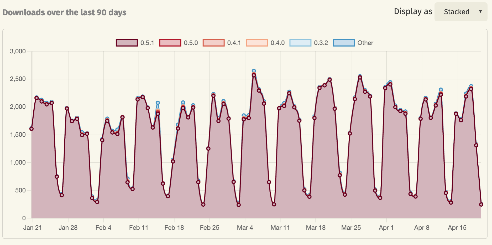
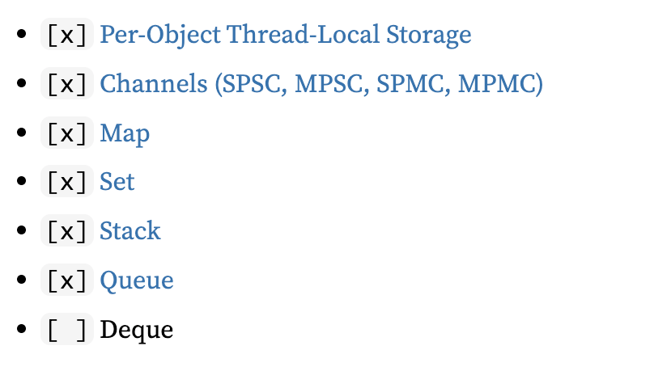

# 32 | 包罗万象，风雨同舟：并发集合（下）

你好，我是鸟窝。

在这个课程的最后一节课，我们可以放松心态，走马观花地了解更多一些 Rust 并发编程的库。这节课我们挑几个重点的库来了解。并发原语库的更多内容，可以参考我建立的一个Rust 并发编程的网站：https://rustcard.rpcx.io，这里我帮你梳理了 99 张卡片。

我挑的这几个库当前还在维护，并且下载量还蛮高的。一些多年已经不维护的库也不给大家推荐了。

## boxcar

这个库是一个并发的 vec 库，但是它和标准库有点不同，它并提供删除的操作，而是只能添加(appending)，所以它适合那种只不断添加元素的场景。

只能添加的功能带来了一个好处：即使它的长度可以增长，它也从不为既有的元素重新分配内

```
存，因此元素的地址在 vec 的整个生命周期内都是稳定的。此外，get 和 push 操作的时间
```

复杂度均为常数时间。

```javascript
它也提供了一个宏，用来快速创建一个 boxcar::vec 对象：
let vec = vec![1, 2, 3];
assert_eq!(vec[0], 1);
assert_eq!(vec[1], 2);
assert_eq!(vec[2], 3);
```

或者创建一个初始化容量的 vec:

```javascript
let vec = vec![1; 3];
assert_eq!(vec, [1, 1, 1]);
当然你可以使用 new 函数或者 with_capacity 创建一个 vec 对象。
```

它提供了无锁的 get 和 push 方法，以及它的功能扩展方法。接下来的一个例子，我来演示它插入和获取的能力：

```javascript
fn main() {
   let vec = boxcar::Vec::new();
   // 启动一个线程往vec中写
   std::thread::scope(|s| for i in 0..6 {
       let vec = &vec;
       s.spawn(move || {
           // 插入一个元素到vec中
           vec.push(i);
       });
       s.spawn(move || {
           // 打印vec的长度
           println!("vec len: {}", vec.count());
       });
   });
   // 在主线程中读取vec中的元素
   for i in 0..6 {
       assert!(vec.iter().any(|(_, &x)| x == i));
   }
}
boxcar::Vec 实现了 IntoIterator trait, 所以我们可以方便的遍历它。通过 count 方法
```

我们可以获取到它当前的长度。

```
虽然不能删除单个元素，但是它提供了一个 clear 方法，可以清空它的所有元素，已分配的
```

容量不会被回收：

```javascript
let mut vec = boxcar::Vec::new();
vec.push(1);
vec.push(2);
vec.clear();
assert!(vec.is_empty());
vec.push(3); // 不会分配新内存
```

## lockfree

这个库提供了几种常见的无锁的数据结构，并且尝试解决 ABA 问题。

- ABA 问题发生在当你使用比较并交换 (Compare-and-Swap, CAS) 这种原子操作来实现并发数据结构时。ABA 问题的核心在于，即使一个值从 A 变成了 B，然后又变回了 A，CAS 操作在比较时仍然会认为值没有发生变化，从而成功地进行交换。但在并发环境下，这个看似没有变化的“A”可能已经经历了其他线程的操作，导致了潜在的问题。

我食言了，事实上这个库已经 6 年没有更新了，不过这个库很有特色，而且每天的下载量也不少，我们不妨简单了解它。



它提供了下面 6 种类型的并发无锁数据结构，对于通道来说，它实现了通道的四种类型。



```javascript
下面是一个并发读写 lockfree::queue::Queue 的例子：
fn main() {
   let q = lockfree::queue::Queue::new();
   // 启动一个线程往队列中写
   std::thread::scope(|s| for i in 0..6 {
       let q = &q;
       s.spawn(move || {
           // 压入一个元素到队列中
           q.push(i);
       });
       s.spawn(move || {
           match  q.pop() {
               Some(x) => println!("弹出: {}", x),
               None => println!("队列为空"),
           }
       });
   });
   for i in q {
       println!("drain item: {}", i);
   }
}
你可能还没有注意到一点：上面这个例子中 q 变量我们并没有将它声明成 mut，虽然我们的
例子有插入操作，这是为什么呢？Queue 的 push 方法的定义也只是引用 &self, 而不是
&mut self。
这是因为 lockfree 的设计就不是采用对整个队列进行可变引用 (&mut self) 那么狠，多个线
```

程可以同时修改队列的内部状态（例如，添加一个新元素），内部采用 lockfree 的方式区处理并发操作，所以不需要 mut 可变。

## arc-swap

```
ArcSwap 是一个非常常用的并发数据结构。
```

在上一节课中，我们使用 Arc<Mutex> 或者 Arc<RwLock> 来提供对我们的数据并发访问支持。既然这种模式这么常用，为什么不单独定义一种这种数据类型呢？这个库就是提供这种功能。

```
ArcSwap  类型是一种容器，可以原子地更改其中的  Arc 。从语义上讲，它类似于
 Atomic<Arc<T>>，从我们熟悉的角度上来说，它的功能类似或  RwLock<Arc<T>> （但不
```

需要锁）。它针对读多写少的场景进行了优化，具有很好的性能。

在很多情况下，人们可能需要一个数据结构，这种结构经常读取而很少更新。例如，服务的配置、路由表、每隔几分钟更新一次的数据快照等。在所有这些场景下，我们需要：

- 能够快速、并发地从多个线程读取数据结构的当前值。

- 在较长时间内使用相同版本的数据结构。

- 在不中断处理的情况下进行更新。

```
ArcSwap 就是专门解决这个问题的。
```

下面这个例子中，我们启动了一个线程更新配置，几个线程读取配置：

```javascript
use std::sync::Arc;
use arc_swap::ArcSwap;
fn main() {
   let config = ArcSwap::from(Arc::new(String::default()));
   std::thread::scope(|s| {
       s.spawn(|| {
           let new_conf = Arc::new("新配置".to_owned());
           config.store(new_conf);
       });
       for _ in 0..10 {
           s.spawn(|| {
               loop {
                   let cfg = config.load();
                   if !cfg.is_empty() {
                       assert_eq!(**cfg, "新配置");
                       return;
                   }
               }
           });
       }
   });
   println!("config: {}", config.load());
}
```

## sharded-slab

```
shared-slab 为单个数据类型提供了预分配的存储。当需要大量相同类型的值时，这比单独
```

为每个对象分配内存更有效。由于分配的对象大小相同，内存碎片减少，创建和删除新项目可以非常便宜。

这个库实现了一个无锁并发 slab，并可以按索引获取元素。

下面这个例子启动了一个线程往 Slab 插入了一条数据，在主线程中可以查询到插入的值。

```sql
use sharded_slab::Slab;
use std::sync::Arc;
fn main() {
   let slab = Arc::new(Slab::new());
   let slab2 = slab.clone();
   let thread2 = std::thread::spawn(move || {
       let key = slab2.insert("来自线程2的问候").unwrap();
       assert_eq!(slab2.get(key).unwrap(), "来自线程2的问候");
       key
   });
   let key1 = slab.insert("来自线程1的问候").unwrap();
   assert_eq!(slab.get(key1).unwrap(), "来自线程1的问候");
   // 等待线程2完成
   let key2 = thread2.join().unwrap();
   // 查询线程2插入的值
   assert_eq!(slab.get(key2).unwrap(), "来自线程2的问候");
}
```

事实上这个库提供了 Slab 和 Pool 两种数据结构：

```
Slab 的核心思想是高效地存储和并发访问固定大小的同类型数据，并通过索引进行管理。
它更像是一个并发安全的、优化过的 Vec<Option<T>>。 你将实际的数据值放入 Slab
```

- 中，并通过返回的索引来访问。

```
Pool 的核心思想是重用已经分配好的存储空间，减少内存分配和释放的开销。它更像是一
```

- 个对象池，你不是直接放入值，而是提供一个方法来初始化池中预留的存储空间。

```
其实，Rust 生态圈还有一个知名的 slab 实现，就叫 slab 库。 那么 shared-slab 和 slab
```

的不同之处在于：

- 与 sharded_slab 不同，向 slab 插入和删除元素需要可变访问。这意味着如果 slab 被多个线程并发访问，那么它需要被一个 Mutex 或 RwLock 保护。即使这些项之间没有关系，当使用 Mutex 时，也不能并发插入或删除（或访问）。在许多情况下，锁会成为显著的瓶颈。另一方面，本小部件允许 slab 中的不同索引并发访问、插入和删除，而不需要全局锁。因此，当 slab 在多个线程之间共享时，本小部件相比slab 提供了显著更好的性能。sharded-slab 在并发使用场景中提供了显著改进的性能，而在单线程使用场景中应优先使用 slab 。

从上面的例子中你可以看到，我们只是使用 Arc 包装了 Slab，并没有使用互斥锁或者读写锁之类的同步原语。

## 总结

好了，在这一节课中，我们又了解了四个第三方的并发库。

相对于 Go 语言的生态圈，Rust 生态圈中的并发库可谓百家齐放，丰富多彩。大家都会针对特定的并发场景，设计有针对性的并发库。对于我们开发者而言，多了解一些并发库，甚至学习它的底层实现，是大有裨益的。

一来可以开拓我们的视野，二来在未来我们的开发过程中，也可以引入这些第三方的库，如虎添翼，快速帮助我们实现并发程序。

## 思考题

你还了解哪些并发库，给你带来了哪些帮助，欢迎在评论区留言。
