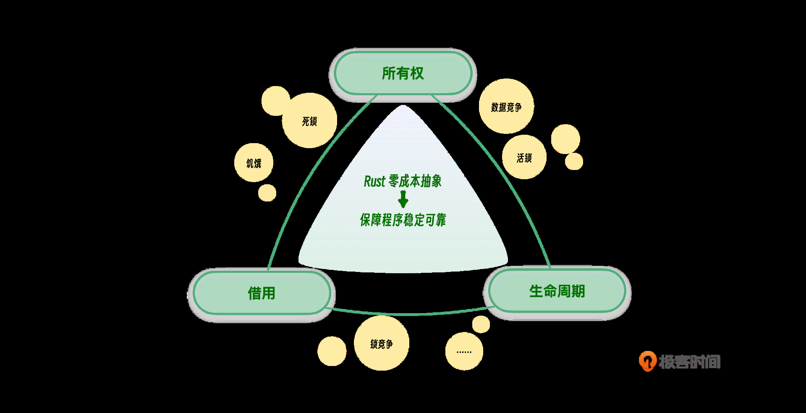
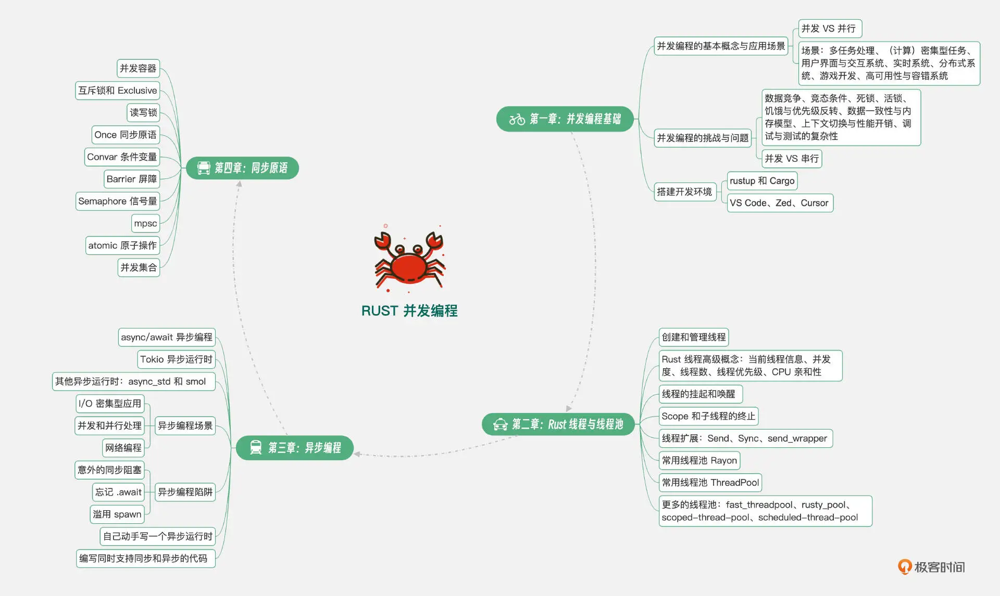
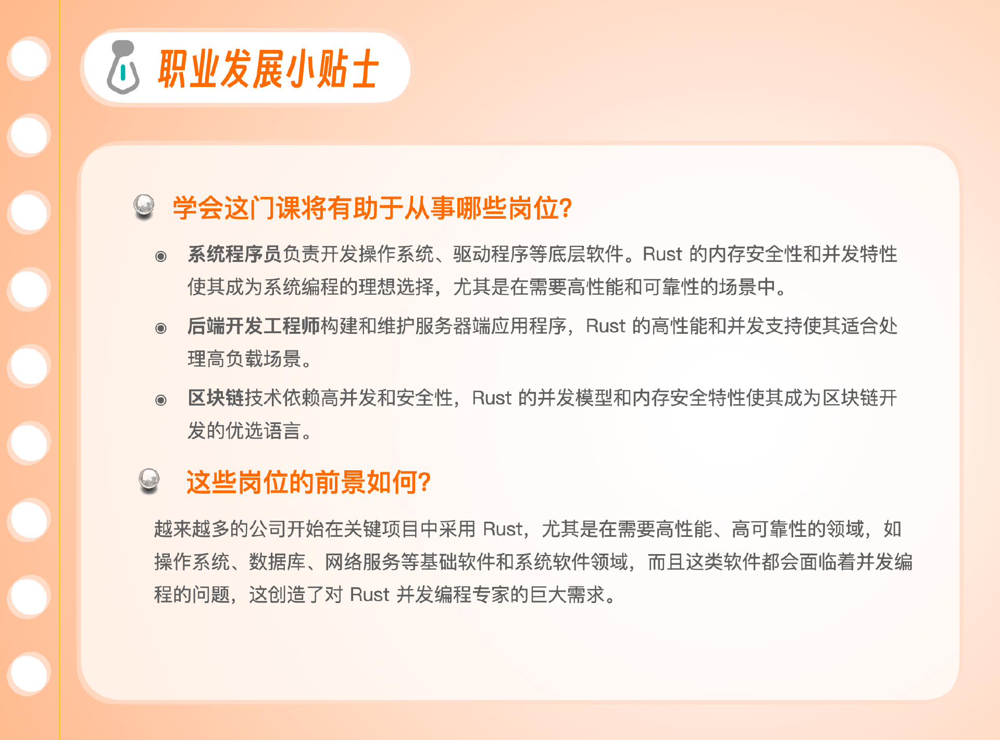

# 开篇词 | 如何用Rust写出安全高效的并发代码？

你好，我是鸟窝，一位沉浸于编程世界 20 余年的 hacker。在公司内同级别的程序员早就不写代码了，可是我依然奋战在编程的第一线，是部门内同级别编码最多的人。

我也是你们的老朋友了，很久以前我研究 Scala 的时候出过一本书《Scala 集合编程手册》，几年前我在极客时间出过《Go 并发编程实战课》的专栏，去年的时候也基于这个专栏出版了《深入理解 Go 并发编程》一书，承蒙厚爱，这两本书也在我们的台湾岛出版了繁体版。

与其说多年的编程经验给了我更多的写作经验，还不如说我可能更善于将开发编程的经验进行挖掘、整理和总结，能够更加系统和全面地介绍某一个垂直方向的知识，让你理解、贯通、深入、全面地掌握和巩固某个方面的知识点。《Scala 集合编程手册》是针对 Scala 集合类的全面介绍，《Go 并发编程实战课》是对 Go 并发编程深入且全面的剖析，而今天这门课程，是对Rust 并发编程的一次全面介绍。

未来，我还有更宏大的计划，想推出 C/C++ 并发编程、Python 并发编程、 Zig 并发编程等姊妹篇，让学习各种编程语言的同学没有编程的困惑，我提前整理好相应的学习资料，你只需买杯奶茶轻轻松松地学习即可。

## 并发编程的本质与挑战

在我看来，并发编程的本质是如何有效地管理和协调多个执行单元（例如线程、协程）共享的资源，以实现高效的程序执行。并发编程的挑战在于两点：如何避免数据竞争、死锁、活锁等问题，同时最大程度地利用硬件资源，提高程序的性能。

传统的并发模型，例如基于共享内存和锁的并发模型，虽然简单易懂，但也容易引入各种并发问题。例如忘记加锁会导致数据竞争，不正确的锁使用顺序会导致死锁。这些问题往往难以调试和排查，给程序的稳定性和可靠性带来了很大的隐患。



Rust 通过其独特的所有权（Ownership）、借用（Borrowing）和生命周期（Lifetime）等概念，在编译期就能够有效地检测出潜在的并发问题，从而避免了运行时错误。这种“零成本抽象”的设计理念，使得 Rust 在保证安全性的同时，还能拥有接近 C/C++ 的性能。同时相比于其他编程语言，能够减少并发编程中的潜在问题。

举一个简单的例子，假设我们需要在多个线程中修改同一个变量。在传统的并发模型中，我们需要使用锁来保护这个变量，以避免数据竞争。而在 Rust 中，我们可以使用

```
Arc<Mutex<T>> 来实现线程安全的共享可变状态，否则在编译的时候都不会通过。
Arc 表示原子引用计数，用于在多个线程之间共享所有权。Mutex 表示互斥锁，用于保护共
享变量的访问。Rust 的编译器会强制我们使用 Mutex 的 lock() 方法来获取锁，并在使用
```

完毕后自动释放锁，从而避免了忘记加锁或解锁的问题。

但是，也并不是说 Rust 在编译的时候完全能够检测出所有的并发问题，让我们无所畏惧地随意编写并发程序，几种情况导致的死锁依然存在，unsafe 的使用也有可能绕过 Rust 的检查导致并发问题，所以正确地使用很关键，这也是我们课程的重点。

此外，Rust 还提供了丰富的同步原语，例如通道（Channel）、原子类型（Atomic Types）、条件变量（Condition Variables）等，可以帮助我们构建各种复杂的并发程序。我们需要用很大一部分时间和精力去学习和掌握这些同步原语，彻底了解它们的功能和使用场景，才能够为我们所用，在合适的时机使用它们。

## 系统学习，步步为营

如果你已经学习了《Go 并发编程实战课》，你会发现本课程和它的同与不同。首先作为编程语言，并发编程有很多相通的地方，包括并发的场景、解决方案和常见的同步原语，所以你会看到一些相同的介绍，比如互斥锁、读写锁和条件变量等等。其次，各编程语言又有不同的设计，比如 Rust 的并发单元是线程和任务，即使是互斥锁，底层的实现也不同。

另外，我们暂时不会去介绍各个同步原语的实现代码，这一块有些高深，阅读起来有些枯燥，容易打击你学习整个课程的积极性，所以在这门课程中，我暂时不去介绍它们的实现了，后续再根据大家的需求决定推出与否。Rust 语言本身的学习曲线就很陡，我们还是把重心放在基础并发知识的掌握上。

### 直播专场：带你直击 Rust 并发之美

此外，我们在课程形式上也做了升级，在原有的课程基础上，增设了 4 个直播专场。我会通过直播的形式，带你学习 Rust 中的线程应用，体会并发之美；通过异步编程的案例带你直观地感受 Rust 并发编程的能力；带你使用我们课程中学到的同步原语，让你精通这些“武器”；最后我还会带你实现一个 lock-free 队列。

因为编程说到底是门手艺活，有时候光看文字是不行的，尤其是需要你动手做的部分，自己摸索可能需要花费很长的时间。如果能够看到整个实现过程，相信你动起手来会事半功倍。这样一来，即便你是 Rust 的初学者也没有问题，你可以把这门课当做你进阶的阶梯，通过对并发编程的学习和实践，去实现大型额度、高性能的现代并发程序。

### 课程设计

我们这门课程将以并发特性的学习为导向，从基础概念入手，逐步深入到高级主题，通过大量的示例代码和实践项目，帮助你系统掌握 Rust 并发编程的核心技术。课程主要包括以下几个模块：



### 第一章：并发编程基础

这部分我们会介绍并发编程的基本概念与应用场景，例如线程、线程池等。这一部分你还会了解到目前并发编程的挑战和你可能会遇到的问题。此外我还会专门介绍 Rust 编程环境的搭建，如果你已经熟悉了 Rust 编程开发，这一部分就可以忽略。

### 第二章：线程和线程池

Rust 的并发单元是线程。线程是基础，我们应该牢牢掌握线程的每一个知识点。所以我们会深入剖析 Rust 中线程的各种属性和使用方法。另外为了更加有效地使用服务器的资源，我们还会在大量并发的情况下，通过线程池的方式，有效管理线程对系统资源的消耗，使用有效的资源管理庞大的并发任务。

### 第三章：异步编程

```
这部分我们会介绍异步编程的概念和优势，以及 Rust 的异步编程模型。讲解 async/await
语法、Future、Executor 等核心概念。掌握常用的异步运行时，如 Tokio、async-std、
```

smol 等。

### 第四章：同步原语

最后我们会介绍标准库中各种常见的同步原语如互斥锁、读写锁、Once、条件变量等等。除了介绍各个同步原语的特性，还会介绍它们的使用场景、常见的坑等等，帮助你在日常工作中规避这些问题。

希望通过这门课程的学习，你能够深入理解 Rust 的并发模型和机制，熟练使用 Rust 的并发原语和 API，最终能够独立解决常见的并发问题，具备使用 Rust 进行高并发系统开发的能力。我相信，只要你一步一个脚印地跟学跟练，就一定能够驾驭并发之美，构建出高效、可靠的 Rust 并发应用程序。好了，就从今天开始，跟着鸟窝老师一起开启这段精彩的 Rust 并发编程之旅吧！



小编提醒：第四次直播时间在五一假期之后，进课程交流群蹲直播链接🔗，直播答疑问题提交点这里

课程配套代码仓库链接：https://github.com/smallnest/rust-concurrency_code
