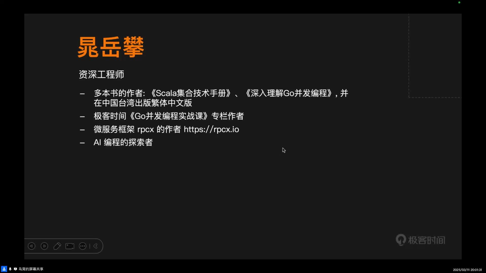
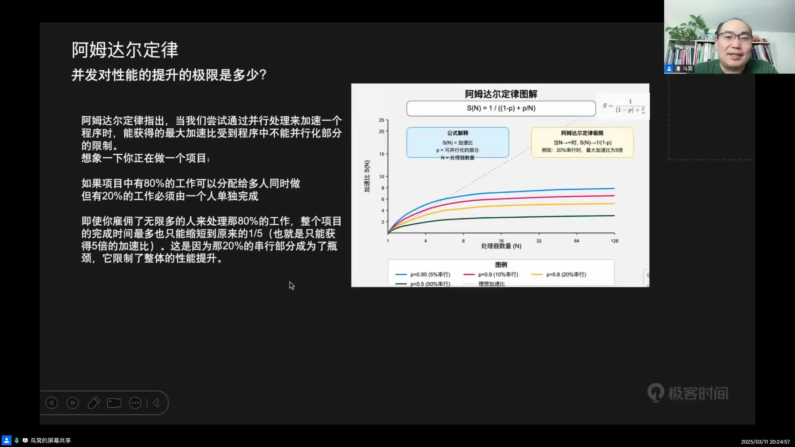
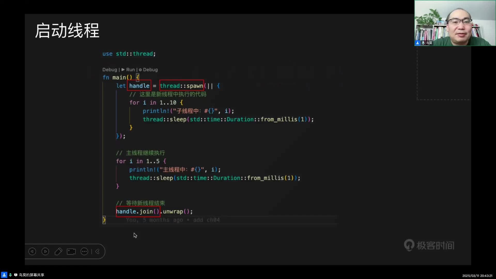
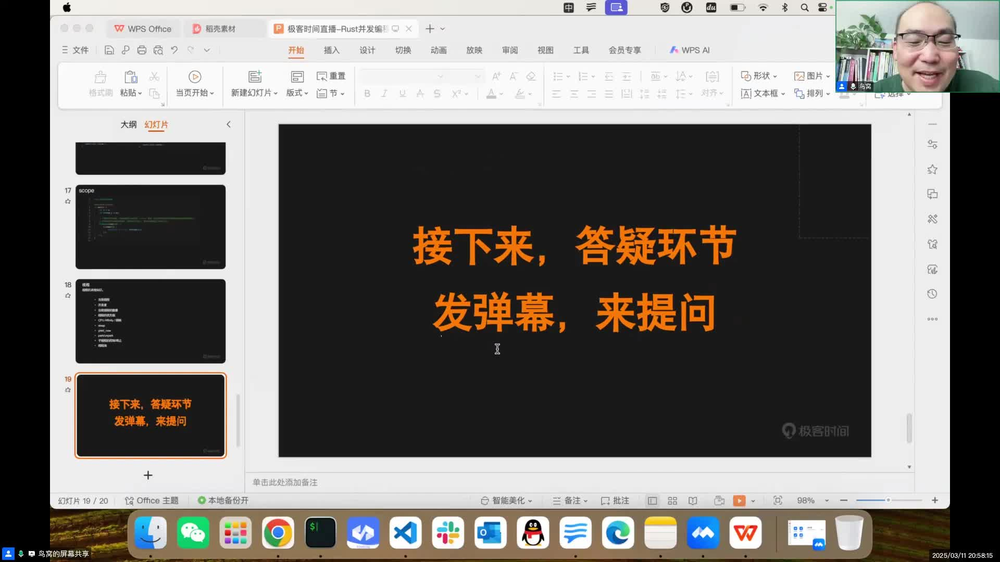

# 直播专场（一） | 并发之美，Rust中的线程应用

## 直播内容预览

Part 1：并发编程的场景

Part 2：并发是银弹吗？

Part 3：Rust 中的线程技术

Part 4：答疑环节



Part 1 主要围绕并发编程的概念、应用场景、以及不同编程语言对并发的支持方式展开讨论。以下是主要内容的总结：

### 1. 并发编程的动机

- 充分利用硬件资源：现代 CPU 多核架构的普及，使得并发编程成为提高程序性能的重要手段。

- 提高吞吐量：通过并发编程，可以提高服务器的吞吐能力，充分利用 CPU、内存、带宽等资源。

- 应对多核 CPU 和 GPU：现代服务器和计算设备通常配备多核 CPU 和高性能 GPU，需要通过并发编程来充分利用这些硬件能力。

### 2. 并发编程的应用场景

- IO 密集型任务：涉及大量磁盘读写或网络通信的任务，如文件读写、网络请求等。这类任务通常被阻塞在 IO 操作上，适合通过并发编程来优化。

- 计算密集型任务：主要消耗 CPU 资源的任务，如复杂计算、数据处理等。这类任务需要通过并行计算来提高性能。

- 混合型任务：同时包含 IO 和计算密集型任务的场景，需要综合优化。

### 3. 并发任务的处理方式

- 线程和进程：操作系统层面的并发单元，线程是进程内的独立执行单元，多个线程共享进程的内存空间。

- 线程池：用于管理线程资源，避免频繁创建和销毁线程带来的开销。

```
轻量级并发单元：如 Go 语言的 Goroutine 和 Rust 的异步编程（async/await），这些单
```

- 元更轻量级，适合处理大量并发任务。

### 4. 不同编程语言的并发支持

- Go 语言：通过 Goroutine 实现高效的并发编程，适合处理 IO 密集型任务。

```
Rust 语言：通过异步编程（async/await）和线程池实现并发，适合处理计算密集型任
```

- 务。

- 其他语言：如 C++、Python 等，也支持并发编程，但实现方式和性能各有不同。

### 5. 并发与并行的区别

- 并发（Concurrency）：指同时处理多个任务，但任务可能在不同时间点上交错执行，不一定同时运行。

- 并行（Parallelism）：指多个任务同时在多个 CPU 上运行，强调任务的并行执行。

- 并发和并行在实际编程中常常结合使用。

### 6. 并发编程的实践建议

- 优化算法：对于计算密集型任务，优化算法可以减少 CPU 资源占用。

- 合理使用线程池：避免线程过多导致的资源浪费和调度开销。

- 异步编程：对于 IO 密集型任务，使用异步编程可以避免线程阻塞，提高效率。



Part 2 主要围绕并发编程的性能优化问题展开，通过理论和实际案例讲解并发编程的优缺点及其适用场景。以下是主要内容的总结：

### 1. 并发对性能的影响

- 提高程序性能并不总是可以通过增加并发来实现。

- 并发的性能提升受到阿姆达尔定律的限制，即程序中可并行化的部分（P）决定了性能提升的上限。

- 当 CPU 核数增加时，性能提升会逐渐趋缓，最终趋于稳定。

### 2. 阿姆达尔定律的解释

- P（可并行化部分）：程序中可以并行执行的部分，其值在 0 到 1 之间。

- 当 P=0 时，程序完全串行，无法通过增加 CPU 核数提升性能。

- 当 P=1 时，程序完全并行化，性能提升与 CPU 核数成正比。

- 加速比（S）：性能优化的倍数，与可并行化部分和 CPU 核数相关。

- 阿姆达尔定律启示：程序性能提升不能仅依赖硬件（如 CPU 核数），还需要优化程序的可并行化部分。

### 3. 并发编程的实际案例

- 归并排序算法的三种实现方式：

- 1.串行实现：传统的归并排序，将数组分成两半，分别排序后再合并。

- 2.并发实现：通过线程并行处理左右两半数组，但可能导致线程过多，资源耗尽，性能反而下降。

- 3.异步实现：使用异步编程技术，通过线程池优化线程管理，避免资源耗尽。

- 性能测试结果：

- 串行实现的性能最好（0.75 毫秒）。

- 并发实现的性能最差（2 毫秒），且 CPU 占用更高。

- 异步实现的性能介于两者之间（约 1 毫秒）。

### 4. 并发编程的局限性

- 并发编程并非万能，其性能提升受到多种因素的限制：

- 线程管理开销：线程的创建、销毁和切换会消耗额外资源。

- 资源竞争：线程过多可能导致 CPU 和内存资源紧张，影响性能。

- 锁和同步机制：并发程序中需要处理线程间的同步和锁，增加了复杂性和开销。

- 在某些场景下，串行执行可能比并发执行更高效。

### 5. 并发的适用场景

- 并发适用于需要处理大量独立任务的场景，如网络连接处理（Redis 的网络处理部分）。

- 对于计算密集型任务，需要谨慎评估并发的收益和开销。

### 总结与建议

- 并发编程并非万能，需要根据具体场景选择合适的实现方式。

- 优化程序的可并行化部分（P）是提升性能的关键。

- 在设计并发程序时，要权衡线程管理开销、资源竞争和锁的使用，避免过度并发导致性能下降。



Part 3 主要介绍了 Rust 语言中并发编程的基础知识和一些重要的线程管理概念。以下是主要内容的总结：

### 1. Rust 并发编程入门

```
线程的创建：通过 thread::spawn 函数启动一个线程，这是 Rust 中实现并发的最基本
```

- 方式。

```
线程的执行：线程可以独立于主线程运行，但需要通过 handle 来管理线程的生命周期。
线程的等待：通过 handle.join() 等待线程完成，确保主线程不会在子线程执行完毕前
```

- 退出。

### 2. 线程的高级特性

```
线程命名：通过 thread::Builder 可以为线程设置名称，便于调试和日志记录。
```

- 线程 ID：可以获取线程的唯一标识符（ID），用于区分不同的线程。

- 线程优先级：Rust 允许设置线程的优先级，高优先级的线程会优先获得 CPU 时间片。

- 线程绑定：可以将线程绑定到特定的 CPU 核心，减少线程切换的开销。

### 3. 线程的生命周期管理

```
线程的启动和终止：介绍了如何启动线程以及如何通过 handle 终止线程。
线程的挂起和恢复：通过 park 和 unpark 方法可以挂起和恢复线程。
线程的取消：介绍了如何取消线程的任务，例如通过 cancel 方法。
```

### 4. 线程池的使用

- 线程池的概念：线程池用于管理线程资源，减少线程创建和销毁的开销。

```
线程池的实现：介绍了 Rust 中常用的线程池库（如 rayon、tokio 等）及其使用方法。
```

### 5. 线程安全和并发控制

```
线程安全变量：介绍了如何使用 Arc（原子引用计数）和 Mutex（互斥锁）来实现线程安
```

- 全。

```
线程间通信：通过 channel（通道）实现线程间的通信。
```

- 线程的并发度：可以根据 CPU 核心数设置线程的并发度，以优化性能。

### 6. 线程的调试和监控

- 日志记录：通过线程名称和 ID 在日志中记录线程的执行情况。

```
调试工具：介绍了如何使用调试工具（如 gdb）来监控线程的运行状态。
```

### 7. 线程的高级用法

```
thread::scope：通过 thread::scope 可以确保线程在作用域内完成，避免线程提前
```

- 退出。

```
spawn_unchecked：在某些情况下可以使用 spawn_unchecked 来绕过 Rust 的生命周
```

- 期检查，但这需要谨慎使用。



### 答疑问题

1. 人工智能生成生产级代码后程序员如何处置？

2. 人工智能对测试有什么提升的实践吗？
