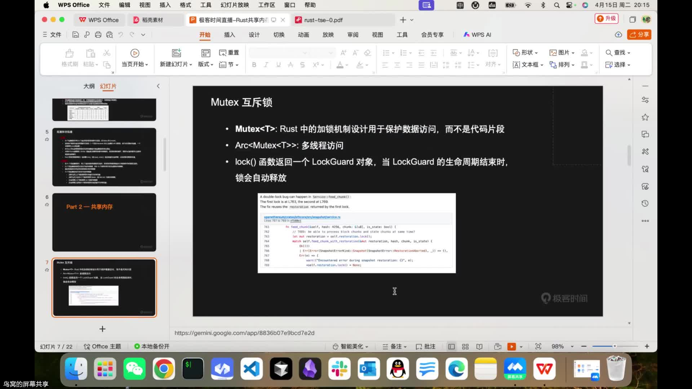
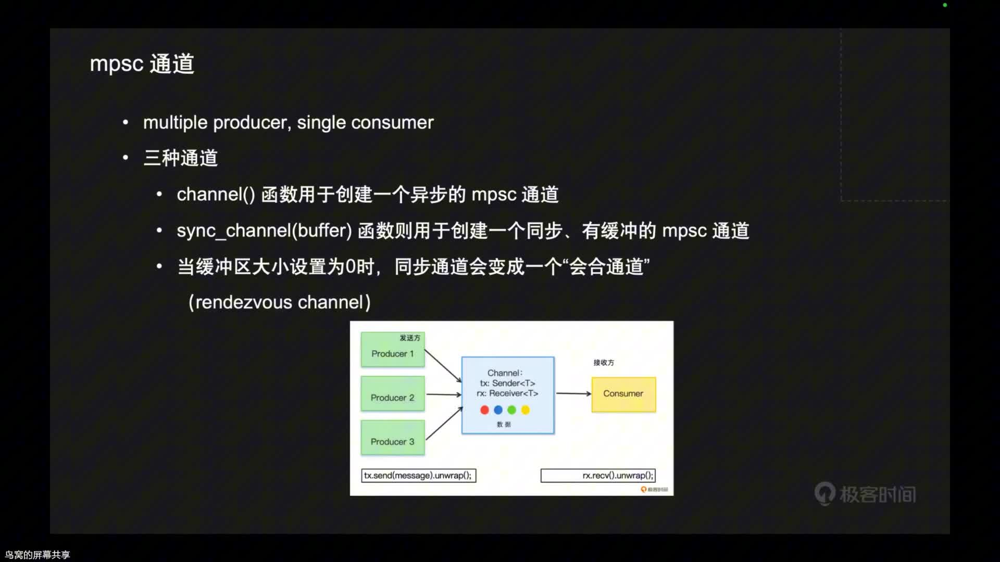

# 直播专场（三） | 同步：共享内存和消息传递

## Part 1 并发问题分类

### Rust 并发问题及修复方法

Rust 的并发问题相对较少，但仍需重视者在研究知名开源项目时发现了 100 多个并发 bug。

论文《Understanding and Detecting Real-World Safetylsisues in Rust》将 Rust 并发问题分成了两类，阻塞与非阻塞。

阻塞：阻塞错误在某个或多个线程执行等待资源（阻塞操作）的操作时出现，但这些资源从未可用。

非阻塞：

- 非阻塞错误是并发错误的一种，所有线程都可以完成执行，但结果是不希望的。

- Rust 支持共享内存和消息传递这两种跨线程通信的机制。

- 错误的数据共享是传统编程语言中大多数非阻塞错误的根本原因。

阻塞：

- 59 个阻塞错误中有 55 个是由同步原语的操作引起的，如 Mutex 和 Condvar。

- 其余四个错误不是由原语操作引起的（一个仅在 Windows 平台上阻塞在 API 调用处，两个在忙循环中阻塞，一个在线程的 join() 处阻塞）。

- 对 Rust 的生命周期规则缺乏良好的理解是许多阻塞错误的常见原因。

- 大部分 Rust 阻塞错误（51/59）都是通过调整同步操作来修复的，包括添加新的操作、移除不必要的操作以及移动或更改现有操作。

- Rust 特有的修复策略之一是调整 lock()（或 read(), write()）返回变量的生命周期，以改变隐式解锁的位置。

非阻塞：

- 在 41 个非阻塞错误中，有三个是由消息传递错误引起的，其余的所有错误都是由于未能保护共享资源引起的。

- 23 个非阻塞错误使用不安全代码共享数据，其中 19 个使用内部不安全函数来共享数据。

- 通过传递指向内存空间的原始指针来共享数据

- 15 个非阻塞错误会与安全代码共享数据，具体情况如下：

- [保护互斥] 五个错误使用原子变量作为共享变量。

- [保护互斥] 而另外十个错误则使用 Mutex（或 RwL。ock）包装共享数据。

- [生命周期] 九个错误使用 Arc 包装共享数据

- [生命周期] 而其他六个错误则使用全局变量作为共享变量。

## Part 2 共享内存

主要介绍了共享内存方式的并发原语（或者叫同步原语）。

### Mutex 互斥锁

- Mutex: Rust 中的加锁机制设计用于保护数据访问，而不是代码片段

- Arc<Mutex>: 多线程访问

- lock() 函数返回一个 LockGuard 对象，当 LockGuard 的生命周期结束时，锁会自动释放

### RwLock 读写锁

- write 获取写锁

- read 获得读锁

- Arc<RwLock>: 多线程访问

- Guard 自动释放

### Once、OnceLock、LazyLock  执行一次

- Once::call_once 执行初始化一次

- OnceLock::get_or_init 获取值，如果还未初始化则初始化

- LazyLock::force 强制求值， 也可以隐式求值

- 死锁：call_once 递归调用此 Once 的 call_once

### Condvar 条件变量

它允许线程在满足特定条件之前进入休眠状态。当条件满足时，其他线程可以发出信号唤醒等待的线程。条件变量最怕的是没有线程唤醒它们。

十个错误中：

- 八个错误中有一个线程在调用条件变量的 wait() 时被阻塞，而没有其他线程调用同一个条件变量的 notify_one() 或 notify_all()。

- 在另外两个错误中，一个线程在等待另一个线程释放锁，而另一个线程在等待第一个线程调用 notify_all()。

### Barrier 屏障

它允许一组线程或进程相互等待，直到所有成员都到达某个预定的点。

- 到达屏障的线程或进程会被阻塞，直到所有其他成员也到达。

- 一旦所有成员都到达，它们才能同时继续执行。

### Semaphore 信号量

它维护一个计数器，表示可用资源的数量。线程可以通过以下两种操作来使用信号量：

- acquire()（P 操作或 down 操作）：尝试获取一个许可。如果计数器大于 0，则计数器减 1，线程继续执行；否则，线程将被阻塞，直到有许可可用。

- release()（V 操作或 up 操作）：释放一个许可，使计数器加 1。如果有等待的线程，则唤醒其中一个。

信号量的核心在于对计数器的管理，通过限制计数器的值，可以控制同时访问共享资源的线程数量。

### WaitGroup

WaitGroup 是一种并发编程中的同步机制，它允许一个“父”线程等待一组其他线程完成它们的执行。你可以把它想象成一个计数器：

- Add（添加）： 当你启动一个新的需要被“等待”的线程时，你会增加计数器的值。

- Done（完成）： 每个被启动的线程在完成其工作后，会减少计数器的值。

- Wait（等待）： “父”线程会阻塞（暂停执行），直到计数器的值变为零，这表示所有被启动的线程都已完成。

### CountdownLatch

- “Latch” 是一种倒计时的计数器，可用于同步线程或协调任务。计数器的值在创建时被初始化。线程 / 任务可以在 latch 上阻塞 / 挂起，直到计数器的值递减到 0。

- 就像 C++ 20 中的 std::latch、Java 中的 java.util.concurrent.CountDownLatch 和concurrent-ruby 中的 Concurrent::CountDownLatch。

## Part 3 消息传递

### mpsc 通道

multiple producer, single consumer

三种通道

- channel() 函数用于创建一个异步的 mpsc 通道

- sync_channel(buffer) 函数则用于创建一个同步、有缓冲的 mpsc 通道

- 当缓冲区大小设置为 0 时，同步通道会变成一个“会合通道”（rendezvous channel）

- [error] 从空通道拉取数据会阻塞一个线程，直到另一个线程向通道发送数据。

- [error]两个或多个线程在等待通道中的数据，但无法向等待通道数据的线程发送数据。

- [error]一个线程持有锁并等待从通道接收数据，而另一个线程在获取锁时被阻塞且无法发送其数据。

### mpmc 通道

multiple producer, multiple consumer

- 三种通道

- channel() 函数用于创建一个异步的 mpmc 通道

- sync_channel(buffer) 函数则用于创建一个同步、有缓冲的 mpmc 通道

- 当缓冲区大小设置为 0 时，同步通道会变成一个“会合通道”（rendezvous channel）
