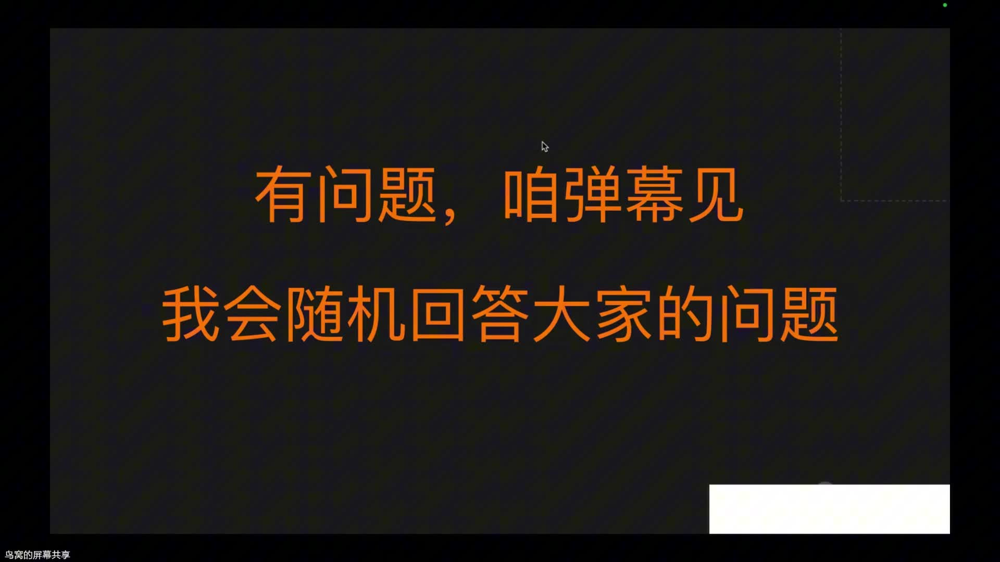
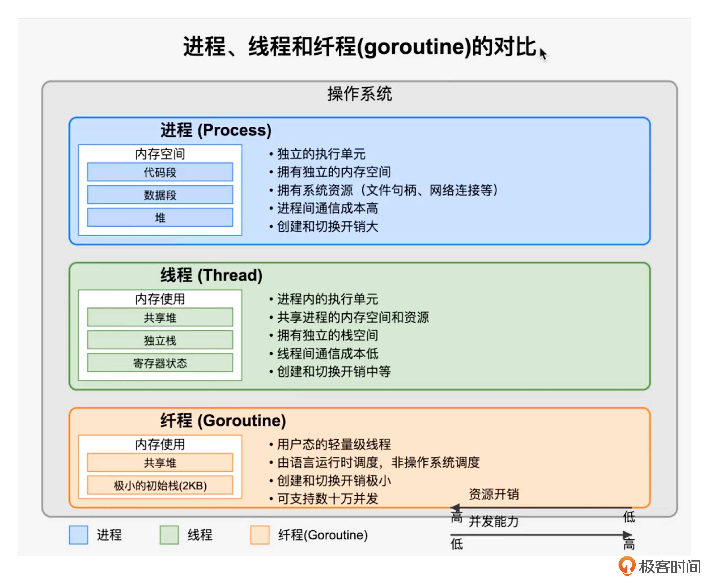
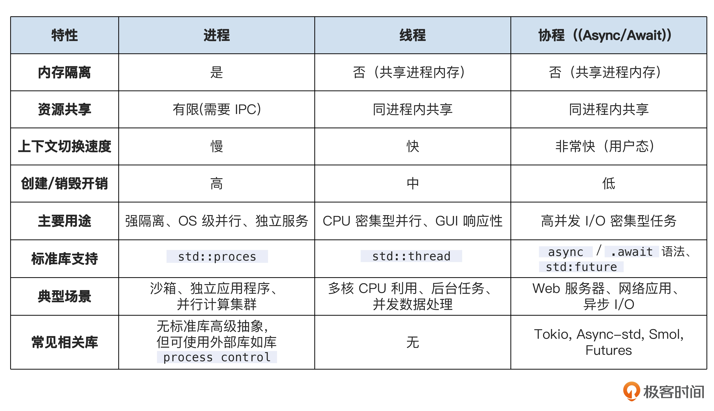
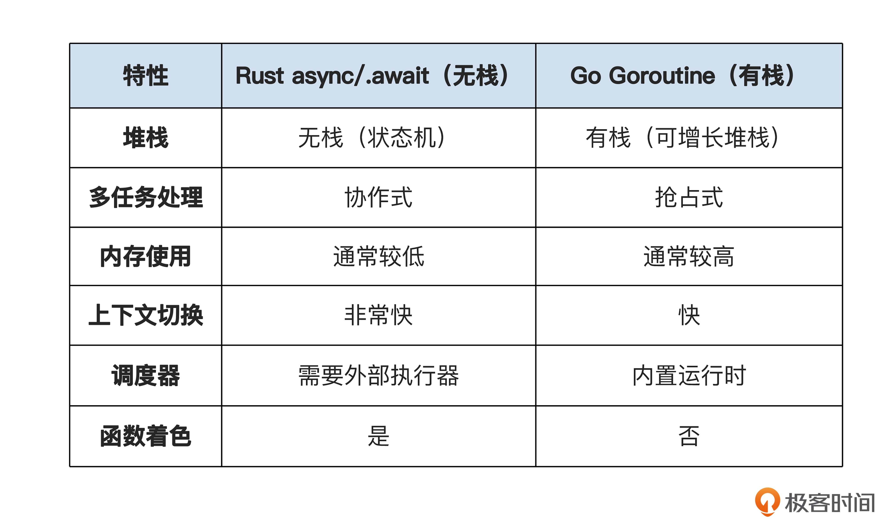
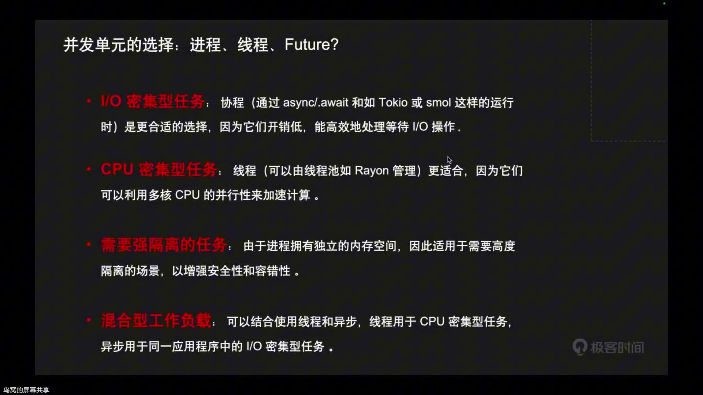
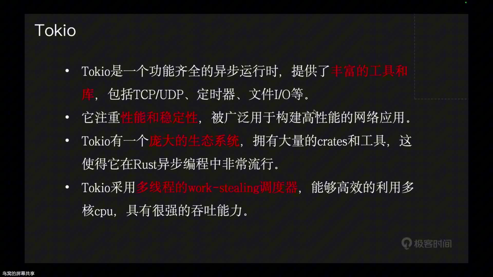
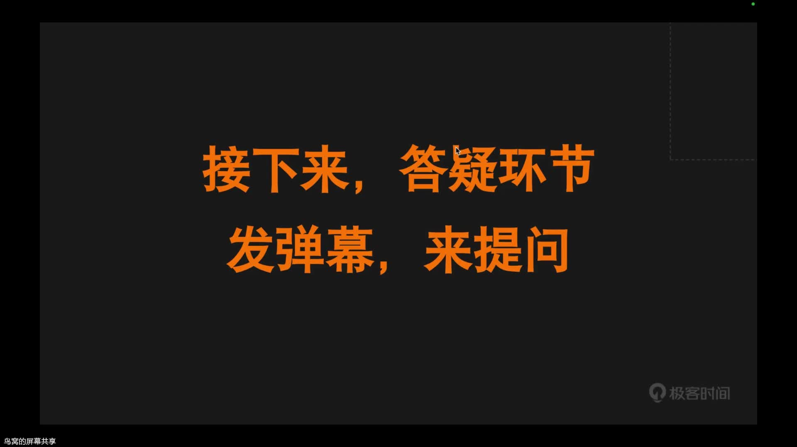

# 直播专场（二） | 异步编程示例：演示Rust并发编程的能力

## 直播内容预览

Part 1：异步编程的起因

Part 2：异步编程的场景

Part 3：异步进行时

Part 4：答疑环节

## Part 1 异步编程的起因



这一部分主要讲解并发单元的比较、Rust 异步编程和 Go Goroutine 的区别。

### 1. 并发单元（进程、线程和纤程）的对比



### 2. 几种并发方式的对比



### 3. 优劣势（了解即可）

Rust 中实现协程的主要机制是 async/await 语法，这实现了无栈协程。async 关键字将代码块转换为一个实现了 Future trait 的状态机。.await 关键字用于挂起当前线程的执行而不阻塞，从而允许其他异步任务运行。这符合其零成本抽象的原则，避免了为每个协程管理独立堆栈的开销。这种设计选择优先考虑了效率和性能，尤其是在 I/O 密集型操作方面。

优势

- 更低的内存开销：与线程相比，尤其是在大量并发任务的情况下，协程通常具有更低的内存开销。

- 更快的上下文切换：由于协程的上下文切换发生在应用程序级别，不涉及操作系统内核，因此通常比操作系统线程的上下文切换更快。

- 更易于编写异步代码：async/.await 语法使得编写异步操作的代码更简洁易懂，类似于同步代码的风格。

- 高效处理大量并发 I/O 密集型任务：协程非常适合处理大量并发、需要等待 I/O 操作的任务。

劣势

- 需要异步运行时：协程的执行需要一个异步运行时（executor）来管理和调度任务。

- 阻塞操作可能阻塞线程：如果在 async 函数中执行阻塞操作，可能会阻塞整个线程，除非使用特定的处理方式（例如 Tokio 中的 spawn_blocking）。

- 数据共享的复杂性：在异步任务之间共享数据，尤其是在多线程 executor 中，可能会涉及到复杂的生命周期管理以及 Send 和 Sync trait 的约束。

- CPU 密集型任务性能提升不明显：对于纯粹的 CPU 密集型任务，协程可能无法提供比线程更显著的性能优势。

### 4.Rust 无栈协程 VS Go Goroutine 有栈协程对比



```
Rust async /.await：通常更适合 I/O 密集型应用，在这些应用中，高并发和低内存使用
至关重要。显式的 .await 关键字可以使异步操作的控制流更清晰。它也适用于需要对调
```

- 度进行细粒度控制以及避免堆分配的场景。

- Go Goroutine：由于其抢占式调度和易用性，非常适合 I/O 密集型和 CPU 密集型任务。内

```
置的运行时和简单的 go 关键字使得实现并发非常直接。Goroutine 通常用于构建并发网络
```

- 服务和应用程序，在这些应用中，简单性和开发者生产力是关键。

## Part 2 异步编程的场景



第二部分主要讲解不同场景下适合选用什么样的并发单元。

### 并发方式单元的选择：进程、线程、Future？

- I/O 密集型任务：协程（通过 async/.await 和如 Tokio 或 smol 这样的运行时）是更合适的选择，因为它们开销低，能高效地处理等待 I/O 操作。

- CPU 密集型任务：线程（可以由线程池如 Rayon 管理）更适合，因为它们可以利用多核CPU 的并行性来加速计算。

- 需要强隔离的任务：由于进程拥有独立的内存空间，因此适用于需要高度隔离的场景，以增强安全性和容错性。

- 混合型工作负载：可以结合使用线程和异步，线程用于 CPU 密集型任务，异步用于同一应用程序中的 I/O 密集型任务。

## Part 3 异步运行时



第三部分主要讲解异步运行时，尤其是 Tokio 的主要功能。

Tokio

- Tokio 是一个功能齐全的异步运行时，提供了丰富的工具和库，包括 TCP/UDP、定时器、文件 I/O 等。

- 它注重性能和稳定性，被广泛用于构建高性能的网络应用。

- Tokio 有一个庞大的生态系统，拥有大量的 crates 和工具，这使得它在 Rust 异步编程中非常流行。

- Tokio 采用多线程的 work-stealing 调度器，能够高效的利用多核 CPU，具有很强的吞吐能力。

Tokio 常用功能梳理

- tokio::runtime: 作为 Tokio 的核心，它提供了一个运行时环境，用于高效地执行异步任务。

- tokio::net: 此模块提供异步网络功能，用于构建高性能的 TCP 和 UDP 网络应用程序。

- tokio::io: 提供异步 I/O 操作，使非阻塞的数据读取和写入成为可能。

- tokio::fs: 该模块提供异步文件系统操作，允许异步的对文件进行读写等操作。

- tokio::time: 提供异步定时器和时间相关功能，用于安排和处理时间相关的异步任务。

- tokio::process: 该模块提供异步的进程管理，用来异步的运行和管理子进程。

- tokio::signal: 提供异步的系统信号处理能力，允许异步的监听系统信号。

- tokio::stream: 提供异步数据流处理工具，用于处理异步的数据流。

- tokio::macros: 提供宏来简化异步代码的编写，减少代码量。

- 其他常用功能（详见文档）：属性宏（main、test）、join、select

### Tokio 的并发单元 Task

任务是一种轻量级、非阻塞的执行单元。任务类似于操作系统线程，但它们不是由操作系统调度程序管理，而是由 Tokio 运行时管理。这种通用模式的另一个名称是绿色线程。如果您熟悉Go 的 goroutines、Kotlin 的 coroutines 或 Erlang 的进程，可以将 Tokio 的任务视为类似的东西。

### 从 async-std 到 smol

最近（2025.3.21） async-std 已经停止维护，建议 smol 代替。但老师不太认同此种观点，认为除了 readme 里提到的替代（smol），也可以考虑 Tokio。

## Part 4 答疑问题



1. 请老师说说对于 Rust 接入大模型的开发、 MCP、Agent 等等方面的看法。
