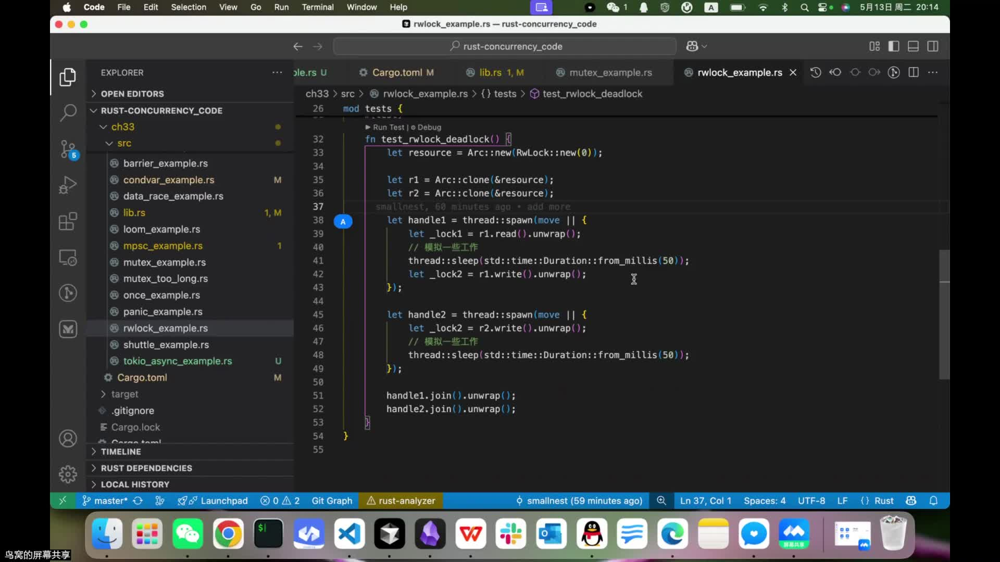
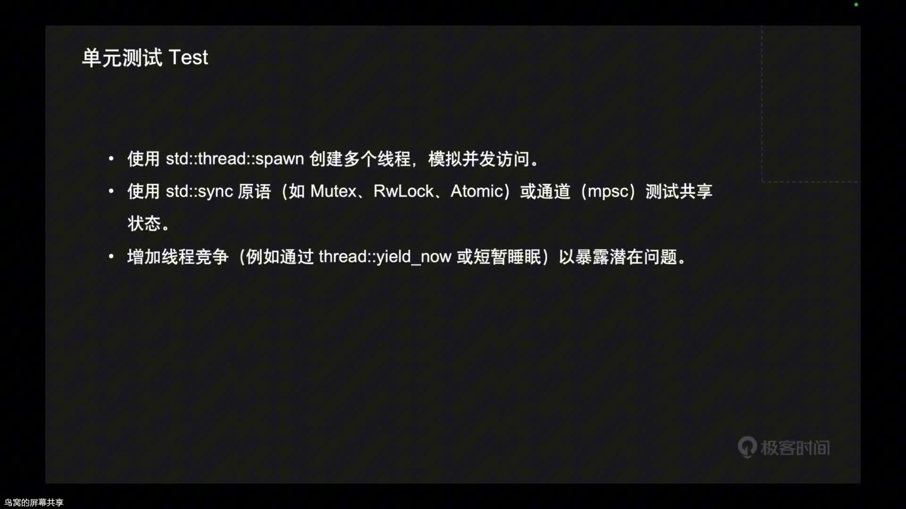
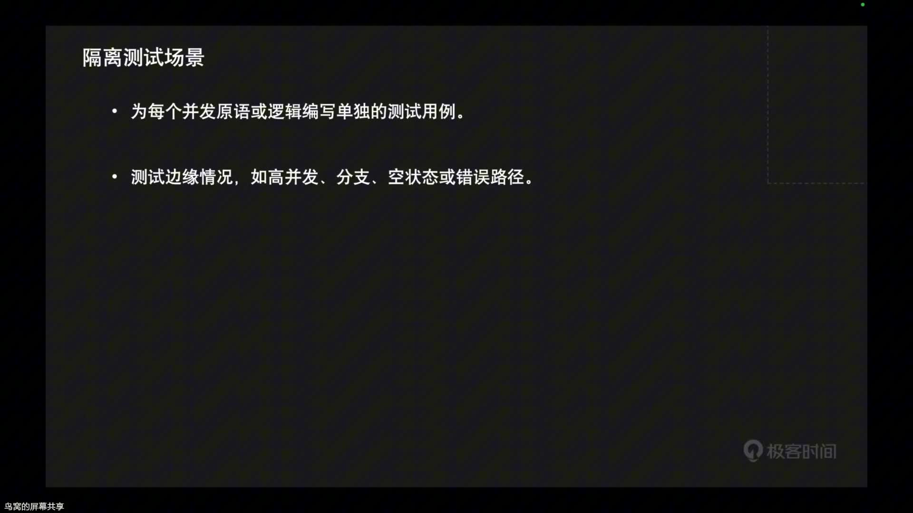

# 直播专场（四） | 并发问题和并发测试

## Part 1 并发问题

### Mutex

- 重入

- scope 范围太大

### Rwlock

- 重入

- 读锁和写锁

### Condvar

- 消费者在生产者通知之后进入等待，可能错过通知

- 虚假唤醒导致条件未满足

### Once

- 初始化逻辑中再次调用

### Barrier

- 启动的参与者不够

### Atomic

- 错误的内存序

- 误以为的原子操作

### mpsc

- 没有生产者，消费者无限等待

### async

- 阻塞线程

### 竞争条件

- 不确定的结果

## Part 2 并发测试

### 单元测试 Test

- 使用 std::thread::spawn 创建多个线程，模拟并发访问。

- 使用 std::sync 原语（如 Mutex、RwLock、Atomic）或通道（mpsc）测试共享状态。

- 增加线程竞争（例如通过 thread::yield_now 或短暂睡眠）以暴露潜在问题。

### 单元测试 - 异步编程

- 使用 #[tokio::test] 或 #[async_std::test] 运行异步测试。

- 模拟高并发任务，检查资源竞争或死锁。

- 使用 tokio::time::timeout 测试异步任务的超时行为。

### 并发测试的难点

- 非确定性：线程调度和异步任务执行顺序不可预测，问题可能在特定条件下触发。

- 可重现性：并发 bug 难以稳定重现。

- 覆盖率：需要测试多种线程交错和错误场景。

### Loom：一个用于测试并发程序的工具

在高层次上，它会多次运行测试，根据 C11 内存模型中有效执行的定义，对每个测试的可能并发执行进行排列组合。然后，它使用状态缩减技术来避免可能执行的数量的组合爆炸。

- write 获取写锁

- read 获得读锁

- Arc<RwLock>: 多线程访问

- Guard 自动释放

### Shuttle：一个强大的并发测试库，专为 Rust 开发者设计

它通过模拟不同的执行顺序来测试并发代码， 帮助开发者发现潜在的竞态条件、死锁和其他并发问题。

- 自动探索不同的执行顺序，无需手动编写复杂的测试场景

- 支持测试多线程、异步代码和无锁数据结构

- 可以检测数据竞争、死锁和其他并发错误

- 提供详细的错误报告，帮助定位和修复问题

- 与 Rust 的测试框架无缝集成，易于在现有项目中使用

### ThreadSanitizer (TSan) - C/C++ 的并发调试工具

RUSTFLAGS=“-Z sanitizer=thread” cargo run/test，检测数据竞争

https://github.com/japaric/rust-san

https://rustc-dev-guide.rust-lang.org/sanitizers.html

## Part 3：最佳实践

### 隔离测试场景

- 为每个并发原语或逻辑编写单独的测试用例。

- 测试边缘情况，如高并发、分支、空状态或错误路径。

### 增加竞争条件

- 使用 thread::yield_now、thread::sleep 或随机延迟触发线程切换。

- 在异步测试中使用 tokio::task::yield_now。

### 检查资源泄漏

- 使用 Arc::strong_count 检查引用计数是否正确释放。

- 监控内存使用，检测线程池或异步任务泄漏。

- 监控 CPU 占用，检查是否 CPU 异常持续占用

### 使用工具

- Loom：检测自定义原语或复杂逻辑的并发 bug。

- Shuttle: 测试各种边缘场景

- TSan/Valgrind：检测数据竞争。

- Cargo Fuzz：模糊测试并发代码的输入。

### 模拟错误

- 测试 panic 场景，使用 std::panic::catch_unwind。

- 检查 Mutex 毒化或通道关闭后的行为。
