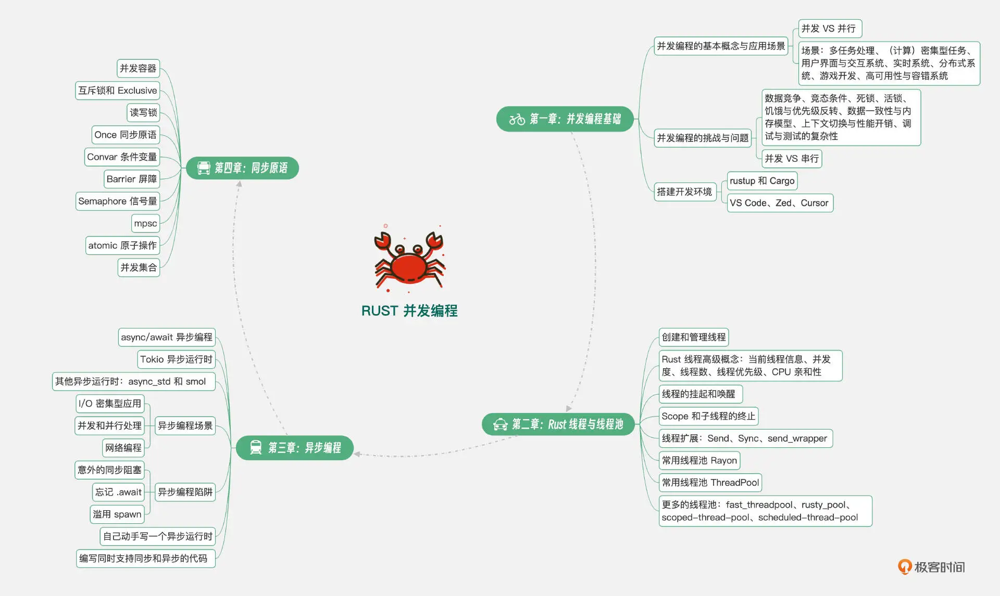

# 结束语 | 在Rust的世界里乘风破浪，无畏前行

你好，我是鸟窝。

时光荏苒，转眼间我们的《Rust 并发编程实战课》已经陪伴你走过了 32 节课的学习旅程。在此，首先要衷心祝贺每一位坚持到最后、完成全部课程学习的同学！你们的毅力和对知识的渴望，是这段旅程中最宝贵的风景。

回顾这一课程，我们一起从 Rust 的基础并发原语出发，深入探索了线程、并发编程、异步编程等各种并发场景和并发原语。我们不仅学习了如何使用它们，更重要的是，我们理解了Rust 为并发编程所做的各种努力，如何通过其革命性的所有权系统和借用检查器，在编译时就为我们规避了大量恼人的数据竞争问题，让我们能够真正地实践“无畏并发”（FearlessConcurrency）。

```
我们也剖析了 async/await 异步编程的优雅与高效，掌握了 Future、Executor 的核心
概念，并了解了 Tokio 等主流异步运行时的使用。
```

我们领略了原子操作的精妙，认识和学习了一些优秀的第三方库，我们力求覆盖 Rust 并发编程的方方面面，为你构建一个坚实而全面的知识体系。

现在再回头来看我们开篇词里的知识地图，相信你也有了更深的体会。



这 32 节课的内容，不仅仅是理论知识的传递，更是实战经验的分享。

学无止境，实践为王

理论学习是基础，但真正的掌握源于实践。并发编程尤其如此，细微之处往往决定成败。

我强烈鼓励你将课程中学到的理念、工具和技巧，勇敢地应用到你的个人项目、工作任务，甚至是参与到蓬勃发展的 Rust 开源社区中去。在实际的敲打和锤炼中，你会遇到新的挑战，也会收获更深刻的理解和宝贵的经验。不要害怕犯错，每一次调试、每一次优化，都是你成长的阶梯。

这门课还提供了配套的代码，即使你还没有合适的项目应用所学的并发知识，你也可以尝试阅读和执行这些代码，通过实践，你对这些并发知识也会理解得更加深刻。

面向未来，持续探索

Rust 语言及其生态系统仍然在高速发展之中，并发领域的技术也在不断演进。

课程的结束，恰恰是你深入探索的新起点。请保持对新技术的好奇心，持续关注 Rust 官方文

```
档、标准库的演进、Tokio等核心库的更新动态，以及社区中不断涌现的新思想和解决方案。
```

Rust 本身发布频率都很频繁，新的特性不断的加入，还有生态圈中也不断涌现出一些优秀的库，我们要保持专注和热情，持续跟进和学习。

社区同行，资源共享

Rust 拥有一个充满活力和友善的社区。遇到问题时，不妨去官方论坛（users.rust-lang.org）、Reddit 的 r/rust 板块、或者国内外的各种 Rust 技术交流群组寻求帮助和交流。阅读优秀的开源项目源码，也是提升并发编程能力的绝佳途径。

拥抱 AI，借力前行

相比前三十年的编程语言的学习，我们现在遇到一个非常好的时代，各种大模型都可以很好的帮助我们学习新知识，它们就像孜孜不倦又无所不知的老师，而且它充满耐心，随时都可以提供给我们帮助。

目前来说很多 AI 工具还都是免费的，我们要充分利用这些工具，帮助我们迅速掌握新的知识点。你可以让 DeepSeek 解答你的编程疑惑、使用 Claude 帮你编写一些代码，还有一些工具比如 Cursor、字节的 Trae 都可以很好地辅助我们学习新知识，甚至为我们的工作服务。

最后的寄语

再次感谢你选择这门《Rust 并发编程实战课》，感谢你们一路的陪伴、提出的问题和宝贵的反馈。能够和大家一起探讨我所热爱的 Rust 并发技术，是我的荣幸。希望这门课程能够成为你技术武器库中的一件利器，帮助你在未来的工作和学习中，更加从容自信地驾驭并发，构建出更加健壮、高效的系统。

编程之路漫漫，探索永不止步。愿大家在 Rust 的世界里，继续乘风破浪，无畏前行，用代码创造更多可能！祝大家在未来的编程旅程中一切顺利，收获满满！

最后，我准备了一份结课问卷 ，花几分钟就能填完。很期待能听到你的反馈，说说你对这门课程的想法和建议。


