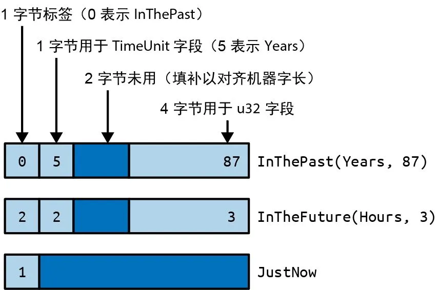
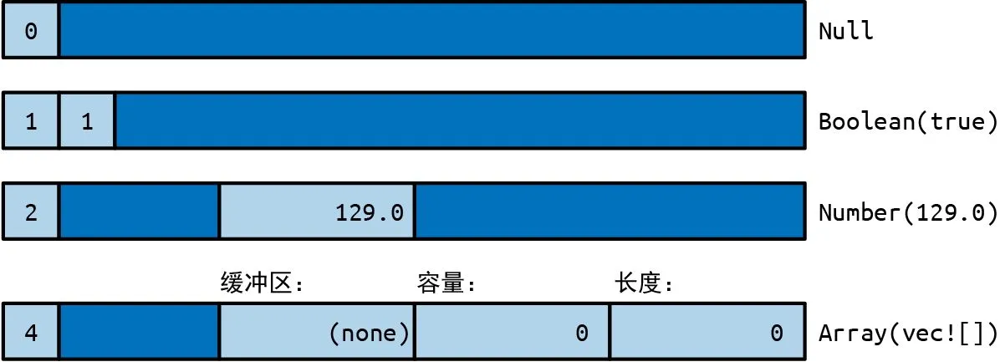
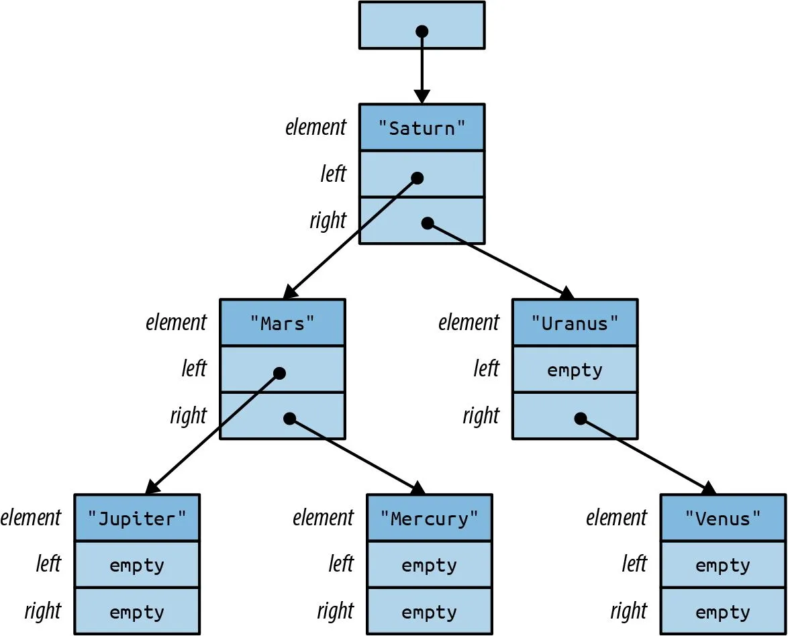
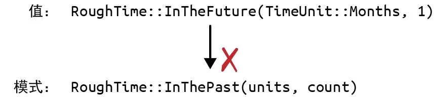
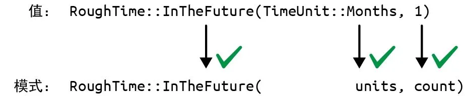
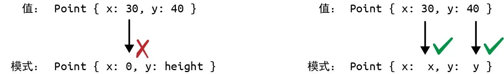
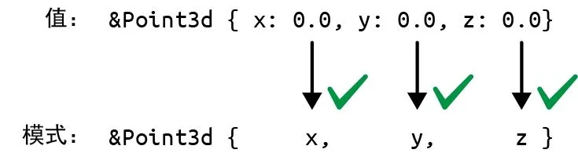

# 第10章枚举与模式

- 在计算机领域，总和类型（sum type）长期悲剧性缺位，很多事情却依然行得通，这简直1不可思议（参见 Lambda 的缺位）。——Graydon Hoare

本章的第一个主题强劲有力且非常“古老”，它能帮助你在短期内完成很多事（但要付出一定代价），并且许多文化中有关于它的传说。我要说的不是“恶魔”，而是一种用户定义数据类型，长期以来被 ML 社区和 Haskell 社区的黑客们称为总和类型、可区分的联合体（union）或代数数据类型。在 Rust 中，它们被称为枚举。与“恶魔”不同，它们相当安全，而且也不用付出多少代价。

C++ 和 C# 都有枚举，你可以使用它们来定义自己的类型，其值是一组命名常量。例如，你可

```
以定义一个名为 Color 的类型，其值为 Red、Orange、Yellow 等。这种枚举也适用于
```

Rust，但是 Rust 的枚举远不止于此。Rust 枚举还可以包含数据，甚至是不同类型的数据。例

```
如，Rust 的 Result<String, io::Error> 类型就是一个枚举，这样的值要么是包含
String 型的 Ok 值，要么是包含 io::Error 的 Err 值。C++ 枚举和 C# 枚举则不具备这
```

样的能力。Rust 枚举更像是 C 的联合体，但不同之处在于它是类型安全的。

只要值可能代表多种事物，枚举就很有用。使用枚举的“代价”是你必须通过模式匹配安全地访问数据，这是本章后半部分的主题。

如果你用过 Python 中的解包或 JavaScript 中的解构，那么应该很熟悉“模式”这个词，但 Rust的模式不止于此。Rust 模式有点儿像针对所有数据的正则表达式。它们用于测试一个值是否具有特定的目标形态，可以一次从结构体或元组中把多个字段提取到局部变量中。

和正则表达式一样，模式很简洁，通常能在一行代码中完成全部工作。

本章从枚举的基础知识讲起，首先展示数据如何关联到枚举的各个变体，以及枚举如何存储在

```
内存中；然后展示 Rust 的模式和 match（匹配）语句如何基于枚举、结构体、数组和切片简
洁地表达逻辑。模式中还可以包含引用、移动和 if 条件，来让自己更加强大。
```

## 10.1　枚举

Rust 中简单的 C 风格枚举很直观：

```
enum Ordering {
   Less,
   Equal,
   Greater,
}
这声明了一个具有 3 个可能值的 Ordering 类型，称为变体或构造器：Ordering::Less、
Ordering::Equal 和 Ordering::Greater。这个特殊的枚举是标准库的一部分，因此
```

Rust 代码能够直接导入它：

```
use std::cmp::Ordering;
fn compare(n: i32, m: i32) -> Ordering {
   if n < m {
       Ordering::Less
   } else if n > m {
       Ordering::Greater
   } else {
       Ordering::Equal
   }
}
```

或连同其所有构造器一同导入：

```
use std::cmp::Ordering::;    // `*`导入所有子项
fn compare(n: i32, m: i32) -> Ordering {
   if n < m {
       Less
   } else if n > m {
       Greater
   } else {
       Equal
   }
}
导入构造器后，我们就可以写成 Less 而非 Ordering::Less，等等，但是因为这样写意思
```

不太明确，所以通常认为不导入构造器的那种风格更好，除非导入它们能让你的代码更具可读性。

```
要导入当前模块中声明的枚举的构造器，请使用 self：
enum Pet {
   Orca,
   Giraffe,
   ...
}
use self::Pet::*;
```

在内存中，C 风格枚举的各个值会存储为整数。有时告诉 Rust 要使用哪几个整数是很有用的：

```
enum HttpStatus {
   Ok = 200,
   NotModified = 304,
   NotFound = 404,
   ...
}
```

否则 Rust 会从 0 开始帮你分配数值。

默认情况下，Rust 会使用可以容纳它们的最小内置整数类型来存储 C 风格枚举。最适合的是单字节：

```
use std::mem::size_of;
assert_eq!(size_of::<Ordering>(), 1);
assert_eq!(size_of::<HttpStatus>(), 2);  // 404不适合存入u8
你可以通过向枚举添加 #[repr] 属性来覆盖 Rust 对内存中表示法的默认选择。有关详细信
```

息，请参阅 23.1 节。

可以将 C 风格枚举转换为整数：

```
assert_eq!(HttpStatus::Ok as i32, 200);
从整数到枚举的反向转换则行不通。与 C 和 C++ 不同，Rust 会保证枚举值必然是 enum 声明
```

中阐明的值之一。从整数类型到枚举类型的非检查转换可能会破坏此保证，因此不允许这样做。你可以编写自己的“检查完再转换”逻辑：

```
fn http_status_from_u32(n: u32) -> Option<HttpStatus> {
   match n {
       200 => Some(HttpStatus::Ok),
       304 => Some(HttpStatus::NotModified),
       404 => Some(HttpStatus::NotFound),
       ...
       _ => None,
   }
}
```

```
或者借助 enum_primitive crate。它包含一个宏，可以帮你自动生成这类转换代码。
与结构体一样，编译器能为你实现 == 运算符等特性，但你必须明确提出要求：
#[derive(Copy, Clone, Debug, PartialEq, Eq)]
enum TimeUnit {
   Seconds, Minutes, Hours, Days, Months, Years,
}
```

枚举可以有方法，就像结构体一样：

```
impl TimeUnit {
   /// 返回此时间单位的复数名词
   fn plural(self) -> &'static str {
       match self {
           TimeUnit::Seconds => "seconds",
           TimeUnit::Minutes => "minutes",
           TimeUnit::Hours => "hours",
           TimeUnit::Days => "days",
           TimeUnit::Months => "months",
           TimeUnit::Years => "years",
       }
   }
   /// 返回此时间单位的单数名词
   fn singular(self) -> &'static str {
       self.plural().trim_end_matches('s')
   }
}
```

至此，C 风格枚举就介绍完了。更有趣的 Rust 枚举类型是其变体中能持有数据的类型。我们将展示如何将它们存储在内存中、如何通过添加类型参数来泛化它们，以及如何运用枚举构建复杂的数据结构。

### 10.1.1　带数据的枚举

有些程序总是要显示精确到毫秒的完整日期和时间，但对大多数应用程序来说，使用粗略的近似值（比如“两个月前”）对用户更友好。我们可以使用之前定义的枚举来编写一个新的

```javascript
enum，以帮忙解决此问题：
/// 刻意四舍五入后的时间戳，所以程序会显示“6个月前”
/// 而非“2016年2月9日上午9点49分”
#[derive(Copy, Clone, Debug, PartialEq)]
enum RoughTime {
   InThePast(TimeUnit, u32),
   JustNow,
   InTheFuture(TimeUnit, u32),
}
此枚举中的两个变体 InThePast 和 InTheFuture 能接受参数。这种变体叫作元组型变
体。与元组型结构体一样，这些构造器也是可创建新 RoughTime 值的函数：
let four_score_and_seven_years_ago =
   RoughTime::InThePast(TimeUnit::Years, 4 * 20 + 7);
let three_hours_from_now =
   RoughTime::InTheFuture(TimeUnit::Hours, 3);
```

枚举还可以有结构体型变体，就像普通结构体一样包含一些具名字段：

```javascript
enum Shape {
   Sphere { center: Point3d, radius: f32 },
   Cuboid { corner1: Point3d, corner2: Point3d },
}
let unit_sphere = Shape::Sphere {
   center: ORIGIN,
   radius: 1.0,
};
```

总而言之，Rust 有 3 种枚举变体，这与我们在第 9 章中展示的 3 种结构体相呼应。没有数据的变体对应于单元型结构体。元组型变体的外观和功能很像元组型结构体。结构体型变体具有花括号和具名字段。单个枚举中可以同时有 3 种类型的变体：

```bash
enum RelationshipStatus {
   Single,
   InARelationship,
   ItsComplicated(Option<String>),
   ItsExtremelyComplicated {
       car: DifferentialEquation,
       cdr: EarlyModernistPoem,
   },
}
```

枚举的所有构造器和字段都与枚举本身具有相同的可见性。

### 10.1.2　内存中的枚举

在内存中，带有数据的枚举会以一个小型整数标签加上足以容纳最大变体中所有字段的内存块的格式进行存储。标签字段供 Rust 内部使用。它会区分由哪个构造器创建了值，进而决定这个值应该有哪些字段。

```
从 Rust 1.50 开始，RoughTime 会占用 8 字节，如图 10-1 所示。
```



```
图 10-1：内存中的 RoughTime 值
```

不过，为了给将来的优化留下余地，Rust 并没有对枚举的内存布局做出任何承诺。在某些情况下，Rust 可以比图 10-1 中展示的布局更有效地打包枚举。例如，有些泛型结构体可以在不需要标签的情况下存储，稍后我们会介绍。

### 10.1.3　用枚举表示富数据结构

枚举对于快速实现树形数据结构也很有用。假设一个 Rust 程序需要处理任意 JSON 数据。在内存中，任何 JSON 文档都可以表示为这种 Rust 类型的值：

```
use std::collections::HashMap;
enum Json {
   Null,
   Boolean(bool),
   Number(f64),
   String(String),
   Array(Vec<Json>),
   Object(Box<HashMap<String, Json>>),
}
```

用自然语言解释这种数据结构还不如直接看 Rust 代码。JSON 标准指定了可以出现在 JSON

```
文档中的不同数据类型：null、布尔值、数值、字符串、各种 JSON 值的数组以及具有字符
串键名和 JSON 值的对象。这里的 Json 枚举只是简单地列出了这些类型而已。
这不是一个假想的例子。可以在 serde_json 中找到一个非常相似的枚举，serde_json 是
```

Rust 的结构体序列化库，是 crates.io 上最常下载的 crate 之一。

```
这里在表示 Object 的 HashMap 周围加 Box 只是为了让所有 Json 值更紧凑。在内存中，
Json 类型的值占用 4 个机器字。而 String 值和 Vec 值占用 3 个机器字，Rust 又添加了一
个标签字节。Null 值和 Boolean 值中没有足够的数据来用完所有空间，但所有 Json 值的
大小必须相同。因此，额外的空间就用不上了。图 10-2 展示了 Json 值在内存中的实际布局
```

的一些示例。



```
图 10-2：内存中的 Json 值
HashMap 则更大。如果必须在每个 Json 值中为它留出空间，那么将会非常大，在 8 个机器
字左右。但是 Box<HashMap> 是 1 个机器字：它只是指向堆中分配的数据的指针。我们甚至
可以通过装箱更多字段来让 Json 更加紧凑。
```

这里值得注意的是用 Rust 建立这个结构有多么容易。在 C++ 中，可能要为此编写一个类：

```python
class JSON {
private:
   enum Tag {
       Null, Boolean, Number, String, Array, Object
   };
   union Data {
       bool boolean;
       double number;
       shared_ptr<string> str;
       shared_ptr<vector<JSON>> array;
       shared_ptr<unordered_map<string, JSON>> object;
       Data() {}
       ~Data() {}
       ...
   };
   Tag tag;
   Data data;
public:
   bool is_null() const { return tag == Null; }
   bool is_boolean() const { return tag == Boolean; }
   bool get_boolean() const {
       assert(is_boolean());
       return data.boolean;
   }
   void set_boolean(bool value) {
       this->~JSON();  // 清理string/array/object值
       tag = Boolean;
       data.boolean = value;
   }
   ...
};
```

写了 30 行代码，我们才刚开了个头。这个类将需要构造函数、析构函数和赋值运算符。还有

```
一种方法是创建一个具有基类 JSON 和子类 JSONBoolean、JSONString 等的类层次结
```

构。无论采用哪种方法，操作完成时，我们的 C++ 版 JSON 库都将有十几个方法。其他程序员需要阅读一定的内容才能掌握并使用它。而整个 Rust 枚举才 8 行代码。

### 10.1.4　泛型枚举

枚举可以是泛型的。Rust 标准库中的两个例子是该语言中最常用的数据类型：

```
enum Option<T> {
   None,
   Some(T),
}
enum Result<T, E> {
   Ok(T),
   Err(E),
}
```

现在你已经很熟悉这些类型了，泛型枚举的语法与泛型结构体是一样的。

```
一个不太明显的细节是，当类型 T 是引用、Box 或其他智能指针类型时，Rust 可以省掉
Option<T> 的标签字段。由于这些指针类型都不允许为 0，因此 Rust 可以将
Option<Box<i32>> 表示为单个机器字：0 表示 None，非零表示 Some 指针。这能让
Option 类型的值尽量接近于可能为空的 C 或 C++ 指针。不同之处在于 Rust 的类型系统要
求你在使用其内容之前检查 Option 是否为 Some。这有效地避免了对空指针解引用。
```

只需几行代码就可以构建出泛型数据结构：

```
// `T`组成的有序集合
enum BinaryTree<T> {
   Empty,
   NonEmpty(Box<TreeNode<T>>),
}
// BinaryTree的部件
struct TreeNode<T> {
   element: T,
   left: BinaryTree<T>,
   right: BinaryTree<T>,
}
```

```
这几行代码定义了一个 BinaryTree 类型，它可以存储任意数量的 T 类型的值。
```

这两个定义中包含了大量信息，因此我们需要花点儿时间逐字解释这些代码。每个

```
BinaryTree 值要么是 Empty，要么是 NonEmpty。如果是 Empty，那它根本不含任何数
据。如果是 NonEmpty，那它就会有一个 Box，即一个指向堆上分配的 TreeNode 的指针。
每个 TreeNode 值包含一个实际元素以及另外两个 BinaryTree 值。这意味着树可以包含子
树，因此 NonEmpty 树可以有任意数量的后代。
BinaryTree<&str> 类型值的示意图如图 10-3 所示。与 Option<Box<T>> 一样，Rust 在
这里也省略了标签字段，因此 BinaryTree 值占用一个机器字。
```



```
图 10-3：包含 6 个字符串的 BinaryTree
```

在此树中构建任何特定节点都很简明直观：

```javascript
use self::BinaryTree::*;
let jupiter_tree = NonEmpty(Box::new(TreeNode {
   element: "Jupiter",
   left: Empty,
   right: Empty,
}));
```

较大的树可以基于较小的树来构建：

```javascript
let mars_tree = NonEmpty(Box::new(TreeNode {
   element: "Mars",
   left: jupiter_tree,
   right: mercury_tree,
}));
自然，此赋值会将 jupiter_node 和 mercury_node 的所有权转移给它们的新父节点。
```

树的其余部分都遵循同样的模式。根节点与其他节点没有什么区别：

```javascript
let tree = NonEmpty(Box::new(TreeNode {
   element: "Saturn",
   left: mars_tree,
   right: uranus_tree,
}));
稍后本章将展示如何在 BinaryTree 类型上实现一个 add 方法，以便像下面这样写：
let mut tree = BinaryTree::Empty;
for planet in planets {
   tree.add(planet);
}
无论你的语言背景如何，在 Rust 中创建像 BinaryTree 这样的数据结构都可能需要做一些
练习。起初并不容易看出应该把这些 Box 放在哪里。找到可行设计方案的方法之一是画出图
```

10-3 那样的图，展示你希望这些数据在内存中如何布局。然后从图片倒推出代码。每组方块

```
都表示一个结构体或元组，每个箭头都是一个 Box 或其他智能指针。弄清楚每个字段的类型
```

虽然有点儿难，但仍然是可以解决的。解决此难题的回报是对程序内存进行了更好的控制。

现在再来说一下本章开头提过的“代价”。枚举的标签字段会占用一点儿内存，最坏情况下可达8 字节，但这通常可以忽略不计。枚举的真正缺点（如果一定要算的话）是，虽然这些字段真的存在于值中，但 Rust 代码不允许你直接访问它们：

```javascript
let r = shape.radius;  // 错误：在`Shape`类型上没有`radius`字段
```

只能用一种安全的方式来访问枚举中的数据，即使用模式。

## 10.2　模式

```
回忆一下本章前面定义过的 RoughTime 类型：
enum RoughTime {
   InThePast(TimeUnit, u32),
   JustNow,
   InTheFuture(TimeUnit, u32),
}
假设你有一个 RoughTime 值并希望把它显示在网页上。你需要访问值内的 TimeUnit 字段
和 u32 字段。Rust 不允许你通过编写 rough_time.0 和 rough_time.1 来直接访问它
们，因为毕竟 rough_time 也可能是没有字段的，比如 RoughTime::JustNow。那么，怎
```

样才能获得数据呢？

```
你需要一个 match 表达式：
1  fn rough_time_to_english(rt: RoughTime) -> String {
2      match rt {
3          RoughTime::InThePast(units, count) =>
4              format!("{} {} ago", count, units.plural()),
5          RoughTime::JustNow =>
6              format!("just now"),
7          RoughTime::InTheFuture(units, count) =>
8              format!("{} {} from now", count, units.plural()),
9      }
10  }
match 会执行模式匹配，在此示例中，模式就是第 3 行、第 5 行和第 7 行中出现在 => 符号
前面的部分。匹配 RoughTime 值的模式很像用于创建 RoughTime 值的表达式。这是刻意的
```

设计。表达式会生成值，模式会消耗值。两者刻意使用了很多相同的语法。

```
我们分步了解一下此 match 表达式在运行期会发生什么。假设 rt 是
RoughTime::InTheFuture(TimeUnit::Months, 1) 的值。Rust 会首先尝试将这个值
```

与第 3 行的模式相匹配。如图 10-4 所示，二者不匹配。



```
图 10-4：不匹配的 RoughTime 值和模式
```

对于枚举、结构体或元组类型的匹配，Rust 的工作方式就像简单地从左到右进行扫描一样，会检查模式的每个组件以查看该值是否与之匹配。如果不匹配，Rust 就会接着尝试下一个模式。

第 3 行和第 5 行的模式都不匹配，但是第 7 行的模式匹配成功了，如图 10-5 所示。



- 图 10-5：一次成功的匹配

```
模式中包含的简单标识符（如 units 和 count）会成为模式后面代码中的局部变量。值中存
在的任何内容都会复制或移动到新变量中。Rust 会在 units 中存储 TimeUnit::Months，
在 count 中存储 1，然后运行第 8 行代码，并返回字符串 "1 months from now"。
该输出有一个小小的英语语法问题（未处理复数），可以通过在 match 中添加另一个分支来解
```

决：

```
RoughTime::InTheFuture(unit, 1) =>
   format!("a {} from now", unit.singular()),
仅当 count 字段恰好为 1 时，才会匹配此分支。请注意，这行新代码必须添加到第 7 行之
```

前。如果将其添加到末尾，那么 Rust 将永远无法访问它，因为第 7 行的模式会匹配所有

```
InTheFuture 值。如果你犯了这种错误，那么 Rust 编译器将警告发现了 "unreachable
pattern"（无法抵达的模式）。
即使用了新代码，RoughTime::InTheFuture(TimeUnit::Hours, 1) 仍然存在问
题："a hour from now" 这个结果不太正确。唉，这就是英语啊。这也可以通过在 match
```

中添加另一个分支来解决。

```
如本示例所示，模式匹配可以和枚举协同工作，甚至可以测试它们包含的数据，这让 match
成了 C 的 switch 语句的强大而灵活的替代品。迄今为止，我们只看到了匹配枚举值的模
```

式。但模式的类型不止于此，Rust 模式还有它们自己的小型语言，如表 10-1 所示。我们将用本章剩余的大部分内容来介绍此表中展示的特性。

表 10-1：模式

模式类型

- 例子注意事项

```
100
```

字面量

- 匹配一个确切的值；也允许匹

```
"name"
0 ..= 100
'a' ..= 'k'
```

范围

- 匹配范围内的任何值，包括可

```
256..
_
```

通配符

- 匹配任何值并忽略它

```
name
类似于 _，但会把值移动或复
```

变量

```
mut count
ref field
```

引用变量

- 借用对匹配值的引用，而不是

```
ref mut field
val @ 0 ..= 99
使用 @ 左边的变量名，匹配其
```

与子模式绑定

```
ref circle @ Shape::Circle { .. }
```

### 10.2.1　模式中的字面量、变量和通配符

```
迄今为止，我们已经展示了如何借助 match 表达式来使用枚举。match 也可用来匹配其他类
型。当你需要类似 C 语言的 switch 语句的内容时，可以使用针对整数值的 match。像 0
和 1 这样的整型字面量都可以作为模式使用：
match meadow.count_rabbits() {
   0 => {}  // 无话可说
   1 => println!("A rabbit is nosing around in the clover."),
   n => println!("There are {} rabbits hopping about in the meadow", n),
}
如果草地上没有兔子，就匹配模式 0；如果只有一只兔子，就匹配模式 1；如果有两只或更多
的兔子，就匹配第三个模式，即模式 n。模式 n 只是一个变量名，它可以匹配任何值，匹配
```

的值会移动或复制到一个新的局部变量中。所以在这种情况下，

```
meadow.count_rabbits() 的值会存储在一个新的局部变量 n 中，然后打印出来。
```

其他字面量也可以用作模式，包括布尔值、字符，甚至字符串：

```javascript
let calendar = match settings.get_string("calendar") {
   "gregorian" => Calendar::Gregorian,
   "chinese" => Calendar::Chinese,
   "ethiopian" => Calendar::Ethiopian,
   other => return parse_error("calendar", other),
};
在这个例子中，other 就像上个例子中的 n 一样充当了包罗万象的模式。这些模式与
switch 语句中的 default 分支起着相同的作用，用于匹配与任何其他模式都无法匹配的
```

值。

```
如果你需要一个包罗万象的模式，但又不关心匹配到的值，那么可以用单个下划线 _ 作为模
```

式，这就是通配符模式：

```javascript
let caption = match photo.tagged_pet() {
   Pet::Tyrannosaur => "RRRAAAAAHHHHHH",
   Pet::Samoyed => "*dog thoughts*",
   _ => "I'm cute, love me", // 一般性捕获，对任意Pet都生效
};
这里的通配符模式能匹配任意值，但不会将其存储到任何地方。由于 Rust 要求每个 match
```

表达式都必须处理所有可能的值，因此最后往往需要一个通配符模式。即使你非常确定其他情况不会发生，也必须至少添加一个后备分支，也许是 panic 的分支。

```
// 有很多种形状（Shape），但我们只支持“选中”一些文本框
// 或者矩形区域中的所有内容。不能选择椭圆或梯形
match document.selection() {
   Shape::TextSpan(start, end) => paint_text_selection(start, end),
   Shape::Rectangle(rect) => paint_rect_selection(rect),
   _ => panic!("unexpected selection type"),
}
```

### 10.2.2　元组型模式与结构体型模式

```
元组型模式匹配元组。每当你想要在单次 match 中获取多条数据时，元组型模式都非常有
```

用：

```
fn describe_point(x: i32, y: i32) -> &'static str {
   use std::cmp::Ordering::*;
   match (x.cmp(&0), y.cmp(&0)) {
       (Equal, Equal) => "at the origin",
       (_, Equal) => "on the x axis",
       (Equal, _) => "on the y axis",
       (Greater, Greater) => "in the first quadrant",
       (Less, Greater) => "in the second quadrant",
       _ => "somewhere else",
   }
}
```

结构体型模式使用花括号，就像结构体表达式一样。结构体型模式包含每个字段的子模式：

```
match balloon.location {
   Point { x: 0, y: height } =>
       println!("straight up {} meters", height),
   Point { x: x, y: y } =>
       println!("at ({}m, {}m)", x, y),
}
在此示例中，如果匹配了第一个分支，则 balloon.location.y 会存储在新的局部变量
height 中。
假设 balloon.location 的值是 Point { x: 30, y: 40 }。像往常一样，Rust 会依
```

次检查每个模式的每个组件，如图 10-6 所示。



- 图 10-6：与结构体的模式匹配

```
这会匹配第二个分支，所以输出是 at (30m, 40m)。
像 Point { x: x, y: y } 这样的模式在匹配结构体时很常见，而冗余的名称会造成视觉
上的混乱，所以 Rust 对此有一个简写形式：Point 。二者的含义是一样的。Point  仍会
将某个点的 x 字段和 y 字段分别存储在新的本地变量 x 和 y 中。
```

即使用了简写形式，当我们只关心几个字段时，匹配大型结构体仍然很麻烦：

```
match get_account(id) {
   ...
   Some(Account {
           name, language,  // <---这两个变量才是我们关心的
           id: _, status: _, address: _, birthday: _, eye_color: _,
           pet: _, security_question: _, hashed_innermost_secret: _,
           is_adamantium_preferred_customer: _, }) =>
       language.show_custom_greeting(name),
}
为避免这种情况，可以使用 .. 告诉 Rust 你不关心任何其他字段。
Some(Account { name, language, .. }) =>
   language.show_custom_greeting(name),
```

### 10.2.3　数组型模式与切片型模式

数组型模式匹配数组。数组型模式通常用于过滤一些特殊情况的值，并且在处理那些不同位置的值具有不同含义的数组时也非常有用。

例如，在将 HSL（色相、饱和度和亮度）颜色值转换为 RGB（红色、绿色和蓝色）颜色值

```
时，具有零亮度或全亮度的颜色只会是黑色或白色。可以使用 match 表达式来简单地处理这
```

些情况。

```
fn hsl_to_rgb(hsl: [u8; 3]) -> [u8; 3] {
   match hsl {
       [_, _, 0] => [0, 0, 0],
       [_, _, 255] => [255, 255, 255],
       ...
   }
}
```

切片型模式也与此相似，但与数组不同，切片具有可变长度，因此切片型模式不仅匹配值，还

```
匹配长度。.. 在切片型模式中能匹配任意数量的元素。
fn greet_people(names: &[&str]) {
   match names {
       [] => { println!("Hello, nobody.") },
       [a] => { println!("Hello, {}.", a) },
       [a, b] => { println!("Hello, {} and {}.", a, b) },
       [a, .., b] => { println!("Hello, everyone from {} to {}.", a, b) }
   }
}
```

### 10.2.4　引用型模式

```
Rust 模式提供了两种特性来支持引用。ref 模式会借用已匹配值的一部分。& 模式会匹配引
用。我们会先介绍 ref 模式。
匹配不可复制的值会移动该值。继续以 account 为例，以下代码是无效的：
match account {
   Account { name, language, .. } => {
       ui.greet(&name, &language);
       ui.show_settings(&account);  // 错误：借用已移动的值`account`
   }
}
在这里，字段 account.name 和 account.language 会移动到局部变量 name 和
language 中。account 的其余部分均已丢弃。这就是为什么我们之后不能再借用它的引
```

用。

```
如果 name 和 language 都是可复制的值，则 Rust 会复制字段而非移动它们，这时上述代码
就是有效的。但假设这些是 String 类型，那我们可以做些什么呢？
我们需要一种借用而非移动匹配值的模式。ref 关键字就是这样做的：
match account {
   Account { ref name, ref language, .. } => {
       ui.greet(name, language);
       ui.show_settings(&account);  // 正确
   }
}
现在局部变量 name 和 language 是对 account 中相应字段的引用。由于 account 只是
```

被借入而没有被消耗，因此继续调用它的方法是没问题的。

```
还可以使用 ref mut 来借入可变引用：
match line_result {
   Err(ref err) => log_error(err),  // `err`是&Error类型的（共享引用）
   Ok(ref mut line) => {            // `line`是&mut String类型的（可变引用）
       trim_comments(line);         // 就地修改此字符串
       handle(line);
   }
}
模式 Ok(ref mut line) 能匹配任何成功的结果，并借入其成功值的可变引用。
```

- 2

```
与 ref 模式相对
的引用型模式是 & 模式。以 & 开头的模式会匹配引用：
match sphere.center() {
   &Point3d { x, y, z } => ...
}
在此示例中，假设 sphere.center() 会返回对 sphere 中的私有字段的引用，这是 Rust
中的常见模式。返回的值是 Point3d 的地址。如果中心位于原点，则 sphere.center()
会返回 &Point3d { x: 0.0, y: 0.0, z: 0.0 }。
```

模式匹配过程如图 10-7 所示。



- 图 10-7：与引用的模式匹配

```
这有点儿棘手，因为 Rust 在这里会追踪一个指针，我们通常会将追踪指针的操作与 * 运算符
而不是 & 运算符联系起来。但要记住，模式和表达式是恰恰相反的。表达式 (x, y) 会把两
个值放入一个新的元组中，而模式 (x, y) 则会匹配一个元组并分解成两个值。& 的逻辑也
是如此。在表达式中，& 会创建一个引用。在模式中，& 则会匹配一个引用。
```

匹配引用时会遵循我们所期望的一切规则。生命周期规则仍然有效。你不能通过共享引用获得可变访问权限，而且不能将值从引用中移动出去，即使对可变引用也是如此。当我们匹配

```
&Point3d { x, y, z } 时，变量 x、y 和 z 会接受坐标的副本，而原始 Point3d 的值
```

保持不变。这种写法之所以有效，是因为这些字段都是可复制的。如果试图在具有不可复制字段的结构体上这么做，就会出错：

```
match friend.borrow_car() {
   Some(&Car { engine, .. }) =>  // 错误：不能把借用的值移动出去
       ...
   None => {}
}
从借来的汽车上搜刮零件可不是君子所为，Rust 同样不会容忍这么做。你可以使用 ref 模式
```

来借用对部件的引用，但并不拥有它：

```
   Some(&Car { ref engine, .. }) =>  // 正确，engine是一个引用
再来看一个 & 模式的例子。假设我们有一个遍历字符串中各字符的迭代器 chars，并且它有
一个返回 Option<&char>（如果有，则是对下一个字符的引用）的方法 chars.peek()。
（Peekable 迭代器实际上会返回 Option<&ItemType>，我们在第 15 章中会看到。）
程序可以使用 & 模式来获取它所指向的字符。
```

```
match chars.peek() {
   Some(&c) => println!("coming up: {:?}", c),
   None => println!("end of chars"),
}
```

### 10.2.5　匹配守卫

有时，匹配分支会有一些额外的条件，必须满足这些条件才能视为匹配成功。假设我们正在实现一款棋类游戏，它的棋盘是由六边形组成的，而玩家刚刚通过点击移动了一枚棋子。为了确认点击是有效的，我们可能会做如下尝试：

```
fn check_move(current_hex: Hex, click: Point) -> game::Result<Hex> {
   match point_to_hex(click) {
       None =>
           Err("That's not a game space."),
       Some(current_hex) =>  // 如果用户单击current_hex，就会尝试匹配
                             //（其实它不起作用：请参见下面的解释）
           Err("You are already there! You must click somewhere else."),
       Some(other_hex) =>
           Ok(other_hex)
   }
}
这失败了，因为模式中的标识符引入了新变量。这里的模式 Some(current_hex) 创建了一
个新的局部变量 current_hex，它遮蔽了同名参数 current_hex。Rust 发出了几个关于
此代码的警告——特别是，match 的最后一个分支是不可达的。解决此问题的一种简单方式
是在匹配分支中使用 if 表达式：
match point_to_hex(click) {
   None => Err("That's not a game space."),
   Some(hex) => {
       if hex == current_hex {
           Err("You are already there! You must click somewhere else")
       } else {
           Ok(hex)
       }
   }
}
```

但 Rust 还提供了匹配守卫，额外的条件必须为真时才能应用此匹配分支，在模式及其分支的

```
=> 标记之间写上 if CONDITION：
match point_to_hex(click) {
   None => Err("That's not a game space."),
   Some(hex) if hex == current_hex =>
       Err("You are already there! You must click somewhere else"),
   Some(hex) => Ok(hex)
}
```

如果模式匹配成功，但此条件为假，就会继续尝试匹配下一个分支。

### 10.2.6　匹配多种可能性

```
对于形如 <i>pat1</i> | <i>pat2</i> 的模式，如果能匹配其中的任何一个子模式，则
```

认为匹配成功：

```javascript
let at_end = match chars.peek() {
   Some(&'\r' | &'\n') | None => true,
   _ => false,
};
在表达式中，| 是按位或运算符，但在这里，它更像正则表达式中的 | 符号。如果 chars.
peek() 为 None，或者是某个持有回车符、换行符的 Some，则把 at_end 设置为 true。
使用 ..= 匹配整个范围的值。范围型模式包括开始值和结束值，因此 '0' ..= '9' 会匹配
```

所有 ASCII 数字：

```
match next_char {
   '0'..='9' => self.read_number(),
   'a'..='z' | 'A'..='Z' => self.read_word(),
   ' ' | '\t' | '\n' => self.skip_whitespace(),
   _ => self.handle_punctuation(),
}
Rust 中还允许使用像 x.. 这样的范围型模式，该模式会匹配从 x 到其类型最大值的任何值。
但是，目前模式中还不允许使用其他的开区间范围（如 0..100 或 ..100）以及无限范围
（如 ..）。
```

### 10.2.7　使用 @模式绑定

```
最后，<i>x</i> @ <i>pattern</i> 会与给定的 pattern 精确匹配，但成功时，它不
会为匹配到的值的各个部分创建变量，而是会创建单个变量 x 并将整个值移动或复制到其
```

中。假设你有如下代码：

```
match self.get_selection() {
   Shape::Rect(top_left, bottom_right) => {
       optimized_paint(&Shape::Rect(top_left, bottom_right))
   }
   other_shape => {
       paint_outline(other_shape.get_outline())
   }
}
请注意，第一个分支解包出一个 Shape::Rect 值，却只是为了在下一行重建一个相同的
Shape::Rect 值。像这种代码可以用 @ 模式重写：
```

```
   rect @ Shape::Rect(..) => {
       optimized_paint(&rect)
   }
@ 模式对于各种范围模式也很有用。
match chars.next() {
   Some(digit @ '0'..='9') => read_number(digit, chars),
   ...
},
```

### 10.2.8　模式能用在哪里

```
尽管模式在 match 表达式中作用最为突出，但它们也可以出现在其他一些地方，通常用于代
```

替标识符。但无论出现在哪里，其含义都是一样的：Rust 不是要将值存储到单个变量中，而是使用模式匹配来拆分值。

这意味着模式可用于：

```javascript
// 把结构体解包成3个局部变量……
let Track { album, track_number, title, .. } = song;
// ……解包某个作为函数参数传入的元组
fn distance_to((x, y): (f64, f64)) -> f64 { ... }
// ……迭代某个HashMap上的键和值
for (id, document) in &cache_map {
   println!("Document #{}: {}", id, document.title);
}
// ……自动对闭包参数解引用（当其他代码给你传入引用，
// 而你更想要一个副本时会很有用）
let sum = numbers.fold(0, |a, &num| a + num);
```

上述示例中的每一个都节省了两三行样板代码。同样的概念也存在于其他一些语言中：JavaScript 中叫作解构，而 Python 中叫作解包。

```
请注意，上述 4 个示例中都使用了确保匹配的模式。模式 Point3d { x, y, z } 会匹配
Point3d 结构体类型的每个可能值，(x, y) 会匹配任何一个 (f64, f64) 值对，等等。
```

这种始终都可以匹配的模式在 Rust 中是很特殊的，它们叫作不可反驳模式，是唯一能同时用

```javascript
于此处展示的 4 个位置（let 之后、函数参数中、for 之后，以及闭包参数中）的模式。
可反驳模式是一种可能不会匹配的模式，比如 Ok(x) 不会匹配错误结果，而 '0' ..= '9'
不会匹配字符 'Q'。可反驳模式可以用在 match 的分支中，因为 match 就是为此而设计
```

的：如果一个模式无法匹配，那么很清楚接下来会发生什么。在 Rust 程序中，前面的 4 个示例确实是模式可以派上用场的地方，但在这些地方语言不允许匹配失败。

```javascript
if let 表达式和 while let 表达式中也允许使用可反驳模式，这些模式可用于：
// ……处理只有一个枚举值的特例
if let RoughTime::InTheFuture(_, _) = user.date_of_birth() {
   user.set_time_traveler(true);
}
// ……只有当查表成功时才运行某些代码
if let Some(document) = cache_map.get(&id) {
   return send_cached_response(document);
}
// ……重复尝试某些事，直到成功
while let Err(err) = present_cheesy_anti_robot_task() {
   log_robot_attempt(err);
   // 让用户再试一次（此用户仍然可能是人类）
}
// ……在某个迭代器上手动循环
while let Some(_) = lines.peek() {
   read_paragraph(&mut lines);
}
```

有关这些表达式的详细信息，请参阅 6.5.1 节和 6.5.2 节。

### 10.2.9　填充二叉树

```
早些时候我们曾承诺要展示如何实现方法 BinaryTree::add()，它能将一个节点添加到如
下的 BinaryTree 类型中：
// `T`的有序集合
enum BinaryTree<T> {
   Empty,
   NonEmpty(Box<TreeNode<T>>),
}
// BinaryTree的部件
struct TreeNode<T> {
   element: T,
   left: BinaryTree<T>,
   right: BinaryTree<T>,
}
```

你现在对模式的了解已经足以写出此方法了。对二叉搜索树的解释超出了本书的范畴，如果你已经很熟悉这个主题，可以自己看看它在 Rust 中的表现。

```
1  impl<T: Ord> BinaryTree<T> {
2      fn add(&mut self, value: T) {
3          match *self {
4              BinaryTree::Empty => {
5                  *self = BinaryTree::NonEmpty(Box::new(TreeNode {
6                      element: value,
7                      left: BinaryTree::Empty,
8                      right: BinaryTree::Empty,
9                  }))
10              }
11              BinaryTree::NonEmpty(ref mut node) => {
12                  if value <= node.element {
13                      node.left.add(value);
14                  } else {
15                      node.right.add(value);
16                  }
17              }
18          }
19      }
20  }
第 1 行告诉 Rust 我们正在为有序类型的 BinaryTree 定义一个方法。这与我们在泛型结构
```

体上定义方法的语法是完全相同的，详见 9.5 节。

```
如果现有的树 *self 是空的，那就很简单了。运行第 5~9 行代码，将 Empty 树更改为
NonEmpty 树即可。此处对 Box::new() 的调用在堆中分配了一个新的 TreeNode。当完成
时，树就会包含一个元素。它的左右子树都是 Empty。
如果 *self 不为空，那么我们就会匹配第 11 行代码的模式：
BinaryTree::NonEmpty(ref mut node) => {
该模式借用了对 Box<TreeNode<T>> 的可变引用，因此我们可以访问和修改该树节点中的
数据。该引用名为 node，位于第 12~16 行代码的作用域内。由于此节点中已经有了一个元
素，因此代码必须递归调用 .add() 以将此新元素添加到左子树或右子树中。
```

新方法可以像下面这样使用。

```javascript
let mut tree = BinaryTree::Empty;
tree.add("Mercury");
tree.add("Venus");
...
```

## 10.3　大局观

Rust 的枚举对系统编程来说可能是新的，但它并不是新思想。它一直顶着各种听起来就很学术的名字（比如代数数据类型）在传播，已经在函数式编程语言中存在四十多年了。目前还不清楚为什么在 C 系列的传承中很少有其他语言支持这种枚举。或许只是因为对编程语言的设计者来说，要将变体、引用、可变性和内存安全这 4 项内容结合使用极具挑战性。函数式编程语言抵触可变性。与之相反，C 的联合体具有变体、指针和可变性——但非常不安全，即使在C 中，它们也只会在迫不得已时使用。Rust 的借用检查器简直就是魔法，它不必做丝毫妥协就能将上述 4 项内容结合起来。

编程就是数据处理。一个小巧、快速、优雅的程序与一个庞大、缓慢、杂乱无章、充斥着各种补丁和虚拟方法调用的程序之间的区别在于，数据是否被转换成了正确的形态。

这就是枚举所针对的“问题空间”。它们是将数据表达为正确形态的设计工具。对于值可能是A、可能是 B，也可能两者都不是的情况，枚举在每个维度上都比类层次结构表现得要好：更快、更安全、代码更少且更容易文档化。

这里的限制因素是灵活性。枚举的最终用户无法通过扩展枚举来添加新变体，只能通过更改枚举声明来添加。当这种情况发生时，现有代码就会被破坏。我们必须重新审视任何单独匹配枚

```
举的每个变体的 match 表达式，因为它需要一个新的分支来处理这个新变体。在某些情况
```

下，为了简单性而牺牲灵活性是很明智的。毕竟，JSON 的语法结构已经定型，不需要灵活性了。在另外一些情况下，当枚举发生变化时，重新审视枚举的所有使用场合正是我们应该做

```
的。例如，当在编译器中使用 enum 来表示编程语言的各种运算符时，添加新运算符本来就应
```

该涉及处理运算符的所有代码。

但有时确实需要更大的灵活性。针对这些情况，Rust 设计了一些特型，这就是第 11 章的主题。

[1]：意思是 Lambda 在主流编程领域的长期缺位造就了大量“烂”代码，总和类型的缺位同样如此。——译者注[2]：“相对”是指 从值取引用， 从引用取值。——译者注
