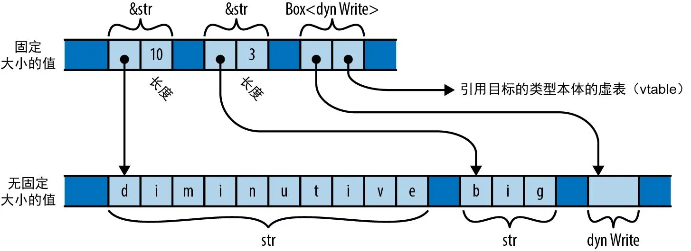

# 第13章实用工具特型

- 科学无非就是在自然界的多样性中寻求统一性（或者更确切地说，是在我们经验的多样性中寻求统一性）。用 Coleridge 的话说，诗歌、绘画、艺术，同样是在多样性中寻求统一性。——Jacob Bronowski

本章讲解了所谓的 Rust“实用工具”特型，这是标准库中各种特型的“百宝箱”，它们对 Rust 的编写方式有相当大的影响，所以，只有熟悉它们，你才能写出符合 Rust 语言惯例的代码并据此为你的 crate 设计公共接口，让用户认为这些接口是符合 Rust 风格的。Rust 实用工具特型可分为三大类。

- 语言扩展特型

第 12 章中介绍的运算符重载特型能让你在自己的类型上使用 Rust 的表达式运算符，同样，还有其他几个标准库特型也是 Rust 的扩展点，允许你把自己的类型更紧密地集成进语言中。

```
这类特型包括 Drop、Deref 和 DerefMut，以及转换特型 From 和 Into。我们将在本章
```

中讲解它们。

- 标记特型

```
这类特型多用作泛型类型变量的限界，以表达无法以其他方式捕获的约束条件。Sized 和
Copy 就属于这类特型。
```

- 公共词汇特型

这类特型不涉及任何编译器魔术，你完全可以在自己的代码中定义其等效特型。之所以定义它们，是为了给常见问题制定一些约定俗成的解决方案。这对 crate 和模块之间的公共接口来说特别有价值：通过减少不必要的变体，让接口更容易理解，也增加了把来自不同 crate 的特性轻易插接在一起的可能性，而且无须样板代码或自定义胶水代码。

```
这类特型包括 Default、引用借用特型 AsRef、AsMut、Borrow 与 BorrowMut、容错的
转换特型 TryFrom 与 TryInto，以及 ToOwned 特型（对 Clone 的泛化）。
```

表 13-1 对上述特型进行了汇总。

表 13-1：实用工具特型汇总表

特型

- 描述

```
Drop
```

- 析构器。每当丢弃一个值时，Rust 都要自动运行的清理代码

- 具有在编译期已知的固定大小类型的标记特型，与之相对的

```
Sized
```

- 是动态大小类型（如切片）

```
Clone
```

- 用来支持克隆值的类型

- 可以简单地通过对包含值的内存进行逐字节复制以进行克隆

```
Copy
```

- 的类型的标记特型

```
Deref 与 DerefMut
```

- 智能指针类型的特型

```
Default
```

- 具有合理“默认值”的类型

```
AsRef 与 AsMut
```

- 用于从另一种类型中借入一种引用类型的转换特型

```
转换特型，类似 AsRef/AsMut，但能额外保证一致的哈
Borrow 与 BorrowMut
```

- 希、排序和相等性

```
From 与 Into
```

- 用于将一种类型的值转换为另一种类型的转换特型

- 用于将一种类型的值转换为另一种类型的转换特型，用于可

```
TryFrom 与 TryInto
```

- 能失败的转换

```
ToOwned
```

- 用于将引用转换为拥有型值的转换特型

```
还有另一些重要的标准库特型。第 15 章会介绍 Iterator 和 IntoIterator。第 16 章会
介绍用于计算哈希值的 Hash 特型。第 19 章会介绍两个用于标记线程安全类型的特型 Send
和 Sync。
```

## 13.1　Drop

当一个值的拥有者消失时，Rust 会丢弃（drop）该值。丢弃一个值就必须释放该值拥有的任何其他值、堆存储和系统资源。丢弃可能发生在多种情况下：当变量超出作用域时；在表达式语句的末尾；当截断一个向量时，会从其末尾移除元素；等等。

在大多数情况下，Rust 会自动处理丢弃值的工作。假设你定义了以下类型：

```
struct Appellation {
   name: String,
   nicknames: Vec<String>
}
Appellation 拥有用作字符串内容和向量元素缓冲区的堆存储。每当 Appellation 被丢
```

弃时，Rust 都会负责清理所有这些内容，无须你进行任何进一步的编码。但只要你想，也可

```
以通过实现 std::ops::Drop 特型来自定义 Rust 该如何丢弃此类型的值：
trait Drop {
   fn drop(&mut self);
}
Drop 的实现类似于 C++ 中的析构函数或其他语言中的终结器。当一个值被丢弃时，如果它
实现了 std::ops::Drop，那么 Rust 就会调用它的 drop 方法，然后像往常一样继续丢弃
它的字段或元素拥有的任何值。这种对 drop 的隐式调用是调用该方法的唯一途径。如果你试
```

图显式调用该方法，那么 Rust 会将其标记为错误。

```
Rust 在丢弃某个值的字段或元素之前会先对值本身调用 Drop::drop，该方法收到的值仍然
是已完全初始化的。因此，在 Appellation 类型的 Drop 实现中可以随意使用其字段：
impl Drop for Appellation {
   fn drop(&mut self) {
       print!("Dropping {}", self.name);
       if !self.nicknames.is_empty() {
           print!(" (AKA {})", self.nicknames.join(", "));
       }
       println!("");
   }
}
```

基于该实现，可以编写以下内容：

```javascript
{
   let mut a = Appellation {
       name: "Zeus".to_string(),
       nicknames: vec!["cloud collector".to_string(),
                       "king of the gods".to_string()]
   };
   println!("before assignment");
   a = Appellation { name: "Hera".to_string(), nicknames: vec![] };
   println!("at end of block");
}
当我们将第二个 Appellation 赋值给 a 时，就会丢弃第一个 Appellation，而当我们离
开 a 的作用域时，就会丢弃第二个 Appellation。上述代码会打印出以下内容：
```

```
before assignment
Dropping Zeus (AKA cloud collector, king of the gods)
at end of block
Dropping Hera
Appellation 的 std::ops::Drop 实现只打印了一条消息，那么它的内存究竟是如何清理
的呢？Vec 类型实现了 Drop，它会丢弃自己的每一个元素，然后释放它们占用的分配在堆上
的缓冲区。String 在内部使用 Vec<u8> 来保存它的文本，因此 String 不需要自己实现
Drop，它会让 Vec 负责释放这些字符。同样的原则也适用于 Appellation 值：当一个值
被丢弃时，最终由 Vec 的 Drop 实现来负责真正释放每个字符串的内容，并释放保存这些向
量元素的缓冲区。至于 Appellation 值本身占用的内存，它的拥有者（可能是某个局部变
```

量或某些数据结构）会负责释放。

如果一个变量的值移动到了别处，以致该变量在超出作用域时正处于未初始化状态，那么Rust 将不会试图丢弃该变量，因为这里没有需要丢弃的值。

虽然根据控制流才能判断变量的值是否会移动出去，但这一原则仍然成立。在这种情况下，Rust 会使用一个不可见的标志来跟踪此变量的状态，该标志会指出是否需要丢弃此变量的值：

```javascript
let p;
{
   let q = Appellation { name: "Cardamine hirsuta".to_string(),
                         nicknames: vec!["shotweed".to_string(),
                                         "bittercress".to_string()] };
   if complicated_condition() {
       p = q;
   }
}
println!("Sproing! What was that?");
```

```
根据 complicated_condition 返回的是 true 还是 false，p 或 q 中的一个会最终拥有
Appellation，而另一个则会变成未初始化状态。这种差异决定了它是在 println! 之前
还是之后丢弃（因为 q 在 println! 之前就离开了作用域，而 p 则在 println! 之后离开
```

的作用域）。虽然一个值可能会从一个地方移动到另一个地方，但 Rust 只会丢弃它一次。

除非正在定义某个拥有 Rust 不了解的资源类型，通常我们不需要自己实现

```
std::ops::Drop。例如，在 Unix 系统上，Rust 的标准库在内部使用了以下类型来表示操
```

作系统的文件描述符：

```javascript
struct FileDesc {
   fd: c_int,
}
FileDesc 的 fd 字段是当程序完成时应该关闭的文件描述符的编号，c_int 是 i32 的别
名。标准库为 FileDesc 实现的 Drop 如下所示：
impl Drop for FileDesc {
   fn drop(&mut self) {
       let _ = unsafe { libc::close(self.fd) };
   }
}
这里，libc::close 是 C 库中 close 函数的 Rust 名称。Rust 代码只能在 unsafe 块中调
用 C 函数，因此在这里使用了一个 unsafe 块。
如果一个类型实现了 Drop，就不能再实现 Copy 特型了。如果类型是 Copy 类型，就表示简
单的逐字节复制足以生成该值的独立副本。但是，对同一份数据多次调用同一个 drop 方法显
```

然是错误的。

```
标准库预导入中包含一个丢弃值的函数 drop，但它的定义一点儿也不神奇：
fn drop<T>(_x: T) { }
换句话说，它会按值接受参数，从调用者那里获得所有权，然后什么也不做。当 _x 超出作用
```

域时，Rust 自然会丢弃它的值，这跟对任何其他变量的操作一样。

## 13.2　Sized

固定大小类型是指其每个值在内存中都有相同大小的类型。Rust 中的几乎所有类型都是固定

```
大小的，比如每个 u64 占用 8 字节，每个 (f32, f32, f32) 元组占用 12 字节。甚至枚举
```

也是有大小的，也就是说，无论实际存在的是哪个变体，枚举总会占据足够的空间来容纳其最

```
大的变体。尽管 Vec<T> 拥有一个大小可变的堆分配缓冲区，但 Vec 值本身是指向“缓冲区、
容量和长度”的指针，因此 Vec<T> 也是一个固定大小类型。
所有固定大小类型都实现了 std::marker::Sized 特型，该特型没有方法或关联类型。
Rust 自动为所有适用的类型实现了 std::marker::Sized 特型，你不能自己实现它。
Sized 的唯一用途是作为类型变量的限界：像 T: Sized 这样的限界要求 T 必须是在编译期
```

已知的类型。由于 Rust 语言本身会使用这种类型的特型为具有某些特征的类型打上标记，因此我们将其称为标记特型。

```
然而，Rust 也有一些无固定大小类型，它们的值大小不尽相同。例如，字符串切片类型 str
（注意没有 &）就是无固定大小的。字符串字面量 "diminutive" 和 "big" 是对占用了 10
字节和 3 字节的 str 切片的引用，两者都展示在图 13-1 中。像 [T]（同样没有 &）这样的
数组切片类型也是无固定大小的，即像 &[u8] 这样的共享引用可以指向任意大小的 [u8] 切
片。因为 str 类型和 [T] 类型都表示不定大小的值集，所以它们是无固定大小类型。
```



- 图 13-1：对无固定大小的值的引用

```
Rust 中另一种常见的无固定大小类型是 dyn 类型，它是特型对象的引用目标。正如我们在
```

11.1.1 节中所解释的那样，特型对象是指向实现了给定特型的某个值的指针。例如，类型

```
&dyn std::io::Write 和 Box<dyn std::io::Write> 是指向实现了 Write 特型的某
个值的指针。引用目标可能是文件、网络套接字，或某种实现了 Write 的自定义类型。由于
实现了 Write 的类型集是开放式的，因此 dyn Write 作为一个类型也是无固定大小的，也
```

就是说它的值可以有各种大小。

```
Rust 不能将无固定大小的值存储在变量中或将它们作为参数传递。你只能通过像 &str 或
Box<dyn Write> 这样的本身是固定大小的指针来处理它们。如图 13-1 所示，指向无固定
```

大小值的指针始终是一个胖指针，宽度为两个机器字：指向切片的指针带有切片的长度，特型对象带有指向方法实现的虚表的指针。

特型对象和指向切片的指针在结构上很像。这两种类型都缺乏某种在使用它们时必要的信息。

```
换句话说，你无法在不知道其长度的情况下对 [u8] 进行索引，也无法在不知道该对某个值使
用 Write 的哪个具体实现的情况下调用 Box<dyn Write> 的方法。对于这两种类型，胖指
```

针都会补齐类型中缺少的信息——它携带着长度或虚表指针。既然欠缺静态信息，那就用动态信息来弥补。

```
由于无固定大小类型处处受限，因此大多数泛型类型变量应当被限制为固定大小的 Sized 类
型。事实上，鉴于这种情况的普遍性，Sized 已经成为 Rust 中的隐式默认值：如果你写
struct S<T> { ... }，那么 Rust 会将其理解为 struct S<T: Sized> { ... }。如
果你不想以这种方式约束 T，就必须将其明确地排除，写成 struct S<T: ?Sized> {
... }。?Sized 语法专用于这种情况，意思是“不要求固定大小的”。如果你写 struct
S<T: ?Sized> { b: Box<T> }，那么 Rust 将允许写成 S<str> 和 S<dyn Write>，这
样这两个 Box 就变成了胖指针，而不像 S<i32> 和 S<String> 的 Box 那样只是普通指针。
```

尽管存在一些限制，但无固定大小类型能让 Rust 的类型系统工作得更顺畅。阅读标准库文档

```
时，你偶尔会遇到类型变量上的 ?Sized 限界，这几乎总是表明“给定的类型只能通过指针访
问”，并能让其关联的代码与切片对象和特型对象以及普通值一起使用。当类型变量具有 ?
Sized 限界时，人们认为它的大小不确定，既可能是固定大小，也可能不是。
```

除了切片对象和特型对象，还有另一种无固定大小类型。结构体类型的最后一个字段（而且只能是最后一个）可以是无固定大小的，并且这样的结构体本身也是无固定大小的。例如，

```javascript
Rc<T> 引用计数指针的内部实现是指向私有类型 RcBox<T> 的指针，后者把引用计数和 T 保
存在一起。下面是 RcBox 的简化定义：
struct RcBox<T: ?Sized> {
   ref_count: usize,
   value: T,
}
Rc<T> 是引用计数指针，其中的 value 字段是 Rc<T> 对其进行引用计数的 T 类型。Rc<T>
会解引用成指向 value 字段的指针。ref_count 字段会保存其引用计数。
真正的 RcBox 只是标准库的一个实现细节，无法在外部使用。但假设我们正在使用前面这种
定义，那么就可以将此 RcBox 与固定大小类型一起使用，比如 RcBox<String> 的结果是一
个固定大小的结构体类型。或者也可以将它与无固定大小类型一起使用，比如 RcBox<dyn
std::fmt::Display>（其中 Display 是可以通过 println! 之类的宏进行格式化的类
型的特型），结果 RcBox<dyn Display> 就成了无固定大小的结构体类型。
不能直接构建 RcBox<dyn Display> 值，而应该先创建一个普通的固定大小的 RcBox，并
让其 value 类型实现 Display，比如 RcBox<String>。然后 Rust 就会允许你将引用
&RcBox<String> 转换为胖引用 &RcBox<dyn Display>：
let boxed_lunch: RcBox<String> = RcBox {
   ref_count: 1,
   value: "lunch".to_string()
};
use std::fmt::Display;
let boxed_displayable: &RcBox<dyn Display> = &boxed_lunch;
在将值传给函数时会发生隐式转换，这样你就可以将 &RcBox<String> 传给需要
&RcBox<dyn Display> 的函数：
fn display(boxed: &RcBox<dyn Display>) {
   println!("For your enjoyment: {}", &boxed.value);
}
display(&boxed_lunch);
```

这将生成以下输出。

```
For your enjoyment: lunch
```

## 13.3　Clone

```
std::clone::Clone 特型适用于可复制自身的类型。Clone 定义如下：
trait Clone: Sized {
   fn clone(&self) -> Self;
   fn clone_from(&mut self, source: &Self) {
       *self = source.clone()
   }
}
clone 方法应该为 self 构造一个独立的副本并返回它。由于此方法的返回类型是 Self，
并且函数本来也不可能返回无固定大小的值，因此 Clone 特型也是扩展自 Sized 特型的，
进而导致其实现代码中的 Self 类型被限界成了 Sized。
克隆一个值通常还需要为它拥有的任何值分配副本，因此 clone 无论在时间消耗还是内存占
用方面都是相当昂贵的。例如，克隆 Vec<String> 不仅会复制此向量，还会复制它的每个
String 元素。这就是 Rust 不会自动克隆值，而是要求你进行显式方法调用的原因。像
Rc<T> 和 Arc<T> 这样的引用计数指针类型属于例外，即克隆其中任何一个都只会增加引用
```

计数并为你返回一个新指针。

```
clone_from 方法会把 self 修改成 source 的副本。clone_from 的默认定义只是克隆
source，然后将其转移给 *self。这固然可行，但对于某些类型，有一种更快的方法可以获
得同样的效果。假设 s 和 t 都是 String。s = t.clone(); 语句必然会克隆 t，丢弃 s
的旧值，然后将克隆后的值转移给 s，这会进行一次堆分配和一次堆释放。但是如果属于原始
s 的堆缓冲区有足够的容量来保存 t 的内容，则不需要分配或释放：可以简单地将 t 的文本
复制到 s 的缓冲区并调整长度。在泛型代码中，应该优先使用 clone_from，以便充分利用
```

这种优化。

```
如果你的 Clone 实现只需要简单地对类型中的每个字段或元素进行 clone，然后从这些克隆
结果中构造一个新值，并且认为 clone_from 的默认定义已经足够好了，那么 Rust 也可以
帮你实现：只要在类型定义上方写 #[derive(Clone)] 就可以了。
标准库中几乎所有能合理复制的类型都实现了 Clone。不仅 bool、i32 等原始类型实现了
Clone，String、Vec<T> 和 HashMap 等容器类型也实现了 Clone。而那些无法合理复制
的类型（如 std::sync::Mutex）则没有实现 Clone。像 std::fs::File 这样的类型虽
```

然可以复制，但如果操作系统无法提供必要的资源，则复制可能会失败。这些类型也没有实现

```
Clone，因为 clone 必须是不会失败的。作为替代，std::fs::File 提供了一个
try_clone 方法，该方法会返回一个 std::io::Result<File> 值，用以报告失败信息。
```

## 13.4　Copy

在第 4 章中，我们曾解释说，对于大多数类型，赋值时会移动值，而不是复制它们。移动值可以更简单地跟踪它们所拥有的资源。但在 4.3 节中，我们指出了例外情况：不拥有任何资源的

```
简单类型可以是 Copy 类型，对这些简单类型赋值会创建源的副本，而不会移动值并使源回到
```

未初始化状态。

```
当时，我们没有充分解释 Copy 类型到底是什么，现在可以告诉你了：如果一个类型实现了
std::marker::Copy 标记特型，那么它就是 Copy 类型，其定义如下所示：
trait Copy: Clone { }
```

对于你自己的类型，这当然很容易实现：

```
impl Copy for MyType { }
但由于 Copy 是一种对语言有着特殊意义的标记特型，因此只有当类型需要一个浅层的逐字节
复制时，Rust 才允许它实现 Copy。拥有任何其他资源（比如堆缓冲区或操作系统句柄）的类
型都无法实现 Copy。
任何实现了 Drop 特型的类型都不能是 Copy 类型。Rust 认为如果一个类型需要特殊的清理
与 Clone 一样，可以使用 #[derive(Copy)] 让 Rust 为你派生出 Copy 实现。你会经常看
到同时使用 #[derive(Copy, Clone)] 进行派生的代码。
在允许一个类型成为 Copy 类型之前务必慎重考虑。尽管这样做能让该类型更易于使用，但也
```

对其实现施加了严格的限制。如果复制的开销很高，那么就不适合进行隐式复制。4.3 节曾详细解释过这些因素。

## 13.5　Deref 与 DerefMut

```
通过实现 std::ops::Deref 特型和 std::ops::DerefMut 特型，可以指定像 * 和 . 这
样的解引用运算符在你的类型上的行为。像 Box<T> 和 Rc<T> 这样的指针类型就实现了这些
特型，因此它们可以像 Rust 的内置指针类型那样用。如果你有一个 Box<Complex> 型的值
b，那么 *b 引用的就是 b 指向的 Complex（复数）值，而 b.re 引用的是它的实部。如果
上下文对引用目标进行了赋值或借用了可变引用，那么 Rust 就会使用 DerefMut（解可变引
用）特型，否则，只要通过 Deref 进行只读访问就够了。
```

这两个特型的定义如下所示：

```
trait Deref {
   type Target: ?Sized;
   fn deref(&self) -> &Self::Target;
}
trait DerefMut: Deref {
   fn deref_mut(&mut self) -> &mut Self::Target;
}
deref 方法会接受 &Self 引用并返回 &Self::Target 引用，而 deref_mut 方法会接受
&mut Self 引用并返回 &mut Self::Target 引用。Target 应该是 Self 包含、拥有或
引用的资源：对于 Box<Complex>，其 Target 类型是 Complex。请注意 DerefMut 扩展
了 Deref：如果可以解引用并修改某些资源，那么当然也可以借入对它的共享引用。由于这
些方法会返回与 &self 生命周期相同的引用，因此只要返回的引用还存在，self 就会一直
```

处于已借出状态。

```
Deref 特型和 DerefMut 特型还扮演着另一个角色。由于 deref 会接受 &Self 引用并返
回 &Self::Target 引用，因此 Rust 会利用这一点自动将前一种类型的引用转换为后一种类
型的引用。换句话说，如果只要插入一个 deref 调用就能解决类型不匹配问题，那 Rust 就
会插入它。实现 DerefMut 也可以为可变引用启用相应的转换。这些叫作隐式解引用：一种
```

类型被“转换”成了另一种类型。

尽管隐式解引用也可以通过显式的方式写出来，但隐式解引用使用起来更方便。

```
如果你有一个 Rc<String> 型的值 r，并想对其调用 String::find，就可以简单地写
成 r.find('?')，而不用写成 (*r).find('?')：这种方法调用会隐式借入 r，并将
&Rc<String> 转换为 &String，因为 Rc<T> 实现了 Deref<Target=T>。
你可以对 String 值使用 split_at 之类的方法，虽然 split_at 是在 str 切片类型上
定义的方法，但因为 String 实现了 Deref<Target=str>，所以可以这样写。String
不需要重新实现 str 的所有方法，因为可以将 &String 隐式转换为 &str。
如果你有一个字节向量 v 并且想将它传给需要字节切片 &[u8] 的函数，就可以简单地将
&v 作为参数传递，因为 Vec<T> 实现了 Deref<Target=[T]>。
```

在必要的情况下，Rust 会连续应用多个隐式解引用。例如，使用前面提到的隐式转换，你可

```
以将 split_at 直接应用于 Rc<String>，因为 &Rc<String> 解引用成了 &String，后
者又解引用成了 &str，而 &str 具有 split_at 方法。
```

假设你有以下类型：

```javascript
struct Selector<T> {
   /// 在这个`Selector`中可用的元素
   elements: Vec<T>,
   /// `elements`中“当前”（current）元素的索引
   /// `Selector`的行为类似于指向当前元素的指针
   current: usize
}
要让 Selector 的行为与文档型注释中声明的一致，就必须为该类型实现 Deref 和
DerefMut：
use std::ops::;
impl<T> Deref for Selector<T> {
   type Target = T;
   fn deref(&self) -> &T {
       &self.elements[self.current]
   }
}
impl<T> DerefMut for Selector<T> {
   fn deref_mut(&mut self) -> &mut T {
       &mut self.elements[self.current]
   }
}
给定上述实现，可以像下面这样使用 Selector：
let mut s = Selector { elements: vec!['x', 'y', 'z'],
                      current: 2 };
// 因为`Selector`实现了`Deref`，所以可以使用`*`运算符来引用它的当前元素
assert_eq!(*s, 'z');
// 通过隐式解引用直接在`Selector`上使用`char`的方法断言'z'是字母
assert!(s.is_alphabetic());
// 通过对此`Selector`的引用目标赋值，把'z'改成了'w'
*s = 'w';
assert_eq!(s.elements, ['x', 'y', 'w']);
Deref 特型和 DerefMut 特型旨在实现诸如 Box、Rc 和 Arc 之类的智能指针类型，以及其
拥有型版本会频繁通过引用来使用的类型（比如 Vec<T> 和 String 就是 [T] 和 str 的拥
有型版本）。仅仅为了让 Target 类型的方法能自动通过类型指针使用（就像 C++ 中那样让
基类的方法在子类上可见）就为类型实现 Deref 和 DerefMut 是不对的。那样做的话并不总
```

能如预期般工作，并且在出错时可能会让人困惑。

隐式解引用有一个容易引起混淆的地方需要注意：Rust 会用它们来解决类型冲突，但并不会将其用于满足类型变量的限界。例如，下面的代码能正常工作：

```javascript
let s = Selector { elements: vec!["good", "bad", "ugly"],
                  current: 2 };
fn show_it(thing: &str) { println!("{}", thing); }
show_it(&s);
在调用 show_it(&s) 时，Rust 发现了一个类型为 &Selector<&str> 的实参（argument）
和一个类型为 &str 的形参（parameter），据此找到了这个 Deref<Target=str> 实现，并
```

- 1

```
根据需要将此调用重写成了 show_it(s.deref())。
但是，如果将 show_it 改成泛型函数，Rust 突然就报错了：
use std::fmt::Display;
fn show_it_generic<T: Display>(thing: T) { println!("{}", thing); }
show_it_generic(&s);
```

Rust 报错说：

```
error: `Selector<&str>` doesn't implement `std::fmt::Display`
  |
31 |  show_it_generic(&s);
  |                  ^^
  |                  |
  |                  `Selector<&str>` cannot be formatted with
  |                  the default formatter
  |                  help: consider adding dereference here: `&*s`
  |
note: required by a bound in `show_it_generic`
  |
30 |  fn show_it_generic<T: Display>(thing: T) { println!("{}", thing); }
  |                        ^^^^^^^ required by this bound
  |                                in `show_it_generic`
这可能会令人困惑：为什么仅仅把函数改成泛型形式就会引入错误呢？Selector<&str> 本
身确实没有实现 Display，但它解引用成了 &str，而 &str 实现了 Display。
由于你要传入一个类型为 &Selector<&str> 的实参并且函数的形参类型为 &T，因此类型
变量 T 必然是 Selector<&str>。然后，Rust 会检查这是否满足 T: Display 限界，但因
```

为它不会通过隐式解引用来满足类型变量的限界，所以这个检查失败了。

```
要解决此问题，可以使用 as 运算符进行显式转换：
show_it_generic(&s as &str);
或者，正如编译器建议的那样，可以使用 &* 进行强制转换。
show_it_generic(&*s);
```

## 13.6　Default

```
显然，某些类型具有合理的默认值：向量或字符串默认为空、数值默认为 0、Option 默认为
None，等等。这样的类型都可以实现 std::default::Default 特型：
trait Default {
   fn default() -> Self;
}
```

```
default 方法只会返回一个 Self 类型的新值。为 String 实现 Default 的代码一目了
```

然：

```
impl Default for String {
   fn default() -> String {
       String::new()
   }
}
Rust 的所有集合类型（Vec、HashMap、BinaryHeap 等）都实现了 Default，其
default 方法会返回一个空集合。当你需要构建一些值的集合但又想让调用者来决定具体构
建何种集合时，这很有用。例如，Iterator 特型的 partition 方法会将迭代器生成的值
```

分为两个集合，并使用闭包来决定每个值的去向：

```javascript
use std::collections::HashSet;
let squares = [4, 9, 16, 25, 36, 49, 64];
let (powers_of_two, impure): (HashSet<i32>, HashSet<i32>)
   = squares.iter().partition(|&n| n & (n-1) == 0);
assert_eq!(powers_of_two.len(), 3);
assert_eq!(impure.len(), 4);
闭包 |&n| n & (n-1) == 0 会使用一些位操作来识别哪些数值是 2 的幂，并且
partition 会使用它来生成两个 HashSet。不过，partition 显然不是专属于 HashSet
的，你可以用它来生成想要的任何种类的集合，只要该集合类型能够实现 Default 以生成一
个初始的空集合，并且实现 Extend<T> 以将 T 添加到集合中就可以。String 实现了
Default 和 Extend<char>，所以你可以这样写：
```

```bash
let (upper, lower): (String, String)
   = "Great Teacher Onizuka".chars().partition(|&c| c.is_uppercase());
assert_eq!(upper, "GTO");
assert_eq!(lower, "reat eacher nizuka");
Default 的另一个常见用途是为表示大量参数集合的结构体生成默认值，其中大部分参数通
常不用更改。例如，glium crate 为强大而复杂的 OpenGL 图形库提供了 Rust 绑定。
glium:: DrawParameters 结构体包括 24 个字段，每个字段控制着 OpenGL 应该如何渲
染某些图形的不同细节。glium draw 函数需要一个 DrawParameters 结构体作为参数。
由于 DrawParameters 已经实现了 Default，因此只需提及想要更改的那些字段即可创建
一个可以传给 draw 的结构体：
let params = glium::DrawParameters {
   line_width: Some(0.02),
   point_size: Some(0.02),
   .. Default::default()
};
target.draw(..., &params).unwrap();
这会调用 Default::default() 来创建一个 DrawParameters 值，该值会使用其所有字
段的默认值进行初始化，然后使用结构体的 .. 语法创建出一个更改了 line_width 字段和
point_size 字段的新值，最后就可以把它传给 target.draw 了。
如果类型 T 实现了 Default，那么标准库就会自动为 Rc<T>、Arc<T>、Box<T>、
Cell<T>、RefCell<T>、Cow<T>、Mutex<T> 和 RwLock<T> 实现 Default。例如，类
型 Rc<T> 的默认值就是一个指向类型 T 的默认值的 Rc。
如果一个元组类型的所有元素类型都实现了 Default，那么该元组类型也同样会实现
Default，这个元组的默认值包含每个元素的默认值。
Rust 不会为结构体类型隐式实现 Default，但是如果结构体的所有字段都实现了
Default，则可以使用 #[derive(Default)] 为此结构体自动实现 Default。
```

## 13.7　AsRef 与 AsMut

```
如果一个类型实现了 AsRef<T>，那么就意味着你可以高效地从中借入 &T。AsMut 是
AsRef 针对可变引用的对应类型。它们的定义如下所示：
trait AsRef<T: ?Sized> {
   fn as_ref(&self) -> &T;
}
trait AsMut<T: ?Sized> {
   fn as_mut(&mut self) -> &mut T;
}
例如，Vec<T> 实现了 AsRef<[T]>，而 String 实现了 AsRef<str>。还可以把 String
的内容借入为字节数组，因此 String 也实现了 AsRef<[u8]>。
AsRef 通常用于让函数更灵活地接受其参数类型。例如，std::fs::File::open 函数的
```

声明如下：

```
fn open<P: AsRef<Path>>(path: P) -> Result<File>
open 真正想要的是 &Path，即代表文件系统路径的类型。有了这个函数签名，open 就能接
受可以从中借入 &Path 的一切，也就是实现了 AsRef<Path> 的一切。这些类型包括
String 和 str、操作系统接口字符串类型 OsString 和 OsStr，当然还有 PathBuf 和
Path。有关完整列表，请参阅标准库的文档。这样你才能给 open 传入字符串字面量：
```

```javascript
let dot_emacs = std::fs::File::open("/home/jimb/.emacs")?;
```

标准库的所有文件系统访问函数都会以这种方式接受路径参数。对调用者来说，其效果类似于C++ 中的重载函数，只不过 Rust 采用的是另一种方式来确定可接受的参数类型。

```
但这还不是全部。字符串字面量是 &str，实现了 AsRef<Path> 的类型是 str，并没有
&。正如我们在 13.5 节中解释的那样，Rust 不会试图通过隐式解引用来满足类型变量限界，
```

因此就算它们在这里也无济于事。

幸运的是，标准库包含了其通用实现：

```
impl<'a, T, U> AsRef<U> for &'a T
   where T: AsRef<U>,
         T: ?Sized, U: ?Sized
{
   fn as_ref(&self) -> &U {
       (*self).as_ref()
   }
}
换句话说，对于任意类型 T 和 U，只要满足 T: AsRef<U>，就必然满足 &T: AsRef<U>：
只需追踪引用并像以前那样继续处理即可。特别是，如果满足 str: AsRef<Path>，那么也
会满足 &str: AsRef<Path>。从某种意义上说，这是一种在检查类型变量的 AsRef 限界
```

时获得受限隐式解引用的方法。

```
你可能会认为，如果一个类型实现了 AsRef<T>，那么它也应该实现 AsMut<T>。但是，这
在某些情况下是不合适的。例如，我们已经提到 String 实现了 AsRef<[u8]>，这是合理
的，因为每个 String 肯定都有一个可以作为二进制数据访问的字节缓冲区。但是，String
要进一步保证这些字节是表示 Unicode 文本的一段格式良好的 UTF-8 编码，如果 String 实
现了 AsMut<[u8]>，那么就会允许调用者将 String 的字节更改为他们想要的任何内容，
这样你就不能再相信 String 一定是格式良好的 UTF-8 了。只有修改给定的 T 肯定不会违反
此类型的不变性约束时，实现 AsMut<T> 的类型才有意义。
尽管 AsRef 和 AsMut 非常简单，但为引用转换提供标准的泛型特型可避免更专用的转换特
型数量激增。只要能实现 AsRef<Foo>，就要尽量避免定义自己的 AsFoo 特型。
```

## 13.8　Borrow 与 BorrowMut

```
std::borrow::Borrow 特型类似于 AsRef：如果一个类型实现了 Borrow<T>，那么它的
borrow 方法就能高效地从自身借入一个 &T。但是 Borrow 施加了更多限制：只有当 &T 能
通过与它借来的值相同的方式进行哈希和比较时，此类型才应实现 Borrow<T>。（Rust 并不
强制执行此限制，它只是记述了此特型的意图。）这使得 Borrow 在处理哈希表和树中的键或
```

者处理因为某些原因要进行哈希或比较的值时非常有用。

```
这在区分对 String 的借用时很重要，比如 String 实现了 AsRef<str>、AsRef<[u8]>
和 AsRef<Path>，但这 3 种目标类型通常具有不一样的哈希值。只有 &str 切片才能保证
像其等效的 String 一样进行哈希，因此 String 只实现了 Borrow<str>。
Borrow 的定义与 AsRef 的定义基本相同，只是名称变了：
trait Borrow<Borrowed: ?Sized> {
   fn borrow(&self) -> &Borrowed;
}
Borrow 旨在解决具有泛型哈希表和其他关联集合类型的特定情况。假设你有一个
std::collections::HashMap<String, i32>，用于将字符串映射到数值。这个表的键
是 String，每个条目都有一个键。在这个表中查找某个条目的方法的签名应该是什么呢？下
```

面是第一次尝试。

```
impl<K, V> HashMap<K, V> where K: Eq + Hash
{
   fn get(&self, key: K) -> Option<&V> { ... }
}
这很合理：要查找条目，就必须为表提供适当类型的键。但在这里，K 是 String，这种签名
会强制你将 String 按值传给对 get 的每次调用，这显然是一种浪费。你真正需要的只是此
```

键的引用：

```
impl<K, V> HashMap<K, V> where K: Eq + Hash
{
   fn get(&self, key: &K) -> Option<&V> { ... }
}
这稍微好一点儿了，但现在你必须将键作为 &String 传递，所以如果想查找常量字符串，就
```

必须像下面这样写。

```
hashtable.get(&"twenty-two".to_string())
这相当荒谬：它会在堆上分配一个 String 缓冲区并将文本复制进去，这样才能将其作为
&String 借用出来，传给 get，然后将其丢弃。
它应该只要求传入任何可以哈希并与我们的键类型进行比较的类型。例如，&str 就完全够用
```

了。所以下面是最后一次迭代，也正是你在标准库中所看到的：

```
impl<K, V> HashMap<K, V> where K: Eq + Hash
{
   fn get<Q: ?Sized>(&self, key: &Q) -> Option<&V>
       where K: Borrow<Q>,
             Q: Eq + Hash
   { ... }
}
换句话说，只要可以借入一个条目的键充当 &Q，并且对生成的引用进行哈希和比较的方式与
键本身一致，&Q 显然就是可接受的键类型。由于 String 实现了 Borrow<str> 和
Borrow<String>，因此最终版本的 get 允许按需传入 &String 型或 &str 型的 key。
Vec<T> 和 [T; N] 实现了 Borrow<[T]>。每个类似字符串的类型都能借入其相应的切片
类型：String 实现了 Borrow<str>、PathBuf 实现了 Borrow<Path>，等等。标准库
中所有关联集合类型都使用 Borrow 来决定哪些类型可以传给它们的查找函数。
标准库中包含一个通用实现，因此每个类型 T 都可以从自身借用：T: Borrow<T>。这确保
了在 HashMap<K, V> 中查找条目时 &K 总是可接受的类型。
为便于使用，每个 &mut T 类型也都实现了 Borrow<T>，它会像往常一样返回一个共享引用
&T。这样你就可以给集合的查找函数传入可变引用，而不必重新借入共享引用，以模拟 Rust
```

通常会从可变引用到共享引用进行的隐式转换。

```
BorrowMut 特型则类似于针对可变引用的 Borrow：
trait BorrowMut<Borrowed: ?Sized>: Borrow<Borrowed> {
   fn borrow_mut(&mut self) -> &mut Borrowed;
}
刚才讲过的对 Borrow 的要求同样适用于 BorrowMut。
```

## 13.9　From 与 Into

```
std::convert::From 特型和 std::convert::Into 特型表示类型转换，这种转换会接
受一种类型的值并返回另一种类型的值。AsRef 特型和 AsMut 特型用于从一种类型借入另一
种类型的引用，而 From 和 Into 会获取其参数的所有权，对其进行转换，然后将转换结果的
```

所有权返回给调用者。

```
From 和 Into 的定义是对称的：
trait Into<T>: Sized {
   fn into(self) -> T;
}
trait From<T>: Sized {
   fn from(other: T) -> Self;
}
标准库自动实现了从每种类型到自身的简单转换：每种类型 T 都实现了 From<T> 和
Into<T>。
```

虽然这两个特型看起来只是为做同一件事提供了两种方式，但其实它们有不同的用途。

```javascript
你通常可以使用 Into 来让你的函数在接受参数时更加灵活。如果你写如下代码：
use std::net::Ipv4Addr;
fn ping<A>(address: A) -> std::io::Result<bool>
   where A: Into<Ipv4Addr>
{
   let ipv4_address = address.into();
   ...
}
```

```
那么 ping 不仅可以接受 Ipv4Addr 作为参数，还可以接受 u32 或 [u8; 4] 数组，因为这
些类型都恰好实现了 Into<Ipv4Addr>。（有时将 IPv4 地址视为单个 32 位值或 4 字节数组
会很有用。）因为 ping 对 address 的唯一了解就是它要实现 Into<Ipv4Addr>，所以在
调用 into 时无须指定想要的是哪种类型。因为只会存在一种有效类型，所以类型推断会替你
```

补全它。

```
与 13.7 节中的 AsRef 一样，其效果很像 C++ 中的函数重载。使用之前的 ping 定义，可以
```

进行以下任何调用：

```javascript
println!("{:?}", ping(Ipv4Addr::new(23, 21, 68, 141))); // 传入一个Ipv4Addr
println!("{:?}", ping([66, 146, 219, 98]));             // 传入一个[u8; 4]
println!("{:?}", ping(0xd076eb94_u32));                 // 传入一个u32
而 From 特型扮演着另一种角色。from 方法会充当泛型构造函数，用于从另一个值生成本类
型的实例。例如，虽然 Ipv4Addr 有两个名为 from_array 和 from_u32 的方法，但
From 只是简单地实现了 From<[u8;4]> 和 From<u32>，于是我们就能这样写：
let addr1 = Ipv4Addr::from([66, 146, 219, 98]);
let addr2 = Ipv4Addr::from(0xd076eb94_u32);
```

可以让类型推断找出适用于此的实现。

```
给定适当的 From 实现，标准库会自动实现相应的 Into 特型。当你定义自己的类型时，如果
它具有某些单参数构造函数，那么就应该将它们写成适当类型的 From<T> 的实现，这样你就
会自动获得相应的 Into 实现。
因为转换方法 from 和 into 会接手它们的参数的所有权，所以此转换可以复用原始值的资源
```

来构造出转换后的值。假设你写如下代码：

```javascript
let text = "Beautiful Soup".to_string();
let bytes: Vec<u8> = text.into();
String 的 Into<Vec<u8>> 的实现只是获取 String 的堆缓冲区，并在不进行任何更改的
```

情况下将其重新用作所返回向量的元素缓冲区。此转换既不需要分配内存，也不需要复制文本。这是通过移动进行高性能实现的另一个例子。

这些转换还提供了一种很好的方式来将受限类型的值放宽为更灵活的值，而不会削弱受限类型

```
提供的保证。例如，String 会保证其内容始终是有效的 UTF-8，它的可变方法会受到严格限
制，以确保你所做的任何事情都不会引入错误的 UTF-8。但是这个例子有效地将 String“降
```

级”为一个普通字节块，你可以用它做任何喜欢的事情：既可以压缩它，也可以将它与其他非

```
UTF-8 的二进制数据组合使用。因为 into 会按值接手其参数，所以转换后的 text 就成了
未初始化状态，这意味着我们可以自由访问前一个 String 的缓冲区，而不会破坏任何现有
String。
然而，Into 和 From 契约并不要求这种转换是低开销的。尽管对 AsRef 和 AsMut 的转换
可以预期开销极低，但 From 和 Into 的转换可能会分配内存、复制或以其他方式处理值的内
容。例如，String 实现了 From<&str>，它会将字符串切片复制到 String 在堆上分配的
新缓冲区中。std::collections::BinaryHeap<T> 实现了 From<Vec<T>>，它能根据
```

算法的要求对元素进行比较和重新排序。

```
通过在需要时自动将具体错误类型转换为一般错误类型，运算符 ? 可以使用 From 和 Into
```

来帮助清理可能以多种方式失败的函数中的代码。

假设一个系统需要读取二进制数据并将其中的某些部分从 UTF-8 文本中作为十进制数值转换

```
出来。这意味着要使用 std::str::from_utf8 和 i32 的 FromStr 实现，它们都可以返
回不同类型的错误。假设讨论错误处理时使用的是第 7 章中定义的 GenericError 类型和
GenericResult 类型，那么运算符 ? 将为我们进行这种转换：
```

```
type GenericError = Box<dyn std::error::Error + Send + Sync + 'static>;
type GenericResult<T> = Result<T, GenericError>;
fn parse_i32_bytes(b: &[u8]) -> GenericResult<i32> {
       Ok(std::str::from_utf8(b)?.parse::<i32>()?)
}
与大多数错误类型一样，Utf8Error 和 ParseIntError 也实现了 Error 特型，标准库为
我们提供了 From 的通用实现，用于将任何实现了 Error 的类型转换为 Box<dyn Error>
类型，? 运算符会自动使用这种转换：
impl<'a, E: Error + Send + Sync + 'a> From<E>
 for Box<dyn Error + Send + Sync + 'a> {
   fn from(err: E) -> Box<dyn Error + Send + Sync + 'a> {
       Box::new(err)
   }
}
这能把具有两个 match 语句的大函数变成单行函数。
在 From 和 Into 被加入标准库之前，Rust 代码充满了专用的转换特型和构造方法，每一个
都专用于一种类型。为了让你的类型更容易使用，From 和 Into 明确写出了可以遵循的约
```

定，因为你的用户已经熟悉它们了。其他库以及语言自身也可以依赖这些特型，将其作为一种规范化、标准化的方式来对转换进行编码。

```
From 和 Into 是不会失败的特型——它们的 API 要求这种转换不会失败。不过很遗憾，许多
转换远比这复杂得多。例如，像 i64 这样的大整数可以存储比 i32 大得多的数值，如果没有
一些额外的信息，那么将像 2_000_000_000_000i64 这样的数值转换成 i32 就没有多大意
```

义。如果进行简单的按位转换，那么其中前 32 位就会被丢弃，通常不会产生我们预期的结果：

```javascript
let huge = 2_000_000_000_000i64;
let smaller = huge as i32;
println!("{}", smaller); // -1454759936
```

有很多选项可以处理这种情况。根据上下文的不同，“回绕型”转换可能比较合适。另外，像数字信号处理和控制系统这样的应用程序通常会使用“饱和型”转换，它会把比可能的最大值还要大的数值限制为最大值。

## 13.10　TryFrom 与 TryInto

```
由于转换的行为方式不够清晰，因此 Rust 没有为 i32 实现 From<i64>，也没有实现任何其
他可能丢失信息的数值类型之间的转换，而是为 i32 实现了 TryFrom<i64>。TryFrom 和
TryInto 是 From 和 Into 的容错版“表亲”，这种转换同样是双向的，实现了 TryFrom 也
就意味着实现了 TryInto。
TryFrom 和 TryInto 的定义比 From 和 Into 稍微复杂一点儿。
pub trait TryFrom<T>: Sized {
   type Error;
   fn try_from(value: T) -> Result<Self, Self::Error>;
}
pub trait TryInto<T>: Sized {
   type Error;
   fn try_into(self) -> Result<T, Self::Error>;
}
try_into() 方法给了我们一个 Result，因此我们可以选择在异常情况下该怎么做，比如
```

处理一个因为太大而无法放入结果类型的数值：

```javascript
// 溢出时饱和，而非回绕
let smaller: i32 = huge.try_into().unwrap_or(i32::MAX);
```

```javascript
如果还想处理负数的情况，那么可以使用 Result 的 unwrap_or_else() 方法：
let smaller: i32 = huge.try_into().unwrap_or_else(|_|{
   if huge >= 0 {
       i32::MAX
   } else {
       i32::MIN
   }
});
为你自己的类型实现容错的转换也很容易。Error 类型既可以很简单，也可以很复杂，具体
```

取决于特定应用程序的要求。标准库使用的是一个空结构体，除了发生过错误这一事实之外没有提供任何信息，因为唯一可能的错误就是溢出。另外，更复杂类型之间的转换可能需要返回更多信息：

```
impl TryInto<LinearShift> for Transform {
   type Error = TransformError;
   fn try_into(self) -> Result<LinearShift, Self::Error> {
       if !self.normalized() {
           return Err(TransformError::NotNormalized);
       }
       ...
   }
}
From 和 Into 可以将类型与简单转换关联起来，而 TryFrom 和 TryInto 通过 Result 提
供的富有表现力的错误处理扩展了 From 和 Into 的简单转换。这 4 个特型可以一起使用，
```

在同一个 crate 中关联多个类型。

## 13.11　ToOwned

```
给定一个引用，如果此类型实现了 std::clone::Clone，则生成其引用目标的拥有型副本
的常用方法是调用 clone。但是当你想克隆一个 &str 或 &[i32] 时该怎么办呢？你想要的
可能是 String 或 Vec<i32>，但 Clone 的定义不允许这样做：根据定义，克隆 &T 必须始
终返回 T 类型的值，并且 str 和 [u8] 是无固定大小类型，它们甚至都不是函数所能返回的
```

类型。

```
std::borrow::ToOwned 特型提供了一种稍微宽松的方式来将引用转换为拥有型的值：
trait ToOwned {
   type Owned: Borrow<Self>;
   fn to_owned(&self) -> Self::Owned;
}
与必须精确返回 Self 类型的 clone 不同，to_owned 可以返回任何能让你从中借入
&Self 的类型：Owned 类型必须实现 Borrow<Self>。你可以从 Vec<T> 借入 &[T]，所
以只要 T 实现了 Clone，[T] 就能实现 ToOwned<Owned=Vec<T>>，这样就可以将切片的
元素复制到向量中了。同样，str 实现了 ToOwned<Owned=String>，Path 实现了
ToOwned<Owned=PathBuf>，等等。
```

- 2

## 13.12　Borrow 与 ToOwned 的实际运用：谦卑

## 的 Cow

要想用好 Rust，就必然涉及对所有权问题的透彻思考，比如函数应该通过引用还是值接受参数。通常你可以任选一种方式，让参数的类型反映你的决定。但在某些情况下，在程序开始运

```
行之前你无法决定是该借用还是该拥有，std::borrow::Cow 类型（用于“写入时克隆”，
```

clone on write 的缩写）提供了一种兼顾两者的方式。

```
std::borrow::Cow 的定义如下所示：
```

```
enum Cow<'a, B: ?Sized>
   where B: ToOwned
{
   Borrowed(&'a B),
   Owned(<B as ToOwned>::Owned),
}
Cow<B> 要么借入对 B 的共享引用，要么拥有可供借入此类引用的值。由于 Cow 实现了
Deref，因此你可以像对 B 的共享引用一样调用它的方法：如果它是 Owned，就会借入对拥
有值的共享引用；如果它是 Borrowed，就会转让自己持有的引用。
还可以通过调用 Cow 的 to_mut 方法来获取对 Cow 值的可变引用，这个方法会返回 &mut
B。如果 Cow 恰好是 Cow::Borrowed，那么 to_mut 只需调用引用的 to_owned 方法来获
取其引用目标的副本，将 Cow 更改为 Cow::Owned，并借入对新创建的这个拥有型值的可变
```

引用即可。这就是此类型名称所指的“写入时克隆”行为。

```
类似地，Cow 还有一个 into_owned 方法，该方法会在必要时提升对所拥有值的引用并返回
此引用，这会将所有权转移给调用者并在此过程中消耗掉 Cow。
Cow 的一个常见用途是返回静态分配的字符串常量或由计算得来的字符串。假设你需要将错
```

误枚举转换为错误消息。大多数变体可以用固定字符串来处理，但有些也需要在消息中包含附

```
加数据。你可以返回一个 Cow<'static, str>：
use std::path::PathBuf;
use std::borrow::Cow;
fn describe(error: &Error) -> Cow<'static, str> {
   match *error {
       Error::OutOfMemory => "out of memory".into(),
       Error::StackOverflow => "stack overflow".into(),
       Error::MachineOnFire => "machine on fire".into(),
       Error::Unfathomable => "machine bewildered".into(),
       Error::FileNotFound(ref path) => {
           format!("file not found: {}", path.display()).into()
       }
   }
}
上述代码使用了 Cow 的 Into 实现来构造出值。此 match 语句的大多数分支会返回
Cow::Borrowed 来引用静态分配的字符串。但是当我们得到一个 FileNotFound 变体时，
会使用 format! 来构建包含给定文件名的消息。match 语句的这个分支会生成一个
Cow::Owned 值。
如果 describe 的调用者不打算更改值，就可以直接把此 Cow 看作 &str：
println!("Disaster has struck: {}", describe(&error));
```

如果调用者确实需要一个拥有型的值，那么也能很容易地生成一个：

```javascript
let mut log: Vec<String> = Vec::new();
...
log.push(describe(&error).into_owned());
使用 Cow，describe 及其调用者可以把分配的时机推迟到确有必要的时候。
```

[1]：在需要做出区分的上下文中，本书选择将 argument 和 parameter 分别译为“实参”和“形参”。除此之外，在表示一般性概念或不

- 会导致混淆的情况下，二者均译为“参数”。——编者注

[2]：指不会主动占有资源，直到确有必要。——译者注
