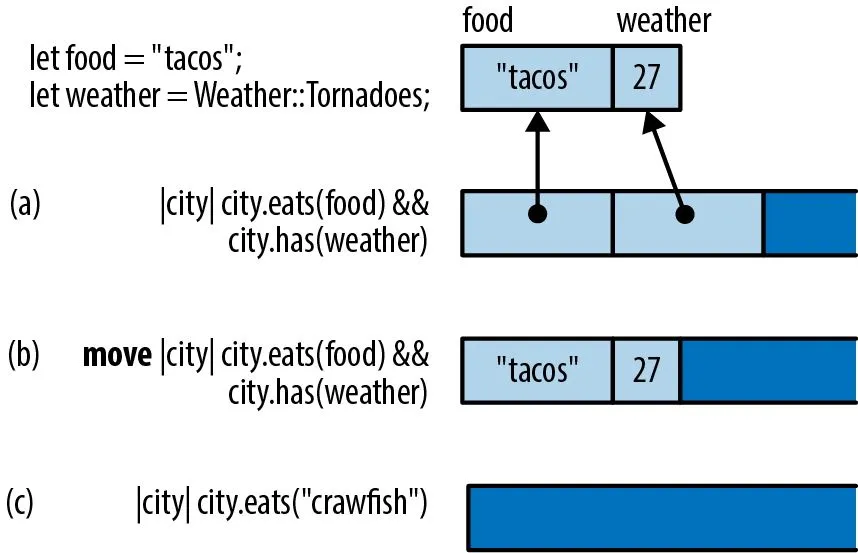
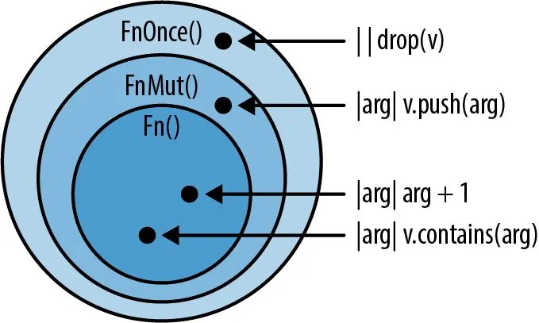

# 第14章闭包

- 1拯救环境！现在就创建闭包！——Cormac Flanagan

对整型向量进行排序很容易：

```
integers.sort();
```

遗憾的是，当我们想对一些数据进行排序时，它们几乎从来都不是整型向量。例如，对某种记

```
录型数据来说，内置的 sort 方法一般不适用：
struct City {
   name: String,
   population: i64,
   country: String,
   ...
}
fn sort_cities(cities: &mut Vec<City>) {
   cities.sort();  // 出错：你到底想怎么排序？
}
Rust 会报错说 City 没有实现 std::cmp::Ord。我们需要指定排序顺序，如下所示：
/// 按照人口数量对城市进行排序的辅助函数
fn city_population_descending(city: &City) -> i64 {
   -city.population
}
fn sort_cities(cities: &mut Vec<City>) {
   cities.sort_by_key(city_population_descending);  // 正确
}
辅助函数 city_population_descending 会接受 City 型记录并提取其键，该键是我们
对数据进行排序时要依据的字段。（它会返回一个负数，因为 sort 会按升序排列数值，而我
们想要按降序排列：让人口最多的城市在前。）sort_by_key 方法会将这个取键函数作为参
```

数。

这固然可行，但如果将辅助函数写成闭包（匿名函数表达式）则会更简洁：

```
fn sort_cities(cities: &mut Vec<City>) {
   cities.sort_by_key(|city| -city.population);
}
这里的 |city| -city.population 就是闭包。它会接受一个参数 city 并返回 -
city.population。Rust 会从闭包的使用方式中推断出其参数类型和返回类型。下面是标
```

准库中接受闭包的其他例子。

```
像 map 和 filter 这样的 Iterator 方法，可用于处理序列数据。第 15 章会介绍这些方
```

- 法。

```
像 thread::spawn 这样的线程 API，会启动一个新的系统线程。并发就是要将工作转移
```

- 给其他线程，而闭包能方便地表示这些工作单元。第 19 章会介绍这些特性。

```
一些需要根据条件计算默认值的方法，比如 HashMap 条目的 or_insert_with 方法。此
方法用于获取或创建 HashMap 中的条目，当默认值的计算成本很高时就要使用闭包。默认
```

- 值会作为闭包传入，只有当不得不创建新条目时才会调用此闭包。

当然，如今匿名函数无处不在，甚至连 Java、C#、Python、C++ 等最初没有匿名函数的语言中也有了其“身影”。从现在开始，我们假定你之前已经了解匿名函数，只想知道 Rust 的闭包与匿名函数有何不同。本章将介绍 3 种类型的闭包，你将学习如何将闭包与标准库方法一起使用、闭包如何“捕获”其作用域内的变量、如何编写自己的以闭包作为参数的函数和方法，以及如何存储闭包供以后用作回调。我们还将解释 Rust 闭包是如何实现的，以及它们为什么比你预想的要快。

## 14.1　捕获变量

闭包可以使用属于其所在函数的数据：

```
/// 根据任何其他的统计标准排序
fn sort_by_statistic(cities: &mut Vec<City>, stat: Statistic) {
   cities.sort_by_key(|city| -city.get_statistic(stat));
}
这里的闭包使用了 stat，该函数由其所在函数 sort_by_statistic 所拥有。于是我们说
这个闭包“捕获”了 stat。这是闭包的经典特性之一，Rust 当然也支持。但在 Rust 中，此特
```

性略有不同。

在大多数支持闭包的语言中，垃圾回收扮演着重要角色。例如，考虑下面这段 JavaScript 代码：

```javascript
// 启动重新排列城市所在表行的动画
function startSortingAnimation(cities, stat) {
   // 用来对表格进行排序的辅助函数
   // 注意此函数引用了stat
   function keyfn(city) {
       return city.get_statistic(stat);
   }
   if (pendingSort)
       pendingSort.cancel();
   // 现在开始动画，把keyfn传给它
   // 排序算法稍后会调用keyfn
   pendingSort = new SortingAnimation(cities, keyfn);
}
闭包 keyfn 存储在了新的 SortingAnimation 对象中。当 startSortingAnimation
```

返回后就会调用它。通常，当一个函数返回时，它的所有变量和参数都会超出作用域并被丢

```
弃。但是在这里，JavaScript 引擎必须以某种方式保留 stat，因为闭包会使用它。大多数
JavaScript 引擎的实现方式是在堆中分配 stat 并等垃圾回收器稍后回收。
```

Rust 没有垃圾回收。这可如何是好？为了回答这个问题，我们来看两个例子。

### 14.1.1　借用值的闭包

首先，我们重复一下本节开头的例子：

```
/// 根据任何其他的统计标准排序
fn sort_by_statistic(cities: &mut Vec<City>, stat: Statistic) {
   cities.sort_by_key(|city| -city.get_statistic(stat));
}
在这种情况下，当 Rust 创建闭包时，会自动借入对 stat 的引用。这很合理，因为闭包引用
了 stat，所以闭包必须包含对 stat 的引用。
```

剩下的就简单了。闭包同样遵循第 5 章中讲过的关于借用和生命周期的规则。特别是，由于闭

```
包中包含对 stat 的引用，因此 Rust 不会让它的生命周期超出 stat。因为闭包只会在排序
```

期间使用，所以这个例子是适用的。

简而言之，Rust 会使用生命周期而非垃圾回收来确保安全。Rust 的方式更快，因为即使是最

```
快的垃圾回收器在分配内存时也会比把 stat 保存在栈上慢，本例中 Rust 就把 stat 保存在
```

栈上。

### 14.1.2　“窃取”值的闭包

第二个例子比较棘手：

```javascript
use std::thread;
fn start_sorting_thread(mut cities: Vec<City>, stat: Statistic)
   -> thread::JoinHandle<Vec<City>>
{
   let key_fn = |city: &City| -> i64 { -city.get_statistic(stat) };
   thread::spawn(|| {
       cities.sort_by_key(key_fn);
       cities
   })
}
这有点儿像我们的 JavaScript 示例所做的：thread::spawn 会接受一个闭包并在新的系统
线程中调用它。请注意 || 是闭包的空参数列表。
```

新线程会和调用者并行运行。当闭包返回时，新线程退出。（闭包的返回值会作为

```
JoinHandle 值发送回调用线程。第 19 章会介绍 JoinHandle。）
同样，闭包 key_fn 包含对 stat 的引用。但这一次，Rust 不能保证此引用的安全使用。因
```

此 Rust 会拒绝编译这个程序：

```javascript
error: closure may outlive the current function, but it borrows `stat`,
      which is owned by the current function
  |
33 | let key_fn = |city: &City| -> i64 { -city.get_statistic(stat) };
  |              ^^^^^^^^^^^^^^^^^^^^                       ^^^^
  |              |                                      `stat` is borrowed here
  |              may outlive borrowed value `stat`
其实这里还有一个问题，因为 cities 也被不安全地共享了。简单来说，thread::spawn
创建的新线程无法保证在 cities 和 stat 被销毁之前在函数末尾完成其工作。
这两个问题的解决方案是一样的：要求 Rust 将 cities 和 stat移动到使用它们的闭包中，
```

而不是借入对它们的引用。

```javascript
fn start_sorting_thread(mut cities: Vec<City>, stat: Statistic)
   -> thread::JoinHandle<Vec<City>>
{
   let key_fn = move |city: &City| -> i64 { -city.get_statistic(stat) };
   thread::spawn(move || {
       cities.sort_by_key(key_fn);
       cities
   })
}
这里唯一的改动是在两个闭包之前都添加了 move 关键字。move 关键字会告诉 Rust，闭包
```

并不是要借入它用到的变量，而是要“窃取”它们。

```
第一个闭包 key_fn 取得了 stat 的所有权。第二个闭包则取得了 cities 和 key_fn 的所
```

有权。

因此，Rust 为闭包提供了两种从封闭作用域中获取数据的方法：移动和借用。实际上，关于移动和借用，闭包所遵循的正是第 4 章和第 5 章中已经介绍过的规则。下面举几个例子。

```
就像 Rust 这门语言中的其他地方一样，如果闭包要移动可复制类型的值（如 i32），那么
就会复制该值。因此，如果 Statistic 恰好是可复制类型，那么即使在创建了要使用
stat 的 move 闭包之后，我们仍可以继续使用 stat。
不可复制类型的值（如 Vec<City>）则确实会被移动，比如前面的代码就通过 move 闭包
将 cities 转移给了新线程。在创建此闭包后，Rust 就不允许再通过 cities 访问它了。
实际上，在闭包将 cities 移动之后，此代码就不需要再使用它了。但是，即使我们确实
需要在此之后使用 cities，解决方法也很简单：可以要求 Rust 克隆 cities 并将副本存
```

- 储在另一个变量中。闭包将只会“窃取”其中一个副本，即它所引用的那个副本。

通过遵循 Rust 的严格规则，我们也收获颇丰，那就是线程安全。正是因为向量是被移动的，而不是跨线程共享的，所以我们知道旧线程肯定不会在新线程正在修改向量的时候释放它。

## 14.2　函数与闭包的类型

在本章中，函数和闭包都在被当作值使用。自然，这就意味着它们有自己的类型。例如：

```
fn city_population_descending(city: &City) -> i64 {
   -city.population
}
该函数会接受一个参数（&City）并返回 i64。所以它的类型是 fn(&City) -> i64。
```

你可以像对其他值一样对函数执行各种操作。你可以将函数存储在变量中，也可以使用所有常用的 Rust 语法来计算函数值：

```javascript
let my_key_fn: fn(&City) -> i64 =
   if user.prefs.by_population {
       city_population_descending
   } else {
       city_monster_attack_risk_descending
   };
cities.sort_by_key(my_key_fn);
结构体也可以有函数类型的字段。像 Vec 这样的泛型类型可以存储大量的函数，只要它们共
享同一个 fn 类型即可。而且函数值占用的空间很小，因为 fn 值就是函数机器码的内存地
```

址，就像 C++ 中的函数指针一样。

一个函数还可以将另一个函数作为参数：

```javascript
/// 给定一份城市列表和一个测试函数，返回有多少个城市通过了测试
fn count_selected_cities(cities: &Vec<City>,
                        test_fn: fn(&City) -> bool) -> usize
{
   let mut count = 0;
   for city in cities {
       if test_fn(city) {
           count += 1;
       }
   }
   count
}
/// 测试函数的示例。注意，此函数的类型是`fn(&City) -> bool`，
/// 与`count_selected_cities` 的 `test_fn`参数相同
fn has_monster_attacks(city: &City) -> bool {
   city.monster_attack_risk > 0.0
}
// 有多少个城市存在被怪兽袭击的风险？
let n = count_selected_cities(&my_cities, has_monster_attacks);
```

如果你熟悉 C/C++ 中的函数指针，就会发现 Rust 的函数值简直跟它一模一样。

知道了这些之后，说闭包与函数不是同一种类型可能会让人大吃一惊：

```javascript
let limit = preferences.acceptable_monster_risk();
let n = count_selected_cities(
   &my_cities,
   |city| city.monster_attack_risk > limit);  // 错误：类型不匹配
```

第二个参数会导致类型错误。为了支持闭包，必须更改这个函数的类型签名。要改成下面这样：

```javascript
fn count_selected_cities<F>(cities: &Vec<City>, test_fn: F) -> usize
   where F: Fn(&City) -> bool
{
   let mut count = 0;
   for city in cities {
       if test_fn(city) {
           count += 1;
       }
   }
   count
}
这里只更改了 count_selected_cities 的类型签名，而没有更改函数体。新版本是泛型
函数。只要 F 实现了特定的特型 Fn(&City) -> bool，该函数就能接受任意 F 型的
test_fn。以单个 &City 为参数并返回 bool 值的所有函数和大多数闭包会自动实现这个特
```

型：

```
fn(&City) -> bool    // fn类型（只接受函数）
Fn(&City) -> bool    // Fn特型（既接受函数也接受闭包）
这种特殊的语法内置于语言中。-> 和返回类型是可选的，如果省略，则返回类型为 ()。
count_selected_cities 的新版本会接受函数或闭包：
count_selected_cities(
   &my_cities,
   has_monster_attacks);  // 正确
count_selected_cities(
   &my_cities,
   |city| city.monster_attack_risk > limit);  // 同样正确
为什么第一次尝试没有成功？好吧，闭包确实是可调用的，但它不是 fn。闭包 |city|
city.monster_attack_risk > limit 有它自己的类型，但不是 fn 类型。
```

事实上，你编写的每个闭包都有自己的类型，因为闭包可以包含数据：从封闭作用域中借用或“窃取”的值。这既可以是任意数量的变量，也可以是任意类型的组合。所以每个闭包都有一个由编译器创建的特殊类型，大到足以容纳这些数据。任何两个闭包的类型都不相同。但是每个

```
闭包都会实现 Fn 特型，我们示例中的闭包就实现了 Fn(&City) -> i64。
```

因为每个闭包都有自己的类型，所以使用闭包的代码通常都应该是泛型的，比如

```
count_selected_cities。每次都明确写出泛型类型确实有点儿笨拙，如果想了解这种设
```

计的优点，请继续往下阅读。

## 14.3　闭包性能

Rust 中闭包的设计目标是要快：比函数指针还要快，快到甚至可以在对性能敏感的热点代码中使用它们。如果你熟悉 C++ 的 lambda 表达式，就会发现 Rust 闭包也一样快速而紧凑，但更安全。

在大多数语言中，闭包会在堆中分配内存、进行动态派发以及进行垃圾回收。因此，创建、调用和收集每一个闭包都会花费一点点额外的 CPU 时间。更糟的是，闭包往往难以内联，而内联是编译器用来消除函数调用开销并实施大量其他优化的关键技术。总而言之，闭包在这些语言中确实慢到值得手动将它们从节奏紧凑的内层循环中去掉。

Rust 闭包则没有这些性能缺陷。它们没有垃圾回收。与 Rust 中的其他所有类型一样，除非你

```
将闭包放在 Box、Vec 或其他容器中，否则它们不会被分配到堆上。由于每个闭包都有不同
```

的类型，因此 Rust 编译器只要知道你正在调用的闭包的类型，就可以内联该闭包的代码。这使得在节奏紧凑的循环中使用闭包成为可能，并且各种 Rust 程序经常会满怀热情地刻意这么做，你会在第 15 章中亲自体会到这一点。

图 14-1 展示了 Rust 闭包在内存中的布局方式。在图的顶部，我们展示了闭包要引用的两个局

```
部变量：字符串 food 和简单的枚举 weather，枚举的数值恰好是 27。
```



- 图 14-1：闭包在内存中的布局

```
闭包 (a) 使用了上述两个变量。显然，我们正在寻找既有炸玉米饼（taco）又有龙卷风
（tornado）的城市。在内存中，这个闭包看起来像一个小型结构体，其中包含对其所用变
```

量的引用。

请注意，这个闭包并不包含指向其代码的指针。这种指针毫无必要：只要 Rust 知道闭包的类型，就知道在调用此闭包时该运行哪些代码。

```
闭包 (b) 与闭包 (a) 完全相同，只不过它是一个 move 闭包，因此会包含值而非引用。
```

闭包 (c) 不会使用其环境中的任何变量。该结构体是空的，所以这个闭包根本不会占用任何内存。

如图 14-1 所示，这些闭包不会占用多少空间。但在实践中，即使那区区几字节可能也不是必要的。通常，编译器会内联所有对闭包的调用，然后连图中所示的小结构体也优化掉。

14.5 节会展示如何使用特型对象在堆中分配闭包并动态调用它们。虽然这种方法有点儿慢，但仍然和特型对象的其他方法一样快。

## 14.4　闭包与安全

到目前为止，我们已经讨论了 Rust 如何确保闭包在从周围代码中借用或移动变量时遵守语言的安全规则。但是还有一些更复杂的后果并不那么显而易见。本节将稍微解释一下当闭包丢弃或修改其捕获的值时会发生什么。

### 14.4.1　“杀死”闭包

我们已经见过借用值的闭包和“窃取”值的闭包，如果沿着这种思路一直走下去，那么早晚会“出

- 2

事”

- 。

当然，“杀死”并不是正确的术语。在 Rust 中，我们会说丢弃值。最直观的方法是调用

```javascript
drop()：
let my_str = "hello".to_string();
let f = || drop(my_str);
当调用 f 时，my_str 会被丢弃。
```

那么，如果调用它两次会发生什么呢？

```
f();
f();
我们来深入思考一下。当第一次调用 f 时，它丢弃了 my_str，这意味着存储该字符串的内
存已经被释放，交还给了系统。当第二次调用 f 时，发生了同样的事情。这是 C++ 编程中会
```

触发未定义行为的经典错误：双重释放。

```
在 Rust 中丢弃同一个 String 两次当然也会出事。幸运的是，Rust 可没那么容易被愚弄：
f();  // 正确
f();  // 错误：使用了已移动的值
```

Rust 知道这个闭包不能调用两次。

一个只能调用一次的闭包看起来很不寻常，但这种现象的根源在于本书一直在讲的所有权和生命周期。值会被消耗掉（移动）的想法是 Rust 的核心概念之一，它对闭包与其他语法一视同仁。

### 14.4.2　FnOnce

```
我们再试一次欺骗 Rust，让它把同一个 String 丢弃两次。这次将使用下面这个泛型函数：
fn call_twice<F>(closure: F) where F: Fn() {
   closure();
   closure();
}
可以将这个泛型函数传给任何实现了特型 Fn() 的闭包，即不带参数且会返回 () 的闭包。
（与函数一样，返回类型如果是 () 则可以省略，Fn() 是 Fn() -> () 的简写形式。）
```

现在，如果将不安全的闭包传给这个泛型函数会发生什么呢？

```javascript
let my_str = "hello".to_string();
let f = || drop(my_str);
call_twice(f);
同样，此闭包将在调用后丢弃 my_str。调用它两次将导致双重释放。但 Rust 仍然没有被愚
```

弄：

```javascript
error: expected a closure that implements the `Fn` trait, but
      this closure only implements `FnOnce`
    |
 8 | let f = || drop(my_str);
   |         ^^^^^^^^------^
   |         |       |
   |         |       closure is `FnOnce` because it moves the variable `my_str`
   |         |       out of its environment
   |         this closure implements `FnOnce`, not `Fn`
 9 | call_twice(f);
   | ---------- the requirement to implement `Fn` derives from here
```

这条错误消息为我们揭示了关于 Rust 如何处理“清理型闭包”的更多信息。Rust 本可以在语言中完全禁止这种闭包，但清理闭包有时候是很有用的。因此，Rust 只是限制了它们的使用场

```
景。像 f 这种会丢弃值的闭包不允许实现 Fn。从字面上看，它们也确实不是 Fn。它们实现
了一个不那么强大的特型 FnOnce，即只能调用一次的闭包特型。
第一次调用 FnOnce 闭包时，闭包本身也会被消耗掉。这是因为 Fn 和 FnOnce 这两个特型
```

是这样定义的：

```
//  无参数的`Fn`特型和`FnOnce`特型的伪代码
trait <b>Fn() -> R</b> {
   fn call(<b>&self</b>) -> R;
}
trait <b>FnOnce() -> R</b> {
   fn call_once(<b>self</b>) -> R;
}
正如算术表达式 a + b 是方法调用 Add::add(a, b) 的简写形式一样，Rust 也会将
closure() 视为前面示例中的两个特型方法之一的简写形式。对于 Fn 闭包，closure()
会扩展为 closure.call()。此方法会通过引用获取 self，因此闭包不会被移动。但是如
果闭包只能安全地调用一次，那么 closure() 就会扩展为 closure.call_once()。该方
法会按值获取 self，因此这个闭包就会被消耗掉。
当然，这里是故意使用 drop() 挑起的麻烦。而在实践中，你通常都会在无意中遇到这种情
```

况。虽然不会经常发生，但偶尔你还是会写出一些无意中消耗掉一个值的闭包代码：

```javascript
let dict = produce_glossary();
let debug_dump_dict = || {
   for (key, value) in dict {  // 糟糕！
       println!("{:?} - {:?}", key, value);
   }
};
然后，当你多次调用 debug_dump_dict() 时，就会收到如下错误消息：
```

```javascript
error: use of moved value: `debug_dump_dict`
  |
19 |     debug_dump_dict();
  |     ----------------- `debug_dump_dict` moved due to this call
20 |     debug_dump_dict();
  |     ^^^^^^^^^^^^^^^ value used here after move
  |
note: closure cannot be invoked more than once because it moves the variable
`dict` out of its environment
  |
13 |         for (key, value) in dict {
  |                             ^^^^
要调试上述错误，就必须弄清楚此闭包为什么是 FnOnce。这里使用了哪个值？编译器友好地
指出它是 dict，在这种情况下该值是我们唯一引用的值。啊，果然有一个 bug：它通过直接
迭代消耗掉了 dict。我们应该遍历 &dict，而不是普通的 dict，以便通过引用访问值：
let debug_dump_dict = || {
   for (key, value) in &dict {  // 不要消耗掉dict
       println!("{:?} - {:?}", key, value);
   }
};
这样就修复了错误，现在这个函数是 Fn 并且可以调用任意次数了。
```

### 14.4.3　FnMut

还有一种包含可变数据或可变引用的闭包。

Rust 认为不可变值可以安全地跨线程共享，但是包含可变数据的不可变闭包不能安全共享——从多个线程调用这样的闭包可能会导致各种竞态条件，因为多个线程会试图同时读取和写入同一份数据。

```
Rust 还有另一类名为 FnMut 的闭包，也就是可写入的闭包。FnMut 闭包会通过可变引用来
```

调用，其定义如下所示：

```javascript
// `Fn`特型、`FnMut`特型和`FnOnce`特型的伪代码
trait Fn() -> R {
   fn call(&self) -> R;
}
trait <b>FnMut() -> R</b> {
   fn call_mut(<b>&mut self</b>) -> R;
}
trait FnOnce() -> R {
   fn call_once(self) -> R;
}
任何需要对值进行可变访问但不会丢弃任何值的闭包都是 FnMut 闭包。例如：
let mut i = 0;
let incr = || {
   i += 1;  // incr借入了对i的一个可变引用
   println!("Ding! i is now: {}", i);
};
call_twice(incr);
按照 call_twice 的调用方式，它会要求传入一个 Fn。由于 incr 是 FnMut 而非 Fn，因
```

此上述代码无法通过编译。不过，有一种简单的解决方法。为了理解此修复，我们先回过头来总结一下 Rust 闭包的 3 种类别。

```
Fn 是可以不受限制地调用任意多次的闭包和函数系列。此最高类别还包括所有 fn 函数。
FnMut 是本身会被声明为 mut，并且可以多次调用的闭包系列。
FnOnce 是如果其调用者拥有此闭包，它就只能调用一次的闭包系列。
每个 Fn 都能满足 FnMut 的要求，每个 FnMut 都能满足 FnOnce 的要求。如图 14-2 所示，
```

它们不是 3 个彼此独立的类别。



- 图 14-2：3 个闭包类别的维恩图

```
应该说，Fn() 是 FnMut() 的子特型，而 FnMut() 是 FnOnce() 的子特型。这使得 Fn 成
了最严格且最强大的类别。FnMut 和 FnOnce 是更宽泛的类别，其中包括某些具有使用限制
```

的闭包。

```
现在我们已经厘清了思路，很显然为了接受尽可能宽泛的闭包，call_twice 函数应该接受
所有 FnMut 闭包，如下所示：
fn call_twice<F>(mut closure: F) where F: FnMut() {
   closure();
   closure();
}
```

```javascript
第 1 行的限界原来是 F: Fn()，现在是 F: FnMut()。通过此更改，我们仍然能接受所有
Fn 闭包，并且还可以在会修改数据的闭包上使用 call_twice。
let mut i = 0;
call_twice(|| i += 1);  // 正确！
assert_eq!(i, 2);
```

### 14.4.4　对闭包的 Copy 与 Clone

```javascript
就像能自动找出哪些闭包只能调用一次一样，Rust 也能找出哪些闭包可以实现 Copy 和
Clone，哪些则不可以实现。
正如之前所解释的，闭包是表示包含它们捕获的变量的值（对于 move 闭包）或对值的引用
（对于非 move 闭包）的结构体。闭包的 Copy 规则和 Clone 规则与常规结构体的规则是一
样的。一个不修改变量的非 move 闭包只持有共享引用，这些引用既能 Clone 也能 Copy，
所以闭包也能 Clone 和 Copy：
let y = 10;
let add_y = |x| x + y;
let copy_of_add_y = add_y;                // 此闭包能`Copy`，所以……
assert_eq!(add_y(copy_of_add_y(22)), 42); // ……可以调用它两次
另外，一个会修改值的非 move 闭包在其内部表示中也可以有可变引用。可变引用既不能
Clone，也不能 Copy，使用它们的闭包同样如此：
let mut x = 0;
let mut add_to_x = |n| { x += n; x };
let copy_of_add_to_x = add_to_x;         // 这会进行移动而非复制
assert_eq!(add_to_x(copy_of_add_to_x(1)), 2); // 错误：使用了已移动出去的值
对于 move 闭包，规则更简单。如果 move 闭包捕获的所有内容都能 Copy，那它就能
Copy。如果 move 闭包捕获的所有内容都能 Clone，那它就能 Clone。例如：
let mut greeting = String::from("Hello, ");
let greet = move |name| {
   greeting.push_str(name);
   println!("{}", greeting);
};
greet.clone()("Alfred");
greet.clone()("Bruce");
这里的 .clone()(...) 语法有点儿奇怪，其实它只是表示克隆此闭包并调用其克隆体。这
```

个程序会输出如下内容：

```
Hello, Alfred
Hello, Bruce
当在 greet 中使用 greeting 时，greeting 被移动到了内部表示 greet 的结构体中，因
为它是一个 move 闭包。所以，当我们克隆 greet 时，它里面的所有东西同时被克隆了。
greeting 有两个副本，它们会在调用 greet 的克隆时分别被修改。这种行为本身并不是很
```

有用，但是在你需要将同一个闭包传给多个函数的场景中，它会非常有帮助。

## 14.5　回调

很多库会在其 API 中使用回调函数，即由用户提供某些函数，供库稍后调用。事实上，你已经

```
在本书中看到过一些类似的 API。在第 2 章，我们曾使用 actix-web 框架编写过一个简单的
```

Web 服务器。那个程序的一个重要部分是路由器，它看起来是这样的：

```
App::new()
   .route("/", web::get().to(get_index))
   .route("/gcd", web::post().to(post_gcd))
```

这个路由器的目的是将从互联网传入的请求路由到处理特定类型请求的那部分 Rust 代码中。

```
在本示例中，get_index 和 post_gcd 是我们在程序其他地方使用 fn 关键字声明的函数名
```

称。其实也可以在这里传入闭包，就像这样：

```
App::new()
   .route("/", web::get().to(|| {
       HttpResponse::Ok()
           .content_type("text/html")
           .body("<title>GCD Calculator</title>...")
   }))
   .route("/gcd", web::post().to(|form: web::Form<GcdParameters>| {
       HttpResponse::Ok()
           .content_type("text/html")
           .body(format!("The GCD of {} and {} is {}.",
                         form.n, form.m, gcd(form.n, form.m)))
   }))
这是因为 actix-web 设计成了可以接受任何线程安全的 Fn 作为参数的形式。
```

那么，如何在自己的程序中做到这一点呢？可以试着从头开始编写自己的简易路由器，而不使

```
用来自 actix-web 的任何代码。可以首先声明一些类型来表示 HTTP 请求和响应：
struct Request {
   method: String,
   url: String,
   headers: HashMap<String, String>,
   body: Vec<u8>
}
struct Response {
   code: u32,
   headers: HashMap<String, String>,
   body: Vec<u8>
}
```

现在路由器所做的只是存储一个将 URL 映射到回调的表，以便按需调用正确的回调。（为简单起见，只允许用户创建与单个 URL 精确匹配的路由。）

```sql
struct BasicRouter<C> where C: Fn(&Request) -> Response {
   routes: HashMap<String, C>
}
impl<C> BasicRouter<C> where C: Fn(&Request) -> Response {
   /// 创建一个空路由器
   fn new() -> BasicRouter<C> {
       BasicRouter { routes: HashMap::new() }
   }
   /// 给路由器添加一个路由
   fn add_route(&mut self, url: &str, callback: C) {
       self.routes.insert(url.to_string(), callback);
   }
}
```

遗憾的是，我们犯了一个错误。你注意到了吗？

如果只给路由器添加一个路由，那么它是可以正常工作的：

```javascript
let mut router = BasicRouter::new();
router.add_route("/", |_| get_form_response());
```

这段代码可以编译和运行。不过很遗憾，如果再添加一个路由：

```
router.add_route("/gcd", |req| get_gcd_response(req));
```

就会得到一些错误：

```
error: mismatched types
  |
41 | router.add_route("/gcd", |req| get_gcd_response(req));
  |                          ^^^^^^^^^^^^^^^^^^^^^^^^^^^
  |                          expected closure, found a different closure
  |
  = note: expected type `[closure@closures_bad_router.rs:40:27: 40:50]`
             found type `[closure@closures_bad_router.rs:41:30: 41:57]`
note: no two closures, even if identical, have the same type
help: consider boxing your closure and/or using it as a trait object
我们所犯的错误在于如何定义 BasicRouter 类型：
struct BasicRouter<C> where C: Fn(&Request) -> Response {
   routes: HashMap<String, C>
}
这里声明的每个 BasicRouter 都带有一个回调类型 C，并且 HashMap 中的所有回调都是此
类型的。11.1.3 节曾展示过一个具有相同问题的 Salad 类型：
struct Salad<V: Vegetable> {
   veggies: Vec<V>
}
这里的解决方案与 Salad 的解决方案一样：因为要支持多种类型，所以需要使用 Box 和特型
```

对象：

```
type BoxedCallback = Box<dyn Fn(&Request) -> Response>;
struct BasicRouter {
   routes: HashMap<String, BoxedCallback>
}
每个 Box 可以包含不同类型的闭包，因此单个 HashMap 可以包含各种回调。请注意，类型参
数 C 消失了。
```

这需要对此方法进行一些调整。

```sql
impl BasicRouter {
   // 创建一个空路由器
   fn new() -> BasicRouter {
       BasicRouter { routes: HashMap::new() }
   }
   // 给路由器添加一个路由
   fn add_route<C>(&mut self, url: &str, callback: C)
       where C: Fn(&Request) -> Response + 'static
   {
       self.routes.insert(url.to_string(), Box::new(callback));
   }
}
```


```
　请注意 add_route 的类型签名中 C 的两个限界：特定的 Fn 特型和 'static 生
命周期。Rust 要求我们添加这个 'static 限界。如果没有它，那么对
Box::new(callback) 的调用就会出错，因为如果闭包包含对即将超出作用域的变量的
```

- 已借用引用，那么存储闭包就是不安全的。

最后，我们的简单路由器已准备好处理传入请求了：

```
impl BasicRouter {
   fn handle_request(&self, request: &Request) -> Response {
       match self.routes.get(&request.url) {
           None => not_found_response(),
           Some(callback) => callback(request)
       }
   }
}
```

以牺牲一些灵活性为代价，我们还可以写出此路由器的更省空间的版本：它并不存储特型对

```javascript
象，而是使用函数指针或 fn 类型。这些类型（如 fn(u32) -> u32）的行为很像闭包：
fn add_ten(x: u32) -> u32 {
   x + 10
}
let fn_ptr: fn(u32) -> u32 = add_ten;
let eleven = fn_ptr(1); // 11
```

事实上，不从其环境中捕获任何内容的闭包与函数指针是一样的，因为它们不需要保存有关捕

```
获变量的任何额外信息。如果在绑定或函数签名中指定了适当的 fn 类型，则编译器很乐意让
```

你以这种方式使用它们：

```javascript
let closure_ptr: fn(u32) -> u32 = |x| x + 1;
let two = closure_ptr(1); // 2
与捕获型闭包不同，这类函数指针只会占用一个 usize。
```

持有函数指针的路由表如下所示：

```sql
struct FnPointerRouter {
   routes: HashMap<String, fn(&Request) -> Response>
}
在这里，HashMap 只会为每个 String 键存储一个 usize 值，更关键的是，没有 Box。除
了 HashMap 自身，根本不存在动态分配。当然，方法也要相应调整：
impl FnPointerRouter {
   // 创建一个空路由器
   fn new() -> FnPointerRouter {
       FnPointerRouter { routes: HashMap::new() }
   }
   // 给路由器添加一个路由
   fn add_route(&mut self, url: &str, callback: fn(&Request) -> Response)
   {
       self.routes.insert(url.to_string(), callback);
   }
}
```

如图 14-1 所示，闭包具有独特的类型，因为每个闭包会捕获不同的变量，所以和别的语法元素一样，它们各自具有不同的大小。但是，如果闭包没有捕捉到任何东西，那就没有什么要存

```
储的了。通过在接受回调的函数中使用 fn 指针，可以限制调用者仅使用这些非捕获型闭包，
```

以牺牲调用者的灵活性为代价，在接受回调的代码中换取一定的性能和灵活性。

## 14.6　高效地使用闭包

正如我们所见，Rust 的闭包不同于大多数其他语言中的闭包。最大的区别是，在具有垃圾回收的语言中，你可以在闭包中使用局部变量，而无须考虑生命周期或所有权的问题。但如果没有垃圾回收，那么情况就不同了。一些在 Java、C# 和 JavaScript 中常见的设计模式如果不进行改变将无法在 Rust 中正常工作。

如图 14-3 所示，我们以模型 - 视图 - 控制器设计模式（简称 MVC）为例。对于用户界面的每个元素，MVC 框架都会创建 3 个对象：表示该 UI 元素状态的模型、负责其外观的视图和处理用户交互的控制器。多年来，MVC 模式已经出现了无数变体，但总体思路仍是 3 个对象以某种方式分担了 UI 的职责。

这就是问题所在。通常，每个对象都会直接或通过回调对其他对象中的一个或两个进行引用，如图 14-3 所示。每当 3 个对象中的一个对象发生变化时，它会通知其他两个对象，因此所有内容都会及时更新。哪个对象“拥有”其他对象之类的问题永远不会出现。


- 图 14-3：模型 - 视图 - 控制器设计模式

如果不进行更改，就无法在 Rust 中实现此模式。所有权必须明晰，循环引用也必须消除。模型和控制器不能相互直接引用。

Rust 的“激进赌注”是基于“必然存在好的替代设计”这个假设的。有时你可以通过让每个闭包接受它需要的引用作为参数，来解决闭包所有权和生命周期的问题。有时你可以为系统中的每个事物分配一个编号，并传递这些编号而不是传递引用。或者你可以实现 MVC 的众多变体之一，其中的对象并非都相互引用。或者你可以将工具包建模为具有单向数据流的非 MVC 系统，比如 Facebook 的 Flux 架构，如图 14-4 所示。


- 图 14-4：MVC 的替代方案——Flux 架构

简而言之，如果你试图使用 Rust 闭包来应对复杂对象关系，就会遇到困难，但还有其他选择。在这种情况下，软件工程这门学科似乎更倾向于使用替代方案，因为它们更简单。

第 15 章将讨论真正让闭包大放异彩的话题。我们将编写一种代码，以充分利用 Rust 闭包的简洁性、速度和效率。这些代码编写起来很有趣，易于阅读，而且非常实用。第 15 章将介绍Rust 迭代器。

[1]：save（有“拯救”和“保存”两个含义）是英文双关语。——译者注[2]：因为没释放，早晚会“偷光”。——译者注
