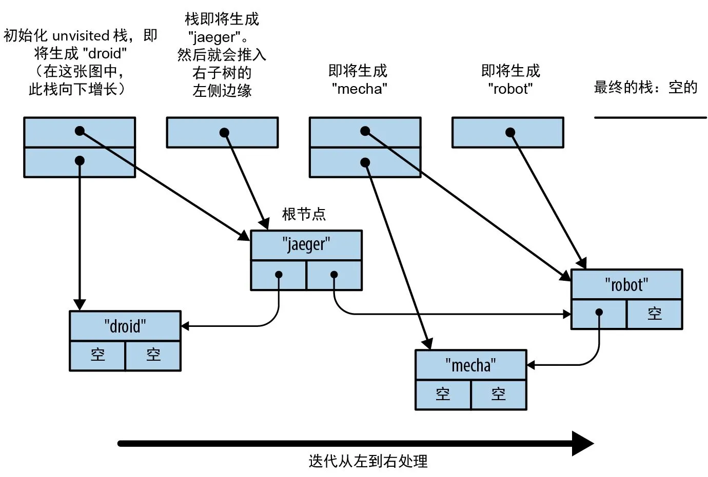

# 第15章迭代器(2)

## 15.3　迭代器适配器

```
一旦你手头有了迭代器，迭代器的 Iterator 特型就会提供大量适配器方法（也可以简称为
```

适配器）。适配器会消耗某个迭代器并构建一个实现了特定行为的新迭代器。为了阐明适配器

```
的工作原理，我们将从两个最流行的适配器 map 和 filter 开始，然后介绍其他适配器，涵
```

盖了你能想到的从其他序列生成值序列的几乎所有方式：截断、跳过、组合、反转、连接、重复等。

### 15.3.1　map 与 filter

```
Iterator 特型的 map（映射）适配器能针对迭代器的各个条目调用闭包来帮你转换迭代
器。filter 适配器能使用闭包来帮你从迭代器中过滤某些条目，由闭包决定保留和丢弃哪些
```

条目。

```javascript
假设你正在逐行遍历文本并希望去掉每一行的前导空格和尾随空格。标准库的 str::trim 方
法能从单个 &str 中丢弃前导空格和尾随空格，返回一个新的、修剪过的 &str 借用。你可以
通过 map 适配器将 str::trim 应用于迭代器中的每一行：
let text = "  ponies  \n   giraffes\niguanas  \nsquid".to_string();
let v: Vec<&str> = text.lines()
   .map(str::trim)
   .collect();
assert_eq!(v, ["ponies", "giraffes", "iguanas", "squid"]);
text.lines() 调用会返回一个生成字符串中各行的迭代器。在该迭代器上调用 map 会返回
第二个迭代器，第二个迭代器会对每一行调用 str::trim 并将生成的结果作为自己的条目。
最后，collect 会将这些条目收集到一个向量中。
map 返回的迭代器本身当然也可以进一步适配。如果你想将结果中的 iguanas 排除，可以这
```

样写：

```javascript
let text = "  ponies  \n   giraffes\niguanas  \nsquid".to_string();
let v: Vec<&str> = text.lines()
   .map(str::trim)
   .filter(|s| *s != "iguanas")
   .collect();
assert_eq!(v, ["ponies", "giraffes", "squid"]);
在这里，filter 会返回第三个迭代器，它只会从 map 迭代器的结果中生成闭包 |s| *s
!= "iguanas" 返回 true 的那些条目。迭代器的适配器链条就像 Unix shell 中的管道：每
```

个适配器都有单一用途，并且很清楚此序列是如何在从左到右读取时进行转换的。

```
map 和 filter 的适配器的签名如下所示：
fn map<B, F>(self, f: F) -> impl Iterator<Item=B>
   where Self: Sized, F: FnMut(Self::Item) -> B;
fn filter<P>(self, predicate: P) -> impl Iterator<Item=Self::Item>
   where Self: Sized, P: FnMut(&Self::Item) -> bool;
在标准库中，map 和 filter 实际上返回的是名为 std::iter::Map 和
std::iter::Filter 的专用不透明（隐藏了实现细节的）struct 类型。然而，仅仅看到
这些名字并不能告诉我们更多信息，所以在本书中，我们会写成 -> impl
Iterator<Item=...>，因为这揭示了我们真正关心的事情：此方法返回了能生成给定类型
条目的 Iterator。
大多数适配器会按值接受 self，这就要求 Self 必须是固定大小的（Sized）（所有常见的
```

迭代器都是这样的）。

```
map 迭代器会按值将每个条目传给闭包，然后将闭包结果的所有权转移给自己的消费者。
filter 迭代器会通过共享引用将每个条目传给闭包，并保留所有权以便再把选定的条目传给
自己的消费者。这就是为什么该示例必须解引用 s 以便将其与 "iguanas" 进行比较：
filter 迭代器的条目类型是 &str，因此闭包参数 s 的类型是 &&str。
```

关于迭代器适配器，有两点需要特别注意。

第一个要点是，单纯在迭代器上调用适配器并不会消耗任何条目，只会返回一个新的迭代器，新迭代器会根据需要从第一个迭代器中提取条目，以生成自己的条目。在适配器的适配链中，

```
实际完成任何工作（同时消耗条目）的唯一方法是在最终的迭代器上调用 next。
因此，在我们之前的示例中，方法调用 text.lines() 本身实际上并不会解析字符串中的任
何一行，它只是返回了一个迭代器，当需要时才会解析这些行。同样，map 和 filter 也只
会返回新的迭代器，当需要时，它们才会映射或过滤。在由 collect 调用 filter 迭代器上
的 next 之前，不会进行任何实际的工作。
```

如果你在使用有副作用的适配器，这一点尤为重要。例如，以下代码根本不会输出任何内容：

```
["earth", "water", "air", "fire"]
   .iter().map(|elt| println!("{}", elt));
iter 调用会返回数组元素的迭代器，map 调用会返回第二个迭代器，第二个迭代器会对第一
```

个迭代器生成的每个值调用闭包。但是这里没有任何代码会实际用到整个链条的值，所以

```
next 方法永远不会执行。事实上，Rust 会就此发出警告：
```

```
warning: unused `std::iter::Map` that must be used
 |
7 | /     ["earth", "water", "air", "fire"]
8 | |         .iter().map(|elt| println!("{}", elt));
 | |_______________________________________________^
 |
 = note: iterators are lazy and do nothing unless consumed
```

错误消息中的术语 lazy（惰性）不是贬义词，只是用来表示“推迟计算，直到需要该值”这种机

```
制的行话。Rust 的惯例是迭代器应该做尽可能少的必要工作来满足每次对 next 的调用，在
```

这个例子中，根本没有这样的调用，所以什么也没做。

```
第二个要点是，迭代器的适配器是一种零成本抽象。由于 map、filter 和其他类似的适配
```

器都是泛型的，因此将它们应用于迭代器就会专门针对所涉及的特定迭代器类型生成特化代

```javascript
码。这意味着 Rust 会有足够的信息将每个迭代器的 next 方法内联到它的消费者中，然后将
这一组功能作为一个单元翻译成机器代码。因此，我们之前展示的迭代器的 lines/ map/
filter 链条会和手写代码一样高效：
for line in text.lines() {
   let line = line.trim();
   if line != "iguanas" {
       v.push(line);
   }
}
下面我们接着介绍可用于 Iterator 特型上的各种适配器。
```

### 15.3.2　filter_map 与 flat_map

```
在每个传入条目都会生成一个传出条目的情况下，map 适配器很实用。但是，如果想从迭代
中删除而不是处理某些条目，或想用零个或多个条目替换单个条目时该怎么办？filter_map
（过滤映射）适配器和 flat_map（展平映射）适配器为你提供了这种灵活性。
filter_map 适配器与 map 类似，不同之处在于前者允许其闭包将条目转换为新条目（就像
map 那样）或从迭代中丢弃该条目。因此，它有点儿像 filter 和 map 的组合。它的签名如
```

下所示：

```
fn filter_map<B, F>(self, f: F) -> impl Iterator<Item=B>
   where Self: Sized, F: FnMut(Self::Item) -> Option<B>;
它和 map 的签名基本相同，不同之处在于这里的闭包会返回 Option<B>，而不只是 B。当
闭包返回 None 时，该条目就会从本迭代中丢弃；当返回 Some(b) 时，b 就是
filter_map 迭代器生成的下一个条目。
```

假设你要扫描字符串，以查找可解析为数值且以空格分隔的单词，然后处理该数值，忽略其他单词。可以这样写：

```javascript
use std::str::FromStr;
let text = "1\nfrond .25  289\n3.1415 estuary\n";
for number in text
   .split_whitespace()
   .filter_map(|w| f64::from_str(w).ok())
{
   println!("{:4.2}", number.sqrt());
}
```

上面的代码会输出以下内容：

```
1.00
0.50
17.00
1.77
传给 filter_map 的闭包会尝试使用 f64::from_str 来解析每个以空格分隔的切片。结果
是一个 Result<f64, ParseFloatError>，再调用 .ok() 就会把它变成
Option<f64>：如果解析错误就会变成 None；如果成功就会变成 Some(v)。
filter_map 迭代器会丢弃所有 None 值并为每个 Some(v) 生成值 v。
但是像这样把 map 和 filter 融合成一个操作，而非直接使用两种适配器，意义何在？实际
上，刚才的例子已经展示了 filter_map 适配器的价值。如果只有先试着实际处理一下条目
才能决定是否应该在迭代中包含它，该适配器就会派上用场。只用 filter 和 map 也可以做
```

同样的事，但略显烦琐：

```
text.split_whitespace()
   .map(|w| f64::from_str(w))
   .filter(|r| r.is_ok())
   .map(|r| r.unwrap())
我们可以将 flat_map 视为与 filter_map 功能类似的适配器，即对 map 的功能延伸，只
是现在这个闭包不仅可以像 map 那样返回一个条目，或像 filter_map 那样返回零个或一个
条目，还可以返回任意数量的条目序列。也就是说，flat_map 迭代器会生成此闭包返回的
```

序列串联后的结果。

```
flat_map 的签名如下所示：
fn flat_map<U, F>(self, f: F) -> impl Iterator<Item=U::Item>
   where F: FnMut(Self::Item) -> U, U: IntoIterator;
```

- 3

```
传给 flat_map 的闭包必须返回一个可迭代者，但可以返回任意种类的可迭代者。
```

假设有一个将国家映射成其主要城市的表。给定一个国家列表，如何遍历这些国家的主要城市呢？

```sql
use std::collections::HashMap;
let mut major_cities = HashMap::new();
major_cities.insert("Japan", vec!["Tokyo", "Kyoto"]);
major_cities.insert("The United States", vec!["Portland", "Nashville"]);
major_cities.insert("Brazil", vec!["São Paulo", "Brasília"]);
major_cities.insert("Kenya", vec!["Nairobi", "Mombasa"]);
major_cities.insert("The Netherlands", vec!["Amsterdam", "Utrecht"]);
let countries = ["Japan", "Brazil", "Kenya"];
for &city in countries.iter().flat_map(|country| &major_cities[country]) {
   println!("{}", city);
}
```

上面的代码会输出以下内容：

```
Tokyo
Kyoto
São Paulo
Brasília
Nairobi
Mombasa
```

可以这样理解，对于每个国家，我们都会检索其城市的向量，将所有向量串联成一个序列，然后打印出来。

```
但请记住，迭代器是惰性的：只有当 for 循环调用了 flat_map 迭代器的 next 方法时才会
```

实际工作。完整的串联序列从未在内存中构建过。不过，这里有一个小小的状态机，它会从城市迭代器中逐个提取，直到用完，然后才为下一个国家 / 地区生成一个新的城市迭代器。其效

- 4

果实际上和嵌套循环一样，但封装成了迭代器以便使用。

### 15.3.3　flatten

```
flatten（展平）适配器会串联起迭代器的各个条目，这里假设每个条目本身都是可迭代
```

者：

```sql
use std::collections::BTreeMap;
// 一个把城市映射为城市中停车场的表格：每个值都是一个向量
let mut parks = BTreeMap::new();
parks.insert("Portland",  vec!["Mt. Tabor Park", "Forest Park"]);
parks.insert("Kyoto",     vec!["Tadasu-no-Mori Forest", "Maruyama Koen"]);
parks.insert("Nashville", vec!["Percy Warner Park", "Dragon Park"]);
// 构建一个表示全部停车场的向量。`values`给出了一个能生成
// 向量的迭代器，然后`flatten`会依次生成每个向量的元素
let all_parks: Vec<_> = parks.values().flatten().cloned().collect();
assert_eq!(all_parks,
          vec!["Tadasu-no-Mori Forest", "Maruyama Koen", "Percy Warner Park",
               "Dragon Park", "Mt. Tabor Park", "Forest Park"]);
名称 "flatten" 来自将二级结构展平为一级结构的直观图景：BTreeMap 及其表示停车场
名称的 Vec 会被展平为一个能生成所有名称的迭代器。
flatten 的签名如下所示：
fn flatten(self) -> impl Iterator<Item=Self::Item::Item>
   where Self::Item: IntoIterator;
这意味着，底层迭代器的条目必须自行实现 IntoIterator 才能真正形成一个由序列组成的
序列。然后，flatten 方法会返回一个迭代器，该迭代器会生成这些序列的串联。当然，这
都是惰性执行的，只有当我们迭代完上一个序列才会从 self 中提取一个新序列。
flatten 方法还有一些看似不寻常的用法。如果你只想从一个 Vec<Option<...>> 中迭代
出 Some 的值，那么 flatten 可以漂亮地完成此任务：
assert_eq!(vec![None, Some("day"), None, Some("one")]
          .into_iter()
          .flatten()
          .collect::<Vec<_>>(),
          vec!["day", "one"]);
这是因为 Option 本身也实现了 IntoIterator，表示由 0 个或 1 个元素组成的序列。
None 元素对迭代没有任何贡献，而每个 Some 元素都会贡献一个值。同样，也可以用
flatten 来迭代 Option<Vec<...>> 值：其中 None 的行为等同于空向量。
Result 也实现了 IntoIterator，其中 Err 表示一个空序列，因此将 flatten 应用于
Result 值的迭代器有效地排除了所有 Err 并将它们丢弃，进而产生了一个解包装过的由成
```

功值组成的流。通常不应该忽略代码中的错误，但如果你很清楚自己在做什么，那么这可能是个有用的小技巧。

```
如果你发现自己随手用了 flatten，这个时候你真正需要的可能是 flat_map。例如，标准
库的 str::to_uppercase 方法可以将字符串转换为大写，其工作方式如下所示：
fn to_uppercase(&self) -> String {
   self.chars()
       .map(char::to_uppercase)
       .flatten() // 使用flat_map更好
       .collect()
}
用 flatten 的原因是 ch.to_uppercase() 返回的不是单个字符，而是会生成一个或多个
```

字符的迭代器。将每个字符都映射成其对应的大写字母会生成由字符迭代器组成的迭代器，而

```
flatten 负责将它们拼接在一起，形成我们最终可以收集（collect）到 String 中的内
```

容。

```
不过 map 和 flatten 的组合非常常见，因此 Iterator 为这种情况提供了 flat_map 适
配器。（事实上，flat_map 比 flatten 先纳入标准库。）因此，可以把前面的代码改写成如
```

下形式。

```
fn to_uppercase(&self) -> String {
   self.chars()
       .flat_map(char::to_uppercase)
       .collect()
}
```

### 15.3.4　take 与 take_while

```
Iterator 特型的 take（取出）适配器和 take_while（当……时取出）适配器的作用是
```

当条目达到一定数量或闭包决定中止时结束迭代。它们的签名如下所示：

```
fn take(self, n: usize) -> impl Iterator<Item=Self::Item>
   where Self: Sized;
fn take_while<P>(self, predicate: P) -> impl Iterator<Item=Self::Item>
   where Self: Sized, P: FnMut(&Self::Item) -> bool;
```

两者都会接手某个迭代器的所有权并返回一个新的迭代器，新的迭代器会从第一个迭代器中传

```
递条目，并可能提早终止序列。take 迭代器会在最多生成 n 个条目后返回 None。
take_while 迭代器会针对每个条目调用 predicate，并对 predicate 返回了 false 的
首个条目以及其后的每个条目都返回 None。
```

例如，给定一封电子邮件，其中有一个空行将标题与邮件正文分隔开，如果只想遍历标题就可

```javascript
以使用 take_while：
let message = "To: jimb\r\n\
              From: superego <editor@oreilly.com>\r\n\
              \r\n\
              Did you get any writing done today?\r\n\
              When will you stop wasting time plotting fractals?\r\n";
for header in message.lines().take_while(|l| !l.is_empty()) {
   println!("{}" , header);
}
```

回想一下 3.7.1 节，当字符串中的一行以反斜杠结尾时，Rust 中不会包含字符串中下一行的缩

```
进，因此字符串中的任何一行都没有前导空格。这意味着 message 的第 3 行是空白的。
take_while 适配器一看到空行就会中止此迭代，所以此代码只会打印两行。
To: jimb
From: superego <editor@oreilly.com>
```

### 15.3.5　skip 与 skip_while

```
Iterator 特型的 skip（跳过）和 skip_while（当……时跳过）是与 take 和
take_while 互补的方法：skip 从迭代开始时就丢弃一定数量的条目，skip_while 则一
```

直丢弃条目直到闭包终于找到一个可接受的条目为止，然后将剩下的条目按照原样传递出来。它们的签名如下所示：

```
fn skip(self, n: usize) -> impl Iterator<Item=Self::Item>
   where Self: Sized;
fn skip_while<P>(self, predicate: P) -> impl Iterator<Item=Self::Item>
   where Self: Sized, P: FnMut(&Self::Item) -> bool;
skip 适配器的常见用途之一是在迭代程序的命令行参数时跳过命令本身的名称。在第 2 章
```

中，我们的最大公约数计算器曾用如下代码循环其命令行参数：

```
for arg in std::env::args().skip(1) {
   ...
}
std::env::args 函数会返回一个迭代器，该迭代器会将程序的各个参数生成为一些
String 型条目，首个条目是程序本身的名称，但这并不是我们要在循环中处理的字符串。对
该迭代器调用 skip(1) 会返回一个新的迭代器，新迭代器会在首次调用时丢弃程序名称，然
```

后生成所有后续参数。

```
skip_while 适配器会使用闭包决定从序列的开头丢弃多少个条目。你还可以像下面这样遍
```

历 15.3.4 节中消息正文的各行：

```
for body in message.lines()
   .skip_while(|l| !l.is_empty())
   .skip(1) {
   println!("{}" , body);
}
这会使用 skip_while 来跳过非空行，但迭代器本身还是会生成一个空行——毕竟，闭包对
该空行返回了 false。所以我们还要使用 skip 方法来丢弃它，并返回一个迭代器，其第一
个条目是消息正文的第 1 行。与 15.3.4 节中的 message 声明合用，此代码会输出如下内
```

容。

```
Did you get any writing done today?
When will you stop wasting time plotting fractals?
```

### 15.3.6　peekable

```
peekable（可窥视）迭代器的功能是允许我们窥视即将生成的下一个条目，而无须实际消耗
它。调用 Iterator 特型的 peekable 方法可以将任何迭代器变成 peekable 迭代器：
fn peekable(self) -> std::iter::Peekable<Self>
   where Self: Sized;
在这里，Peekable<Self> 是一个实现了 Iterator<Item=Self::Item> 的结构体，而
Self 是底层迭代器的类型。
peekable 迭代器有一个额外的方法 peek，该方法会返回一个 Option<&Item>：如果底
层迭代器已耗尽，那么返回值就为 None；否则为 Some(r)，其中 r 是对下一个条目的共享
```

引用。（注意，如果迭代器的条目类型已经是对某个值的引用了，则最终产出就会是对引用的引用。）

```
调用 peek 会尝试从底层迭代器中提取下一个条目，如果条目存在，就将其缓存，直到下一次
调用 next 时给出。Peekable 上的所有其他 Iterator 方法都知道这个缓存，比如，
peekable 迭代器 iter 上的 iter.last() 就知道要在耗尽底层迭代器后检查此缓存。
```

有时候，只有超前一点儿才能决定应该从迭代器中消耗多少个条目，在这种情况下，

```
peekable 迭代器就变得至关重要。如果要从字符流中解析数值，那么在看到数值后面的第
```

一个非数值字符之前是无法确定该数值的结束位置的：

```javascript
use std::iter::Peekable;
fn parse_number<I>(tokens: &mut Peekable<I>) -> u32
   where I: Iterator<Item=char>
{
   let mut n = 0;
   loop {
       match tokens.peek() {
           Some(r) if r.is_digit(10) => {
               n = n * 10 + r.to_digit(10).unwrap();
           }
           _ => return n
       }
       tokens.next();
   }
}
let mut chars = "226153980,1766319049".chars().peekable();
assert_eq!(parse_number(&mut chars), 226153980);
// 注意，`parse_number`并没有消耗这个逗号，所以我们能看到它
assert_eq!(chars.next(), Some(','));
assert_eq!(parse_number(&mut chars), 1766319049);
assert_eq!(chars.next(), None);
parse_number 函数会使用 peek 来检查下一个字符，只有当它是数字时才消耗它。如果它
不是数字或迭代器已消耗完（也就是说，peek 返回了 None），我们将返回已解析的数值并将
```

下一个字符留在迭代器中，以供使用。

### 15.3.7　fuse

```javascript
Iterator 特型并没有规定一旦 next 返回 None 之后，再次调用 next 方法时应该如何行
动。大多数迭代器只是再次返回 None，但也有例外。如果你的代码依赖于“再次返回
None”这种行为，那么遇到例外可能会让你大吃一惊。
fuse（保险丝）适配器能接受任何迭代器并生成一个确保在第一次返回 None 后继续返回
None 的迭代器：
struct Flaky(bool);
impl Iterator for Flaky {
   type Item = &'static str;
   fn next(&mut self) -> Option<Self::Item> {
       if self.0 {
           self.0 = false;
           Some("totally the last item")
       } else {
           self.0 = true; // 糟糕！
           None
       }
   }
}
let mut flaky = Flaky(true);
assert_eq!(flaky.next(), Some("totally the last item"));
assert_eq!(flaky.next(), None);
assert_eq!(flaky.next(), Some("totally the last item"));
let mut not_flaky = Flaky(true).fuse();
assert_eq!(not_flaky.next(), Some("totally the last item"));
assert_eq!(not_flaky.next(), None);
assert_eq!(not_flaky.next(), None);
fuse 适配器在需要使用不明来源迭代器的泛型代码中非常有用。与其奢望要处理的每个迭代
器都表现良好，还不如使用 fuse 加上保险。
```

### 15.3.8　可逆迭代器与 rev

```
有的迭代器能够从序列的两端抽取条目，使用 rev（逆转）适配器可以反转此类迭代器。例
```

如，向量上的迭代器就可以像从头开始一样轻松地从向量的末尾抽取条目。这样的迭代器可以

```
实现 std::iter::DoubleEndedIterator 特型，它扩展了 Iterator：
trait DoubleEndedIterator: Iterator {
   fn next_back(&mut self) -> Option<Self::Item>;
}
```

你可以将双端迭代器想象成用两根手指分别标记序列的当前首端和尾端。从任何一端提取条目都会让该手指向另一端前进，当两者相遇时，迭代就完成了：

```javascript
let bee_parts = ["head", "thorax", "abdomen"];
let mut iter = bee_parts.iter();
assert_eq!(iter.next(),      Some(&"head"));
assert_eq!(iter.next_back(), Some(&"abdomen"));
assert_eq!(iter.next(),      Some(&"thorax"));
assert_eq!(iter.next_back(), None);
assert_eq!(iter.next(),      None);
```

基于切片迭代器的结构，这种行为实现起来非常简单：切片迭代器实际上是一对指向我们尚未

```
生成的元素范围的起始指针和结束指针，next 和 next_back 所做的只是从起始指针或结束
指针中提取一个条目而已。BTreeSet 和 BTreeMap 等有序集合的迭代器也是双端的：它们
的 next_back 方法会首先提取最大的元素或条目。总体而言，只要有可能，标准库就会提供
```

双端迭代能力。

```
但并非所有迭代器都能如此轻松地实现，比如，从通道的 Receiver 中生成来自其他线程的
```

值的迭代器显然无法预测最后接收的值可能是什么。一般来说，你需要查看标准库的文档以了

```javascript
解哪些迭代器实现了 DoubleEndedIterator，哪些没有实现。
如果迭代器是双端的，就可以用 rev 适配器将其逆转：
fn rev(self) -> impl Iterator<Item=Self>
   where Self: Sized + DoubleEndedIterator;
返回的迭代器也是双端的，只是互换了 next 方法和 next_back 方法：
let meals = ["breakfast", "lunch", "dinner"];
let mut iter = meals.iter().rev();
assert_eq!(iter.next(), Some(&"dinner"));
assert_eq!(iter.next(), Some(&"lunch"));
assert_eq!(iter.next(), Some(&"breakfast"));
assert_eq!(iter.next(), None);
大多数适配器，如果应用到某个可逆迭代器上，就会返回另一个可逆迭代器，比如，map 和
filter 都会保留可逆性。
```

### 15.3.9　inspect

```
inspect（探查）适配器为调试迭代器适配器的流水线提供了便利，但在生产代码中用得不
多。inspect 只是对每个条目的共享引用调用闭包，然后传递该条目。闭包不会影响条目，
```

但可以做一些事情，比如打印它们或对它们进行断言。

本示例演示了将字符串转换为大写会更改其长度的情况：

```javascript
let upper_case: String = "große".chars()
   .inspect(|c| println!("before: {:?}", c))
   .flat_map(|c| c.to_uppercase())
   .inspect(|c| println!(" after:     {:?}", c))
   .collect();
assert_eq!(upper_case, "GROSSE");
小写德语字母 ß 的大写形式是 SS，这就是 char::to_uppercase 会返回一个字符迭代器
而不是单个字符的原因。前面的代码使用了 flat_map 将 to_uppercase 返回的所有序列
连接成一个 String，同时输出以下内容。
before: 'g'
after:    'G'
before: 'r'
after:    'R'
before: 'o'
after:    'O'
before: 'ß'
after:    'S'
after:    'S'
before: 'e'
after:    'E'
```

### 15.3.10　chain

```
chain（链接）适配器会将一个迭代器追加到另一个迭代器之后。更准确地说，
i1.chain(i2) 会返回一个迭代器，该迭代器从 i1 中提取条目，直到用尽，然后从 i2 中
```

提取条目。

```
chain 适配器的签名如下所示：
fn chain<U>(self, other: U) -> impl Iterator<Item=Self::Item>
   where Self: Sized, U: IntoIterator<Item=Self::Item>;
```

换句话说，你可以将迭代器与任何会生成相同条目类型的可迭代者链接在一起。

例如：

```javascript
let v: Vec<i32> = (1..4).chain([20, 30, 40]).collect();
assert_eq!(v, [1, 2, 3, 20, 30, 40]);
如果 chain 的两个底层迭代器都是可逆的，则其结果迭代器也是可逆的：
let v: Vec<i32> = (1..4).chain([20, 30, 40]).rev().collect();
assert_eq!(v, [40, 30, 20, 3, 2, 1]);
chain 迭代器会跟踪这两个底层迭代器是否返回了 None 并按需把其中一个迭代器的 next
和 next_back 重定向到另一个迭代器的 next 和 next_back。
```

### 15.3.11　enumerate

```
Iterator 特型的 enumerate（枚举）适配器会将运行索引附加到序列中，它接受某个迭代
器生成的条目 A, B, C, ... 并返回生成的值对 (0, A), (1, B), (2, C), ...。乍
```

看起来，这微不足道，但其使用频率相当惊人。

消费者可以使用上述索引将一个条目与另一个条目区分开来，并建立处理每个条目时的上下文。例如，第 2 章中的曼德博集绘图器会将图像分成 8 个水平条带，并将每个条带分配给不

```
同的线程。该代码就使用了 enumerate 来告诉每个线程其条带对应于图像的哪个部分。
```

从一个矩形像素缓冲区开始：

```javascript
let mut pixels = vec![0; columns * rows];
接下来使用 chunks_mut 将图像拆分为一些水平条带，每个线程负责一个：
let threads = 8;
let band_rows = rows / threads + 1;
...
let bands: Vec<&mut [u8]> = pixels.chunks_mut(band_rows * columns).collect();
```

然后遍历条带，为每个条带启动一个线程：

```javascript
for (i, band) in bands.into_iter().enumerate() {
   let top = band_rows * i;
   // 启动一个线程来渲染`top..top + band_rows`范围内的行
   ...
}
每次迭代都会得到一个 (i, band) 值对，其中 band 是 &mut [u8] 类型的像素缓冲区切
片，表示线程应该绘制的区域，而 i 是该条带在整个图像中的索引，由 enumerate 适配器
```

提供。绘图的边界和条带的大小足以让线程确定分配给它的是图像中的哪个部分，从而确定要

```
在 band 中绘制什么。
可以将 enumerate 生成的 (index, item) 值对视为在迭代 HashMap 或其他关联集合时
获得的 (key, value) 值对。如果在切片或向量上进行迭代，则 index 就是 item 对应的
key。
```

### 15.3.12　zip

```
zip（拉合）适配器会将两个迭代器组合成一个迭代器，新的迭代器会生成值对，每个底层迭
```

代器各提供一个值，就像把拉链的两侧拉合起来一样。当两个底层迭代器中的任何一个已结束时，拉合后的迭代器就结束了。

```
例如，可以通过将无尽范围 0.. 与一个迭代器拉合起来获得与 enumerate 适配器相同的效
```

果：

```javascript
let v: Vec<_> = (0..).zip("ABCD".chars()).collect();
assert_eq!(v, vec![(0, 'A'), (1, 'B'), (2, 'C'), (3, 'D')]);
从这个意义上说，你可以将 zip 视为 enumerate 的泛化版本：enumerate 会将索引附加
到序列，而 zip 能附加来自任意迭代器的条目。之前我们建议用 enumerate 在处理条目时
协助提供上下文，而 zip 提供了一种更灵活的方式来实现同样的效果。
zip 的参数本身不一定是迭代器，可以是任意可迭代者。
use std::iter::repeat;
let endings = ["once", "twice", "chicken soup with rice"];
let rhyme: Vec<_> = repeat("going")
   .zip(endings)
   .collect();
assert_eq!(rhyme, vec![("going", "once"),
                      ("going", "twice"),
                      ("going", "chicken soup with rice")]);
```

### 15.3.13　by_ref

前面我们一直在将适配器附加到迭代器上。一旦开始这样做，还能再取下适配器吗？一般来说是不能，因为适配器会接手底层迭代器的所有权，并且没有提供归还所有权的方法。

```
迭代器的 by_ref（按引用）方法会借入迭代器的可变引用，便于将各种适配器应用于该引
```

用。一旦消耗完适配器中的条目，就会丢弃这些适配器，借用也就结束了，然后你就能重新获得对原始迭代器的访问权。

```
例如，在本章前面我们展示过如何使用 take_while 和 skip_while 来处理邮件消息的标
```

题行和正文。但是，如果想让两者使用同一个底层迭代器来处理邮件消息，该怎么办呢？借助

```javascript
by_ref，我们就可以使用 take_while 来处理邮件头，完成这些之后，取回底层迭代器，
此时 take_while 恰好位于处理消息正文的适当位置：
let message = "To: jimb\r\n\
              From: id\r\n\
              \r\n\
              Oooooh, donuts!!\r\n";
let mut lines = message.lines();
println!("Headers:");
for header in lines.by_ref().take_while(|l| !l.is_empty()) {
   println!("{}" , header);
}
println!("\nBody:");
for body in lines {
   println!("{}" , body);
}
调用 lines.by_ref() 会借出一个对迭代器的可变引用，take_while 迭代器会取得这个
引用的所有权。该迭代器在第一个 for 循环结束时超出了作用域，表示本次借用已结束，这
样你就能在第二个 for 循环中再次使用 lines 了。上述代码将输出以下内容：
```

```
Headers:
To: jimb
From: id
Body:
Oooooh, donuts!!
by_ref 适配器的定义很简单：它会返回对迭代器的可变引用。然后，标准库中还包含了这个
```

神奇的小实现：

```
impl<'a, I: Iterator + ?Sized> Iterator for &'a mut I {
   type Item = I::Item;
   fn next(&mut self) -> Option<I::Item> {
       (**self).next()
   }
   fn size_hint(&self) -> (usize, Option<usize>) {
       (**self).size_hint()
   }
}
换句话说，如果 I 是某种迭代器类型，那么 &mut I 就同样是一个迭代器，其 next 方法和
size_hint 方法会转发给其引用目标。当你在此迭代器的可变引用上调用某个适配器时，适
```

配器会取得引用（而不是迭代器本身）的所有权。当适配器超出作用域时，本次借用就会结束。

### 15.3.14　cloned 与 copied

```javascript
cloned（克隆后）适配器会接受一个生成引用的迭代器，并返回一个会生成从这些引用克隆
而来的值的迭代器，就像 iter.map(|item| item.clone())。当然，引用目标的类型也
必须实现了 Clone：
let a = ['1', '2', '3', '∞'];
assert_eq!(a.iter().next(),          Some(&'1'));
assert_eq!(a.iter().cloned().next(), Some('1'));
copied（复制后）适配器的设计思想同样如此，但限制更严格，它要求引用目标的类型必须
实现了 Copy。像 iter.copied() 这样的调用与 iter.map(|r| *r) 大致相同。由于每
个实现了 Copy 的类型也必定实现了 Clone，因此 cloned 更通用。但根据条目类型的不
同，clone 调用可能会进行任意次数的分配和复制。如果你认为由于条目类型很简单，因而
永远不会发生内存分配，那么最好使用 copied 来让类型检查器帮你验证这种假设。
```

### 15.3.15　cycle

```
cycle（循环）适配器会返回一个迭代器，它会无限重复底层迭代器生成的序列。底层迭代器
必须实现 std::clone::Clone，以便 cycle 保存其初始状态并且在每次循环重新开始时
```

复用它。下面是一个例子：

```javascript
let dirs = ["North", "East", "South", "West"];
let mut spin = dirs.iter().cycle();
assert_eq!(spin.next(), Some(&"North"));
assert_eq!(spin.next(), Some(&"East"));
assert_eq!(spin.next(), Some(&"South"));
assert_eq!(spin.next(), Some(&"West"));
assert_eq!(spin.next(), Some(&"North"));
assert_eq!(spin.next(), Some(&"East"));
```

或者，下面是纯粹为了演示迭代器的用法而编写的代码：

```javascript
use std::iter::;
let fizzes = repeat("").take(2).chain(once("fizz")).cycle();
let buzzes = repeat("").take(4).chain(once("buzz")).cycle();
let fizzes_buzzes = fizzes.zip(buzzes);
let fizz_buzz = (1..100).zip(fizzes_buzzes)
   .map(|tuple|
       match tuple {
           (i, ("", "")) => i.to_string(),
           (_, (fizz, buzz)) => format!("{}{}", fizz, buzz)
       });
for line in fizz_buzz {
   println!("{}", line);
}
```

这是一个儿童文字游戏，现在有时会用作程序员的求职面试问题：玩家轮流数数，将任何可被

```
3 整除的数值替换为单词 fizz；将任何可被 5 整除的数值替换为单词 buzz；能被两者整除
的数值则替换为单词 fizzbuzz。
```

## 15.4　消耗迭代器

迄今为止，我们已经介绍了创建迭代器并将它们适配成新迭代器的方法，在这里，我们会通过展示如何消耗它们来完成整个处理过程。

```
当然，你可以使用带有 for 循环的迭代器，也可以显式调用 next，但有许多常见任务不必
一遍又一遍地写出来。Iterator 特型提供了一大组可选方法来涵盖其中的许多任务。
```

### 15.4.1　简单累加：count、sum 和 product

```
count（计数）方法会从迭代器中提取条目，直到迭代器返回 None，并报告提取的条目数。
```

- 5

下面是一个计算标准输入行数的小程序：

```javascript
use std::io::prelude::*;
fn main() {
   let stdin = std::io::stdin();
   println!("{}", stdin.lock().lines().count());
}
sum（求和）方法和 product（乘积）方法会分别计算迭代器条目之和与乘积，结果必须是
```

整数或浮点数。

```
fn triangle(n: u64) -> u64 {
   (1..=n).sum()
}
assert_eq!(triangle(20), 210);
fn factorial(n: u64) -> u64 {
   (1..=n).product()
}
assert_eq!(factorial(20), 2432902008176640000);
（为方便与其他类型一起工作，可以通过实现 std::iter::Sum 特型和
std::iter::Product 特型来扩展 sum 和 product，这里我们就不展开讲解这些特型
```

了。）

### 15.4.2　min 与 max

```
Iterator 上的 min（最小）方法和 max（最大）方法会分别返回迭代器生成的最小条目与
最大条目。迭代器的条目类型必须实现 std::cmp::Ord，这样条目之间才能相互比较：
assert_eq!([-2, 0, 1, 0, -2, -5].iter().max(), Some(&1));
assert_eq!([-2, 0, 1, 0, -2, -5].iter().min(), Some(&-5));
这些方法会返回一个 Option<Self::Item> 以便当迭代器不再生成任何条目时能返回
None。
就像 12.2 节中所讲的，Rust 的浮点类型 f32 和 f64 仅实现了 std::cmp::PartialOrd
而没有实现 std::cmp::Ord，因此不能使用 min 方法和 max 方法来计算浮点数序列中的最
```

小值和最大值。这在 Rust 设计中并不讨喜，却是经过深思熟虑的——因为不清楚这些函数该

```
如何处理 IEEE 的 NaN 值，如果只是简单地忽略则可能会掩盖代码中更严重的问题。
```

```
如果知道如何处理 NaN 值，则可以改用 max_by 和 min_by 迭代器方法，这样你就可以提供
```

自己的比较函数了。

### 15.4.3　max_by 与 min_by

```
max_by（据……最大）方法和 min_by（据……最小）方法会分别返回迭代器生成的最大条
```

目与最小条目，由你提供的比较函数确定规则：

```javascript
use std::cmp::Ordering;
// 比较两个f64值，如果其一是NaN，则引发panic
fn cmp(lhs: &f64, rhs: &f64) -> Ordering {
   lhs.partial_cmp(rhs).unwrap()
}
let numbers = [1.0, 4.0, 2.0];
assert_eq!(numbers.iter().copied().max_by(cmp), Some(4.0));
assert_eq!(numbers.iter().copied().min_by(cmp), Some(1.0));
let numbers = [1.0, 4.0, std::f64::NAN, 2.0];
assert_eq!(numbers.iter().copied().max_by(cmp), Some(4.0)); // 引发panic
max_by 方法和 min_by 方法会通过引用将条目传给比较函数，这样一来，这两个方法就可
以与任意种类的迭代器一起高效配合使用。在上面的代码中，虽然我们已经用 copied 获取
了会生成 f64 条目的迭代器，但 cmp 函数还是期望通过引用获取其参数。
```

### 15.4.4　max_by_key 与 min_by_key

```
使用 Iterator 上的 max_by_key（据键最大）方法和 min_by_key（据键最小）方法可
```

以选择最大条目或最小条目，由针对每个条目调用的闭包确定。闭包可以选择条目的某些字段或对此条目执行某些计算。由于你通常只对与某些最小值或最大值相关的数据感兴趣，而不仅

```
仅是极值本身，因此这两个函数通常比 max 和 min 更有用。它们的签名如下所示：
fn min_by_key<B: Ord, F>(self, f: F) -> Option<Self::Item>
   where Self: Sized, F: FnMut(&Self::Item) -> B;
fn max_by_key<B: Ord, F>(self, f: F) -> Option<Self::Item>
   where Self: Sized, F: FnMut(&Self::Item) -> B;
也就是说，给定一个接受某条目并返回任意有序类型 B 的闭包，则返回那个调用闭包时所返
回的 B 为最大或最小的条目；如果没有生成任何条目，则返回 None。
```

例如，要扫描城市的哈希表，分别查找人口最多和最少的城市，可以这样写：

```sql
use std::collections::HashMap;
let mut populations = HashMap::new();
populations.insert("Portland",  583_776);
populations.insert("Fossil",        449);
populations.insert("Greenhorn",       2);
populations.insert("Boring",      7_762);
populations.insert("The Dalles", 15_340);
assert_eq!(populations.iter().max_by_key(|&(_name, pop)| pop),
          Some((&"Portland", &583_776)));
assert_eq!(populations.iter().min_by_key(|&(_name, pop)| pop),
          Some((&"Greenhorn", &2)));
闭包 |&(_name, pop)| pop 会针对迭代器生成的每个条目进行调用并返回要用于比较的值
```

——在本例中为城市人口。这两个方法返回的值是整个条目，而不仅仅是闭包返回的值。（当然，如果要频繁进行这样的条目查询，最好用一种比在表中进行线性查找更高效的方式。）

### 15.4.5　对条目序列进行比较

```
如果字符串、向量和切片的各个元素是可比较的，我们就可以使用 < 运算符和 == 运算符来对
它们进行比较。但是，比较运算符不能用来比较迭代器，这项工作是由像 eq 和 lt 这样的方
```

法来完成的。相关方法从迭代器中成对取出条目并比较，直到得出结果：

```javascript
let packed = "Helen of Troy";
let spaced = "Helen   of    Troy";
let obscure = "Helen of Sandusky"; // 好人，只是不出名
assert!(packed != spaced);
assert!(packed.split_whitespace().eq(spaced.split_whitespace()));
// 此断言为真，因为' ' < 'o'
assert!(spaced < obscure);
// 此断言为真，因为'Troy' > 'Sandusky'
assert!(spaced.split_whitespace().gt(obscure.split_whitespace()));
调用 split_whitespace 会返回字符串中以空白字符分隔的单词的迭代器。在这些迭代器
上使用 eq 方法和 gt 方法会进行逐词比较（而不是逐字符比较），因为 &str 实现了
PartialOrd 和 PartialEq。
迭代器提供的比较方法既包括用于相等比较的 eq 方法和 ne 方法，也包括用于有序比较的
lt 方法、le 方法、gt 方法和 ge 方法。而 cmp 方法和 partial_cmp 方法的行为类似于
Ord 特型和 PartialOrd 特型的相应方法。
```

### 15.4.6　any 与 all

```javascript
any（任意）方法和 all（所有）方法会将闭包应用于迭代器生成的每个条目。如果闭包对任
意条目返回了 true 或对所有条目都返回了 true，则相应的方法返回 true：
let id = "Iterator";
assert!( id.chars().any(char::is_uppercase));
assert!(!id.chars().all(char::is_uppercase));
```

这两个方法只会消耗确定答案所需的尽可能少的条目。如果闭包已经为给定条目返回了

```
true，则 any 会立即返回 true，不会再从迭代器中提取更多条目。
```

### 15.4.7　position、rposition 和 ExactSizeIterator

```javascript
position（位置）方法会针对迭代器中的每个条目调用闭包，并返回调用结果为 true 的第
一个条目的索引。确切而言，它会返回关于此索引的 Option：如果闭包没有为任何条目返回
true，则 position 返回 None。一旦闭包返回 true，position 就会停止提取条目：
let text = "Xerxes";
assert_eq!(text.chars().position(|c| c == 'e'), Some(1));
assert_eq!(text.chars().position(|c| c == 'z'), None);
rposition（右起位置）方法也是一样的，只是从右侧开始搜索：
let bytes = b"Xerxes";
assert_eq!(bytes.iter().rposition(|&c| c == b'e'), Some(4));
assert_eq!(bytes.iter().rposition(|&c| c == b'X'), Some(0));
rposition 方法要求使用可逆迭代器，以便它能从此序列的右端提取条目。另外，它也要求
这是确切大小迭代器，以便能像 position 一样对索引进行赋值，最左边的索引值为 0。所
谓确切大小迭代器就是实现了 std::iter::ExactSizeIterator 特型的迭代器：
trait ExactSizeIterator: Iterator {
   fn len(&self) -> usize { ... }
   fn is_empty(&self) -> bool { ... }
}
len 方法会返回剩余的条目数，而 is_empty 方法会在迭代完成时返回 true。
自然，也不是每个迭代器都能预知要生成的条目数，比如，之前使用的 str::chars 迭代器
就不能（UTF-8 是可变宽度编码），因此不能在字符串上使用 rposition。但是字节数组上
的迭代器必定知道数组的长度，因此它可以实现 ExactSizeIterator。
```

### 15.4.8　fold 与 rfold

```
fold（折叠）方法是一种非常通用的工具，用于在迭代器生成的整个条目序列上累积某种结
果。给定一个初始值（我们称之为累加器）和一个闭包，fold 会以当前累加器和迭代器中的
```

下一个条目为参数反复调用这个闭包。闭包返回的值被视为新的累加器，并将其与下一个条目

```
一起传给闭包。最终，累加器的值就是 fold 本身返回的值。如果序列为空，则 fold 只返回
```

初始累加器。

```javascript
使用迭代器值的许多其他方法可以改写成对 fold 的使用：
let a = [5, 6, 7, 8, 9, 10];
assert_eq!(a.iter().fold(0, |n, _| n+1), 6);        // 计数
assert_eq!(a.iter().fold(0, |n, i| n+i), 45);       // 求和
assert_eq!(a.iter().fold(1, |n, i| n*i), 151200);   // 乘积
// 最大值
assert_eq!(a.iter().cloned().fold(i32::min_value(), std::cmp::max),
          10);
fold 方法的签名如下所示：
fn fold<A, F>(self, init: A, f: F) -> A
   where Self: Sized, F: FnMut(A, Self::Item) -> A;
这里，A 是累加器的类型。闭包的第一个参数 init 及其返回值都是类型 A，fold 自身的返
回值也是类型 A。
请注意，累加器的值会移动进闭包或者从闭包中移动出来，因此你可以将 fold 与各种非
Copy 的累加器类型一起使用：
```

```javascript
let a = ["Pack", "my", "box", "with",
        "five", "dozen", "liquor", "jugs"];
// 另见切片的`join`方法，它不会像这里一样帮你在末尾添加额外的空格
let pangram = a.iter()
   .fold(String::new(), |s, w| s + w + " ");
assert_eq!(pangram, "Pack my box with five dozen liquor jugs ");
rfold（右起折叠）方法与 fold 方法基本相同，但需要一个双端迭代器，并从后往前处理
```

各个条目。

```javascript
let weird_pangram = a.iter()
   .rfold(String::new(), |s, w| s + w + " ");
assert_eq!(weird_pangram, "jugs liquor dozen five with box my Pack ");
```

### 15.4.9　try_fold 与 try_rfold

```
try_fold（尝试折叠）方法与 fold 方法基本相同，不过迭代可以提前退出，无须消耗迭代
器中的所有值。传给 try_fold 的闭包返回的值会指出它是应该立即返回，还是继续折叠迭
```

代器的条目。

```
闭包可以返回多种类型的值，根据类型值，try_fold 方法可判断继续折叠的方式。
如果闭包返回 Result<T, E>，可能是因为它执行了 I/O 或其他一些容易出错的操作，那
就返回 Ok(v) 令 try_fold 继续折叠，同时将 v 作为新的累加器值。如果返回
Err(e)，则 try_fold 立即停止折叠。折叠后的最终值是一个带有最终累加器值的
Result，或者由闭包返回的错误值。
如果闭包返回 Option<T>，则 Some(v) 表示折叠应该以 v 作为新的累加器值继续前进，
而 None 表示迭代应该立即停止。折叠后的最终值也是 Option 类型的。
```

```
最后，闭包还可以返回一个 std::ops::ControlFlow 值。这种类型是一个具有两个变
体的枚举，即 Continue(c) 和 Break(b)，分别表示使用新的累加器值 c 继续或提前中
止迭代。折叠的最终结果是一个 ControlFlow 值：如果折叠消耗了整个迭代器，并生成
了最终的累加器值 v，则为 Continue(v)；如果闭包中途返回了值 b，则为
Break(b)。
Continue(c) 和 Break(b) 的行为与 Ok(c) 和 Err(b) 完全一样。使用 ControlFlow
而不用 Result 的优点在于，有时候提前退出并不表示出错了，而只是表明提前得出了答
```

案，这种情况下它会让代码可读性更好。我们接下来会展示一个例子。

下面是一段对从标准输入读取的数值进行求和的程序：

```javascript
use std::error::Error;
use std::io::prelude::*;
use std::str::FromStr;
fn main() -> Result<(), Box<dyn Error>> {
   let stdin = std::io::stdin();
   let sum = stdin.lock()
       .lines()
       .try_fold(0, |sum, line| -> Result<u64, Box<dyn Error>> {
           Ok(sum + u64::from_str(&line?.trim())?)
       })?;
   println!("{}", sum);
   Ok(())
}
缓冲输入流上的 lines 迭代器会生成 Result<String, std::io::Error> 类型的条
目，并且将 String 解析为整数时也可能会出错。在这里使用 try_fold 会让闭包返回
Result<u64, ...>，所以我们可以使用 ? 运算符将本次失败从闭包传播到 main 函数。
try_fold 非常灵活，被用来实现 Iterator 的许多其他消费者方法，比如，以下是 all 的
```

一种实现：

```
fn all<P>(&mut self, mut predicate: P) -> bool
   where P: FnMut(Self::Item) -> bool,
         Self: Sized
{
   use std::ops::ControlFlow::*;
   self.try_fold((), |_, item| {
       if predicate(item) { Continue(()) } else { Break(()) }
   }) == Continue(())
}
请注意，这里无法用普通的 fold 来写，all 的语义承诺了一旦 predicate 返回 false 就
停止从底层迭代器中消耗条目，但 fold 总是会消耗掉整个迭代器。
如果你正在实现自己的迭代器类型，就值得研究一下你的迭代器能否比 Iterator 特型的默
认定义更高效地实现 try_fold。如果可以为 try_fold 提速，那么基于它构建的所有其他
```

方法都会受益。

```
顾名思义，try_rfold（尝试右起折叠）方法与 try_fold 方法相同，只是从后面而不是前
```

面开始提取值，并且要求传入一个双端迭代器。

### 15.4.10　nth 与 nth_back

```javascript
nth（第 n 个）方法会接受索引参数 n，从迭代器中跳过 n 个条目，并返回下一个条目，如
果序列提前结束了，则返回 None。调用 .nth(0) 等效于 .next()。
nth 不会像适配器那样接手迭代器的所有权，因此可以多次调用：
let mut squares = (0..10).map(|i| i*i);
assert_eq!(squares.nth(4), Some(16));
assert_eq!(squares.nth(0), Some(25));
assert_eq!(squares.nth(6), None);
```

它的签名如下所示：

```
fn nth(&mut self, n: usize) -> Option<Self::Item>
   where Self: Sized;
nth_back（倒数第 n 个）方法与 nth 方法很像，只是从双端迭代器的后面往前提取。调用
.nth_back(0) 等效于 .next_back()：返回最后一个条目；如果迭代器为空则返回
None。
```

### 15.4.11　last

```
last（最后一个）方法会返回迭代器生成的最后一个条目，如果为空则返回 None。它的签
```

名如下所示：

```
fn last(self) -> Option<Self::Item>;
```

例如：

```javascript
let squares = (0..10).map(|i| i*i);
assert_eq!(squares.last(), Some(81));
```

会从前面开始消耗所有迭代器的条目，即便此迭代器是可逆的也会如此。如果你有一个可逆迭

```
代器并且不想消耗它的所有条目，应该只写 iter.next_back()。
```

### 15.4.12　find、rfind 和 find_map

```
find（查找）方法会从迭代器中提取条目，返回第一个由给定闭包回复 true 的条目，如果
序列在找到合适的条目之前就结束了则返回 None。它的签名如下所示：
fn find<P>(&mut self, predicate: P) -> Option<Self::Item>
   where Self: Sized,
         P: FnMut(&Self::Item) -> bool;
rfind（右起查找）方法与此类似，但要求迭代器为双端迭代器并从后往前搜索值，返回最后
一个给定闭包回复为 true 的条目。
```

例如，使用 15.4.4 节的城市和人口表，你可以这样写：

```
assert_eq!(populations.iter().find(|&(_name, &pop)| pop > 1_000_000),
          None);
assert_eq!(populations.iter().find(|&(_name, &pop)| pop > 500_000),
          Some((&"Portland", &583_776)));
```

这个表中没有任何城市的人口超过一百万，但有一个城市有五十万人口。

有时候，闭包不仅仅是一个简单的谓词——对每个条目进行逻辑判断并继续向前，它还可能是

```
更复杂的东西，比如生成一个有意义的值。在这种情况下就需要使用 find_map（查找并映
```

射），它的签名如下所示：

```
fn find_map<B, F>(&mut self, f: F) -> Option<B> where
   F: FnMut(Self::Item) -> Option<B>;
find_map 和 find 很像，但其闭包不会返回 bool，而是返回某个值的 Option。
find_map 会返回第一个类型为 Some 的 Option。
```

假设有个城市内部公园的数据库，而我们要查看其中的公园是否有火山，有的话就给出公园的名称。

```javascript
let big_city_with_volcano_park = populations.iter()
   .find_map(|(&city, _)| {
       if let Some(park) = find_volcano_park(city, &parks) {
           // find_map会返回下面的值，以便让调用者知道我们找到了哪个公园
           return Some((city, park.name));
       }
       // 拒绝此条目，并继续搜索
       None
   });
assert_eq!(big_city_with_volcano_park,
          Some(("Portland", "Mt. Tabor Park")));
```

### 15.4.13　构建集合：collect 与 FromIterator

```
本书一直在用 collect（收集）方法构建包含迭代器条目的向量，比如，在第 2 章中，我们
曾调用 std::env::args() 获取程序命令行参数的迭代器，然后调用该迭代器的 collect
```

方法把它们收集到一个向量中：

```javascript
let args: Vec<String> = std::env::args().collect();
但 collect 并不是向量专用的，事实上，它可以构建出 Rust 标准库中任意类型的集合，只
```

要迭代器能生成合适的条目类型即可：

```javascript
use std::collections::;
let args: HashSet<String> = std::env::args().collect();
let args: BTreeSet<String> = std::env::args().collect();
let args: LinkedList<String> = std::env::args().collect();
// 只有键–值对才能收集到Map中，因此对于这个例子，
// 要把字符串序列和整数序列拉合在一起
let args: HashMap<String, usize> = std::env::args().zip(0..).collect();
let args: BTreeMap<String, usize> = std::env::args().zip(0..).collect();
// 其他代码略
当然，collect 本身并不知道如何构造出所有这些类型。相反，如果某些集合类型（如 Vec
或 HashMap）知道如何从迭代器构造自身，就会自行实现 std::iter::FromIterator
（来自迭代器）特型，而 collect 只是一个便捷的浅层包装而已：
trait FromIterator<A>: Sized {
   fn from_iter<T: IntoIterator<Item=A>>(iter: T) -> Self;
}
如果一个集合类型实现了 FromIterator<A>，那么它的类型关联函数 from_iter 就能从
一个可迭代者生成的 A 类型条目中构建出一个该类型的值。
```

在最简单的情况下，实现代码可以构造出一个空集合，然后将迭代器中的条目一个个添加进

```
去。例如，std::collections::LinkedList 的 FromIterator 就是这样实现的。
不过，也有一些类型可以用更好的方式实现，比如，要从某个迭代器 iter 构造出一个向量可
```

以非常简单。

```javascript
let mut vec = Vec::new();
for item in iter {
   vec.push(item)
}
vec
```

但这样做的效果并不理想：随着向量的增长，它可能要扩展其缓冲区，进而需要调用堆分配器并复制现有元素。向量固然进行了算法优化来保持这种开销尽可能低，但是如果有某种方法可以直接分配一个正确大小的缓冲区作为起点，那就根本没必要调整大小了。

```
这是 Iterator 特型的 size_hint 方法的用武之地：
trait Iterator {
   ...
   fn size_hint(&self) -> (usize, Option<usize>) {
       (0, None)
   }
}
size_hint 方法会返回迭代器要生成的条目数的下限与可选上限，默认返回 0 作为下限而没
有指定上限，这实际上就是在说“我也不知道上限”。许多迭代器可以做得更好，比如，Range
上的迭代器肯定知道它将生成多少个条目，Vec 或 HashMap 上的迭代器也知道。这类迭代器
为 size_hint 提供了自己的专有定义。
Vec 的 FromIterator 实现如果想在一开始就正确设置新向量的缓冲区大小，那么这些上下
```

限信息正是它所需要的。但在插入条目时仍然会检查缓冲区是否足够大，因此即使这种提示不正确，也只会影响性能，而不会影响安全。其他类型也可以采取类似的步骤，比如，

```
HashSet 和 HashMap 就会使用 Iterator::size_hint 来为其哈希表选择合适的初始大
```

小。

```
关于类型推断的一点说明：在本节的一开始，你曾看到同样是调用 std::env::args().
collect()，却根据上下文生成了 4 种类型的集合，这可能有点儿奇怪。collect 的返回类
```

型就是它的类型参数，所以前两个调用等价于以下代码：

```javascript
let args = std::env::args().collect::<Vec<String>>();
let args = std::env::args().collect::<HashSet<String>>();
但如果只有一种类型可以作为 collect 的参数，Rust 的类型推断就会为你提供这种类型。
当你明确写出 args 的类型时，也足以说明只有一种类型了。
```

### 15.4.14　Extend 特型

```
如果一个类型实现了 std::iter::Extend（扩展）特型，那么它的 extend 方法就能将一
```

些可迭代的条目添加到集合中：

```javascript
let mut v: Vec<i32> = (0..5).map(|i| 1 << i).collect();
v.extend([31, 57, 99, 163]);
assert_eq!(v, [1, 2, 4, 8, 16, 31, 57, 99, 163]);
所有的标准集合都实现了 Extend，因此它们都有 extend 方法，String 也实现了，但具
```

有固定长度的数组和切片则未实现。

```
Extend 特型的定义如下所示：
trait Extend<A> {
   fn extend<T>(&mut self, iter: T)
       where T: IntoIterator<Item=A>;
}
显然，这与 std::iter::FromIterator 非常相似：后者会创建新集合，而 Extend 会扩
展现有集合。事实上，标准库中 FromIterator 的好几个实现都只是简单地创建一个新的空
集合，然后调用 extend 填充它，比如 std::collections::LinkedList 的
FromIterator 就是这样实现的。
```

```javascript
impl<T> FromIterator<T> for LinkedList<T> {
   fn from_iter<I: IntoIterator<Item = T>>(iter: I) -> Self {
       let mut list = Self::new();
       list.extend(iter);
       list
   }
}
```

### 15.4.15　partition

```
partition（分区）方法会将迭代器的条目划分到两个集合中，并使用闭包来决定每个条目
```

归属的位置：

```javascript
let things = ["doorknob", "mushroom", "noodle", "giraffe", "grapefruit"];
// 惊人的事实：在这个列表里生物的名字都是以奇数序的字母开头的
let (living, nonliving): (Vec<&str>, Vec<&str>)
   = things.iter().partition(|name| name.as_bytes()[0] & 1 != 0);
assert_eq!(living,    vec!["mushroom", "giraffe", "grapefruit"]);
assert_eq!(nonliving, vec!["doorknob", "noodle"]);
与 collect 一样，partition 也可以创建你喜欢的任意种类的集合，但这些集合必须属于
同一个类型。和 collect 一样，你需要指定返回类型：前面的示例明确写出了 living 和
nonliving 的类型，并让类型推断为调用 partition 选择正确的类型参数。
partition 的签名如下所示：
fn partition<B, F>(self, f: F) -> (B, B)
   where Self: Sized,
         B: Default + Extend<Self::Item>,
         F: FnMut(&Self::Item) -> bool;
collect 要求其结果类型实现了 FromIterator，而 partition 则要求其结果类型实现
了 std::default::Default，因为所有 Rust 集合都实现了
std::default::Default，而 std::default::Extend 则用于将元素添加到集合中。
其他语言提供的 partition 操作往往只是将迭代器拆分为两个迭代器，而不会构建两个集合
```

——这种处理方法之所以在 Rust 中并非好的选择，是因为那些已从底层迭代器中提取但尚未从已分区迭代器中提取的条目需要在某处进行缓冲，毕竟如果无论如何都要在内部构建某种集合，那还不如直接返回这些集合本身。

### 15.4.16　for_each 与 try_for_each

```
for_each（对每一个）方法会简单地对每个条目调用某个闭包：
["doves", "hens", "birds"].iter()
   .zip(["turtle", "french", "calling"])
   .zip(2..5)
   .rev()
   .map(|((item, kind), quantity)| {
       format!("{} {} {}", quantity, kind, item)
   })
   .for_each(|gift| {
       println!("You have received: {}", gift);
   });
```

输出如下所示：

```
You have received: 4 calling birds
You have received: 3 french hens
You have received: 2 turtle doves
这与简单的 for 循环非常相似，你同样可以在其中使用像 break 和 continue 这样的控制
结构，但下面这样的适配器长链条调用在 for 循环中会显得有点儿笨拙：
for gift in ["doves", "hens", "birds"].iter()
   .zip(["turtle", "french", "calling"])
   .zip(2..5)
   .rev()
   .map(|((item, kind), quantity)| {
       format!("{} {} {}", quantity, kind, item)
   })
{
   println!("You have received: {}", gift);
}
要绑定的模式 gift 最终可能离使用它的循环体很远。
如果你的闭包需要容错或提前退出，可以使用 try_for_each（尝试对每一个）。
...
   .try_for_each(|gift| {
       writeln!(&mut output_file, "You have received: {}", gift)
   })?;
```

## 15.5　实现自己的迭代器

```
你可以为自己的类型实现 IntoIterator 特型和 Iterator 特型，令本章中展示的所有适
```

配器和消费者都可以使用它，甚至包括许多针对标准迭代器接口编写的库和 crate 代码。在本节中，我们将展示两个迭代器：一个简单的迭代器，可以遍历范围类型；一个相对复杂些的迭代器，可以遍历二叉树类型。

```
假设我们有以下范围类型（从标准库的 std::ops::Range<T> 类型简化而来）。
```

```javascript
struct I32Range {
   start: i32,
   end: i32
}
要想迭代 I32Range 就需要两个状态：当前值和迭代应该结束的界限。这恰好非常适合
I32Range 类型本身，使用 start 作为下一个值，并使用 end 作为界限。因此，你可以像
这样实现 Iterator：
impl Iterator for I32Range {
   type Item = i32;
   fn next(&mut self) -> Option<i32> {
       if self.start >= self.end {
           return None;
       }
       let result = Some(self.start);
       self.start += 1;
       result
   }
}
此迭代器会生成 i32 型条目，也就是其 Item 类型。如果迭代已完成，则 next 会返回
None，否则，它会生成下一个值并更新其状态以便为下一次调用做准备。
当然，for 循环会使用 IntoIterator::into_iter 将其操作数转换为迭代器。但是标准
库为每个实现了 Iterator 的类型都提供了 IntoIterator 的通用实现，所以 I32Range
```

可以直接使用：

```javascript
let mut pi = 0.0;
let mut numerator = 1.0;
for k in (I32Range { start: 0, end: 14 }) {
   pi += numerator / (2*k + 1) as f64;
   numerator /= -3.0;
}
pi *= f64::sqrt(12.0);
// IEEE 754精确定义了此结果
assert eq!(pi as f32, std::f32::consts::PI);
但 I32Range 是一个特例，因为其迭代目标和迭代器的类型是一样的。但还有许多情况没这
```

么简单，比如，下面是第 10 章中的二叉树类型：

```
enum BinaryTree<T> {
   Empty,
   NonEmpty(Box<TreeNode<T>>)
}
struct TreeNode<T> {
   element: T,
   left: BinaryTree<T>,
   right: BinaryTree<T>
}
```

遍历二叉树的经典方式是递归，使用函数调用栈来跟踪你当前在树中的位置以及尚未访问的节

```
点。但是当为 BinaryTree<T> 实现 Iterator 时，对 next 的每次调用都必须生成一个值
并返回。为了跟踪尚未生成的树节点，迭代器必须维护自己的栈。下面是 BinaryTree 的一
```

种可能的迭代器类型：

```
use self::BinaryTree::*;
// `BinaryTree`的有序遍历状态
struct TreeIter<'a, T> {
   // 跟踪树节点引用的栈。由于我们使用了`Vec`的`push`方法
   // 和`pop`方法，因此栈顶就是向量的末尾
   //
   // 迭代器接下来要访问的节点位于栈顶，栈顶之下的那些祖先
   // 仍未访问。如果栈已空，则本迭代结束
   unvisited: Vec<&'a TreeNode<T>>
}
创建了一个新的 TreeIter 时，它的初始状态应该是即将生成的树中最左侧的叶节点。根据
unvisited 栈的规则，它应该让那个叶节点位于栈顶，然后是栈顶节点未访问的祖先：位于
```

树的左边缘的节点。我们可以通过从根到叶遍历树的左边缘并推入我们遇到的每个节点来初始

```javascript
化 unvisited（未访问的栈），因此我们将在 TreeIter 上定义一个方法来执行此操作：
impl<'a, T: 'a> TreeIter<'a, T> {
   fn push_left_edge(&mut self, mut tree: &'a BinaryTree<T>) {
       while let NonEmpty(ref node) = *tree {
           self.unvisited.push(node);
           tree = &node.left;
       }
   }
}
写成 mut tree 能让代码中的循环在沿着左边缘向下移动时更改 tree 指向的节点，但是由
于 tree 是共享引用，它不能改变节点本身。
有了这个辅助方法，就可以给 BinaryTree 提供一个 iter 方法，让它返回遍历树的迭代器
```

了：

```javascript
impl<T> BinaryTree<T> {
   fn iter(&self) -> TreeIter<T> {
       let mut iter = TreeIter { unvisited: Vec::new() };
       iter.push_left_edge(self);
       iter
   }
}
iter 方法会构造一个带有空 unvisited 栈的 TreeIter，然后调用 push_left_edge 进
行初始化。根据 unvisited 栈规则的要求，最左边的节点位于栈顶。
遵循标准库的做法，也可以通过调用 BinaryTree::iter 在对树的共享引用上实现
IntoIterator：
impl<'a, T: 'a> IntoIterator for &'a BinaryTree<T> {
   type Item = &'a T;
   type IntoIter = TreeIter<'a, T>;
   fn into_iter(self) -> Self::IntoIter {
       self.iter()
   }
}
这个 IntoIter 定义将 TreeIter 定义为针对 &BinaryTree 的迭代器类型。
最后，在 Iterator 实现中，我们开始实际遍历树。与 BinaryTree 的 iter 方法一样，
迭代器的 next 方法也遵循栈规则：
impl<'a, T> Iterator for TreeIter<'a, T> {
   type Item = &'a T;
   fn next(&mut self) -> Option<&'a T> {
       // 找到此迭代必须生成的节点，或完成迭代（如果为`None`，
       // 请使用`?`运算符立即返回）
       let node = self.unvisited.pop()?;
       // 在`node`之后，我们接下来生成的条目必须是`node`右子树中最左边
       // 的子节点，所以要从这里向下推进。这个辅助方法恰好是我们想要的
       self.push_left_edge(&node.right);
       // 生成一个对本节点值的引用
       Some(&node.element)
   }
}
如果栈为空，则迭代完成。否则，node 就是对当前要访问的节点的引用，此调用将返回一个
指向其 element 字段的引用。但首先，我们必须将迭代器的状态推进到下一个节点。如果这
```

个节点具有右子树，则下一个要访问的节点是该子树最左侧的节点，我们可以使用

```
push_left_edge 将它及其未访问的祖先压入栈。但是如果这个节点没有右子树，则
push_left_edge 没有任何效果，这正是我们想要的：我们希望新的栈顶是 node 的第一个
```

未访问的祖先（如果有的话）。

```javascript
有了 IntoIterator 和 Iterator 这两个实现，我们终于可以使用 for 循环来通过引用迭
代 BinaryTree 了。使用 10.2.9 节中 BinaryTree 的 add 方法：
// 构建一棵小树
let mut tree = BinaryTree::Empty;
tree.add("jaeger");
tree.add("robot");
tree.add("droid");
tree.add("mecha");
// 对它进行遍历
let mut v = Vec::new();
for kind in &tree {
   v.push(*kind);
}
assert_eq!(v, ["droid", "jaeger", "mecha", "robot"]);
图 15-1 展示了当我们遍历示例树时 unvisited 栈的行为方式。对于每一步，下一个要访问
```

的节点都会位于栈顶，所有未访问的祖先则位于其下方。



- 图 15-1：迭代遍历二叉树

所有常用的迭代器适配器和消费者都能用在我们这棵树上：

```
assert_eq!(tree.iter()
          .map(|name| format!("mega-{}", name))
          .collect::<Vec<_>>(),
          vec!["mega-droid", "mega-jaeger",
               "mega-mecha", "mega-robot"]);
```

各种迭代器正是 Rust 哲学的体现，即提供强大的、零成本的抽象，提升代码的表现力和可读性。迭代器并没有完全取代循环，但确实提供了一个功能强大的基础构件，天然支持惰性求值特性且具有出色的性能。

[3]：事实上，由于 也是一个可迭代者，其行为类似于有零个或一个条目的序列，因此 等效于 ，这里假设 会返回一个 。[4]：这就是迭代器提供的抽象能力和价值。——译者注[5]：要结束输入，请用 Ctrl-Z（Windows）或 Ctrl-D（Linux/Mac）组合键。——译者注
