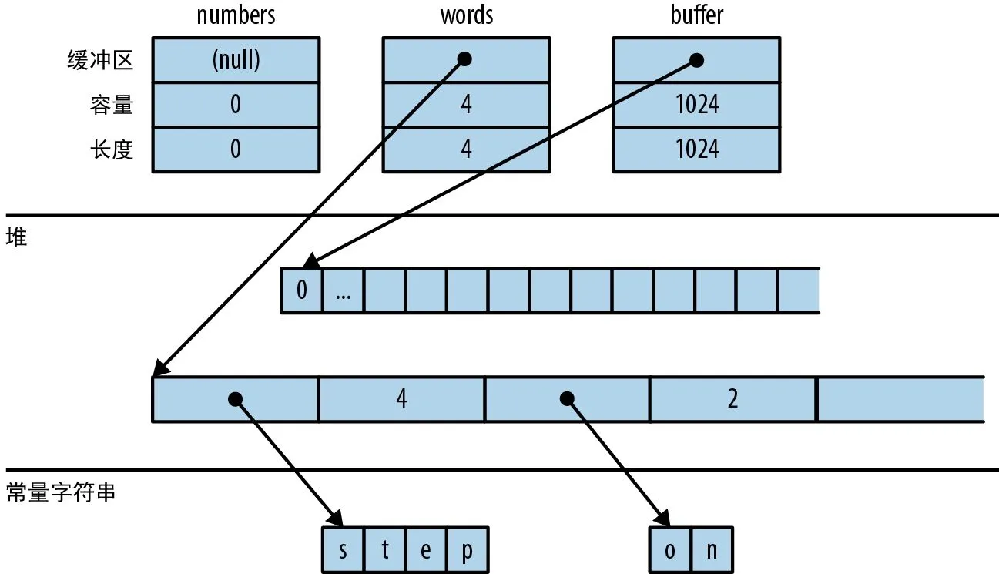
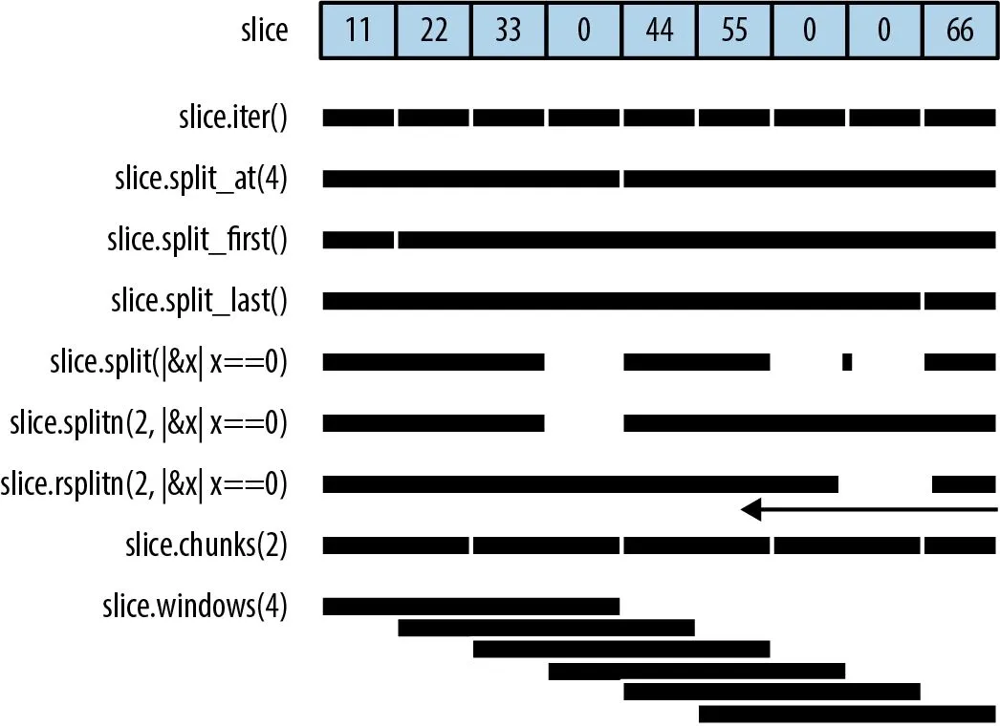
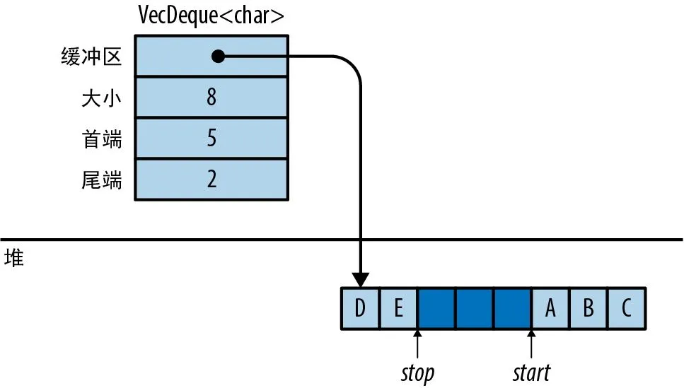

# 第16章集合(1)

- 我们都像物理学假想中的麦克斯韦妖一样活动。正是在日常经验中，我们可以发现一向冷静的物理学家在两个世纪里对这个卡通形象一直难以忘怀的原因。生物体（organism），顾名思义，时刻在组织（organize）。我们分拣邮件、堆造沙堡、拼凑拼图、复盘棋局、收集邮票、给麦穗脱粒、按字母表顺序排列图书、创造对称形式、创作十四行诗和奏鸣曲，以及整理自己的房间。所有这些活动并不需要巨大的能量，只需保障我们能够发挥智能便可。1——James Gleick，《信息简史》

Rust 标准库包含多个集合，这些集合是泛型类型，用于在内存中存储各种数据。在本书中，

```
我们已经用到了一些集合，比如 Vec 和 HashMap。本章将详细介绍这两种类型的方法，以及
```

另外 6 个标准集合。在开始之前，我们先来辨析一下 Rust 的集合与其他语言的集合之间的一些系统性差异。

首先，移动和借用无处不在。Rust 使用移动来避免对值做深拷贝。这就是

```
Vec<T>::push(item) 方法会按值而非按引用来获取参数的原因。这样值就会移动到向量
中。第 4 章中的示意图展示了这在实践中是如何实现的：将 Rust String 压入
Vec<String> 中会很快，因为 Rust 不必复制字符串的字符数据，并且字符串的所有权始终
```

是明晰的。

其次，Rust 没有失效型错误，也就是当程序仍持有指向集合内部数据的指针时，集合被重新


调整大小或发生其他变化而导致的那种悬空指针错误。失效型错误是 C++ 中未定义行为的另一个来源，即使在内存安全的语言中，它们也会偶尔导致


- 2

```
ConcurrentModificationException
```

- 。Rust 的借用检查器在编译期就可以排除这些错

误。

```
最后，Rust 没有 null，因此在其他语言使用 null 的地方 Rust 会使用 Option。
```

除了这些差异，Rust 的集合与你预期的差不多。如果你是一位经验丰富的程序员，而且时间有限，那么可以快速浏览本章，但不要错过 16.5.1 节。

## 16.1　概述

表 16-1 展示了 Rust 的 8 个标准集合，它们都是泛型类型。

表 16-1：标准集合汇总表

- 其他语言中

集合

- 描述C++

```
Vec<T>
vector
```

- 可增长数组

```
VecDeque<T>
deque
```

- 双端队列（可增长的环形缓冲区）

```
LinkedList<T>
list
```

- 双向链表

```
BinaryHeap<T> where T: Ord
priority
```

- 最大堆

```
HashMap<K, V> where K: Eq + Hash
unordere
```

- 键值哈希表

```
BTreeMap<K, V> where K: Ord
map
```

- 有序键值表

```
HashSet<T> where T: Eq + Hash
unordere
```

- 无序的、基于哈希的集

```
BTreeSet<T> where T: Ord
set
```

- 有序集

```
Vec<T>、HashMap<K, V> 和 HashSet<T> 是最常用的集合类型，其余的都各自有其基本
```

应用场景。本章会依次讨论每种集合类型。

```
Vec<T>（普通向量）
可增长的、分配在堆上的 T 类型值数组。本章会用大约一半的篇幅专门介绍 Vec 及其众多实
```

用方法。

```
VecDeque<T>（双端队列向量）
与 Vec<T> 类似，但更适合用作先入先出队列。它支持在列表的前面和后面高效地添加值和
```

移除值，但代价是会让所有其他的操作都稍微变慢一些。

```
BinaryHeap<T>（二叉堆）
优先级队列。BinaryHeap 中的值是精心组织过的，因此始终可以高效地查找和移除其最大
```

值。

```
HashMap<K, V>（哈希 Map）
```

由键 - 值对构成的表。通过键查找值很快。其条目会以任意顺序存储。

```
BTreeMap<K, V>（B 树 Map）
与 HashMap<K, V> 类似，但它会根据键来对条目进行排序。BTreeMap<String, i32>
会以 String 的比较顺序来存储其条目。除非需要让条目保持排序状态，否则用 HashMap 更
```

快一些。

```
HashSet<T>（哈希 Set）
由 T 类型的值组成的 Set。它既能很快地添加值和移除值，也能很快地查询给定值是否在此
Set 中。
```

```
BTreeSet<T>（B 树 Set）
```

```
与 HashSet<T> 类似，但它会让元素按值排序。同样，除非需要让数据保持排序状态，否则
用 HashSet 更快一些。
因为 LinkedList 很少使用（对于大多数用例，在性能和接口方面有更好的替代方案），所以
```

这里就不展开讲解了。

## 16.2　Vec<T>

```javascript
因为本书中一直在使用 Vec，所以我们假设你对它已经比较熟悉了。有关介绍，请参阅 3.6.2
节。下面我们将详细讲解 Vec 的方法及内部工作原理。
创建向量的最简单方法是使用 vec! 宏：
// 创建一个空向量
let mut numbers: Vec<i32> = vec![];
// 使用给定内容创建一个向量
let words = vec!["step", "on", "no", "pets"];
let mut buffer = vec![0u8; 1024];  // 1024个内容为0的字节
```

如第 4 章所述，向量具有 3 个字段：长度、容量和指向用于存储元素的堆分配内存的指针。

```
图 16-1 展示了前面的向量在内存中的布局方式。空向量 numbers 最初的容量为 0。直到添
```

加第一个元素之前，不会为其分配堆内存。



```javascript
图 16-1：向量的内存布局：words 的每个元素都是一个由指针和长度组成的 &str 值
与所有集合一样，Vec 也实现了 std::iter::FromIterator，所以可以使用迭代器的
.collect() 方法从任意迭代器创建向量，详情请参阅 15.4.13 节。
// 把另一个集合转换成向量
let my_vec = my_set.into_iter().collect::<Vec<String>>();
```

### 16.2.1　访问元素

通过索引来获取数组、切片或向量的元素非常简单：

```javascript
// 获取某个元素的引用
let first_line = &lines[0];
// 获取某个元素的副本
let fifth_number = numbers[4];       // 要求实现了Copy特型
let second_line = lines[1].clone();  // 要求实现了Clone特型
// 获取切片的引用
let my_ref = &buffer[4..12];
// 获取切片的副本
let my_copy = buffer[4..12].to_vec();  // 要求实现了Clone特型
```

如果索引超出了范围，则所有这些形式都会引发 panic。

```
Rust 对数值类型很挑剔，对向量也不例外。向量的长度和索引都是 usize 类型。试图用
```

```
u32、u64 或 isize 作为向量索引会导致出错。可以根据需要使用 n as usize 来转换，
```

详情请参阅 6.14 节。

下面这些方法可以轻松访问向量或切片的特定元素（请注意，所有的切片方法也都适用于数组和向量）。

```javascript
slice.first()（第一个）
返回对 slice 的第一个元素的引用（如果有的话）。
返回类型为 Option<&T>，所以如果 slice 为空则返回值为 None，如果不为空则返回
Some(&slice[0])。
if let Some(item) = v.first() {
   println!("We got one! {}", item);
}
slice.last()（最后一个）
与 first 类似，但会返回对最后一个元素的引用。
slice.get(index)（获取）
如果其存在，就返回 slice[index] 引用的 Some 值。如果 slice 的元素少于 index+1
个，则返回 None。
let slice = [0, 1, 2, 3];
assert_eq!(slice.get(2), Some(&2));
assert_eq!(slice.get(4), None);
```

```
slice.first_mut()（第一个可变）、slice.last_mut()（最后一个可变）和
slice.get_mut(index)（获取可变）
```

```javascript
这些方法是前述 slice.first() 等方法的变体，但借入的是可变引用。
let mut slice = [0, 1, 2, 3];
{
   let last = slice.last_mut().unwrap();   // last的类型是&mut i32
   assert_eq!(*last, 3);
   *last = 100;
}
assert_eq!(slice, [0, 1, 2, 100]);
因为按值返回 T 就意味着移动它，所以一些需要就地访问元素的方法通常会按引用返回这些
```

元素。

```
.to_vec() 方法是一个例外，它会复制这些元素。
slice.to_vec()（转向量）
```

克隆整个切片，返回一个新向量：

```javascript
let v = [1, 2, 3, 4, 5, 6, 7, 8, 9];
assert_eq!(v.to_vec(),
          vec![1, 2, 3, 4, 5, 6, 7, 8, 9]);
assert_eq!(v[0..6].to_vec(),
          vec![1, 2, 3, 4, 5, 6]);
此方法只能用在元素可以克隆的情况下，也就是需满足 where T: Clone 限界。
```

### 16.2.2　迭代

- 3，要么按引用迭代，但都要遵循 15.2.2 节描

向量、数组和切片是可迭代的，要么按值迭代

述的模式。

```
遍历 Vec<T> 或数组 [T; N] 会生成 T 类型的条目。这些元素会逐个从向量或数组中移动
```

- 出来并被消耗掉。

```
遍历 &[T; N]、&[T] 或 &Vec<T> 类型的值（对数组、切片或向量的引用）会生成 &T
```

- 类型的条目，即对单个元素的引用，这些元素不会移动出来。

```
遍历 &mut [T; N]、&mut [T] 或 &mut Vec<T> 类型的值会生成 &mut T 类型的条
```

- 目。

```
数组、切片和向量也有 .iter() 方法和 .iter_mut() 方法（参见 15.2.1 节），以用于创建
```

一个会生成对其元素的引用的迭代器。

稍后本章将在 16.2.5 节中介绍一些更高级的方法来迭代切片。

### 16.2.3　扩大向量与收缩向量

数组、切片或向量的长度是它们所包含的元素数量。

```
slice.len()（长度）
返回 slice 的长度，类型为 usize。
slice.is_empty()（为空？）
如果 slice 未包含任何元素（slice.len() == 0）则为真。
```

本节中的其余方法是关于扩大向量和收缩向量的。但数组和切片中没有这些方法，因为数组和切片一旦创建就无法调整大小。

向量的所有元素都存储在连续的、分配在堆上的内存块中。向量的容量就是该内存块可以容纳

```
的最大元素数量。Vec 通常会替你管理容量，当需要更多空间时它会自动分配更大的缓冲区
```

并将元素移入其中。下面是一些显式管理容量的方法。

```
Vec::with_capacity(n)（自带容量）
创建一个容量为 n 的新的空向量。
vec.capacity()（取容量）
返回 vec 的容量，类型为 usize。vec.capacity() >= vec.len() 始终是成立的。
vec.reserve(n)（预留）
确保向量至少有足够的备用容量来容纳另外 n 个元素，也就是说，vec.capacity() 至少等
于 vec.len() + n。如果已经有足够的空间，就什么也不做。如果没有，则会分配一个更
```

大的缓冲区并将向量的内容移入其中。

```
vec.reserve_exact(n)（精确预留）
与 vec.reserve(n) 类似，但要求 vec 不要为未来的增长分配任何多于 n 的额外容量。调
用此方法后，vec.capacity() 应该精确等于 vec.len() + n。
vec.shrink_to_fit()（缩小到刚好够）
如果 vec.capacity() 大于 vec.len()，则尝试释放额外的内存。
Vec<T> 还有许多用来添加或移除元素的方法，它们可以改变向量的长度。所有这些方法都可
以通过可变引用获取其 self 参数。
```

下面这两个方法会在向量的末尾添加或移除单个值。

```
vec.push(value)（推入）
将给定 value 添加到 vec 的末尾。
```

```
vec.pop()（弹出）
移除并返回最后一个元素。返回类型是 Option<T>。如果弹出的元素是 x，则返回
Some(x)；如果向量已经为空，则返回 None。
```

```
请注意，.push() 会按值而不是按引用接受其参数。同样，.pop() 会返回弹出的值，而不
```

是引用。本节中剩下的大部分方法也是如此。它们可以将值移动进和移动出向量。

下面这两个方法会在向量的任意位置添加或移除一个值。

```sql
vec.insert(index, value)（插入）
在 vec[index] 处插入给定的 value，将 vec[index..] 中的所有当前值向右平移一个位
```

置以腾出空间。

```
如果 index > vec.len()，则会引发 panic。
vec.remove(index)（移除）
移除并返回 vec[index]，将 vec[index+1..] 中的所有当前值向左平移一个位置以填补
```

空白。

```
如果 index >= vec.len()，则会引发 panic，因为在这种情况下要移除的 vec[index]
```

元素并不存在。

```sql
向量越长，这个操作就越慢。如果需要经常执行 vec.remove(0)，请考虑使用 VecDeque
（参见 16.3 节）来代替 Vec。
需要移动的元素越多，.insert() 和 .remove() 的速度就会越慢。
```

下面这 4 个方法可以把向量的长度更改为特定值。

```
vec.resize(new_len, value)（调整大小）
将 vec 的长度设置为 new_len。如果该操作会增加 vec 的长度，则以 value 的副本填补
新空间。元素类型必须实现 Clone 特型。
vec.resize_with(new_len, closure)（以……调整大小）
与 vec.resize 类似，但会调用闭包来构造每个新元素。它能用于不可 Clone 的元素构成
```

的向量。

```
vec.truncate(new_len)（截断）
将 vec 的长度减少到 new_len，丢弃 vec[new_len..] 范围内的任何元素。
如果 vec.len() 已经小于或等于 new_len，则什么也不会发生。
vec.clear()（清空）
从 vec 中移除所有元素。此方法的效果和 vec.truncate(0) 一样。
```

下面这 4 个方法可以一次添加或移除多个值。

```
vec.extend(iterable)（扩展）
按顺序在 vec 末尾添加来自给定 iterable 值的所有条目。此方法就像 .push() 的多值版
本。iterable 参数可以是实现了 IntoIterator<Item=T> 的任何值。
此方法非常有用，所以我们为其定义了一个标准特型 Extend，所有标准集合都实现了该特
型。不过很遗憾，这会导致 rustdoc 在其生成的 HTML 底部将 .extend() 与其他特型方
```

法混排在一起，因此在需要时很难找到它。我也只能告诉你：请记住它在那里。有关详细信

息，请参见 15.4.14 节。

```
vec.split_off(index)（拆分出）
与 vec.truncate(index) 类似，但此方法会返回一个 Vec<T>，其中包含从 vec 末尾移
除的那些值。此方法就像是 .pop() 的多值版本。
vec.append(&mut vec2)（追加）
这会将 vec2 的所有元素移动到 vec 中，其中 vec2 是 Vec<T> 类型的另一个向量。之后，
vec2 会被清空。
此方法与 vec.extend(vec2) 类似，不同之处在于调用 extend 之后 vec2 仍然存在，其
```

容量也不受影响。

```
vec.drain(range)（抽取）
这将从 vec 中移除 range 范围内的切片 vec[range]，并返回对所移除元素的迭代器，其
中 range 是范围值，类似 .. 或 0..4。
```

还有一些略显古怪的方法可以从向量中选择性地移除一些元素。

```
vec.retain(test)（留下）
移除所有未通过给定测试的元素。test 参数是实现了 FnMut(&T) -> bool 的函数或闭
包。针对 vec 的每个元素，此方法都会调用 test(&element)，如果函数或闭包返回了
false，就会从向量中移除并丢弃此元素。
```

除了性能上略有差异，此方法和下面的写法很像。

```
vec = vec.into_iter().filter(test).collect();
```

```
vec.dedup()（去重）
丢弃重复的元素，类似于 Unix shell 实用程序 uniq。此方法会扫描 vec 以查找彼此相等的相
```

邻元素，然后会从这些相等值中保留一个并丢弃多余的值：

```sql
let mut byte_vec = b"Misssssssissippi".to_vec();
byte_vec.dedup();
assert_eq!(&byte_vec, b"Misisipi");
请注意，输出中仍然有两个 's' 字符。这是因为此方法只会移除相邻的重复项。要想消除所
有重复项，你有 3 个选择：在调用 .dedup() 之前对向量进行排序、将数据移动到一个 Set
中，或者（为了保持元素的原始顺序）使用如下 .retain() 技巧：
let mut byte_vec = b"Misssssssissippi".to_vec();
let mut seen = HashSet::new();
byte_vec.retain(|r| seen.insert(*r));
assert_eq!(&byte_vec, b"Misp");
上述代码的工作原理是当 Set 已经包含我们要插入的条目时 .insert() 就会返回 false。
vec.dedup_by(same)（根据 same 调用结果去重）
与 vec.dedup() 类似，但此方法会使用函数或闭包 same(&mut elem1, &mut elem2)
而不是 == 运算符来检查两个元素是否应被视为相等。
vec.dedup_by_key(key)（根据 key 属性去重）
```

```
与 vec.dedup() 类似，但此方法会在 key(&mut elem1) == key(&mut elem2) 时将
```

两个元素视为相等。

```
如果 errors 是一个 Vec<Box<dyn Error>>，你可以这样写：
// 移除带有相同信息的多余错误（error）
errors.dedup_by_key(|err| err.to_string());
在本节涵盖的所有方法中，只有 .resize() 会克隆值，其他方法都是将值从一个地方移动到
```

另一个地方。

### 16.2.4　联结

以下两个方法可用于数组的数组，即其元素本身也是数组、切片或向量的数组、切片或向量。

```
slices.concat()（串联）
```

返回通过串联所有切片组装成的新向量。

```
assert_eq!([[1, 2], [3, 4], [5, 6]].concat(),
          vec![1, 2, 3, 4, 5, 6]);
slices.join(&separator)（联结）
与 concat 类似，只是在这些切片之间插入了值 separator 的副本。
assert_eq!([[1, 2], [3, 4], [5, 6]].join(&0),
          vec![1, 2, 0, 3, 4, 0, 5, 6]);
```

### 16.2.5　拆分

同时获得多个对数组、切片或向量中元素的不可变引用是比较容易的：

```javascript
let v = vec![0, 1, 2, 3];
let a = &v[i];
let b = &v[j];
let mid = v.len() / 2;
let front_half = &v[..mid];
let back_half = &v[mid..];
```

但获取多个可变引用就不那么容易了：

```javascript
let mut v = vec![0, 1, 2, 3];
let a = &mut v[i];
let b = &mut v[j];  // 错误：不能同时把`v`借入为多个可变引用
*a = 6;             // 这里用到了引用`a`和引用`b`，
*b = 7;             // 所以它们的生命周期必然重叠
Rust 禁止这样做，因为如果 i == j，那么 a 和 b 就是对同一个整数的两个可变引用，这违
```

反了 Rust 的安全规则。（参见 5.4 节。）

Rust 有几种方法可以同时借入对数组、切片或向量的两个或多个部分的可变引用。与前面的代码不同，这些方法是安全的，因为根据设计，它们总会把数据拆分成几个不重叠的区域。这

```
里的大部分方法在处理非 mut 切片时也很方便，因此每个方法都有 mut 版本和非 mut 版
```

本。

图 16-2 展示了这些方法。



```
图 16-2：对几个拆分型方法的说明（注意：slice.split(|&x|x==0) 输出中的小矩形是由于存在两个相邻的分隔符而
生成的空切片，并且 rsplitn 会按从后向前的顺序生成其输出，这与另外几个方法不同）
```

这些方法都没有直接修改数组、切片或向量，它们只是返回了对内部数据中各部分的新引用。

```
slice.iter()（迭代器）和 slice.iter_mut()（可变迭代器）
生成对 slice 中每个元素的引用。16.2.2 节介绍过它们。
```

```
slice.split_at(index)（拆分于）和 slice.split_at_mut(index)（可变拆分
```

- 于）

```
将一个切片分成两半，返回一个值对。slice.split_at(index) 等价于
(&slice[..index], &slice[index..])。如果 index 超出了限界，这两个方法就会
```

发生 panic。

```
slice.split_first()（拆分首个）和 slice.split_first_mut()（可变拆分首
```

- 个）

```
同样会返回一个值对：对首个元素（slice[0]）的引用和对所有其余元素（slice[1..]）
```

的切片的引用。

```
.split_first() 的返回类型是 Option<(&T, &[T])>，如果 slice 为空，则结果为
None。
slice.split_last()（拆分末尾）和 slice.split_last_mut()（可变拆分末尾）
与 slice.split_first() 和 slice.split_first_mut() 类似，但这两个方法拆分出
```

的是最后一个元素而不是首个元素。

```
.split_last() 的返回类型是 Option<(&T, &[T])>。
slice.split(is_sep)（拆分）和 slice.split_mut(is_sep)（可变拆分）
将 slice 拆分为一个或多个子切片，使用函数或闭包 is_sep 确定拆分位置。这两个方法会
```

返回一个遍历这些子切片的迭代器。

```
当你消耗此迭代器时，这些方法会为切片中的每个元素调用 is_sep(&element)。如果
is_sep(&element) 为 true，则认为该元素是分隔符。分隔符不会包含在输出的任何子切
```

片中。

输出总是至少包含一个子切片，每遇到一个分隔符就额外加一个。如果有多个分隔符彼此相

```
邻，或者有分隔符出现在 slice 的两端，则每对分隔符和两端的分隔符分别会对应输出一个
```

空的子切片。

```
slice.split_inclusive(is_sep)（拆分，含分隔符）和
slice.split_inclusive_mut(is_sep)（可变拆分，含分隔符）
与 split 和 split_mut 类似，但这两个方法会在前一个子切片的结尾包含分隔符而不会排
```

除它。

```
slice.rsplit(is_sep)（右起拆分）和 slice.rsplit_mut(is_sep)（右起可变拆
```

- 分）

```
与 split 和 split_mut 类似，但这两个方法会从切片的末尾开始往前拆分。
slice.splitn(n, is_sep)（拆分为 n 片）和 slice.splitn_mut(n, is_sep)
```

- （可变拆为 n 片）

```
与 slice.rsplit(is_sep) 和 slice.rsplit_mut(is_sep) 类似，但这两个方法最多
会生成 n 个子切片。在找到前 n-1 个切片后，不会再调用 is_sep。最后一个子切片中会包
```

含剩下的所有元素。

```
slice.rsplitn(n, is_sep)（右起拆分为 n 片）和 slice.rsplitn_mut(n,
is_sep)（右起可变拆分为 n 片）
与 .splitn() 和 .splitn_mut() 类似，但是在使用这两个方法时，切片会以相反的顺序
扫描。也就是说，这两个方法会在切片中的最后而不是最前 n-1 个分隔符上进行拆分，并且
```

子切片是从末尾开始向前生成的。

```
slice.chunks(n)（分为长度为 n 的块）和 slice.chunks_mut(n)（分为长度为 n
```

- 的可变块）

```
返回长度为 n 的非重叠子切片上的迭代器。如果 n 不能被 slice.len() 整除，则最后一个
```

```
块包含的元素将不足 n 个。
slice.rchunks(n)（右起分为长度为 n 的块）和 slice.rchunks_mut(n)（右起分
```

- 为长度为 n 的可变块）

```
与 slice.chunks 和 slice.chunks_mut 类似，但会从切片的末尾开始向前拆分。
slice.chunks_exact(n)（精确分为长度为 n 的块）和
slice.chunks_exact_mut(n)（精确分为长度为 n 的可变块）
返回长度为 n 的非重叠子切片上的迭代器。如果 n 不能被 slice.len() 整除，则最后一个
块（少于 n 个元素）可以在其结果的 remainder() 方法中获取。
slice.rchunks_exact(n)（右起精确分为长度为 n 的块）和
slice.rchunks_exact_mut(n)（右起精确分为长度为 n 的可变块）
与 slice.chunks_exact 和 slice.chunks_exact_mut 类似，但会从切片的末尾开始
```

拆分。

还有一个迭代子切片的方法。

```
slice.windows(n)（滑动窗口）
返回一个其行为类似于 slice 中数据的“滑动窗口”的迭代器。这个迭代器会生成一些横跨此
slice 中 n 个连续元素的子切片。它生成的第一个值是 &slice[0..n]，第二个值是
&slice[1..n+1]，以此类推。
如果 n 大于 slice 的长度，则不会生成任何切片。如果 n 为 0，则此方法会发生 panic。
如果 days.len() == 31，那么就可以通过调用 days.windows(7) 来生成 days 中所有
```

相隔 7 天的时间段。

```
大小为 2 的滑动窗口可用于探究数据序列如何从一个数据点变化到下一个数据点：
```

```javascript
let changes = daily_high_temperatures
                 .windows(2)             // 获得两个相邻的最高气温
                 .map(|w| w[1] - w[0])   // 气温变化了多少？
                 .collect::<Vec<_>>();
```

因为各个子切片会重叠，所以此方法并没有返回可变引用的变体。

### 16.2.6　交换

下面是交换切片内容的一些便利方法。

```
slice.swap(i, j)（交换元素）
交换 slice[i] 和 slice[j] 这两个元素。
slice_a.swap_with_slice(slice_b)（互换内容）
交换 slice_a 和 slice_b 的全部内容。slice_a 和 slice_b 的长度必须相同。
```

向量有一个关联方法，该方法可以高效地移除任何元素。

```
vec.swap_remove(i)（交换后移除）
移除并返回 vec[i]。与 vec.remove(i) 类似，但此方法不会将向量中剩余的元素平移过
来以填补空缺，而是简单地将 vec 的最后一个元素移动到空缺中。如果不关心向量中剩余条
```

目的顺序，那么此方法会很有用，因为性能更高。

### 16.2.7　填充

下面是替换可变切片内容的两种便利方法。

```
slice.fill(value)（填充）
```

```javascript
用 value 的克隆体填充切片。
slice.fill_with(function)（以 function 回调填充）
```

```
使用调用给定函数生成的值来填充切片。这对于实现了 Default 但未实现 Clone 的类型很
有用，比如当 T 为不可复制类型时的 Option<T> 或 Vec<T>。
```

### 16.2.8　排序与搜索

下面是切片提供的 3 个排序方法。

```
slice.sort()（排序）
将元素按升序排列。此方法仅当元素类型实现了 Ord 时才存在。
slice.sort_by(cmp)（按 cmp 回调排序）
对 slice 中的元素按函数或闭包 cmp 指定的顺序进行排序。cmp 必须实现 Fn(&T, &T) -
> std::cmp::Ordering。
手动实现 cmp 是一件痛苦的事，不过可以把它委托给别的 .cmp() 方法来实现：
students.sort_by(|a, b| a.last_name.cmp(&b.last_name));
```

如果想按一个字段排序，但当该字段相同时按另一个字段判定先后，则可以先把它们做成元组然后再进行比较。

```javascript
students.sort_by(|a, b| {
   let a_key = (&a.last_name, &a.first_name);
```

```javascript
   let b_key = (&b.last_name, &b.first_name);
   a_key.cmp(&b_key)
});
slice.sort_by_key(key)（按 key 回调排序）
使用由函数或闭包型参数 key 给出的排序键对 slice 的元素按递增顺序排序。key 的类型
必须实现 Fn(&T) -> K，这里要满足 K: Ord。
这在 T 包含一个或多个有序字段时会很有用，因此它可以按多种方式排序：
// 按平均学分绩点排序，低分在前
students.sort_by_key(|s| s.grade_point_average());
请注意，在排序过程中不会缓存这些排序键值，因此 key 函数可能会被调用 n 次以上。
出于技术原因，key(element) 无法返回从元素借来的任何引用。下面这种写法行不通：
students.sort_by_key(|s| &s.last_name);  // 错误：无法推断生命周期
Rust 无法推算出生命周期。但在这些情况下，很容易把 .sort_by() 作为后备方案。
```

以上 3 个方法都会执行稳定排序。

```
要想以相反的顺序排序，可以将 sort_by 与交换了两个参数的 cmp 闭包一起使用。传入参
数 |b, a| 而不是 |a, b| 可以有效地生成相反的顺序。或者，也可以在排序之后调用
.reverse() 方法。
```

```
slice.reverse()（逆转）
```

就地逆转切片。

一旦切片排序完毕，就可以高效地进行搜索了。

```
slice.binary_search(&value)（二分搜索）、
slice.binary_search_by(&value, cmp)（按 cmp 回调二分搜索）和
slice.binary_search_by_key(&value, key)（按 key 闭包二分搜索）
以上 3 个方法都会在给定的已排序 slice 中搜索 value。请注意，value 是按引用传递
```

的。

```
这些方法的返回类型是 Result<usize, usize>。如果在指定排序顺序中 slice[index]
等于 value，那么这些方法就会返回 Ok(index)。如果找不到这样一个索引，那么这些方
法就会返回 Err(insertion_point)，这样当你在 insertion_point 中插入 value
```

后，向量仍然会保持排好序的状态。

当然，只有在切片确实已经按指定顺序排序时二分搜索才有效。否则，结果将是没有意义的，因为如果输入无效，则输出也无效。

```
由于 f32 和 f64 具有 NaN 值，因此它们无法实现 Ord 并且不能直接用作排序和二分搜索方
法的键。要获得适用于浮点数据的类似方法，请使用 ord_subset crate。
```

可以用另一个方法在未排过序的向量中搜索。

```
slice.contains(&value)（包含）
如果 slice 中有任何元素等于 value，则返回 true。这会简单地检查切片的每个元素，直
到找到匹配项。value 同样是按引用传递的。
```

```
如果要在切片中查找值的位置（类似 JavaScript 中的 array.indexOf(value)），请使用迭
```

代器：

```
slice.iter().position(|x| *x == value)
```

```
这将返回 Option<usize>。
```

### 16.2.9　比较切片

```
如果类型 T 支持 == 运算符和 != 运算符（PartialEq 特型，参见 12.2 节），那么数组 [T;
N]、切片 [T] 和向量 Vec<T> 也会支持这两个运算符。如果两个切片的长度相同并且对应的
```

元素也相等，那它们就是相等的。数组和向量也是如此。

```
如果 T 支持运算符 <、<=、> 和 >=（PartialOrd 特型，参见 12.3 节），那么 T 的数组、
```

切片和向量也会支持这些运算符。切片之间是按字典序比较的（从左到右逐个比较）。

下面是执行常见的切片比较的两个便捷方法。

```
slice.starts_with(other)（以 other 开头）
如果 slice 的起始值序列等于 other 切片中的相应元素，则返回 true。
assert_eq!([1, 2, 3, 4].starts_with(&[1, 2]), true);
assert_eq!([1, 2, 3, 4].starts_with(&[2, 3]), false);
slice.ends_with(other)（以 other 结尾）
与上一个方法类似，但会检查 slice 的结尾值。
```

```
assert_eq!([1, 2, 3, 4].ends_with(&[3, 4]), true);
```

### 16.2.10　随机元素

```
随机数并未内置在 Rust 标准库中，但在 rand crate 中可以找到它们。rand crate 提供了以
```

下两个方法，用于从数组、切片或向量中获取随机输出。

```
slice.choose(&mut rng)（随机选取）
返回对切片中随机元素的引用。与 slice.first() 和 slice.last() 类似，此方法会返
回 Option<&T>，只有当切片为空时才返回 None。
slice.shuffle(&mut rng)（随机洗牌）
```

就地随机重排切片中的元素。切片必须通过可变引用传递。

```
这两个都是 rand::Rng 特型的方法，所以你需要一个 Rng（random number generator，随
机数生成器），以便调用它们。幸运的是，通过调用 rand::thread_rng() 很容易得到一个
生成器。要对向量 my_vec 进行洗牌，可以像下面这样写。
use rand::seq::SliceRandom;
use rand::thread_rng;
my_vec.shuffle(&mut thread_rng());
```

### 16.2.11　Rust 中不存在失效型错误

大多数主流编程语言有集合和迭代器，它们为排除失效型错误做了一点儿变化：不要在迭代集

合时修改它。例如，在 Python 中，与向量等价的是列表：

```
my_list = [1, 3, 5, 7, 9]
假设我们试图从 my_list 中移除所有大于 4 的值：
for index, val in enumerate(my_list):
   if val > 4:
       del my_list[index]  # bug：在迭代过程中修改列表
print(my_list)
（Python 中的 enumerate 函数相当于 Rust 中的 .enumerate() 方法，参见 15.3.11 节。）
令人惊讶的是，这个程序打印出了 [1, 3, 7]。但是 7 显然大于 4。为什么失控了？这就是
```

失效型错误：程序在迭代数据时修改了数据，让迭代器失效了。在 Java 中，结果将是一个异常。在 C++ 中，这是未定义行为。在 Python 中，虽然此行为有明确定义，但不直观：迭代器

```
会跳过一个元素。这样一来，val 永远不会等于 7，因此也就没有机会删除它了。
```

我们试着在 Rust 中重现这个 bug：

```javascript
fn main() {
   let mut my_vec = vec![1, 3, 5, 7, 9];
   for (index, &val) in my_vec.iter().enumerate() {
       if val > 4 {
           my_vec.remove(index);  // 错误：不能把`my_vec`借用为可变的
       }
   }
   println!("{:?}", my_vec);
}
```

```
当然，Rust 在编译时就会拒绝这个程序。当我们调用 my_vec.iter() 时，它借用了一个共
```

```
享（非 mut）的向量引用。引用与迭代器的生命周期一样长，直到 for 循环结束。当存在不
可变引用时，不能通过调用 my_vec.remove(index) 来修改向量。
```

帮你指出错误固然有用，但你还是得想方设法达成自己的目标。最简单的修复方法是写成如下形式：

```
my_vec.retain(|&val| val <= 4);
或者，也可以像在 Python 或任何其他语言中那样使用 filter 创建一个新向量。
```

## 16.3　VecDeque<T>

```
Vec 只支持在末尾高效地添加元素和移除元素。当程序需要一个地方来存储“排队等候”的值
时，Vec 可能会很慢。
Rust 的 std::collections::VecDeque<T> 是一个双端队列（deque，double-ended
```

queue 的缩写，发音为 /'dek/）。它支持在首端和尾端进行高效的添加操作和移除操作。

```
deque.push_front(value)（队首推入）
```

在队列的首端添加一个值。

```
deque.push_back(value)（队尾推入）
在队列的尾端添加一个值。（此方法比 .push_front() 更常用，因为队列通常的习惯是在尾
```

端添加值，在首端移除值，就像人们在排队等候一样。）

```
deque.pop_front()（队首弹出）
```

```
移除并返回队列的首端值，如果队列为空则返回一个为 None 的 Option<T>，就像
vec.pop() 那样。
```

```
deque.pop_back()（队尾弹出）
移除并返回队列的尾端值，同样返回 Option<T>。
deque.front()（队首）和 deque.back()（队尾）
与 vec.first() 和 vec.last() 类似，这两个方法会返回对队列首端或尾端元素的引用。
返回值是一个 Option<&T>，如果队列为空则为 None。
deque.front_mut()（队首，可变版）和 deque.back_mut()（队尾，可变版）
与 vec.first_mut() 和 vec.last_mut() 类似，这两个方法会返回 Option<&mut
T>。
VecDeque 的实现是一个环形缓冲区，如图 16-3 所示。
```



```
图 16-3：VecDeque 在内存中的存储情况
```

```
和 Vec 一样，VecDeque 用一块分配在堆上的内存来存储元素。与 Vec 不同，VecDeque
```

的数据并不总是从该区域的开头开始，它可以“回绕”到末尾。这个双端队列的元素按顺序排列

```
是 ['A', 'B', 'C', 'D', 'E']。VecDeque 有两个私有字段，在图 16-3 中被标记为
start 和 stop，用于记住数据在缓冲区中的首端位置和尾端位置。
```

从任一端向队列中添加一个值都意味着占用一个未使用的插槽，如图 16-3 中的深灰色色块所示。如果需要，可以回绕或分配更大的内存块。

```
VecDeque 会管理回绕，因此你不必费心于此。图 16-3 展示了 Rust 如何让 .pop_front()
```

更快的幕后原理。

```sql
通常，当你需要用到双端队列时，基本上只是需要 .push_back() 和 .pop_front() 这两
个方法。用于创建队列的类型关联函数 VecDeque::new() 和
VecDeque::with_capacity(n) 和它们在 Vec 中的对应函数一样。VecDeque 还实现了
Vec 中的许多方法，比如 .len() 和 .is_empty()、.insert(index,
value)、.remove(index)、.extend(iterable) 等。
```

和向量一样，双端队列可以按值、共享引用或可变引用进行迭代。它们有 3 个迭代器方法，即

```
.into_iter()、.iter() 和 .iter_mut()。它们可以按通常的方式通过索引来访问：
deque[index]。
```

因为双端队列不会将自己的元素存储在连续的内存中，所以它们无法继承切片的所有方法。但

```
是，如果你愿意承受移动内容的开销，则可以通过 VecDeque 提供的如下方法来解决此问
```

题。

```
deque.make_contiguous()（变连续）
获取 &mut self 并将 VecDeque 重新排列到连续的内存中，返回 &mut [T]。
Vec 和 VecDeque 紧密相关，为了轻松地在两者之间进行转换，标准库提供了两个特型实
```

现。

```
Vec::from(deque)（来自双端队列）
Vec<T> 实现了 From<VecDeque<T>>，因此 Vec::from(deque) 能将双端队列变成向
```

量。这个操作的时间复杂度是 O(n)，因为可能要重新排列元素。

```
VecDeque::from(vec)（来自向量）
VecDeque<T> 实现了 From<Vec<T>>，因此 VecDeque::from(vec) 能把向量变成双端
队列。这个操作的时间复杂度是 O(1)，因为 Rust 会直接把向量缓冲区转移给 VecDeque，而
```

不会重新分配。

```
这个方法使得创建具有指定元素的双端队列变得很容易，哪怕并没有标准的 vec_deque![]
```

宏。

```javascript
use std::collections::VecDeque;
let v = VecDeque::from(vec![1, 2, 3, 4]);
```

## 16.4　BinaryHeap<T>

```
BinaryHeap（二叉堆）是一种元素组织会保持松散的集合，这样最大值便能总是冒泡到队列
的首部。以下是 3 个最常用的 BinaryHeap 方法。
heap.push(value)（压入）
```

向堆中添加一个值。

```
heap.pop()（弹出）
```

```
从堆中移除并返回最大值。如果堆为空，则会返回一个为 None 的 Option<T>。
```

```
heap.peek()（窥视）
返回对堆中最大值的引用。返回类型是 Option<&T>。
heap.peek_mut()（窥视，可变版）
返回一个 PeekMut<T>，它会返回对堆中最大值的可变引用，并提供类型关联函数 pop() 以
```

从堆中弹出该值。使用此方法，我们可以根据最大值来决定是否将其从堆中弹出。

```javascript
use std::collections::binary_heap::PeekMut;
if let Some(top) = heap.peek_mut() {
   if *top > 10 {
       PeekMut::pop(top);
   }
}
BinaryHeap 还支持 Vec 上的部分方法，包括
BinaryHeap::new()、.len()、.is_empty()、.capacity()、.clear() 和
.append(&mut heap2)。
假设我们用一堆数值填充了 BinaryHeap：
use std::collections::BinaryHeap;
let mut heap = BinaryHeap::from(vec![2, 3, 8, 6, 9, 5, 4]);
值 9 会位于堆顶：
```

```
assert_eq!(heap.peek(), Some(&9));
assert_eq!(heap.pop(), Some(9));
```

```
移除了 9 之后也会稍微重新排列其他元素，以便让 8 位于最前面，以此类推：
assert_eq!(heap.pop(), Some(8));
assert_eq!(heap.pop(), Some(6));
assert_eq!(heap.pop(), Some(5));
...
当然，BinaryHeap 并不局限于数值。它可以包含实现了内置特型 Ord 的任意类型的值。
这使得 BinaryHeap 可用作工作队列。你可以定义一个基于优先级实现 Ord 的任务结构体，
以便高优先级任务比低优先级任务大一些。然后，创建一个 BinaryHeap 来保存所有待处理
的任务。它的 .pop() 方法将始终返回最重要的条目，也就是你的程序下一步就应该处理的
```

任务。

```javascript
注意：BinaryHeap 是可迭代的，它有一个 .iter() 方法，但此迭代器会以任意顺序而不
是从大到小生成堆的元素。要按优先顺序消耗 BinaryHeap 中的值，请使用 while 循环。
while let Some(task) = heap.pop() {
   handle(task);
}
```

[1]：此书已由人民邮电出版社出版，详见 。——编者注[2]：这是 Java 中的异常类。——译者注[3]：作者在这里只是泛泛而言，其实除非元素是 类型，否则切片并不能按值迭代（情形 1）。——译者注
