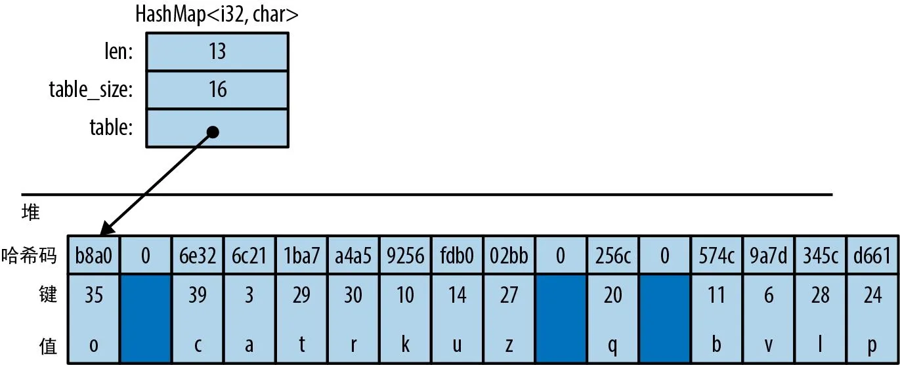
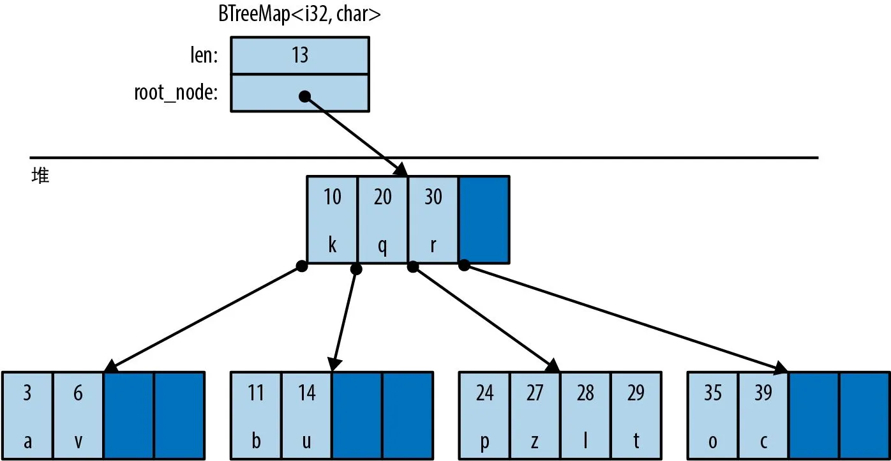

# 第16章集合(2)

```
16.5　HashMap<K, V> 与 BTreeMap<K, V>
Map 是键 - 值对［称为条目（entry）］的集合。任何两个条目都不会有相同的键，并且这些条
目会始终按某种数据结构进行组织，从而使你可以通过键在 Map 中高效地查找对应的值。简
而言之，Map 就是一个查找表。
Rust 提供了两种 Map 类型：HashMap<K, V> 和 BTreeMap<K, V>。这两种类型共享许多
```

相同的方法，区别在于它们如何组织条目以便进行快速查找。

```
HashMap 会将键和值存储在哈希表中，因此它需要一个实现了 Hash 和 Eq 的键类型 K，即
```

用来求哈希与判断相等性的标准库特型。

```
图 16-4 展示了 HashMap 在内存中的排列方式。深灰色区域表示未使用。所有键、值和缓存
的哈希码都存储在一个分配在堆上的表中。添加条目最终会迫使 HashMap 分配一个更大的表
```

并将所有数据移入其中。



```
图 16-4：内存中的 HashMap
BTreeMap 会在树结构中按键的顺序存储条目，因此它需要一个实现了 Ord 的键类型 K。图
16-5 展示了一个 BTreeMap。同样，深灰色区域表示未使用的备用容量。
BTreeMap 中存储条目的单元称为节点。BTreeMap 中的大多数节点仅包含键 - 值对。非叶
节点（比如图 16-5 中所示的根节点）中也有一些空间用于存储指向子节点的指针。(20,
'q') 和 (30, 'r') 之间的指针会指向包含 20 和 30 之间所有键的子节点。添加条目通常
```

需要将节点的一些现有条目向右平移，以保持它们的顺序，并且偶尔需要创建新节点。

```
为了适合页面大小，图 16-5 已略作简化。例如，真正的 BTreeMap 节点会有 11 个条目的空
```

间，而不是 4 个。

Rust 标准库采用了 B 树而不是平衡二叉树，因为 B 树在现代硬件上速度更快。两相对比，二叉树固然在每次搜索时的比较次数较少，但 B 树具有更好的局部性（也就是说，内存访问被分组在一起，而不是分散在整个堆中）。这使得 CPU 缓存未命中的情况更为罕见。这会带来显著的速度提升。



- 图 16-5：内存中的 BTreeMap

```
下面是创建 Map 的几种方法。
HashMap::new()（新建）和 BTreeMap::new()（新建）
创建新的空 Map。
iter.collect()（收集）
可用于从键 - 值对创建和填充新的 HashMap 或 BTreeMap。iter 必须是
Iterator<Item=(K, V)> 类型的。
HashMap::with_capacity(n)（自带容量）
创建一个新的空 HashMap，其中至少有 n 个条目的空间。与向量一样，HashMap 会将数据
存储在分配在堆上的单块内存中，因此它们有容量及其相关方法 hash_map.capacity()、
hash_map.reserve(additional) 和 hash_map.shrink_to_fit()。BTreeMap 则
```

没有这些。

```
HashMap 和 BTreeMap 用于处理键和值的核心方法是一样的。
map.len()（长度）
```

返回条目数。

```
map.is_empty()（为空？）
如果 map 没有条目，则返回 true。
map.contains_key(&key)（包含 key？）
如果 map 具有给定 key 的条目，则返回 true。
map.get(&key)（按 key 获取）
在 map 中搜索具有给定 key 的条目。如果找到匹配的条目，就返回 Some(r)，其中 r 是对
相应值的引用。如果没找到，则返回 None。
map.get_mut(&key)（按 key 获取，可变版）
与 map.get(&key) 类似，但此方法会返回对值的可变引用。
一般来说，Map 允许对其存储的值进行可变访问，但不允许对键进行可变访问。你可以随意
修改这些值，但键属于 Map 本身，需要确保它们不会改变，因为条目是根据对应的键来组织
```

的。对键进行就地修改是错误的。

```sql
map.insert(key, value)（插入）
将条目 (key, value) 插入 map 并返回旧值（如果有的话）。返回类型是 Option<V>。如
果 Map 中已有 key 条目，则新插入的 value 会覆盖旧值。
map.extend(iterable)（用 iterable 扩展）
遍历 iterable 中的 (K, V) 项并将这些键和值逐个插入 map 中。
map.append(&mut map2)（从 map2 追加）
将所有条目从 map2 移动到 map 中。之后，map2 会变空。
map.remove(&key)（按 key 移除值）
从 map 中查找并移除具有给定 key 的任何条目，如果存在，就返回刚刚移除的值。返回类型
是 Option<V>。
map.remove_entry(&key)（按 key 移除条目）
```

```
从 map 中查找并移除具有给定 key 的任何条目，返回刚刚移除的键和值（如果有的话）。返
回类型是 Option<(K, V)>。
map.retain(test)（留下）
移除所有未通过给定测试的元素。test 参数是实现了 FnMut(&K, &mut V) -> bool 的
函数或闭包。对于 map 中的每个元素，都会调用 test(&key, &mut value)，如果此函数
或闭包返回 false，则从 map 中移除并丢弃该元素。
```

除了性能上有些许区别，此方法和下面的写法很像。

```
map = map.into_iter().filter(test).collect();
map.clear()（清空）
```

移除所有条目。

```
也可以使用方括号来查询 Map，比如 map[&key]。也就是说，Map 实现了内置特型
Index。但是，如果给定 key 还没有条目（就像越界数组访问），则会出现 panic，因此只有
```

在要查找的条目肯定已填充过时才应使用此语法。

```
.contains_key()、.get()、.get_mut() 和 .remove() 的 key 参数不必具有确切的
类型 &K。这些方法对可以从 K 借用来的类型来说是通用的。可以在 HashMap<String,
Fish> 上调用 fish_map.contains_key("conger")，即便 "conger" 不是确切的
String 类型也没问题，因为 String 实现了 Borrow<&str>。有关详细信息，请参阅 13.8
```

节。

```
因为 BTreeMap<K, V> 会始终保持其条目是根据键排序的，所以它支持一些额外的操作。
btree_map.split_off(&key)（拆分出）
把 btree_map 一分为二。将键小于 key 的条目留在 btree_map 中。返回包含其他条目的
新 BTreeMap<K, V>。
```

### 16.5.1　条目

```sql
HashMap 和 BTreeMap 都有其对应的 Entry（条目）类型。条目的作用旨在消除冗余的
Map 查找。例如，下面是一些获取或创建学生记录的代码：
// 已经有关于此学生的记录了吗？
if !student_map.contains_key(name) {
   // 没有：创建一个
   student_map.insert(name.to_string(), Student::new());
}
// 现在，肯定存在一条记录了
let record = student_map.get_mut(name).unwrap();
...
这固然可以正常工作，但它会访问 student_map 两次或 3 次，每次都进行同样的查找。
对于这些条目，我们应该只进行一次查找，生成一个 Entry 值，然后将其用于所有后续操
```

作。下面这个单行代码等效于上一段代码，但它只会执行一次查找：

```javascript
let record = student_map.entry(name.to_string()).or_insert_with(Student::new);
student_map.entry(name.to_string()) 返回的 Entry 值就像对 Map 中某个位置的
```

可变引用，该位置要么由键 - 值对占用着，要么是空的（意味着那里还没有条目）。如果为

```
空，那么条目的 .or_insert_with() 方法就会插入一个新的 Student。Entry 的大多数
```

用法也是这样的：小而美。

```
所有 Entry 值都是由同一个方法创建的。
map.entry(key)（按 key 取条目）
返回给定 key 的 Entry。如果 Map 中没有这样的键，则返回一个空的 Entry。
此方法会通过可变引用获取其 self 参数并返回与其生命周期一致的 Entry：
pub fn entry<'a>(&'a mut self, key: K) -> Entry<'a, K, V>
Entry 类型有一个生命周期参数 'a，因为它实际上是一种奇特的对 Map 的可变引用。只要
Entry 存在，它就拥有对此 Map 的独占访问权。
```

通过 5.3.5 节，我们已经了解了如何在类型中存储引用以及这会如何影响生命周期。现在我们

```
正在从用户的视角来看待它。Entry 就是一例。
遗憾的是，如果 Map 具有 String 型的键，则无法将 &str 类型的引用传给此方法。在这种
情况下，.entry() 方法需要一个真正的 String 型的值。
Entry 值提供了以下 3 个方法来处理空条目。
map.entry(key).or_insert(value)（取条目或插入）
确保 map 包含具有给定 key 的条目，如果需要，就插入具有给定 value 的新条目。此方法
```

会返回对新值或现有值的可变引用。

假设我们需要统计选票。可以这样写：

```javascript
let mut vote_counts: HashMap<String, usize> = HashMap::new();
for name in ballots {
   let count = vote_counts.entry(name).or_insert(0);
   *count += 1;
}
.or_insert() 会返回一个可变引用，所以 count 的类型是 &mut usize。
map.entry(key).or_default()（取条目或插入默认值）
确保 map 包含具有给定键的条目，如果需要，就插入一个具有 Default::default() 返回
值的新条目。这仅适用于实现了 Default 的类型。与 or_insert 类似，此方法会返回对新
```

值或现有值的可变引用。

```
map.entry(key).or_insert_with(default_fn)（取条目或借助 default_fn 插
```

- 入）

```
与前两个方法类似，不过当需要创建一个新条目时，此方法会调用 default_fn() 来生成默
认值。如果 map 中已经有了 key 条目，则不会调用 default_fn。
```

假设我们想知道哪些词出现在了哪些文件中。可以这样写：

```sql
// 对于每个单词，这个`Map`包含一组曾出现过此单词的文件
let mut word_occurrence: HashMap<String, HashSet<String>> =
   HashMap::new();
for file in files {
   for word in read_words(file)? {
       let set = word_occurrence
           .entry(word)
           .or_insert_with(HashSet::new);
       set.insert(file.clone());
   }
}
Entry 还提供了一个仅修改现有字段的便捷方法。
map.entry(key).and_modify(closure)（取条目并修改）
如果存在具有键 key 的条目，则调用 closure，并传入对该值的可变引用。此方法会返回
Entry，因此可以与其他方法做链式调用。
```

例如，可以使用此方法来计算字符串中单词出现的次数：

```javascript
// 这个`Map`包含给定字符串的所有单词以及单词的出现次数
let mut word_frequency: HashMap<&str, u32> = HashMap::new();
for c in text.split_whitespace() {
   word_frequency.entry(c)
       .and_modify(|count| *count += 1)
       .or_insert(1);
}
Entry 类型是为 HashMap 专门定义的一个枚举（BTreeMap 也类似）：
// (in std::collections::hash_map)
pub enum Entry<'a, K, V> {
   Occupied(OccupiedEntry<'a, K, V>),
   Vacant(VacantEntry<'a, K, V>)
}
OccupiedEntry 类型和 VacantEntry 类型都有一些无须重复查找即可插入、移除和访问
```

条目的方法。可以在在线文档中找到这些方法。这些额外的方法有时可用于消除一两次冗余查

```
找，不过 .or_insert() 和 .or_insert_with() 已经涵盖了几种常见情况。
```

### 16.5.2　对 Map 进行迭代

```
以下几个方法可以对 Map 进行迭代。
按值迭代（for (k, v) in map）以生成 (K, V) 对。这会消耗 Map。
按共享引用迭代（for (k, v) in &map）以生成 (&K, &V) 对。
按可变引用迭代（for (k, v) in &mut map）以生成 (&K, &mut V) 对。（同样，无
法对存储在 Map 中的键进行可变访问，因为这些条目是通过它们的键进行组织的。）
与向量类似，Map 也有 .iter() 方法和 .iter_mut() 方法，它们会返回针对“条目引用”的
迭代器，可用来迭代 &map 或 &mut map。此外，还有以下迭代方法。
map.keys()（所有键的迭代器）
```

返回只有“键引用”的迭代器。

```
map.values()（所有值的迭代器）
```

返回只有“值引用”的迭代器。

```
map.values_mut()（所有值的可变迭代器）
```

返回只有“值可变引用”的迭代器。

```
map.into_iter()（转为迭代器）、map.into_keys()（转为键迭代器）和
map.into_values()（转为值迭代器）
消耗此 Map，分别返回遍历键值元组 (K, V)、键或值的迭代器。
所有 HashMap 迭代器都会以任意顺序访问 Map 的条目，而 BTreeMap 迭代器会按 key 的
```

顺序访问它们。

## 16.6　HashSet<T> 与 BTreeSet<T>

```sql
Set 是用于快速进行元素存在性测试的集合：
let b1 = large_vector.contains(&"needle");    // 慢，会检查每一个元素
let b2 = large_hash_set.contains(&"needle");  // 快，会按哈希查找
Set 中永远不会包含相同值的多个副本。
Map 和 Set 有一些不同的方法，但在幕后，Set 就像一个只有键（而非键 - 值对）的 Map。
事实上，Rust 的两个 Set 类型 HashSet<T> 和 BTreeSet<T> 都是通过对 HashMap<T,
()> 和 BTreeMap<T, ()> 的浅层包装实现的。
HashSet::new()（新建）和 BTreeSet::new()（新建）
创建新 Set。
iter.collect()（收集）
可用于从任意迭代器创建出新 Set。如果 iter 多次生成了同一个值，则重复项将被丢弃。
HashSet::with_capacity(n)（自带容量）
创建一个至少有 n 个值空间的空 HashSet。
HashSet<T> 和 BTreeSet<T> 有以下几个公共的基本方法。
set.len()（长度）
返回 set 中值的数量。
set.is_empty()（为空？）
如果 set 不包含任何元素，就返回 true。
set.contains(&value)（包含）
如果 set 包含给定 value，就返回 true。
set.insert(value)（插入）
向 set 中添加一个 value。如果新增了一个值，就返回 true；如果它先前已是此 set 的成
员，则返回 false。
set.remove(&value)（移除）
从 set 中移除一个 value。如果移除了一个值，就返回 true；如果它之前不是此 set 的成
员，则返回 false。
set.retain(test)（留下）
移除所有未通过给定测试的元素。test 参数是实现了 FnMut(&T) -> bool 的函数或闭
包。对于 set 中的每个元素，此方法都会调用 test(&value)，如果它返回 false，则该
元素将被从此 set 中移除并丢弃。
```

除了性能上略有差异，此方法和下面的写法很像。

```
set = set.into_iter().filter(test).collect();
与 Map 一样，通过引用查找值的方法对于可以从 T 借用来的类型都是通用的。有关详细信
```

息，请参阅 13.8 节。

### 16.6.1　对 Set 进行迭代

```
以下两个方法可以迭代 Set。
按值迭代（for v in set）会生成 Set 的成员并消耗掉此 Set。
按共享引用（for v in &set）迭代会生成对 Set 成员的共享引用。
不支持通过可变引用迭代 Set。无法获取对存储在 Set 中的值的可变引用。
set.iter()（迭代器）
返回 set 中成员引用的迭代器。
与 HashMap 迭代器类似，HashSet 迭代器会以任意顺序生成它们的值。BTreeSet 迭代器
```

会按顺序生成值，就像一个排好序的向量。

### 16.6.2　当相等的值不完全相同时

```
Set 有一些奇怪的方法，只有当你关心“相等”的值之间的差异时才需要使用这些方法。
这种差异确实经常存在。例如，两个内容相同的 String 值会将它们的字符存储在内存中的
```

不同位置：

```javascript
let s1 = "hello".to_string();
let s2 = "hello".to_string();
println!("{:p}", &s1 as &str);  // 0x7f8b32060008
println!("{:p}", &s2 as &str);  // 0x7f8b32060010
```

通常，我们不必在乎这种差异。

```sql
但如果确实需要关心这两个 String 的存储位置，就可以用以下方法访问存储在 Set 中的实
际值。如果 set 不包含匹配值，则每个方法都会返回一个为 None 的 Option。
set.get(&value)（取值）
返回对等于 value 的 set 成员的共享引用（如果有的话）。返回类型是 Option<&T>。
set.take(&value)（拿出值）
与 set.remove(&value) 类似，但此方法会返回所移除的值（如果有的话）。返回类型是
Option<T>。
set.replace(value)（替换为）
与 set.insert(value) 类似，但如果 set 已经包含一个等于 value 的值，那么此方法就
会替代并返回原来的值。返回类型是 Option<T>。
```

### 16.6.3　针对整个 Set 的运算

```
迄今为止，我们看到的大多数 set 方法专注于单个 Set 中的单个值。Set 还有一些对整个
Set 进行运算的方法。
set1.intersection(&set2)（交集）
返回同时出现在 set1 和 set2 中的值的迭代器。
```

如果想打印同时参加脑外科和火箭科学课程的所有学生的姓名，可以这样写：

```
for student in &brain_class {
   if rocket_class.contains(student) {
       println!("{}", student);
   }
}
```

或者，再精简一些：

```
for student in brain_class.intersection(&rocket_class) {
   println!("{}", student);
}
```

令人惊讶的是，有一个运算符能实现同样的效果。

```javascript
&set1 & &set2 会返回一个新 Set，该 Set 是 set1 和 set2 的交集。这是把“二进制按
位与”运算符应用在了两个引用之间。这样就会找到同时存在于 set1 和 set2 中的值。
let overachievers = &brain_class & &rocket_class;
set1.union(&set2)（并集）
返回存在于 set1 或 set2 中或者同时存在于两者中的值的迭代器。
&set1 | &set2 会返回包含所有这些值的新 Set。它会找出所有存在于 set1 或 set2 中
```

的值。

```
set1.difference(&set2)（差集）
返回存在于 set1 但不在于 set2 中的值的迭代器。
&set1 - &set2 会返回包含所有此类值的新 Set。
set1.symmetric_difference(&set2)（对称差集，异或）
返回存在于 set1 或 set2 中但不同时存在于两者中的迭代器。
&set1 ^ &set2 会返回包含所有此类值的新 Set。
以下是测试 Set 之间关系的 3 个方法。
set1.is_disjoint(set2)（有交集？）
如果 set1 和 set2 没有共同的值，就返回 true——它们之间的交集为空。
set1.is_subset(set2)（是子集？）
如果 set1 是 set2 的子集，就返回 true。也就是说，set1 中的所有值都在 set2 中。
set1.is_superset(set2)（是超集？）
与上一个方法相反：如果 set1 是 set2 的超集，就返回 true。
Set 还支持使用 == 和 != 进行相等性测试。如果两个 Set 包含完全相同的一组值，那它们
```

就是相等的。

## 16.7　哈希

```
std::hash::Hash 是可哈希类型的标准库特型。HashMap 的键和 HashSet 的元素都必须
实现 Hash 和 Eq。
大多数实现了 Eq 的内置类型也会实现 Hash。整数、char 和 String 都是可哈希的。对元
```

组、数组、切片和向量来说，只要它们的元素是可哈希的，它们自身就是可哈希的。

标准库的一个设计原则是，无论将值存储在何处或如何指向它，都应具有相同的哈希码。因

```
此，引用与其引用的值具有相同的哈希码，而 Box 与其封装的值也具有相同的哈希码。向量
vec 与包含其所有数据的切片 &vec[..] 具有相同的哈希码。String 与具有相同字符的
&str 具有相同的哈希码。
默认情况下，结构体和枚举没有实现 Hash，但可以派生一个实现：
/// 大英博物馆藏品中某件物品的ID号
#[derive(Clone, PartialEq, Eq, Hash)]
enum MuseumNumber {
   ...
}
```

只要此类型的字段都是可哈希的，就可以这样用。

```
如果为一个类型手动实现了 PartialEq，那么也应该手动实现 Hash。假设我们有一个代表
```

无价历史宝藏的类型：

```
struct Artifact {
   id: MuseumNumber,
   name: String,
   cultures: Vec<Culture>,
   date: RoughTime,
   ...
}
如果两个 Artifact 具有相同的 ID，那么就认为它们是相等的：
impl PartialEq for Artifact {
   fn eq(&self, other: &Artifact) -> bool {
       self.id == other.id
   }
}
impl Eq for Artifact {}
```

由于我们仅是根据这些收藏品的 ID 来比较它们，因此也必须以相同的方式对这些收藏品进行哈希处理：

```javascript
use std::hash::;
impl Hash for Artifact {
   fn hash<H: Hasher>(&self, hasher: &mut H) {
       // 把哈希工作委托给藏品编号
       self.id.hash(hasher);
   }
}
（否则，HashSet<Artifact> 将无法正常工作。与所有哈希表一样，它要求如果 a ==
b，则必然 hash(a) == hash(b)。）
这允许我们创建一个 Artifact 的 HashSet：
let mut collection = HashSet::<Artifact>::new();
如上述代码的前一段代码所示，即使要手动实现 Hash，也不需要了解任何有关哈希算法的知
识。.hash() 会接收一个表示哈希算法的 Hasher 引用作为参数。你只需将与 == 运算符相
关的所有数据提供给这个 Hasher 即可。Hasher 会根据你提供的任何内容计算哈希码。
```

## 16.8　使用自定义哈希算法

```
hash 方法是泛型的，因此 16.7 节展示的 Hash 实现可以将数据提供给实现了 Hasher 的任
```

何类型。这就是 Rust 支持可替换哈希算法的方式。

```
第三个特型 std::hash::BuildHasher 是表示哈希算法初始状态的类型的特型。每个
Hasher 都是单次使用的，就像迭代器一样：用过一次就扔掉了。而 BuildHasher 是可重
```

用的。

```
每个 HashMap 都包含一个 BuildHasher，每次需要计算哈希码时都会用到。
BuildHasher 值包含哈希算法每次运行时所需的键、初始状态或其他参数。
```

计算哈希码的完整协议如下所示：

```javascript
use std::hash::;
fn compute_hash<B, T>(builder: &B, value: &T) -> u64
   where B: BuildHasher, T: Hash
{
   let mut hasher = builder.build_hasher();  // 1. 开始此算法
   value.hash(&mut hasher);                  // 2. 填入数据
   hasher.finish()                           // 3. 结束，生成u64
}
HashMap 每次需要计算哈希码时都会调用这 3 个方法。所有的方法都是可内联的，所以速度
```

非常快。

Rust 的默认哈希算法是著名的 SipHash-1-3 算法。SipHash 的速度很快，而且非常擅长减少哈希冲突。事实上，它也是一个加密算法：目前还没有已知的有效方法能刻意生成与SipHash-1-3 冲突的值。只要每个哈希表使用不同且无法预测的密钥，Rust 就可以安全地抵御一种称为 HashDoS 的拒绝服务攻击，在这种攻击中，攻击者会故意使用哈希冲突来触发服务器的最坏性能。

不过，也许你的应用程序不需要此算法。如果要存储诸如整数或非常短的字符串之类的小型

```
键，则可以实现更快的哈希函数，但代价是要牺牲 HashDoS 的安全性。fnv crate 实现了这
```

样的一个算法，即 Fowler-Noll-Vo (FNV) 哈希。要尝试此算法，请将如下内容添加到你的Cargo.toml 中：

```
[dependencies]
fnv = "1.0"
然后从 fnv 中导入 Map 类型和 Set 类型：
use fnv::;
可以使用这两种类型作为 HashMap 和 HashSet 的无缝替代品。浏览一下 fnv 源代码，就
```

会发现它们是如何定义的：

```
/// 使用默认FNV哈希器的`HashMap`
pub type FnvHashMap<K, V> = HashMap<K, V, FnvBuildHasher>;
/// 使用默认FNV哈希器的`HashSet`
pub type FnvHashSet<T> = HashSet<T, FnvBuildHasher>;
标准的 HashMap 集合和 HashSet 集合会接受一个可选的额外类型参数来指定哈希算法，
FnvHashMap 和 FnvHashSet 是 HashMap 和 HashSet 的泛型类型别名，用于为那个参数
```

指定一个 FNV 哈希器。

## 16.9　在标准集合之外

在 Rust 中创建一个新的自定义集合类型和在其他语言中非常相似。你可以通过组合语言提供

```
的部件（结构体和枚举、标准集合、Option、Box 等）来组织数据。有关示例，请参阅
10.1.4 节定义的 BinaryTree<T> 类型。
```

如果你习惯于在 C++ 中实现数据结构，使用裸指针、手动内存管理、定位放置（placement）

```
new 和显式析构函数调用来获得最佳性能，那么你无疑会发现这在安全的 Rust 中处处受限。
```

所有这些工具本质上都是不安全的。可以在 Rust 中使用它们，但前提是要使用不安全的代码。第 22 章展示了如何通过不安全的代码实现它们，其中包括一个示例，该示例使用了一些不安全的代码来实现安全的自定义集合。

现在，我们将沐浴在标准集合及其安全、高效 API 的和煦阳光中。与 Rust 标准库中的许多

```
API 一样，这些 API 旨在让你尽可能少写一点儿 unsafe 代码。
```
