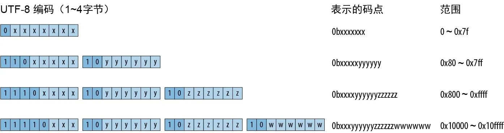
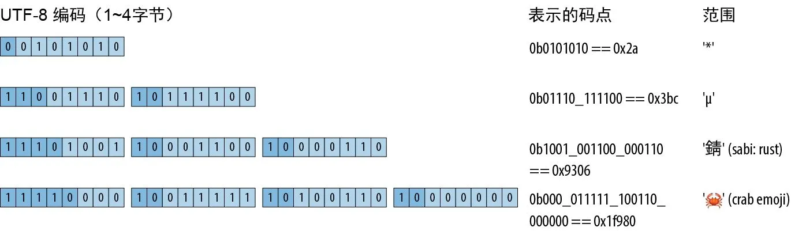
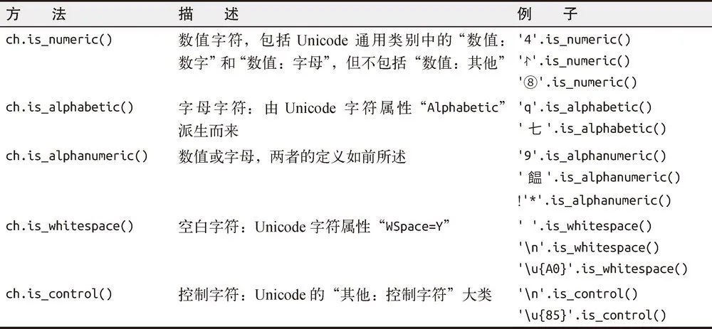
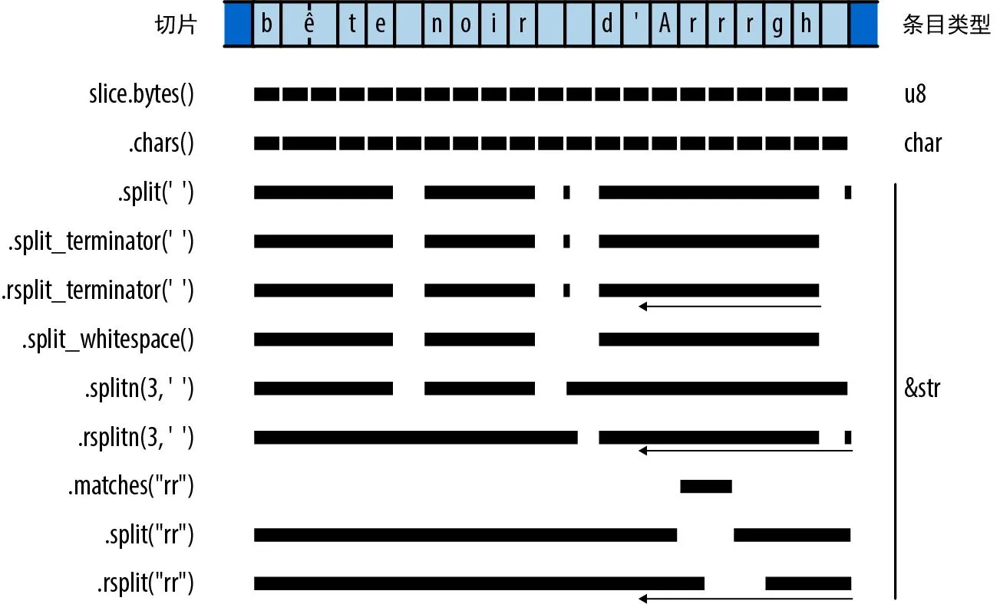

# 第17章字符串与文本(1)

- 字符串是一个光秃秃的数据结构，其途经之地会出现很多重复的处理。它简直是隐藏重要信息的“完美”手段。——Alan Perlis，警句 #34

```
本书一直在使用 Rust 的主要文本类型 String、str 和 char。3.7 节曾讲解过字符和字符
```

串字面量的语法，也展示过字符串在内存中的表示方式。在本章中，我们将更详细地介绍文本处理技术。

本章包括如下内容。

- 提供一些 Unicode 背景知识来帮助你理解标准库的设计。

```
讲解表示单个 Unicode 码点的 char 类型。
讲解 String 类型和 str 类型，二者是表示拥有和借用的 Unicode 字符序列。它们有各种
```

- 各样的方法来构建、搜索、修改和迭代其内容。

```
介绍 Rust 的字符串格式化工具，比如 println! 宏和 format! 宏。你可以编写自己的宏
```

- 来处理格式化字符串，并扩展它们以支持自己的类型。

- 概述 Rust 对正则表达式的支持。

- 讨论为什么 Unicode 的规范化很重要，并展示如何在 Rust 中对其进行规范化。


## 17.1　一些 Unicode 背景知识


本书是关于 Rust 而不是 Unicode 的，后者已经有专门的书介绍它了。但是，Rust 的字符类型和字符串类型都是围绕 Unicode 设计的。此处介绍一些 Unicode 的背景知识有助于更好地理解 Rust。

### 17.1.1　ASCII、Latin-1 和 Unicode

```
Unicode 和 ASCII 对于从 0 到 0x7f 的所有 ASCII 码点是一一对应的，比如，它们都为字符
* 分配了码点 42。同样，Unicode 也将 0 到 0xff 分配给了与 ISO/IEC 8859-1 字符集相同
```

的字符，这是 ASCII 字符集用于西欧语言的 8 位超集。Unicode 将此码点范围称为 Latin-1 码块，因此我们也将使用耳熟能详的名称 Latin-1 来指代 ISO/IEC 8859-1。

由于 Unicode 是 Latin-1 的超集，因此将 Latin-1 转换为 Unicode 甚至不需要查表：

```
fn latin1_to_char(latin1: u8) -> char {
   latin1 as char
}
```

反向转换也很简单，假设码点落在了 Latin-1 范围内。

```
fn char_to_latin1(c: char) -> Option<u8> {
   if c as u32 <= 0xff {
       Some(c as u8)
   } else {
       None
   }
}
```

### 17.1.2　UTF-8 编码

```
Rust 的 String 类型和 str 类型表示使用了 UTF-8 编码形式的文本。UTF-8 会将字符编码
```

为 1~4 字节的序列，如图 17-1 所示。



- 图 17-1：UTF-8 编码

格式良好的 UTF-8 序列有两个限制。首先，只有任何给定码点的最短编码才被认为是格式良好的，你不能花费 4 字节来编码原本只需要 3 字节的码点。此规则确保了每个码点只会有唯

```
一一个 UTF-8 编码。其次，格式良好的 UTF-8 不得对从 0xd800 到 0xdfff 或超过
0x10ffff 的数值进行编码：这些数值要么保留用作非字符目的，要么完全超出了 Unicode
```

的范围。

图 17-2 展示了一些示例。



- 图 17-2：UTF-8 示例

请注意，虽然在螃蟹表情符号的编码中其前导字节对码点只贡献了一串 0，但是它仍然需要用

```
4 字节来编码：3 字节的 UTF-8 编码只能表达 16 位码点，而 0x1f980 有 17 位长。
```

下面是一个包含具有不同编码长度字符的字符串的简单示例：

```
assert_eq!("うどん: udon".as_bytes(),
          &[0xe3, 0x81, 0x86, // う
            0xe3, 0x81, 0xa9, // ど
            0xe3, 0x82, 0x93, // ん
            0x3a, 0x20, 0x75, 0x64, 0x6f, 0x6e // : udon
          ]);
```

图 17-2 还展示了 UTF-8 一些非常有用的属性。

```
由于 UTF-8 会把码点 0 ~ 0x7f 编码为字节 0 ~ 0x7f，因此一段 ASCII 文本必然是有效
```

- 的 UTF-8 字符串。反过来，如果 UTF-8 字符串中只包含 ASCII 字符，则它也必然是有效的ASCII 字符串。

```
对于 Latin-1 则不是这样的，比如，Latin-1 会将 é 编码为字节 0xe9，而 UTF-8 会将其解
```

- 释为三字节编码中的第一字节。

- 通过查看任何字节的高位，就能立刻判断出它是某个字符的 UTF-8 编码的起始字节还是中间字节。

- 编码的第一字节会单独通过其前导位告诉你编码的全长。

- 由于不会有任何编码超过 4 字节，因此 UTF-8 在处理时从不需要无限循环，这在处理不受信任的数据时非常有用。

- 在格式良好的 UTF-8 中，即使从字节中间的任意点开始，你也始终可以明确地找出该字符编码的起始位置和结束位置。UTF-8 的第一字节和后面的字节一定不同，所以一段编码不可能从另一段编码的中间开始。第一字节会确定编码的总长度，因此任何一段编码都不可能是另一段编码的前缀。这很有用。例如，要在 UTF-8 字符串中搜索 ASCII 分隔符只需对分隔符的字节进行简单扫描即可。这个分隔符永远不会作为多字节编码的任何部分出现，因此根本不需要跟踪 UTF-8 的结构。类似地，在一个字节串中搜索另一个字节串的算法无须针

- 对 UTF-8 字符串做修改即可正常工作，甚至连那些根本不会检查待搜文本中每字节的算法也没问题。

尽管可变宽度编码比固定宽度编码更复杂，但以上特征让 UTF-8 比预想的更容易使用。标准库会帮你处理绝大部分问题。

### 17.1.3　文本方向性

拉丁文、西里尔文、泰文等文字是从左向右书写的，而希伯来文、阿拉伯文等文字则是从右向左书写的。Unicode 以写入或读取字符的常规顺序存储字符，因此在这种情况下字符串（如希伯来语文本）中保存的首字节是对写在最右端的字符的编码。

```
assert_eq!("טוב ערב".chars().next(), Some('ע'));
```

## 17.2　字符（char）

```
Rust 的 char 类型是一个包含 Unicode 码点的 32 位值。char 保证会落在 0~ 0xd7ff 或
0xe000~ 0x10ffff 范围内，所有用于创建和操作 char 值的方法都会确保此规则永远成
立。char 类型实现了 Copy 和 Clone，以及用于比较、哈希和格式化的所有常用特型。
字符串切片可以使用 slice.chars() 生成针对其字符的迭代器：
assert_eq!("カニ".chars().next(), Some('カ'));
接下来的讲解中出现的变量 ch 全都是 char 类型的。
```

### 17.2.1　字符分类

```
char 类型的一些方法可以将字符分入几个常见类别，如表 17-1 所示。这些都是从 Unicode
```

中提取的定义。

表 17-1：char 类型的分类方法



```
一组仅限于 ASCII 的方法，对任何非 ASCII char 都会返回 false，如表 17-2 所示。
```

表 17-2：char 的 ASCII 分类方法

方法

- 描述

```
ch.is_ascii()
ASCII 字符：码点介于 0 和 127 之间
大写或小写 ASCII 字母，在 'A'..=
ch.is_ascii_alphabetic()
'a'..='z' 范围内
ch.is_ascii_digit()
ASCII 数字，在 '0'..='9' 范围内
'0'..='9'、'A'..='F' 或 'a'.
ch.is_ascii_hexdigit()
```

- 任何字符

```
所有 is_ascii_... 方法也可用于 u8 字节类型：
assert!(32u8.is_ascii_whitespace());
assert!(b'9'.is_ascii_digit());
```

在使用这些函数来实现现有规范（如编程语言标准或文件格式）时一定要小心，因为这些分类

```
可能存在某些令人吃惊的差异。例如，注意 is_whitespace 和 is_ascii_whitespace
```

对某些字符的处理不同：

```javascript
let line_tab = '\u'; //“行间制表符”，也叫“垂直制表符”
assert_eq!(line_tab.is_whitespace(), true);
assert_eq!(line_tab.is_ascii_whitespace(), false);
```

```
这是因为 char::is_ascii_whitespace 函数实现了许多 Web 标准中通用的空白字符定
义，而 char::is_whitespace 遵循的是 Unicode 标准。
```

### 17.2.2　处理数字

对于数字的处理，可以使用以下方法。

```
ch.to_digit(radix)（转数字）
判断 ch 是不是以 radix 为基数的数字。如果是，就返回 Some(num)，其中 num 是 u32；
否则，返回 None。此方法只会识别 ASCII 数字，而不包括 char::is_numeric 涵盖的更
广泛的字符类别。radix 参数的范围可以从 2 到 36。对于大于 10 的基数，会用 ASCII 字母
```

（不分大小写）表示值为 10 到 35 的数字。

```
std::char::from_digit(num, radix)（来自数字）
自由函数，只要有可能，就可以把 u32 数字值 num 转换为 char。如果 num 可以表示为
radix 中的单个数字，那么 from_digit 就会返回 Some(ch)，其中 ch 是数字。当
radix 大于 10 时，ch 可以是小写字母。否则，它会返回 None。
这是 to_digit 的逆函数。如果 std::char::from_digit(num, radix) 等于
Some(ch)，则 ch.to_digit(radix) 等于 Some(num)。如果 ch 是 ASCII 数字或小写
```

字母，则反之亦成立。

```
ch.is_digit(radix)（是数字？）
```

```
如果 ch 可以表示以 radix 为基数的 ASCII 数字，就返回 true。此方法等效于
```

```
ch.to_digit(radix) != None。
```

关于上述方法，举例如下。

```
assert_eq!('F'.to_digit(16), Some(15));
assert_eq!(std::char::from_digit(15, 16), Some('f'));
assert!(char::is_digit('f', 16));
```

### 17.2.3　字符大小写转换

处理字符大小写的方法如下。

```
ch.is_lowercase()（是小写？）和 ch.is_uppercase()（是大写？）
指出 ch 是小写字母字符还是大写字母字符。这两个方法遵循 Unicode 的派生属性
```

Lowercase（小写字母）和 Uppercase（大写字母），因此它们涵盖了非拉丁字母表（如希腊字母和西里尔字母），并给出了和 ASCII 一样的预期结果。

```javascript
ch.to_lowercase()（转小写）和 ch.to_uppercase()（转大写）
根据 Unicode 的默认大小写转换算法，返回生成 ch 的小写和大写对应字符的迭代器：
let mut upper = 's'.to_uppercase();
assert_eq!(upper.next(), Some('S'));
assert_eq!(upper.next(), None);
```

这两个方法会返回迭代器而不是单个字符，因为 Unicode 中的大小写转换并不总是一对一的过程：

```javascript
// 德文字母"ß"的大写形式是"SS"：
let mut upper = 'ß'.to_uppercase();
assert_eq!(upper.next(), Some('S'));
assert_eq!(upper.next(), Some('S'));
assert_eq!(upper.next(), None);
// Unicode规定在将带点的土耳其大写字母'İ'变为小写时要转成'i'后跟一个
// `'\u'`，把点组合到字母上，以便在随后转换回大写字母时保留这个点
let ch = 'İ'; // `'\u'`
let mut lower = ch.to_lowercase();
assert_eq!(lower.next(), Some('i'));
assert_eq!(lower.next(), Some('\u'));
assert_eq!(lower.next(), None);
为便于使用，这些迭代器都实现了 std::fmt::Display 特型，因此可以将它们直接传给
println! 或 write! 宏。
```

### 17.2.4　与整数之间的转换

```
Rust 的 as 运算符会将 char 转换为任何整数类型，并抹掉高位：
assert_eq!('B' as u32, 66);
assert_eq!('饂' as u8, 66);   // 截断高位
assert_eq!('二' as i8, -116); // 同上
as 运算符会将任何 u8 值转换为 char，并且 char 也实现了 From<u8>。但是，更宽的整
数类型可以表示无效码点，因此对于那部分整数，必须使用 std::char::from_u32 进行转
换，它会返回 Option<char>。
assert_eq!(char::from(66), 'B');
assert_eq!(std::char::from_u32(0x9942), Some('饂'));
assert_eq!(std::char::from_u32(0xd800), None); // 为UTF-16保留的码点
```

## 17.3　String 与 str

```
Rust 的 String 类型和 str 类型会保证自己只包含格式良好的 UTF-8。标准库通过限制你
创建 String 值和 str 值的方式以及可以对它们执行的操作来确保这一点。这样，当引入这
```

些值时一定是格式良好的，而且在使用中也是如此。它们所有的方法都会坚守这个保证：对它们的任何安全操作都不会引入格式错误的 UTF-8。这就简化了处理文本的代码。

```
Rust 可以将文本处理方法关联到 str 或 String 上，具体关联到哪个取决于该方法是需要可
调整大小的缓冲区还是仅满足于就地使用文本。由于 String 可以解引用成 &str，因此在
str 上定义的每个方法都可以直接在 String 上使用。本节会介绍这两种类型的方法，并按
```

其功能粗略分组。

文本处理方法会按字节偏移量索引文本并以字节而不是字符为单位测量其长度。实际上，考虑到 Unicode 的性质，按字符索引并不像看起来那么有用，按字节偏移量索引反而更快且更简单。如果试图使用位于某个字符的 UTF-8 编码中间的字节偏移量，则该方法会发生 panic，因此不能通过这种方式引入格式错误的 UTF-8。

```
String 通过封装 Vec<u8> 实现，并可以确保向量中的内容永远是格式良好的 UTF-8。Rust
永远不会把 String 改成更复杂的表示形式，因此你可以假设 String 的性能表现始终会和
Vec 保持一致。
```

在后面的讲解里，所有用到的变量都具有表 17-3 中给出的类型。

表 17-3：后面的讲解里要用到的变量类型

17.3.6 节会讲解模式类型。

### 17.3.1　创建字符串值

```
创建 String 值的常见方法有以下几种。
String::new()（新建）
```

返回一个新的空字符串。这时还没有在堆上分配缓冲区，但将来会按需分配。

```
String::with_capacity(n)（自带容量）
返回一个新的空字符串，其中预先分配了一个足以容纳至少 n 字节的缓冲区。如果事先知道
```

要构建的字符串的长度，则此构造函数可以让你从一开始就正确设置缓冲区大小，而不是等构

```
建字符串时再进行调整。如果字符串的长度超过 n 字节，则该字符串仍会根据需要增加其缓
冲区。与向量一样，字符串也有 capacity 方法、reserve 方法和 shrink_to_fit 方
```

法，但一般来说默认的分配逻辑就很好。

```
str_slice.to_string()（转字符串）
分配一个新的 String，其内容是 str_slice 的副本。本书一直在使用诸如 "literal
text".to_string() 之类的表达式来从字符串字面量生成 String。
iter.collect()（收集）
```

```
通过串联迭代器的各个条目构造出字符串，迭代器的条目可以是 char 值、&str 值或
```

```javascript
String 值。例如，要从字符串中移除所有空格，可以这样写：
let spacey = "man hat tan";
let spaceless: String =
   spacey.chars().filter(|c| !c.is_whitespace()).collect();
assert_eq!(spaceless, "manhattan");
以这种方式使用 collect 可以充分利用 String 对 std::iter::FromIterator 特型的
```

实现。

```
slice.to_owned()（转自有）
将 slice 的副本作为新分配的 String 返回。str 类型无法实现 Clone：该特型需要在
&str 上进行 clone 以返回 str 值，但 str 是无固定大小类型。不过，&str 实现了
ToOwned，这能让实现者指定其自有（Owned）版本的等效类型。
```

### 17.3.2　简单探查

下面这些方法可以从字符串切片中获取基本信息。

```
slice.len()（长度）
slice 的长度，以字节为单位。
slice.is_empty()（为空？）
如果 slice.len() == 0，就返回 True。
slice[range]（范围内切片）
```

```
返回借用了 slice 给定部分的切片。有界的范围、部分有界的范围和无界的范围都可以。
```

例如：

```javascript
let full = "bookkeeping";
assert_eq!(&full[..4], "book");
assert_eq!(&full[5..], "eeping");
assert_eq!(&full[2..4], "ok");
assert_eq!(full[..].len(), 11);
assert_eq!(full[5..].contains("boo"), false);
请注意，不能索引具有单个位置的字符串切片，比如 slice[i]。要想在给定的字节偏移处
获取单个字符有点儿笨拙：必须在切片上生成一个 chars 迭代器，并要求它解析成单个字符
```

的 UTF-8：

```javascript
let parenthesized = "Rust (饂)";
assert_eq!(parenthesized[6..].chars().next(), Some('饂'));
```

不过，你很少需要这样做。Rust 有更好的方法来迭代切片，17.3.8 节会对此进行讲解。

```
slice.split_at(i)（拆分于）
返回从 slice 借来的两个共享切片的元组：一个是字节偏移量 i 之前的部分，另一个是字节
偏移量 i 之后的部分。换句话说，这会返回 (slice[..i], slice[i..])。
slice.is_char_boundary(i)（是字符边界？）
如果字节偏移量 i 恰好落在字符边界之间并且适合作为 slice 的偏移量，就返回 True。
```

自然，也可以对切片做相等性比较、排序和哈希。有序比较只是将字符串视为一系列 Unicode

码点，并按字典顺序进行比较。

### 17.3.3　追加文本与插入文本

```sql
以下方法会将文本添加到 String 中。
string.push(ch)（压入）
将字符 ch 追加到 string 的末尾。
string.push_str(slice)（压入字符串）
追加 slice 的全部内容。
string.extend(iter)（以 iter 扩展）
将迭代器 iter 生成的条目追加到字符串中。迭代器可以生成 char 值、str 值或 String
值。这是 String 对 std::iter::Extend 特型的实现。
let mut also_spaceless = "con".to_string();
also_spaceless.extend("tri but ion".split_whitespace());
assert_eq!(also_spaceless, "contribution");
string.insert(i, ch)（插入于）
在 string 内的字节偏移量 i 处插入单个字符 ch。这需要平移 i 之后的所有字符以便为 ch
```

- 2

腾出空间，因此用这种方式构建字符串的时间复杂度是 O(n)

- 。

```
string.insert_str(i, slice)（插入字符串于）
这会在 string 内插入 slice，但同样需要注意性能问题。
```

```
String 实现了 std::fmt::Write，这意味着 write! 宏和 writeln! 宏可以将格式化后
```

```javascript
的文本追加到 String 上：
use std::fmt::Write;
let mut letter = String::new();
writeln!(letter, "Whose {} these are I think I know", "rutabagas")?;
writeln!(letter, "His house is in the village though;")?;
assert_eq!(letter, "Whose rutabagas these are I think I know\n\
                   His house is in the village though;\n");
由于 write! 和 writeln! 是专为写入输出流而设计的，因此它们会返回一个 Result，如
果你忽略 Result，则 Rust 会报错。上述代码使用了 ? 运算符来处理错误，但实际上写入
String 是肯定不会出错的，因此这种情况下也可以调用 .unwrap()。
因为 String 实现了 Add<&str> 和 AddAssign<&str>，所以你可以编写如下代码：
let left = "partners".to_string();
let mut right = "crime".to_string();
assert_eq!(left + " in " + &right, "partners in crime");
right += " doesn't pay";
assert_eq!(right, "crime doesn't pay");
当应用于字符串时，+ 运算符会按值获取其左操作数，所以实际上它可以重用该 String 的
```

缓冲区作为加法的结果。因此，如果左操作数的缓冲区足够容纳结果，那么就不需要分配内存。

```javascript
遗憾的是，此运算不是对称的，+ 的左操作数不能是 &str，所以不能写成：
let parenthetical = "(" + string + ")";
```

只能改成：

```javascript
let parenthetical = "(".to_string() + &string + ")";
```

不过，此限制确实妨碍了从末尾向开头反向构建字符串的方式。这种方式性能不佳，因为必须反复把文本平移到缓冲区的末尾。

```
然而，通过向末尾追加小片段的方式从头到尾构建字符串是高效的。String 的行为方式与向
```

量是一样的，当它需要更多容量时，总是至少将其缓冲区大小加倍。这就令再次复制的开销与

```
字符串的最终大小成正比。不过，使用 String::with_capacity 创建具有正确缓冲区大
```

小的字符串可以完全避免调整大小，并且可以减少对堆分配器的调用次数。

### 17.3.4　移除文本与替换文本

```
String 有以下几个移除文本的方法。（这些方法不会影响字符串的容量，如果需要释放内
存，请使用 shrink_to_fit。）
string.clear()（清空）
将 string 重置为空字符串。
string.truncate(n)（截断为 n 个）
丢弃字节偏移量 n 之后的所有字符，留下长度最多为 n 的 string。如果 string 短于 n 字
```

节，则毫无效果。

```
string.pop()（弹出）
从 string 中移除最后一个字符（如果有的话），并将其作为 Option<char> 返回。
```

```
string.remove(i)（移除）
```

```
从 string 中移除字节偏移量 i 处的字符并返回该字符，将后面的所有字符平移到前面。这
```

个操作所花费的时间与后续字符的数量呈线性关系。

```
string.drain(range)（抽取）
```

返回给定字节索引范围内的迭代器，并在迭代器被丢弃后移除字符。范围之后的所有字符都会向前平移：

```javascript
let mut choco = "chocolate".to_string();
assert_eq!(choco.drain(3..6).collect::<String>(), "col");
assert_eq!(choco, "choate");
```

如果只是想移除这个范围，则可以立即丢弃此迭代器，而不从中提取任何条目。

```javascript
let mut winston = "Churchill".to_string();
winston.drain(2..6);
assert_eq!(winston, "Chill");
string.replace_range(range, replacement)（替换范围）
用给定的替代字符串切片替换 string 中的给定范围。切片不必与要替换的范围长度相同，
但除非要替换的范围已到达 string 的末尾，否则将需要移动范围末尾之后的所有字节。
let mut beverage = "a piña colada".to_string();
beverage.replace_range(2..7, "kahlua"); // 'ñ' 是两字节的！
assert_eq!(beverage, "a kahlua colada");
```

### 17.3.5　搜索与迭代的约定

Rust 用于搜索文本和迭代文本的标准库函数遵循了一些命名约定，以便于记忆。

```
r
```

```
大多数操作会从头到尾处理文本，但名称以 r 开头的操作会从尾到头处理。例如，rsplit
是 split 的从尾到头版本。在某些情况下，改变处理方向不仅会影响值生成的顺序，还会影
```

响值本身。具体示例请参见图 17-3。

```
n
```

名称以 n 结尾的迭代器会将自己限定为只取给定数量的匹配项。

- 3

```
_indices
名称以 _indices 结尾的迭代器会生成通常的迭代值和在此 slice 中的字节偏移量组成的值
```

对。

```
标准库并不会提供每个操作的所有组合。例如，许多操作并不需要 n 变体，因为很容易简单
```

地提前结束迭代。

### 17.3.6　搜索文本的模式

当标准库函数需要搜索、匹配、拆分或修剪文本时，它能接受如下几种类型来表示要查找的内容：

```javascript
let haystack = "One fine day, in the middle of the night";
assert_eq!(haystack.find(','), Some(12));
assert_eq!(haystack.find("night"), Some(35));
assert_eq!(haystack.find(char::is_whitespace), Some(3));
```

这些类型称为模式，大多数操作支持它们。

```
assert_eq!("## Elephants"
          .trim_start_matches(|ch: char| ch == '#' || ch.is_whitespace()),
          "Elephants");
```

标准库支持 4 种主要的模式。

```
以 char 作为模式意味着要匹配该字符。
以 String、&str 或 &&str 作为模式，意味着要匹配等于该模式的子串。
以 FnMut(char) -> bool 闭包作为模式，意味着要匹配该闭包返回 true 的单个字
```

- 符。

```
以 &[char]（注意并不是 &str，而是 char 的切片）作为模式，意味着要匹配该列表中
```

- 出现的任何单个字符。请注意，如果将此列表写成数组字面量，那么可能要调用

```javascript
as_ref() 来获得正确的类型。
let code = "\t    function noodle() { ";
1
assert_eq!(code.trim_start_matches([' ', '\t'].as_ref()),
2
          "function noodle() { ");
3
// 更短的等效形式：&[' ', '\t'][..]4
4
```

- 4

```
从 Rust 1.51.0 开始，通常可以使用更简短的形式，即 &[' ', '\t']。——译者注
如果不这么做，则 Rust 会误以为这是固定大小数组类型 &[char; 2]。遗憾的是，&
[char; 2] 不是有效的模式类型。
```

```
在标准库本身的代码中，模式就是实现了 std::str::Pattern 特型的任意类型。
Pattern 的细节还不稳定，所以你不能在稳定版的 Rust 中为自己的类型实现它。但是，将
```

来要支持正则表达式和其他复杂模式也很容易。Rust 可以保证现在支持的模式类型将来仍会继续有效。

### 17.3.7　搜索与替换

Rust 提供了一些可以在切片中搜索某些模式并可能将其替换成新文本的方法。

```javascript
slice.contains(pattern)（包含）
如果 slice 包含 pattern 的匹配项，就返回 true。
slice.starts_with(pattern)（以 pattern 开头）和
slice.ends_with(pattern)（以 pattern 结尾）
如果 slice 的起始文本或结尾文本与 pattern 相匹配，就返回 true。
assert!("2017".starts_with(char::is_numeric));
slice.find(pattern)（查找）和 slice.rfind(pattern)（右起查找）
如果 slice 包含 pattern 的匹配项，就返回 Some(i)，其中的 i 是模式出现的字节偏移
量。find 方法会返回第一个匹配项，rfind 方法则返回最后一个。
let quip = "We also know there are known unknowns";
assert_eq!(quip.find("know"), Some(8));
assert_eq!(quip.rfind("know"), Some(31));
assert_eq!(quip.find("ya know"), None);
assert_eq!(quip.rfind(char::is_uppercase), Some(0));
```

```
slice.replace(pattern, replacement)（替换）
```

- 5

```
返回新的 String，它是通过用 replacement 急性
替换 pattern 的所有匹配项而形成
```

的：

```
assert_eq!("The only thing we have to fear is fear itself"
          .replace("fear", "spin"),
          "The only thing we have to spin is spin itself");
assert_eq!("`Borrow` and `BorrowMut`"
          .replace(|ch:char| !ch.is_alphanumeric(), ""),
          "BorrowandBorrowMut");
因为替换是急性完成的，所以 .replace() 在彼此重叠的几个匹配段上的行为可能令人惊
讶。这里有 4 个匹配 "aba" 模式的实例，但在替换了第一个和第三个之后，第二个和第四个
```

就不再匹配了。

```
assert_eq!("cabababababbage"
          .replace("aba", "***"),
          "c***b***babbage")
slice.replacen(pattern, replacement, n)（替换 n 次）
与上一个方法类似，但最多替换前 n 个匹配项。
```

### 17.3.8　遍历文本

标准库提供了几种对切片的文本进行迭代的方法。图 17-3 展示了一些示例。



- 图 17-3：迭代切片的一些方法

```
split（拆分）和 match（匹配）系列方法是互补的：拆分取的是匹配项之间的范围。
```

这些方法中大多数会返回可逆的迭代器（也就是说，它们实现了

```
DoubleEndedIterator）：调用它们的 .rev() 适配器方法会为你提供一个迭代器，该迭
```

代器会生成相同的条目，只是顺序相反。

```
slice.chars()（字符迭代器）
返回访问 slice 中各个字符的迭代器。
```

```
slice.char_indices()（字符及其偏移量迭代器）
```

```
返回访问 slice 中各个字符及其字节偏移量的迭代器：
assert_eq!("élan".char_indices().collect::<Vec<_>>(),
          vec![(0, 'é'), // 有一个双字节UTF-8编码
               (2, 'l'),
               (3, 'a'),
               (4, 'n')]);
请注意，这并不等同于 .chars().enumerate()，因为本方法提供的是每个字符在切片中
```

的字节偏移量，而不仅仅是字符的序号。

```
slice.bytes()（字节迭代器）
返回访问 slice 中各字节的迭代器，对外暴露 UTF-8 编码细节。
assert_eq!("élan".bytes().collect::<Vec<_>>(),
          vec![195, 169, b'l', b'a', b'n']);
slice.lines()（文本行迭代器）
返回访问 slice 中各行的迭代器。各行以 "\n" 或 "\r\n" 结尾。生成的每个条目都是从
slice 中借入的 &str。这些条目不包括行的终止字符。
slice.split(pattern)（拆分）
返回一个迭代器，该迭代器会迭代 slice 中由 pattern 匹配项分隔开的各个部分。这会在
紧邻的两个匹配项之间、位于 slice 开头的匹配项与头部之间，以及结尾的匹配项与尾部之
```

间生成空字符串。

```
如果 pattern 是 &str，则返回的迭代器不可逆，因为这类模式会根据不同的扫描方向生成
不同的匹配序列，但可逆迭代器不允许这种行为。可以改用接下来要讲的 rsplit 方法。
slice.rsplit(pattern)（右起拆分）
与上一个方法类似，但此方法会从尾到头扫描 slice，并按该顺序生成匹配项。
slice.split_terminator(pattern)（终结符拆分）和
slice.rsplit_terminator(pattern)（右起终结符拆分）
```

与刚刚讲过的拆分方法类似，但这两个方法会把模式视为终结符，而不是分隔符：如果

```
pattern 在 slice 的末尾匹配上了，则迭代器不会像 split 和 rsplit 那样生成表示匹
```

配项和切片末尾之间空字符串的空切片。例如：

```
// 这里把':'字符视为分隔符。注意结尾的""（空串）
assert_eq!("jimb:1000:Jim Blandy:".split(':').collect::<Vec<_>>(),
          vec!["jimb", "1000", "Jim Blandy", ""]);
// 这里把'\n'字符视为终结符
assert_eq!("127.0.0.1  localhost\n\
           127.0.0.1  www.reddit.com\n"
          .split_terminator('\n').collect::<Vec<_>>(),
          vec!["127.0.0.1  localhost",
               "127.0.0.1  www.reddit.com"]);
               // 注意，没有结尾的""！
slice.splitn(n, pattern)（拆分为 n 片）和 slice.rsplitn(n, pattern)
```

- （右起拆分为 n 片）

```
与 split 和 rsplit 类似，但这两个方法会把字符串分成最多 n 个切片，拆分位置位于
pattern 的第 n-1 个（split）或倒数第 n-1 个（rsplit）匹配项处。
```

```
slice.split_whitespace()（按空白字符拆分）和
```

```
slice.split_ascii_whitespace()（按 ASCII 空白字符拆分）
返回访问 slice 中以空白字符分隔的各部分的迭代器。这两个方法会把连续多个空白字符视
```

为单个分隔符。忽略尾部空白字符。

```javascript
split_whitespace 方法会使用 Unicode 的空白字符定义，由 char 上的
is_whitespace 方法实现。split_ascii_whitespace 方法则会使用只识别 ASCII 空白
字符的 char::is_ascii_whitespace。
let poem = "This  is  just  to say\n\
           I have eaten\n\
           the plums\n\
           again\n";
assert_eq!(poem.split_whitespace().collect::<Vec<_>>(),
          vec!["This", "is", "just", "to", "say",
               "I", "have", "eaten", "the", "plums",
               "again"]);
slice.matches(pattern)（匹配项）
返回访问 slice 中 pattern 匹配项的迭代器。slice.rmatches(pattern) 也一样，但
```

会从尾到头迭代。

```
slice.match_indices(pattern)（匹配项及其偏移量）和
slice.rmatch_indices(pattern)（右起匹配项及其偏移量）
和上一个方法很像，但这两个方法生成的条目是 (offset, match) 值对，其中 offset 是
匹配的起始字节的偏移量，而 match 是匹配到的切片。
```

### 17.3.9　修剪

修剪字符串就是从字符串的开头或结尾移除文本（通常是空白字符）。修剪常用于清理从文件

中读取的输入，在此文件中，用户可能为了易读性而添加了文本缩进，或者不小心在一行中留下了尾随空白字符。

```
slice.trim()（修剪）
返回略去了任何前导空白字符和尾随空白字符的 slice 的子切片。slice.trim_start()
只会略去前导空白字符，slice.trim_end() 只会略去尾随空白字符。
assert_eq!("\t*.rs  ".trim(), "*.rs");
assert_eq!("\t*.rs  ".trim_start(), "*.rs  ");
assert_eq!("\t*.rs  ".trim_end(), "\t*.rs");
slice.trim_matches(pattern)（按匹配修剪）
返回 slice 的子切片，该子切片从开头和结尾略去了 pattern 的所有匹配项。
trim_start_matches 方法和 trim_end_matches 方法只会对匹配的前导内容或尾随内
```

容执行修剪操作。

```
assert_eq!("001990".trim_start_matches('0'), "1990");
slice.strip_prefix(pattern)（剥离前缀）和 slice.strip_suffix(pattern)
```

- （剥离后缀）

```
如果 slice 以 pattern 开头，则 strip_prefix 会返回一个 Some，其中携带了移除匹
配文本之后的切片。否则，它会返回 None。strip_suffix 方法与此类似，但会检查字符
```

串末尾的匹配项。

```
与 trim_start_matches 和 trim_end_matches 类似，但这里的两个方法会返回
```

```
Option，并且只会移除一个匹配 pattern 的副本。
```

```javascript
let slice = "banana";
assert_eq!(slice.strip_suffix("na"),
          Some("bana"))
```

### 17.3.10　字符串的大小写转换

```
slice.to_uppercase() 方法和 slice.to_lowercase() 方法会返回一个新分配的字符
串，其中包含已转为大写或小写的 slice 文本。结果的长度可能与 slice 不同，有关详细
```

信息，请参阅 17.2.3 节。

### 17.3.11　从字符串中解析出其他类型

Rust 为“从字符串解析出值”和“生成值的文本表示”提供了一些标准特型。

```
如果一个类型实现了 std::str::FromStr 特型，那它就提供了一种从字符串切片中解析出
```

值的标准方法：

```
pub trait FromStr: Sized {
   type Err;
   fn from_str(s: &str) -> Result<Self, Self::Err>;
}
所有常见的机器类型都实现了 FromStr：
```

```javascript
use std::str::FromStr;
assert_eq!(usize::from_str("3628800"), Ok(3628800));
assert_eq!(f64::from_str("128.5625"), Ok(128.5625));
assert_eq!(bool::from_str("true"), Ok(true));
assert!(f64::from_str("not a float at all").is_err());
assert!(bool::from_str("TRUE").is_err());
char 类型也实现了 FromStr，用于解析只有一个字符的字符串：
assert_eq!(char::from_str("é"), Ok('é'));
assert!(char::from_str("abcdefg").is_err());
std::net::IpAddr 类型，即包含 IPv4 或 IPv6 互联网地址的 enum，同样实现了
FromStr：
use std::net::IpAddr;
let address = IpAddr::from_str("fe80::0000:3ea9:f4ff:fe34:7a50")?;
assert_eq!(address,
          IpAddr::from([0xfe80, 0, 0, 0, 0x3ea9, 0xf4ff, 0xfe34, 0x7a50]));
```

```
字符串切片有一个 parse 方法，该方法可以将切片解析为你想要的任何类型——只要它实现
了 FromStr。与 Iterator::collect 一样，有时需要明确写出想要的类型，因此用
```

```javascript
parse 不一定比直接调用 from_str 可读性强。
let address = "fe80::0000:3ea9:f4ff:fe34:7a50".parse::<IpAddr>()?;
```

### 17.3.12　将其他类型转换为字符串

将非文本值转换为字符串的方法主要有以下 3 种。

```javascript
那些具有人类可读的自然打印形式的类型可以实现 std::fmt::Display 特型，该特型允
许在 format! 宏的格式中使用 {} 格式说明符：
assert_eq!(format!("{}, wow", "doge"), "doge, wow");
1
assert_eq!(format!("{}", true), "true");
2
assert_eq!(format!("({:.3}, {:.3})", 0.5, f64::sqrt(3.0)/2.0),
3
          "(0.500, 0.866)");
4
5
// 使用上一个例子中的`address`
6
let formatted_addr: String = format!("{}", address);
7
assert_eq!(formatted_addr, "fe80::3ea9:f4ff:fe34:7a50");
8
Rust 的所有机器数值类型都实现了 Display，字符、字符串和切片也是如此。智能指针类
型 Box<T>、Rc<T> 和 Arc<T> 也实现了 Display（只要 T 本身实现了 Display）：它
们的显示形式就只是其引用目标的显示形式而已。而像 Vec 和 HashMap 这样的容器则没
有实现 Display，因为这些类型没有人类可读的单一自然形式。
如果一个类型实现了 Display，那么标准库就会自动为它实现 std::str::ToString
特型，当你不需要 format! 的灵活性时，使用此特型的唯一方法 to_string 会更方便：
// 接续前面的例子
1
assert_eq!(address.to_string(), "fe80::3ea9:f4ff:fe34:7a50");
2
```

```
Rust 在引入 Display 之前就已经引入 ToString 特型了，但该特型不太灵活。对于自己
```

```javascript
的类型，你通常应该实现 Display 而非 ToString。
标准库中的每个公共类型都实现了 std::fmt::Debug，这个特型会接受一个值并将其格
式化为对程序员有用的字符串。用 Debug 生成字符串的最简单方法是使用 format! 宏的
{:?} 格式说明符：
// 接续前面的例子
1
let addresses = vec![address,
2
                    IpAddr::from_str("192.168.0.1")?];
3
assert_eq!(format!("{:?}", addresses),
4
          "[fe80::3ea9:f4ff:fe34:7a50, 192.168.0.1]");
5
对于本身实现了 Debug 的任何类型 T，这里利用了 Vec<T> 对 Debug 的通用实现。Rust
```

- 的所有集合类型都有这样的实现。

```
你也应该为自己的类型实现 Debug。通常，最好让 Rust 派生一个实现，就像我们在第 12
章中对 Complex 类型所做的那样：
#[derive(Copy, Clone, Debug)]
1
struct Complex { re: f64, im: f64 }
2
format! 及其相关宏在把值格式化为文本时用到了很多格式化特型，Display 和 Debug 只
```

是其中的两个。17.4 节会介绍其他特型，并解释如何实现它们。

### 17.3.13　借用其他类似文本的类型

可以通过以下两种方式借用切片的内容。

```
切片和 String 都实现了 AsRef<str>、AsRef<[u8]>、AsRef<Path> 和
```

```
AsRef<OsStr>。许多标准库函数会使用这些特型作为参数类型的限界，因此可以直接将
```

- 切片和字符串传给它们，即便它们真正想要的是其他类型。有关详细解释，请参阅 13.7

- 节。

```
切片和字符串还实现了 std::borrow::Borrow<str> 特型。HashMap 和 BTreeMap
会借助 Borrow 令 String 很好地用作表中的键。有关详细信息，请参阅 13 .8 节。
```

### 17.3.14　以 UTF-8 格式访问文本

获取表示文本的那些字节有两个主要方法，具体取决于你是想获取字节的所有权还是只想借用它们。

```
slice.as_bytes()（用作字节切片）
把 slice 的字节借入为 &[u8]。由于这不是可变引用，因此 slice 可以假定其字节将保持
```

为格式良好的 UTF-8。

```
string.into_bytes()（转为字节切片）
获取 string 的所有权并按值返回字符串字节的 Vec<u8>。这是一个开销极低的转换，因为
它只是移动了字符串一直用作缓冲区的 Vec<u8>。由于 string 已经不复存在，因此这些字
节无须继续保持为格式良好的 UTF-8，而调用者可以随意修改 Vec<u8>。
```

### 17.3.15　从 UTF-8 数据生成文本

```
如果你有一个包含 UTF-8 数据的字节块，那么有几个方法可以将其转换为 String 或切片，
```

但具体用哪个取决于你希望如何处理错误。

```
str::from_utf8(byte_slice)（来自 utf8 切片）
接受 &[u8] 字节切片并返回 Result：如果 byte_slice 包含格式良好的 UTF-8，就返回
Ok(&str)，否则，返回错误。
String::from_utf8(vec)（来自 utf8 向量）
```

```
尝试从按值传递的 Vec<u8> 中构造字符串。如果 vec 持有格式良好的 UTF-8，那么
```

```
from_utf8 就会返回 Ok(string)，其中 string 会取得 vec 的所有权并将其用作缓冲
```

区。此过程不会发生堆分配或文本复制。

```javascript
如果这些字节不是有效的 UTF-8，则返回 Err(e)，其中 e 是 FromUtf8Error 型的错误
值。调用 e.into_bytes() 会返回原始向量 vec，因此当转换失败时它并不会丢失：
let good_utf8: Vec<u8> = vec![0xe9, 0x8c, 0x86];
assert_eq!(String::from_utf8(good_utf8).ok(), Some("錆".to_string()));
let bad_utf8: Vec<u8> = vec![0x9f, 0xf0, 0xa6, 0x80];
let result = String::from_utf8(bad_utf8);
assert!(result.is_err());
// 由于String::from_utf8失败了，因此它不会消耗原始向量，
// 而是通过错误值把原始向量原原本本地还给了我们
assert_eq!(result.unwrap_err().into_bytes(),
          vec![0x9f, 0xf0, 0xa6, 0x80]);
String::from_utf8_lossy(byte_slice)（来自 utf8，宽松版）
尝试从 &[u8] 共享字节切片构造一个 String 或 &str。此转换总会成功，任何格式错误的
UTF-8 都会被 Unicode 代用字符替换。返回值是一个 Cow<str>，如果它包含格式良好的
UTF-8，就会直接从 byte_slice 借用 &str，否则会拥有一个新分配的 String，其中格
式错误的字节会被代用字符替换。因此，当 byte_slice 是格式良好的 UTF-8 时，不会发生
堆分配或复制。17.3.16 节会更详细地讨论 Cow<str>。
String::from_utf8_unchecked(vec)（来自 utf8，不检查版）
如果你确信此 Vec<u8> 包含格式良好的 UTF-8，那就可以调用这个不安全的函数。此方法只
是将 vec 包装为一个 String 并返回它，根本不检查字节。你有责任确保没有将格式错误的
UTF-8 引入系统，这就是此函数被标记为 unsafe 的原因。
str::from_utf8_unchecked(byte_slice)（来自 utf8，不检查版）
```

```
与上一个方法类似，但此方法会接受 &[u8] 并将其作为 &str 返回，而不检查它是否包含格
```

```
式良好的 UTF-8。与 String::from_utf8_unchecked 一样，你有责任确保
byte_slice 是安全的。
```

### 17.3.16　推迟分配

假设你想让程序向用户打招呼。在 Unix 上，可以这样写：

```javascript
fn get_name() -> String {
   std::env::var("USER") // 在Windows上要改成"USERNAME"
       .unwrap_or("whoever you are".to_string())
}
println!("Greetings, {}!", get_name());
```

对于 Unix 用户，这个程序会根据用户名向他们问好。对于 Windows 用户和无名用户，它提供了备用文本。

```javascript
std::env::var 函数会返回一个 String——并且有充分的理由这样做，所以我们不会在
这里讨论。但这意味着备用文本也必须作为 String 返回。这不太理想：当 get_name 返回
```

静态字符串时，根本没必要分配内存。

```
问题的关键在于，get_name 的返回值有时应该是拥有型 String，有时则应该是
&'static str，并且在运行程序之前我们无法知道会是哪一个。这种动态的特点预示着应
该考虑使用 std::borrow::Cow，这个写入时克隆类型既可以持有拥有型数据也可以持有借
```

入的数据。

```
正如 13.12 节所述，Cow<'a, T> 是一个具有 Owned 和 Borrowed 两个变体的枚举。
Borrowed 持有一个引用 &'a T，而 Owned 持有 &T 的拥有型版本：对于 &str 是
String，对于 &[i32] 是 Vec<i32>，等等。无论是 Owned 还是 Borrowed，Cow<'a,
T> 总能生成一个 &T 供你使用。事实上，Cow<'a, T> 可以解引用为 &T，其行为类似于一
```

种智能指针。

```javascript
更改 get_name 以返回 Cow，结果如下所示：
use std::borrow::Cow;
fn get_name() -> Cow<'static, str> {
   std::env::var("USER")
       .map(|v| Cow::Owned(v))
       .unwrap_or(Cow::Borrowed("whoever you are"))
}
如果读取 "USER" 环境变量成功，那么 map 就会将结果 String 作为 Cow::Owned 返回。
如果失败，则 unwrap_or 会将其静态 &str 作为 Cow::Borrowed 返回。调用者可以保持
```

不变：

```
println!("Greetings, {}!", get_name());
只要 T 实现了 std::fmt::Display 特型，显示 Cow<'a, T> 的结果就和显示 T 的结果是
```

一样的。

```
当你可能需要也可能不需要修改借用的某些文本时，Cow 也很有用。不需要修改时，可以继
续借用。但是 Cow 名副其实的写入时克隆行为可以根据需要为你提供一个拥有型的、可变的
值副本。Cow 的 to_mut 方法会确保 Cow 是 Cow::Owned，必要时会应用该值的 ToOwned
```

实现，然后返回对该值的可变引用。

因此，如果你发现某些用户（但不是全部）拥有他们更想使用的头衔，就可以这样写：

```
fn get_title() -> Option<&'static str> { ... }
```

```javascript
let mut name = get_name();
if let Some(title) = get_title() {
```

```
   name.to_mut().push_str(", ");
   name.to_mut().push_str(title);
}
println!("Greetings, {}!", name);
```

这可能会生成如下输出：

```
$ cargo run
Greetings, jimb, Esq.!
$
这样做的好处是，如果 get_name() 返回一个静态字符串并且 get_title 返回 None，那
么 Cow 只是将静态字符串透传到 println!。你已经设法把内存分配推迟到了确有必要的时
```

候，并且代码仍然一目了然。

```
由于 Cow 经常用于字符串，因此标准库对 Cow<'a, str> 有一些特殊支持。它提供了来自
String 和 &str 的 From 和 Into 这两个转换特型，这样就可以更简洁地编写 get_name
```

了：

```javascript
fn get_name() -> Cow<'static, str> {
   std::env::var("USER")
       .map(|v| v.into())
       .unwrap_or("whoever you are".into())
}
Cow<'a, str> 还实现了 std::ops::Add 和 std::ops::AddAssign，因此要将标题添
```

加到名称中，可以这样写：

```javascript
if let Some(title) = get_title() {
```

```javascript
   name += ", ";
   name += title;
}
或者，因为 String 可以作为 write! 宏的目标，所以也可以这样写：
use std::fmt::Write;
if let Some(title) = get_title() {
   write!(name.to_mut(), ", {}", title).unwrap();
}
和以前一样，在尝试修改 Cow 之前不会发生内存分配。
请记住，并非每个 Cow<..., str> 都必须是 'static：可以使用 Cow 借用以前计算好的
```

文本，直到需要复制为止。

### 17.3.17　把字符串当作泛型集合

```
String 同时实现了 std::default::Default 和 std::iter::Extend：default 返
回空字符串，而 extend 可以把字符、字符串切片、Cow<..., str> 或字符串追加到一个
字符串尾部。这与 Rust 的其他集合类型（如 Vec 和 HashMap）为其泛型构造模式（如
collect 和 partition）实现的特型组合是一样的。
&str 类型也实现了 Default，返回一个空切片。这在某些极端情况下很方便，比如，这样
可以让包含字符串切片的结构派生于 Default（#[derive(Default)）。
```

[1]：也就是广义标点。——译者注[2]：不考虑重新分配内存的情况。——译者注[3]：的复数形式。——译者注

[5]：急性（eagerly）是惰性（lazily）的反义词。——译者注
