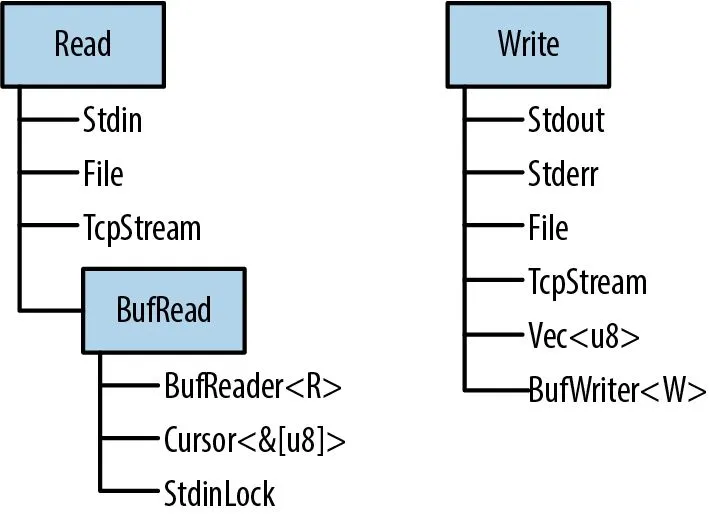
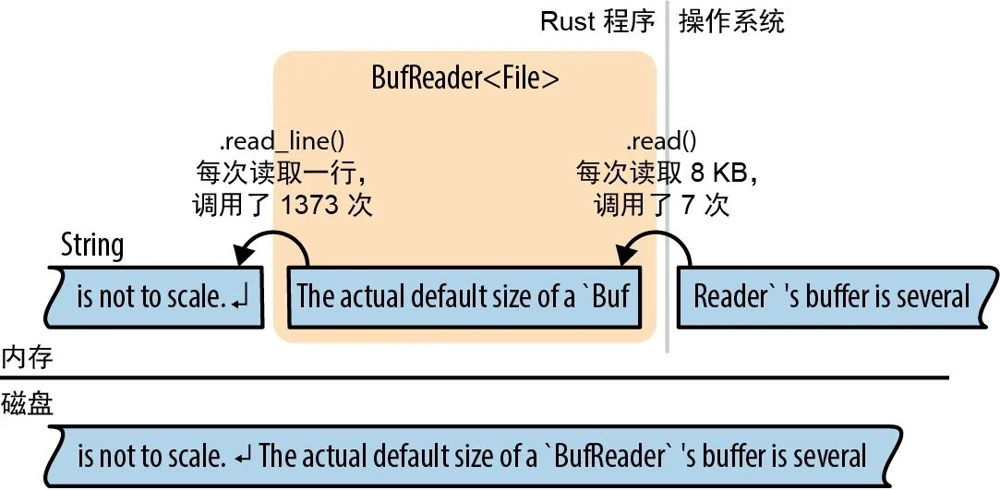

# 第18章输入与输出

- Doolittle：你有什么具体证据能证明你的存在？炸弹 -20：嗯……好吧……我思故我在。Doolittle：很好。非常好。但你又如何知道其他事物的存在呢？炸弹 -20：我的感官感受到了。——科幻喜剧《暗星》（Dark Star）

```
Rust 标准库中的输入和输出的特性是围绕 3 个特型组织的，即 Read、BufRead 和
Write。
实现了 Read 的值具有面向字节的输入方法。它们叫作读取器。
实现了 BufRead 的值是缓冲读取器。它们支持 Read 的所有方法，外加读取文本行等方
```

- 法。

```
实现了 Write 的值能支持面向字节和 UTF-8 文本的输出。它们叫作写入器。
```

图 18-1 展示了这 3 个特型以及几个读取器类型和写入器类型的示例。



- 图 18-1：Rust 的 3 个主要 I/O 特型和一些实现了它们的类型

在本章中，我们会讲解如何使用这些特型及其方法，涵盖了图 18-1 中所示的这些读取器类型和写入器类型，并展示了与文件、终端和网络进行交互的其他方式。

## 18.1　读取器与写入器

你的程序可以从读取器中读取一些字节。例如：

```
使用 std::fs::File::open(filename) 打开的文件；
std::net::TcpStream，用于通过网络接收数据；
std::io::stdin()，用于从进程的标准输入流中进行读取；
std::io::Cursor<&[u8]> 值和 std::io::Cursor<Vec<u8>> 值，它们是从已存在
```

- 于内存中的字节数组或向量中进行“读取”的读取器。

写入器则可以向其中写入一些字节。例如：

```
使用 std::fs::File::create(filename) 打开的文件；
std::net::TcpStream，用于通过网络发送数据；
std::io::stdout() 和 std::io:stderr()，用于写入到终端；
Vec<u8> 也是一个写入器，它的 write 方法会把内容追加到向量；
std::io::Cursor<Vec<u8>>，它与 Vec<u8> 很像，但允许读取数据和写入数据，并
```

- 能在向量中寻找不同的位置；

```
std::io::Cursor<&mut [u8]>，它与 std::io::Cursor<Vec<u8>> 很像，不过不
```

- 能增长缓冲区，因为它只是一些现有字节数组的切片。

```
由于读取器和写入器都有标准特型（std::io::Read 和 std::io::Write），因此编写适
```

用于各种输入通道或输出通道的泛型代码是很常见的。例如，下面是一个将所有字节从任意读取器复制到任意写入器的函数：

```javascript
use std::io::;
const DEFAULT_BUF_SIZE: usize = 8 * 1024;
pub fn copy<R: ?Sized, W: ?Sized>(reader: &mut R, writer: &mut W)
   -> io::Result<u64>
   where R: Read, W: Write
{
   let mut buf = [0; DEFAULT_BUF_SIZE];
   let mut written = 0;
   loop {
       let len = match reader.read(&mut buf) {
           Ok(0) => return Ok(written),
           Ok(len) => len,
           Err(ref e) if e.kind() == ErrorKind::Interrupted => continue,
           Err(e) => return Err(e),
       };
       writer.write_all(&buf[..len])?;
       written += len as u64;
   }
}
这是 Rust 标准库中 std::io::copy() 的实现。由于是泛型的，因此可以使用它将数据从
File 复制到 TcpStream，从标准输入复制到内存中的 Vec<u8>，等等。
如果对此处的错误处理代码不清楚，可以重温一下第 7 章。我们接下来还要不断使用 Result
```

类型，了解它的工作原理很重要。

```
std::io 的 Read、BufRead 和 Write 这 3 个特型以及 Seek 非常常用，下面是一个只包
含这些特型的 prelude 模块：
use std::io::prelude::*;
你会在本章中看到一两次这种写法。我们还习惯于导入 std::io 模块本身：
use std::io::;
此处的 self 关键字将 io 声明成了 std::io 模块的别名。这样，std::io::Result 和
std::io::Error 就可以更简洁地写为 io::Result 和 io::Error 了。
```

### 18.1.1　读取器

```
std::io::Read 有以下几个读取数据的方法。所有这些方法都需要对读取器本身进行可变
```

引用。

```
reader.read(&mut buffer)（读取）
从数据源中读取一些字节并将它们存储在给定的 buffer 中。buffer 参数的类型是
&mut[u8]。此方法最多会读取 buffer.len() 字节。
返回类型是 io::Result<u64>，它是 Result<u64, io::Error> 的类型别名。成功
时，这个 u64 的值是已读取的字节数——可能等于或小于 buffer.len()，就算数据源突然
涌入更多数据也不会超出。Ok(0) 则意味着没有更多输入可以读取了。
出错时，.read() 会返回 Err(err)，其中 err 是一个 io::Error 值。为了对人类友
好，io::Error 是可打印的；为了便于程序处理，它有一个 .kind() 方法，该方法会返回
io::ErrorKind 类型的错误代码。此枚举的成员都有 PermissionDenied 和
ConnectionReset 之类的名称。大多数表示严重的错误，不容忽视，但有一种错误需要特
殊处理。io::ErrorKind::Interrupted 对应于 Unix 错误码 EINTR，表示读取恰好被某
```

种信号中断了。除非程序的设计目标之一就是对信号中断做一些巧妙的处理，否则就应该再次

```
尝试读取。18.1 节中的 copy() 代码就展示了这种示例。
如你所见，.read() 方法是非常底层的，甚至还继承了底层操作系统的某些怪癖。如果你正
在为一种新型数据源实现 Read 特型，那么这会给你很大的发挥空间。但如果你想读取一些数
据，则会很痛苦。因此，Rust 提供了几个更高级的便捷方法。这些方法是 Read 中的默认实
现，而且都处理了 ErrorKind::Interrupted，这样你就不必自己处理了。
reader.read_to_end(&mut byte_vec)（读至末尾）
从这个读取器读取所有剩余的输入，将其追加到 Vec<u8> 型的 byte_vec 中。返回
io::Result<usize>，即已读取的字节数。
```

此方法对要装入向量中的数据量没有任何限制，因此不要在不受信任的来源上使用它。（可以

```
用接下来要讲的 .take() 方法加以限制。）
reader.read_to_string(&mut string)（读取字符串）
和上一个方法类似，但此方法会将数据附加到给定的 String。如果流不是有效的 UTF-8，则
返回 ErrorKind::InvalidData 错误。
```

在某些编程语言中，字节输入和字符输入是由不同的类型处理的。如今，UTF-8 占据了绝对主

```
导地位，所以 Rust 承认这一事实标准并且处处支持 UTF-8。开源的 encoding crate 可以支
```

持其他字符集。

```
reader.read_exact(&mut buf)（精确读满）
读取足够的数据来填充给定的缓冲区。参数类型是 &[u8]。如果读取器在读够 buf.len()
字节之前就耗尽了数据，那么此方法就会返回 ErrorKind::UnexpectedEof 错误。
以上这些是 Read 特型的主要方法。此外，还有 3 个适配器方法可以按值获取 reader，将
```

其转换为迭代器或另一种读取器。

```
reader.bytes()（字节迭代器）
返回输入流中各字节的迭代器。条目类型是 io::Result<u8>，因此每字节都需要进行错误
检查。此外，此方法会为每字节调用一次 reader.read()，如果没有缓冲，则会非常低
```

效。

```
reader.chain(reader2)（串联）
返回新的读取器，先生成来自 reader 的所有输入，然后再生成来自 reader2 的所有输入。
reader.take(n)（取出 n 个）
返回新的读取器，从与 reader 相同的数据源读取，但仅限于前 n 字节的输入。
没有关闭读取器的方法。读取器和写入器通常会实现 Drop 以便自行关闭。
```

### 18.1.2　缓冲读取器

为了提高效率，可以对读取器和写入器进行缓冲，这基本上意味着它们有一块内存（缓冲区），用于保存一些输入数据或输出数据。这可以减少一些系统调用，如图 18-2 所示。应用程

```
序会从 BufReader 中读取数据，在本例中是通过调用其 .read_line() 方法实现的。
BufReader 会依次从操作系统获取更大块的输入。
```



- 图 18-2：缓冲文件读取器

```
图 18-2 未按比例绘制。BufReader 缓冲区的实际大小默认为几千字节，因此一次 read 系
统调用就可以服务数百次 .read_line() 调用。这很重要，因为系统调用很慢。
```

（如图 18-2 所示，操作系统也有自己的缓冲区。同理：系统调用固然慢，但从磁盘读取数据更慢。）

```
缓冲读取器同时实现了 Read 特型和 BufRead 特型，后者添加了以下方法。
reader.read_line(&mut line)（读一行）
读取一行文本并将其追加到 line，line 是一个 String。行尾的换行符 '\n' 包含在
line 中。
如果输入带有 Windows 风格的行尾结束符号 "\r\n"，则这两个字符都会包含在 line 中。
返回值是 io::Result<usize>，表示已读取的字节数，包括行尾结束符号（如果有的话）。
如果读取器在输入的末尾，则会保持 line 不变并返回 Ok(0)。
reader.lines()（文本行迭代器）
返回生成各个输入行的迭代器。条目类型是 io::Result<String>。字符串中不包含换行
符。如果输入带有 Windows 风格的行尾结束符号 "\r\n"，则这两个字符都会被去掉。
```

在绝大多数场景中，这个方法足够你进行文本输入了。接下来的 18.1.3 节和 18.1.4 节展示了它的一些使用示例。

```
reader.read_until(stop_byte, &mut byte_vec)（读到 stop_byte 为止）和
reader.split(stop_byte)（根据 stop_byte 拆分）
与 .read_line() 和 .lines() 类似，但这两个方法是面向字节的，会生成 Vec<u8> 而
不是 String。你要自选分隔符 stop_byte。
BufRead 还提供了 .fill_buf() 和 .consume(n)，这是一对底层方法，用于直接访问读
```

取器的内部缓冲区。有关这两个方法的更多信息，请参阅在线文档。

接下来的 18.1.3 节和 18.1.4 节将更详细地介绍缓冲读取器。

### 18.1.3　读取行

```
下面是一个用于实现 Unix grep 实用程序的函数，该函数会在多行文本（通常是通过管道从
```

另一条命令输入的文本）中搜索给定字符串：

```javascript
use std::io;
use std::io::prelude::*;
fn grep(target: &str) -> io::Result<()> {
   let stdin = io::stdin();
   for line_result in stdin.lock().lines() {
       let line = line_result?;
       if line.contains(target) {
           println!("{}", line);
       }
   }
   Ok(())
}
因为要调用 .lines()，所以需要一个实现了 BufRead 的输入源。在这种情况下，可以调用
io::stdin() 来获取通过管道传输给我们的数据。但是，Rust 标准库使用互斥锁保护着
stdin。因此要调用 .lock() 来锁定 stdin 以供当前线程独占使用，这会返回一个实现了
BufRead 的 StdinLock 值。在循环结束时，StdinLock 会被丢弃，释放互斥锁。（如果没
有互斥锁，那么当两个线程试图同时从 stdin 读取时就会导致未定义行为。C 语言也有相同
```

的问题，且以相同的方式来解决：所有 C 标准输入函数和输出函数都会在幕后获得锁。唯一的不同在于，在 Rust 中，锁是 API 的一部分。）

```
该函数的其余部分都很简单：它会调用 .lines() 并对生成的迭代器进行循环。因为这个迭
代器会生成 Result 值，所以要用 ? 运算符检查错误。
假如我们想完善这个 grep 程序，让它支持在磁盘上搜索文件。可以把这个函数变成泛型函
```

数：

```bash
fn grep<R>(target: &str, reader: R) -> io::Result<()>
   where R: BufRead
{
   for line_result in reader.lines() {
       let line = line_result?;
       if line.contains(target) {
           println!("{}", line);
       }
   }
   Ok(())
}
现在可以将 StdinLock 或带缓冲的 File 传给它：
let stdin = io::stdin();
grep(&target, stdin.lock())?;  // 正确
let f = File::open(file)?;
grep(&target, BufReader::new(f))?;  // 同样正确
请注意，File 不会自动缓冲。File 实现了 Read 但没实现 BufRead。但是，为 File 或
任意无缓冲读取器创建缓冲读取器很容易。BufReader::new(reader) 就是做这个的。（要
设置缓冲区的大小，请使用 BufReader::with_capacity(size, reader)。）
```

在大多数语言中，文件默认是带缓冲的。如果想要无缓冲的输入或输出，就必须弄清楚如何关

```
闭缓冲。在 Rust 中，File 和 BufReader 是两个独立的库特性，因为有时你想要不带缓冲
```

的文件，有时你想要不带文件的缓冲（例如，你可能想要缓冲来自网络的输入）。

下面是一个包括错误处理和一些粗略的参数解析的完整程序。

```bash
// grep——搜索stdin或其他文件，以便用给定的字符串进行逐行匹配
use std::error::Error;
use std::io::;
use std::io::prelude::*;
use std::fs::File;
use std::path::PathBuf;
fn grep<R>(target: &str, reader: R) -> io::Result<()>
   where R: BufRead
{
   for line_result in reader.lines() {
       let line = line_result?;
       if line.contains(target) {
           println!("{}", line);
       }
   }
   Ok(())
}
fn grep_main() -> Result<(), Box<dyn Error>> {
   // 获取命令行参数。第一个参数是要搜索的字符串，其他参数是一些文件名
   let mut args = std::env::args().skip(1);
   let target = match args.next() {
       Some(s) => s,
       None => Err("usage: grep PATTERN FILE...")?
   };
   let files: Vec<PathBuf> = args.map(PathBuf::from).collect();
   if files.is_empty() {
       let stdin = io::stdin();
       grep(&target, stdin.lock())?;
   } else {
       for file in files {
           let f = File::open(file)?;
           grep(&target, BufReader::new(f))?;
       }
   }
   Ok(())
}
fn main() {
   let result = grep_main();
   if let Err(err) = result {
       eprintln!("{}", err);
       std::process::exit(1);
   }
}
```

### 18.1.4　收集行

```javascript
有些读取器方法（包括 .lines()）会返回生成 Result 值的迭代器。当你第一次想要将文
件的所有行都收集到一个大型向量中时，就会遇到如何摆脱 Result 的问题：
// 正确，但不是你想要的
let results: Vec<io::Result<String>> = reader.lines().collect();
// 错误：不能把Result的集合转换成Vec<String>
let lines: Vec<String> = reader.lines().collect();
第二次尝试无法编译：遇到这些错误怎么办？最直观的解决方法是编写一个 for 循环并检查
```

每个条目是否有错：

```javascript
let mut lines = vec![];
for line_result in reader.lines() {
   lines.push(line_result?);
}
这固然没错，但这里最好还是用 .collect()，事实上确实可以做到。只要知道该请求哪种
```

类型就可以了：

```javascript
let lines = reader.lines().collect::<io::Result<Vec<String>>>()?;
这是怎么做到的呢？标准库中包含了 Result 对 FromIterator 的实现（在线文档中这很容
```

易被忽略），这个实现让一切成为可能：

```
impl<T, E, C> FromIterator<Result<T, E>> for Result<C, E>
   where C: FromIterator<T>
{
   ...
}
这需要仔细阅读，但确实是一个很好的技巧。假设 C 是任意集合类型，比如 Vec 或
HashSet。只要已经知道如何从 T 值的迭代器构建出 C，就可以从生成 Result<T, E> 值
的迭代器构建出 Result<C, E>。只需从迭代器中提取各个值并从 Ok 结果构建出集合即
可，但一旦看到 Err，就停止并将其传出。
换句话说，io::Result<Vec<String>> 是一种集合类型，因此 .collect() 方法可以创
```

建并填充该类型的值。

### 18.1.5　写入器

如前所述，输入主要是用方法完成的，而输出略有不同。

```
本书一直在使用 println!() 生成纯文本输出：
println!("Hello, world!");
println!("The greatest common divisor of {:?} is {}",
        numbers, d);
println!();  // 打印空行
还有不会在行尾添加换行符的 print!() 宏，以及会写入标准错误流的 eprintln! 宏和
eprint! 宏。所有这些宏的格式化代码都和 format! 宏一样，17.4 节曾讲解过。
要将输出发送到写入器，请使用 write!() 宏和 writeln!() 宏。它们和 print!() 和
println!() 类似，但有两点区别：
writeln!(io::stderr(), "error: world not helloable")?;
writeln!(&mut byte_vec, "The greatest common divisor of {:?} is {}",
        numbers, d)?;
一是每个 write 宏都接受一个额外的写入器作为第一参数。二是它们会返回 Result，因此
必须处理错误。这就是为什么要在每行末尾使用 ? 运算符。
print 宏不会返回 Result，如果写入失败，它们只会 panic。由于写入的是终端，所以极少
```

失败。

```
Write 特型有以下几个方法。
writer.write(&buf)（写入）
将切片 buf 中的一些字节写入底层流。此方法会返回 io::Result<usize>。成功时，这给
出了已写入的字节数，如果流突然提前关闭，那么这个值可能会小于 buf.len()。
和 Reader::read() 一样，这是一个要避免直接使用的底层方法。
writer.write_all(&buf)（写入全部）
将切片 buf 中的所有字节都写入。返回 Result<()>。
writer.flush()（刷新缓冲区）
将可能被缓冲在内存中的数据刷新到底层流中。返回 Result<()>。
请注意，虽然 println! 宏和 eprintln! 宏会自动刷新 stdout 流和 stderr 流的缓冲
区，但 print! 宏和 eprint! 宏不会。使用它们时，可能要手动调用 flush()。
```

与读取器一样，写入器也会在被丢弃时自动关闭。

```javascript
正如 BufReader::new(reader) 会为任意读取器添加缓冲区一样，
BufWriter::new(writer) 也会为任意写入器添加缓冲区：
let file = File::create("tmp.txt")?;
let writer = BufWriter::new(file);
要设置缓冲区的大小，请使用 BufWriter::with_capacity(size, writer)。
当丢弃 BufWriter 时，所有剩余的缓冲数据都将写入底层写入器。但是，如果在此写入过程
中发生错误，则错误会被忽略。（由于错误发生在 BufWriter 的 .drop() 方法内部，因此
```

没有合适的地方来报告。）为了确保应用程序会注意到所有输出错误，请在丢弃带缓冲的写入

```
器之前将它手动 .flush() 一下。
```

### 18.1.6　文件

下面是本书已经介绍过的打开文件的两个方法。

```
File::open(filename)（打开）
打开现有文件进行读取。此方法会返回一个 io::Result<File>，如果该文件不存在则报
```

错。

```
File::create(filename)（创建）
```

创建一个用于写入的新文件。如果存在具有给定文件名的文件，则会将其截断。

```javascript
请注意，File 类型位于文件系统模块 std::fs 中，而不是 std::io 中。
当这两个方法都不符合需求时，可以使用 OpenOptions 来指定所期望的确切行为：
use std::fs::OpenOptions;
let log = OpenOptions::new()
   .append(true)  // 如果文件已存在，则追加到末尾
   .open("server.log")?;
let file = OpenOptions::new()
   .write(true)
   .create_new(true)  // 如果文件已存在，则失败
   .open("new_file.txt")?;
方法 .append()、.write()、.create_new() 等是可以链式调用的：每个方法都会返回
self。这种链式调用的设计模式很常见，所以在 Rust 中它有一个专门的名字——构建器
（builder）。另一个例子是 std::process::Command。有关 OpenOptions 的详细信息，
```

请参阅在线文档。

```
File 打开后的行为就和任何读取器或写入器一样。如果需要，可以为它添加缓冲区。File
```

在被丢弃时会自动关闭。

### 18.1.7　寻址

```
File 还实现了 Seek 特型，这意味着你可以在 File 中“跳来跳去”，而不是从头到尾一次性
读取或写入。Seek 的定义如下：
pub trait Seek {
   fn seek(&mut self, pos: SeekFrom) -> io::Result<u64>;
}
pub enum SeekFrom {
   Start(u64),
   End(i64),
   Current(i64)
}
```

```
此枚举让 seek 方法表现得很好：可以用 file.seek(SeekFrom::Start(0)) 倒回到开
头，还能用 file.seek(SeekFrom::Current(-8)) 回退几字节，等等。
```

在文件中寻址很慢。无论使用的是硬盘还是固态驱动器（SSD），每一次寻址的开销都接近于读取数兆字节的数据。

### 18.1.8　其他读取器与写入器类型

```
迄今为止，本章一直在使用 File 作为示范的主力，但还有许多其他有用的读取器类型和写入
```

器类型。

```
io::stdin()（标准输入）
返回标准输入流的读取器。类型是 io::Stdin。由于它被所有线程共享，因此每次读取都会
```

获取和释放互斥锁。

```
Stdin 有一个 .lock() 方法，该方法会获取互斥锁并返回 io::StdinLock，这是一个带
缓冲的读取器，在被丢弃之前会持有互斥锁。因此，对 StdinLock 的单个操作就避免了互斥
```

开销。18.1.3 节展示过使用此方法的示例代码。

- 1

```javascript
由于技术原因，不能直接调用 io::stdin().lock()
。这个锁持有对 Stdin 值的引用，
这意味着此 Stdin 值必须存储在某个能让它“活得”足够长的地方：
let stdin = io::stdin();
let lines = stdin.lock().lines();  // 正确
io::stdout()（标准输出）和 io::stderr()（标准错误）
返回标准输出流（Stdout）类型和标准错误流（Stderr）类型的写入器。它们也有互斥锁
和 .lock() 方法。
Vec<u8>（u8 向量）
实现了 Write。写入 Vec<u8> 会使用新数据扩展向量。
（但是，String 没有实现 Write。要使用 Write 构建字符串，需要首先写入 Vec<u8>，
然后使用 String::from_utf8(vec) 将向量转换为字符串。）
Cursor::new(buf)（新建）
创建一个 Cursor（游标，一个从 buf 读取数据的缓冲读取器）。这样你就创建了一个能读取
String 的读取器。参数 buf 可以是实现了 AsRef<[u8]> 的任意类型，因此也可以传递 &
[u8]、&str 或 Vec<u8>。
Cursor 的内部平平无奇，只有两个字段：buf 本身和一个整数，该整数是 buf 中下一次读
```

取开始的偏移量。此位置的初始值为 0。

```
Cursor 实现了 Read、BufRead 和 Seek。如果 buf 的类型是 &mut [u8] 或
Vec<u8>，那么 Cursor 也实现了 Write。写入游标会覆盖 buf 中从当前位置开始的字
节。如果试图直接写到超出 &mut [u8] 末尾的位置，就会导致一次“部分写入”或一个
io::Error。不过，使用游标写入 Vec<u8> 的结尾就没有这个问题：它会增长此向量。因
此，Cursor<&mut [u8]> 和 Cursor<Vec<u8>> 实现了所有这 4 个
std::io::prelude 特型。
std::net::TcpStream（Tcp 流）
```

表示 TCP 网络连接。由于 TCP 支持双向通信，因此它既是读取器又是写入器。

```
类型关联函数 TcpStream::connect(("hostname", PORT)) 会尝试连接到服务器并返
回 io::Result<TcpStream>。
std::process::Command（命令）
```

支持启动子进程并通过管道将数据传输到其标准输入，如下所示：

```javascript
use std::process::;
let mut child =
   Command::new("grep")
   .arg("-e")
   .arg("a.*e.*i.*o.*u")
   .stdin(Stdio::piped())
   .spawn()?;
let mut to_child = child.stdin.take().unwrap();
for word in my_words {
   writeln!(to_child, "{}", word)?;
}
drop(to_child);  // 关闭grep的stdin，以便让它退出
child.wait()?;
child.stdin 的类型是 Option<std::process::ChildStdin>，这里在建立子进程时
使用了 .stdin(Stdio::piped())，因此当 .spawn() 成功时，child.stdin 必然已经
就位。如果没提供，那么 child.stdin 就是 None。
Command 还有两个类似的方法 .stdout() 和 .stderr()，可用于请求 child.stdout
和 child.stderr 中的读取器。
std::io 模块还提供了一些返回普通读取器和写入器的函数。
io::sink()（地漏）
这是无操作写入器。所有的写入方法都会返回 Ok，但只是把数据扔掉了。
io::empty()（空白）
```

这是无操作读取器。读取总会成功，但只会返回“输入结束”（EOF）。

```
io::repeat(byte)（重复）
```

返回一个会无限重复给定字节的读取器。

### 18.1.9　二进制数据、压缩和序列化

```
许多开源 crate 建立在 std::io 框架之上，以提供额外的特性。
byteorder crate 提供了 ReadBytesExt 特型和 WriteBytesExt 特型，为所有读取器和
```

写入器添加了二进制输入和输出的方法：

```javascript
use byteorder::;
let n = reader.read_u32::<LittleEndian>()?;
writer.write_i64::<LittleEndian>(n as i64)?;
flate2 crate 提供了用于读取和写入 gzip 数据的适配器方法：
use flate2::read::GzDecoder;
let file = File::open("access.log.gz")?;
let mut gzip_reader = GzDecoder::new(file);
serde crate 及其关联的格式类 crate（如 serde_json）实现了序列化和反序列化：它们在
```

Rust 结构体和字节之间来回转换。11.2.2 节曾简单提到过这个 crate。现在可以仔细看看了。

```sql
假设我们有一些数据（文字冒险游戏中的映射表）存储在 HashMap 中：
type RoomId = String;                       // 每个房间都有唯一的名字
type RoomExits = Vec<(char, RoomId)>;       // ……并且存在一个出口列表
type RoomMap = HashMap<RoomId, RoomExits>;  // 房间名和出口的简单映射表
// 创建一个简单映射表
let mut map = RoomMap::new();
map.insert("Cobble Crawl".to_string(),
          vec![('W', "Debris Room".to_string())]);
map.insert("Debris Room".to_string(),
          vec![('E', "Cobble Crawl".to_string()),
               ('W', "Sloping Canyon".to_string())]);
...
```

将此数据转换为 JSON 输出只需一行代码：

```
serde_json::to_writer(&mut std::io::stdout(), &map)?;
在内部，serde_json::to_writer 使用了 serde::Serialize 特型的 serialize 方
法。该库会将 serde::Serialize 特型附加到所有它知道如何序列化的类型中，包括我们
的数据中出现过的类型：字符串、字符、元组、向量和 HashMap。
serde 很灵活。在这个程序中，输出是 JSON 数据，因为我们选择了 serde_json 序列化
器。其他格式（如 MessagePack）也有对应的序列化器支持。同样，可以将此输出发送到文
件、Vec<u8> 或任意写入器。前面的代码会将数据打印到 stdout。具体内容如下所示：
{"Debris Room":[["E","Cobble Crawl"],["W","Sloping Canyon"]],"Cobble Crawl":
[["W","Debris Room"]]}
serde 还包括对供派生的两个关键 serde 特型的支持：
#[derive(Serialize, Deserialize)]
struct Player {
   location: String,
   items: Vec<String>,
   health: u32
}
这里的 #[derive] 属性会让编译多花费一点儿时间，所以当你在 Cargo.toml 文件中将它列
为依赖项时，要明确要求 serde 支持它。下面是要用在上述代码中的内容：
[dependencies]
serde = { version = "1.0", features = ["derive"] }
serde_json = "1.0"
有关详细信息，请参阅 serde 文档。简而言之，构建系统会为 Player 自动生成
serde::Serialize 和 serde::Deserialize 的实现，因此序列化 Player 的值很简
```

单：

```
serde_json::to_writer(&mut std::io::stdout(), &player)?;
```

输出如下所示。

```json
{"location":"Cobble Crawl","items":["a wand"],"health":3}
```

## 18.2　文件与目录

前面已经展示了如何使用读取器和写入器，接下来的几节将介绍 Rust 用于处理文件和目录的

```
特性，这些特性位于 std::path 模块和 std::fs 模块中。所有这些特性都涉及使用文件
```

名，因此我们将从文件名类型开始。

### 18.2.1　OsStr 与 Path

麻烦的是，操作系统并不会强制要求其文件名是有效的 Unicode。下面是创建文本文件的两个Linux shell 命令。第一个使用了有效的 UTF-8 文件名，第二个则没有：

```
$ echo "hello world" > ô.txt
$ echo "O brave new world, that has such filenames in't" > $'\xf4'.txt
```

这两个命令都没有任何报错就通过了，因为 Linux 内核并不检查 UTF-8 的格式有效性。对内

```
核来说，任意字节串（除了 null 字节和斜杠）都是可接受的文件名。在 Windows 上的情况
```

类似：几乎任意 16 位“宽字符”字符串都是可接受的文件名，即使字符串不是有效的 UTF-16也可以。操作系统处理的其他字符串也是如此，比如命令行参数和环境变量。

Rust 字符串始终是有效的 Unicode。文件名在实践中几乎总是 Unicode，但 Rust 必须以某种

```
方式处理罕见的例外情况。这就是 Rust 会有 std::ffi::OsStr 和 OsString 的原因。
OsStr 是一种字符串类型，它是 UTF-8 的超集。OsStr 的任务是表示当前系统上的所有文
件名、命令行参数和环境变量，无论它们是不是有效的 Unicode。在 Unix 上，OsStr 可以保
存任意字节序列。在 Windows 上，OsStr 使用 UTF-8 的扩展格式存储，可以对任意 16 位值
```

序列（包括不符合标准的半代用区码点）进行编码。

```
所以我们有两种字符串类型：str 用于实际的 Unicode 字符串，而 OsStr 用于操作系统可能
抛出的任意文字。还有用于文件名的 std::path::Path，这纯粹是一个便捷名称。Path
与 OsStr 完全一样，只是添加了许多关于文件名的便捷方法，18.2.2 节会介绍这些方法。绝
对路径和相对路径都使用 Path 表示。对于路径中的单个组件，请使用 OsStr。
最后，每种字符串类型都有对应的拥有型版本：String 拥有分配在堆上的 str，
std::ffi:: OsString 拥有分配在堆上的 OsStr，而 std::path::PathBuf 拥有分配
在堆上的 Path。表 18-1 概述了每种类型的一些特性。
```

表 18-1：文件名类型

```
str
OsStr
Path
```

无固定大小类型，总是通过引用传递

- 是是是

可以包含任意 Unicode 文本

- 是是是

通常看起来和 UTF-8 一样

- 是是是

可以包含非 Unicode 数据

- 否是是

文本处理类方法

- 是否否

文件名相关方法

- 否否是

```
String
OsString
PathBu
```

拥有型、可增长且分配在堆上的等价类型

```
to string()
to os string()
to pa
```

转换为拥有型类型

```
所有这 3 种类型都实现了一个公共特型 AsRef<Path>，因此我们可以轻松地声明一个接受
```

“任意文件名类型”作为参数的泛型函数。这使用了 13.7 节中展示过的技巧：

```javascript
use std::path::Path;
use std::io;
fn swizzle_file<P>(path_arg: P) -> io::Result<()>
  where P: AsRef<Path>
{
  let path = path_arg.as_ref();
  ...
}
所有接受 path 参数的标准函数和方法都使用了这种技巧，因此可以直接将字符串字面量传给
```

它们中的任意一个。

### 18.2.2　Path 与 PathBuf 的方法

```javascript
Path 提供了以下方法。
Path::new(str)（新建）
将 &str 或 &OsStr 转换为 &Path。这不会复制字符串。新的 &Path 会指向与原始 &str
或 &OsStr 相同的字节。
use std::path::Path;
let home_dir = Path::new("/home/fwolfe");
（类似的方法 OsStr::new(str) 会将 &str 转换为 &OsStr。）
path.parent()（父目录）
返回路径的父目录（如果有的话）。返回类型是 Option<&Path>。
这不会复制路径。path 的父路径一定是 path 的子串。
assert_eq!(Path::new("/home/fwolfe/program.txt").parent(),
          Some(Path::new("/home/fwolfe")));
path.file_name()（文件名）
返回 path 的最后一个组件（如果有的话）。返回类型是 Option<&OsStr>。
典型情况下，path 由目录、斜杠和文件名组成，此方法会返回文件名。
```

```
use std::ffi::OsStr;
assert_eq!(Path::new("/home/fwolfe/program.txt").file_name(),
          Some(OsStr::new("program.txt")));
path.is_absolute()（是绝对路径？）和 path.is_relative()（是相对路径？）
```

这两个方法会指出文件是绝对路径（如 Unix 路径 /usr/bin/advent 或 Windows 路径C:\Program Files）还是相对路径（如 src/main.rs）。

```javascript
path1.join(path2)（联结）
联结两个路径，返回一个新的 PathBuf：
let path1 = Path::new("/usr/share/dict");
assert_eq!(path1.join("words"),
          Path::new("/usr/share/dict/words"));
如果 path2 本身是绝对路径，则只会返回 path2 的副本，因此该方法可用于将任意路径转
```

换为绝对路径。

```javascript
let abs_path = std::env::current_dir()?.join(any_path);
path.components()（组件迭代器）
```

返回从左到右访问给定路径各个组件的迭代器。这个迭代器的条目类型是

```
std::path::Component，这是一个枚举，可以代表所有可能出现在文件名中的不同部分：
```

```
pub enum Component<'a> {
   Prefix(PrefixComponent<'a>),  // 驱动器路径或共享路径（在Windows 上）
   RootDir,                      // 根目录，`/`或`\`
   CurDir,                       // 特殊目录`.`
   ParentDir,                    // 特殊目录`..`
   Normal(&'a OsStr)             // 普通文件或目录名
}
```

例如，Windows 路径 \\venice\Music\A Love Supreme\04-Psalm.mp3 包含一个表示

```
\\venice\Music 的 Prefix，后跟一个 RootDir，然后是表示 A Love Supreme 和 04-
Psalm.mp3 的两个 Normal 组件。
```

有关详细信息，请参阅在线文档。

```javascript
path.ancestors()（祖先迭代器）
返回一个从 path 开始一直遍历到根路径的迭代器。生成的每个条目也都是 Path：首先是
path 本身，然后是它的父级，接下来是它的祖父级，以此类推：
let file = Path::new("/home/jimb/calendars/calendar-18x18.pdf");
assert_eq!(file.ancestors().collect::<Vec<_>>(),
          vec![Path::new("/home/jimb/calendars/calendar-18x18.pdf"),
               Path::new("/home/jimb/calendars"),
               Path::new("/home/jimb"),
               Path::new("/home"),
               Path::new("/")]);
这就像在重复调用 parent 直到它返回 None。最后一个条目始终是根路径或前缀路径
（Prefix）。
这些方法只针对内存中的字符串进行操作。Path 也有一些能查询文件系统的方
法：.exists()、.is_file()、.is_dir()、.read_dir()、.canonicalize()
```

等。请参阅在线文档以了解更多信息。

```javascript
将 Path 转换为字符串有以下 3 个方法，每个方法都容许 Path 中存在无效 UTF-8。
path.to_str()（转字符串）
将 Path 转换为字符串，返回 Option<&str>。如果 path 不是有效的 UTF-8，则返回
None。
if let Some(file_str) = path.to_str() {
   println!("{}", file_str);
}  // ……否则就跳过这种名称古怪的文件
path.to_string_lossy()（转字符串，宽松版）
基本上和上一个方法一样，但该方法在任何情况下都会设法返回某种字符串。如果 path 不是
```


有效的 UTF-8，则该方法会制作一个副本，用 Unicode 代用字符

- 替代每个无

效的字节序列。

```
返回类型为 std::borrow::Cow<str>：借用或拥有的字符串。要从此值获取 String，请
使用其 .to_owned() 方法。（有关 Cow 的更多信息，请参阅 13.12 节。）
path.display()（转显示）
```

用于打印路径：

```
println!("Download found. You put it in: {}", dir_path.display());
此方法返回的值不是字符串，但它实现了 std::fmt::Display，因此可以与 format!
()、println!() 和类似的宏一起使用。如果路径不是有效的 UTF-8，则输出可能包含 ᓼ
```

字符。

### 18.2.3　访问文件系统的函数

```
表 18-2 展示了 std::fs 中的一些函数及其在 Unix 和 Windows 上的近乎等价方式。所有这
些函数都会返回 io::Result 值。除非另行说明，否则它们的返回值都是 Result<()>。
```

表 18-2：文件系统访问函数汇总表

- Rust 函数Unix

```bash
create_dir(path)
mkdir()
create_dir_all(path)
类似 mkdir -p
remove_dir(path)
rmdir()
```

创建和删除

```
remove_dir_all(path)
类似 rm -r
remove_file(path)
unlink()
copy(src_path, dest_path) ->
类似 cp -p
Result<u64>
rename()
```

复制、移动和链接

```bash
rename(src_path, dest_path)
link()
hard_link(src_path, dest_path)
canonicalize(path) -> Result<PathBuf>
realpath()
metadata(path) -> Result<Metadata>
stat()
symlink_metadata(path) ->
lstat()
```

检查

```bash
Result<Metadata>
opendir()
read_dir(path) -> Result<ReadDir>
readlink()
read_link(path) -> Result<PathBuf>
set_permissions(path, perm)
chmod()
```

权限

```
（copy() 返回的数值是已复制文件的大小，以字节为单位。要创建符号链接，请参阅 18.2.5
```

节。）

如你所见，Rust 会努力提供可移植的函数，这些函数可以在 Windows 以及 macOS、Linux和其他 Unix 系统上如预期般工作。

关于文件系统的完整教程超出了本书的范畴，如果你对这些函数中的任何一个感到好奇，可以轻松地在网上找到更多相关信息。18.2.4 节中会展示一些示例。

```
所有这些函数都是通过调用操作系统实现的。例如，std::fs::canonicalize(path) 不
仅会使用字符串处理来从给定的 path 中消除 . 和 ..，还会使用当前工作目录解析相对路
```

径，并追踪符号链接。如果路径不存在，则会报错。

```
std::fs::metadata(path) 和 std::fs::symlink_metadata(path) 生成的
Metadata 类型包含文件类型和大小、权限、时间戳等信息。同样，可以参阅在线文档了解
```

详细信息。

```
为便于使用，Path 类型将其中一些内置成了方法，比如，path.metadata() 和
std::fs::metadata(path) 是一样的。
```

### 18.2.4　读取目录

```javascript
要列出目录的内容，请使用 std::fs::read_dir 或 Path 中的等效方法 .read_dir()：
for entry_result in path.read_dir()? {
   let entry = entry_result?;
   println!("{}", entry.file_name().to_string_lossy());
}
注意，在这段代码中有两行用到了 ? 运算符。第 1 行检查了打开目录时的错误。第 2 行检查
```

了读取下一个条目时的错误。

```
entry 的类型是 std::fs::DirEntry，这个结构体提供了数个方法。
```

```
entry.file_name()（文件名）
文件或目录的名称，是 OsString 类型的。
entry.path()（路径）
与 entry.file_name() 基本相同，但 entry.path() 联结了原始路径，生成了一个新的
PathBuf。如果正在列出的目录是 "/home/jimb"，并且 entry.file_name() 是
".emacs"，那么 entry.path() 将返回 PathBuf::from("/home/jimb/.emacs").
entry.file_type()（文件类型）
返回 io::Result<FileType>。FileType 有 .is_file() 方法、.is_dir() 方法和
.is_symlink() 方法。
entry.metadata()（元数据）
```

获取有关此条目的其他元数据。

```
特殊目录 . 和 .. 在读取目录时不会列出。
```

下面是一个更接近现实的例子。以下代码会递归地将目录树从磁盘上的一个位置复制到另一个位置。

```javascript
use std::fs;
use std::io;
use std::path::Path;
/// 把现有目录`src`复制到目标路径`dst`
fn copy_dir_to(src: &Path, dst: &Path) -> io::Result<()> {
   if !dst.is_dir() {
       fs::create_dir(dst)?;
   }
   for entry_result in src.read_dir()? {
       let entry = entry_result?;
       let file_type = entry.file_type()?;
       copy_to(&entry.path(), &file_type, &dst.join(entry.file_name()))?;
   }
   Ok(())
}
独立的 copy_to 函数用于复制单个目录条目。
/// 把`src`中的任何内容复制到目标路径`dst`
fn copy_to(src: &Path, src_type: &fs::FileType, dst: &Path)
   -> io::Result<()>
{
   if src_type.is_file() {
       fs::copy(src, dst)?;
   } else if src_type.is_dir() {
       copy_dir_to(src, dst)?;
   } else {
       return Err(io::Error::new(io::ErrorKind::Other,
                                 format!("don't know how to copy: {}",
                                         src.display())));
   }
   Ok(())
}
```

### 18.2.5　特定于平台的特性

```
到目前为止，copy_to 函数既可以复制文件也可以复制目录。接下来我们还打算在 Unix 上支
```

持符号链接。

没有可移植的方法来创建同时适用于 Unix 和 Windows 的符号链接，但标准库提供了一个特定

```
于 Unix 的 symlink 函数：
use std::os::unix::fs::symlink;
有了这个函数，我们的工作就很容易了。只需向 copy_to 中的 if 表达式添加一个分支即
```

可：

```javascript
...
} else if src_type.is_symlink() {
   let target = src.read_link()?;
   symlink(target, dst)?;
...
```

如果只是为 Unix 系统（如 Linux 和 macOS）编译我们的程序，那么就能这么用。

```
std::os 模块包含各种特定于平台的特性，比如 symlink。std::os 在标准库中的实际主
```

体如下所示（这里为了看起来整齐，调整了代码格式）：

```
//! 特定于操作系统的功能
#[cfg(unix)]                    pub mod unix;
#[cfg(windows)]                 pub mod windows;
#[cfg(target_os = "ios")]       pub mod ios;
#[cfg(target_os = "linux")]     pub mod linux;
#[cfg(target_os = "macos")]     pub mod macos;
...
#[cfg] 属性表示条件编译：这些模块中的每一个仅在某些平台上存在。这就是为什么使用
std::os::unix 修改后的程序只能针对 Unix 成功编译，因为在其他平台上
std::os::unix 不存在。
如果希望代码在所有平台上编译，并支持 Unix 上的符号链接，则必须也在程序中使用 #
[cfg]。在这种情况下，最简单的方法是在 Unix 上导入 symlink，同时在其他系统上定义
自己的 symlink 模拟实现：
```

```
#[cfg(unix)]
use std::os::unix::fs::symlink;
/// 在未提供`symlink`的平台上提供的模拟实现
#[cfg(not(unix))]
fn symlink<P: AsRef<Path>, Q: AsRef<Path>>(src: P, _dst: Q)
   -> std::io::Result<()>
{
   Err(io::Error::new(io::ErrorKind::Other,
                      format!("can't copy symbolic link: {}",
                              src.as_ref().display())))
}
事实上，symlink 只是特殊情况。大多数特定于 Unix 的特性不是独立函数，而是将新方法添
加到标准库类型的扩展特型（11.2.2 节介绍过扩展特型）。prelude 模块可用于同时启用所有
```

这些扩展：

```
use std::os::unix::prelude::*;
例如，在 Unix 上，这会向 std::fs::Permissions 添加 .mode() 方法，从而支持表达
Unix 权限所需的底层 u32 值。同样，这还会给 std::fs::Metadata 添加一些访问器方
法，从而得以访问底层 struct stat 的字段（比如 .uid() 可获得文件所有者的用户 ID）
为 std::fs::Metadata 添加了访问器。
总而言之，std::os 中的内容非常基础。更多特定于平台的功能可通过第三方 crate 获得，
比如用于访问 Windows 注册表的 winreg。
```

## 18.3　网络

关于网络的教程远远超出了本书的范畴。但是，如果你已经对网络编程有所了解，那么本节能帮你开始使用 Rust 中的网络支持。

```
要编写较底层的网络代码，可以使用 std::net 模块，该模块为 TCP 网络和 UDP 网络提供
了跨平台支持。可以使用 native_tls crate 来支持 SSL/TLS。
```

这些模块为网络上直接的、阻塞型的输入和输出提供了一些基础构件。用几行代码就可以编写

```
一个简单的服务器，只要使用 std::net 并为每个连接启动一个线程即可。例如，下面是一
```

个“回显”（echo）服务器：

```bash
use std::net::TcpListener;
use std::io;
use std::thread::spawn;
/// 不断接受连接，为每个连接启动一个线程
fn echo_main(addr: &str) -> io::Result<()> {
   let listener = TcpListener::bind(addr)?;
   println!("listening on {}", addr);
   loop {
       // 等待客户端连入
       let (mut stream, addr) = listener.accept()?;
       println!("connection received from {}", addr);
       // 启动一个线程来处理此客户端
       let mut write_stream = stream.try_clone()?;
       spawn(move || {
           // 回显从`stream`中收到的一切
           io::copy(&mut stream, &mut write_stream)
               .expect("error in client thread: ");
           println!("connection closed");
       });
   }
}
fn main() {
   echo_main("127.0.0.1:17007").expect("error: ");
}
```

回显服务器会简单地重复发给它的所有内容。这种代码与用 Java 或 Python 编写的代码没有

```
太大区别。（第 19 章会介绍 std::thread::spawn()。）
```

但是，对于高性能服务器，需要使用异步输入和输出。第 20 章会介绍 Rust 对异步编程的支持，并展示网络客户端和服务器的完整代码。

```javascript
更高层级的协议由第三方 crate 提供支持。例如，reqwest crate 为 HTTP 客户端提供了一个
漂亮的 API。下面是一个完整的命令行程序，该程序可以通过 http: 或 https: URL 获取对
应文档，并将其内容打印到你的终端。此代码是使用 reqwest = "0.11" 编写的，并启用
了其 "blocking" 特性。reqwest 还提供了一个异步接口。
use std::error::Error;
use std::io;
fn http_get_main(url: &str) -> Result<(), Box<dyn Error>> {
   // 发送HTTP请求并获取响应
   let mut response = reqwest::blocking::get(url)?;
   if !response.status().is_success() {
       Err(format!("{}", response.status()))?;
   }
   // 读取响应体并写到标准输出
   let stdout = io::stdout();
   io::copy(&mut response, &mut stdout.lock())?;
   Ok(())
}
fn main() {
   let args: Vec<String> = std::env::args().collect();
   if args.len() != 2 {
       eprintln!("usage: http-get URL");
       return;
   }
   if let Err(err) = http_get_main(&args[1]) {
       eprintln!("error: {}", err);
   }
}
actix-web 框架为 HTTP 服务器提供了一些高层次抽象，比如 Service 特型和
Transform 特型，这两个特型可以帮助你从一些可插接部件组合出应用程序。websocket
```

crate 实现了 WebSocket 协议。Rust 是一门年轻的语言，拥有繁荣的开源生态系统，对网络的支持正在迅速扩展。

[1]：从 Rust 1.8 开始，已经可以直接调用 了。——译者注
