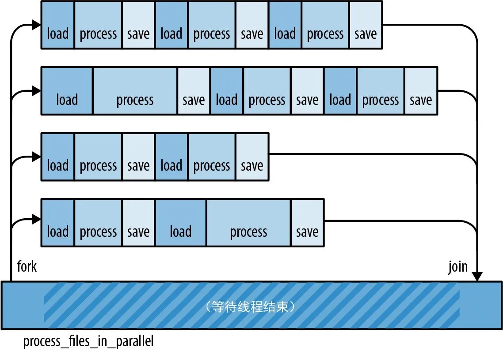
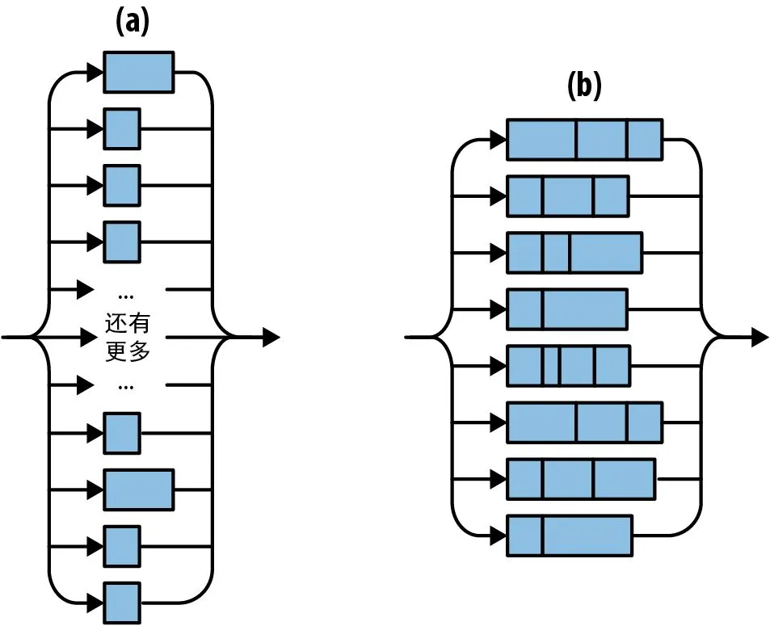
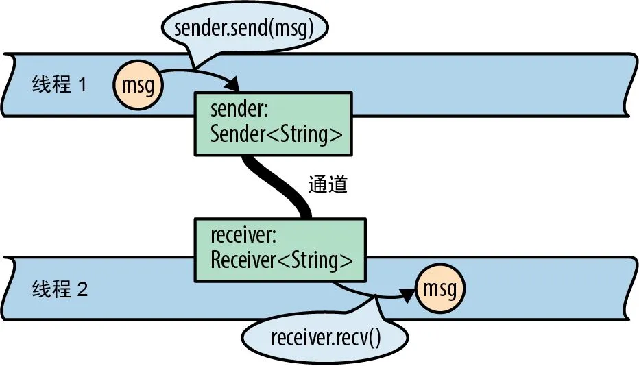
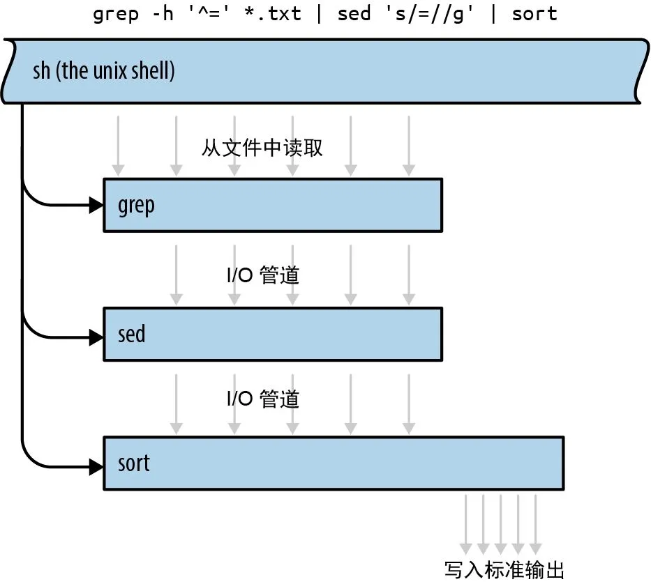
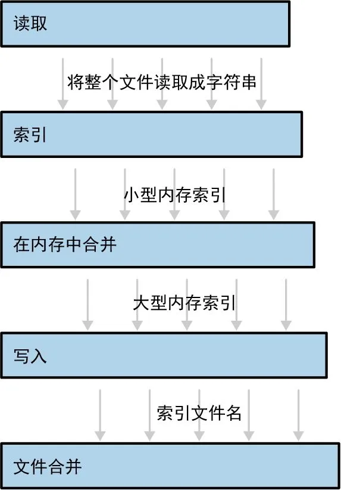
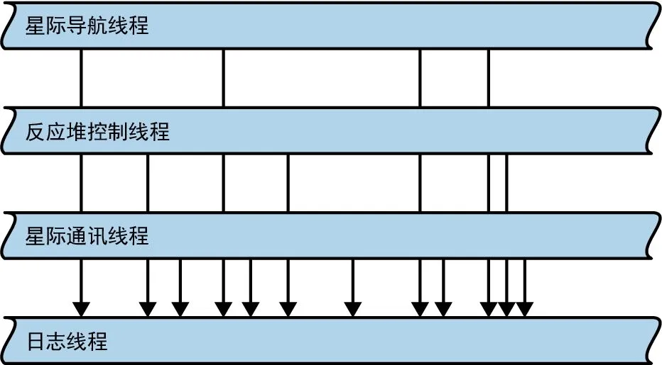
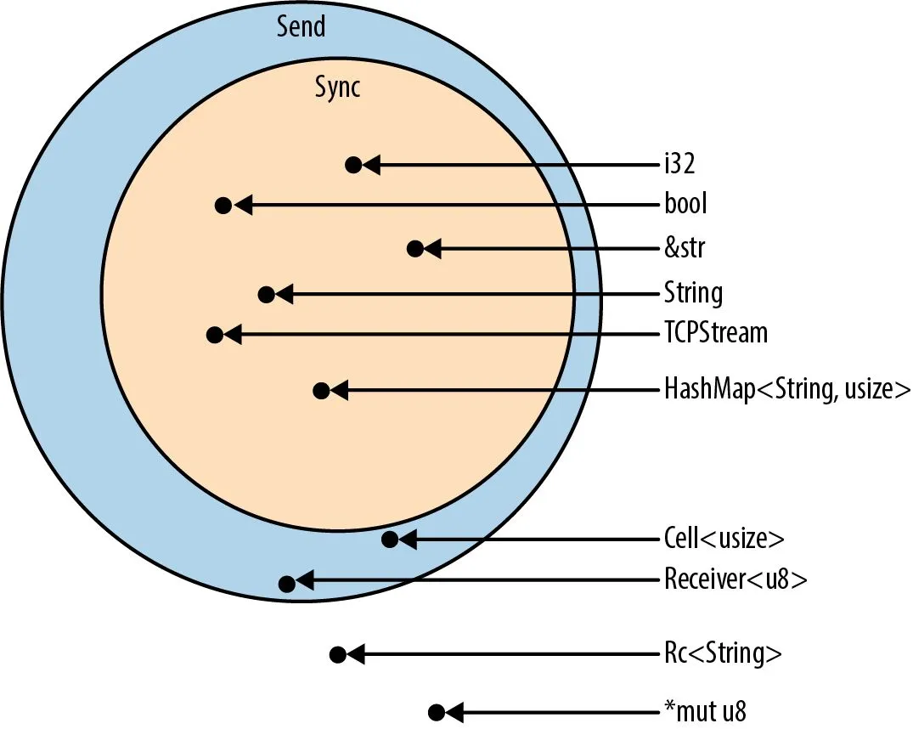
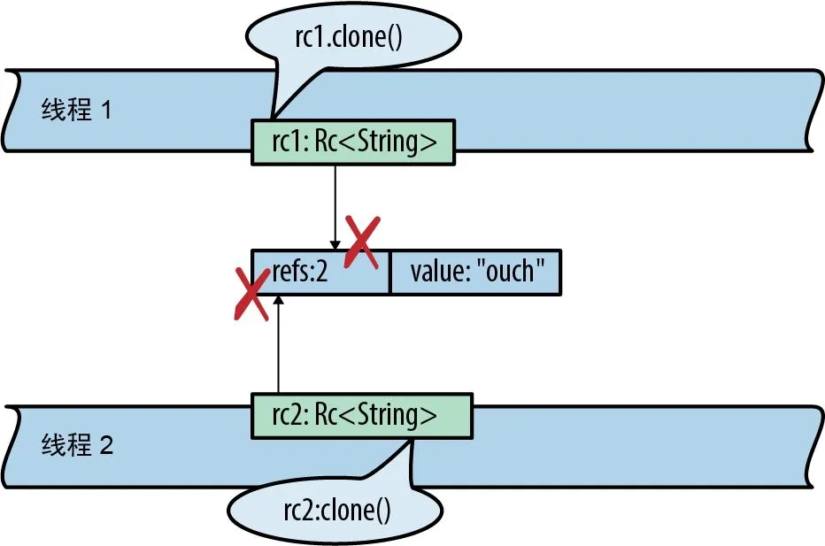

# 第19章并发(1)

- 长远看来，不建议使用面向机器的语言编写大型并发程序，因为面向机器的语言允许不受限制地使用存储位置及其地址。这就意味着，即使借助复杂的硬件机制，我们也根本没有能力确保程序的可靠性。——Per Brinch Hansen（1977 年）

- “通信”的模式就是“并行”的模式。——Whit Morriss

如果你看待并发的态度在职业生涯中发生过变化，那你并不是特例。这种现象太常见了。

起初，编写并发代码看起来既简单又有趣。线程、锁、队列等工具很容易上手，固然其中也有很多陷阱，但幸运的是我们知道都有哪些陷阱，并且多加小心就不会出错。

我们总有不得不调试其他人的多线程代码的情况，这时候，你只能得出以下结论：某些人确实不适合使用这些工具。

但迟早，你不得不调试自己的多线程代码。

过去的教训告诉你，如果还没有对多线程技术彻底失望，那么至少也应该对所有多线程代码保持适度的警惕。你偶尔会碰上几篇文章详细解释为什么一些看似正确的多线程惯用法却根本不起作用（与“内存模型”有关），这又进一步强化了这种警惕。但是，你最终会找到一种自己用起来顺手且不会经常出错的并发惯用法。你会把几乎所有经验都塞进那个惯用法中，并且，如果你真的很厉害，那么还能对凭空增加的复杂性说“不”。

当然，还有很多惯用法。系统程序员常用的方法包括以下几种。

- 具有单一作业的后台线程，需要定期唤醒执行作业。

- 通过任务队列与客户端通信的通用工作池。

- 管道，数据在其中从一个线程流向下一个线程，每个线程只负责一部分工作。

- 数据并行处理，假设（无论对错）整个计算机只进行一次主要的大型计算，将这次计算分成n 个部分且在 n 个线程上运行，并期望机器的所有 n 个核心都能立即开始工作。

- 同步复杂对象关系，其中多个线程可以访问相同的数据，并且使用基于互斥锁等底层原语的临时加锁方案避免了竞争。（Java 内置了对此模型的支持，它曾在 20 世纪 90 年代和 21 世纪初非常流行。）

- 原子化整数操作允许多个核心借助一个机器字大小的字段传递信息来进行通信。（这种惯用法比其他所有方法更难正确使用，除非要交换的数据恰好是整数值，但实际上，数据通常是指针。）

随着时间的推移，你已经对其中的几种方法非常娴熟，还能彼此相安无事地组合使用它们——简直就是艺术大师！如果其他人不会以任何方式修改你的系统，那么就能岁月静好——然而，尽管这些程序可以很好地利用线程，但其中充满了“潜规则”。

Rust 提供了一种更好的并发处理方式，不是强制所有程序采用单一风格（对系统程序员来说这可算不上什么解决方案），而是安全地支持多种风格。通过代码把“潜规则”写出来并由编译器强制执行。

你可能听说过 Rust 能让你编写安全、快速、并发的程序。本章将向你展示它是如何做到的。我们将介绍 3 种使用 Rust 线程的方法。

- 分叉与合并（fork-join）并行

- 通道

- 共享可变状态

在此过程中，你会用上迄今为止学过的有关 Rust 语言的所有知识。Rust 对引用、可变性和生命周期的处理方式在单线程程序中已经足够有价值了，但在并发编程中，这些规则的意义才开始真正显现。它们会扩展你的工具箱，让快速而正确地编写各种风格的多线程代码成为可能——不再怀疑，不再愤世嫉俗，不再恐惧。

## 19.1　分叉与合并并行

当我们有几个完全独立的任务想要同时完成时，线程最简单的用例就出现了。

假设我们正在对大量文档进行自然语言处理。可以写这样一个循环：

```javascript
fn process_files(filenames: Vec<String>) -> io::Result<()> {
   for document in filenames {
       let text = load(&document)?;  // 读取源文件
       let results = process(text);  // 计算统计信息
       save(&document, results)?;    // 写入输出文件
   }
   Ok(())
}
```

图 19-1 展示了这个程序的执行过程。


```
图 19-1：process_files() 的单线程执行
```

由于每个文档都是单独处理的，因此要想加快任务处理速度，可以将语料库分成多个块并在单独的线程上处理每个块，如图 19-2 所示。



- 图 19-2：使用分叉与合并方法的多线程文件处理

这种模式称为分叉与合并并行。fork（分叉）是启动一个新线程，join（合并）是等待线程完成。我们已经见过这种技术：第 2 章中曾用它来加速曼德博程序。

出于以下几个原因，分叉与合并并行很有吸引力。

- 非常简单。分叉与合并很容易实现，在 Rust 中更不容易写错。

- 避免了瓶颈。分叉与合并中没有对共享资源的锁定。任何线程只会在最后一步才不得不等待另一个线程。同时，每个线程都可以自由运行。这有助于降低任务切换开销。

- 这种模式在性能方面的数学模型对程序员来说比较直观。在最好的情况下，通过启动 4 个线程，我们只花 1/4 的时间就能完成原本的工作。图 19-2 展示了不应该期望这种理想加速的一个原因：我们可能无法在所有线程之间平均分配工作。另一个需要注意的原因是，有时分叉与合并程序必须在线程联结后花费一些时间来组合各线程的计算结果。也就是说，完全

- 隔离这些任务可能会产生一些额外的工作。不过，除了这两个原因，任何具有独立工作单元的 CPU 密集型程序都可以获得显著的性能提升。

- 很容易推断出程序是否正确。只要线程真正隔离了，分叉与合并程序就是确定性的，就像曼德博程序中的计算线程一样。无论线程速度如何变化，程序总会生成相同的结果。这是一个没有竞态条件的并发模型。

分叉与合并的主要缺点是要求工作单元彼此隔离。本章在后面会考虑一些无法完全隔离的问题。

现在，继续以自然语言处理为例。我们将展示几种将分叉与合并模式应用于

```
process_files 函数的方法。
```

### 19.1.1　启动与联结

```
函数 std::thread::spawn 会启动一个新线程：
use std::thread;
thread::spawn(|| {
   println!("hello from a child thread");
});
它会接受一个参数，即一个 FnOnce 闭包或函数型的参数。Rust 会启动一个新线程来运行该
```

闭包或函数的代码。新线程是一个真正的操作系统线程，有自己的栈，就像 C++、C#、Java中的线程一样。

```javascript
下面是一个更实际的例子，它使用 spawn 实现了之前的 process_files 函数的并行版本：
use std::;
fn process_files_in_parallel(filenames: Vec<String>) -> io::Result<()> {
   // 把工作拆分成几块
   const NTHREADS: usize = 8;
   let worklists = split_vec_into_chunks(filenames, NTHREADS);
   // 分叉：启动一个线程来处理每一个块
   let mut thread_handles = vec![];
   for worklist in worklists {
       thread_handles.push(
           thread::spawn(move || process_files(worklist))
       );
   }
   // 联结：等待所有线程结束
   for handle in thread_handles {
       handle.join().unwrap()?;
   }
   Ok(())
}
```

下面来逐行分析一下这个函数。

```
fn process_files_in_parallel(filenames: Vec<String>) -> io::Result<()> {
我们的新函数与原始 process_files 具有相同的类型签名，这样它就是一个方便的无缝替
```

代品了。

```javascript
   // 把工作拆分成几块
   const NTHREADS: usize = 8;
   let worklists = split_vec_into_chunks(filenames, NTHREADS);
我们使用了尚未展示过的实用函数 split_vec_into_chunks 来拆分工作。它的返回值
worklists 是由向量组成的向量，其中包含从原始向量 filenames 中均分出来的 8 个部
```

分。

```javascript
   // 分叉：启动一个线程来处理每一个块
   let mut thread_handles = vec![];
   for worklist in worklists {
       thread_handles.push(
           thread::spawn(move || process_files(worklist))
       );
   }
我们会为每个 worklist 启动一个线程。spawn() 会返回一个名为 JoinHandle 的值，稍
后会用到。现在，先将所有 JoinHandle 放入一个向量中。
```

请注意我们是如何将文件名列表放入工作线程的。

```
在父线程中，通过 for 循环来定义和填充 worklist。
一旦创建了 move 闭包，worklist 就会被移动到此闭包中。
然后 spawn 会将闭包（内含 worklist 向量）转移给新的子线程。
这些操作开销很低。就像第 4 章中讨论过的 Vec<String> 移动一样，String 没有被克
隆。事实上，这个过程中并没有发生任何分配和释放。唯一移动的数据是 Vec 本身，只有 3
```

个机器字。

我们创建的每个线程几乎都需要代码和数据才能启动。Rust 闭包可以方便地包含我们想要的任何代码和数据。

继续看下面的代码：

```
   // 联结：等待所有线程结束
   for handle in thread_handles {
       handle.join().unwrap()?;
   }
我们使用之前收集的 JoinHandle 的 .join() 方法来等待所有 8 个线程完成。联结这些线
程对于保证程序的正确性是必要的，因为 Rust 程序会在 main 返回后立即退出，即使其他线
```

程仍在运行。这些线程并不会调用析构器，而是直接被“杀死”了。如果这不是你想要的结果，

```
请确保在从 main 返回之前联结了任何你关心的线程。
```

如果我们通过了这个循环，则意味着所有 8 个子线程都成功完成了。因此，该函数会以返回

```
Ok(()) 结束。
   Ok(())
}
```

### 19.1.2　跨线程错误处理

由于要做错误处理，我们在示例中用于联结子线程的代码比看起来更棘手。再重温一下那行代码：

```
handle.join().unwrap()?;
.join() 方法为我们做了两件事。
首先，handle.join() 会返回 std::thread::Result，如果子线程出现了 panic，就返
```

回一个错误（Err）。这使得 Rust 中的线程比 C++ 中的线程更加健壮。在 C++ 中，越界数组访问是未定义行为，并且无法保护系统的其余部分免受后果的影响。在 Rust 中，panic 是安全且局限于每个线程的。线程之间的边界充当着 panic 的防火墙，panic 不会自动从一个线程传播到依赖它的其他线程。相反，一个线程中的 panic 在其他线程中会报告为错误型

```
Result。程序整体而言很容易恢复。
不过，在本程序中，我们不会尝试任何花哨的 panic 处理，而是会立即在 Result 上使用
.unwrap()，断言它是一个 Ok 结果而不是 Err 结果。如果一个子线程确实发生了 panic，
```

那么这个断言就会失败，所以父线程也会出现 panic。如此一来，我们就显式地将 panic 从子线程传播到了父线程。

```
其次，handle.join() 会将子线程的返回值传回父线程。我们传给 spawn 的闭包的返回类
型是 io::Result<()>，因为它就是 process_files 返回值的类型。此返回值不会被丢
弃。当子线程完成时，它的返回值会被保存下来，并且 JoinHandle::join() 会把该值传
```

回父线程。

```
在这个程序中，handle.join() 返回的完整类型是
std::thread::Result<std::io::Result<()>>。thread::Result 是 spawn/
joinAPI 的一部分，而 io::Result 是我们的应用程序的一部分。
在这个例子中，展开（unwrap）thread::Result 之后，我们就用 io::Result 上的 ? 运
```

算符显式地将 I/O 错误从子线程传播到了父线程。

所有这些看起来可能相当琐碎。但如果只把它当作一行代码，则可以与别的语言对比一下。Java 和 C# 中的默认行为是子线程中的异常会转储到终端，然后被遗忘。在 C++ 中，默认行

```
为是中止进程。在 Rust 中，错误是 Result 值（数据）而不是异常（控制流）。它们会像其
```

他值一样跨线程传递。每当你使用底层线程 API 时，最终都必须仔细编写错误处理代码，但如

```
果不得不编写错误处理代码，那么 Result 是非常合适的选择。
```

### 19.1.3　跨线程共享不可变数据

假设我们正在进行的分析需要一个大型的英语单词和短语的数据库：

```
// 之前
fn process_files(filenames: Vec<String>)
// 之后
fn process_files(filenames: Vec<String>, glossary: &GigabyteMap)
```

```
这个 glossary 会很大，所以要通过引用传递它。该如何修改
process_files_in_parallel 以便将词汇表传给工作线程呢？
```

想当然的改法是不行的：

```
fn process_files_in_parallel(filenames: Vec<String>,
                            glossary: &GigabyteMap)
   -> io::Result<()>
{
   ...
   for worklist in worklists {
       thread_handles.push(
           spawn(move || process_files(worklist, glossary))  // 错误
       );
   }
   ...
}
我们只给此函数添加了一个 glossary 参数并将其传给 process_files。Rust 报错说：
error: explicit lifetime required in the type of `glossary`
  |
38 |             spawn(move || process_files(worklist, glossary))  // 错误
  |             ^^^^^ lifetime `'static` required
Rust 对传给 spawn 的闭包的生命周期报了错，而编译器在此处显示的“有用”消息实际上根本
```

没有帮助。

```
spawn 会启动独立线程。Rust 无法知道子线程要运行多长时间，因此它假设了最坏的情况：
```

即使在父线程完成并且父线程中的所有值都消失后，子线程仍可能继续运行。显然，如果子线程要持续那么久，那么它运行的闭包也需要持续那么久。但是这个闭包有一个有限的生命周

```
期，它依赖于 glossary 引用，而此引用不需要永久存在。
```

请注意，Rust 拒绝编译此代码是对的。按照我们编写这个函数的方式，一个线程确实有可能

```
遇到 I/O 错误，导致 process_files_in_parallel 在其他线程完成之前退出。在主线程
```

释放词汇表后，子线程可能仍然会试图使用词汇表。这将是一场竞赛，如果主线程获胜，就会赢得“未定义行为”这份大奖。而 Rust 不允许发生这种事。

```
spawn 似乎过于开放了，无法支持跨线程共享引用。事实上，我们已经在 14.1.2 节中看到过
这样的情况。那时候，解决方案是用 move 闭包将数据的所有权转移给新线程。但在这里行不
```

通，因为有许多线程要使用同一份数据。一种安全的替代方案是为每个线程都克隆整个词汇表，但由于词汇表很大，我们不希望这么做。幸运的是，标准库提供了另一种方式：原子化引用计数。

```javascript
4.4 节介绍过 Arc。是时候使用它了：
use std::sync::Arc;
fn process_files_in_parallel(filenames: Vec<String>,
                            glossary: Arc<GigabyteMap>)
   -> io::Result<()>
{
   ...
   for worklist in worklists {
       // 对.clone()的调用只会克隆Arc并增加引用计数，并不会克隆GigabyteMap
       let glossary_for_child = glossary.clone();
       thread_handles.push(
           spawn(move || process_files(worklist, &glossary_for_child))
       );
   }
   ...
}
我们更改了 glossary 的类型：要执行并行分析，调用者就必须传入
Arc<GigabyteMap>，这是指向已使用 Arc::new(giga_map) 移入堆中的
GigabyteMap 的智能指针。
```

```
调用 glossary.clone() 时，我们是在复制 Arc 智能指针而不是整个 GigabyteMap。这
```

相当于增加一次引用计数。

通过此项更改，程序可以编译并运行了，因为它不再依赖于引用的生命周期。只要任何线程拥

```
有 Arc<GigabyteMap>，它就会让 GigabyteMap 保持存活状态，即使父线程提前退出也
没问题。不会有任何数据竞争，因为 Arc 中的数据是不可变的。
```

### 19.1.4　rayon

```
标准库的 spawn 函数是一个重要的基础构件，但它并不是专门为分叉与合并的并行而设计
```

的，基于它，我们可以封装出更好的分叉与合并式 API。例如，在第 2 章中，我们使用

```
crossbeam 库将一些工作拆分为 8 个线程。crossbeam 的作用域线程能非常自然地支持分
```

叉与合并并行。

- 1

```
由 Niko Matsakis 和 Josh Stone 设计的 rayon
```

- 库是另一个例子。它提供了两种运行并发任

务的方式：

```javascript
use rayon::prelude::*;
// “并行做两件事”
let (v1, v2) = rayon::join(fn1, fn2);
// “并行做N件事”
giant_vector.par_iter().for_each(|value| {
   do_thing_with_value(value);
});
rayon::join(fn1, fn2) 只是调用这两个函数并返回两个结果。.par_iter() 方法会创
建 ParallelIterator，这是一个带有 map、filter 和其他方法的值，很像 Rust 的
Iterator。在这两种情况下，rayon 都会用自己的工作线程池来尽可能拆分工作。只要告
诉 rayon 哪些任务可以并行完成就可以了，rayon 会管理这些线程并尽其所能地分派工作。
```

```
图 19-3 展示了对 giant_vector.par_iter().for_each(...) 调用的两种思考方式。
(a) rayon 表现得就好像它为向量中的每个元素启动了一个线程。(b) 在幕后，rayon 在每个
```

CPU 核心上都有一个工作线程，这样效率更高。这个工作线程池由程序中的所有线程共享。

```
当成千上万个任务同时进来时，rayon 会拆分这些工作。
```



```
图 19-3：理论上与实践中的 rayon
下面是一个使用 rayon 的 process_files_in_parallel 版本和一个接受
Vec<String> 型而非 &str 型参数的 process_file：
use rayon::prelude::*;
fn process_files_in_parallel(filenames: Vec<String>, glossary: &GigabyteMap)
   -> io::Result<()>
{
   filenames.par_iter()
       .map(|filename| process_file(filename, glossary))
       .reduce_with(|r1, r2| {
           if r1.is_err() { r1 } else { r2 }
       })
       .unwrap_or(Ok(()))
}
比起使用 std::thread::spawn 的版本，这段代码更简短，也不需要很多技巧。我们一行
```

一行地看。

```
首先，用 filenames.par_iter() 创建一个并行迭代器。
然后，用 .map() 在每个文件名上调用 process_file。这会在一系列
io::Result<()> 型的值上生成一个 ParallelIterator。
最后，用 .reduce_with() 来合并结果。在这里，我们会保留第一个错误（如果有的话）
```

- 并丢弃其余错误。如果想累积所有的错误或者打印它们，也可以在这里修改。

```
当传递一个能在成功时返回有用值的 .map() 闭包时，.reduce_with() 方法也非常好
用。这时可以给 .reduce_with() 传入一个闭包，指定如何组合两个成功结果。
reduce_with 只有在 filenames 为空时才会返回一个为 None 的 Option。在这种情
况下，我们会用 Option 的 .unwrap_or() 方法来生成结果 Ok(())。
在幕后，rayon 使用了一种叫作工作窃取的技术来动态平衡线程间的工作负载。相比于
```

19.1.1 节的手动预先分配工作的方式，这通常能更好地让所有 CPU 都处于忙碌状态。

```
另外，rayon 还支持跨线程共享引用。幕后发生的任何并行处理都能确保在 reduce_with
返回时完成。这解释了为什么即使该闭包会在多个线程上调用，也能安全地将 glossary 传
给 process_file。
（顺便说一句，这里使用 map 和 reduce 这两个方法名并非巧合。由 Google 和 Apache
```

Hadoop 推广的 MapReduce 编程模型与分叉与合并有很多共同点。可以将其看作查询分布式数据的分叉与合并方法。）

### 19.1.5　重温曼德博集

回想第 2 章，我们曾用分叉与合并并发来渲染曼德博集。这让渲染速度提升了 4 倍，令人印象非常深刻。但考虑到我们让程序在 8 核机器上启动了 8 个工作线程，因此这个速度还不够快。

问题的根源在于我们没有平均分配工作量。计算图像的一个像素相当于运行一个循环（参见2.6.1 节）。事实上，图像的浅灰色部分（循环会快速退出的地方）比黑色部分（循环会运行整整 255 次迭代的地方）渲染速度要快得多。因此，虽然我们将整个区域划分成了大小相等的水平条带，但创建了不均等的工作负载，如图 19-4 所示。


- 图 19-4：曼德博程序中的工作分配不均等

```
使用 rayon 很容易解决这个问题。我们可以为输出中的每一行像素启动一个并行任务。这会
创建数百个任务，而 rayon 可以在其线程中分配这些任务。有了工作窃取机制，任务的规模
是无关紧要的。rayon 会对这些工作进行平衡。
下面是实现代码。第 1 行和最后一行是 2.6.6 节中展示过的 main 函数的一部分，但我们更改
```

了这两行之间的渲染代码：

```javascript
let mut pixels = vec![0; bounds.0 * bounds.1];
// 把`pixels`拆分成一些水平条带
{
   let bands: Vec<(usize, &mut [u8])> = pixels
       .chunks_mut(bounds.0)
       .enumerate()
       .collect();
   bands.into_par_iter()
       .for_each(|(i, band)| {
           let top = i;
           let band_bounds = (bounds.0, 1);
           let band_upper_left = pixel_to_point(bounds, (0, top),
                                                upper_left, lower_right);
           let band_lower_right = pixel_to_point(bounds, (bounds.0, top + 1),
                                                 upper_left, lower_right);
           render(band, band_bounds, band_upper_left, band_lower_right);
       });
}
write_image(&args[1], &pixels, bounds).expect("error writing PNG file");
首先，创建 bands，也就是要传给 rayon 的任务集合。每个任务只是一个元组类型
(usize, &mut [u8])：第一个是计算所需的行号，第二个是要填充的 pixels 切片。我
们使用 chunks_mut 方法将图像缓冲区分成一些行，enumerate 则会给每一行添加行号，
然后 collect 会将所有数值切片对放入一个向量中。（这里需要一个向量，因为 rayon 只能
```

从数组和向量中创建并行迭代器。）

```
接下来，将 bands 转成一个并行迭代器，并使用 .for_each() 方法告诉 rayon 我们想要
```

完成的工作。

```
由于我们在使用 rayon，因此必须将下面这行代码添加到 main.rs 中：
use rayon::prelude::*;
```

下面是要添加到 Cargo.toml 中的内容：

```
[dependencies]
rayon = "1"
```

通过这些更改，现在该程序在 8 核机器上使用了大约 7.75 个核心。速度比以前手动分配工作时快 75%，而且代码更简短。这体现出了让 crate 负责工作分配而不是我们自己去完成的好处。

## 19.2　通道

通道是一种单向管道，用于将值从一个线程发送到另一个线程。换句话说，通道是一个线程安全的队列。

图 19-5 说明了如何使用通道。通道有点儿像 Unix 管道：一端用于发送数据，另一端用于接收数据。两端通常由两个不同的线程拥有。但是，Unix 管道用于发送字节，而通道用于发送

```
Rust 值。sender.send(item) 会将单个值放入通道，receiver.recv() 则会移除一个
值。值的所有权会从发送线程转移给接收线程。如果通道为空，则 receiver.recv() 会一
```

直阻塞到有值发出为止。



```
图 19-5：String 的通道：字符串 msg 的所有权从线程 1 转移给线程 2
```

使用通道，线程可以通过彼此传值来进行通信。这是线程协同工作的一种非常简单的方法，无须使用锁或共享内存。

这并不是一项新技术。Erlang 中的独立进程和消息传递已经有 30 年历史了。Unix 管道已经有将近 50 年历史了。我们一般会认为管道具有灵活性和可组合性，而没有意识到它还具有并发的特性，但事实上，管道具有上述所有特性。图 19-6 展示了一个 Unix 管道的例子。当然，这3 个程序也可以同时工作。



- 图 19-6：Unix 管道的执行过程

Rust 通道比 Unix 管道更快。发送值只是移动而不是复制，即使要移动的数据结构包含数兆字节数据速度也很快。

### 19.2.1　发送值

在接下来的几节中，我们将使用通道来构建一个创建倒排索引的并发程序，倒排索引是搜索引擎的关键组成部分之一。每个搜索引擎都会处理特定的文档集合。倒排索引是记录“哪些词出现在哪里”的数据库。

我们将展示与线程和通道有关的部分代码。完整的程序（参见本书在 GitHub 网站上的页面）也不长，大约 1000 行代码。

我们的程序结构是管道式的，如图 19-7 所示。管道只是使用通道的众多方法之一（稍后会讨论其他几种方式），但它们是将并发引入现有单线程程序的最直观方式。



- 图 19-7：索引构建器管道，其中箭头表示通过通道将值从一个线程发送到另一个线程（未展示磁盘 I/O）

这个程序使用总共 5 个线程分别执行了不同的任务。每个线程在程序的生命周期内不断地生成输出。例如，第一个线程只是将源文档从磁盘逐个读取到内存中。（之所以用一个线程来做这件事，是因为我们想在这里编写尽可能简单的代码，该代码只会调用像

```
fs::read_to_string 这样的阻塞式 API。在磁盘工作时，我们不希望 CPU 闲置。）该阶
段会为每个文档输出一个表示其内容的长 String，因此这个线程与下一个线程可以通过
String 型通道连接。
我们的程序将从启动读取文件的线程开始。假设 documents 是一个 Vec<PathBuf>，即一
```

个文件名向量。启动读取文件线程的代码如下所示：

```javascript
use std::;
use std::sync::mpsc;
let (sender, receiver) = mpsc::channel();
let handle = thread::spawn(move || {
   for filename in documents {
       let text = fs::read_to_string(filename)?;
       if sender.send(text).is_err() {
           break;
       }
   }
   Ok(())
});
通道是 std::sync::mpsc 模块的一部分，本章稍后会解释这个名字的含义。下面来看这段
```

代码是如何工作的。先创建一个通道：

```javascript
let (sender, receiver) = mpsc::channel();
channel 函数会返回一个值对：发送者和接收者。底层队列的数据结构是标准库的内部实现
```

细节。

```
通道是有类型的。我们要使用这个通道来发送每个文件的文本，因此 sender 和 receiver
的类型分别为 Sender<String> 和 Receiver<String>。固然可以写成
mpsc::channel::<String>() 来明确请求一个字符串型通道。但最好还是让 Rust 的类型
```

推断来解决这个问题。

```javascript
let handle = thread::spawn(move || {
和以前一样，使用 std::thread::spawn 来启动一个线程。sender（而不是 receiver）
的所有权会通过这个 move 闭包转移给新线程。
```

接下来的几行代码只会从磁盘读取文件：

```javascript
   for filename in documents {
       let text = fs::read_to_string(filename)?;
```

成功读取文件后，要将其文本发送到通道中：

```
       if sender.send(text).is_err() {
           break;
       }
   }
sender.send(text) 会将 text 值移动到通道中。最终，通道会再次把 text 值转交给接
收到该值的任何对象。无论 text 包含 10 行文本还是 10 兆字节，此操作都只会复制 3 个机
器字（String 结构体的大小），相应的 receiver.recv() 调用也只会复制 3 个机器字。
send 方法和 recv 方法都会返回 Result，这两种方法只有当通道的另一端已被丢弃时才会
失败。如果 Receiver 已被丢弃，那么 send 调用就会失败，因为如果不失败，则该值会永
远存在于通道中：没有 Receiver，任何线程都无法再接收它。同样，如果通道中没有值在
等待并且 Sender 已被丢弃，则 recv 调用会失败，因为如果不失败，recv 就只能永远等
```

待：

```
没有 Sender，任何线程都无法再发出下一个值。丢弃通道的某一端是正常的“挂断”方式，完
```

成后就会关闭连接。

```
在我们的代码中，只有当接收者的线程提前退出时，sender.send(text) 才会失败。这是
```

使用通道的典型代码。无论接收者是故意退出还是出错退出，读取者线程都可以悄悄地自行关闭。

```
无论是发生了这种情况还是线程读取完了所有文档，程序都会返回 Ok(())：
   Ok(())
});
请注意，这个闭包返回了一个 Result。如果线程遇到 I/O 错误，则会立即退出，错误会被存
储在线程的 JoinHandle 中。
```

当然，就像其他编程语言一样，Rust 在错误处理方面也有许多其他选择。当发生错误时，可

```
以使用 println! 将其打印出来，然后再处理下一个文件。还可以通过用于传递数据的同一
通道传递错误，把它变成 Result 的通道——或者为传递错误创建第二个通道。我们在这里
选择的方法既轻量又可靠：我们使用了 ? 运算符，这样就不会有一堆样板代码，甚至连 Java
中可能看到的显式 try/catch 都没有，而且也不会悄无声息地传递错误。
```

为便于使用，程序会把所有这些代码都包装在一个函数中，该函数会返回至今尚未用到的

```javascript
receiver 和新线程的 JoinHandle：
fn start_file_reader_thread(documents: Vec<PathBuf>)
   -> (mpsc::Receiver<String>, thread::JoinHandle<io::Result<()>>)
{
   let (sender, receiver) = mpsc::channel();
   let handle = thread::spawn(move || {
       ...
   });
   (receiver, handle)
}
```

请注意，这个函数会启动新线程并立即返回。我们会为管道的每个阶段编写一个类似的函数。

### 19.2.2　接收值

现在我们有了一个线程来运行发送值的循环。接下来可以启动第二个线程来运行调用

```javascript
receiver.recv() 的循环：
while let Ok(text) = receiver.recv() {
   do_something_with(text);
}
但 Receiver 是可迭代的，所以还有更好的写法：
for text in receiver {
   do_something_with(text);
}
```

这两个循环是等效的。无论怎么写，当控制流到达循环顶部时，只要通道恰好为空，接收线程

```
在其他线程发送值之前都会阻塞。当通道为空且 Sender 已被丢弃时，循环将正常退出。在
```

我们的程序中，当读取者线程退出时，循环会自然而然地退出。该线程正在运行一个拥有变量

```
sender 的闭包，当闭包退出时，sender 会被丢弃。
```

现在可以为管道的第二阶段编写代码了：

```javascript
fn start_file_indexing_thread(texts: mpsc::Receiver<String>)
   -> (mpsc::Receiver<InMemoryIndex>, thread::JoinHandle<()>)
{
   let (sender, receiver) = mpsc::channel();
   let handle = thread::spawn(move || {
       for (doc_id, text) in texts.into_iter().enumerate() {
           let index = InMemoryIndex::from_single_document(doc_id, text);
           if sender.send(index).is_err() {
               break;
           }
       }
   });
   (receiver, handle)
}
这个函数会启动一个线程，该线程会从一个通道（texts）接收 String 值并将
InMemoryIndex 值发送给另一个通道（sender/receiver）。这个线程的工作是获取第一
```

阶段加载的每个文件，并将每个文档变成一个小型单文件内存倒排索引。

这个线程的主循环很简单。索引文档的所有工作都是由函数

```
InMemoryIndex::from_single_document 完成的。我们不会在这里展示它的源代码，
```

你只要知道它会在单词边界处拆分输入字符串，然后生成从单词到位置列表的映射就可以了。

```
这个阶段不会执行 I/O，所以不必处理各种 io::Error。它会返回 () 而非
io::Result<()>。
```

### 19.2.3　运行管道

```
其余 3 个阶段的设计也是类似的。每个阶段都会使用上一阶段创建的 Receiver。对管道的
```

其余部分，我们设定的目标是将所有小索引合并到磁盘上的单个大索引文件中。最快的方法是将这个任务分为 3 个阶段。我们不会在这里展示代码，只会展示这 3 个函数的类型签名。完整的源代码请参见在线文档。

首先，合并内存中的索引，直到它们变得“笨重”（第三阶段）：

```
fn start_in_memory_merge_thread(file_indexes: mpsc::Receiver<InMemoryIndex>)
   -> (mpsc::Receiver<InMemoryIndex>, thread::JoinHandle<()>)
```

然后，将这些大型索引写入磁盘（第四阶段）：

```
fn start_index_writer_thread(big_indexes: mpsc::Receiver<InMemoryIndex>,
                            output_dir: &Path)
   -> (mpsc::Receiver<PathBuf>, thread::JoinHandle<io::Result<()>>)
```

最后，如果有多个大文件，就用基于文件的合并算法合并它们（第五阶段）：

```
fn merge_index_files(files: mpsc::Receiver<PathBuf>, output_dir: &Path)
   -> io::Result<()>
最后一个阶段不会返回 Receiver，因为它是此管道的末尾。这个阶段会在磁盘上生成单个
输出文件。它也不会返回 JoinHandle，因为我们没有为这个阶段启动线程。这项工作是在
```

调用者的线程上完成的。

现在来看一下启动线程和检查错误的代码：

```javascript
fn run_pipeline(documents: Vec<PathBuf>, output_dir: PathBuf)
   -> io::Result<()>
{
   // 启动管道的所有5个阶段
   let (texts,   h1) = start_file_reader_thread(documents);
   let (pints,   h2) = start_file_indexing_thread(texts);
   let (gallons, h3) = start_in_memory_merge_thread(pints);
   let (files,   h4) = start_index_writer_thread(gallons, &output_dir);
   let result = merge_index_files(files, &output_dir);
   // 等待这些线程结束，保留它们遇到的任何错误
   let r1 = h1.join().unwrap();
   h2.join().unwrap();
   h3.join().unwrap();
   let r4 = h4.join().unwrap();
   // 返回遇到的第一个错误（如果有的话）（如你所见，h2和h3
   // 不会失败，因为这些线程都是纯粹的内存数据处理）
   r1?;
   r4?;
   result
}
和以前一样，使用 .join().unwrap() 显式地将 panic 从子线程传播到主线程。这里唯一
不寻常的事情是：我们没有马上使用 ?，而是将 io::Result 值放在一边，直到所有 4 个线
```

程都联结完成。

这个管道比等效的单线程管道快 40%。这一下午的工作还算小有所成，但与曼德博程序曾获得的 675% 的提升相比就有点儿微不足道了。我们显然没有让系统的 I/O 容量或所有 CPU 核心的工作量饱和。这是怎么回事？

管道就像制造业工厂中的装配流水线，其性能受限于最慢阶段的吞吐量。一条全新的、未调整过的装配线可能和单元化生产一样慢，只有对装配流水线做针对性的调整才能获得回报。在这

```
个例子中，测量表明第二阶段是瓶颈。我们的索引线程使用了 .to_lowercase() 和
.is_alphanumeric()，因此它会花费大量时间在 Unicode 表中查找。对于索引下游的其他
阶段，它们大部分时间在 Receiver::recv 中休眠，等待输入。
```

这意味着应该还可以更快。只要解决了这些瓶颈，并行度就会提高。既然你已经知道如何使用通道，再加上我们的程序是由孤立的代码片段组成的，那么就很容易找到解决第一个瓶颈的方法。可以手动优化第二阶段的代码，就像优化其他代码一样，将工作拆分成两个或更多阶段，或同时运行多个文件索引线程。

### 19.2.4　通道的特性与性能

```
std::sync::mpsc 中的 mpsc 代表多生产者、单消费者（multi-producer, single-
```

consumer），这是对 Rust 通道提供的通信类型的简洁描述。

这个示例程序中的通道会将值从单个发送者传送到单个接收者。这是相当普遍的案例。但是Rust 通道也支持多个发送者，如果需要的话，你可以用一个线程来处理来自多个客户端线程的请求，如图 19-8 所示。



- 图 19-8：单个通道接收来自多个发送者的请求

```
Sender<T> 实现了 Clone 特型。要获得具有多个发送者的通道，只需创建一个常规通道并
根据需要多次克隆发送者即可。可以将每个 Sender 值转移给不同的线程。
Receiver<T> 不能被克隆，所以如果需要让多个线程从同一个通道接收值，就需要使用
Mutex。本章后面会展示如何做。
```

Rust 的通道经过了精心优化。首次创建通道时，Rust 会使用特殊的“一次性”队列实现。如果只通过此通道发送一个对象，那么开销是最低的。如果要发送第二个值，Rust 就会切换到第二种队列实现。实际上，第二种实现就是为长期使用而设计的，它会准备好传输许多值的通

```
道，同时最大限度地降低内存分配开销。如果你克隆了 Sender，那么 Rust 就必须回退到第
```

三种实现，使得多个线程可以安全地同时尝试发送值，这种实现是安全的。当然，即便这 3 种实现中最慢的一种也是无锁队列，所以发送或接收一个值最多就是执行几个原子化操作和堆分配，再加上移动本身。只有当队列为空时才需要系统调用，这时候接收线程就会让自己进入休眠状态。当然，在这种情况下，走这个通道的流量无论如何都不会满载。

尽管进行了所有这些优化工作，但应用程序很容易在通道性能方面犯一个错误：发送值的速度快于接收值和处理值的速度。这会导致通道中积压的值不断增长。例如，在这个程序中，我们发现文件读取线程（第一阶段）加载文件的速度比文件索引线程（第二阶段）更快。结果导致数百兆字节的原始数据从磁盘中读取出来后立即填充到了队列中。

这种不当行为会消耗内存并破坏局部性。更糟糕的是，发送线程还会继续运行，耗尽 CPU 和其他系统资源只是为了发出更多的值，而此时却恰恰是接收端最需要资源来处理它们的时候。这显然不对劲。

Rust 再次从 Unix 管道中汲取了灵感。Unix 使用了一个优雅的技巧来提供一些背压，以迫使超速的发送者放慢速度：Unix 系统上的每个管道都有固定的大小，如果进程试图写入暂时已满的管道，那么系统就会简单地阻塞该进程直到管道中有了空间。这在 Rust 中的等效设计称为同步通道：

```javascript
use std::sync::mpsc;
let (sender, receiver) = mpsc::sync_channel(1000);
```

同步通道与常规通道非常像，但在创建时可以指定它能容纳多少个值。对于同步通道，

```
sender.send(value) 可能是一个阻塞操作。毕竟，有时候阻塞也不是坏事。在我们的示
例程序中，将 start_file_reader_thread 中的 channel 更改为具有 32 个值空间的
sync_channel 后，可将基准数据集上的内存使用量节省 2/3，却不会降低吞吐量。
```

### 19.2.5　线程安全：Send 与 Sync

迄今为止，我们一直假定所有值都可以在线程之间自由移动和共享。这基本正确，但 Rust 完

```
整的线程安全故事取决于两个内置特型，即 std::marker::Send 和
std::marker::Sync。
实现了 Send 的类型可以安全地按值传给另一个线程。它们可以跨线程移动。
实现了 Sync 的类型可以安全地将一个值的不可变引用传给另一个线程。它们可以跨线程
```

- 共享。

这里所说的安全，就是我们一直在强调的意思：没有数据竞争和其他未定义行为。

```
例如，在本章开头的 process_files_in_parallel 示例中，我们使用闭包将
Vec<String> 从父线程传给了每个子线程。虽然我们当时没有指出，但这意味着向量及其字
符串会在父线程中分配，但会在子线程中释放。Vec<String> 实现了 Send，这事实上代表
一个关于“可以怎么做”的 API 承诺：Vec 和 String 在内部使用的分配器是线程安全的。
（如果要用快速但非线程安全的分配器编写自己的 Vec 类型和 String 类型，就不得不使用
非 Send 的类型（如不安全的指针）来实现它们。然后 Rust 就会推断出
NonThreadSafeVec 类型和 NonThreadSafeString 类型没有实现 Send 而将它们限制为
```

在单线程中使用。但需要这么做的情况非常罕见。）

```
如图 19-9 所示，大多数类型既实现了 Send 也实现了 Sync。你甚至不必使用 #[derive]
```

来为程序中的结构体和枚举实现这些特型。Rust 会自动帮你实现。如果结构体或枚举的所有

```
字段都是 Send 的，那它自然是 Send 的；如果结构体或枚举的所有字段都是 Sync 的，那
它自然是 Sync 的。
有些类型是 Send 的但不是 Sync 的。这通常是刻意设计的，就像 mpsc::Receiver 一
样，它是为了保证 mpsc 通道的接收端一次只能被一个线程使用。
少数既不是 Send 也不是 Sync 的类型大多使用了非线程安全的可变性，比如引用计数智能指
针类型 std::rc::Rc<T>。
```



```
图 19-9：Send 类型和 Sync 类型
如果 Rc<String> 是 Sync 的，那么允许线程通过共享引用共享单个 Rc 会发生什么呢？如
图 19-10 所示，如果两个线程碰巧同时尝试克隆 Rc，就会发生数据竞争，因为两个线程都会
```

增加共享引用计数。结果引用计数可能变得不准确，导致释放后仍在使用（use-after-free）或稍后出现双重释放，这都是未定义行为。



```
图 19-10：为什么 Rc<String> 既非 Sync 型也非 Send 型
```

当然，Rust 会阻止这种情况。下面是试图建立这种数据竞争的代码：

```javascript
use std::thread;
use std::rc::Rc;
fn main() {
   let rc1 = Rc::new("ouch".to_string());
   let rc2 = rc1.clone();
   thread::spawn(move || {  // 错误
       rc2.clone();
   });
   rc1.clone();
}
```

Rust 会拒绝编译这段代码，并给出详细的错误消息：

```
error: `Rc<String>` cannot be sent between threads safely
  |
10 |     thread::spawn(move || {  // 错误
  |             ^^^^^ `Rc<String>` cannot be sent between threads safely
  |
  = help: the trait `std::marker::Send` is not implemented for `Rc<String>`
  = note: required because it appears within the type `[closure@...]`
  = note: required by `std::thread::spawn`
现在可以看出 Send 和 Sync 如何帮助 Rust 加强线程安全了。对于跨线程边界传输数据的函
数，Send 和 Sync 会作为函数类型签名中的限界。当你生成（spawn）一个线程时，传入的
闭包必须实现了 Send 特型，这意味着它包含的所有值都必须是 Send 的。同样，如果要通过
通道将值发送到另一个线程，则该值必须是 Send 的。
```

### 19.2.6　绝大多数迭代器能通过管道传给通道

我们的倒排索引构建器是作为管道构建的。虽然代码很清晰，但需要手动建立通道和启动线程。相比之下，我们在第 15 章中构建的迭代器流水线似乎将更多的工作打包到了几行代码中。可以为线程管道构建类似的东西吗？

如果能统一迭代器流水线和线程管道就好了。这样索引构建器就可以写成迭代器流水线了。它可能是这样开始的：

```
documents.into_iter()
   .map(read_whole_file)
   .errors_to(error_sender)   // 过滤出错误结果
   .off_thread()              // 为上面的工作生成线程
   .map(make_single_file_index)
   .off_thread()              // 为第二阶段生成另一个线程
   ...
```

特型允许我们向标准库类型添加一些方法，所以确实可以这样做。

首先，编写一个特型来声明自己想要的方法：

```
use std::sync::mpsc;
pub trait OffThreadExt: Iterator {
   /// 将这个迭代器转换为线程外迭代器：`next()`调用发生在
   /// 单独的工作线程上，因此该迭代器和循环体会同时运行
   fn off_thread(self) -> mpsc::IntoIter<Self::Item>;
}
然后，为迭代器类型实现这个特型。mpsc::Receiver 已经是可迭代类型了，对于我们的实
```

现很有帮助：

```javascript
use std::thread;
impl<T> OffThreadExt for T
   where T: Iterator + Send + 'static,
         T::Item: Send + 'static
{
   fn off_thread(self) -> mpsc::IntoIter<Self::Item> {
       // 创建一个通道把条目从工作线程中传出去
       let (sender, receiver) = mpsc::sync_channel(1024);
       // 把这个迭代器转移给新的工作线程，并在那里运行它
       thread::spawn(move || {
           for item in self {
               if sender.send(item).is_err() {
                   break;
               }
           }
       });
       // 返回一个从通道中拉取值的迭代器
       receiver.into_iter()
   }
}
```

```
此代码中的 where 子句是通过类似于 11.5 节描述的一个流程确定的。起初，我们只有如下内
```

容：

```
impl<T> OffThreadExt for T
也就是说，我们希望此实现适用于所有迭代器。而 Rust 说不行。因为要用 spawn 将 T 类型
的迭代器转移给新线程，所以必须指定 T: Iterator + Send + 'static。因为要用通
道发回条目，所以必须指定 T::Item: Send + 'static。做完这些改动，Rust 很满意。
```

简而言之，这就是 Rust 的特征：我们可以自由地为该语言中的几乎每个迭代器添加一个提供并发能力的工具，但前提是要理解并用代码说明它在安全使用方面的限制条件。

### 19.2.7　除管道之外的用法

本节会以管道作为示例，因为管道是使用通道的一种很好、很直白的方式。每个人都能理解它们。管道是具体、实用且具有确定性的。不过，通道不仅仅在管道中有用，它们也是向同一进程中的其他线程提供异步服务的快捷且简便的方法。

假设你想在自己的线程上进行日志记录，如图 19-8 所示。其他线程可以通过通道将日志消息

```
发送到日志线程。由于你可以克隆通道的 Sender，因此许多客户端线程可以具有向同一个日
```

志记录线程发送日志消息的发送器。

在独立线程上运行诸如记录日志之类的服务有一些优势。日志记录线程可以在需要时轮换日志文件。它不必与其他线程进行任何花哨的协调。这些线程也不会被阻塞。消息可以在通道中无害地累积片刻，直到日志线程恢复工作。

通道也可用于一个线程向另一个线程发送请求并要求返回某种响应的情况。第一个线程的请求

```
可以是一个结构体或元组，包含一个 Sender，这个 Sender 是第二个线程用来发送其回复
```

的一种回邮信封。但这并不意味着这种交互必须是同步的。第一个线程可以自行决定是阻塞并

```
等待响应，还是使用 .try_recv() 方法轮询结果。
```

迄今为止，我们介绍了用于高度并行计算的分叉与合并和用于松散连接组件的通道，这两种工具已经足以应对大部分应用程序。但本章内容还未结束，请接着往下看。

[1]：rayon 意为“人造丝”，引申为“人造线程”。——译者注
