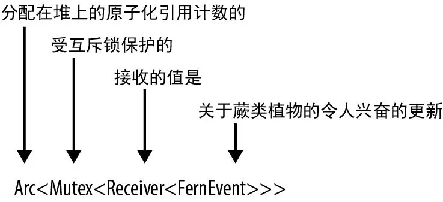

# 第19章并发(2)

## 19.3　共享可变状态

```
自从你在第 8 章发布了 fern_sim crate，在之后的几个月里，你的蕨类植物模拟软件真的
```

“火”了。现在你正在创建一个多人即时战略游戏，其中 8 名玩家在模拟的侏罗纪景观中竞相种植大部分真实的同时代蕨类植物。该游戏的服务器是一个大规模并行应用程序，要处理从很多线程涌入的大量请求。一旦有了 8 名待加入的玩家，这些线程该如何相互协调以开始游戏呢？

这里要解决的问题是，很多线程需要访问待加入游戏玩家的共享列表。这个数据必然是可变的，并且会在所有线程之间共享。如果 Rust 不支持共享的可变状态，那我们还能用它做些什么呢？

可以通过创建一个新线程来解决这个问题，该线程的全部工作就是管理这个列表。其他线程将通过通道与它通信。当然，这会多占用一个线程，从而产生一些操作系统开销。

另一种选择是使用 Rust 提供的工具来安全地共享可变数据。这种工具确实存在。它们就是任何使用过线程的系统程序员都熟悉的底层原语。本节将介绍互斥锁、读 / 写锁、条件变量和原子化整数。最后，我们将展示如何在 Rust 中实现全局可变变量。

### 19.3.1　什么是互斥锁

互斥锁（mutex）或锁（lock）用于强制多个线程在访问某些数据时轮流读写。19.3.2 节会介绍 Rust 的互斥锁。先回顾一下互斥锁在其他语言中的用法是有好处的。下面是互斥锁在 C++中的简单用法：

```
// C++代码，不是Rust代码
void FernEmpireApp::JoinWaitingList(PlayerId player) {
   mutex.Acquire();
   waitingList.push_back(player);
   // 如果有了足够的待进入玩家，就开始游戏
   if (waitingList.size() >= GAME_SIZE) {
       vector<PlayerId> players;
       waitingList.swap(players);
       StartGame(players);
   }
   mutex.Release();
}
调用 mutex.Acquire() 和 mutex.Release() 会标记出此代码中临界区的开始和结束。
对于程序中的每个 mutex，一次只能有一个线程在临界区内运行。如果临界区中有一个线
程，那么所有调用 mutex.Acquire() 的其他线程都将被阻塞，直到第一个线程到达
mutex.Release()。
我们说互斥锁能保护数据，在这个例子中就是 mutex 会保护 waitingList。不过，程序员
```

有责任确保每个线程总是在访问数据之前获取互斥锁，并在之后释放它。

互斥锁很有用，原因如下。

- 它们可以防止数据竞争，即多个竞争线程同时读取和写入同一内存的情况。数据竞争是C++ 和 Go 中的未定义行为。Java、C# 等托管语言承诺不会崩溃，但发生数据竞争时，产出的结果仍然没有意义。

- 即使不存在数据竞争，并且所有读取和写入在程序中都是按顺序一个接一个地发生，如果没有互斥锁，不同线程的操作也可能会以任意方式相互交错。想象一下，如何写出即使在运行期被其他线程修改了数据也能照常工作的代码。再想象一下你试图调试这个程序。那简直就像程序在“闹鬼”。

- 互斥锁支持使用不变条件进行编程，在初始化设置时，那些关于受保护数据的规则在刚构造出来时就是成立的，并且会让每个临界区负责维护这些规则。

当然，所有这些实际上都基于同一个原因：不受控的竞态条件会让编程变得非常棘手。互斥锁给混乱带来了一些秩序，尽管不如通道或分叉与合并那么有序。

然而，在大多数语言中，互斥锁很容易搞砸。例如，在 C++ 中，数据和锁是彼此独立的对象。理想情况下，可以通过注释来解释每个线程必须在接触数据之前获取互斥锁：

```python
class FernEmpireApp {
   ...
private:
   // 等待加入游戏的玩家列表。通过`mutex`来保护
   vector<PlayerId> waitingList;
   // 请在读写`waitingList`之前获取互斥锁
   Mutex mutex;
   ...
};
```

但即使有这么好的注释，编译器也无法在此处强制执行安全访问。当一段代码忘了获取互斥锁时，就会得到未定义行为。现实中，这意味着极难重现和修复的 bug。

虽然在 Java 中对象和互斥锁之间存在某种概念上的关联，但这种关联也不是很紧密。编译器不会试图强制执行这种关联，实际上，受锁保护的数据在大多数时候不仅仅是相关对象中的几个字段，而是经常包含分布于多个对象中的数据。“锁定”方案依旧很棘手。注释仍然是执行这种关联的主要工具。

### 19.3.2　Mutex<T>

现在我们将展示在 Rust 中如何实现等待列表。在我们的蕨类帝国游戏服务器中，每个玩家都有一个唯一的 ID：

```
type PlayerId = u32;
```

等待列表只是玩家的集合：

```javascript
const GAME_SIZE: usize = 8;
/// 等候列表永远不会超过GAME_SIZE个玩家
type WaitingList = Vec<PlayerId>;
等待列表会被存储为 FernEmpireApp 中的一个字段，这是在服务器启动期间在 Arc 中设置
的一个单例。每个线程都有一个 Arc 指向它。它包含我们程序中所需的全部共享配置和其他
“零件”，其中大部分是只读的。由于等待列表既是共享的又是可变的，因此必须由 Mutex 提
```

供保护：

```
use std::sync::Mutex;
/// 所有线程都可以共享对这个大型上下文结构体的访问
struct FernEmpireApp {
   ...
   waiting_list: Mutex<WaitingList>,
   ...
}
与 C++ 不同，在 Rust 中，受保护的数据存储于 Mutex 内部。建立此 Mutex 的代码如下所
```

示：

```javascript
use std::sync::Arc;
let app = Arc::new(FernEmpireApp {
   ...
   waiting_list: Mutex::new(vec![]),
   ...
});
创建新的 Mutex 看起来就像创建新的 Box 或 Arc，但是 Box 和 Arc 意味着堆分配，而
Mutex 仅与锁操作有关。如果希望在堆中分配 Mutex，则必须明确写出来，就像这里所做的
这样：对整个应用程序使用 Arc::new，而仅对受保护的数据使用 Mutex::new。这两个类
型经常一起使用，Arc 用于跨线程共享数据，而 Mutex 用于跨线程共享的可变数据。
现在可以实现使用互斥锁的 join_waiting_list 方法了：
impl FernEmpireApp {
   /// 往下一个游戏的等候列表中添加一个玩家。如果有足够
   /// 的待进入玩家，则立即启动一个新游戏
   fn join_waiting_list(&self, player: PlayerId) {
       // 锁定互斥锁，并授予内部数据的访问权。`guard`的作用域是一个临界区
       let mut guard = self.waiting_list.lock().unwrap();
       // 现在开始执行游戏逻辑
       guard.push(player);
       if guard.len() == GAME_SIZE {
           let players = guard.split_off(0);
           self.start_game(players);
       }
   }
}
获取数据的唯一方法就是调用 .lock() 方法：
let mut guard = self.waiting_list.lock().unwrap();
self.waiting_list.lock() 会阻塞，直到获得互斥锁。这个方法调用所返回的
MutexGuard<WaitingList> 值是 &mut WaitingList 的浅层包装。多亏了 13.5 节讨论
过的“隐式解引用”机制，我们可以直接在此守卫上调用 WaitingList 的各种方法：
guard.push(player);
```

此守卫甚至允许我们借用对底层数据的直接引用。Rust 的生命周期体系会确保这些引用的生

```javascript
命周期不会超出守卫本身。如果不持有锁，就无法访问 Mutex 中的数据。
当 guard 被丢弃时，锁就被释放了。这通常会发生在块的末尾，但也可以手动丢弃。
if guard.len() == GAME_SIZE {
   let players = guard.split_off(0);
   drop(guard);  // 启动游戏时就不必锁定列表了
   self.start_game(players);
}
```

### 19.3.3　mut 与互斥锁

```
join_waiting_list 方法并没有通过可变引用获取 self，这可能看起来很奇怪，至少初
```

看上去是这样。它的类型签名如下所示：

```
fn join_waiting_list(&self, player: PlayerId)
当你调用底层集合 Vec<PlayerId> 的 push 方法时，它确实需要一个可变引用，其类型签
```

名如下所示：

```
pub fn push(&mut self, item: T)
```

然而这段代码不仅能编译而且运行良好。这是怎么回事？

```
在 Rust 中，&mut 表示独占访问。普通 & 表示共享访问。
```

```
我们习惯于把 &mut 访问从父级传到子级，从容器传到内容。只有一开始你就拥有对
starships 的 &mut 引用 [ 或者你也可能拥有这些 starships（星舰）？如果是这样，那
么……恭喜你成了埃隆 • 马斯克。]，才可以在 starships[id].engine 上调用 &mut self
```

方法。这是默认设置，因为如果没有对父项的独占访问权，那么 Rust 通常无法确保你对子项拥有独占访问权。

```
但是 Mutex 有办法确保这一点：锁。事实上，互斥锁只不过是提供对内部数据的独占（mut）
访问的一种方法，即使有许多线程也在共享（非 mut）访问 Mutex 本身时，也能确保一切正
```

常。

```
Rust 的类型系统会告诉我们 Mutex 在做什么。它在动态地强制执行独占访问，而这通常是由
```

Rust 编译器在编译期间静态完成的。

```
（你可能还记得 std::cell::RefCell 也是这么做的，但它没有试图支持多线程。Mutex
和 RefCell 是内部可变性的两种形式，详情请参见 9.11 节。）
```

### 19.3.4　为什么互斥锁不是“银弹”

在开始使用互斥锁之前，我们就介绍了一些并发方式，如果你是 C++ 用户，那么这些方法可能看起来非常容易正确使用。这并非巧合，因为这些方法本来就是为了给并发编程中最令人困惑的方面提供强有力的保证。专门使用分叉与合并并行的程序具有确定性，不会死锁。使用通道的程序几乎同样表现良好。那些专门供管道使用的通道（比如我们的索引构建器）也具有确定性：虽然消息传递的时机可能有所不同，但不会影响输出。这些关于多线程编程的保证都很好。

```
Rust 的 Mutex 设计几乎肯定会让你比以往任何时候都更系统、更明智地使用互斥锁。但也值
```

得停下来思考一下 Rust 的安全保证可以帮你做什么，不能帮你做什么。

安全的 Rust 代码不会引发数据竞争，这是一种特定类型的 bug，其中多个线程会同时读写同一内存，并产生无意义的结果。这很好，因为数据竞争总会出 bug，这在真正的多线程程序中并不罕见。

但是，使用互斥锁的线程会遇到 Rust 无法为你修复的另一些问题。

- 有效的 Rust 程序不会有数据竞争，但仍然可能有其他竞态条件——程序的行为取决于各线程之间的运行时间长短，因此可能每次运行时都不一样。有些竞态条件是良性的，有些则表现为普遍的不稳定性和难以修复的 bug。以非结构化方式使用互斥锁会引发竞态条件。你需要确保竞态条件是良性的。

- 共享可变状态也会影响程序设计。通道作为代码中的抽象边界，可以轻松地拆出彼此隔离的组件以进行测试，而互斥锁则会鼓励一种“只要再添加一个方法就行了”的工作方式，这可能会导致彼此有联系的代码耦合成一个单体。

- 最后，互斥锁也并不像最初看起来那么简单，接下来的 19.3.5 节和 19.3.6 节会详解介绍。

所有这些问题都是工具本身所固有的。要尽可能使用更结构化的方法，只在必要时使用

```
Mutex。
```

### 19.3.5　死锁

线程在尝试获取自己正持有的锁时会让自己陷入死锁：

```javascript
let mut guard1 = self.waiting_list.lock().unwrap();
let mut guard2 = self.waiting_list.lock().unwrap();  // 死锁
假设第一次调用 self.waiting_list.lock() 成功，获得了锁。第二次调用时看到锁已被
```

持有，所以线程就会阻塞自己，等待锁被释放。它会永远等下去，因为这个正等待的线程就是持有锁的线程。

```
换而言之，Mutex 中的锁并不是递归锁。
这里的 bug 是显而易见的。但在实际程序中，这两个 lock() 调用可能位于两个不同的方法
```

中，其中一个会调用另一个。单独来看，每个方法的代码看起来都没什么问题。还有其他方式可以导致死锁，比如涉及多个线程或每个线程同时获取多个互斥锁。Rust 的借用系统不能保护你免于死锁。最好的保护是保持临界区尽可能小：进入，开始工作，完成后马上离开。

通道也有可能陷入死锁。例如，两个线程可能会互相阻塞，每个线程都在等待从另一个线程接收消息。然而，再次强调，良好的程序设计可以让你确信这在实践中不会发生。在管道中，就像我们的倒排索引构建器一样，数据流是非循环的。与 Unix shell 管道一样，这样的程序不可能发生死锁。

### 19.3.6　“中毒”的互斥锁

```
Mutex::lock() 返回 Result 的原因与 JoinHandle::join() 是一样的：如果另一个线
程发生 panic，则可以优雅地失败。当我们编写 handle.join().unwrap() 时，就是在告
诉 Rust 将 panic 从一个线程传播到另一个线程。mutex.lock().unwrap() 惯用法同样如
```

此。

```
如果线程在持有 Mutex 期间出现 panic，则 Rust 会把 Mutex 标记为已“中毒”。之后每当试
图锁住已“中毒”的 Mutex 时都会得到错误结果。如果发生这种情况，我们的 .unwrap() 调
```

用就会告诉 Rust 发生了 panic，将 panic 从另一个线程传播到本线程。

“中毒”的互斥锁有多糟糕？中毒听起来很致命，但在这个场景中并不一定致命。正如我们在第7 章中所说，panic 是安全的。一个发生了 panic 的线程能让程序的其余部分仍然留在安全状态。

这样看来，互斥锁因 panic 而“中毒”的原因并非害怕出现未定义行为。相反，它真正的关注点在于你编程时一直在维护不变条件。由于你的程序在未完成其正在执行的操作的情况下发生panic 并退出临界区，可能更新了受保护数据的某些字段但未更新其他字段，因此不变条件现在有可能已经被破坏了。于是 Rust 决定让这个互斥锁“中毒”，以防止其他线程无意中误入这种已破坏的场景并让情况变得更糟。你仍然可以锁定已“中毒”的互斥锁并访问其中的数据，完

```
全强制运行互斥代码。具体请参阅 PoisonError::into_inner() 的文档。但你肯定不会
```

希望这发生在自己的意料之外。

### 19.3.7　使用互斥锁的多消费者通道

我们之前提到过，Rust 的通道是多生产者、单一消费者。或者更具体地说，一个通道只能有

```
一个 Receiver。如果有一个线程池，则不能让其中的多个线程使用单个 mpsc 通道作为共
```

享工作列表。

```javascript
其实有一种非常简单的解决方法，只要使用标准库的一点点“能力”就可以。可以在 Receiver
周围包装一个 Mutex 然后再共享。下面就是这样做的一个模块：
pub mod shared_channel {
   use std::sync::;
   use std::sync::mpsc::;
   /// 对`Receiver`的线程安全的包装
   #[derive(Clone)]
   pub struct SharedReceiver<T>(Arc<Mutex<Receiver<T>>>);
   impl<T> Iterator for SharedReceiver<T> {
       type Item = T;
       /// 从已包装的接收者中获取下一个条目
       fn next(&mut self) -> Option<T> {
           let guard = self.0.lock().unwrap();
           guard.recv().ok()
       }
   }
   /// 创建一个新通道，它的接收者可以跨线程共享。这会返回一个发送者和一个
   /// 接收者，就像标准库的 `channel()`，有时可以作为无缝替代品使用
   pub fn shared_channel<T>() -> (Sender<T>, SharedReceiver<T>) {
       let (sender, receiver) = channel();
       (sender, SharedReceiver(Arc::new(Mutex::new(receiver))))
   }
}
我们正在使用 Arc<Mutex<Receiver<T>>>。这些泛型简直像俄罗斯套娃。这种情况在
```

Rust 中比在 C++ 中更常见。虽然这看起来会让人感到困惑，但通常情况下（就像在本例中一样），仅仅读出名称就可以帮你理解发生了什么，如图 19-11 所示。



- 图 19-11：如何阅读复杂类型

### 19.3.8　读 / 写锁（RwLock<T>）

```
介绍完互斥锁，下面来看一下 std::sync 中提供的其他工具：Rust 标准库的线程同步工具
```

包。我们将快速介绍，因为对这些工具的完整讨论超出了本书的范畴。

服务器程序通常都有一些只加载一次且很少更改的配置信息。大多数线程只会查询此配置，但由于配置可以更改（例如，可能要求服务器从磁盘重新加载其配置），所以无论如何都必须用锁进行保护。在这种情况下，可以使用互斥锁，但它会形成不必要的瓶颈。如果配置没有改

```
变，那么各个线程就不应该轮流查询配置。这时就可以使用读 / 写锁或 RwLock。
互斥锁只有一个 lock 方法，而读 / 写锁有两个，即 read 和 write。RwLock::write 方
法类似于 Mutex::lock。它会等待对受保护数据的独占的 mut 访问。RwLock::read 方法
提供了非 mut 访问，它的优点是可能不怎么需要等待，因为本就可以让许多线程同时安全地
```

读取。使用互斥锁，在任何给定时刻，受保护的数据都只有一个读取者或写入者（或两者都没有）。使用读 / 写锁，则可以有一个写入者或多个读取者，就像一般的 Rust 引用一样。

```javascript
FernEmpireApp 可能有一个用作配置的结构体，由 RwLock 提供保护：
use std::sync::RwLock;
struct FernEmpireApp {
   ...
   config: RwLock<AppConfig>,
   ...
}
读取配置的方法会使用 RwLock::read()：
/// 如果应该使用试验性的真菌代码，则为True
fn mushrooms_enabled(&self) -> bool {
   let config_guard = self.config.read().unwrap();
   config_guard.mushrooms_enabled
}
重新加载配置的方法就要使用 RwLock::write()：
fn reload_config(&self) -> io::Result<()> {
   let new_config = AppConfig::load()?;
   let mut config_guard = self.config.write().unwrap();
   *config_guard = new_config;
   Ok(())
}
当然，Rust 特别适合在 RwLock 数据上执行安全规则。单写者或多读者的概念是 Rust 借用
体系的核心。self.config.read() 会返回一个守卫，以提供对 AppConfig 的非 mut
（共享）访问。self.config.write() 会返回另一种类型的守卫，以提供 mut（独占）访
```

问。

### 19.3.9　条件变量（Condvar）

通常线程需要一直等到某个条件变为真。

- 在关闭服务器的过程中，主线程可能需要等到所有其他线程都完成后才能退出。

- 当工作线程无事可做时，需要一直等待，直到有数据需要处理为止。

- 实现分布式共识协议的线程可能要等到一定数量的对等点给出响应为止。

有时，对于我们想要等待的确切条件，会有一个方便的阻塞式 API，比如服务器关闭示例中的

```
JoinHandle::join。其他情况下，则没有内置的阻塞式 API。程序可以使用条件变量来构
建自己的 API。在 Rust 中，std::sync::Condvar 类型实现了条件变量。Condvar 中有
方法 .wait() 和 .notify_all()，其中 .wait() 会阻塞线程，直到其他线程调用了
.notify_all()。
但条件变量的用途不止于此，因为说到底条件变量是关于受特定 Mutex 保护的某些数据的特
定“真或假”条件。因此，Mutex 和 Condvar 是相关的。对条件变量的完整解释超出了本书的
```

范畴，但为了让曾使用过条件变量的程序员更容易理解，我们将展示代码的两个关键部分。

```
当所需条件变为真时，就调用 Condvar::notify_all（或 notify_one）来唤醒所有等
```

待的线程：

```
self.has_data_condvar.notify_all();
要进入睡眠状态并等待条件变为真，可以使用 Condvar::wait()：
while !guard.has_data() {
   guard = self.has_data_condvar.wait(guard).unwrap();
}
这个 while 循环是条件变量的标准用法。然而，Condvar::wait 的签名非比寻常。它会按
值获取 MutexGuard 对象，消耗它，并在成功时返回新的 MutexGuard。这种签名给我们的
直观感觉是 wait 方法会释放互斥锁并在返回之前重新获取它。按值传递 MutexGuard 要表
达的意思是“我授予你通过 .wait() 方法释放互斥锁的独占权限。”
```

### 19.3.10　原子化类型

```
std::sync::atomic 模块包含用于无锁并发编程的原子化类型。这些类型与标准 C++ 原子
```

化类型基本相同，但也有一些独特之处。

```
AtomicIsize 和 AtomicUsize 是与单线程 isize 类型和 usize 类型对应的共享整数
```

- 类型。

```
AtomicI8、AtomicI16、AtomicI32、AtomicI64 及其无符号变体（如 AtomicU8）
是共享整数类型，对应于单线程中的类型 i8、i16 等。
AtomicBool 是一个共享的 bool 值。
AtomicPtr<T> 是不安全指针类型 *mut T 的共享值。
```

正确使用原子化数据超出了本书的范畴。你只要明白多个线程可以同时读取和写入一个原子化的值而不会导致数据竞争就足够了。

与通常的算术运算符和逻辑运算符不同，原子化类型会暴露执行原子化操作的方法，单独的加载、存储、交换和算术运算都会作为一个单元安全地进行，哪怕其他线程也在执行操作同一内

```javascript
存的原子化操作也没问题。递增一个名为 atom 的 AtomicIsize 的代码如下所示：
use std::sync::atomic::;
let atom = AtomicIsize::new(0);
atom.fetch_add(1, Ordering::SeqCst);
这些方法可以编译成专门的机器语言指令。在 x86-64 架构上，这个 .fetch_add() 调用会
编译为 lock incq 指令，而普通 n += 1 可以编译为简单的 incq 指令或其他各种与此相
```

关的变体。Rust 编译器还必须放弃围绕原子化操作的一些优化，因为与正常的加载或存储不同，它可以立即合法地影响其他线程或被其他线程影响。

```
参数 Ordering::SeqCst 是指内存排序。内存排序类似于数据库中的事务隔离级别。它们
```

告诉系统，相对于性能，你有多关心诸如对因果性的影响和不存在时间循环之类的哲学概念。内存排序对于程序的正确性至关重要，而且很难进行理解和推理。不过令人高兴的是，选择顺序一致性（最严格的内存排序类型）的性能损失通常很低，与将 SQL 数据库置于

```
SERIALIZABLE 模式时的性能损失截然不同。因此，只要拿不准，就尽情使用
Ordering::SeqCst 吧。Rust 从标准 C++ 原子化机制继承了另外几种内存排序，分别对存
```

续性和因果性提供了几种保证。我们就不在这里讨论它们了。

原子化的一个简单用途是中途取消。假设有一个线程正在执行一些长时间运行的计算（如渲染视频），我们希望能异步取消它。问题在于如何与希望关闭的线程进行通信。可以通过共享的

```javascript
AtomicBool 来做到这一点：
use std::sync::Arc;
use std::sync::atomic::AtomicBool;
let cancel_flag = Arc::new(AtomicBool::new(false));
let worker_cancel_flag = cancel_flag.clone();
上述代码会创建两个 Arc<AtomicBool> 智能指针，它们都指向分配在堆上的
AtomicBool，其初始值为 false。第一个名为 cancel_flag，将留在主线程中。第二个
名为 worker_cancel_flag，将转移给工作线程。
```

下面是工作线程的代码：

```javascript
use std::thread;
use std::sync::atomic::Ordering;
let worker_handle = thread::spawn(move || {
   for pixel in animation.pixels_mut() {
       render(pixel); // 光线跟踪，需要花几微秒时间
       if worker_cancel_flag.load(Ordering::SeqCst) {
           return None;
       }
   }
   Some(animation)
});
渲染完每个像素后，线程会通过调用其 .load() 方法检查标志的值：
worker_cancel_flag.load(Ordering::SeqCst)
如果决定在主线程中取消工作线程，可以将 true 存储在 AtomicBool 中，然后等待线程退
```

出：

```
// 取消渲染
cancel_flag.store(true, Ordering::SeqCst);
// 放弃结果，该结果有可能是`None`
worker_handle.join().unwrap();
当然，还有其他实现方法。此处的 AtomicBool 可以替换为 Mutex<bool> 或通道。主要区
```

别在于原子化的开销是最低的。原子化操作从不使用系统调用。加载或存储通常会编译为单个CPU 指令。

```
原子化是内部可变性的一种形式（就像 Mutex 或 RwLock），因此它们的方法会通过共享（非
mut）引用获取 self。这使得它们作为简单的全局变量时非常有用。
```

### 19.3.11　全局变量

假设我们正在编写网络代码。我们想要一个全局变量，即一个每当发出数据包时都会递增的计数器：

```
/// 服务器已成功处理的数据包的数量
static PACKETS_SERVED: usize = 0;
这可以正常编译，但有一个问题：PACKETS_SERVED 是不可变的，所以我们永远都不能改变
```

它。

```javascript
Rust 会尽其所能阻止全局可变状态。用 const 声明的常量当然是不可变的。默认情况下，静
态变量也是不可变的，因此无法获得一个 mut 引用。static 固然可以声明为 mut，但访问
```

它是不安全的。所有这些规则的制定，出发点都是 Rust 对线程安全的坚持。

全局可变状态也有不幸的软件工程后果：它往往使程序的各个部分更紧密耦合，更难测试，以后更难更改。尽管如此，在某些情况下并没有合理的替代，所以最好找到一种安全的方法来声明可变静态变量。

```
支持递增 PACKETS_SERVED 并保持其线程安全的最简单方式是让它变成原子化整数：
use std::sync::atomic::AtomicUsize;
static PACKETS_SERVED: AtomicUsize = AtomicUsize::new(0);
```

一旦声明了这个静态变量，增加数据包计数就很简单了：

```
use std::sync::atomic::Ordering;
PACKETS_SERVED.fetch_add(1, Ordering::SeqCst);
```

原子化全局变量仅限于简单的整数和布尔值。不过，要创建任何其他类型的全局变量，就要解决以下两个问题。

首先，变量必须以某种方式成为线程安全的，否则它就不能是全局变量：为了安全起见，静态

```javascript
变量必须同时是 Sync 和非 mut 的。幸运的是，我们已经看到了这个问题的解决方案。Rust
具有用于安全地共享变化的值的类型：Mutex、RwLock 和原子化类型。即使声明为非
mut，也可以修改这些类型。这就是它们的用途。（参见 19.3.3 节。）
其次，静态初始化程序只能调用被专门标记为 const 的函数，编译器可以在编译期间对其进
```

行求值。换句话说，它们的输出是确定性的，这些输出只会取决于它们的参数，而不取决于任何其他状态或 I/O。这样，编译器就可以将计算结果作为编译期常量嵌入了。这类似于 C++ 的

```javascript
constexpr。
Atomic 类型（AtomicUsize、AtomicBool 等）的构造函数都是 const 函数，这使我们
能够更早地创建 static AtomicUsize。一些其他类型，比如 String、Ipv4Addr 和
Ipv6Addr，同样有简单的 const 构造函数。
还可以直接在函数的签名前加上 const 来定义自己的 const 函数。Rust 将 const 函数可
```

以做的事情限制在一小部分操作上，这些操作足够有用，同时仍然不会带来任何不确定的结

```javascript
果。const 函数不能以类型而只能以生命周期作为泛型参数，并且不能分配内存或对裸指针
进行操作，即使在 unsafe 的块中也是如此。但是，我们可以使用算术运算［包括回绕型算
```

术（wrapping arithmetic）和饱和型算术（saturating arithmetic）］、非短路逻辑运算和其他

```javascript
const 函数。例如，可以创建便捷函数来更轻松地定义 static 和 const 并减少代码重
```

复：

```javascript
const fn mono_to_rgba(level: u8) -> Color {
   Color {
       red: level,
       green: level,
       blue: level,
       alpha: 0xFF
   }
}
const WHITE: Color = mono_to_rgba(255);
const BLACK: Color = mono_to_rgba(000);
```

结合这些技术，我们可能会试着像下面这样写：

```javascript
static HOSTNAME: Mutex<String> =
   Mutex::new(String::new());  // 错误：静态调用仅限于常量函数、常量元组、
                               // 常量结构体和常量元组变体
不过很遗憾，虽然 AtomicUsize::new() 和 String::new() 是 const fn，但
```

- 2

```
Mutex::new() 不是
。为了绕过这些限制，需要使用 lazy_static crate。
我们在 17.5.2 节介绍过 lazy_static crate。通过 lazy_static! 宏定义的变量允许你使
```

用任何喜欢的表达式进行初始化，该表达式会在第一次解引用变量时运行，并保存该值以供后续操作使用。

```
可以像下面这样使用 lazy_static 声明一个全局 Mutex 控制的 HashMap：
use lazy_static::lazy_static;
use std::sync::Mutex;
lazy_static! {
   static ref HOSTNAME: Mutex<String> = Mutex::new(String::new());
}
同样的技术也适用于其他复杂的数据结构，比如 HashMap 和 Deque。对于根本不可变、只
```

- 3

是需要进行非平凡初始化

- 的静态变量，它也非常方便。

```
使用 lazy_static! 会在每次访问静态数据时产生很小的性能成本。该实现使用了
std::sync::Once，这是一种专为一次性初始化而设计的底层同步原语。在幕后，每次访问
惰性静态数据时，程序都会执行原子化加载指令以检查初始化是否已然发生。（Once 有比较
特殊的用途，这里不做详细介绍。通常使用 lazy_static! 更方便。但是，
std::sync::Once 对于初始化非 Rust 库很有用，有关示例，请参阅 23.5 节。）
```

## 19.4　在 Rust 中编写并发代码的一点儿经验

本章介绍了在 Rust 中使用线程的 3 种技术：分叉与合并并行、通道和带锁的共享可变状态。我们的目标是好好介绍一下 Rust 提供的这些“零件”，重点在于如何将它们组合到实际程序中。

Rust 坚持安全性，因此从你决定编写多线程程序的那一刻起，重点就是构建安全、结构化的通信。保持线程近乎处于隔离态可以让 Rust 相信你的代码正在做的事是安全的。恰好，隔离也是确保你的代码正确且可维护的好办法。同样，Rust 也会引导你开发优秀的程序。

更重要的是，Rust 能让你组合多种技术并进行实验。你可以快速迭代。换句话说，“在编译器的督促下知错就改”肯定比“等出了问题后再调试数据竞争”能更快地开工并正确运行。

[2]：在 Rust 1.63 及以上版本中， 已经是 了。——译者注[3]：“非平凡初始化”是指初始化一个变量或对象时，需要进行一些复杂的计算或操作，而不是简单的赋值或默认初始化。在计算机编

- 程中，有些变量或对象的初始化需要进行一些计算，比如读取配置文件、解析命令行参数、连接数据库等，这些初始化操作都可以称为“非平凡初始化”。与之相反，简单的赋值操作或者默认初始化可以称为“平凡初始化”。——译者注
