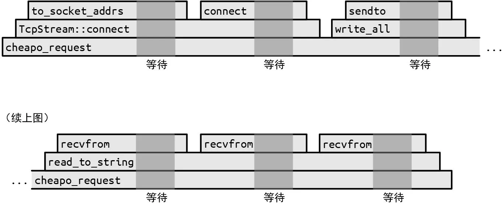
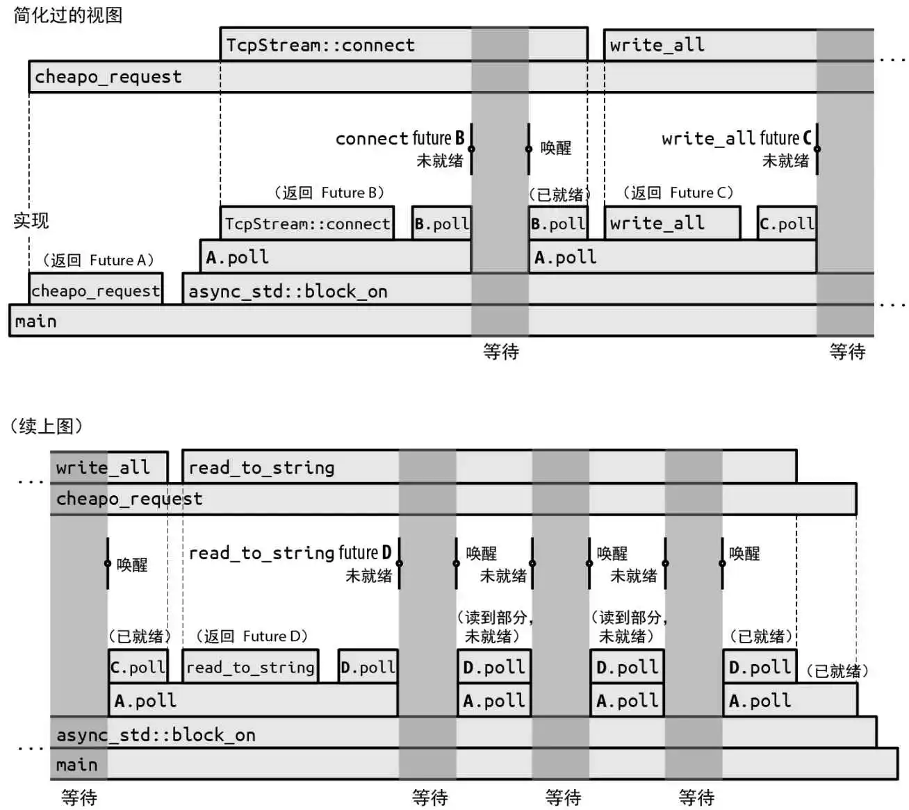
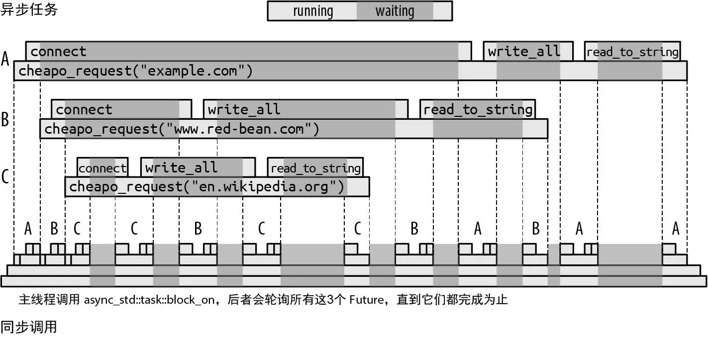

# 第20章异步编程(1)

假设你要编写一个聊天服务器。对于每个网络连接，都会有一些要解析的传入数据包、要组装的传出数据包、要管理的安全参数、要跟踪的聊天组订阅等。要想同时管理这么多连接，就得进行一定的组织工作。

理论上，可以为传入的每个连接启动一个单独的线程：

```javascript
use std::;
let listener = net::TcpListener::bind(address)?;
for socket_result in listener.incoming() {
   let socket = socket_result?;
   let groups = chat_group_table.clone();
   thread::spawn(|| {
       log_error(serve(socket, groups));
   });
}
对于每个新连接，这都会启动一个运行 serve 函数的新线程，此线程专注于管理单个连接所
```

需的一切。

这确实很好，好得远远超出了预期，直到有一天突然涌入了数万个用户。每个线程都拥有 100KiB 以上的栈，这很常见，但这可不是你花费数 GB 服务器内存的理由。如果要在多个处理器之间分配工作，那么线程固然好用，而且确有必要。但现在它们的内存需求已经太大了，所以通常在使用线程的同时，还要用一些补充手段来完成这些工作。

可以使用 Rust 异步任务在单个线程或工作线程池中交替执行许多彼此独立的活动。异步任务类似于线程，但其创建速度更快，在它们之间可以更有效地传递控制权，并且其内存开销比线程少一个数量级。在单个程序中同时运行数十万个异步任务是完全可行的。当然，你的应用程序可能仍会受到其他因素的制约，比如网络带宽、数据库速度、算力，或此工作的固有内存需求，但与线程的开销相比，这些异步任务的固有内存开销只是九牛一毛。

一般来说，异步 Rust 代码看上去很像普通的多线程代码，但实际上那些可能导致阻塞的操作（如 I/O 或获取互斥锁）会以略有不同的方式处理。通过对这些操作进行特殊处理，Rust 能够获得关于这段代码行为的更多信息以辅助优化，这就是它能提高性能的原因。前面代码的异步版本如下所示：

```javascript
use async_std::;
let listener = net::TcpListener::bind(address).await?;
let mut new_connections = listener.incoming();
while let Some(socket_result) = new_connections.next().await {
   let socket = socket_result?;
   let groups = chat_group_table.clone();
   task::spawn(async {
       log_error(serve(socket, groups).await);
   });
}
这里用的是 async_std 这个 crate 的网络模块和任务模块，并在可能发生阻塞的调用之后添
加了 .await。但这段代码的整体结构与基于线程的版本无异。
```

本章的目标不仅是帮你编写异步代码，还要尽可能详细地展示它的工作原理，以便你可以预知如何在应用程序中执行异步代码以及把它用在哪里最能发挥出其价值。

```
为了展示异步编程的机制，我们会列举一组涵盖所有核心概念的最小语言特性集：Future
（未来值）、异步函数、await 表达式、任务以及 block_on 执行器和 spawn_local 执
```

- 行器。

```
然后，我们会介绍异步块和 spawn 执行器。这些在实际工作中非常重要，但从概念上讲，
```

- 它们只是刚才提过的那些特性的变体。在此过程中，我们会指出你可能会遇到的一些异步编

- 程特有的问题，并解释该如何处理这些问题。

- 为了展示所有这些“零件”是如何协同工作的，我们还会浏览一遍聊天服务器和客户端的完整代码，前面的代码片段只是其中的一部分。

```
为了说明原生 Future 和执行器的工作原理，我们会展示 spawn_blocking 和
block_on 的简单而实用的实现。
最后，我们会解释 Pin 类型，该类型在异步接口中会不时出现，以保证异步函数和异步式
Future 的安全使用。
```

## 20.1　从同步到异步

考虑调用以下（非异步，而是完全传统的）函数时会发生什么：

```javascript
use std::io::prelude::*;
use std::net;
fn cheapo_request(host: &str, port: u16, path: &str)
                     -> std::io::Result<String>
{
   let mut socket = net::TcpStream::connect((host, port))?;
   let request = format!("GET {} HTTP/1.1\r\nHost: {}\r\n\r\n", path, host);
   socket.write_all(request.as_bytes())?;
   socket.shutdown(net::Shutdown::Write)?;
   let mut response = String::new();
   socket.read_to_string(&mut response)?;
   Ok(response)
}
```

这段代码会打开到 Web 服务器的 TCP 连接，以过时的协议向其发送一个极简的 HTTP 请求1

- ，然后读取其响应。图 20-1 展示了随着时间推移这个函数的执行情况。



- 图 20-1：同步 HTTP 请求的进度（深灰色区域表示正在等待操作系统）

图 20-1 展示了当时间从左到右流逝时，函数的调用栈的情况。每个函数调用都是一个方框，

```
叠放在其调用者上方。显然，cheapo_request 函数贯穿了整个执行过程。它会调用 Rust
标准库中的函数（如 TcpStream::connect）以及由 TcpStream 实现的 write_all 和
read_to_string 这两个特型方法。它们又会依次调用其他函数，但此程序最终会进行一些
```

系统调用，请求操作系统实际完成某些操作，比如打开 TCP 连接，读取或写入一些数据。

深灰色背景表示程序正在等待操作系统完成系统调用的时间。我们没有按比例绘制这些时间。如果按比例绘制，则整张图都会变成深灰色：事实上，这个函数在几乎所有时间里都在等待操作系统。而前面代码的执行时间是系统调用之间的小窄条。

当这个函数正在等待系统调用返回时，它的单个线程是阻塞的，也就是说，在系统调用完成之前，它不能做任何其他事情。一个线程的栈大小有数十或数百 KB 的情况并不罕见，因此如果这是某个更大系统中的一小部分，那么就会有许多线程在同时做类似的事情，如果仅仅为了等待而锁定这些线程资源则可能会让开销变得相当高。

为了解决这个问题，就要允许线程在等待系统调用完成期间进行其他工作。但要做到这一点并非易事。例如，我们用来从套接字读取响应的函数签名如下所示：

```
fn read_to_string(&mut self, buf: &mut String) -> std::io::Result<usize>;
```

它直接在类型签名里表明，这个函数在完成工作或出现问题之前不会返回。因此这个函数是同步的：调用者在操作完成后才会继续。如果想在操作系统工作时将此线程用于其他任务，就需要一个新的 I/O 库来提供这个函数的异步版本。

### 20.1.1　Future

```
Rust 支持异步操作的方法是引入特型 std::future::Future：
trait Future {
   type Output;
   // 现在，暂时把`Pin<&mut Self>`当作`&mut Self`
   fn poll(self: Pin<&mut Self>, cx: &mut Context<'_>) -> Poll<Self::Output>;
}
enum Poll<T> {
   Ready(T),
   Pending,
}
Future 代表一个你可以测试其完成情况的操作。Future 的 poll（轮询）方法从来不会等
待操作完成，它总是立即返回。如果操作已完成，则 poll 会返回
Poll::Ready(output)，其中 output 是它的最终结果。否则，它会返回 Pending。如
果 Future 值得再次轮询，它承诺会通过调用 Context 中提供的回调函数 waker 来通知我
```

- 2

```
模型”：对于 Future，你唯一能做的就是
```

们。我们将这种实现方式称为异步编程的“皮纳塔通过轮询来“敲打”它，直到某个值“掉”出来。

所有现代操作系统都包含其系统调用的一些变体，我们可以使用它们来实现这种轮询接口。例如，在 Unix 和 Windows 上，如果将网络套接字设置为非阻塞模式，那么一旦这些读写发生阻塞，就会返回某种错误。你必须稍后再试。

```
因此，异步版本的 read_to_string 的签名大致如下所示：
fn read_to_string(&mut self, buf: &mut String)
   -> impl Future<Output = Result<usize>>;
```

除了返回类型，这与我们之前展示过的签名基本相同：异步版本会返回携带

```
Result<usize> 的 Future。你需要轮询这个 Future，直到从中获得
Ready(result)。每次轮询时，都会尽可能读取更多的内容。最终 result 会为你提供成
```

功值或错误值，就像普通的 I/O 操作一样。这是一种通用模式：任何函数的异步版本都会接受

```
与其同步版本完全相同的参数，但返回类型包裹在 Future 中。
调用这个版本的 read_to_string 并没有实际读取任何内容，它唯一的职责是构建并返回一
个 Future，该 Future 会在轮询时完成其真正的工作。这个 Future 必须包含执行调用请
求所需的全部信息。例如，此 read_to_string 返回的 Future 必须记住调用它的输入
流，以及附加了传入数据的 String。事实上，由于 Future 包含 self 和 buf 的引用，因
此 read_to_string 的正确签名必然是如下形式：
fn read_to_string<'a>(&'a mut self, buf: &'a mut String)
   -> impl Future<Output = Result<usize>> + 'a;
这增加了生命周期以表明返回的 Future 的生存期只能与 self 和 buf 借用的值一样长。
async-std crate 提供了所有 std 中 I/O 设施的异步版本，包括带有 read_to_string 方
法的异步 Read 特型。async-std 选择紧紧跟随 std 的设计，尽可能在它自己的接口中重
用 std 的类型，因此 Error、Result、网络地址和大多数其他相关数据在“两个世界”之间
是兼容的。熟悉 std 有助于使用 async-std，反之亦然。
Future 特型的一个规则是，一旦 Future 返回了 Poll::Ready，它就会假定自己永远不
会再被轮询（poll）。当某些 Future 被过度轮询时，它们只会永远返回
Poll::Pending，而其他 Future 则可能会 panic 或被挂起。（但是，它们绝不会违反内存
安全或线程安全规则，或以其他方式导致未定义行为。）Future 特型上的 fuse 适配器方法
```

```
能把任何 Future 变成被过度轮询时总会返回 Poll::Pending 的 Future。但所有常用的
Future 消耗方式都会遵守这一规则，因此通常不必动用 fuse。
```

完全没必要一听到轮询就觉得效率低下。Rust 的异步架构是经过精心设计的，只要你正确实

```
现了基本的 I/O 函数（如 read_to_string），就只会在值得尝试时才轮询 Future。每当
调用 poll 时，必然有某个地方的某些代码返回了 Ready，或者至少朝着那个目标前进了一
```

步。20.3 节会对此工作原理进行解释。

```
但使用 Future 似乎很具挑战性：当轮询时，如果得到了 Poll::Pending，应该做些什么
呢？你必须四处寻找这个线程暂时可以做的其他工作，还不能忘记稍后回到这个 Future 并
```

再次轮询它。整个程序将充斥着辅助性代码，以跟踪谁在等待处理以及一旦就绪应该做些什么

```
之类的事情。cheapo_request 函数的简单性被破坏了。
```

好消息是，你大可不必这样做。

### 20.1.2　异步函数与 await 表达式

```javascript
下面是一个写成异步函数的 cheapo_request 版本：
use async_std::io::prelude::*;
use async_std::net;
async fn cheapo_request(host: &str, port: u16, path: &str)
                           -> std::io::Result<String>
{
   let mut socket = net::TcpStream::connect((host, port)).await?;
   let request = format!("GET {} HTTP/1.1\r\nHost: {}\r\n\r\n", path, host);
   socket.write_all(request.as_bytes()).await?;
   socket.shutdown(net::Shutdown::Write)?;
   let mut response = String::new();
   socket.read_to_string(&mut response).await?;
   Ok(response)
}
```

除了以下几点，这段程序跟我们的原始版本几乎是每个字母都一样。

```
函数以 async fn 而不是 fn 开头。
使用 async_std crate 的异步版本的 TcpStream::connect、write_all 和
read_to_string。这些都会返回其结果的 Future。（本节中的示例使用了 async_std
的 1.7 版。）
每次返回 Future 的调用之后，代码都会 .await。虽然这看起来像是在引用结构体中名
为 await 的字段，但它实际上是语言中内置的特殊语法，用于等待 Future 就绪。
await 表达式的计算结果为 Future 的最终值。这就是函数从 connect、write_all
和 read_to_string 获取结果的方式。
```

与普通函数不同，当你调用异步函数时，它会在函数体开始执行之前立即返回。显然，调用的

```
最终返回值还没有计算出来，你得到的只是承载它最终值的 Future。所以如果执行下面这段
```

代码：

```javascript
let response = cheapo_request(host, port, path);
那么 response 将是 std::io::Result<String> 型的 Future，而 cheapo_request
的函数体尚未开始执行。你不需要调整异步函数的返回类型，Rust 会自动把 async fn
f(...) -> T 函数的返回值视为承载 T 的 Future，而非直接的 T 值。
异步函数返回的 Future 中包含函数体运行时所需的一切信息：函数的参数、局部变量的内
存空间等。（就像是把要调用的栈帧捕获成了一个普通的 Rust 值。）所以 response 必须保存
传给 host、port 和 path 的值，因为 cheapo_request 的函数体将需要这些值来运行。
Future 的特化类型是由编译器根据函数的主体和参数自动生成的。这种类型没有名字，你只
知道它实现了 Future<Output=R>，其中 R 是异步函数的返回类型。从这个意义上说，异
步函数的 Future 就像闭包：闭包也有由编译器生成的匿名类型，该类型实现了 FnOnce 特
型、Fn 特型和 FnMut 特型。
当你首次轮询 cheapo_request 返回的 Future 时，会从函数体的顶部开始执行，一直运
行到 TcpStream::connect 返回的 Future 的第一个 await。await 表达式会轮询
connect 返回的 Future，如果它尚未就绪，则向调用者返回 Poll::Pending：程序不能
从这个 await 继续向前运行了，直到对这个 Future 的某次轮询返回了 Poll::Ready。因
此，表达式 TcpStream::connect(...).await 大致等价于如下内容：
{
   // 注意：这是伪代码，不是有效的Rust
   let connect_future = TcpStream::connect(...);
   'retry_point:
   match connect_future.poll(cx) {
       Poll::Ready(value) => value,
       Poll::Pending => {
           // 安排对`cheapo_request`返回的Future进行
           // 下一次`poll`，以便在'retry_point处恢复执行
           ...
           return Poll::Pending;
       }
   }
}
await 表达式会获取 Future 的所有权，然后轮询它。如果已就绪，那么 Future 的最终值
就是 await 表达式的值，然后继续执行。否则，此 Future 返回 Poll::Pending。
但至关重要的是，下一次对 cheapo_request 返回的 Future 进行轮询时不会再从函数的
顶部开始，而是会在即将轮询 connect_future 的中途时间点恢复执行函数。直到 Future
```

就绪之前，我们都不会继续处理异步函数的其余部分。

```
随着对其返回的 Future 继续进行轮询，cheapo_request 将通过函数体从一个 await 走
到下一个，仅当它等待的子 Future 就绪时才会继续。因此，要对 cheapo_request 返回
的 Future 进行多少次轮询，既取决于子 Future 的行为，也取决于该函数自己的控制流。
cheapo_request 返回的 Future 会跟踪下一次 poll 应该恢复的点，以及恢复该点所需的
```

所有本地状态，比如变量、参数和临时变量。

在函数中间暂停执行稍后再恢复，这种能力是异步函数所独有的。当一个普通函数返回时，它

```
的栈帧就永远消失了。由于 await 表达式依赖于这种恢复能力，因此只能在异步函数中使用
```

它们。

在撰写本章时，Rust 还不允许特型具有异步方法。只有自由函数以及从属于具体类型的函数才能是异步的。要解除此限制就要对语言进行一些更改。同时，如果确实需要定义包含异步函

```
数的特型，请考虑使用 async-trait crate，它提供了基于宏的解决方案。
```

### 20.1.3　从同步代码调用异步函数：block_on

```
从某种意义上说，异步函数就是在转移责任。的确，在异步函数中很容易获得 Future 的
值：只要使用 await 就可以。但是异步函数本身也会返回 Future，所以现在调用者的工作
```

是以某种方式进行轮询。但最终还是得有人实际等待一个值。

```javascript
可以使用 async_std 的 task::block_on 函数从普通的同步函数（如 main）调用
cheapo_request，这会接受一个 Future 并轮询，直到它生成一个值：
fn main() -> std::io::Result<()> {
   use async_std::task;
   let response = task::block_on(cheapo_request("example.com", 80, "/"))?;
   println!("{}", response);
   Ok(())
}
由于 block_on 是一个会生成异步函数最终值的同步函数，因此可以将其视为从异步世界到
同步世界的适配器。但 block_on 的阻塞式特征意味着我们不应该在异步函数中使用它，因
为在值被准备好之前它会一直阻塞整个线程。异步函数中请改用 await。
图 20-2 展示了 main 的一种可能的执行方式。
```



- 图 20-2：阻塞异步函数

```
上方的时间线（“简化过的视图”）部分展示了程序异步调用的抽象视图：cheapo_request
会首先调用 TcpStream::connect 以获得套接字，然后在该套接字上调用 write_all 和
read_to_string。接下来会返回。这与本章前面的 cheapo_request 同步版本的时间线
```

非常相似。

```
但是其中的每一个异步调用都是一个多步骤的过程：创建一个 Future，然后轮询直到它就
绪，也许在这个过程中创建并轮询了其他子 Future。下方的时间线（“实现”）部分展示了实
```

现此异步行为的实际同步调用。这是了解普通异步执行中究竟发生了什么的一个好机会。

```
首先，main 会调用 cheapo_request，返回其最终结果的 Future A。然后 main 会将
此 Future 传给 async_std::block_on，由后者对其进行轮询。
轮询 Future A 让 cheapo_request 的主体开始执行。它会调用
TcpStream::connect 来获取套接字的 Future B，然后对其进行等待。更准确地说，
由于 TcpStream::connect 可能会遇到错误，因此 B 其实是 Result<TcpStream,
std::io::Error> 型的 Future。
Future B 会被 await 轮询。由于尚未建立网络连接，因此 B.poll 会返回
Poll::Pending，但会安排在套接字就绪后唤醒此调用任务。
由于 Future B 还没有就绪，因此 A.poll 会将 Poll::Pending 返回给自己的调用者
block_on。
由于 block_on 没有更好的事情可做，因此它进入了休眠状态。现在整个线程都被阻塞
```

- 了。

```
如果 Future B 的连接就绪，就会唤醒轮询它的任务。这会激发 block_on 的行动，并再
次尝试轮询 Future A。
轮询 Future A 会导致 cheapo_request 在其第一个 await 中恢复，并再次轮询
Future B。
这一次，Future B 就绪了：套接字创建完成，因此它将 Poll::Ready(Ok(socket))
返回给了 A.poll。
对 TcpStream::connect 的异步调用现已完成。因此
TcpStream::connect(...).await 表达式的值成了 Ok(socket)。
cheapo_request 函数体正常执行，使用 format! 宏构建请求字符串，并将其传给
socket.write_all。
由于 socket.write_all 是一个异步函数，因此它会返回其结果的 Future C，而
cheapo_request 会等待这个 Future。
剩下的部分也类似。在图 20-2 所示的执行中，socket.read_to_string 返回的 Future
```

在就绪之前被轮询了 4 次，这些唤醒中的每一个都从套接字中读取了一些数据，但是

```
read_to_string 要求一直读到输入的末尾，这需要做一些操作。
编写一遍又一遍调用 poll 的循环听起来并不难。但是 async_std::task::block_on 的
价值在于，它知道如何进入休眠直到 Future 真正值得再次轮询时再启动轮询，而不是浪费
处理器时间和电池寿命进行数十亿次无结果的 poll 调用。像 connect 和
read_to_string 这样的基本 I/O 函数返回的 Future 保留了由传给 poll 的 Context 提
供的唤醒器。到了应该唤醒 block_on 并再次尝试轮询时，就会调用此唤醒器。我们将在
20.3 节通过实现一个简单版本的 block_on 来准确地揭示它的工作原理。
与前面介绍的原始同步版本一样，为了等待操作完成，这个异步版本的 cheapo_request 花
```

费了几乎所有时间。如果时间轴是按真实比例绘制的，那么图 20-2 将几乎完全是深灰色的，当程序偶尔唤醒时才会出现微小的碎片级计算时间。

这里有大量细节。幸运的是，通常可以只考虑简化过的上层时间线：一些函数调用是同步的，

```
另一些函数调用是异步的且需要 await，但它们都只是函数调用。Rust 异步支持的成功之处
```

在于能帮程序员在实践中使用简化过的视图，而不会反复被其具体实现分心。

### 20.1.4　启动异步任务

```
在 Future 的值就绪之前，async_std::task::block_on 函数会一直阻塞。但是把线程
完全阻塞在单个 Future 上并不比同步调用好：本章的目标是让线程在等待的同时做其他工
```

作。

```
为此，可以使用 async_std::task::spawn_local。该函数会接受一个 Future 并将其
添加到任务池中，只要正阻塞着 block_on 的 Future 还未就绪，就会尝试轮询。因此，如
果你将一堆 Future 传给 spawn_local，然后将 block_on 应用于最终结果的 Future，
那么 block_on 就会在可以向前推进时轮询每个启动（spawn）后的 Future，并行执行整
```

个任务池，直到你想要的结果就绪。

```
在撰写本章时，要想在 async-std 中使用 spawn_local，就必须启用该 crate 的
unstable 特性。为此，需要在 Cargo.toml 中使用下面这行代码去引用 async-std：
```

```
async-std = { version = "1", features = ["unstable"] }
spawn_local 函数是标准库的 std::thread::spawn 函数的异步模拟，用于启动线程。
std::thread::spawn(c) 会接受闭包 c 并启动线程来运行它，然后返回
std::thread::JoinHandle，其中 std::thread::JoinHandle 的 join 方法会等待
线程完成并返回 c 中返回的任何内容。
async_std::task::spawn_local(f) 会接受 Future f 并将其添加到当前线程在调用
block_on 时要轮询的池中。spawn_local 会返回自己的
async_std::task::JoinHandle 类型，它本身就是一个 Future，你可以等待
（await）它以获取 f 的最终值。
```

假设我们想同时发出一整套 HTTP 请求。下面是第一次尝试：

```javascript
pub async fn many_requests(requests: Vec<(String, u16, String)>)
                          -> Vec<std::io::Result<String>>
{
   use async_std::task;
   let mut handles = vec![];
   for (host, port, path) in requests {
       handles.push(task::spawn_local(cheapo_request(&host, port, &path)));
   }
   let mut results = vec![];
   for handle in handles {
       results.push(handle.await);
   }
   results
}
```

```
该函数会在 requests 的每个元素上调用 cheapo_request，并将每个调用返回的
Future 传给 spawn_local。该函数还会将生成的 JoinHandle 收集到一个向量中，然后
等待每一个 JoinHandle。可以用任意顺序等待这些 JoinHandle：由于请求已经发出，因
此只要此线程调用了 block_on 并且没有更有价值的事情可做，请求的 Future 就会根据需
要进行轮询。所有请求都将并行执行。一旦完成操作，many_requests 就会把结果返回给
```

它的调用者。

```
前面的代码几乎是正确的，但 Rust 的借用检查器报错说它很担心 cheapo_request 返回的
Future 的生命周期：
error: `host` does not live long enough
   handles.push(task::spawn_local(cheapo_request(&host, port, &path)));
                                  ---------------^^^^^--------------
                                  |              |
                                  |              borrowed value does not
                                  |              live long enough
                    argument requires that `host` is borrowed for `'static`
}
- `host` dropped here while still borrowed
path 也会出现类似的错误。
自然，如果将引用传给一个异步函数，那么它返回的 Future 就必须持有这些引用，因此，
安全起见，Future 的生命周期不能超出它们借来的值。这和任何包含引用的值所受的限制是
```

一样的。

```
问题是 spawn_local 无法确定你会在 host 和 path 被丢弃之前等待任务完成。事实上，
spawn_local 只会接受生命周期为 'static 的 Future，因为你也可以简单地忽略它返回
的 JoinHandle，并在程序执行其他部分时让此任务继续运行。这不是异步任务独有的问
题：如果尝试使用 std::thread::spawn 启动一个线程，那么该线程的闭包也会捕获对局
```

部变量的引用，并得到类似的错误。

解决此问题的方法是创建另一个接受这些参数的拥有型版本的异步函数：

```
async fn cheapo_owning_request(host: String, port: u16, path: String)
                              -> std::io::Result<String> {
   cheapo_request(&host, port, &path).await
}
此函数会接受 String 引用而不是 &str 引用，因此它的 Future 拥有 host 字符串和
path 字符串本身，并且其生命周期为 'static。通过借用检查器可以发现它立即开始等待
cheapo_request 返回的 Future，因此，如果该 Future 被轮询，那么它借用的 host 变
量和 path 变量必然仍旧存在。一切顺利。
可以使用 cheapo_owning_request 像下面这样分发所有请求：
for (host, port, path) in requests {
   handles.push(task::spawn_local(cheapo_owning_request(host, port, path)));
}
可以借助 block_on 从同步 main 函数中调用 many_requests：
```

```javascript
let requests = vec![
   ("example.com".to_string(),      80, "/".to_string()),
   ("www.red-bean.com".to_string(), 80, "/".to_string()),
   ("en.wikipedia.org".to_string(), 80, "/".to_string()),
];
let results = async_std::task::block_on(many_requests(requests));
for result in results {
   match result {
       Ok(response) => println!("{}", response),
       Err(err) => eprintln!("error: {}", err),
   }
}
上述代码会在对 block_on 的调用中同时运行所有 3 个请求。每一个都会在某种时机取得进
```

展，而其他的则会被阻塞，所有这些都发生在调用线程上。图 20-3 展示了对

```
cheapo_request 的 3 个调用的一种可能的执行方式。
```



- 图 20-3：在单个线程上运行 3 个异步任务

```
（我们鼓励你尝试自己运行此代码，在 cheapo_request 的顶部和每个 await 表达式之后
添加 eprintln! 调用，以便看出这些调用在一次执行与下一次执行之间的交错方式有何不
```

同。）

```
对 many_requests 的调用（为简单起见，图 20-3 中未展示）启动了 3 个异步任务，我们将
其标记为 A、B 和 C。block_on 首先轮询 A，这样 A 会连接到 example.com。一旦返回
了 Poll::Pending，block_on 就会将注意力转向下一个异步任务，轮询 B，并最终轮询
C，这样每个任务都会连接到各自的服务器。
当所有可轮询的 Future 都返回了 Poll::Pending 时，block_on 就会进入休眠状态，直
到某个 TcpStream::connect 返回的 Future 表明它的任务值得再次轮询时才唤醒。
在本次执行中，服务器 en.wikipedia.org 比其他服务器响应更快，因此该任务首先完
成。当启动的任务完成后，它会将值保存在 JoinHandle 中并标记为就绪，以便正在等候的
many_requests 可以继续处理。最终，对 cheapo_request 的其他调用要么成功了，要
么返回了错误，而 many_requests 本身也可以返回了。最后，main 会从 block_on 接收
```

到结果向量。

```
上述操作发生在同一个线程上，对 cheapo_request 的 3 个调用会通过对它们的 Future
```

的连续轮询交错进行。虽然异步调用看起来是单个函数调用一直运行到完成为止，但这种调用

```
其实是通过对 Future 的 poll 方法的一系列同步调用实现的。每个单独的 poll 调用都会
```

快速返回，让进程空闲，以便轮询另一个异步调用。

我们终于达成了本章开头设定的目标：让线程在等待 I/O 完成时承担其他工作，这样线程的资源就不会在无所事事中浪费掉。更妙的是，此目标是通过与普通 Rust 代码非常相似的代码实

```
现的：一些函数被标记为 async，一些函数调用后面跟着 .await，并且改用来自
async_std 而不是 std 的函数，除此之外，就和普通的 Rust 代码一模一样。
```

异步任务与线程的一个重要区别是：从一个异步任务到另一个异步任务的切换只会出现在

```
await 表达式处，且只有当等待的 Future 返回了 Poll::Pending 时才会发生。这意味着
如果在 cheapo_request 中放置了一个长时间运行的计算，那么传给 spawn_local 的其
```

他任务在它完成之前全都没有机会运行。使用线程则不会出现这个问题：操作系统可以在任何时候挂起任何线程，并设置定时器以确保没有哪个线程会独占处理器。异步代码要求共享同一

```
个线程的各个 Future 自愿合作。如果想让长时间运行的计算与异步代码共存，可以参考
```

20.1.9 节讲到的一些选项。

### 20.1.5　异步块

除了异步函数，Rust 还支持异步块。普通的块语句会返回其最后一个表达式的值，而异步块

```javascript
会返回其最后一个表达式值的 Future。可以在异步块中使用 await 表达式。
异步块看起来就像普通的块语句，但其前面有 async 关键字：
let serve_one = async {
   use async_std::net;
   // 监听连接并接受其中一个
   let listener = net::TcpListener::bind("localhost:8087").await?;
   let (mut socket, _addr) = listener.accept().await?;
   // 在`socket`上与客户端对话
   ...
};
上述代码会将 serve_one 初始化为一个 Future（当被轮询时），以侦听并处理单个 TCP 连
接。直到轮询 serve_one 时才会开始执行代码块的主体，就像直到轮询 Future 时才会开
```

始执行异步函数的主体一样。

```
如果在异步块中使用 ? 运算符处理错误，那么它只会从块中而不是围绕它的函数中返回。如
果前面的 bind 调用返回了错误，则 ? 运算符会将其作为 serve_one 的最终值返回。同
样，return 表达式也会从异步块而不是其所在函数中返回。
如果异步块引用了围绕它的代码中定义的变量，那么它的 Future 就会捕获这些变量的值，
就像闭包所做的那样。与 move 闭包（参见 14.1.2 节）的用法一样，也可以用 async move
```

启动该块以获取捕获的值的所有权，而不仅仅持有对它们的引用。

为了将你想要异步运行的那部分代码分离出去，异步块提供了一种简洁的方法。例如，在

```javascript
20.1.4 节中，spawn_local 需要一个 'static 的 Future，因此我们定义了包装函数
cheapo_owning_request 来为我们提供一个拥有其参数所有权的 Future。只需从异步块
中调用 cheapo_request 即可获得相同的效果，不用花心思去写包装函数：
pub async fn many_requests(requests: Vec<(String, u16, String)>)
                          -> Vec<std::io::Result<String>>
{
   use async_std::task;
   let mut handles = vec![];
   for (host, port, path) in requests {
       handles.push(task::spawn_local(async move {
           cheapo_request(&host, port, &path).await
       }));
   }
   ...
}
由于这是一个 async move 块，因此它的 Future 获取了 String 值 host 和 path 的所
有权，和 move 闭包一样。然后该 Future 会传递对 cheapo_request 的引用。借用检查
器可以看到块的 await 表达式接手了 cheapo_request 返回的 Future 的所有权，因此对
host 和 path 的引用的生命周期不能比它们借来的已捕获变量的生命周期长。对于
cheapo_owning_request 所能做的事，async 块也能完成，且使用的样板代码更少。
```

你可能会遇到的一个棘手问题是，与异步函数不同，没有任何语法可用于指定异步块的返回类

```
型。这在使用 ? 运算符时会导致问题：
```

```javascript
let input = async_std::io::stdin();
let future = async {
   let mut line = String::new();
   // 这会返回`std::io::Result<usize>`
   input.read_line(&mut line).await?;
   println!("Read line: {}", line);
   Ok(())
};
```

运行失败并出现以下错误：

```javascript
error: type annotations needed
  |
48 |     let future = async {
  |         ------ consider giving `future` a type
...
60 |         Ok(())
  |         ^^ cannot infer type for type parameter `E` declared
  |            on the enum `Result`
Rust 无法判断异步块的返回类型是什么。read_line 方法会返回 Result<(),
std::io::Error>，但是因为 ? 运算符会使用 From 特型将手头的错误类型转换为场景要
求的任何类型，所以异步块的返回类型 Result<(), E> 中的 E 可以是实现了
From<std::io::Error> 的任意类型。
Rust 的未来版本中可能会新增相应的语法来指出 async 块的返回类型。目前，可以通过明确
写出块的最终 Ok 的类型来解决这个问题：
let future = async {
   ...
   Ok::<(), std::io::Error>(())
};
由于 Result 是一个希望以成功类型和错误类型作为其参数的泛型类型，因此，如上例所
示，可以在使用 Ok 或 Err 时指定这些类型参数。
```

### 20.1.6　从异步块构建异步函数

异步块为我们提供了另一种实现与异步函数相同效果的方式，并且这种方式更加灵活。例如，

```
可以将我们的 cheapo_request 示例改写为一个普通的同步函数，该函数会返回一个异步块
的 Future：
use std::io;
use std::future::Future;
fn cheapo_request<'a>(host: &'a str, port: u16, path: &'a str)
   -> impl Future<Output = io::Result<String>> + 'a
{
   async move {
       ……函数体……
   }
}
当你调用这个版本的函数时，它会立即返回异步块返回值的 Future。这会捕获该函数的参数
表，并且表现得就像异步函数返回的 Future 一样。由于没有使用 async fn 语法，因此需
要在返回类型中写上 impl Future。但就调用者而言，这两个定义是具有相同函数签名的可
```

互换实现。

```javascript
如果想在调用函数时立即进行一些计算，然后再创建其结果的 Future，那么第二种方法会很
有用。例如，另一种让 cheapo_request 和 spawn_local 协同工作的方法是将其变成一
个返回 'static Future 的同步函数，这会捕获由其参数完全拥有的副本：
fn cheapo_request(host: &str, port: u16, path: &str)
   -> impl Future<Output = io::Result<String>> + 'static
{
   let host = host.to_string();
   let path = path.to_string();
   async move {
       ……使用&*host、port和path……
   }
}
这个版本允许异步块将 host 和 path 捕获为拥有型 String 值，而不是 &str 引用。由于
Future 拥有其运行所需的全部数据，因此它会在整个 'static 生命周期内有效。（在前面
所展示的签名中我们明确写出了 + 'static，但 'static 本来就是各种 -> impl 返回类
```

型的默认值，因此将其省略也不会有任何影响。）

```javascript
由于这个版本的 cheapo_request 返回的是 'static Future，因此可以将它们直接传给
spawn_local。
let join_handle = async_std::task::spawn_local(
   cheapo_request("areweasyncyet.rs", 80, "/")
);
……其他工作……
let response = join_handle.await?;
```

### 20.1.7　在线程池中启动异步任务

迄今为止，我们展示的这些示例把几乎所有时间都花在了等待 I/O 上，但某些工作负载主要是CPU 任务和阻塞的混合体。当计算量繁重到无法仅靠单个 CPU 满足时，可以使用

```javascript
async_std::task::spawn 在工作线程池中启动 Future，线程池专门用于轮询那些已准
备好向前推进的 Future。
async_std::task::spawn 用起来很像 async_std::task::spawn_local：
use async_std::task;
let mut handles = vec![];
for (host, port, path) in requests {
   handles.push(task::spawn(async move {
       cheapo_request(&host, port, &path).await
   }));
}
...
与 spawn_local 一样，spawn 也会返回一个 JoinHandle 值，你可以等待它，以获得
Future 的最终值。但与 spawn_local 不同，Future 不必等到调用 block_on 才进行轮
```

询。一旦线程池中的某个线程空闲了，该线程就会试着轮询它。

```
在实践中，spawn 比 spawn_local 用得多。这只是因为人们更希望看到他们的工作负载在
```

机器资源上均匀分配，而不关心工作负载的计算和阻塞是如何混杂的。

```
使用 spawn 时要记住一点：线程池倾向于保持忙碌。因此无论哪个线程率先得到轮询的机
会，都会轮询到你的 Future。异步调用可能在一个线程上开始执行，阻塞在 await 表达式
```

上，然后在另一个线程中恢复。因此，虽然将异步函数调用视为单一的、连续的代码执行是一

```
种合理的简化（实际上，异步函数和 await 表达式的设计目标就是鼓励你以这种方式思考），
```

但实际上可能会通过许多不同的线程来承载此次调用。

```
如果你正在使用线程本地存储，可能会惊讶地看到你在 await 表达式之前放置的数据后来被
```

换成了完全不同的东西。这是因为你的任务现在正由线程池中的不同线程轮询。如果你觉得这

```
是一个问题，就应该改用任务本地存储，具体请参阅 async-std crate 的 task_local! 宏
```

的详细信息。

### 20.1.8　你的 Future 实现 Send 了吗

```
spawn 具有 spawn_local 所没有的一项限制。由于 Future 会被发送到另一个线程运行，
因此它必须实现标记特型 Send（参见 19.2.5 节）。只有当 Future 包含的所有值都符合
Send 要求时，它自己才符合 Send 要求：所有函数参数、局部变量，甚至匿名临时值都必须
```

安全地转移给另一个线程。

和生命周期方面的限制一样，这项要求也不是异步任务独有的：如果尝试用

```
std::thread::spawn 启动其闭包以捕获非 Send 值的线程，那么也会遇到类似的错误。
不同点在于，虽然传给 std::thread::spawn 的闭包会留在创建并运行它的线程上，但在
线程池中启动的 Future 可以在等待期间的任意时刻从一个线程转移给另一个线程。
```

这项限制很容易意外触发。例如，下面的代码乍看起来没问题：

```javascript
use async_std::task;
use std::rc::Rc;
async fn reluctant() -> String {
   let string = Rc::new("ref-counted string".to_string());
   some_asynchronous_thing().await;
   format!("Your splendid string: {}", string)
}
task::spawn(reluctant());
异步函数的 Future 需要保存足够的信息，以便此函数能从 await 表达式继续。在这种情况
下，reluctant 返回的 Future 必须在 await 之后使用 string 的值，因此 Future（至
少在某些时刻）会包含一个 Rc<String> 值。由于 Rc 指针不能在线程之间安全地共享，因
此 Future 本身也不能是 Send 的。因为 spawn 只接受符合 Send 要求的 Future，所以
Rust 不会接受 Rc 指针：
error: future cannot be sent between threads safely
   |
17  |     task::spawn(reluctant());
   |     ^^^^^^^^^^^ future returned by `reluctant` is not `Send`
   |
   |
127 | T: Future + Send + 'static,
   |             ---- required by this bound in `async_std::task::spawn`
   |
   = help: within `impl Future`, the trait `Send` is not implemented
           for `Rc<String>`
note: future is not `Send` as this value is used across an await
   |
10  |         let string = Rc::new("ref-counted string".to_string());
   |             ------ has type `Rc<String>` which is not `Send`
11  |
12  |         some_asynchronous_thing().await;
   |         ^^^^^^^^^^^^^^^^^^^^^^^^^^^^^^^
                 await occurs here, with `string` maybe used later
...
15  |     }
   |     - `string` is later dropped here
```

此错误消息很长，包含很多有用的详细信息。

```
解释了为什么 Future 需要符合 Send 的要求：task::spawn 需要它。
解释了哪个值不符合 Send 的要求：局部变量 string，其类型是 Rc<String>。
```

- 3

```
解释了为什么 string 会影响 Future：它的作用域跨越了 await
```

- 。

```
有两种方法可以解决此问题。一种方法是限制非 Send 值的作用域，使其不跨越任何 await
表达式的作用域，因此也不需要保存在函数的 Future 中：
```

```javascript
async fn reluctant() -> String {
   let return_value = {
       let string = Rc::new("ref-counted string".to_string());
       format!("Your splendid string: {}", string)
       // `Rc<String>`在此离开了作用域……
   };
   // ……因此当我们在这里暂停时，它不在周边环境里
   some_asynchronous_thing().await;
   return_value
}
另一种方法是简单地使用 std::sync::Arc 而非 Rc。Arc 使用原子更新来管理引用计数，
这会让它略慢，但 Arc 指针是符合 Send 要求的。
虽然最终你将学会识别和避免非 Send 类型，但一开始它们可能有点儿令人吃惊。[ 至少，我
```

们（本书作者）曾感到惊讶。] 例如，旧的 Rust 代码有时会使用下面这样的泛型结果类型：

```
// 别这样做！
type GenericError = Box<dyn std::error::Error>;
type GenericResult<T> = Result<T, GenericError>;
这个 GenericError 类型使用了装箱过的特型对象来保存实现了 std::error::Error 的
任意类型的值，但没有对它施加任何进一步的限制：如果有某个非 Send 类型实现了
Error，那么就可以将该类型的装箱值转换为 GenericError。由于这种可能性，
GenericError 不符合 Send 要求，并且下面的代码无法工作：
fn some_fallible_thing() -> GenericResult<i32> {
   ...
}
// 这个函数的Future不符合`Send`要求……
async fn unfortunate() {
   // ……因为此调用的值……
   match some_fallible_thing() {
       Err(error) => {
           report_error(error);
       }
       Ok(output) => {
           // ……其生命周期跨越了这个await……
           use_output(output).await;
       }
   }
}
// ……因此这个`spawn`会出错
async std::task::spawn(unfortunate());
与前面的示例一样，编译器的错误消息解释了正在发生的事情，并指出 Result 类型是罪魁
祸首。由于 Rust 认为 some_fallible_thing 的结果存在于整个 match 语句（包括
await 表达式）中，所以它确定 unfortunate 返回的 Future 不符合 Send 的要求。对于
这个错误，Rust 过于谨慎了：虽然 GenericError 确实不能安全地发送到另一个线程，但
await 只有在结果为 Ok 时才会发生，因此当我们等待 use_output 返回的 Future 时其
```

实并不存在错误值。

理想的解决方案是使用更严格的泛型错误类型，比如 7.2.5 节提到的错误类型：

```
type GenericError = Box<dyn std::error::Error + Send + Sync + 'static>;
type GenericResult<T> = Result<T, GenericError>;
这个特型对象会明确要求底层错误类型实现 Send。一切顺利。
即使你的 Future 不符合 Send 要求，而且不容易把它变成符合形式，仍然可以使用
spawn_local 在当前线程上运行它。当然，你需要确保此线程会在某个时刻调用
block_on 以便让它有机会运行，并且你无法受益于跨多个处理器分派工作的能力。
```

### 20.1.9　长时间运行的计算：yield_now 与 spawn_blocking

```
为了让 Future 更好地与其他任务共享线程，它的 poll 方法应该总是尽可能快地返回。但
是，如果你正在进行长时间的计算，就可能需要很长时间才能到达下一个 await，从而让其
```

他异步任务等待的时间比你预想的更久些。

```
避免这种情况的一种方法是偶尔等待某些事情。async_std::task::yield_now 函数会返
回一个为此而设计的简单的 Future：
while computation_not_done() {
   ……完成一个中等规模的计算步骤……
   async_std::task::yield_now().await;
}
当 yield_now 返回的 Future 第一次被轮询时，它会返回 Poll::Pending，但表示自己
```

很快就值得再次轮询。因此你的异步调用放弃了线程，以使其他任务有机会运行，但很快会再

```
次轮到它。第二次轮询 yield_now 返回的 Future 时，它会返回 Poll::Ready(())，让
```

你的异步函数恢复执行。

然而，这种方法并不总是可行。如果你使用外部 crate 进行长时间运行的计算或者调用 C 或C++，那么将上述代码更改为异步友好型代码可能并不方便。或者很难确保计算所经过的每条路径一定会时不时地等待一下。

```
对于这种情况，可以使用 async_std::task::spawn_blocking。该函数会接受一个闭
包，开始在独立的线程上运行它，并返回携带其返回值的 Future。异步代码可以等待那个
Future，将其线程让给其他任务，直到本次计算就绪。通过将繁重的工作放在单独的线程
```

上，可以委托给操作系统去负责，让它更友善地分享处理器。

假设我们要根据存储在身份验证数据库中的密码哈希值来检查用户提供的密码。为安全起见，验证密码需要进行大量计算，这样即使攻击者获得了数据库的副本，也无法简单地通过尝试数

```javascript
万亿个可能的密码来查看是否有匹配项。argonautica crate 提供了一个专为存储密码而设
计的哈希函数：正确生成的 argonautica 哈希需要相当一部分时间才能验证。可以在异步
应用程序中使用 argonautica（0.2 版），如下所示：
async fn verify_password(password: &str, hash: &str, key: &str)
                       -> Result<bool, argonautica::Error>
{
   // 制作参数的副本，以使闭包的生命周期是'static
   let password = password.to_string();
   let hash = hash.to_string();
   let key = key.to_string();
   async_std::task::spawn_blocking(move || {
       argonautica::Verifier::default()
           .with_hash(hash)
           .with_password(password)
           .with_secret_key(key)
           .verify()
   }).await
}
如果 password 与 hash 匹配，则返回 Ok(true)，给定的 key 是整个数据库的键。通过
在传给 spawn_blocking 的闭包中进行验证，可以将昂贵的计算推给其各自的线程，确保它
```

不会影响我们对其他用户请求的响应。

### 20.1.10　对几种异步设计进行比较

在许多方面，Rust 的异步编程方式与其他语言所采用的方法相似。例如，JavaScript、C# 和

```
Rust 都有带 await 表达式的异步函数。所有这些语言都有代表未完成计算的值：Rust 中叫
作“Future”，JavaScript 中叫作“承诺”（Promise），C# 中叫作“任务”（Task），但它们都代表
```

一种你可能不得不等待的值。

然而，Rust 对轮询的使用独树一帜。在 JavaScript 和 C# 中，异步函数在调用后会立即开始运行，并且系统库中内置了一个全局事件循环，可在等待的值可用时恢复挂起的异步函数调

```
用。不过，在 Rust 中，异步调用什么都不会做，直到你将它传给 block_on、spawn 或
spawn_local 之类的函数，这些函数将轮询它并驱动此事直到完成。我们称这些函数为执行
```

器，它们承担着与其他语言中全局事件循环类似的职责。

```
因为 Rust 会让你（程序员）选择一个执行器来轮询你的 Future，所以它并不需要在系统中
内置全局事件循环。async-std crate 提供了迄今为止本章使用过的这些执行器函数，但是
tokio crate（本章稍后会用到）自己定义了一组类似的执行器函数。在本章的末尾，我们将
```

实现自己的执行器。你可以在同一个程序中使用这 3 种执行器。

### 20.1.11　一个真正的异步 HTTP 客户端

如果不展示一个正确使用异步 HTTP 客户端 crate 的例子，那本章就是不完整的，因为它非常

```javascript
简单，并且确有几个不错的 crate 可供选择，包括 request 和 surf。
下面是对 many_requests 的重写，它甚至比基于 cheapo_request 的重写更简单，而且
会用 surf 同时运行一系列请求。你需要在 Cargo.toml 文件中添加如下依赖项：
[dependencies]
async-std = "1.7"
surf = "1.0"
然后，可以像下面这样定义 many_requests：
pub async fn many_requests(urls: &[String])
                          -> Vec<Result<String, surf::Exception>>
{
   let client = surf::Client::new();
   let mut handles = vec![];
   for url in urls {
       let request = client.get(&url).recv_string();
       handles.push(async_std::task::spawn(request));
   }
   let mut results = vec![];
   for handle in handles {
       results.push(handle.await);
   }
   results
}
fn main() {
   let requests = &["http://example.com".to_string(),
                    "https://www.red-bean.com".to_string(),
                    "https://en.wikipedia.org/wiki/Main_Page".to_string()];
   let results = async_std::task::block_on(many_requests(requests));
   for result in results {
       match result {
           Ok(response) => println!("*** {}\n", response),
           Err(err) => eprintln!("error: {}\n", err),
       }
   }
}
使用单个 surf::Client 发出所有请求可以让我们重用 HTTP 连接（如果其中有多个请求指
向同一台服务器的话），并且不需要异步块：因为 recv_string 是一个返回 Send +
'static 型 Future 的异步方法，所以可以将它返回的 Future 直接传给 spawn。
```

[1]：如果确实需要 HTTP 客户端，请考虑使用像 或 这样的众多优秀的 crate 中的任何一个，它们可以正确且异步地完成工作。这里

- 的客户端最多只能得到 HTTPS 重定向的返回。

[2]：皮纳塔（piñata，西班牙语）是一种纸糊的容器，其中装满玩具与糖果，于节庆或生日宴会上悬挂起来，让人用棍棒敲打，一旦

- 打破，玩具和糖果就会掉落下来。——译者注

[3]：由于 之前和之后不属于同一个作用域，因此需要保存上下文。——译者注
