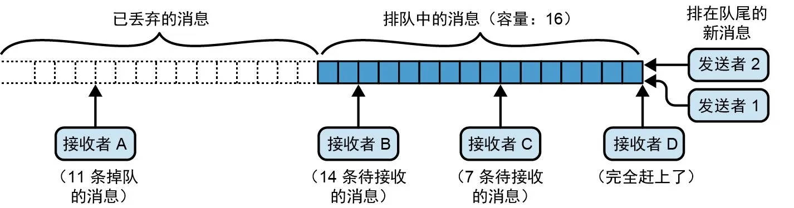

# 第20章异步编程(2)

## 20.2　异步客户端与服务器

现在，我们要把这些已讨论过的关键思想组合成一个真正可用的程序。在很大程度上，异步应用程序和普通的多线程应用程序非常相似，但在某些需要紧凑而且富有表现力的代码的场合，异步编程可以大显身手。

本节的示例是聊天服务器和客户端。真正的聊天系统是很复杂的，涉及从安全、重新连接到隐私和内部审核的各种问题，但我们已将此系统缩减为一组非常基础的特性，来把注意力聚焦于少数我们感兴趣的要点上。

特别是，我们希望能好好处理背压。也就是说，即使一个客户端的网络连接速度较慢或完全断开连接，也绝不能影响其他客户端按照自己的节奏交换消息。由于“龟速”客户端不应该让服务器花费无限的内存来保存其不断增长的积压消息，因此我们的服务器应该丢弃那些发给掉队客户端的消息，但也有义务提醒他们其信息流不完整。（一个真正的聊天服务器会将消息记录到磁盘并允许客户端检索他们错过的消息，但这里不考虑那样做。）

```
使用命令 cargo new --lib async-chat 启动项目，并将以下文本放入 async-
```

chat/Cargo.toml 中：


```
[package]
name = "async-chat"
version = "0.1.0"
authors = ["You <you@example.com>"]
edition = "2021"
[dependencies]
async-std = { version = "1.7", features = ["unstable"] }
tokio = { version = "1.0", features = ["sync"] }
serde = { version = "1.0", features = ["derive", "rc"] }
serde_json = "1.0"
```

我们依赖于 4 个 crate。

```
async-std crate 是本章中一直在用的异步 I/O 基础构件和实用工具的集合。
tokio crate 是类似于 async-std crate 的另一个异步基础构件集合，它也是最古老且最
成熟的 crate 之一。tokio crate 应用广泛，设计和实现的标准都很高，但使用时需要比
async-std crate 更加小心。
tokio 是一个大型 crate，但我们只需要其中的一个组件，因此 Cargo.toml 依赖行中的
features = ["sync"] 字段将 tokio 缩减为了我们需要的部分，使其成为一种轻型依
赖。当异步库生态系统还不太成熟时，人们会避免在同一个程序中同时使用 tokio 和
async-std。不过，只要遵循这两个项目各自 crate 文档中的规则，就可以在同一个程序
```

- 中使用。

```
serde 和 serde_json 是第 18 章中介绍过的两个 crate。它们为我们提供了方便且高效
```

- 的工具来生成和解析 JSON，我们的聊天协议使用 JSON 来表示网络上的数据。我们想使

```
用 serde 的一些可选特性，因此会在提供依赖项时选择它们。
```

我们的聊天应用程序、客户端和服务器的整体结构如下所示：

```
async-chat
├── Cargo.toml
└── src
   ├── lib.rs
   ├── utils.rs
   └── bin
       ├── client.rs
       └── server
           ├── main.rs
           ├── connection.rs
           ├── group.rs
           └── group_table.rs
```

这个包的布局使用了 8.4 节中提到的一项 Cargo 特性：除了主库 crate src/lib.rs 及其子模块src/utils.rs，还包括两个可执行文件。

- src/bin/client.rs 是聊天客户端的单文件可执行文件。

```
src/bin/server 是服务端的可执行文件，分布在 4 个文件中：main.rs 包含 main 函数，另
```

- 外 3 个子模块分别是 connection.rs、group.rs 和 group_table.rs。

我们将在本章中展示每个源文件的内容，如果它们都就位了，那么一旦在此目录树中键入

```
cargo build，就会编译库的 crate，然后构建出两个可执行文件。Cargo 会自动包含库的
crate 作为依赖项，使其成为放置客户端和服务器共享定义的约定位置。同样，cargo
check 会检查整棵源代码树。要运行任何一个可执行文件，可以使用如下命令：
$ cargo run --release --bin server -- localhost:8088
$ cargo run --release --bin client -- localhost:8088
```

```
--bin 选项会指出要运行哪个可执行文件，而 -- 选项后面的任何参数都会传给可执行文件
```

本身。我们的客户端和服务器只希望知道服务器的地址和 TCP 端口。

### 20.2.1　Error 类型与 Result 类型

```
库 crate 的 utils 模块定义了要在整个应用程序中使用的 Error 类型与 Result 类型。以
```

下来自 src/utils.rs：

```
use std::error::Error;
pub type ChatError = Box<dyn Error + Send + Sync + 'static>;
pub type ChatResult<T> = Result<T, ChatError>;
这些是我们在 7.2.5 节中建议的泛型错误类型。async_std crate、serde_json crate 和
tokio crate 也分别定义了自己的错误类型，但是 ? 运算符可以自动将它们全部转换为
ChatError，这是借助标准库的 From 特型实现的，该特型可以将任何合适的错误类型转换
为 Box<dyn Error + Send + Sync + 'static> 类型。类型限界 Send 和 Sync 会确
```

保，如果在另一个线程中启动的任务失败，那么它可以安全地将错误报告给主线程。

```
在实际的应用程序中，请考虑使用 anyhow crate，它提供了与这里类似的 Error 类型和
Result 类型。anyhow crate 易于使用，而且提供了一些超越 ChatError 和 ChatResult
```

的优秀特性。

### 20.2.2　协议

库 crate 以下面这两种类型来支持整个聊天协议，这是在 lib.rs 中定义的：

```
use serde::;
use std::sync::Arc;
pub mod utils;
#[derive(Debug, Deserialize, Serialize, PartialEq)]
```

```
pub enum FromClient {
   Join { group_name: Arc<String> },
   Post {
```

```javascript
       group_name: Arc<String>,
       message: Arc<String>,
   },
}
#[derive(Debug, Deserialize, Serialize, PartialEq)]
pub enum FromServer {
   Message {
       group_name: Arc<String>,
       message: Arc<String>,
   },
   Error(String),
}
#[test]
fn test_fromclient_json() {
   use std::sync::Arc;
   let from_client = FromClient::Post {
       group_name: Arc::new("Dogs".to_string()),
       message: Arc::new("Samoyeds rock!".to_string()),
   };
   let json = serde_json::to_string(&from_client).unwrap();
   assert_eq!(json,
              r#"{"Post":{"group_name":"Dogs","message":"Samoyeds rock!"}}"#);
   assert_eq!(serde_json::from_str::<FromClient>(&json).unwrap(),
              from_client);
}
FromClient 枚举表示可以从客户端发送到服务器的数据包：它可以请求加入一个组或向已
加入的任何组发布消息。FromServer 表示可以由服务器发回的内容，即发布到某个组的消
息或错误消息。可以使用带引用计数的 Arc<String> 而不是普通的 String，这有助于服
```

务器在管理组和分发消息时避免复制字符串。

```
#[derive] 属性要求 serde crate 为 FromClient 和 FromServer 生成其 Serialize
特型和 Deserialize 特型的实现。这样一来，就可以调用 serde_json::to_string 将
它们转换为 JSON 值，通过网络进行发送，最后再调用 serde_json::from_str 转换回它
```

们的 Rust 形式。

```
test_fromclient_json 这个单元测试演示了它的用法。给定由 serde 派生的
Serialize 实现，可以调用 serde_json::to_string 将给定的 FromClient 值转换为
```

这样的 JSON：

```json
{"Post":{"group_name":"Dogs","message":"Samoyeds rock!"}}
然后，派生出的 Deserialize 实现会将其解析回等效的 FromClient 值。请注意，
FromClient 中的 Arc 指针对其序列化形式没有任何影响：引用计数字符串会直接显示为
```

JSON 对象成员的值。

### 20.2.3　获取用户输入：异步流

我们的聊天客户端的首要职责是读取用户的命令并将相应的数据包发送到服务器。管理一个合适的用户界面超出了本章的范围，所以我们将做最简单可行的事情：直接从标准输入中读取行。以下代码位于 src/bin/client.rs 中：

```javascript
use async_std::prelude::*;
use async_chat::utils::;
use async_std::io;
use async_std::net;
async fn send_commands(mut to_server: net::TcpStream) -> ChatResult<()> {
   println!("Commands:\n\
             join GROUP\n\
             post GROUP MESSAGE...\n\
             Type Control-D (on Unix) or Control-Z (on Windows) \
             to close the connection.");
   let mut command_lines = io::BufReader::new(io::stdin()).lines();
   while let Some(command_result) = command_lines.next().await {
       let command = command_result?;
       // 参见GitHub存储库中对`parse_command`的定义
       let request = match parse_command(&command) {
           Some(request) => request,
           None => continue,
       };
       utils::send_as_json(&mut to_server, &request).await?;
       to_server.flush().await?;
   }
   Ok(())
}
这会调用 async_std::io::stdin 来获取客户端标准输入的异步句柄，并包装在
async_std::io::BufReader 中对其进行缓冲，然后调用 lines 逐行处理用户的输入。
它会尝试将每一行解析为与某个 FromClient 值相对应的命令，如果成功，就将该值发送到
服务器。如果用户输入了无法识别的命令，那么 parse_command 就会打印一条错误消息并
```

```
返回 None，以便 send_commands 可以重新开始循环。如果用户键入了文件结束（EOF）
```

```
指示符，则 lines 流会返回 None，并且 send_commands 也会返回。此代码与你在普通同
步程序中编写的代码非常相似，只不过它使用的是 async_std 版本的库特性。
异步 BufReader 的 lines 方法很有趣。它没有像标准库那样返回一个迭代器：
Iterator::next 方法是一个普通的同步函数，因此调用 command_lines.next() 会阻
塞线程，直到下一行代码就绪。而这里的 lines 会返回一个 Result<String> 值组成的
```

流。流是迭代器的异步模拟，它会用异步友好的方式按需生成一系列值。下面是

```
async_std::stream 模块中 Stream 特型的定义：
trait Stream {
   type Item;
   // 现在，把`Pin<&mut Self>`读取为`&mut Self`
   fn poll_next(self: Pin<&mut Self>, cx: &mut Context<'_>)
       -> Poll<Option<Self::Item>>;
}
可以将 Stream 特型视为 Iterator 特型和 Future 特型的混合体。与迭代器一样，
Stream 也有关联的 Item 类型，并使用 Option 来指示序列何时结束。同时，与 Future
一样，流必须被轮询：要获取下一个条目（或了解流是否结束），就必须调用 poll_next 直
到它返回 Poll::Ready。流的 poll_next 实现应该总是快速返回，不会阻塞。如果流返回
了 Poll::Pending，则必须在值得再次轮询时通过 Context 通知调用者。
poll_next 方法很难直接使用，不过通常也不需要直接使用该方法。与迭代器一样，流有很
多实用方法，比如 filter 和 map。在这些方法中，有一个 next 方法，它会返回流中下一
个 Option<Self::Item> 的 Future。可以调用 next 并等待它返回的 Future，而不必
```

显式轮询流。

```javascript
把这些片段结合起来看，send_commands 会利用 while let 和 next 循环遍历输入行组
```

成的流来消耗这个流：

```javascript
while let Some(item) = stream.next().await {
```

```
   ……使用条目……
}
（Rust 可能会在未来版本中引入可用来消耗流的异步 for 循环，就像普通 for 循环能消耗
Iterator 值一样。）
在流结束后（也就是说，在流返回 Poll::Ready(None) 指出流已结束之后）轮询流，就像
在迭代器返回 None 之后调用 next，或者在 Future 返回 Poll::Ready 之后轮询
Future：Stream 特型没有规定此时流应该怎么做，某些流可能行为诡异。与 Future 和迭
代器一样，流也有一个 fuse 方法来确保此类调用的行为在必要时是可预测的。有关详细信
```

息，请参阅在线文档。

```
使用流时，务必记住使用 async_std 预导入：
use async_std::prelude::*;
这是因为 Stream 特型的实用方法（如 next、map、filter 等）实际上并没有定义在自身
上，而是单独特型 StreamExt 上的默认方法，该特型会自动为所有 Stream 实现：
pub trait StreamExt: Stream {
   ……把一些实用工具方法定义为默认方法……
}
impl<T: Stream> StreamExt for T { }
这是 11.2.2 节描述的扩展特型模式的示例。async_std::prelude 模块会将 StreamExt
```

方法引入作用域，因此使用预导入可以确保这些方法在你的代码中可见。

### 20.2.4　发送数据包

```
为了在网络套接字上传输数据包，我们的客户端和服务器会使用库 crate 的 utils 模块中的
```

```javascript
send_as_json 函数：
use async_std::prelude::*;
use serde::Serialize;
use std::marker::Unpin;
pub async fn send_as_json<S, P>(outbound: &mut S, packet: &P) -> ChatResult<()>
where
   S: async_std::io::Write + Unpin,
   P: Serialize,
{
   let mut json = serde_json::to_string(&packet)?;
   json.push('\n');
   outbound.write_all(json.as_bytes()).await?;
   Ok(())
}
这个函数会将 packet 的 JSON 表示形式构建为 String，在末尾添加换行符，然后将其全
部写入 outbound。
从这个函数的 where 子句可以看出 send_as_json 非常灵活。要发送的数据包类型 P 可以
是任何实现了 serde::Serialize 的值。输出流 S 可以是任何实现了
async_std::io::Write（输出流的 std::io::Write 特型的异步版本）的值。这足以
让我们在异步 TcpStream 上发送 FromClient 值和 FromServer 值。只要遵守
send_as_json 的泛型定义，就能确保它不会意外依赖于流类型或数据包类型的细节，因为
send_as_json 只能使用来自这些特型的方法。
使用 write_all 方法需要满足 S 上的 Unpin 约束。本章在后面会介绍 Pin 和 Unpin，但
就目前而言，只要在必要时向类型变量中添加 Unpin 约束就足够了，如果忘记了，Rust 编译
```

器会帮你指出这些问题。

```
send_as_json 没有将数据包直接序列化到 outbound 流，而是将其序列化为临时
```

```
String，然后写入 outbound 中。serde_json crate 确实提供了将值直接序列化为输出流
的函数，但这些函数只支持同步流。要想写入异步流，就要对 serde_json 和 serde 这两
```

个 crate 中与格式无关的核心代码进行根本性更改，因为围绕它们设计的特型都有一些同步方法。

```
与流一样，async_std 的 I/O 特型的许多方法实际上是在其扩展特型上定义的，因此在使用
它们时请务必记住 use async_std::prelude::*。
```

### 20.2.5　接收数据包：更多异步流

```javascript
为了接收数据包，我们的服务器和客户端将使用一个来自 utils 模块的函数从异步缓冲的
TCP 套接字（async_std::io::BufReader<TcpStream>）中接收 FromClient 值和
FromServer 值：
use serde::de::DeserializeOwned;
pub fn receive_as_json<S, P>(inbound: S) -> impl Stream<Item = ChatResult<P>>
   where S: async_std::io::BufRead + Unpin,
         P: DeserializeOwned,
{
   inbound.lines()
       .map(|line_result| -> ChatResult<P> {
           let line = line_result?;
           let parsed = serde_json::from_str::<P>(&line)?;
           Ok(parsed)
       })
}
与 send_as_json 一样，这个函数的输入流类型和数据包类型是泛型的。
流类型 S 必须实现 async_std::io::BufRead，这是 std::io::BufRead 的异步模
```

- 拟，表示缓冲输入字节流。

```
数据包类型 P 必须实现 DeserializeOwned，这是 serde 的 Deserialize 特型的更
严格变体。为了提高效率，Deserialize 可以生成 &str 值和 &[u8] 值，这些值会直接
```

- 从反序列化的缓冲区中借用它们的内容，以免复制数据。然而，在上面的例子中，这样做可

- 不太好：我们要将反序列化后的值返回给调用者，因此它们的生命周期必须超出被解析的缓

```
冲区。实现了 DeserializeOwned 的类型始终独立于被反序列化的缓冲区。
```

```
调用 inbound.lines() 会为我们提供一个携带 std::io::Result<String> 值的
Stream。然后，使用流的 map 适配器对每个条目应用一个闭包，处理错误并将每一行都解
析为 P 类型值的 JSON 形式。这就生成了一个携带 ChatResult<P> 值的流，我们直接将其
```

返回。该函数的返回类型如下所示：

```
impl Stream<Item = ChatResult<P>>
这表示我们返回了某种会异步生成 ChatResult<P> 值序列的类型，但我们的调用者无法准
确判断是哪种类型。由于传给 map 的闭包无论如何都是匿名类型，因此这已经是
receive_as_json 可能返回的最具体的类型了。
请注意，receive_as_json 本身并不是异步函数，它是会返回一个异步值（一个流）的普
通函数。现在，比起“只在某些地方添加 async 与 .await”，你更深入地理解了 Rust 的异步
```

支持机制，能够写出清晰、灵活和高效的定义，就像刚才这个充分发挥出语言特性的定义一样。

```
要想了解 receive_as_json 的用法，可以看看下面这个来自 src/bin/client.rs 的聊天客户端
的 handle_replies 函数，该函数会从网络接收 FromServer 的值流并将它们打印出来供
```

用户查看：

```javascript
use async_chat::FromServer;
async fn handle_replies(from_server: net::TcpStream) -> ChatResult<()> {
   let buffered = io::BufReader::new(from_server);
   let mut reply_stream = utils::receive_as_json(buffered);
   while let Some(reply) = reply_stream.next().await {
       match reply? {
           FromServer::Message { group_name, message } => {
               println!("message posted to {}: {}", group_name, message);
```

```
           }
           FromServer::Error(message) => {
               println!("error from server: {}", message);
```

```javascript
           }
       }
   }
   Ok(())
}
这个函数会接受一个从服务器接收数据的套接字，把它包装进 BufReader（请注意，这是
async_std 版本），然后将其传给 receive_as_json 以获取传入的 FromServer 值流。
接下来它会用 while let 循环来处理传入的回复，检查错误结果并打印每个服务器的回复以
```

供用户查看。

### 20.2.6　客户端的 main 函数

```
介绍完 send_commands 和 handle_replies，现在可以展示聊天客户端的 main 函数
```

了，该函数来自 src/bin/client.rs：

```javascript
use async_std::task;
fn main() -> ChatResult<()> {
   let address = std::env::args().nth(1)
       .expect("Usage: client ADDRESS:PORT");
   task::block_on(async {
       let socket = net::TcpStream::connect(address).await?;
       socket.set_nodelay(true)?;
       let to_server = send_commands(socket.clone());
       let from_server = handle_replies(socket);
       from_server.race(to_server).await?;
       Ok(())
   })
}
```

```
从命令行获取服务器地址后，main 要调用一系列异步函数，因此它会将函数的其余部分都包
装在一个异步块中，并将该块返回的 Future 传给 async_std::task::block_on 来运
```

行。

```
建立连接后，我们希望 send_commands 函数和 handle_replies 函数双线运行，这样就
```

可以在键入的同时看到别人发来的消息。如果遇到了 EOF 指示器或者与服务器的连接断开了，那么程序就应该退出。

考虑到我们在本章其他地方所做的工作，你可能想要写出这样的代码：

```javascript
let to_server = task::spawn(send_commands(socket.clone()));
let from_server = task::spawn(handle_replies(socket));
to_server.await?;
from_server.await?;
但由于我们在等待两个 JoinHandle，这会让程序在两个任务都完成后才能退出。但我们希
望只要任何一个完成就立即退出。Future 上的 race（赛跑）方法可以满足这一要求。调用
from_server.race(to_server) 会返回一个新的 Future，它会同时轮询
from_server 和 to_server，并在二者之一就绪时返回 Poll::Ready(v)。这两个
Future 必须具有相同的输出类型，其最终值是先完成的那个 Future 的值。未完成的
Future 会被丢弃。
race 方法以及许多其他的便捷工具都是在 async_std::prelude::FutureExt 特型上定
义的，async_std::prelude 能让它对我们可见。
迄今为止，我们唯一没有展示过的客户端代码是 parse_command 函数。这是一目了然的文
```

本处理代码，所以这里就不展示它的定义了。有关详细信息，请参阅 Git 库中的完整代码。

### 20.2.7　服务器的 main 函数

以下是服务器主文件 src/bin/server/main.rs 的全部内容：

```javascript
use async_std::prelude::*;
use async_chat::utils::ChatResult;
use std::sync::Arc;
mod connection;
mod group;
mod group_table;
use connection::serve;
fn main() -> ChatResult<()> {
   let address = std::env::args().nth(1).expect("Usage: server ADDRESS");
   let chat_group_table = Arc::new(group_table::GroupTable::new());
   async_std::task::block_on(async {
       // 下面这段代码曾在本章的章节介绍中展示过
       use async_std::;
       let listener = net::TcpListener::bind(address).await?;
       let mut new_connections = listener.incoming();
       while let Some(socket_result) = new_connections.next().await {
           let socket = socket_result?;
           let groups = chat_group_table.clone();
           task::spawn(async {
               log_error(serve(socket, groups).await);
           });
       }
       Ok(())
   })
}
fn log_error(result: ChatResult<()>) {
   if let Err(error) = result {
       eprintln!("Error: {}", error);
   }
}
服务器的 main 函数和客户端的 main 函数类似：它会先进行一些设置，然后调用
block_on 来运行一个异步块以完成真正的工作。为了处理来自客户端的传入连接，它创建
了 TcpListener 套接字，其 incoming 方法会返回一个
```

```
std::io::Result<TcpStream> 值流。
```

```
对于每个传入的连接，我们都会启动一个运行 connection::serve 函数的异步任务。每个
任务还会收到一个 GroupTable 值的引用，该值表示服务器的当前聊天组列表，由所有连接
通过 Arc 引用计数指针共享。
```

```
如果 connection::serve 返回错误，我们就会将一条消息记录到标准错误并让任务退出，
```

其他连接则照常运行。

### 20.2.8　处理聊天连接：异步互斥锁

```
下面这些位于 src/bin/server/connection.rs 的 connection 模块中的 serve 函数是服务器的
```

主要工作代码：

```javascript
use async_chat::;
use async_chat::utils::;
use async_std::prelude::*;
use async_std::io::BufReader;
use async_std::net::TcpStream;
use async_std::sync::Arc;
use crate::group_table::GroupTable;
pub async fn serve(socket: TcpStream, groups: Arc<GroupTable>)
                  -> ChatResult<()>
{
   let outbound = Arc::new(Outbound::new(socket.clone()));
   let buffered = BufReader::new(socket);
   let mut from_client = utils::receive_as_json(buffered);
   while let Some(request_result) = from_client.next().await {
       let request = request_result?;
       let result = match request {
           FromClient::Join { group_name } => {
               let group = groups.get_or_create(group_name);
               group.join(outbound.clone());
               Ok(())
```

```
           }
```

```javascript
           FromClient::Post { group_name, message } => {
               match groups.get(&group_name) {
                   Some(group) => {
                       group.post(message);
                       Ok(())
                   }
                   None => {
                       Err(format!("Group '{}' does not exist", group_name))
                   }
               }
           }
       };
       if let Err(message) = result {
           let report = FromServer::Error(message);
           outbound.send(report).await?;
       }
   }
   Ok(())
}
这几乎就是客户端的 handle_replies 函数的镜像：大部分代码是一个循环，用于处理传入
的 FromClient 值的流，它是从带有 receive_as_json 的缓冲 TCP 流构建出来的。如果
发生错误，就会生成一个 FromServer::Error 数据包，将坏消息传回给客户端。
```

除了错误消息，客户端还希望接收来自他们已加入的聊天组的消息，因此需要与每个组共享和

```
客户端的连接。虽然可以简单地为每个人提供一份 TcpStream 的克隆，但是如果其中两个源
```

试图同时将数据包写入套接字，那么他们的输出就可能彼此交叉，并且客户端最终会收到乱码JSON。我们需要对此连接安排安全的并发访问。

```
这是使用 Outbound 类型管理的，在 src/bin/server/connection.rs 中的定义如下所示：
use async_std::sync::Mutex;
pub struct Outbound(Mutex<TcpStream>);
```

```
impl Outbound {
   pub fn new(to_client: TcpStream) -> Outbound {
       Outbound(Mutex::new(to_client))
```

```javascript
   }
   pub async fn send(&self, packet: FromServer) -> ChatResult<()> {
       let mut guard = self.0.lock().await;
       utils::send_as_json(&mut *guard, &packet).await?;
       guard.flush().await?;
       Ok(())
   }
}
Outbound 值在创建时会获得 TcpStream 的所有权并将其包装在 Mutex 中以确保一次只有
一个任务可以使用它。serve 函数会将每个 Outbound 包装在一个 Arc 引用计数指针中，
以便客户端加入的所有组都可以指向同一个共享的 Outbound 实例。
调用 Outbound::send 时会首先锁定互斥锁，返回一个可解引用为内部 TcpStream 的守卫
值。我们使用 send_as_json 来传输 packet，最后会调用 guard.flush() 来确保它不
会在某处缓冲区进行不完整传输。（据我们所知，TcpStream 实际上并不会缓冲数据，但
Write 特型确实允许它的实现这样做，所以不应该冒这个险。）
表达式 &mut *guard 可以帮我们解决 Rust 不会通过隐式解引用来满足特型限界的问题。我
们会显式解引用互斥锁守卫，得到受保护的 TcpStream，然后借用一个可变引用，生成
send_as_json 所需的 &mut TcpStream。
请注意，Outbound 会使用 async_std::sync::Mutex 类型，而不是标准库的 Mutex。
```

原因有以下 3 点。

```
首先，如果任务在持有互斥锁守卫时被挂起，那么标准库的 Mutex 可能会行为诡异。如果一
直运行该任务的线程选择了另一个试图锁定同一 Mutex 的任务，那么麻烦就会随之而来：从
Mutex 的角度来看，已经拥有它的线程正试图再次锁定它。标准的 Mutex 不是为处理这种情
```

况而设计的，因此会发生 panic 或死锁。（它永远不会以不恰当的方式授予锁。）Rust 团队正

```
在进行的一项工作就是在编译期检测到这个问题，并当 std::sync::Mutex 守卫运行在
await 表达式中时发出警告。由于 Outbound::send 在等待 send_as_json 和
```

```
guard.flush 返回的 Future 时需要持有锁，因此它必须使用 async_std 的 Mutex。
```

```
其次，异步 Mutex 的 lock 方法会返回一个守卫的 Future，因此正在等待互斥锁的任务会
将其线程让给别的任务使用，直到互斥锁就绪。（如果互斥锁已然可用，则此 lock 的
Future 会立即就绪，任务根本不会自行挂起。）另外，标准库 Mutex 的 lock 方法在等待
```

获取锁期间会锁定整个线程。由于前面的代码在通过网络传输数据包时持有互斥锁，因此这种等待可能会持续相当长的时间。

```
最后，标准库 Mutex 必须由锁定它的同一个线程解锁。为了强制执行此操作，标准库互斥锁
的守卫类型没有实现 Send，它不能传输到其他线程。这意味着持有这种守卫的 Future 本身
不会实现 Send，并且不能传给 spawn 以在线程池中运行，它只能与 block_on 或
spawn_local 一起使用。而 async_std Mutex 的守卫实现了 Send，因此在已启动的任
```

务中使用它没有问题。

### 20.2.9　群组表：同步互斥锁

```
但前面所讲的那些并不能导向“在异步代码中应该始终使用 async_std::sync::Mutex”这
```

样简单的结论。通常在持有互斥锁时不需要等待任何东西，并且这种锁定不会持续太久。在这

```
种情况下，标准库的 Mutex 效率会更高。聊天服务器的 GroupTable 类型就说明了这种情
```

况。以下是 src/bin/server/group_table.rs 的全部内容：

```
use crate::group::Group;
use std::collections::HashMap;
use std::sync::;
pub struct GroupTable(Mutex<HashMap<Arc<String>, Arc<Group>>>);
impl GroupTable {
   pub fn new() -> GroupTable {
       GroupTable(Mutex::new(HashMap::new()))
   }
   pub fn get(&self, name: &String) -> Option<Arc<Group>> {
       self.0.lock()
           .unwrap()
           .get(name)
           .cloned()
   }
```

```
   pub fn get_or_create(&self, name: Arc<String>) -> Arc<Group> {
       self.0.lock()
```

```
           .unwrap()
       .entry(name.clone())
       .or_insert_with(|| Arc::new(Group::new(name)))
       .clone()
   }
}
GroupTable 只是一个受互斥锁保护的哈希表，它会将聊天组名称映射到实际组，两者都使
用引用计数指针进行管理。get 方法和 get_or_create 方法会锁定互斥锁，执行一些哈希
```

表操作，可能还会做一些内存分配，然后返回。

```
在 GroupTable 中，我们会使用普通的旧式 std::sync::Mutex。此模块中根本没有异步
代码，因此无须避免 await。事实上，如果想在这里使用 async_std::sync::Mutex，就
要将 get 和 get_or_create 变成异步函数，这会引入 Future 创建、暂停和恢复的开
```

销，但收益甚微：互斥锁只会在一些哈希操作和可能出现的少量内存分配上锁定。

```
如果聊天服务器发现自己拥有数百万用户，并且 GroupTable 的互斥锁确实成了瓶颈，那么
```

就算把它变成异步形式也无法解决该问题。使用某种专门用于并发访问的集合类型来代替

```
HashMap 可能会好一些。例如，dashmap crate 就提供了这样一个类型。
```

### 20.2.10　聊天组：tokio 的广播通道

```
在我们的服务器中，group::Group 类型代表一个聊天组。该类型只需要支持
connection::serve 调用的两个方法：join 用于添加新成员，post 用于发布消息。发
```

布的每条消息都要分发给所有成员。

现在我们来解决前面提过的背压大挑战。有几项需求相互掣肘。

- 如果一个成员无法跟上发布到群组的消息（比如，其网络连接速度较慢），则群组中的其他成员不应受到影响。

- 即使某个成员掉线了，也应该有办法重新加入对话并以某种方式继续参与。

- 用于缓冲消息的内存不应无限制地增长。

```
因为这些挑战在实现多对多通信模式时很常见，所以 tokio crate 提供了一种广播通道类型，
可以对这些挑战进行合理的权衡。tokio 广播通道是一个值队列（在这个例子中就是聊天消
```

息），它允许任意数量的不同线程或任务发送值和接收值。之所以称为“广播”通道，是因为每个

```
消费者都会获得这里发出的每个值的副本。（这个值的类型必须实现了 Clone。）
```

通常，广播通道会在队列中把一条消息保留到每个消费者都获得了它的副本为止。但是，如果队列的长度超过通道的最大容量（在创建通道时指定），那么最旧的消息将被丢弃。任何掉队的消费者在下次尝试获取下一条消息时都会收到错误消息，并且通道会让他们赶上仍然可用的最旧消息。

例如，图 20-4 展示了一个最大容量为 16 个值的广播通道。



```
图 20-4：tokio 广播通道
```

有 2 个发送方会将消息排入队列，4 个接收方会将消息从队列中取出——或者更准确地说，是将消息从队列中复制出来。接收者 B 还有 14 条消息要接收，接收者 C 还有 7 条，接收者 D已经完全赶上了。接收者 A 掉队了，有 11 条消息在它看到之前就被丢弃了。它的下一次接收消息的尝试将失败，然后会返回一个错误以说明情况，并快进到队列的当前尾部。

```
聊天服务器会将每个聊天组都表示为承载 Arc<String> 值的广播通道：向该组发布消息会
将消息广播给所有当前成员。下面是 src/bin/server/group.rs 中的 group::Group 类型的定
```

义：

```
use async_std::task;
use crate::connection::Outbound;
```

```javascript
use std::sync::Arc;
use tokio::sync::broadcast;
pub struct Group {
   name: Arc<String>,
   sender: broadcast::Sender<Arc<String>>
}
impl Group {
   pub fn new(name: Arc<String>) -> Group {
       let (sender, _receiver) = broadcast::channel(1000);
       Group { name, sender }
   }
   pub fn join(&self, outbound: Arc<Outbound>) {
       let receiver = self.sender.subscribe();
       task::spawn(handle_subscriber(self.name.clone(),
                                     receiver,
                                     outbound));
   }
   pub fn post(&self, message: Arc<String>) {
       // 这只会在没有订阅者时返回错误。连接的发送端可能会退出，并恰好赶在其
       // 接收端回复之前丢弃订阅，这可能会最终导致接收端试图向空组回复消息
       let _ignored = self.sender.send(message);
   }
}
Group 结构体中包含聊天组的名称，以及表示组广播通道发送端的 broadcast::Sender。
Group::new 函数会调用 broadcast::channel 创建一个最大容量为 1000 条消息的广播
通道。channel 函数会返回发送者和接收者，但此时我们不需要接收者，因为组中还没有任
```

何成员。

```
要向组中添加新成员，Group::join 方法会调用发送者的 subscribe 方法来为通道创建新
的接收者。然后聊天组会在 handle_subscribe 函数中启动一个新的异步任务来监视消息
```

的接收者并将它们写回客户端。

```
有了这些细节，Group::post 方法就很简单了：它只是将消息发送到广播通道。由于通道携
带的值是 Arc<String> 型的值，因此为每个接收者提供自己的消息副本只会增加消息的引
```

用计数，不会进行任何复制或堆分配。一旦所有订阅者都传输了这条消息，引用计数就会降为0，并且此消息会被释放。

```javascript
下面是 handle_subscriber 的定义：
use async_chat::FromServer;
use tokio::sync::broadcast::error::RecvError;
async fn handle_subscriber(group_name: Arc<String>,
                          mut receiver: broadcast::Receiver<Arc<String>>,
                          outbound: Arc<Outbound>)
{
   loop {
       let packet = match receiver.recv().await {
           Ok(message) => FromServer::Message {
               group_name: group_name.clone(),
               message: message.clone(),
           },
           Err(RecvError::Lagged(n)) => FromServer::Error(
               format!("Dropped {} messages from {}.", n, group_name)
           ),
           Err(RecvError::Closed) => break,
       };
       if outbound.send(packet).await.is_err() {
           break;
       }
   }
}
```

尽管细节略有不同，但此函数的形式我们很熟悉：它是一个循环，从广播通道接收消息并通过

```
共享的 Outbound 值将消息传输回客户端。如果此循环跟不上广播通道，它就会收到一个
Lagged 错误，并会尽职尽责地报告给客户端。
```

如果将数据包发送回客户端时完全失败了，那么可能是因为连接已关闭，

```
handle_subscriber 退出其循环并返回，导致异步任务退出。这会丢弃广播通道的
```

```
Receiver，并取消订阅该通道。这样，当连接断开时，它的每个组成员身份都会在下次该组
```

试图向它发送消息时被清除。

这个聊天组永远不会关闭，因为我们不会从群组表中移除一个组。但为完整性考虑，一旦遇到

```
Closed 错误，handle_subscriber 就会退出该任务。
```

请注意，我们正在为每个客户端的每个组成员创建一个新的异步任务。这之所以可行，是因为异步任务使用的内存要比线程少得多，而且在同一个进程中从一个异步任务切换到另一个异步任务效率非常高。

```
这就是聊天服务器的完整代码。它有点儿简陋，async_std crate、tokio crate 和
futures crate 中有许多比本书所讲更有价值的特性，但从理论上说，这个扩展示例已经阐明
```

了异步生态系统的一些特性是如何协同工作的：例子中有两种风格的异步任务、流、异步 I/O特型、通道和互斥锁。

## 20.3　原始 Future 与执行器：Future 什么时候值得再次轮询

```
聊天服务器展示了我们如何使用 TcpListener、broadcast 通道等异步原语来编写代码，
并使用 block_on、spawn 等执行器来驱动它们的执行。现在来看看这些操作是如何实现
的。关键问题是，当一个 Future 返回 Poll::Pending 时，应该如何与执行器协调，以便
```

在正确的时机再次轮询。

```javascript
想想当我们从聊天客户端的 main 函数运行如下代码时会发生什么：
task::block_on(async {
   let socket = net::TcpStream::connect(address).await?;
   ...
})
在 block_on 第一次轮询异步块的 Future 时，几乎可以肯定网络连接没有立即就绪，所以
```

```
block_on 进入了睡眠状态。那它应该在什么时候醒来呢？一旦网络连接就绪，TcpStream
就需要以某种方式告诉 block_on 应该再次尝试轮询异步块的 Future，因为它知道这一次
```

```
await 将完成，并且异步块的执行可以向前推进。
当像 block_on 这样的执行器轮询 Future 时，必须传入一个称为唤醒器（waker）的回
调。如果 Future 还没有就绪，那么 Future 特型的规则就会要求它必须暂时返回
Poll::Pending，并且如果 Future 值得再次轮询，就会安排在那时调用唤醒器。
所以 Future 的手写实现通常看起来是这样的：
use std::task::Waker;
struct MyPrimitiveFuture {
   ...
   waker: Option<Waker>,
}
impl Future for MyPrimitiveFuture {
   type Output = ...;
   fn poll(mut self: Pin<&mut Self>, cx: &mut Context<'_>) -> Poll<...> {
       ...
       if ... future is ready ... {
           return Poll::Ready(final_value);
       }
       // 保存此唤醒器以备后用
       self.waker = Some(cx.waker().clone());
       Poll::Pending
   }
}
换句话说，如果 Future 的值就绪了，就返回它。否则，将 Context 中唤醒器的克隆体存储
在某处，并返回 Poll::Pending。
当 Future 值得再次轮询时，它一定会通过调用其唤醒器的 wake 方法通知最后一个轮询它
```

的执行器：

```
// 如果有一个唤醒器，就调用它，并清除`self.waker`
```

```javascript
if let Some(waker) = self.waker.take() {
   waker.wake();
}
```

```
理论上，执行器和 Future 会轮流轮询和唤醒：执行器会轮询 Future 并进入休眠状态，然
后 Future 会调用唤醒器，这样，执行器就会醒来并再次轮询 Future。
异步函数和异步块的 Future 不会处理唤醒器本身，它们只会将自己获得的上下文传给要等
待的子 Future，并将保存和调用唤醒器的义务委托给这些子 Future。在我们的聊天客户端
中，对异步块返回的 Future 的第一次轮询只会在等待 TcpStream::connect 返回的
Future 时传递上下文（Context）。随后的轮询会同样将自己的上下文传给异步块接下来要
等待的任何 Future。
如前面的示例所示，TcpStream::connect 返回的 Future 会被轮询。也就是说，这些返
回的 Future 会将唤醒器转移给一个辅助线程，该线程会等待连接就绪，然后调用唤醒器。
Waker 实现了 Clone 和 Send，因此 Future 总是可以制作自己的唤醒器副本并根据需要将
其发送到其他线程。Waker::wake 方法会消耗此唤醒器。还有一个 wake_by_ref 方法，
```

该方法不会消耗唤醒器，但某些执行器可以更高效地实现消耗唤醒器的版本。（但这种差异充

```
其量也只是一次 clone 而已。）
执行器过度轮询 Future 并无害处，只会影响效率。然而，Future 应该只在轮询会取得实
```

际进展时才小心地调用唤醒器：虚假唤醒和轮询之间的循环调用可能会阻止执行器完全休眠，从而浪费电量并使处理器对其他任务的响应速度降低。

```
既然已经展示了执行器和原始 Future 是如何通信的，那么接下来我们就自己实现一个原始
Future，然后看看 block_on 执行器的实现。
```

### 20.3.1　调用唤醒器：spawn_blocking

```
本章在前面介绍过 spawn_blocking 函数，该函数会启动在另一个线程上运行的给定闭包，
```

```
并返回携带闭包返回值的 Future。现在，我们拥有实现 spawn_blocking 所需的所有“零
件”。为简单起见，我们的版本会为每个闭包创建一个新线程，而不是像 async_std 的版本
```

那样使用线程池。

```
尽管 spawn_blocking 会返回 Future，但我们并不会将其写成 async fn。相反，它将
作为普通的同步函数，返回一个 SpawnBlocking 结构体，我们会利用该结构体实现自己的
Future。
spawn_blocking 的签名如下所示：
pub fn spawn_blocking<T, F>(closure: F) -> SpawnBlocking<T>
where F: FnOnce() -> T,
     F: Send + 'static,
     T: Send + 'static,
由于需要将闭包发送到另一个线程并带回返回值，因此闭包 F 及其返回值 T 必须实现
Send。由于不知道线程会运行多长时间，因此它们也必须是 'static 的。这些限界与
std::thread::spawn 自身的强制限界是一样的。
SpawnBlocking<T> 是携带闭包返回值的 Future。下面是它的定义：
use std::sync::;
use std::task::Waker;
pub struct SpawnBlocking<T>(Arc<Mutex<Shared<T>>>);
struct Shared<T> {
   value: Option<T>,
   waker: Option<Waker>,
}
```

```javascript
Shared 结构体必须充当 Future 和运行闭包的线程之间的结合点，因此它由 Arc 拥有并受
Mutex 保护。（同步互斥锁在这里很好用。）轮询此 Future 会检查 value 是否存在，如果
不存在则将唤醒器保存在 waker 中。运行闭包的线程会将其返回值保存在 value 中，然后
调用 waker（如果存在的话）。
下面是 spawn_blocking 的完整定义：
pub fn spawn_blocking<T, F>(closure: F) -> SpawnBlocking<T>
where F: FnOnce() -> T,
     F: Send + 'static,
     T: Send + 'static,
{
   let inner = Arc::new(Mutex::new(Shared {
       value: None,
       waker: None,
   }));
   std::thread::spawn({
       let inner = inner.clone();
       move || {
           let value = closure();
           let maybe_waker = {
               let mut guard = inner.lock().unwrap();
               guard.value = Some(value);
               guard.waker.take()
           };
           if let Some(waker) = maybe_waker {
               waker.wake();
           }
       }
   });
   SpawnBlocking(inner)
}
```

```
创建 Shared 值后，就会启动一个线程来运行此闭包，将结果存储在 Shared 的 value 字
```

段中，并调用唤醒器（如果有的话）。

```javascript
可以为 SpawnBlocking 实现 Future，如下所示：
use std::future::Future;
use std::pin::Pin;
use std::task::;
impl<T: Send> Future for SpawnBlocking<T> {
   type Output = T;
   fn poll(self: Pin<&mut Self>, cx: &mut Context<'_>) -> Poll<T> {
       let mut guard = self.0.lock().unwrap();
       if let Some(value) = guard.value.take() {
           return Poll::Ready(value);
       }
       guard.waker = Some(cx.waker().clone());
       Poll::Pending
   }
}
轮询 SpawnBlocking 来检查闭包的值是否就绪，如果已经就绪，就接手这个值的所有权并
返回它。否则，Future 仍然处于 Pending 状态，因此它在 Future 的 waker 字段中保存
```

了此上下文中唤醒器的克隆体。

```
一旦 Future 返回了 Poll::Ready，就不应该再次对其进行轮询。诸如 await 和
block_on 之类消耗 Future 的常用方式都遵守这条规则。过度轮询 SpawnBlocking 型
Future 并不会发生什么可怕的事情，因此也不必花费精力来处理这种情况。这就是典型的手
写型 Future。
```

### 20.3.2　实现 block_on

```
除了能够实现原始 Future，我们还拥有构建简单执行器所需的全部“零件”。在本节中，我们
将编写自己的 block_on 版本。它会比 async_std 的版本简单很多，比如，它不支持
spawn_local、任务局部变量或嵌套调用（从异步代码调用 block_on）。但这已足够运行
```

我们的聊天客户端和服务器了。

代码如下所示：

```javascript
use waker_fn::waker_fn;      // Cargo.toml: waker-fn = "1.1"
use futures_lite::pin;       // Cargo.toml: futures-lite = "1.11"
use crossbeam::sync::Parker; // Cargo.toml: crossbeam = "0.8"
use std::future::Future;
use std::task::;
fn block_on<F: Future>(future: F) -> F::Output {
   let parker = Parker::new();
   let unparker = parker.unparker().clone();
   let waker = waker_fn(move || unparker.unpark());
   let mut context = Context::from_waker(&waker);
   pin!(future);
   loop {
       match future.as_mut().poll(&mut context) {
           Poll::Ready(value) => return value,
           Poll::Pending => parker.park(),
       }
   }
}
```

上述代码虽然很短，但做了很多事，我们慢慢讲。

```javascript
let parker = Parker::new();
let unparker = parker.unparker().clone();
crossbeam crate 的 Parker 类型是一个简单的阻塞原语：调用 parker.park() 阻塞线
程，直到其他人在相应的 Unparker（可以通过调用 parker.unparker() 预先获得）上调
用 .unpark()。如果要 unpark 一个尚未停泊（park）的线程，那么它的下一次 park 调
用将立即返回，而不会阻塞。这里的 block_on 将使用 Parker 在 Future 未就绪时等待，
```

```
而我们传给 Future 的唤醒器将解除停泊。
```

```javascript
let waker = waker_fn(move || unparker.unpark());
来自 waker_fn crate 的 waker_fn 函数会从给定的闭包创建一个 Waker。在这里，我们制
作了一个 Waker，当调用它时，它会调用闭包 move || unparker.unpark()。还可以通
过实现 std::task::Wake 特型来创建唤醒器，但这里用 waker_fn 更方便一些。
pin!(future);
```

- 4

```
给定一个携带 F 类型 Future 的变量，pin! 宏
会获取 Future 的所有权并声明一个同名
的新变量，其类型为 Pin<&mut F> 并借入了此 Future。这就为我们提供了 poll 方法所
需的 Pin<&mut Self>。异步函数和异步块返回的 Future 必须在轮询之前通过 Pin 换成
```

引用，20.4 节会对此进行解释。

```
loop {
   match future.as_mut().poll(&mut context) {
       Poll::Ready(value) => return value,
       Poll::Pending => parker.park(),
   }
}
最后，轮询循环非常简单。以一个携带唤醒器的上下文为入参，我们会轮询 Future 直到它
返回 Poll::Ready。如果返回的是 Poll::Pending，我们会暂停此线程，并阻塞到调用
了 waker 为止。放行后就再重试。
as_mut 调用能让我们在不放弃所有权的情况下对 future 进行轮询，20.4 节会对此进行详
```

细解释。

[4]：在 Rust 1.68 及以上版本中，标准库已经内置 宏。——译者注
