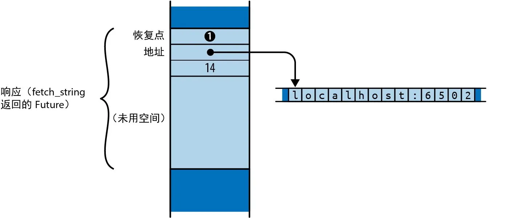
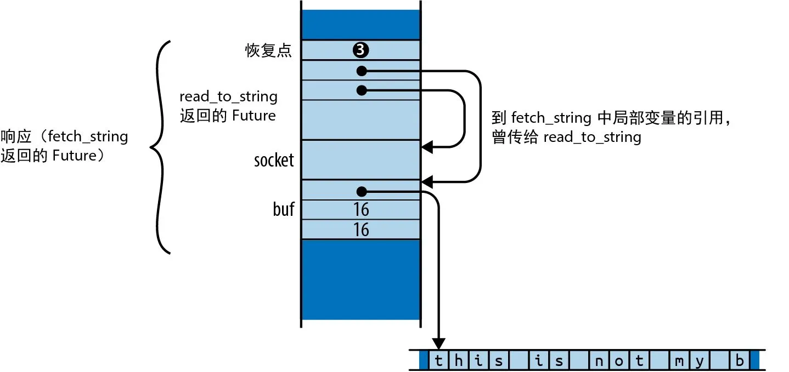
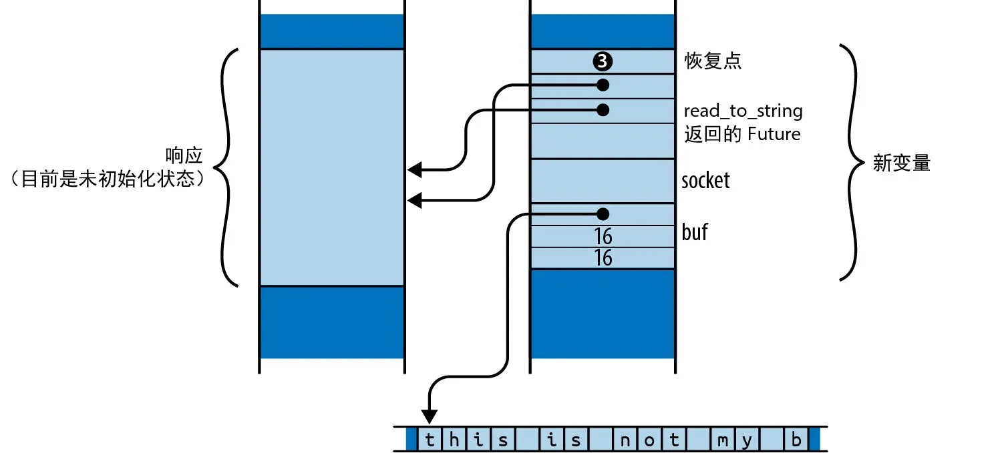

# 第20章异步编程(3)

- 5

## 20.4　固定（Pin）

```
尽管异步函数和异步块对于编写清晰的异步代码至关重要，但处理它们的 Future 时要小心
一点儿。Pin 类型有助于确保 Rust 安全地使用它们。
本节首先会展示为什么异步函数调用和异步块的 Future 不能像普通 Rust 值那样随意处理；
然后会展示 Pin 如何用作指针的“许可印章”，我们可以依靠这些“盖章指针”来安全地管理此类
Future；最后会展示几种使用 Pin 值的方法。
```

### 20.4.1　Future 生命周期的两个阶段

考虑下面这个简单的异步函数：

```javascript
use async_std::io::prelude::*;
use async_std::;
async fn fetch_string(address: &str) -> io::Result<String> {
   ➊
   let mut socket = net::TcpStream::connect(address).await➋?;
   let mut buf = String::new();
   socket.read_to_string(&mut buf).await➌?;
   Ok(buf)
}
这会打开到给定地址的 TCP 连接，并以 String 的形式返回服务器发送的任何内容。标有
```

➊、➋ 和 ➌ 的点是恢复点，即异步函数代码中可以暂停执行的点。

假设你调用它，但没有等待，就像下面这样：

```javascript
let response = fetch_string("localhost:6502");
现在 response 是一个 Future，它准备在 fetch_string 的开头开始执行，并带有给定
的参数。在内存中，Future 看起来如图 20-5 所示。
```



```
图 20-5：为调用 fetch_string 而构建的 Future
由于我们刚刚创建了这个 Future，因此它认为执行应该从函数体顶部的恢复点 ➊ 开始。在
这种状态下，Future 唯一能给出的值就是函数参数。
现在假设你对 response 进行了几次轮询，并且它在函数体中到达了下面这个点：
socket.read_to_string(&mut buf).await➌?;
进一步假设 read_to_string 的结果尚未就绪，因此轮询会返回 Poll::Pending。此
时，Future 看起来如图 20-6 所示。
```



```
图 20-6：同一个 Future，正在等待 read_to_string
Future 必须始终保存下一次轮询时恢复执行需要的所有信息。在这种情况下是如下内容。
恢复点 ➌，表示执行应该在 await 处恢复，那时正在轮询 read_to_string 返回的
Future。
在那个恢复点处于活动状态的变量：socket 和 buf。address 的值在 Future 中不会
```

- 再出现，因为该函数已不再需要它。

```
read_to_string 的子 Future，await 表达式正在对其进行轮询。
请注意，对 read_to_string 的调用借用了对 socket 和 buf 的引用。在同步函数中，所
有局部变量都存在于栈中，但在异步函数中，在 await 中仍然存活的局部变量必须位于
Future 中，这样当再次轮询时它们才是可用的。借入对这样一个变量的引用，就是借入了
Future 中的一部分。
然而，Rust 要求值在已借出时就不能再移动了。假设要将下面这个 Future 移动到一个新位
```

置：

```javascript
let new_variable = response;
Rust 无法找出所有活动引用并相应地调整它们。引用不会指向新位置的 socket 和 buf，而
是继续指向它们在当前处于未初始化状态的 response 中的旧位置。它们变成了悬空指针，
```

如图 20-7 所示。



```
图 20-7：fetch_string 返回的 Future，在已借出时移动（Rust 会阻止这样做）
```

防止已借出的值被移动通常是借用检查器的责任。借用检查器会将变量视为所有权树的根。但

```
与存储在栈中的变量不同，如果 Future 本身已移动，则存储在 Future 中的变量也会移
动。这意味着 socket 和 buf 的借用不仅会影响 fetch_string 可以用自己的变量做什
么，还会影响其调用者可以安全地用 response（也就是持有这些变量的 Future）做什
么。异步函数的 Future 是借用检查器的盲点，如果 Rust 想要保持其内存安全承诺，就必须
```

以某种方式解决这个问题。

```
Rust 对这个问题的解决方案基于这样一种洞见：Future 在首次创建时总是可以安全地移
动，只有在轮询时才会变得不安全。在一开始，通过调用异步函数创建的 Future 仅包含一
```

个恢复点和参数值。这些仅仅存在于尚未开始执行的异步函数主体的作用域内。只有当轮询

```
Future 时才会借用其内容。
由此可见，每一个 Future 的生命周期中都有两个阶段。
第一阶段从刚创建 Future 时开始。因为函数体还没有开始执行，所以它的任何部分都不
```

- 可能被借用。在这一点上，移动它和移动其他 Rust 值一样安全。

```
第二阶段在第一次轮询 Future 时开始。一旦函数的主体开始执行，它就可以借用对存储
在 Future 中的变量的引用，然后等待，保留对 Future 持有的变量的借用。从第一次轮
询开始，就必须假设 Future 不能被安全地移动了。
第一个生命阶段的灵活性让我们能够将 Future 传给 block_on 和 spawn 并调用适配器方
法（如 race 和 fuse），所有这些都会按值获取 Future。事实上，即使最初创建 Future
```

的那次异步函数调用也必须将其返回给调用者，那同样是一次移动。

```
要进入 Future 的第二个生命阶段，就必须对 Future 进行轮询。poll 方法要求将
Future 作为 Pin<&mut Self> 值传递。Pin 是指针类型（如 &mut Self）的包装器，它
限制了指针的使用方式，以确保它们的引用目标（如 Self）永远不会再次移动。因此，必须
首先生成一个指向 Future 的以 Pin 包装的指针，然后才能对其进行轮询。
这就是 Rust 确保 Future 安全的策略：Future 只有在轮询之前移动才不会有危险，在构建
指向 Future 的以 Pin 包装的指针之前无法轮询 Future，一旦这么做了，Future 就不可
```

再移动。

“一个无法移动的值”听起来有点儿不可思议，因为在 Rust 中移动无处不在。20.4.2 节会详细

```
解释 Pin 是如何保护 Future 的。
```

尽管本节讨论的是异步函数，但这里的所有内容也适用于异步块。一个新创建的异步块的

```
Future 只会从它周围的代码中捕获要使用的变量，就像闭包一样。只有轮询 Future 时才
```

会创建对其内容的引用，使其移动变得不安全。

```
请记住，这种移动的脆弱性仅限于异步函数和异步块的 Future，以及编译器为它们生成的特
殊 Future 实现。如果你为自己的类型手动实现了 Future，就像我们在 20.3.1 节为
SpawnBlocking 类型所做的那样，那么这样的 Future 无论在轮询之前还是之后移动都是
完全安全的。在任何手写的 poll 实现中，借用检查器会确保当 poll 返回时你已借出的任何
对 self 部分的引用都已消失。正是因为异步函数和异步块有能力在函数调用过程中暂停执行
并仍持有借用，所以才必须小心处理它们的 Future。
```

### 20.4.2　固定指针

```
Pin 类型是指向 Future 的指针的包装器，它限制了指针的用法，以确保 Future 一旦被轮
询就不能移动。这些限制对于不介意被移动的 Future 是可以取消的，但对于需要安全地轮
询异步函数和异步块的 Future 必不可少。
这里的指针指的是任何实现了 Deref 或 DerefMut 的类型。包裹在指针上的 Pin 称为固定
指针。Pin<&mut T> 和 Pin<Box<T>> 是典型的固定指针。
标准库中 Pin 的定义很简单：
pub struct Pin<P> {
   pointer: P,
}
请注意，pointer 字段不是 pub 的。这意味着构造或使用 Pin 的唯一方法是借助该类型提
```

供的经过精心设计的方法。

```
给定一个异步函数或异步块返回的 Future，只有以下几种方法可以获得指向它的固定指针。
pin! 宏来自 futures-lite crate，它会用新的 Pin<&mut T> 类型的变量遮蔽 T 类型
```

- 的变量。新变量会指向原始值，而原始值已移至栈中的匿名临时位置。当新变量超出作用域

```
时，原始值会被丢弃。我们用 pin! 在 block_on 实现中固定了想要轮询的 Future。
标准库的 Box::pin 构造函数能获取任意类型 T 值的所有权，将其移动到堆中，并返回
Pin<Box<T>>。
```

```
Pin<Box<T>> 可以实现 From<Box<T>>，因此 Pin::from(boxed) 会取得 boxed 的
所有权，并返回指向堆上同一个 T 的固定过的 Box。
获得指向这些 Future 的固定指针的每一种方法都需要放弃对 Future 的所有权，并且无法
```

再取回。当然，固定指针本身可以按照你喜欢的任何方式移动，但移动指针不会移动其引用目

```
标。因此，拥有指向 Future 的固定指针足以证明你已经不能移动 Future 了。这样就可以
```

安全地对其进行轮询了。这就是我们所要了解的一切。

```
一旦固定了 Future，如果想轮询它，那么所有 Pin<pointer to T> 类型都会有一个
as_mut 方法，该方法会解引用指针并返回 poll 所需的 Pin<&mut T>。
as_mut 方法还可以帮你在不放弃所有权的情况下轮询 Future。block_on 的实现中就是
```

出于这个目的而使用它的：

```
pin!(future);
loop {
   match future.as_mut().poll(&mut context) {
       Poll::Ready(value) => return value,
       Poll::Pending => parker.park(),
   }
}
在这里，pin! 宏已将 future 重新声明为 Pin<&mut F>，因此可以将其传给 poll。但是
可变引用不是 Copy 类型，因此 Pin<&mut F> 也不是 Copy 类型，这意味着直接调用
future.poll() 将取得 future 的所有权，进而导致循环的下一次迭代留下未初始化的变
量。为了避免这种情况，我们会调用 future.as_mut() 为每次循环迭代重新借入新的
Pin<&mut F>。
无法获得对已固定 Future 的 &mut 引用，因为如果可以获得该引用，那么你就能用
std::mem::replace 或 std::mem::swap 将其移动出来并在原位置放入另一个
Future。
之所以不必担心普通异步代码中的固定 Future，是因为获取 Future 的最终值的最常见方
式（等待它或传给执行器）都要求拥有 Future 的所有权并会在内部管理固定指针。例如，
我们的 block_on 实现会接手 Future 的所有权并使用 pin! 来生成轮询所需的 Pin<&mut
F> 的宏。await 表达式也会接手 Future 的所有权，其内部实现类似于 pin! 宏。
```

### 20.4.3　Unpin 特型

```
然而，并不是所有的 Future 都需要这样小心翼翼地处理。对于普通类型（如前面提到的
SpawnBlocking 类型）的 Future 的任何手写实现，这些对构造和使用固定指针方面的限
```

制都是不必要的。

```
这种耐用类型实现了 Unpin 标记特型：
trait Unpin { }
Rust 中的几乎所有类型都使用编译器中的特殊支持自动实现了 Unpin。异步函数和异步块返
回的 Future 是这条规则的例外情况。
对于各种 Unpin 类型，Pin 没有任何限制。可以使用 Pin::new 从普通指针创建固定指
针，然后使用 Pin::into_inner 取回该指针。Pin 本身会传递指针自己的 Deref 实现和
DerefMut 实现。
例如，String 实现了 Unpin，所以可以这样写：
```

```javascript
let mut string = "Pinned?".to_string();
let mut pinned: Pin<&mut String> = Pin::new(&mut string);
pinned.push_str(" Not");
Pin::into_inner(pinned).push_str(" so much.");
let new_home = string;
assert_eq!(new_home, "Pinned? Not so much.");
即使在制作出 Pin<&mut String> 之后，仍然可以完全可变地访问字符串，并且一旦这个
Pin 被 into_inner 消耗，可变引用消失后就可以将其转移给新变量。因此，对 Unpin 类
型（几乎所有类型）来说，Pin 只是指向该类型指针的一个无聊包装器而已。
这意味着当你为自己的 Unpin 类型实现 Future 时，你的 poll 实现可以将 self 视为
&mut Self，而不是 Pin<&mut Self>。Pin 成了几乎可以忽略的东西。
令人惊讶的是，即使 F 没有实现 Unpin，Pin<&mut F> 和 Pin<Box<F>> 也会实现
Unpin。这读起来不太对劲。（Pin 怎么可能是 Unpin 呢？）但是如果仔细考虑一下每个术
语的含义，就能想通了。虽然 F 一旦被轮询就不能安全地移动，但指向它的指针总是可以安
```

全地移动，无论其是否被轮询过。不过，只有指针可以移动，其脆弱的引用目标仍然不能。

```
当你想把一个异步函数或异步块的 Future 传给只接受 Unpin 类 Future 的函数时，知道
这一点很重要。（此类函数在 async_std 中很少见，但在异步生态中的其他地方并非如此。）
无论 F 是否实现了 Unpin，Pin<Box<F>> 都会实现 Unpin，因此将 Box::pin 应用于异
步函数或异步块返回的 Future 都会为你提供一个可以在任何地方使用的 Future，但代价
```

是要进行堆分配。

```
使用 Pin 时，还有各种不安全的方法，通过这些方法，你可以对指针及其目标做任何想做的
事情，甚至对于非 Unpin 目标类型也是如此。但是，正如第 22 章所解释的，Rust 无法检查
```

这些方法用的是否正确。因此，你有责任确保用到这些方法的代码的安全性。

## 20.5　什么时候要用异步代码

异步代码比多线程代码更难写。你必须使用正确的 I/O 和同步原语，手动分解长时间运行的计算或将它们分拆到其他线程上，并管理多线程代码中不会遇到的其他细节，比如固定。那么异步代码到底有哪些优势呢？

下面是你常会听到的两种说法，但它们经不起仔细推敲。

- “异步代码非常适合 I/O。”这不完全正确。如果应用程序正在花费时间等待 I/O，那么把它变成异步形式并不会让 I/O 运行得更快。如今普遍使用的异步 I/O 接口没有什么比同步接口更高效的地方。对于这两种方式，操作系统会完成同样的工作。（事实上，未就绪的异步 I/O操作必须稍后重试，因此需要两次系统调用才能完成，而不是一次。）

- “异步代码比多线程代码更容易编写。”在 JavaScript、Python 等语言中，这很可能是正确

```
的。在这些语言中，程序员使用 async/await 作为并发的一种形式：有一个执行线程，
并且中断只发生在 await 表达式中，因此通常不需要互斥锁来保持数据一致，只是不要在
使用它的中途进行 await。当只有在你的明确许可下才可能发生任务切换时，代码会更容
```

- 易理解。但是这个论点不适用于 Rust，因为在 Rust 中线程用起来几乎不怎么麻烦。一旦程序编译完成，就不会出现数据竞争。非确定性行为仅限于同步特性，比如互斥锁、通道、原子等，它们都是为应对该行为而设计的。因此，异步代码并不能帮你更好地了解其他线程何时会影响你，这在所有安全的 Rust 代码中一目了然。

- 当然，在与线程结合使用时，Rust 的异步支持真的很出色。如果放弃这种用法实在太可惜了。

那么，异步代码的真正优势是什么呢？

- 异步任务可以使用更少的内存。在 Linux 上，一个线程的内存使用量至少为 20 KiB，包括6

```
 Future 则小得多：我们的聊天服务器的 Future
```

- 用户空间和内核空间的内存使用量。只有几百字节大小，并且随着 Rust 编译器的改进还能变得更小。

- 异步任务的创建速度更快。在 Linux 上，创建一个线程大约需要 15 微秒。而启动一个异步任务大约需要 300 纳秒，仅为创建线程所花费时间的约 1/50。

- 异步任务之间的上下文切换比操作系统线程之间的上下文切换更快。在 Linux 上这两个操作7所需时间分别为 0.2 微秒和 1.7 微秒。然而，这些都是最佳情况下的数值：如果切换是由于 I/O 就绪导致的，则这两个操作的时间都会上升到 1.7 微秒。线程之间的切换和不同处理器核心上的任务之间的切换大不相同：跨核心的通信非常慢。

这给了我们一个关于异步代码适合解决哪种问题的提示。例如，异步服务器可能想为每项任务使用更少的内存，以便处理更多的并发连接。（这可能就是异步代码常因“适合 I/O”而享有盛誉的原因。）或者，如果你的设计可以自然地组织成许多相互通信的独立任务，那么每项任务开销低、创建时间短，并且能快速切换上下文都会是重要的优势。这就是为什么聊天服务器是异步编程的经典示例。不过，多人游戏和网络路由器也可能是很好的应用场景。

在其他场景中，要做出是否使用异步编程的决定就不这么显而易见了。如果你的程序有一个线程池来执行繁重的计算或闲置以等待 I/O 完成，那么前面列出的优势可能对其性能影响不大。你必须优化自己的计算，找到更快的网络连接，或者做点儿能实际影响这些限制因素的其他事情。

在实践中，我们能找到的每一个关于实现大容量服务器的说明，都强调了通过测量、调整和不懈努力来识别和消除任务之间产生争用的根源的重要性。异步架构无法让你跳过这些工作中的任何一项。事实上，虽然很多现成的工具可以评估多线程程序的行为，但这些工具无法识别Rust 异步任务，因此它们需要自己的工具。（正如一位智者曾经说过的：“现在，你有两个问题了。”）

即使现在不使用异步代码，但如果将来你能有幸比现在忙得多，那么至少了解这个选项的存在也绝对是件好事。

[5]：pin 原意为“图钉”，这里指把某个值固定在原位，防止被移动。——译者注[6]：这包括内核内存，并按为线程分配的物理分页（而非虚拟分页）中尚未分配的数量计算。macOS 和 Windows 上的数量类似。[7]：Linux 上下文切换也曾处于 0.2 微秒范围内，直到其内核由于处理器安全漏洞而被迫使用较慢的技术。
