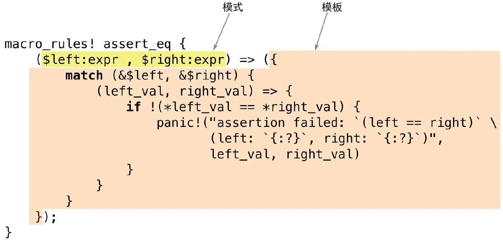
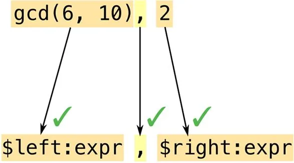
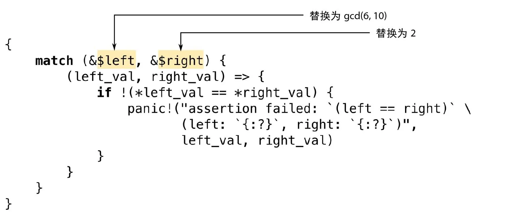
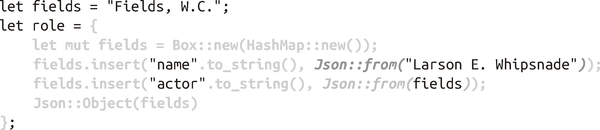
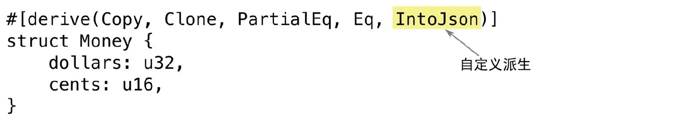

# 第21章宏

- cento（来自拉丁语，意为“拼凑而成”）是一种完全由引自其他诗人的诗句组成的诗。——Matt Madden

Rust 支持宏。宏是一种扩展语言的方式，它能做到单纯用函数无法做到的一些事。例如，我

```
们已经见过 assert_eq! 宏，它是用于测试的好工具：
assert_eq!(gcd(6, 10), 2);
这也可以写成泛型函数，但是 assert_eq! 宏能做到一些无法用函数做到的事。一是当断言
失败时，assert_eq! 会生成一条错误消息，其中包含断言的文件名和行号。函数无法获取
```

这些信息，而宏可以，因为它们的工作方式完全不同。

宏是一种简写形式。在编译期间，在检查类型并生成任何机器码之前，每个宏调用都会被展开。也就是说，每个宏调用都会被替换成一些 Rust 代码。前面的宏调用展开后大致如下所示：

```
match (&gcd(6, 10), &2) {
```


```
   (left_val, right_val) => {
       if !(*left_val == *right_val) {
```


```
           panic!("assertion failed: `(left == right)`, \
                   (left: `{:?}`, right: `{:?}`)", left_val, right_val);
       }
   }
}
```

```
panic! 也是一个宏，它本身可以展开为更多的 Rust 代码（此处未展示）。这些代码使用了另
外两个宏，即 file!() 和 line!()。一旦 crate 中的每个宏调用都已完全展开，Rust 就会
```

进入下一个编译阶段。

```
在运行期，断言失败时是这样的（同时指出了 gcd() 函数中存在 bug，因为 2 才是正确答
```

案）：

```
thread 'main' panicked at 'assertion failed: `(left == right)`, (left: `17`,
right: `2`)', gcd.rs:7
```

如果你是 C++ 用户，那么可能对宏有过一些不好的体验。Rust 宏采用了完全不同的设计，类

```
似于 Scheme 的 syntax-rules。与 C++ 宏相比，Rust 宏能与语言的其余部分更好地集
```

成，因此更不容易出错。宏调用总是标有感叹号，因此在你阅读代码时很容易发现它们，并且当你想要调用函数时也不会意外调用它们。Rust 宏永远不会插入不匹配的方括号或圆括号，它们天生支持模式匹配，因此编写既可维护又易于使用的宏非常容易。

本章会使用几个简单的示例来展示如何编写宏。与 Rust 的大部分内容一样，深入理解宏会获得回报，因此我们将设计一个更复杂的宏，以将 JSON 字面量直接嵌入程序中。但是，由于本书并不能涵盖宏的所有内容，因此本章将在结尾处提供一些指导，以便你进一步学习，内容包括这里展示的这些工具的高级技术，以及称为过程宏的更强大的机制。

## 21.1　宏基础

```
图 21-1 展示了 assert_eq! 宏的部分源代码。
```



```
图 21-1：assert_eq! 宏
macro_rules! 是在 Rust 中定义宏的主要方式。请注意，这个宏定义中的 assert_eq 之
后没有 !：只有调用宏时才要用到 !，定义宏时不用。
但并非所有的宏都是这样定义的：有一些宏是内置于编译器中的，比如 file!、line! 和
macro_rules!。本章会在结尾处讨论另一种方法，称为过程宏。但在本章的大部分内容
里，我们会聚焦于 macro_rules!，这是迄今为止编写宏的最简单方式。
使用 macro_rules! 定义的宏完全借助“模式匹配”方式发挥作用。宏的主体只是一系列规
```

则：

```
( <i>pattern1</i> ) => ( <i>template1</i> );
```

```
( <i>pattern2</i> ) => ( <i>template2</i> );
```

```
...
图 21-1 中的 assert_eq! 版本只有一个模式和一个模板。
```

另外，可以在模式或模板周围随意使用方括号或花括号来代替圆括号，这对 Rust 没有影响。同样，在调用宏时，下面这些都是等效的：

```
assert_eq!(gcd(6, 10), 2);
assert_eq![gcd(6, 10), 2];
assert_eq!
唯一的区别是花括号后面的分号通常是可选的。按照惯例，在调用 assert_eq! 时使用圆括
号，在调用 vec! 时使用方括号，而在调用 macro_rules! 时使用花括号。
```

刚才我们展示了一个宏展开的简单例子和用来生成它的宏定义，接下来会深入了解实现这些所需的必要细节。

- 详细解释 Rust 是如何在程序中查找和展开宏定义的。

- 指出从宏模板生成代码的过程中固有的一些微妙细节。

- 展示模式是如何处理重复性结构的。

### 21.1.1　宏展开的基础

Rust 在编译期间的很早阶段就展开了宏。编译器会从头到尾阅读你的源代码，定义并展开宏。你不能在定义宏之前就调用它，因为 Rust 在查看程序的其余部分之前就已经展开了每个宏调用。（相比之下，函数和其他语法项则不必按任何特定顺序排列。调用一个稍后才会在其crate 中定义的函数是完全可行的。）

```
Rust 展开 assert_eq! 宏调用的过程与对 match 表达式求值很像。Rust 会首先将参数与模
```

式进行匹配，如图 21-2 所示。



- 图 21-2：展开宏的第一部分：对参数做模式匹配

宏模式是 Rust 中的一种迷你语言。它们本质上是用来匹配代码的正则表达式。不过正则表达式操作的是字符，而模式操作的是语法标记（Token，包括数值、名称、标点符号等），这些语法标记是 Rust 程序的基础构造块。这意味着可以在宏模式中自由使用注释和空白字符，以尽量提高模式的可读性。因为注释和空白字符不是语法标记，所以不会影响匹配。

正则表达式和宏模式之间的另一个重要区别是圆括号、方括号和花括号在 Rust 中总是成对出现。Rust 会在展开宏之前进行检查，不仅仅在宏模式中检查，而且会贯穿整个语言。

```
在此示例中，我们的模式包含片段 $left:expr，它告诉 Rust 要匹配一个表达式（在本例中
是 gcd(6, 10)）并将其命名为 $left。然后 Rust 会将模式中的逗号与 gcd 的参数后面的
```

逗号进行匹配。就像正则表达式一样，模式中只有少数特殊字符会触发有意义的匹配行为；其

```
他字符，比如逗号，则必须逐字匹配，否则匹配就会失败。最后，Rust 会匹配表达式 2 并将
```

```
其命名为 $right。
```

```
这个模式中的两个代码片段都是 expr 类型的，表示它们期待表达式。21.4.1 节会展示其他类
```

型的代码片段。

因为这个模式已经匹配到了所有的参数，所以 Rust 展开了相应的模板，如图 21-3 所示。



- 图 21-3：展开宏的第二部分：填充模板

```
Rust 会将 $left 和 $right 替换为它在匹配过程中找到的代码片段。
在输出模板中包含片段类型（比如写成 $left:expr 而不仅是 $left）是一个常见的错误。
Rust 不会立即检测到这种错误。它会将 $left 视为替代品，然后将 :expr 视为模板中的其
```

他内容——要包含在宏输出中的语法标记。所以宏在被调用之前不会发生错误，然而它将生成

```
实际无法编译的伪输出。如果在使用新宏时收到像 cannot find type 'expr' in this
scope 和 help: maybe you meant to use a path separator here 这样的错误消
```

息，请检查是否存在这种错误。（21.3 节为此类情况提供了更一般化的建议。）

宏模板与 Web 编程中常用的十几种模板语言没有太大差别，唯一的差别（也是重大差别）是它输出的是 Rust 代码。

### 21.1.2　意外后果

将代码片段插入模板与用来处理值的常规代码略有不同。这些差异起初并不明显。我们一直在

```
讲的宏 assert_eq! 就包含一些略显奇怪的代码，其原因大部分和宏编程有关。我们重点看
```

看其中两个比较有意思的部分。

```
首先，为什么这个宏会创建变量 left_val 和 right_val？为什么不能将模板简化成下面
```

这样呢？

```
if !($left == $right) {
   panic!("assertion failed: `(left == right)` \
           (left: `{:?}`, right: `{:?}`)", $left, $right)
}
要回答这个问题，请尝试在心里展开宏调用 assert_eq!(letters.pop(),
Some('z'))。它的输出会是什么呢？自然，Rust 会将匹配的表达式插入模板中的多个位
```

置。但是，在构建错误消息时重新计算表达式似乎是个坏主意，不仅仅是因为需要花两倍的时

```
间，更是因为这会导致第二次调用后它的值发生变化（因为 letters.pop() 会从向量中移
除一个值）。这就是为什么真正的宏只会计算一次 $left 和 $right 并存储它们的值。
继续第二个问题：为什么这个宏会借用对 $left 值和 $right 值的引用？为什么不像下面这
```

样将值存储在变量中？

```
macro_rules! bad_assert_eq {
   ($left:expr, $right:expr) => ({
       match ($left, $right) {
           (left_val, right_val) => {
               if !(left_val == right_val) {
                   panic!("assertion failed" /* ... */);
               }
           }
       }
   });
}
```

对于我们一直在考虑的这个特定情况（宏参数是整数），这当然会正常工作。但是，如果调用

```javascript
者将一个 String 变量作为 $left 或 $right 传递，则上述代码会将该值移动出变量。
fn main() {
   let s = "a rose".to_string();
   bad_assert_eq!(s, "a rose");
   println!("confirmed: {} is a rose", s);  // 错误：使用了已移动出去的值 "s"
}
```

我们不希望断言移动值，因此这个宏改成了借入引用。

```javascript
（你可能想知道为什么这个宏要使用 match 而不是 let 来定义变量。嗯……我们也想知道。
事实证明这样做没有特别的原因。使用 let 也可以达到同样的效果。）
```

简而言之，宏可以做一些令人惊讶的事情。如果在你编写的宏周围发生了某些奇怪的事，那么很可能就是宏造成的。

你肯定不会看到下面这个经典的 C++ 宏 bug：

```
// 有bug的C++宏：把数值n加上1
#define ADD_ONE(n) n + 1
由于大多数 C++ 程序员很熟悉，因而不值得在这里展开解释的原因，对于像 ADD_ONE(1) *
10 或 ADD_ONE(1 << 4) 这样不起眼的代码，使用这个宏会产生令人非常吃惊的结果。要
```

修复这个 bug，就要在宏定义中添加更多圆括号。这在 Rust 中是不必要的，因为 Rust 宏能更好地与语言集成。Rust 知道自己什么时候是在处理表达式，因此在将一个表达式粘贴到另一个表达式时能有效地添加合理的圆括号。

### 21.1.3　重复

```
标准的 vec! 宏有两种形式：
```

```javascript
// 把一个值重复N次
let buffer = vec![0_u8; 1000];
// 由逗号分隔的值列表
let numbers = vec!["udon", "ramen", "soba"];
```

它可以这样实现：

```
macro_rules! vec {
   ($elem:expr ; $n:expr) => {
       ::std::vec::from_elem($elem, $n)
   };
   ( $( $x:expr ),* ) => {
       <[_]>::into_vec(Box::new([ $( $x ),* ]))
   };
   ( $( $x:expr ),+ ,) => {
       vec![ $( $x ),* ]
   };
}
```

这里有 3 条规则。我们将解释“多规则”宏的工作原理，然后再依次查看每条规则。

```
Rust 在展开像 vec![1, 2, 3] 这样的宏调用时，会先尝试将参数 1, 2, 3 与第一条规则
的模式相匹配，在本例中就是 $elem:expr ; $n:expr。这无法匹配上，因为 1 是一个表
```

达式，但模式要求其后有一个分号，而这里没有。所以 Rust 继续匹配第二条规则，以此类推。如果没有匹配任何规则，则视为错误。

```
第一条规则处理像 vec![0u8; 1000] 这样的用法。碰巧标准库（但未写入文档）函数
std::vec::from_elem 完全满足这里的需要，所以这条规则是显而易见的。
第二条规则处理 vec!["udon", "ramen", "soba"]。$( $x:expr ),* 模式使用了我
```

们从未见过的一个特性：重复。它会匹配 0 个或多个表达式，以逗号分隔。更一般地说，语法

```
$( PATTERN ),* 可用于匹配任何以逗号分隔的列表，其中列表的每个条目都会匹配
PATTERN。
```

```
这里的 * 与正则表达式中的 * 具有相同的含义（“0 或更多”），只是公认的正则表达式中并没
有特殊的 ,* 重复器。还可以使用 + 要求至少匹配一次，或者使用 ? 要求有 0 个或 1 个匹配
```

项。表 21-1 给出了全套的重复模式。

表 21-1：重复模式

模式

- 含义

```
$( ... )*
```

- 匹配 0 次或多次，没有分隔符

```
$( ... ),*
```

- 匹配 0 次或多次，以逗号分隔

```
$( ... );*
```

- 匹配 0 次或多次，以分号分隔

```
$( ... )+
```

- 匹配 1 次或多次，没有分隔符

```
$( ... ),+
```

- 匹配 1 次或多次，以逗号分隔

```
$( ... );+
```

- 匹配 1 次或多次，以分号分隔

```
$( ... )?
```

- 匹配 0 次或 1 次，没有分隔符

```
代码片段 $x 不是单个表达式，而是一个表达式列表。这条规则的模板也使用了重复语法：
<[_]>::into_vec(Box::new([ $( $x ),* ]))
```

同样，有一些标准库方法可以完全满足我们的需要。此代码会创建一个 Box 数组，然后使用

```
[T]::into_vec 方法将 Box 数组转换为向量。
```

```
第一个代码片段 <[_]> 是用于编写“某物的切片”类型的一种不寻常的方式，它会期待 Rust 推
```

断出元素类型。那些名称为普通标识符的类型可以不经任何修改直接用在表达式中，但是像

```
fn()、&str 或 [_] 这样的特殊类型必须用尖括号括起来。
重复要出现在模板的末尾，在我们这里是 $($x),*。这个 $(...),* 与我们在模式中看到的
语法是一样的。它会遍历我们为 $x 匹配出的表达式列表，并将它们全部插入模板中，以逗号
```

分隔。

在这个例子中，重复输出看起来和重复输入差不多。但事实并非如此。也可以这样写规则：

```javascript
( $( $x:expr ),* ) => {
   {
       let mut v = Vec::new();
       $( v.push($x); )*
       v
   }
};
在这里，模板中读取 $( v.push($x); )* 的部分会为 $x 中的每个表达式插入对
v.push() 的调用。宏里的分支可以展开为一系列表达式，但这里只需要一个表达式，所以
```

要把向量的集合包装在一个块中。

```
与 Rust 的其余部分不同，使用 $( ... ),* 的模式不会自动支持可选的尾随逗号。但是，
有一个标准技巧，即通过添加额外的规则来支持尾随逗号。这正是 vec! 宏的第三条规则的作
```

用：

```
( $( $x:expr ),+ ,) => {  // 如果出现了尾随逗号，
   vec![ $( $x ),* ]     // 就按没有这个逗号时的样子重试
};
我们使用 $( ... ),+ , 来匹配带有额外逗号的列表。然后在模板中递归地调用 vec!，并
```

剥离额外的逗号。这次会匹配上第二条规则。

## 21.2　内置宏

Rust 编译器提供了几个内置宏，它们在你定义自己的宏时很有用。这些宏都不能使用

```
macro_rules! 来实现。它们是硬编码在 rustc 中的。
file!()（文件名）、line!()（行号）和 column!()（列号）
file!() 会展开为字符串字面量，即当前文件名。line!() 和 column!() 会展开为 u32
```

字面量，以给出当前行号和列号（从 1 开始计数）。

```
如果一个宏调用了另一个宏，后者又调用了别的宏，并且最后一个宏调用了 file!()、
line!() 或 column!()，而它们都在不同的文件中，则最终展开之后的结果指示的是第一
```

个宏所在的位置。

```
stringify!(...tokens...)（代码字符串）
该宏会展开为包含给定语法标记的字符串字面量。assert! 宏会使用它来生成包含断言代码
```

的错误消息。

```
它的参数中的宏调用不会展开，比如 stringify!(line!()) 会展开为字符串 "line!
()"。
```

Rust 会从这些语法标记构造出字符串，因此字符串中没有换行符或注释（因为它们都不是语法标记）。

```
concat!(str0, str1, ...)（串联）
```

该宏会通过串联它的各个参数展开为单个字符串字面量。

Rust 还定义了下面这些用于查询构建环境的宏。

```
cfg!(...)（配置）
```

```
该宏会展开为布尔常量，如果当前正构建的配置与圆括号中的条件匹配则为 true。如果在启
```

```
用了调试断言的情况下进行编译，则 cfg!(debug_assertions) 为 true。
这个宏支持与 8.5 节所讲的 #[cfg(...)] 属性完全相同的语法，但其结果不是条件编译，
而是给出像 true 或 false 这样的答案。
env!("VAR_NAME")（环境变量）
```

展开为字符串，即在编译期指定的环境变量的值。如果该变量不存在，则为编译错误。

Cargo 会在编译 crate 时设置几个有实质性内容的环境变量，这样此宏才有价值。例如，要获取 crate 的当前版本字符串，可以这样写：

```javascript
let version = env!("CARGO_PKG_VERSION");
```

Cargo 文档中有这些环境变量的完整列表。

```
option_env!("VAR_NAME")（可选环境变量）
和 env! 基本一样，不过该宏会返回 Option<&'static str>，如果没有设置指定的变
量，则返回 None。
```

以下 3 个内置宏支持从另一个文件中引入代码或数据。

```
include!("file.rs")（包含代码文件）
```

该宏会展开为指定文件的内容，这个文件必须是有效的 Rust 代码——表达式或语法项的序列。

```
include_str!("file.txt")（包含字符串）
```

```
该宏会展开为包含指定文件中文本的 &'static str。可以像这样使用它：
```

```javascript
const COMPOSITOR_SHADER: &str =
   include_str!("../resources/compositor.glsl");
```

如果文件不存在或不是有效的 UTF-8 格式，你将收到编译错误。

```
include_bytes!("file.dat")（包含一些字节）
```

和上一个宏基本相同，不过该宏会把文件视为二进制数据而非 UTF-8 文本。结果是

```
&'static [u8]。
```

与所有宏一样，这些内置宏也都在编译期处理。如果文件不存在或无法读取，则编译失败。它们不会在运行期失败。在任何情况下，如果文件名是相对路径，就会相对于当前文件所在的目录进行解析。

Rust 还提供了几个我们未曾涉及的便捷宏。

```
todo!()（待做）和 unimplemented!()（未实现）
这两个宏的作用相当于 panic!()，但传达了不同的意图。unimplemented!() 适用于 if
子句、match 分支和其他尚未处理的情况。它总会 panic。todo!() 大致相同，但传达了这
```

样的想法，即这段代码还没有编写，一些 IDE 会对其进行标记以提请关注。

```
matches!(value, pattern)（匹配）
```

```
将值与模式进行比较，如果匹配就返回 true，否则返回 false。类似于如下写法：
```

```
match value {
 pattern => true,
 _ => false
}
```

如果你正在寻求编写基本宏的练习，那么该宏是一个很好的复刻目标——特别是你可以直接在标准库文档中找到它的源代码，其实现非常简单。

## 21.3　调试宏

调试率性而为的宏颇具挑战性。最大的问题是宏展开过程缺乏可见性。Rust 经常会展开所有宏，在发现某种错误后打印一条错误消息，但不会展示包含该错误的完全展开后的代码。

以下是 3 个有助于解决宏问题的工具。（这些特性都还不稳定，但由于它们实际上是为了在开发过程中使用而设计的，而不会出现在要签入的代码中，因此这在实践中并不是什么大问题。）

```
第一，也是最简单的，可以让 rustc 展示代码在展开所有宏后的样子。使用 cargo build
--verbose 查看 Cargo 如何调用 rustc。复制 rustc 命令行并添加 -Z unstable-
options --pretty expanded 选项。完全展开的代码将转储到终端。很遗憾，只有当代
```

码没有语法错误时才能这样做。

```
第二，Rust 提供了一个 log_syntax!() 宏，它只会在编译期将自己的参数打印到终端。你
可以将其用于 println! 式调试。此宏需要添加 #![feature(log_syntax)] 特性标志。
```

第三，可以要求 Rust 编译器把所有宏调用记录到终端。在代码中的某个地方插入

```
trace_macros!(true);。从那时起，每当 Rust 展开宏时，它都会打印宏的名称和各个参
```

数。例如，考虑下面这个程序：

```javascript
#![feature(trace_macros)]
fn main() {
   trace_macros!(true);
   let numbers = vec![1, 2, 3];
   trace_macros!(false);
   println!("total: {}", numbers.iter().sum::<u64>());
}
```

它会生成这样的输出：

```javascript
$ rustup override set nightly
...
$ rustc trace_example.rs
note: trace_macro
--> trace_example.rs:5:19
 |
5 |     let numbers = vec![1, 2, 3];
 |                   ^^^^^^^^^^^^^
 |
 = note: expanding `vec! { 1 , 2 , 3 }`
 = note: to `< [ _ ] > :: into_vec ( box [ 1 , 2 , 3 ] )`
编译器会展示每个宏调用的代码，既包括展开前的也包括展开后的。trace_macros!
(false); 这一行再次关闭了跟踪，因此不会跟踪对 println!() 的调用。
```

## 21.4　构建 json! 宏

```
我们已经讨论过了 macro_rules! 的核心特性。本节将逐步开发用于构建 JSON 数据的宏。
我们将使用这个例子来展示宏的开发过程，同时会介绍 macro_rules! 剩下的几个特性，并
```

就如何确保你的宏如预期般运行提供一些建议。

回想第 10 章，我们介绍过下面这个用于表示 JSON 数据的枚举：

```javascript
#[derive(Clone, PartialEq, Debug)]
enum Json {
   Null,
   Boolean(bool),
   Number(f64),
   String(String),
   Array(Vec<Json>),
   Object(Box<HashMap<String, Json>>)
}
遗憾的是，编写 Json 值的语法相当冗长：
let students = Json::Array(vec![
   Json::Object(Box::new(vec![
       ("name".to_string(), Json::String("Jim Blandy".to_string())),
       ("class_of".to_string(), Json::Number(1926.0)),
       ("major".to_string(), Json::String("Tibetan throat singing".to_string()))
   ].into_iter().collect())),
   Json::Object(Box::new(vec![
       ("name".to_string(), Json::String("Jason Orendorff".to_string())),
       ("class_of".to_string(), Json::Number(1702.0)),
       ("major".to_string(), Json::String("Knots".to_string()))
   ].into_iter().collect()))
]);
```

我们希望使用更具 JSON 风格的语法来编写：

```javascript
let students = json!([
   {
       "name": "Jim Blandy",
       "class_of": 1926,
       "major": "Tibetan throat singing"
   },
```

```json
   {
       "name": "Jason Orendorff",
       "class_of": 1702,
```

```
       "major": "Knots"
   }
]);
```

```
我们想要的是一个将 JSON 值作为参数并展开为 Rust 表达式的 json! 宏，就像上面示例中
```

的那样。

### 21.4.1　片段类型

如果想编写一个复杂的宏，那么第一项工作是弄清楚如何匹配或解析所期望的输入。

```
我们可以预见 Json 宏内部将会有多条规则，因为 JSON 数据有多种类型：对象、数组、数
```

值等。事实上，我们可以合理地猜测每种 JSON 类型都将有一条规则：

```
macro_rules! json {
   (null)    => { Json::Null };
   ([ ... ]) => { Json::Array(...) };
   ({ ... }) => { Json::Object(...) };
   (???)     => { Json::Boolean(...) };
   (???)     => { Json::Number(...) };
   (???)     => { Json::String(...) };
}
```

然而这不太正确，因为宏模式无法区分最后 3 种情况，稍后我们会讨论如何处理。至于前 3种情况，显然它们是以不同的语法标记开始的，所以我们先从它们开始讨论。

第一条规则已经奏效：

```
macro_rules! json {
```

```
   (null) => {
       Json::Null
   }
```

```
}
#[test]
fn json_null() {
   assert_eq!(json!(null), Json::Null);  // 通过！
}
要添加对 JSON 数组的支持，可以尝试将这些元素匹配为 expr：
macro_rules! json {
   (null) => {
       Json::Null
   };
   ([ $( $element:expr ),* ]) => {
       Json::Array(vec![ $( $element ),* ])
   };
}
```

很遗憾，这无法匹配所有 JSON 数组。下面是阐明此问题的一个测试：

```javascript
#[test]
fn json_array_with_json_element() {
   let macro_generated_value = json!(
       [
           // 无法匹配`$element:expr`的有效JSON
           {
               "pitch": 440.0
           }
       ]
   );
   let hand_coded_value =
       Json::Array(vec![
           Json::Object(Box::new(vec![
               ("pitch".to_string(), Json::Number(440.0))
           ].into_iter().collect()))
       ]);
   assert_eq!(macro_generated_value, hand_coded_value);
```

```
}
```

```
模式 $( $element:expr ),* 表示“以逗号分隔的 Rust 表达式列表”。但是许多 JSON 值，
```

尤其是对象，并不是有效的 Rust 表达式。它们无法匹配。

既然待匹配的每一小段代码并不一定都是表达式，那么 Rust 就肯定要支持另外几种片段类型，如表 21-2 所示。

表 21-2：macro_rules! 支持的片段类型

- 后面可以跟……

片段类型

- 匹配（带例子）

- 表达式：

```
expr
=>,;
2 + 2、"udon"、x.len()
```

- 表达式或声明，不包括任何尾随分号（很难用，请尝

```
stmt
=>,;
试使用 expr 或 block）
```

- 类型：

```
String、Vec<u8>、(&str, bool)、dyn Read
ty
=>,; =| { [ : > as
+ Send
```

- 路径（参见 8.2.3 节）：

```
path
=> ; = | { [ : > a
表 21-2 中的大多数选项会严格执行 Rust 语法。expr 类型只会匹配 Rust 表达式（而不是
JSON 值），ty 只会匹配 Rust 类型，等等。这些选项都不可展开，即无法定义 expr 可以识
```

别的新算术运算符或新关键字。所以无法让它们匹配任意 JSON 数据。

```
最后两个选项（ident 和 tt）支持匹配看起来不像 Rust 代码的宏参数。ident 能匹配任何
标识符。tt 能匹配单个语法标记树：正确匹配的一对括号，比如 (...)、[...] 或
{...}，以及位于两者之间的所有内容，包括嵌套的语法标记树，或者单独的非括号语法标
记，比如 1926 或 "Knots"。
看来语法标记树正是我们这个 json! 宏所需要的。每个 JSON 值都是一个语法标记树：数
值、字符串、布尔值和 null 是单个语法标记，对象和数组则是有括号的语法标记。所以可以
```

像下面这样写匹配模式：

```
macro_rules! json {
   (null) => {
       Json::Null
   };
   ([ $( $element:tt ),* ]) => {
       Json::Array(...)
   };
   ({ $( $key:tt : $value:tt ),* }) => {
       Json::Object(...)
   };
   ($other:tt) => {
       ... // TODO: 返回Number、String或Boolean
   };
}
这个版本的 json! 宏可以匹配所有的 JSON 数据。现在只要生成正确的 Rust 代码就好了。
```

为了使得将来在增加新特性的同时不破坏你今天编写的代码，Rust 限制模式中的语法标记必须出现在片断类型的后面。表 21-2 中的“后面可以跟……”那列展示了哪些语法标记是允许

```
的。例如，模式 $x:expr ~ $y:expr 是错误的，因为不允许 ~ 跟在 expr 之后。模式
$vars:pat => $handler:expr 则是正确的，因为 $vars:pat 后面跟着箭头 =>，这是
pat 允许的语法标记之一，而 $handler:expr 后面什么都没有，这总是允许的。
```

### 21.4.2　宏中的递归

```
我们已经看过宏调用自身的一个简单例子：vec! 的实现就使用了递归来支持尾随逗号。这里
我们会展示一个更重要的例子：json! 需要递归调用自己。
```

我们可能会尝试在不使用递归的情况下支持 JSON 数组，如下所示：

```
([ $( $element:tt ),* ]) => {
   Json::Array(vec![ $( $element ),* ])
};
```

```
但这是行不通的，因为这样做就会将 JSON 数据（$element 语法标记树）直接粘贴到 Rust
```

表达式中，而它们是两种不同的语言。

因此，我们需要将数组的每个元素从 JSON 格式转换为 Rust。幸运的是，有一个宏可以执行此操作，也就是我们正在写的这个。

```
([ $( $element:tt ),* ]) => {
   Json::Array(vec![ $( json!($element) ),* ])
};
```

可以用相同的方式支持对象：

```
({ $( $key:tt : $value:tt ),* }) => {
   Json::Object(Box::new(vec![
       $( ($key.to_string(), json!($value)) ),*
   ].into_iter().collect()))
};
编译器会对宏施加递归限制：默认情况下最多递归 64 层。这对于 json! 这样的正常用法足
```

够了，但复杂的递归宏有时会达到这个极限。可以通过在使用宏的 crate 顶部添加如下属性来调整它：

```
#![recursion_limit = "256"]
我们的 json! 宏接近完成了。剩下的就是支持布尔值、数值和字符串值。
```

### 21.4.3　将特型与宏一起使用

编写复杂的宏总会给人带来困惑。请务必记住，宏本身并不是你可以使用的唯一解谜工具。

```
在这里，我们需要支持 json!(true)、json!(1.0) 和 json!("yes")，将值（无论它是
什么）转换为适当类型的 Json 值。但是宏并不擅长区分类型。可以想象像下面这样写：
macro_rules! json {
   (true) => {
       Json::Boolean(true)
   };
   (false) => {
       Json::Boolean(false)
   };
   ...
}
```

这种方法马上就会失效。如果只有两个布尔值，这样写当然没问题。但可能还有更多数值，甚至更多字符串，那时候就不能再这样写了。

```
幸运的是，有一种标准库方法可以将各种类型的值转换为一种指定类型，它就是 From 特型
```

（参见 13.9 节）。我们只需要为少数几种类型实现这个特型：

```
impl From<bool> for Json {
   fn from(b: bool) -> Json {
       Json::Boolean(b)
   }
}
impl From<i32> for Json {
   fn from(i: i32) -> Json {
       Json::Number(i as f64)
   }
}
impl From<String> for Json {
   fn from(s: String) -> Json {
       Json::String(s)
   }
```

```
}
impl<'a> From<&'a str> for Json {
```

```
   fn from(s: &'a str) -> Json {
       Json::String(s.to_string())
   }
}
...
```

事实上，所有 12 种数值类型都有非常相似的实现，所以仅仅为了避免复制粘贴而编写一个宏也是合理的：

```
macro_rules! impl_from_num_for_json {
   ( $( $t:ident )* ) => {
       $(
           impl From<$t> for Json {
               fn from(n: $t) -> Json {
                   Json::Number(n as f64)
               }
           }
       )*
   };
}
impl_from_num_for_json!(u8 i8 u16 i16 u32 i32 u64 i64 u128 i128
                       usize isize f32 f64);
现在可以使用 Json::from(value) 将任何受支持类型的 value 转换为 Json 了。在我们
```

的宏中，它看起来是这样的：

```
( $other:tt ) => {
   Json::from($other)  // 处理布尔值、数值和字符串
};
将这条规则添加到 json! 宏中，让它通过我们迄今已编写的所有测试。将所有部分放在一
```

起，就变成了这样：

```
macro_rules! json {
   (null) => {
       Json::Null
   };
   ([ $( $element:tt ),* ]) => {
       Json::Array(vec![ $( json!($element) ),* ])
   };
   ({ $( $key:tt : $value:tt ),* }) => {
       Json::Object(Box::new(vec![
           $( ($key.to_string(), json!($value)) ),*
       ].into_iter().collect()))
   };
   ( $other:tt ) => {
       Json::from($other)  // 处理布尔值、数值和字符串
   };
}
```

事实证明，宏出乎意料地支持在 JSON 数据中使用变量甚至任意 Rust 表达式，这是一个方便的额外特性：

```javascript
let width = 4.0;
let desc =
   json!({
       "width": width,
       "height": (width * 9.0 / 4.0)
   });
因为 (width * 9.0 / 4.0) 被圆括号括起来了，所以它是一个单语法标记树，这样宏在解
析对象时就能成功地将它与 $value:tt 匹配起来。
```

### 21.4.4　作用域界定与卫生宏

编写宏时一个非常棘手的问题是需要将来自不同作用域的代码粘贴在一起。所以接下来的内容涵盖了 Rust 处理作用域的两种方式：一种方式用于局部变量和参数，另一种方式用于其他一

切。

为了说明为什么这个问题很重要，我们来重写一下解析 JSON 对象的规则（前面展示的

```sql
json! 宏中的第三条规则）以消除临时向量。可以这样写：
({ $($key:tt : $value:tt),* }) => {
   {
       let mut fields = Box::new(HashMap::new());
       $( fields.insert($key.to_string(), json!($value)); )*
       Json::Object(fields)
   }
};
现在不是通过使用 collect() 而是通过重复调用 .insert() 方法来填充 HashMap。这意
味着需要将此映射表存储在名为 fields 的临时变量中。
但是如果调用 json! 时碰巧使用了自己的一个变量，而这个变量也叫 fields，会发生什么
```

呢？

```sql
let fields = "Fields, W.C.";
let role = json!({
   "name": "Larson E. Whipsnade",
   "actor": fields
});
展开宏会将两小段代码粘贴在一起，两者都使用 fields 这个名字，但表示不同的东西。
let fields = "Fields, W.C.";
let role = {
   let mut fields = Box::new(HashMap::new());
   fields.insert("name".to_string(), Json::from("Larson E. Whipsnade"));
   fields.insert("actor".to_string(), Json::from(fields));
   Json::Object(fields)
```

```
};
```

每当宏使用临时变量时，这似乎是一个无法回避的陷阱，你也许已经在考虑可能的修复方法

```
了。也许应该重命名 json! 宏，以便定义其调用者不太可能传入的东西，比如可以叫
__json$fields。
```

令人吃惊的是这个宏现在就能正常工作。Rust 会替你重命名此变量。这个特性是首先在Scheme 语言的宏中实现的，被称为卫生的（hygiene），因此 Rust 被称为支持卫生宏（hygienic macro）的语言。

理解卫生宏的最简单方法是想象每次展开宏时，来自宏本身的展开结果都会被涂上不同的颜色。

然后，不同颜色的变量被视为具有不同的名称：



```
请注意，由宏调用者传入并粘贴到输出中的那点儿代码（如 "name" 和 "actor"）会保持其
```

原始颜色（黑色）。这里只会对源自宏模板的语法标记进行染色。

```
现在有一个名为 fields 的变量（在调用者中声明）和另一个同样名为
```

- 的变量（由


宏引入）。由于名称是不同的颜色，因此这两个变量不会混淆。

如果宏确实需要引用调用者作用域内的变量，则调用者必须将变量的名称传给宏。

（染色的比喻并不是要准确描述卫生宏的工作原理。真正的机制甚至比这种方式更“聪明一点儿”。只要两个标识符引用的是位于宏及其调用者作用域内的公共变量，不管“染成了什么颜

色”，都能识别出它们是相同的。但这种情况在 Rust 中很少见。如果你理解前面的例子，就知道该如何使用卫生宏了。）

```
你可能已经注意到，随着宏的展开，许多其他标识符（比如 Box、HashMap 和 Json）被染
```

上了不止一种颜色。虽然这些类型名称的颜色不同，但 Rust 仍然毫不费力地识别出了它们。那是因为 Rust 中的卫生工作仅限于局部变量和参数。对于常量、类型、方法、模块、静态值和宏名称，Rust 是“色盲”。

```
这意味着如果我们的 json! 宏在尚未导入 Box、HashMap 或 Json 的模块中使用，那么宏
```

就无法正常工作。21.4.5 节会展示如何避免这一问题。

首先，需要考虑 Rust 的严格卫生机制构成某种障碍的情况，我们要解决这一问题。假设我们有很多包含下面这行代码的函数：

```javascript
let req = ServerRequest::new(server_socket.session());
```

复制和粘贴这行代码很痛苦。可以改用宏吗？

```javascript
macro_rules! setup_req {
   () => {
       let req = ServerRequest::new(server_socket.session());
   }
}
fn handle_http_request(server_socket: &ServerSocket) {
   setup_req!();  // 使用`server_socket`来声明`req`
   …… // 使用`req`的代码
}
这样写是不行的。它需要宏中的名称 server_socket 来引用函数中声明的局部变量
server_socket，对于变量 req 也是如此，只不过方向相反。但是卫生机制会防止宏中的
名称与其他作用域中的名称“冲突”——不过在这种情况下，你想要的正是变量 req。
```

解决方案是把你打算同时在宏代码内部和外部使用的任何标识符都传给宏：

```javascript
macro_rules! setup_req {
   ($req:ident, $server_socket:ident) => {
       let $req = ServerRequest::new($server_socket.session());
   }
}
fn handle_http_request(server_socket: &ServerSocket) {
   setup_req!(req, server_socket);
   …… // 使用`req`的代码
}
由于函数现在提供了 req 和 server_socket，因此它们在该作用域内就有正确的“颜色”
```

了。

卫生机制让这个宏使用起来有点儿冗长，但这是一个特性，而不是 bug：了解到卫生宏不会背

```
着你干扰局部变量，就更容易理解它。如果你在函数中搜索像 server_socket 这样的标识
```

符，就会找到使用过它的所有地方，包括宏调用。

### 21.4.5　导入宏和导出宏

由于宏会在编译早期展开，那时候 Rust 甚至都不知道项目的完整模块结构，因此编译器需要对宏的导入和导出进行特殊支持。

在一个模块中可见的宏也会自动在其子模块中可见。要将宏从当前模块“向上”导出到其父模

```
块，请使用 #[macro_use] 属性。假设我们的 lib.rs 是这样的：
#[macro_use] mod macros;
mod client;
mod server;
```

```
那么 macros 模块中定义的所有宏都会导入 lib.rs 中，因此在 crate 的其余部分（包括在
client 和 server 中）都可见。
```

```
标有 #[macro_export] 的宏会自动成为公共的，并且可以像其他语法项一样通过路径引
```

用。

```
例如，lazy_static crate 提供了一个名为 lazy_static 的宏，该宏会被标记为 #
[macro_export]。要在自己的 crate 中使用这个宏，可以这样写：
use lazy_static::lazy_static;
lazy_static!{ }
```

一旦导入了宏，就可以像其他任何语法项一样使用它：

```
use lazy_static::lazy_static;
mod m {
   crate::lazy_static! { }
}
```

当然，实际上做这些就意味着你的宏可能会在其他模块中调用。因此，导出的宏不应该依赖作用域内的任何内容，因为在使用时无从确定它的作用域内会有哪些内容。它甚至可以遮蔽标准库预导入中的特性。

```
相反，宏应该对它用到的任何名称都使用绝对路径。macro_rules! 提供了特殊片段
$crate 来帮助解决这个问题。这与crate 不同，crate 关键字可以用在任何地方的路径中
而不仅仅是宏中。$crate 相当于定义此宏的 crate 的根模块绝对路径。我们可以写成
$crate::Json 而非 Json 的形式，这样即使没有导入 Json 也能工作。HashMap 可以被
更改为 ::std::collections::HashMap 或 $crate::macros::HashMap。在后一种情
```

```
况下，我们将不得不重新导出 HashMap，因为 $crate 不能用于访问 crate 的私有特性。它
```

```
实际上只是展开成类似于 ::jsonlib 的普通路径。可见性规则不受影响。
将宏移到它自己的模块 macros 并修改为使用 $crate 后，代码是下面这样的。这是最终版
```

本：

```sql
// macros.rs
pub use std::collections::HashMap;
pub use std::boxed::Box;
pub use std::string::ToString;
#[macro_export]
macro_rules! json {
   (null) => {
       $crate::Json::Null
   };
   ([ $( $element:tt ),* ]) => {
       $crate::Json::Array(vec![ $( json!($element) ),* ])
   };
   ({ $( $key:tt : $value:tt ),* }) => {
       {
           let mut fields = $crate::macros::Box::new(
               $crate::macros::HashMap::new());
           $(
               fields.insert($crate::macros::ToString::to_string($key),
                             json!($value));
           )*
           $crate::Json::Object(fields)
       }
   };
   ($other:tt) => {
       $crate::Json::from($other)
   };
}
由于 .to_string() 方法是标准 ToString 特型的一部分，因此我们也会通过 $crate 来
```

引用它，而使用的语法是 11.3 节介绍的

```
$crate::macros::ToString::to_string($key)。在这个例子中，这一句并不是必要
的，因为 ToString 位于标准库预导入中。但是，如果你调用的特型方法可能不在调用宏的
```

作用域内，则使用完全限定的方法调用是最好的办法。

## 21.5　在匹配过程中避免语法错误

下面的宏看起来很合理，但它给 Rust 带来了一些麻烦：

```
macro_rules! complain {
   ($msg:expr) => {
       println!("Complaint filed: {}", $msg)
   };
   (user : $userid:tt , $msg:expr) => {
       println!("Complaint from user {}: {}", $userid, $msg)
   };
}
```

假设我们这样调用它：

```
complain!(user: "jimb", "the AI lab's chatbots keep picking on me");
```

在人类眼中，这显然符合第二条规则。但是 Rust 会首先尝试第一条规则，试图将所有输入与

```
$msg:expr 匹配。事情开始变得棘手了。user: "jimb" 当然不是表达式，所以我们得到
```

了一个语法错误。Rust 拒绝隐藏语法错误，因为调试宏本来就已经够艰难了，再隐藏语法错误简直要命。因此，它会立即报告并停止编译。

如果无法匹配模式中的任何其他语法标记，Rust 就会继续执行下一条规则。只有语法错误才会导致匹配失败，并且只在试图匹配片段时才会发生。

```
这里的问题并不难理解：我们是在错误的规则中试图匹配片段 $msg:expr。这无法匹配，因
```

为我们本来就不应该在这里匹配。调用者想要匹配其他规则。有两种简单的方法可以避免这种情况。

第一种方法，避免混淆各条规则。例如，可以更改宏，让每个模式都以不同的标识符开头：

```
macro_rules! complain {
   (msg : $msg:expr) => {
       println!("Complaint filed: {}", $msg);
   };
   (user : $userid:tt , msg : $msg:expr) => {
       println!("Complaint from user {}: {}", $userid, $msg);
   };
}
当宏参数以 msg 开头时，就匹配第一条规则。当宏参数以 user 开头时，就匹配第二条规
```

则。无论是哪种参数，我们都能知道在尝试匹配片段之前已经找到了正确的规则。

```
避免虚假语法错误的另一种方法是将更具体的规则放在前面。将 user: 规则放在前面就可以
解决 complain! 的问题，因为永远不会到达导致语法错误的那条规则。
```

## 21.6　超越 macro_rules!

宏模式固然可以解析比 JSON 更复杂的输入，但我们也发现这种复杂性很快就会失控。

```
Daniel Keep 等人撰写的 The Little Book of Rust Macros 是一本优秀的高级 macro_rules!
```

编程书。该书写得清晰明了，关于宏展开的各个方面都比本章讲得更详尽。另外，该书还提供

```
了几种非常聪明的技巧来借助 macro_rules! 模式实现某种玄奥的编程语言，以用这种模式
```

解析复杂的输入。不过我们对这些技巧持保留态度。请小心使用。

```
Rust 1.15 引入了一种称为过程宏的独立机制。过程宏不仅支持扩展 #[derive] 属性以处理
自定义派生（参见图 21-4），还支持创建自定义属性和像前面讨论过的 macro_rules! 这样
```

的宏。



```
图 21-4：通过 #[derive] 属性调用假设的 IntoJson 过程宏
没有 IntoJson 特型，但这并不重要：过程宏可以利用这个钩子插入它想要的任何代码（在
这个例子中，可能是 impl From<Money> for Json { ... }）。
```

让过程宏得名“过程”的原因在于它是作为 Rust 函数而不是声明性规则集实现的。这个函数会

```
通过一个很薄的抽象层与编译器交互，进而实现任意复杂的功能。例如，diesel 数据库
```

crate 就会使用过程宏连接到数据库并在编译期根据该数据库的模式（schema）生成代码。

因为过程宏要与编译器内部交互，所以要写出有效的宏就要了解编译器是如何运行的，这超出了本书的范畴。有关详细信息，可以查阅 Rust 在线文档。

也许在阅读了所有这些内容后，你开始有点儿讨厌宏了。那么，还有什么其他选择吗？还有一种方法是使用构建脚本生成 Rust 代码。Cargo 文档展示了如何一步一步地做到这一点。它涉及编写一个生成所需 Rust 代码的程序，然后向 Cargo.toml 中添加一行，以便在构建过程中运

```
行该程序并使用 include! 将生成的代码放入你的 crate 中。
```
