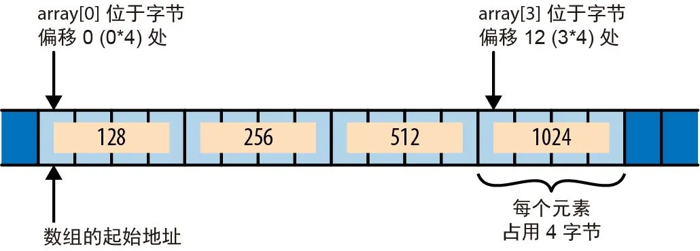
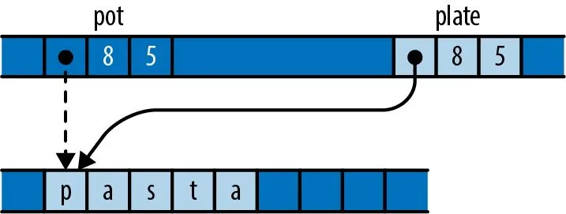
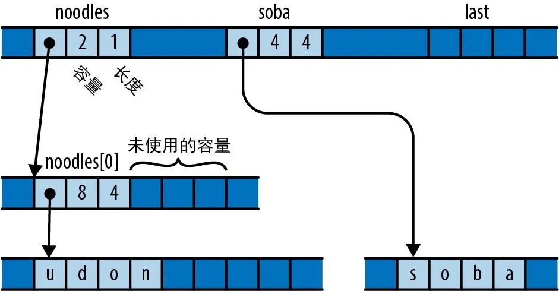
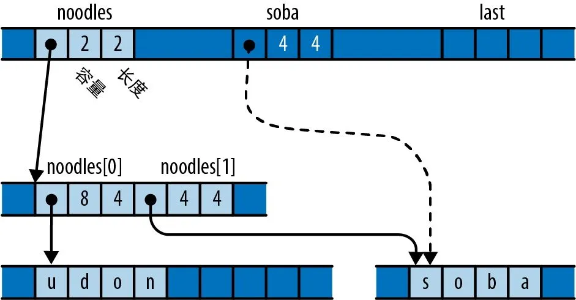
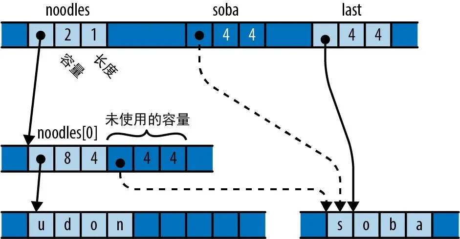
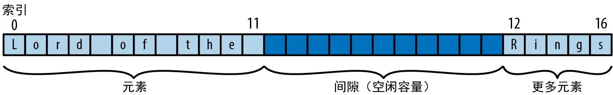
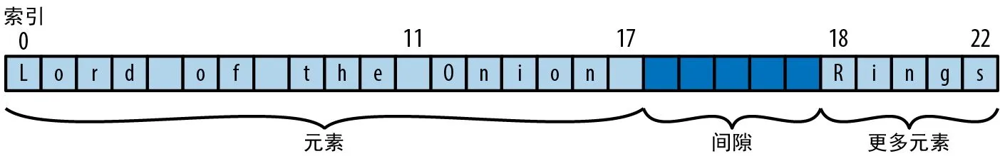

# 第22章不安全代码(2)

## 22.6　未定义行为

如本章开头所述，术语未定义行为的意思是“Rust 坚定地认为你的代码永远不会出现的行为”。这是一个奇怪的措辞，特别是因为我们从使用其他语言的经验中就能知道这些行为确实会以某种频率偶然发生。为什么这个概念对厘清不安全代码的责任有帮助？

编译器是从一种编程语言到另一种编程语言的翻译器。Rust 编译器是将 Rust 程序翻译成等效的机器语言的程序。但是，说“两个使用完全不同语言的程序是等效的”意味着什么呢？

幸运的是，这个问题对程序员来说比对语言学家更容易理解。我们通常说两个程序是等效的，意思是它们在执行时总是具有相同的可见行为，比如会进行相同的系统调用，以等效的方式与外部库交互，等等。这有点儿像程序界的图灵测试：如果不能分辨自己是在与原文交互还是与译文交互，那它们就是等效的。

现在考虑以下代码：

```javascript
let i = 10;
very_trustworthy(&i);
println!("{}", i * 100);
即使对 very_trustworthy 的定义一无所知，也可以看到它仅接收对 i 的共享引用，因此
该调用肯定无法更改 i 的值。由于传给 println! 的值永远是 1000，因此 Rust 可以将这段
```

代码翻译成机器语言，就像我们写过的一样：

```
very_trustworthy(&10);
println!("{}", 1000);
```

这个转换后的版本与原始版本具有相同的可见行为，而且速度可能更快一点儿。但只有在保证它与原始版本具有相同含义的前提下，才值得去考虑此版本的性能。如果

```javascript
very_trustworthy 的定义是下面这样的该怎么办？
fn very_trustworthy(shared: &i32) {
   unsafe {
       // 把共享引用转换成可变指针
       // 这是一种未定义行为
       let mutable = shared as *const i32 as *mut i32;
       *mutable = 20;
   }
}
这段代码打破了共享引用的规则：它将 i 的值更改为 20，即使这个值应该被冻结（因为 i 是
为了共享而借用的）。结果，我们对调用者所做的转换现在有了非常明显的效果：如果 Rust
转换这段代码，那么程序就会打印 1000；如果它保留代码并使用 i 的新值，则程序会打印
2000。在 very_trustworthy 中打破共享引用的规则意味着共享引用在其调用者中的行为
```

可能不再符合预期了。

这种问题几乎会出现在 Rust 可能尝试的每一种转换中，其中就包括：即使把一个函数内联到它的调用点，也仍然可以假设当被调用者完成时，控制流就会返回到调用点。然而我们在本章开头就给出过一个违反了该假设的问题代码示例。

Rust（或任何其他语言）基本上不可能评估出对程序的转换是否保留了其含义，除非它可以相信语言的基本特性会按原本的设计运行。一段代码是否可信，不仅取决于手头的这部分代码，还取决于程序中隔得比较远的其他部分的代码。为了对代码做任何处理，Rust 必须假设你的程序的其余部分是“遵纪守法”的。

下面是 Rust 判断程序是否“遵纪守法”的规则。

- 程序不得读取未初始化的内存。

- 程序不得创建无效的原始值。

```
引用、Box 值或 fn 指针为空（null）。
bool 值非 0 且非 1。
enum 值具有无效判别值。
char 值无效，比如存在半代用区的 Unicode 码点。
str 值不是格式良好的 UTF-8。
```

- 胖指针具有无效虚表或 slice 长度。

```
never 类型的任何值，可以写作 !，只能用于不会返回的函数。
```

- 程序必须遵守第 5 章中解释过的引用规则。任何引用的生命周期都不能超出其引用目标，共享访问是只读访问，可变访问是独占访问。

- 程序不得对空指针、未正确对齐的指针或悬空指针进行解引用。

- 程序不得使用指针访问与此指针关联的分配区之外的内存。22.8.1 节会详细解释此规则。

- 程序必须没有数据竞争。当两个线程在没有同步保护的情况下访问同一个内存位置，并且至少有一个访问是写入时，就会发生数据竞争。

- 程序不得对借助外部函数接口进行的跨语言调用进行栈展开（参见 7.1.1 节）。

- 程序必须遵守标准库函数的契约。

```
由于还没有针对 unsafe 代码的 Rust 语义的完整模型，因此该列表可能会随着时间的推移而
```

演变，但上述这些规则仍然有效。

任何违反这些规则的行为都构成了未定义行为，并让 Rust 试图优化你的程序并将其翻译成机器语言的努力变得不可信。如果你违反最后一条规则并将格式错误的 UTF-8 传给

```
String::from_utf8_unchecked，那么没准儿 2097151 真会不等于 2097151。
```

未使用不安全特性的 Rust 代码只要编译通过就可以保证会遵守前面的所有规则。（假设编译器自身没有 bug——我们正为之努力，但没有 bug 永远只能是个理想。）只有在使用不安全特性时，遵守这些规则才会成为你的责任。

而在 C 和 C++ 中，你的程序“在编译期没有错误或警告”这件事意义不大。正如本书前面所提到的，即使那些一直坚持着高标准且备受推崇的项目所编写的最好的 C 程序和 C++ 程序，也会在实践中表现出未定义行为。

## 22.7　不安全特型

不安全特型是一种特型，用于表示这里存在某种 Rust 无法检查也无法强制保障的契约。实现者必须满足它，以规避未定义行为。要实现不安全特型，就必须将实现标记为不安全的。你需要了解此特型的契约并确保自己的类型能满足它。

类型变量以某个不安全特型为限界的函数通常是自身使用了不安全特型的函数，并且只能依靠此不安全特型的契约来满足那些不安全特型的契约。对此特型的不正确实现可能导致这样的函数出现未定义行为。

```
std::marker::Send 和 std::marker::Sync 是不安全特型的典型示例。这些特型没有
定义任何方法，因此你可以用喜欢的任意类型来轻松实现它们。但它们确实有契约：Send 要
求实现者能安全地转移给另一个线程，而 Sync 要求实现者能安全地通过共享引用在线程之间
共享。如果为不合适的类型实现了 Send，就会使 std::sync::Mutex 在数据竞争中不再安
```

全。

```
举个简单的例子，Rust 标准库曾包含一个不安全特型 core::nonzero::Zeroable，该特
型用于标记出可通过将所有字节设置为 0 来进行安全初始化的类型。显然，将 usize 变量归
零肯定没问题，但将 &T 归零就会带来一个空引用，如果解引用，则会导致崩溃。对于
Zeroable 的类型，可以进行一些优化：可以使用 std::ptr::write_bytes（memset
在 Rust 中的等价物）或者用能分配全零内存页的系统调用来快速初始化数组。（Zeroable
是不稳定的，在 Rust 1.26 的 num crate 中被转移到仅供内部使用，但它是一个优秀、简单且
```

真实的例子。）

```
Zeroable 是一个典型的标记特型，缺少方法或关联类型：
pub unsafe trait Zeroable {}
```

它对适用类型的实现同样简单明了：

```javascript
unsafe impl Zeroable for u8 {}
unsafe impl Zeroable for i32 {}
unsafe impl Zeroable for usize {}
// 以及所有整数类型
有了这些定义，就可以编写一个函数来快速分配给定长度的包含 Zeroable 类型的向量了：
use core::nonzero::Zeroable;
fn zeroed_vector<T>(len: usize) -> Vec<T>
   where T: Zeroable
{
   let mut vec = Vec::with_capacity(len);
   unsafe {
       std::ptr::write_bytes(vec.as_mut_ptr(), 0, len);
       vec.set_len(len);
   }
   vec
}
这个函数会首先创建一个具有所需容量的空 Vec，然后调用 write_bytes 以用 0 填充未占
用的缓冲区。（write_byte 函数会将 len 视为 T 元素的数量，而不是字节数，因此该调用
确实会填充整个缓冲区。）向量的 set_len 方法只会更改其长度而不会对缓冲区做任何事，
这是不安全的，因为必须保证新的缓冲区空间确实包含已正确初始化的 T 类型值。不过这正
是 T: Zeroable 类型限界所保证的：全零的字节块表示有效的 T 值。我们对 set_len 的
```

使用是安全的。

下面我们来使用这个函数：

```javascript
let v: Vec<usize> = zeroed_vector(100_000);
assert!(v.iter().all(|&u| u == 0));
显然，Zeroable 一定是一个不安全特型，因为不遵守其契约的实现可能会导致未定义行
```

为：

```javascript
struct HoldsRef<'a>(&'a mut i32);
unsafe impl<'a> Zeroable for HoldsRef<'a> { }
let mut v: Vec<HoldsRef> = zeroed_vector(1);
*v[0].0 = 1;   // 崩溃：对空指针解引用
Rust 不知道 Zeroable 意味着什么，所以无从判断它何时会被实现为不合适的类型。与其他
```

任何不安全特性一样，如何理解并遵守不安全特型的契约由你来决定。

请注意，不安全代码不得依赖于普通的、安全的特型在实现上的正确性。假设有一个

```
std::hash::Hasher 特型的实现，它只会返回一个随机哈希值，与被哈希的值无关。该特
```

型要求对一些相同的位进行两次哈希后必须生成相同的哈希值，但此实现无法满足该要求，这

```
根本就不正确。但因为 Hasher 并不是不安全特型，所以不安全代码在使用这个哈希器时不
```

- 2为了满足“可以使用不安全特性”这条契约，

得表现出未定义行为。

```
std::collections::HashMap 类型是经过精心编写的，但并未考虑哈希器自身行为出错
```

的可能性。当然，这样一来该哈希表将无法正常运行：查找将失败，条目将随机出现和消失。但该哈希表并不存在未定义行为。

## 22.8　裸指针

裸指针在 Rust 中就是一种不受约束的指针。你可以使用裸指针来创建 Rust 的受检查指针类型不能创建的各种结构，比如双向链表或任意对象图。但是因为裸指针非常灵活，Rust 无法

```
判断你是否在安全地使用它们，所以只能在 unsafe 块中对它们解引用。
```

裸指针本质上等效于 C 指针或 C++ 指针，因此在与这些语言编写的代码进行交互时它们也很有用。

裸指针有以下两种类型。

```javascript
*mut T 是指向 T 的允许修改其引用目标的裸指针。
*const T 是指向 T 的只允许读取其引用目标的裸指针。
（没有单纯的 *T 类型，必须始终指定 const 或 mut。）
可以把引用转换成裸指针，并使用 * 运算符对其解引用：
let mut x = 10;
let ptr_x = &mut x as *mut i32;
let y = Box::new(20);
let ptr_y = &*y as *const i32;
unsafe {
   *ptr_x += *ptr_y;
}
assert_eq!(x, 30);
与 Box 和引用不同，裸指针可以为空，就像 C 中的 NULL 或 C++ 中的 nullptr：
fn option_to_raw<T>(opt: Option<&T>) -> *const T {
   match opt {
       None => std::ptr::null(),
       Some(r) => r as *const T
   }
}
assert!(!option_to_raw(Some(&("pea", "pod"))).is_null());
assert eq!(option to raw::<i32>(None), std::ptr::null());
这个例子中没有 unsafe 块：创建裸指针、传递裸指针和比较裸指针都是安全的。只有解引
```

用裸指针是不安全的。

```javascript
指向无固定大小类型的裸指针是胖指针，就像相应的引用或 Box 类型一样。*const [u8]
指针包括一个长度和地址，而像 *mut dyn std::io::Write 指针这样的特型对象则会携
```

带一个虚表。

尽管 Rust 会在各种情况下隐式解引用安全指针类型，但对裸指针解引用必须是显式的。

```
. 运算符不会隐式解引用裸指针，必须写成 (*raw).field 或
(*raw).method(...)。
裸指针没有实现 Deref，因此隐式解引用不适合它们。
==、< 等运算符将裸指针作为地址进行比较：如果两个裸指针指向内存中的相同位置，那
```

- 它们就相等。类似地，对裸指针进行哈希处理会针对其指向的地址值本身，而不会针对其引用目标的值。

```
像 std::fmt::Display 这样的格式化特型会自动追踪引用，但根本不会处理裸指针。
std::fmt::Debug 和 std::fmt::Pointer 是例外，它们会将裸指针展示为十六进制
```

- 地址，而不会解引用它们。

```javascript
与 C 和 C++ 中的 + 运算符不同，Rust 的 + 不会处理裸指针，但可以通过它们的 offset 方
法和 wrapping_offset 方法或更方便的 add 方法、sub 方法、wrapping_add 方法和
wrapping_sub 方法执行指针运算。反过来，offset_from 方法会以字节为单位求出两个
指针之间的距离，不过需要确保开始和结束位于同一个内存区域，比如在同一个 Vec 中：
let trucks = vec!["garbage truck", "dump truck", "moonstruck"];
let first: *const &str = &trucks[0];
let last: *const &str = &trucks[2];
assert_eq!(unsafe { last.offset_from(first) }, 2);
assert eq!(unsafe { first.offset from(last) }, -2);
first 和 last 不需要显式转换，只需指定类型即可。Rust 会将引用隐式转换成裸指针（当
```

然，反过来肯定不成立）。

```
as 运算符允许从引用到裸指针或两个裸指针类型之间几乎所有的合理转换。但是，可能需要
```

将复杂的转换分解为一系列更简单的步骤。例如：

```javascript
&vec![42_u8] as *const String;  // 错误：无效的转换
&vec![42_u8] as *const Vec<u8> as *const String;  // 这样可以转换
请注意，as 不会将裸指针转换为引用。这样的转换不安全，as 应该保持安全操作。因此，
必须在 unsafe 块中对裸指针解引用，然后再借用其结果值。
```

这样操作时要非常小心：以这种方式生成的引用具有不受约束的生命周期，它可以存续多长时间没有限制，因为裸指针没有给 Rust 提供任何能做出这种决定的依据。23.5 节会展示几个如何正确限制生命周期的示例。

```
许多类型有 as_ptr 方法和 as_mut_ptr 方法，它们会返回指向其内容的裸指针。例如，数
```

组切片和字符串会返回指向它们第一个元素的指针，而一些迭代器会返回指向它们将生成的下

```
一个元素的指针。像 Box、Rc 和 Arc 这样的拥有型指针类型都有 into_raw 函数和
from_raw 函数，可以与裸指针相互转换，其中一些方法的契约强加了出人意料的要求，因
```

此在使用之前务必检查一下它们的文档。

还可以通过转换整数来构造裸指针，不过你唯一可以信任的整数通常就是从指针转换来的。22.8.2 节就以这种方式使用了裸指针。

```
与引用不同，裸指针既不是 Send 的也不是 Sync 的。因此，在默认情况下，任何包含裸指针
```

的类型都不会实现这些特型。在线程之间发送或共享裸指针本身其实并没有什么不安全的，毕

```
竟，无论它们“走”到哪里，你都需要一个 unsafe 块来解引用它们。但是考虑到裸指针经常扮
```

演的角色，语言设计者认为还是现在这种默认使用方式更好。22.7 节讨论过如何自己实现

```
Send 和 Sync。
```

### 22.8.1　安全地解引用裸指针

以下是安全使用裸指针的一些常识性指南。

- 解引用空指针或悬空指针是未定义行为，引用未初始化的内存或超出作用域的值也一样。

- 解引用未针对其引用目标的类型正确对齐的指针是未定义行为。

- 只有在遵守了第 5 章解释过的引用安全规则（任何引用的生命周期都不能超出其引用目标，共享访问是只读访问，可变访问是独占访问）的前提下，才能从解引用的裸指针中借用值。（很容易意外违反这条规则，因为裸指针通常用于创建具有非标准共享或所有权的数据结构。）

- 仅当引用目标是所属类型的格式良好的值时，才能使用裸指针的引用目标。例如，必须确保

```javascript
解引用 *const char 后会产生一个正确的、不在半代用区的 Unicode 码点。
如果想在特定的裸指针上使用 offset 方法和 wrapping_offset 方法，那么该裸指针只
```

- 能指向原初（original）指针所引用的变量内部的字节或分配在堆上的内存块内部的字节，或者指向上述两个区域之外的第一字节。如果通过将指针转换为整数，对整数进行运算，然后将其转换回指针的方式进行指针运算，

```
则结果必须是 offset 方法的规则允许生成的指针。
```

- 如果要给裸指针的引用目标赋值，则不得违反引用目标所属的任何类型的不变条件。如果你

```
有一个 *mut u8 指向 String 中的一字节，那么在该 u8 中存储的值必须能让 String
```

- 保持为格式良好的 UTF-8。

抛开借用规则不谈，上述规则与在 C 或 C++ 中使用指针时必须遵守的规则基本上是一样的。

不得违反类型不变条件的原因应该很清楚。许多 Rust 标准库类型在其实现中使用了不安全代码，但仍然提供了安全接口，前提是 Rust 的安全检查、模块系统和可见性规则能得到遵守。使用裸指针来规避这些保护措施可能会导致未定义行为。

裸指针的完整、准确的契约不容易表述，并且可能随着语言的发展而改变。但本节概要表述的这些原则应该让你处于安全地带。

### 22.8.2　示例：RefWithFlag

- 3的位级 hack，并将其包装为完全安全的 Rust

下面这个例子说明了如何采用裸指针实现经典

```
类型。这个模块定义了一个类型 RefWithFlag<'a, T>，它同时包含一个 &'a T 和一个
bool，就像元组 (&'a T, bool) 一样，但仍然设法只占用了一个机器字而不是两个。这种
```

技术在垃圾回收器和虚拟机中经常使用，其中某些类型（比如表示对象的类型）的数量多到就算只向每个值添加一个机器字都会大大增加内存占用：

```javascript
mod ref_with_flag {
   use std::marker::PhantomData;
   use std::mem::align_of;
   ///  包装在单个机器字中的`&T`和`bool`
   ///  类型`T`要求必须至少按两字节对齐
   ///
   ///  如果你是那种中规中矩的程序员，从未想过还能从某个指针中偷出
   ///  第  2<sup>0</sup>  位（数据的最低位），那么现在可以安全地做到这一点了！
   /// （“但这样做并不像想象中那么刺激啊……”）
   pub struct RefWithFlag<'a, T> {
       ptr_and_bit: usize,
       behaves_like: PhantomData<&'a T> //  不占空间
   }
   impl<'a, T: 'a> RefWithFlag<'a, T> {
       pub fn new(ptr: &'a T, flag: bool) -> RefWithFlag<T> {
           assert!(align_of::<T>() % 2 == 0);
           RefWithFlag {
               ptr_and_bit: ptr as *const T as usize | flag as usize,
               behaves_like: PhantomData
           }
       }
       pub fn get_ref(&self) -> &'a T {
           unsafe {
               let ptr = (self.ptr_and_bit & !1) as *const T;
               &*ptr
           }
       }
       pub fn get_flag(&self) -> bool {
           self.ptr_and_bit & 1 != 0
       }
   }
}
```

这段代码利用了这样一个事实，即许多类型在内存中必须放置在偶数地址：由于偶数地址的最低有效位始终为 0，因此可以在那里存储其他内容，然后通过屏蔽最低位来可靠地重建原始地

```
址。并非所有类型都符合条件，比如类型 u8 和 (bool, [i8; 2]) 可以放在任何地址。但
```

是我们可以检查此类型在构造方面的对齐情况，并拒绝不适用的类型。

```javascript
可以像下面这样使用 RefWithFlag：
use ref_with_flag::RefWithFlag;
let vec = vec![10, 20, 30];
let flagged = RefWithFlag::new(&vec, true);
assert_eq!(flagged.get_ref()[1], 20);
assert_eq!(flagged.get_flag(), true);
构造函数 RefWithFlag::new 会接受一个引用和一个 bool 值，并断言此引用具有适当的
类型，然后把它转换为裸指针，再转换为 usize 类型。usize 类型大小的定义是足够在我们
正在编译的任何处理器上保存一个指针，因此将裸指针转换为 usize 并返回它是有明确定义
的。一旦有了 usize，我们就知道它必然是偶数，所以可以使用按位或运算符 | 将其与已转
换为整数 0 或 1 的 bool 值组合起来。
get_flag 方法用于提取 RefWithFlag 的 bool 部分。这很简单：只要取出最低位并检查
结果是否非零就可以了（self.ptr_and_bit & 1 != 0）。
get_ref 方法用于从 RefWithFlag 中提取引用。首先，它会屏蔽 usize 的最低位
（self.ptr_and_bit & !1）并将其转换为裸指针。as 运算符无法将裸指针转换为引
用，但我们可以解引用裸指针（当然是在 unsafe 块中）并借用它。借用一个裸指针的引用
```

目标会得到一个无限生命周期的引用：Rust 会赋予引用任何生命周期来检查它周围的代码（如果有的话）。但是，通常还有一些更准确的特定生命周期，因此会发现更多错误。在这个

```
例子中，由于 get_ref 的返回类型是 &'a T，因此 Rust 认为该引用的生命周期与
RefWithFlag 的生命周期参数 'a 相同，这正是我们想要的，因为这个生命周期就是最初那
```

个引用的生命周期。

```
在内存中，RefWithFlag 看起来很像 usize：由于 PhantomData（意思是虚构的数据）
是零大小的类型，因此 behaves_like 字段并不会占用结构体中的空间。但是，为了让
Rust 知道该如何处理使用 RefWithFlag 的代码中的生命周期，PhantomData 是必需的。
想象一下没有 behaves_like 字段的类型会是什么样子：
// 这无法编译
pub struct RefWithFlag<'a, T: 'a> {
   ptr_and_bit: usize
}
```

如第 5 章所述，任何包含引用的结构体，其生命周期都不能超出它们借用的值，以免引用变成

```
悬空指针。这个结构体必须遵守适用于其字段的限制。这当然也适用于 RefWithFlag：在刚
刚看到的示例代码中，flagged 的生命周期不能超出 vec，因为 flagged.get_ref() 会
返回对它的引用。但是我们简化版的 RefWithFlag 类型根本不包含任何引用，并且从不使
用其生命周期参数 'a，因为这只是一个 usize。怎么让 Rust 知道应该如何限制 flagged
的生命周期呢？包含一个 PhantomData<&'a T> 字段就是为了告诉 Rust 应该将
RefWithFlag<'a, T> 视为包含一个 &'a T，却不会实际影响此结构体的表示方式。
尽管 Rust 并不真正知道发生了什么（这就是 RefWithFlag 不安全的原因），但它会尽力帮
助你解决这个问题。如果省略了 behaves_like 字段，那么 Rust 就会报错说参数 'a 和 T
未使用，并建议使用 PhantomData。
RefWithFlag 使用了与之前介绍的 Ascii 类型相同的策略来避免其 unsafe 块中的未定义
行为。类型本身是 pub 的，但其字段不是，这意味着只有 ref_with_flag 模块中的代码才
能创建或查看 RefWithFlag 值。你不必检查太多代码就可以确信 ptr_and_bit 字段是构
```

造良好的。

### 22.8.3　可空指针

```javascript
Rust 中的空裸指针是一个零地址，与 C 和 C++ 中一样。对于任意类型 T，
std::ptr::null<T> 函数会返回一个 *const T 空指针，而 std::ptr::null_mut<T>
会返回一个 *mut T 空指针。
检查裸指针是否为空有几种方法。最简单的是 is_null 方法，但 as_ref 方法可能更方便。
as_ref 方法会接受 *const T 指针并返回 Option<&'a T>，以便将一个空指针变成
None。同样，as_mut 方法会将 *mut T 指针转换为 Option<&'a mut T> 值。
```

### 22.8.4　类型大小与对齐方式

```
任何固定大小类型（Sized）的值都会在内存中占用固定数量的字节，并且必须放置在由机器
体系结构决定的某个对齐值的倍数的地址处。例如，一个 (i32, i32) 元组占用 8 字节，而
```

大多数处理器更喜欢将其放置在 4 的倍数地址处。

```
调用 std::mem::size_of::<T>() 会返回类型 T 值的大小（以字节为单位），而调用
std::mem::align_of::<T>() 会返回其所需的对齐方式。例如：
assert_eq!(std::mem::size_of::<i64>(), 8);
assert_eq!(std::mem::align_of::<(i32, i32)>(), 4);
```

任何类型总是对齐到二的 n 次幂。

即使在技术上可以填入更小的空间，类型的大小也总是会四舍五入为其对齐方式的倍数。例

```
如，尽管像 (f32, u8) 这样的元组只需要 5 字节，但 size_of::<(f32, u8)>() 是 8，
因为 align_of::<(f32, u8)>() 是 4。这会确保如果你有一个数组，那么元素类型的大
```

小总能反映出一个元素与其下一个元素的间距。

对于无固定大小类型，其大小和对齐方式取决于手头的值。给定对无固定大小值的引用，

```
std::mem::size_of_val 函数和 std::mem::align_of_val 函数会返回值的大小和对
```

齐方式。这两个函数可以对固定大小类型和无固定大小类型的引用进行操作。

```javascript
// 指向切片的胖指针包含其引用目标的长度
let slice: &[i32] = &[1, 3, 9, 27, 81];
assert_eq!(std::mem::size_of_val(slice), 20);
let text: &str = "alligator";
assert_eq!(std::mem::size_of_val(text), 9);
use std::fmt::Display;
let unremarkable: &dyn Display = &193_u8;
let remarkable: &dyn Display = &0.0072973525664;
// 这些会返回特型对象指向的值的大小/对齐方式，而不是特型对象
// 本身的大小/对齐方式。此信息来自特型对象引用的虚表
assert_eq!(std::mem::size_of_val(unremarkable), 1);
assert_eq!(std::mem::align_of_val(remarkable), 8);
```

### 22.8.5　指针运算

Rust 会将数组、切片或向量的元素排布为单个连续的内存块，如图 22-1 所示。元素的间隔很

```
均匀，因此如果每个元素占用 size 字节，则第 i 个元素就从第 i * size 字节开始。
```



- 图 22-1：内存中的数组

这样做有一个好处：如果你有两个指向数组元素的裸指针，那么比较指针就会得到与比较元素

```
索引相同的结果。如果 i < j，则指向第 i 个元素的裸指针一定小于指向第 j 个元素的裸指
```

针。这使得裸指针可用作数组遍历的边界。事实上，标准库对切片的简单迭代器最初就是这样定义的：

```javascript
struct Iter<'a, T> {
   ptr: *const T,
   end: *const T,
   ...
}
ptr 字段指向迭代应该生成的下一个元素，end 字段作为界限：当 ptr == end 时，迭代完
```

成。

```javascript
数组布局的另一个好处是：如果 element_ptr 是指向某个数组的第 i 个元素的 *const T
或 *mut T 裸指针，那么 element_ptr.offset(o) 就是指向第 (i + o) 个元素的裸指
```

针。它的定义等效于如下内容：

```javascript
fn offset<T>(ptr: *const T, count: isize) -> *const T
   where T: Sized
{
   let bytes_per_element = std::mem::size_of::<T>() as isize;
   let byte_offset = count * bytes_per_element;
   (ptr as isize).checked_add(byte_offset).unwrap() as *const T
}
std::mem::size_of::<T> 函数会返回类型 T 的字节大小。根据定义，由于 isize 大到
足以容纳一个地址，因此可以将基指针转换为 isize，对得到的值进行算术运算，然后将结
```

果转换回指针。

可以生成指向数组末尾之后第一字节的指针。虽然不能对这样的指针解引用，但可以用它来表示循环的界限或用于边界检查。

```
但是，使用 offset 生成超出该点或指向数组开头之前的指针是未定义行为，即使从未对它
解引用也是如此。为了方便优化，Rust 会假设当 i 为正值时 ptr.offset(i) > ptr，当
i 为负值时 ptr.offset(i) < ptr。这个假设似乎是安全的，但如果 offset 中的算术溢
出了 isize 值，那么可能就不成立了。如果把 i 限制在 ptr 的同一个数组范围内，则肯定
```

不会发生溢出：毕竟数组本身不会溢出地址空间的边界。（为了让指向结尾之后第一字节的指针安全，Rust 从来都不会将值放在地址空间的上端。）

```
如果确实需要将指针偏移到与其关联的数组的界限之外，则可以使用 wrapping_offset 方
法。该方法与 offset 等效，但 Rust 不会假设 ptr.wrapping_offset(i) 和 ptr 本身
```

的相对顺序。当然，你仍然不能对此类指针解引用，除非确信它们会落在数组中。

### 22.8.6　移动入和移动出内存

如果你正在实现的类型需要管理自己的内存，那么就要跟踪内存中哪些部分保存了有效值，而哪些是未初始化的，就像 Rust 处理局部变量一样。考虑下面这段代码：

```javascript
let pot = "pasta".to_string();
let plate = pot;
```

上述代码运行后，情况如图 22-2 所示。



- 图 22-2：将字符串从一个局部变量转移给另一个局部变量

```
赋值后，pot 处于未初始化状态，而 plate 成了字符串的拥有者。
```

在机器层面，没有指定移动对源值的作用，但实际上它通常什么都不做。该赋值可能会使

```
pot 仍然保存着字符串的指针、容量和长度。当然，如果继续将其视为有效值将是灾难性
```

的，但 Rust 会确保你不会这样做。

同样的考虑也适用于管理自己内存的数据结构。假设你运行了下面这段代码：

```javascript
let mut noodles = vec!["udon".to_string()];
let soba = "soba".to_string();
let last;
```

在内存中，状态如图 22-3 所示。



- 图 22-3：具有未初始化的空闲容量的向量

这个向量有空闲容量可以再容纳一个元素，但空闲容量中存放的是垃圾数据，可能是以前的内存残余。假设你随后运行了如下代码：

```
noodles.push(soba);
```

将字符串压入向量会将未初始化的内存转换为新元素，如图 22-4 所示。



```
图 22-4：将 soba 的值推入向量之后
```

该向量已初始化其空白空间，以便拥有该字符串，并增加其长度，以便将其标记为新的有效元素。向量现在是字符串的拥有者，你可以引用它的第二个元素了，而丢弃此向量将释放两个字

```
符串。soba 现在处于未初始化状态。
```

最后，考虑一下当从向量中弹出一个值时会发生什么：

```
   last = noodles.pop().unwrap();
```

在内存中，现在看起来如图 22-5 所示。



```
图 22-5：把向量中的一个元素弹出到 last 之后
变量 last 取得了字符串的所有权。向量已减小其 length 以指示用于保存字符串的空间现
```

在未初始化。

```
就像之前的 pot 和 pasta 一样，soba、last 和向量的可用空间这三者可能存有相同的位
模式。但只有 last 被认为拥有这个值。将其他两个位置中的任何一个视为有效位置都是错误
```

的。

初始化值的真正定义是应视为有效的值。写入值的字节通常是初始化的必要部分，但这只是为了将其视为有效的而做的准备工作。移动和复制对内存的影响是一样的，两者之间的区别在于，在移动之后，源不再被视为有效值，而在复制之后，源和目标都处于有效状态。

Rust 会在编译期跟踪哪些局部变量处于有效状态，并阻止你使用值已转移给其他地方的变

```
量。Vec、HashMap、Box 等类型会动态跟踪它们的缓冲区。如果你实现了一个管理自己内
```

存的类型，则也需要这样做。

Rust 为实现这些类型提供了两个基本操作。

```javascript
std::ptr::read(src)（读取）
将值移动出 src 指向的位置，将所有权转移给调用者。src 参数应该是一个 *const T 裸指
针，其中 T 是一个固定大小类型。调用此函数后，*src 的内容不受影响，但除非 T 是 Copy
```

类型，否则你必须确保自己的程序会将它们视为未初始化内存。

```
这是 Vec::pop 背后的操作。要弹出一个值，就要调用 read 将该值移出缓冲区，然后递减
```

长度以将该空间标记为未初始化容量。

```
std::ptr::write(dest, value)（写入）
将 value 转移给 dest 指向的位置，该位置在调用之前必须是未初始化内存。引用目标现在
拥有该值。在这里，dest 必须是一个 *mut T 裸指针并且 value 是一个 T 值，其中 T 是
```

固定大小类型。

```
这就是 Vec::push 背后的操作。压入一个值会调用 write 将值转移给下一个可用空间，然
```

后增加长度以将该空间标记为有效元素。

两者都是自由函数，而不是裸指针类型的方法。

请注意，不能使用任何 Rust 的安全指针类型来执行这些操作。安全指针类型会要求其引用目标始终是初始化的，因此将未初始化内存转换为值或相反的操作都超出了它们的能力范围。而裸指针符合这种要求。

标准库还提供了将值数组从一个内存块移动到另一个内存块的函数。

```
std::ptr::copy(src, dst, count)（复制）
将内存中从 src 开始的 count 个值数组移动到 dst 处，就像编写了一个 read 和 write
```

调用循环以一次性移动它们一样。调用之前目标内存必须是未初始化的，调用之后源内存要保

```javascript
持未初始化状态。src 参数和 dest 参数必须是 *const T 裸指针和 *mut T 裸指针，并且
count 必须是 usize。
ptr.copy_to(dst, count)（复制到）
一个更方便的 copy 版本，它会将内存中从 ptr 开始的 count 个值的数组转移给 dst，而
```

不用以其起点作为参数。

```
std::ptr::copy_nonoverlapping(src, dst, count)（复制，无重叠版）
就像对 copy 的类似调用一样，但是它的契约进一步要求源内存块和目标内存块不能重叠。这
可能比调用 copy 略微快一些。
ptr.copy_to_nonoverlapping(dst, count)（复制到，无重叠版）
一个更方便的 copy_nonoverlapping 版本，就像 copy_to。
还有另外两组 read 函数和 write 函数，它们也位于 std::ptr 模块中。
read_unaligned（读取，未对齐版）和 write_unaligned（写入，未对齐版）
与 read 和 write 类似，但是这两个函数的指针不需要像引用目标类型通常要求的那样对
齐。它们可能比普通的 read 函数和 write 函数慢一点儿。
read_volatile（读取，易变版）和 write_volatile（写入，易变版）
这两个函数对应于 C 或 C++ 中的易变（volatile）读取和易变写入。
```

### 22.8.7　示例：GapBuffer

下面是一个使用刚刚讲过的裸指针函数的示例。

```sql
假设你正在编写一个文本编辑器，并且正在寻找一种类型来表示文本。可以选择 String 并
使用 insert 方法和 remove 方法在用户键入时插入字符和移除字符。但是如果在一个大文
```

件的开头编辑文本，则这些方法可能开销会很高：插入新字符需要在内存中将整个字符串的其余部分都移到右侧，而删除则要将其全部移回左侧。你希望此类常见操作的开销低一些。

Emacs 文本编辑器使用了一种称为间隙缓冲区的简单数据结构，该数据结构可以在恒定时间

```
内插入字符和删除字符。String 会将其所有空闲容量保留在文本的末尾，这使得 push 和
pop 的开销变得更低，而间隙缓冲区会将其空闲容量保留在文本中间，即正在进行编辑的位
```

置。这种空闲容量称为间隙。在间隙处插入元素或删除元素的开销很低，只要根据需要缩小或扩大间隙即可。可以通过将文本从间隙的一侧移动到另一侧，来让间隙移动到你喜欢的任何位置。当间隙为空时，就迁移到更大的缓冲区。

虽然间隙缓冲区中的插入和删除速度很快，但如果想更改这些操作发生的位置就要将间隙移动到新位置。移动元素需要的时间与移动的距离成正比。幸运的是，典型的编辑活动通常都会在转移到别处之前，在缓冲区的临近区域中进行一系列更改。

本节将在 Rust 中实现间隙缓冲区。为了避免被 UTF-8 分散注意力，我们会让该缓冲区直接存

```
储 char 值，但即使以其他形式存储文本，这些操作的原则也是一样的。
首先，我们会展示间隙缓冲区的实际应用。下列代码会创建一个 GapBuffer，在其中插入一
```

些文本，然后将插入点移动到最后一个单词之前：

```javascript
let mut buf = GapBuffer::new();
buf.insert_iter("Lord of the Rings".chars());
buf.set_position(12);
```

运行上述代码后，缓冲区如图 22-6 所示。



- 图 22-6：包含一些文本的间隙缓冲区

插入就是要用新文本填补间隙。下面这段代码添加了一个单词并破坏了原句要表达的意思：

```
buf.insert_iter("Onion ".chars());
```

这会导致如图 22-7 所示的状态。



- 图 22-7：包含更多文本的间隙缓冲区

```
下面是我们的 GapBuffer 类型：
use std;
use std::ops::Range;
pub struct GapBuffer<T> {
   // 元素的存储区。这个存储区具有我们需要的容量，但它的长度始终保持为0。
   // GapBuffer会将其元素和间隙放入此`Vec`的“未使用”容量中
   storage: Vec<T>,
   // `storage`中间未初始化元素的范围
   // 这个范围前后的元素始终是已初始化的
   gap: Range<usize>
}
```

- 4

```
GapBuffer 会以一种奇怪的方式使用它的 storage 字段。
```

- 它实际上从未在向量中存储任

```
何元素（不过这么说也不太准确），而只是简单地调用 Vec::with_capacity(n) 来获取一
块足够大的内存以容纳 n 值，通过向量的 as_ptr 方法和 as_mut_ptr 方法获得指向该内
存的裸指针，然后直接将该缓冲区用于自己的目的。向量的长度始终保持为 0。当 Vec 被丢
弃时，Vec 不会尝试释放自己的元素（因为它不认为自己有任何元素），而只会释放内存块。
这正是 GapBuffer 想要的行为，它有自己的 Drop 实现，知道有效元素在哪里并能正确地丢
```

弃它们。

```
GapBuffer 中最简单的方法正如你所预期的：
impl<T> GapBuffer<T> {
   pub fn new() -> GapBuffer<T> {
       GapBuffer { storage: Vec::new(), gap: 0..0 }
   }
   /// 返回在不重新分配的情况下这个GapBuffer可以容纳的元素数
   pub fn capacity(&self) -> usize {
       self.storage.capacity()
   }
   /// 返回这个GapBuffer当前包含的元素数
   pub fn len(&self) -> usize {
       self.capacity() - self.gap.len()
   }
   /// 返回当前插入点
   pub fn position(&self) -> usize {
       self.gap.start
   }
   ...
}
```

它为后面的很多函数提供了一个工具方法，简化了那些函数的实现。该工具方法会返回指向缓

```javascript
冲区中给定索引处元素的裸指针。为了满足 Rust 的要求，需要为 mut 指针和 const 指针分
别定义一个方法。与前面的方法不同，这些方法都不是公共的。继续看这个 impl 块：
/// 返回底层存储中第`index`个元素的指针，不考虑间隙
///
/// 安全性: `index`必须是`self.storage`中的有效索引
unsafe fn space(&self, index: usize) -> *const T {
   self.storage.as_ptr().offset(index as isize)
}
/// 返回底层存储中第`index`个元素的可变指针，不考虑间隙
///
/// 安全性：`index`必须是`self.storage`中的有效索引
unsafe fn space_mut(&mut self, index: usize) -> *mut T {
   self.storage.as_mut_ptr().offset(index as isize)
}
```

要找到给定索引处的元素，就必须考虑该索引是落在间隙之前还是之后，并适当调整：

```javascript
/// 返回缓冲区中第`index`个元素的偏移量，并将间隙考虑在内。
/// 这个方法不检查索引是否在范围内，但永远不会返回间隙中的索引
fn index_to_raw(&self, index: usize) -> usize {
   if index < self.gap.start {
       index
   } else {
       index + self.gap.len()
   }
}
/// 返回对第`index`个元素的引用，如果`index`超出了范围，则返回`None`
pub fn get(&self, index: usize) -> Option<&T> {
   let raw = self.index_to_raw(index);
   if raw < self.capacity() {
       unsafe {
           // 刚刚针对self.capacity()检查过`raw`，而index_to_raw
           // 跳过了间隙，所以这是安全的
           Some(&*self.space(raw))
       }
   } else {
       None
   }
}
```

当开始在缓冲区的不同部分进行插入和删除时，需要将间隙移动到新位置。向右移动间隙就要向左移动元素，反之亦然，这就像水平仪中的气泡向一个方向移动而液体会向另一个方向移动一样：

```javascript
/// 将当前插入点设置为`pos`。如果`pos`越界，就panic
pub fn set_position(&mut self, pos: usize) {
   if pos > self.len() {
       panic!("index {} out of range for GapBuffer", pos);
   }
   unsafe {
       let gap = self.gap.clone();
       if pos > gap.start {
           // `pos`位于间隙之后。通过将间隙之后的元素移动到间隙之前来向右移动间隙
           let distance = pos - gap.start;
           std::ptr::copy(self.space(gap.end),
                          self.space_mut(gap.start),
                          distance);
       } else if pos < gap.start {
           // `pos`位于间隙之前。通过将间隙之前的元素移动到间隙之后来向左移动间隙
           let distance = gap.start - pos;
           std::ptr::copy(self.space(pos),
                          self.space_mut(gap.end - distance),
                          distance);
       }
       self.gap = pos .. pos + gap.len();
   }
}
这个函数使用 std::ptr::copy 方法来平移元素，copy 要求目标是未初始化的并且会让源
保持未初始化。源和目标范围可以重叠，copy 会正确处理这种情况。由于间隙是调用前尚未
初始化的内存，而这个函数会调整间隙的位置以覆盖 copy 腾出的空间，因此可以满足 copy
```

函数的契约。

元素的插入和移除都比较简单。插入会从间隙中为新元素占用一个空间，而移除会将值移出并扩大间隙以覆盖此值曾占据的空间：

```sql
/// 在当前插入点插入`elt`，并在插入后把插入点后移
pub fn insert(&mut self, elt: T) {
   if self.gap.len() == 0 {
       self.enlarge_gap();
   }
   unsafe {
       let index = self.gap.start;
       std::ptr::write(self.space_mut(index), elt);
   }
   self.gap.start += 1;
}
/// 在当前插入点插入`iter`生成的元素，并在插入后把插入点后移
pub fn insert_iter<I>(&mut self, iterable: I)
   where I: IntoIterator<Item=T>
{
   for item in iterable {
       self.insert(item)
   }
}
/// 删除插入点之后的元素并返回它，如果插入点位于GapBuffer的末尾，则返回`None`
pub fn remove(&mut self) -> Option<T> {
   if self.gap.end == self.capacity() {
       return None;
   }
   let element = unsafe {
       std::ptr::read(self.space(self.gap.end))
   };
   self.gap.end += 1;
   Some(element)
}
与 Vec 使用 std::ptr::write 进行 push 和使用 std::ptr::read 进行 pop 的方式类
似，GapBuffer 使用 write 进行 insert，使用 read 进行 remove。与 Vec 必须调整其
长度以维持已初始化元素和空闲容量之间的边界一样，GapBuffer 也会调整其间隙。
填补此间隙后，insert 方法必须扩大缓冲区以获得更多可用空间。enlarge_gap 方法
（impl 块中的最后一个）会处理这个问题：
/// 将`self.storage`的容量翻倍
fn enlarge_gap(&mut self) {
   let mut new_capacity = self.capacity() * 2;
   if new_capacity == 0 {
       // 现有向量是空的
       // 选择一个合理的初始容量
       new_capacity = 4;
   }
   // 我们不知道调整Vec的大小会对其“（表面看）未使用的”容量
   // 有何影响，所以只好创建一个新向量并把元素移了过去
   let mut new = Vec::with_capacity(new_capacity);
   let after_gap = self.capacity() - self.gap.end;
   let new_gap = self.gap.start .. new.capacity() - after_gap;
   unsafe {
       // 移动位于此间隙之前的元素
       std::ptr::copy_nonoverlapping(self.space(0),
                                     new.as_mut_ptr(),
                                     self.gap.start);
       // 移动位于此间隙之后的元素
       let new_gap_end = new.as_mut_ptr().offset(new_gap.end as isize);
       std::ptr::copy_nonoverlapping(self.space(self.gap.end),
                                     new_gap_end,
                                     after_gap);
   }
   // 这会释放旧的Vec，但不会丢弃任何元素，因为此Vec的长度为0
   self.storage = new;
   self.gap = new_gap;
}
set_position 必须使用 copy 在间隙中来回移动元素，enlarge_gap 则可以使用
copy_nonoverlapping，因为它会将元素移动到一个全新的缓冲区。
将新向量转移给 self.storage 会丢弃旧向量。由于旧向量的长度为 0，它认为自己没有要
丢弃的元素，因此只释放了自己的缓冲区。巧妙的是，copy_nonoverlapping 也有把源变
```

成未初始化状态的语义，因此旧向量的做法恰巧是正确的：现在所有元素都归新向量所有了。

```
最后，需要确保丢弃 GapBuffer 也会丢弃它的所有元素：
impl<T> Drop for GapBuffer<T> {
   fn drop(&mut self) {
       unsafe {
           for i in 0 .. self.gap.start {
               std::ptr::drop_in_place(self.space_mut(i));
           }
           for i in self.gap.end .. self.capacity() {
               std::ptr::drop_in_place(self.space_mut(i));
           }
       }
   }
}
这些元素都位于间隙前后，因此需要遍历每个区域并使用 std::ptr::drop_in_place 函
数丢弃每个元素。drop_in_place 函数是一个行为类似于
drop(std::ptr::read(ptr)) 的实用程序，但不会“费心”地将值转移给其调用者（因此适
用于无固定大小类型）。就像在 enlarge_gap 中一样，当向量 self.storage 被丢弃时，
```

它的缓冲区实际上是未初始化的。

```
与本章展示过的其他类型一样，GapBuffer 会确保自己的不变条件足以遵守所使用的每个不
安全特性的契约，因此它的所有公共方法都不需要标记为不安全。GapBuffer 为无法用安全
```

代码高效编写的特性实现了一个安全的接口。

### 22.8.8　不安全代码中的 panic 安全性

```
在 Rust 中，panic 通常不会导致未定义行为，panic! 宏并不是不安全特性。但是，当你决
```

定使用不安全代码时，就得考虑 panic 安全性的问题了。

```javascript
考虑 22.8.7 节中的 GapBuffer::remove 方法：
pub fn remove(&mut self) -> Option<T> {
   if self.gap.end == self.capacity() {
       return None;
   }
   let element = unsafe {
       std::ptr::read(self.space(self.gap.end))
   };
   self.gap.end += 1;
   Some(element)
}
对 read 的调用会将紧随间隙之后的元素移出缓冲区，留下未初始化的空间。此时，
GapBuffer 处于不一致状态：我们打破了间隙外的所有元素都必须是初始化的这个不变条
```

件。幸运的是，下一条语句扩大了间隙以覆盖这个空间，因此当我们返回时，不变条件会再次成立。

```
但是请考虑一下，如果在调用 read 之后、调整 self.gap.end 之前，此代码尝试使用可能
```

引发 panic 的特性（如索引切片），那么会发生什么呢？在这两个操作之间的任何地方突然退

```
出该方法都会使 GapBuffer 在间隙外留下未初始化的元素。下一次调用 remove 可能会尝
试再次读取（read）它，即使仅仅丢弃 GapBuffer 也会尝试运行其 drop 方法。这两者都
```

是未定义行为，因为它们会访问未初始化内存。

类型的方法在执行工作时几乎不可避免地会暂时放松类型的不变条件，然后在返回之前让其回到正轨。方法中间出现的 panic 可能会中断清理过程，使类型处于不一致状态。

如果类型只使用安全代码，那么这种不一致可能会使类型行为诡异，但并不会引入未定义行为。不过使用不安全特性的代码通常会依赖其不变条件来满足这些特性的契约。破坏不变条件会导致契约破损，从而导致未定义行为。

使用不安全特性时，必须特别注意识别这些暂时放松了不变条件的敏感代码区域，并确保它们不会执行任何可能引起 panic 的事情。

## 22.9　用联合体重新解释内存

虽然 Rust 提供了许多有用的抽象，但最终我们编写的软件只是在操纵字节。联合体是 Rust最强大的特性之一，用于操纵这些字节并选择如何解释它们。例如，任何 32 位（4 字节）的集合都可以解释为整数或浮点数。任何一种解释都是有效的，不过，将一种数据解释为另一种数据可能会导致其失去意义。

下面是一个用来表示可解释为整数或浮点数的字节集合的联合体：

```
union FloatOrInt {
   f: f32,
   i: i32,
}
这是一个包含两个字段（f 和 i）的联合体。这两个字段可以像结构体的字段一样被赋值，但
```

在构造联合体时，只能选择一个字段，这与结构体不同。结构体的字段会引用内存中的不同位置，而联合体的字段会引用相同位序列的不同解释。赋值给不同的字段只是意味着根据适当的

```javascript
类型覆盖这些位中的一部分或全部。在下面的代码中，one 指向的是单个 32 位内存范围，它
首先存储一个按简单整数编码的 1，然后存储一个按 IEEE 754 浮点数编码的 1.0。一旦写入
了 f，先前写入的 FloatOrInt 值就会被覆盖：
let mut one = FloatOrInt { i: 1 };
assert_eq!(unsafe { one.i }, 0x00_00_00_01);
one.f = 1.0;
assert_eq!(unsafe { one.i }, 0x3F_80_00_00);
```

出于同样的原因，联合体的大小会由其最大字段决定。例如，下面这个联合体的大小为 64

```
位，虽然 SmallOrLarge::s 只是一个 bool：
union SmallOrLarge {
   s: bool,
   l: u64
}
```

虽然构建联合体或对它的字段赋值是完全安全的，但读取联合体的任何字段都是不安全的：

```javascript
let u = SmallOrLarge { l: 1337 };
println!("{}", unsafe ); // 打印出1337
```

这是因为与枚举不同，联合体没有标签。编译器不会添加额外的位来区分各种变体。在运行期

```
无法判断 SmallOrLarge 是要该解释为 u64 还是 bool，除非程序有一些额外的上下文。
```

同时，并没有什么内置手段可以保证给定字段的位模式是有效的。例如，写入

```
SmallOrLarge 值的 l 字段将覆盖其 s 字段，但它创建的这个位模式并无任何用处，甚至可
能都不是有效的 bool。因此，虽然写入联合体字段是安全的，但每次读取都需要 unsafe 代
码。仅当 s 字段的各个位可以形成有效的 bool 时才允许从 u.s 读取，否则，这就是未定义
```

行为。

只要把这些限制牢记在心，联合体仍然可以成为临时重新解释某些数据的有用方法，尤其是在

```javascript
针对值的表观而非值本身进行计算时。例如，前面提到的 FloatOrInt 类型可以轻松地打印
出浮点数的各个位——即便 f32 没有实现过 Binary 格式化程序：
let float = FloatOrInt { f: 31337.0 };
// 打印出1000110111101001101001000000000
println!("{:b}", unsafe { float.i });
```

虽然几乎可以肯定这些简单示例会在任何版本的编译器上如预期般工作，但并不能保证任何字

```
段都从特定位置开始，除非将某个属性添加到 union 定义中，告诉编译器如何在内存中排布
数据。添加属性 #[repr(C)] 可以保证所有字段都从偏移量 0 而不是编译器喜欢的任何位置
```

开始。有了这个保证，这种改写行为就可以用来提取像整数的符号位这样的单独二进制位了：

```javascript
#[repr(C)]
union SignExtractor {
   value: i64,
   bytes: [u8; 8]
}
fn sign(int: i64) -> bool {
   let se = SignExtractor { value: int };
   println!("{:b} ({:?})", unsafe { se.value }, unsafe { se.bytes });
   unsafe { se.bytes[7] >= 0b10000000 }
}
assert_eq!(sign(-1), true);
assert_eq!(sign(1), false);
assert_eq!(sign(i64::MAX), false);
assert_eq!(sign(i64::MIN), true);
```

在这里，符号位是最高有效字节的最高有效位。因为 x86 处理器是小端（低位在前）的，所以

```
这些字节的顺序是相反的，其最高有效字节不是 bytes[0]，而是 bytes[7]。通常，这不
是 Rust 代码必须处理的事情，但是因为这段代码要直接与 i64 的内存中表示法打交道，所以
```

这些底层细节就变得很重要了。

```
因为不知道该如何丢弃其内容，所以联合体的所有字段都必须是可 Copy 的。但是，如果必须
在联合体中存储一个 String，那么也有相应的解决方案，详情请参阅
std::mem::ManuallyDrop 的标准库文档。
```

## 22.10　匹配联合体

在 Rust 联合体上进行匹配和在结构体上匹配类似，但每个模式必须指定一个字段：

```
unsafe {
   match u {
       SmallOrLarge { s: true } => { println!("boolean true"); }
       SmallOrLarge { l: 2 } => { println!("integer 2"); }
       _ => { println!("something else"); }
   }
}
与联合体变体匹配但不指定值的 match 分支永远都会成功。如果 u 的最后一个写入字段是
u.i，则以下代码将导致未定义行为：
// 未定义行为！
unsafe {
   match u {
       FloatOrInt { f } => { println!("float {}", f) },
       // 警告：无法抵达的模式
       FloatOrInt { i } => { println!("int {}", i) }
   }
}
```

## 22.11　借用联合体

借用联合体的一个字段就是借用整个联合体。这意味着，按照正常的借用规则，将一个字段作为可变借用会排斥对该字段或其他字段的任何其他借用，而将一个字段作为不可变借用则意味着对任何字段都不能再进行可变借用。

正如我们将在第 23 章中看到的，Rust 不仅可以帮你为自己的不安全代码构建出安全接口，还可以为用其他语言编写的代码构建出安全接口。从字面来看，“不安全”是充满危险的，但如果谨慎使用，那么也可以构建出高性能代码，同时还能让 Rust 程序员继续享有安全感。

[2]：的行为是有明确定义的，别人实现错了并不等于此特型未定义。——译者注[3]：好吧，应该说是成就我们（本书作者）的经典。[4]：使用编译器内部 crate 中的 类型能更好地处理这个问题，但那个 crate 还不稳定。
